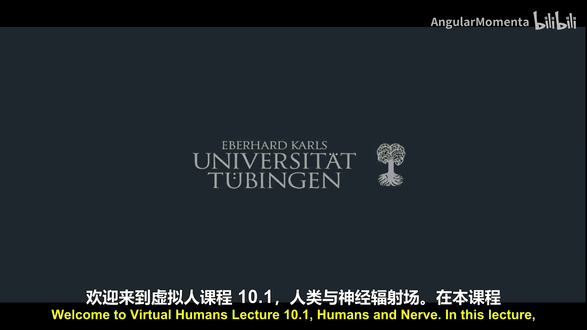
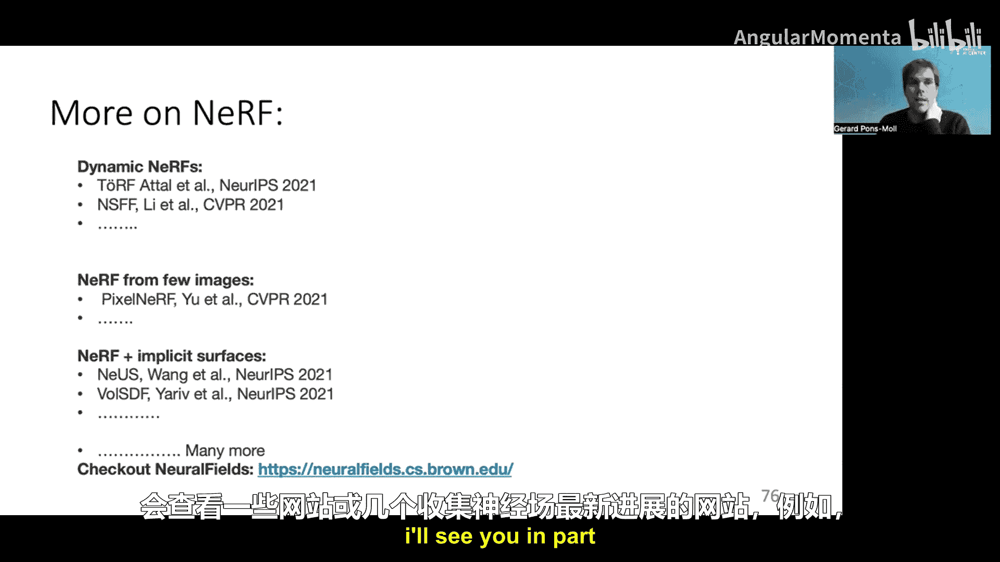

# 【精译】蒂宾根大学《虚拟人类》-p22-10.1-削弱人类--BV1TAbkzpEva_p22-

Welcome to Vit Human Lec 101， Human and Nf。In this lecture。

 we're going to see how virtual humans or the appearance of virtual humans can be modeled using like nerve techniques。

So before we delve into those methods， we have to understand what N is doing and what problem is attempting to solve。

So N stands for。Noodle radiance fields and it。It provides us new solution for the problem of novelview synthesis。

So the problem is you have a set of static images of a scene and those are spars typically。

 and then you want to learn a model such that you can render the scene from any viewpoint in a continuous manner。

In classical computer graphics， this has been addressed by attempting to reconstruct the scene using multiple view stereo and then rendering the scene from multiple views。

 but this is difficult， especially for f structures and when you have like transparent objects and so on。

Another approach is to interpolate different viewpoints， but that's sometimes tricky to do。

More importantly， these methods require lots of specialized knowledge and they are not so easy to reproduce so what nerve is doing different is is taking a much more radical approach and is learning the radiance of the scene for every five dimensional point defined as the spatial location X Y Z and the viewing direction。

So essentially， we are memorizing for every single point in the scene and every single possible direction where I could be looking from。

It's memorizing like what's the color？Emitted at that in that direction and location and also the density of the scene at that point right so ideally we want like high density where we have。

Actually geometry of the scene and we own like very low density where we do not have geometry one nice property of this is that you can model solid objects。

 but also like like like volume volumetric objects as well。So essentially。

 once you have this radiance， what you can do is you can do volume rendering in order to obtain the image that we are after。

So essentially， like the pixel color C at a given pixel location right is obtained by integrating。

The following quantity along the rate。The first thing to notice is that r is a ray that starts at O and basically like t is this scalar that parameters the movement along the ray。

 so it's plus t times the direction along the ray， so this integral goes from TN。

 which is the near end of the sin and Tf which is the far end of the sin and we integrate along T so we move along the ray。

And then we integrate the following quantity。Essentially， the T is the transmittance along the ray。

 which itself is this exponential of this integral， right？Then we have sigma。

 which is the volume density， and essentially is the probability of a rate terminating at an infinite SMO particle location R of D right the probability of finishing exactly that location would be zero。

 so you have to consider like an infinite SMO particle。

So the way to interpret this is like this product。Like the integral of this product along the way should sum up to one。

And the transmittance， you could this T of T， basically you could interpret that this is the probability that the rate travels from TN this near end until Tf or until T right without hitting any other particle okay？

And so this makes sense because， you know， if I'm hitting some particle along the ray， then you know。

 I should take up this color and I should not continue integrating further colors because like those will be occluded。

So this is basically this equation is encoding two things one t of T is the probability that I haven't hit anything until that point t and sigma of T is essentially the probability that you know it's here what I'm going to finish。

So。So that's how you should interpret this equation。

Now we have to integrate this equation and we're not going to derive exactly where how we go from here to here。

 but it's one way to numerically integrate this equation above so we have this integral which is replaced by summation and we have the transmittance here which is approximated with this exponential of sum of sigma delta J here this delta is like。

When we do numerical integration is this separation between samples。And then this term here。

 which was sigma of R of T， gets replaced by 1 minus the exponential of minus sigma delta I。

And this is like you can check the paper where it's explained how this approximates this。

This integral better and essentially here we have this deelta I。

 which is again the distance between adjacent samples and we have the color at the location TI。嗯。

One important thing is that in order to obtain a continuous model。

 like what it's done here to approximate integral is to divide the array into segments and then。

Between each segment notice this is the segment that goes from this interval here until this other。

 this interval here， so basically you uniformly sample and samples right from with a uniform distribution in this segment that we're considering。

And like this way， like you get like this continues。This continuous representation。

 which is not depending on the discretization of the numerical integration。All right。

 so that's how we compute this integral and notice that we can compute this integral because of course。

 these quantities that depend on the radiance C and Sigma I are provided by the MLP at every single location。

So essentially like this is the key idea from a five dimensional input position and direction。

 the MLP produces the RGB and the density and then basically when we want to generate an image。

 we will march along the ray and we will keep accumulating this。Braances。

And this basically will be weighted by this density times the transmittance so that we take into account the occlusions。

And then basically the loss will be how similar my rendered pixel is to the actual pixel in the image。

Again as to repeat we March camera race。To generate。诶。

To generate a set of pixel colors and then we use。We use this integral to generate this pixel which we compare against the ground truth and then basically we minimize this different discrepancy between the。

The ground truth pixel and the generated pixel。So this is also illustrated with this really cool graphic。

 so basically like to generate an image， we march along the ray。

 we accumulate the radiances using the integral that I' shown before。And essentially here we have。

That for every single point， we can use the MLP to produce the RGB and the density。And basically。

 then we integrate in order to produce the final pixel color， which is trained。

This radiance field is trained such that the images match the training images and because we have this MLP that varies along x y Z and direction like this changes。

This basically produces a continuous model。So。If you attempted to learn this nicelyively。

 there is one problem and the problem is that when you train this with an MLP。

 like the results of the S look blurry。So let's look at this a little bit more in detail。

 so if you have like you go from x like the location and direction directly to the RGB colors and density。

 what happens is that the results look rather blurry all the time and this was already appearing in the original nerve paper。

Basically， this is addressed using like a positional encoding。

 which essentially it's addressing this blurriness effect。So in some papers。

 there's some theoretical analysis of why this is happening。

 basically the bandwidth of the neural tangent kernel limits the spectrum of the recovered learn function。

so what？Intuitively， you can understand that basically。

There's a limit on how much sharpness I can produce at the output if the inputs are very similar to each other。

 so if we have X Y Z and the direction nearby points， if they look very similar。

 then the output will also be very similar and then basically you will end up with a blurry image。

So one way to address this is to。Like map those points to a higher dimensional space using Fourier features so basically like you have Fourier features that map this X Y z and direction into a larger vector which basically are like different frequencies different wavelengths and this way you can basically increase the spectrum and be able to produce results at the output that are sharper so notice this is without positional encoding this is with positional encoding again like all these results look much sharper and this is very virtual of changing the input space right but this is this input is not this mapping is not learned this basically based on these Fourier features and that's something that you can do to make this models more basically sharper。

So these are like some other examples where notice that this positional encoding indeed。

Like produces sharper results this is another example like the when we learn without position encoding like the results look rather blurry。

 especially。When the model is not large and with positional encoding。

The results look immediately much sharper。Okay。Okay， good so。

So one pool of well cool thing of nerve well there's many cool things of nerve。

 but one cool thing is that you essentially get also like the geometry of the scene right although it was never directly trained for it。

 it was only trained to reproduce the original images but the network recovers the depth because you can recover depth by calculating the expected rate termination。

 remember we have this density， and so we can calculate calculate the expected。

Great termination depth using this density and the transmits。

And so we see that the nerve recovers not only a continuous representation of the sin that you can render continuously from different multiple camera viewpoints。

 but also recovers the geometry of the scene。So NV was definitely a breakthrough and there's many follow up works addressing some of the limitations。

So one limitation is that it's seen as specific and。

Basically you cannot model dynamic scenes and if you train nerve on a dynamic scene， of course。

 you will get blurry results because you know the scene is not static。

There is no way of easily controlling the scene， so being able to， for example。

 like move particular objects and things like that and the scene is memorized within the network。

Then。It doesn't generalize to new sin。 it's basically for every sin you train this MLP and you can generate novel viewpoints of this S。

 but it doesn't generalize to new sin。 So this is also even now like。An open issue。

And it's expensive to train， it takes up to10 from 10 hours to a few days to train。

 and inference is also not real time， especially calculating these integrals is expensive。

And the surface extracted is not very accurate and it depends you always need to threshold the density in order to obtain this surface and that's typically not very accurate。

Okay， so。Let's look at the first limitation like not being able to model dynamic scene。

 so right after Nf there were some extensions， several papers that。

Extended nerve to time and so here the goal is to have a sparse set of views and a sparse set of frames。

Temporal instances of the scene and like the goal is to be able to render the scene from any viewpoint at any time。

So one obvious thing that you might think is like， well。

 let's just depend one more dimension to the input of nerve and predict the radiance and the density right so now we are going to depend on x Y Z。

 the viewing direction and。That sort of makes sense because you know。

 nearby points will basically by virtue of the parameterization will have nearby colors and densities which makes sense。

 but the problem with this is that it produces like rather blurry results even using the positional enco。

So。One more sensitive thing to do is to leverage this idea of canonical space and this should not surprise you by now we've seen this for modeling virtual humans。

 this is a technique that is quite recurrent。So basically， the idea is。😊，That tomorrow model time。

 what we're going to do is to input， we're going to concatenate two networks one is going to learn the formation field or a S flow。

Or something related to a sea flow and the other one is going to learn this color and density。

So how does this work？You have like a deformed scene。Right， which essentially you want to。

Like learn with nerve and then like while we're like march along the ray for every x， Y Z T， right。

 we're going to map it to the formation field right at the formation vector delta x delta y。

 which is going to tell me。How this deform sin maps to a canonical sin。

 and in this case the canonical sin could be the first frame of the sequence。So essentially。

 this is why the ray looks more here because this essentially is deforming the sin， right。

 such that you know those points in the form scene match with the points in the canonical sin。

And once I've map more of this， then I will have another MLLP。

 which is going to be exactly nerve that is going to map this x plus delta x。

 y plus delta y z plus delta z， the viewing direction to this RGB and the density。So essentially。

 you will train this end to end using VX and FT。Altogether。

 in a way that the network is automatically learning the formation field and the neural radiance field。

And so this is efficient because it's leveraging the correlations and it's able to learn a single canonical field and how this canonical。

Field or this canonical like scene should be deformed in order to explain each of the time instances。

Now， because we don't have any。Like。More physical constraints like this deformation field might not correspond exactly to Sflow。

 but it will the network will learn shortcuts such that you know， it will pick up the。

Corresponding colors and densities that are necessary to render that they given theform in。All right。

 and this essentially。Produces results that are much sharper than exploiting nerve plus time。

 although nerve plus time is also not that bad actually it's better than you would think。

 but this is like a more like closer to the physical reality way of modeling。

And then once you've trained this model， which is called D nerve， like you can change。

This is the input to the model wait a second， so on the right you see the closest input time and on the left you see the interpolation of these time instances。

And notice that the model like produces a continuous result and here like on the right it's shown the closest input view and the closest input time。

 so it shows that you know it a naive nearest neighbor baseline。

 well I mean exactly that that's exactly a nearest neighbor baseline and notice that this is not continuous while this de nerve model is continuous。

And you can also observe like they're recovered。Messures of these dynamic scenes。

 including the me depth and also like the displacement fields。

 which interestingly are quite coherent。That's why they look rather smooth。All right。

 so this was one way of modeling time dependent deformation and being able to disentangle this time dependent deformation from the neural rendering network and Der is also able to synthesize the shading effects by warping the canonical configuration。

For example， we observe how the floor shadows are warped a long time and。嗯。

This is exactly so this can be seen in these examples here。Let's see when this will be played。

So let's see if those oh those are not animated here。So basically like you can see how this。

The points in the shadow， for example， of the red ball map to different regions in the canonical space。

 and this is because the network learns whatever shortcut is necessary。

All right so to the issue of not being able to edit the nerve representation there's also follow up works I'm going to explain one that comes from our group which is called control nerve which allows you to take two different scenes and you know combine them in a single scene or for example。

 like you know replicating，诶。One scene duplicating objects， for example。

 this dinosaur has been duplicated here and you can then render this edited scene from multiple viewpoints。

Okay， so。So the idea is to basically。The couple， the scene representation from the neural rendering network。

So this is intuitive， right because？It's a bit so typically you would like to have like some latent representation some numbers that encode the sin and then you would like to have like some some model that takes this latent representation and renders like the sin right this would be an intuitive decomposition that would allow us to for example like learn the rendering network independently from the scene right so for this we need to disentangle these two things and this is exactly this idea of control nerve essentially。

You have like for every scene you have like a multi scale or a multi resolution representation where at every point。

You store like some feature， right， some high dimensional feature that basically will be used by a rendering network to produce the color and radance right。

 so that's the basic idea。 So you have。like this multi resolution features for every Sim and then you have like a。

A rendering network that is not specific to the scene but is universal for an any scene。

 and then basically you can train this with multiple scenes because you can train for every scene a different volume and you can train the same network for all the scenes at once。

And this gives you like a representation that is closer to these graphics representations that we're used to。

 for example， like like occupancies or meshes， and it would allow us to like you know take some pieces of this mooty resolution feature treat and you know deform them or crop them and move them around and we would still be able to render because then we can use this rendering network。

So just some details basically like this multiresol training is trained in a course to find manner。

 and then basically you start training this low resolution volume until it converges and then you ass sample the learn feature volume and then you train the high resolution until it converges。

And this improves the time and it produces like higher quality than if you would not do these techniques。

And this allows you to train。Like multiple scenes into。

At once and basically there's some some details， for example。

 like that you need to consider when you're doing this and this is that you it's not efficient to sample。

Aray from a new scene every time， but it's better to keep to train every scene for a few iterations so that you don't need to load these feature volumes into GPU memory and so on。

 So there's also like some technical details that you have to。To address。And。

But the key advantage here is that you have like a fixed neural rendering network and feature volumes that are specific to the scenes。

And given sufficient training scenes， the learned radance function can be applied to optimize for novel scenes more efficiently。

Okay， so this is how you can do scene compositing， you can basically take the feature volume of one scene。

 the feature volume of another scene， and then you can basically like crop one part of one scene and put it in the other and then use the same rendering network to produce effects like this one。

For example， like you take docins， like on the left is just these plants on the right is' just this dinosaur。

 and then you can just crop the part that corresponds to the dinosaur and copy the features。

From this scene to this scene， and then basically you can。Mix and match and produce。诶。

Like combinations of scenes。Okay， but even with these tricks that I explained before。

 this is expensive to train， you have these multi resolution volumes scale with scale cubically because you have three dimensions。

And the inference is not real time。So there was a paper last year which is neuroographics。

Oh sorryrry， this is incorrect。啊。One second， which was the paper was called instantstant NGP。

And the same idea is like the idea similar to this decoupling the rendering network from the feature。

Representing the sin。嗯。And。A second， going at work。

Let me move to this slide to explain this yes so this is the key idea so so now like instead of keeping this full feature volume in memory the the key idea here。

 which is a very simple idea but at very neat one is to have a hash table that maps like these corners of these cubos encapsulating every point in the sin。

You will keep us a hash table that maps these vertices of these cuboids to this feature。Vctors。

In a way that now like these multiresol high encoding。

 it allows you to do fast training and not having to deal with these huge feature volumes that I described before。

 so you have fast query and computation and you have a table size T that controls quality versus the memory requirements。

And essentially， you will do linear interpolation。Of these corners of a cuboid same as what we did for ifFnets if you remember and actually this leads to some。

Using like a tailored coa implementation， this leads to significant improvements you get instant。

Nerf results， which are trained very quickly。As you can see here。

So the key idea is to have these feature volumes， but then basically the features are hed with a hash table in order to have a very efficient implementation。

This can be used also for training sign distance functions， as you can see here。And so on。Okay。

 so the conclusion of instant NGps is that you have like a rendering。

You have a task specific GPU implementation， which is 10 to 100 times faster than an naive。

Tensor based approach and it's five to10 times faster than。Then then the the denor flow and。Yeah。

 and basically it provides a better trade off of speed versus quality and it's also a task agnostic。

是。All right， so we still have the problem that is to obtain like a mesh of the of nerve。

 we need to basically threshold the density and this is not。

Not straightforward to do and it produces meshes that are not so high quality。

And so there's a work that you I。That you can check。

 which is basically combining the benefits of surface rendering and volume rendering and essentially for surface rendering。

 you have high quality geometry and a clear surface definition。

But you need the mask supervision and the texture mapping is blurry。And with volume rendering。

 the surface is approximated using this thresholdholding。

And the good thing is that you can train directly on the pixel collar。

And you can produce novel views， which are sharp and high quality。

So the idea is to combine the best of both worlds to remove the limitations of each。

So this is the basic idea of this UniIurF essentially you have here。

 the surface rendering which requires like intersecting the ray with the surface and finding this occupancy O of the point xs where it's at the threshold。

 this is the same as what we saw in the neural implicit lecture。And with volume rendering， instead。

 we have this ray marching and this integral along the ray。So the key idea here is to progressively。

Make the volume rendering converge to surface rendering。

 so basically you will consider a small interval where you will integrate along the surface and you will make this interval progressively smaller and smaller。

Okay。诶。So if we look at the equations， essentially we had this integral in volume rendering。

 which is the transmittance times this。诶。This which approximates the integral of the density and times the column。

And essentially， this can be written in terms of。In terms of these alpha terms。

 like summation of alpha and this product of one minus alpha J times C okay？And。

The trick here is that for solid objects， this alpha which is approximated this integral of this density。

 it basically corresponds to an occupancy field Oi at the height sample so you have here summation of the occupancy product from J1 until I of1 minus occupancy J times C and again the interpretation of this is similar to2 before。

Or I is telling you the probability right of this point being occupied and this product here 1 minus Oj。

 it tells you the probability that I haven't hit。Any service point along the right。 so it's like。

So that's why you have this product of probability that I terminate here and the probability that I haven't been。

Ocluded before。 and now because we have a solid surface。

 this volume rendering equation turns into this like simpler。诶。Equation based on oncs。诶。Yeah。

 so and then the idea is that because you don't know the surface at the beginning。

 you basically start doing volume rendering and then you consider an interval at the surface and then you do volume rendering and then you basically make this interval smaller and smaller until like。

诶。And then like you have like this， instead of volume rendering， you have this surface rendering。

Okay I don't know all the details about these papers if you want to know more details。

 you should look at the paper， I thought this was interesting because it was a combination of this。

Surface and volume rendering。Okay， so the advantage of this is that you get sharper geometry as it can be seen here。

All right， so this was a。Rather quick overview of nerve and extensions there's many， many。

 many more extensions that I didn't describe and that I definitely don't have time I would need a full lecture for this。

But this gives you an idea， and now in the next part of this lecture。

 we will see how to combine neural radance fields with virtual humans。And we will see how to。Yeah。

 to leverage these two components in order to have control over the pose and shape of humans while keeping these like high quality rendering properties of nerve。

If you're interested， I would basically check， if you're interested more in this topic。

 I would check like some website theres several that collect like this recent advancements in neural fields like for example。

 like here， neuralfieldels。cs。brown。edu。Okay thank you。

 that was all for this and I'll see you in part to in a bit， bye bye。

