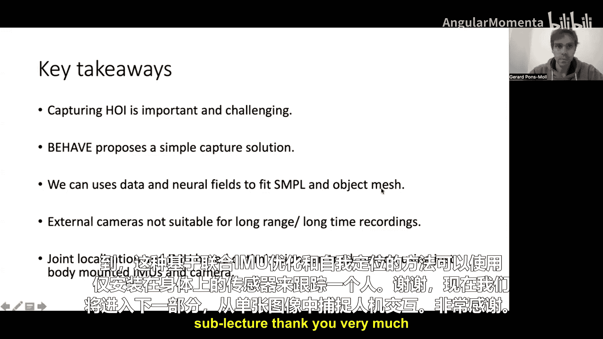

# 【精译】蒂宾根大学《虚拟人类》-p23-11.1-人类行为捕捉--BV1TAbkzpEva_p23-

Welcome to Vit Humans Lecture 111， Human Behavior Cap。

In this lecture we will see how to capture humans in static scenes。

 we will see how to capture dynamic human object interactions and finally we will see also a method to capture humans in large spaces like buildings including several rooms and so on。

So basically， like in terms of modeling the human behavior。

 analogously to modeling the human appearance， we have like two intertwined problems。

One is we have to be able to capture people， this means like reconstruct their 3D motion in conjunction with the 3D scene when they are performing actions。

So by this， I mean， like we should be able to， for example。

 capture an interaction like this one like this person capturing grabbing a book and then moving to another place。

And the difficulty here lies in being able to record the human motion in conjunction with the 3DC。

And we will see some techniques to do this。Now， capturing itself is really challenging because now you have like occlusions of the object and the human。

 you have to， for example， localize where the human is in the scene。

So this is challenging in itself and generating human motion that is coherent with the scene is also very challenging and it's a topic that is becoming more and more important。

 it has many applications as we will see so here we mean like we should be able to design like an algorithm on an AI system that is capable of performing human motion coherent with the scene。

 for example this is an animation that is aware of the3D environment and so the simple model moves according to this environment。

All right， so in this lecture， well focus more on the capture part and the synthesis part we'll cover in the next lecture。

 which is lecture 12 human motion synthesis。So。So why are we interested in human object interactions well most of the interesting human activities involve interaction with other people or with the world。

 we interact to change the environment in order to achieve a particular goal， for example。

 like we want to carry a box from one point to another or we want to sit on the environment like a table or a chair or want to hammer a nail or want to open a box。

Of course， like a very important type of interaction is like interaction with other humans。

Unfortunately due to lack of time， we will not cover these human human interactions in this lecture。

In terms of applications， of course， one obvious application is that robots could learn from human motion。

 they could learn from human demonstrations， and first of all。

 we need to be able to digitize these human actions with environment。Then， of course。

 like humans too can learn useful skills using virtual environments， for example。

 train people how to operate operate tools and machines in a virtual environment without the danger of actually performing the action for the first time。

 for example， like if the machinery could potentially be dangerous。

And another cool application would be to have a virtual assistant which can help you navigate the world a little bit better。

 imagine like joining and going to a new building and you have to meet a particular person and the virtual assistant would attend you at the entrance of a building and would show you the way through the building。

So these are all like potential applications on other application might be like for virtual teaching。

 for example， like you could have like you know famous character like Albert Einstein teach you a class on relativity and so on so you could basically have the shared spaces and basically the recent pandemic has raised like basically even more interest in this virtual spaces to communicate with all the humans so when we communicate through Zoom the obvious thing that is missing is this shared the sensation of shared space。

So these are all like potential applications which require being able to capture humans and objects。

So how do we capture this human object interaction in the real world？

So well first we need to capture the 3D scenes and here the computer vision technology has advanced significantly in terms of sensors and also in terms of algorithms。

 so we have lotss and lots of or not lotss but basically much more 3D data than we used to have。

 let's say，  seven to 10 years ago。So one way is to， like， for example， like you connects。

 you can go across a room and then fuse all the depth frames into a single coherent 3D S。

You could use like different kinds of lasers， laser scanners。

 you could use scanners based on stereo or on lighter and with this you can reconfect the scenes that you see here。

And then like for example， like some works came about when these three scenes were available。

 like for example， this is the work of ICCCP19 pros， which。Basically， like。

Argues for incorporating the 3D scene to estimate the 3 human poses in shape from images。

 and the argument is that if we know the 3D scene beneath like we can estimate the human pose better because we know the humans do not intersect with the scene。

 we know that you know humans perform certain types of actions with particular objects and so on。

So in the simplest form we can enforce these physical constraints and this is basically what prox is about the idea to estimate the simple model using similar techniques to simplify which we saw a couple of lectures ago。

 but at the same time we incorporate constraints such that the simple model should not penetrate the 3D S and for example。

 like certain parts of the simple model should be in contact with the S。

So this improves the results for because for example， like if you don't take into account the sin。

 you have like penetrations like this so the person is sinking into the sofa。

 which is clearly not correct。So basically we want to penalize intersections and we want to use contact in this case in pros like those contacts are manuallynotated。

 so the vertices in the simple model are manually annotated。

So they define which regions will be most likely in contact with the 3D scene。

 and then basically they encourage proximity if contact vertices。

 blue dot these blue vertices are close to the scene。How you do this。

 I mean you like this is ways like you could just have a constraint that says like this vertices should have a distance close to zero to the sin and to enforce penetration you typically would minimize like the distance from the simple vertices。

Like the sign you would basically make the sign distance be0。

 so you would detect which vertices of the simple model have penetrated and then pushed them out by minimizing this distance。

 and so basically this is essentially based on optimization。

 And here the 3D scene is not estimated is assumed to be known。 and basically like the。

They prove their hypothesis that basically， empirically they show that the results can improve if you know the three is seen in advance。

 which makes a lot of sense。So basically prox captures the static scene。

 but the question is of course， how do we capture dynamic scene interactions。

 how do we capture a human moving the objects in the scene or moving like a particular object？

So how do we capture this kind of data using a single image it will be very difficult because we have lots of ambiguities and tracking the human and the object is really challenging。

 there are methods and we will see them but it's really challenging so one option is to use markb capture methods which are high quality but they are also expensive and they are limited in the recording volume and they are not easy to scale to large spaces。

And also markers from an optical marker system those markers that you place on the body like they can be also includedd especially during complex interactions well another way is to put IMU sensors on the body and then basically use this camera free system in order to track the person and we will see a little bit of this technique before later which are。

IMs are good because they are easy to scale and there's no restriction to recording volume you can record in large spaces。

 but they are prone to sensor drift and the quality of the data is。I would not say poor。

 maybe that's a bit detergerated， but it's not as good as an optical marker system and especially if you just。

Do not incorporate any visual information like this your data will basically drift away over time。

So in this work， which is called behave， we basically have like something in between。

 so we wanted to capture system that that is。嗯。That is portable but it has also good localization and it does not drift over time so for this we used like a setup which includes four calibrated kins and basically eight subjects were recorded five males and three females in five different locations and we captured a variety of daily use objects and interactions for example。

 boxes chair tables， backpacks and so on So the data looks like this you have an RGB sequence and essentially like like behave is an algorithm in a data set as well to capture。

Like the human object。The human object interaction and in particular the human motion represented as a simple model。

 as well as the 3D mesh of the object。So this is the behavior data set。

 which includes a wide variety of these complex interactions。

 which are dynamic because it' like the human is moving the object。Now。How is this done， This is far。

 far from trivial。 This is a very complex problem。 and how did we start Well， we started by。

Being humble and acknowledging that this is a hard problem， we wanted to collect good data。

 so essentially like we designed like a rather sophisticated pipeline。

 including a little bit of manual annotation in order to track the human object pose。

So the annotation involves clicking points in an image that so basically you have to identify key points of the objects such that then we can use these key points to reconstruct the object pose more accurately。

Then using the Connect data， like one can fit the simple model to the point clouds we're using techniques that we've seen in the class。

 like for example， like registration。And then like basically。

 you jointly estimate the human object pose and the human model。So to estimate the human model。

 we also use 2D key pointss coming from 2D detector。

 which is called open pose and basically using the object fix and segmentation and the key point annotations from Amazon mechanicalical Turk。

 basically you optimize the models that that the projections of the 3D joints of simple and the open pose detections match and the 3D object points match with the 2D key point annotated in the image。

Now of course this is a tedious procedure which we needed to do to get things started。

 and then after this we trained a model to automatize all this process and be able to automatically from five from four depth views of the human and the object to automatically recover the simple model and the object。

So how do we do this？Well。Typically， to feed a model to data。

 the classical way you would basically minimize as we've seen several times in the class。

 like the model parameters x。To minimize the distance between features extracted from the image。

 or in this case， the depth images and the model。And if these features are the classical features that we all know like edges。

 key points and silhouettes， it's very likely that this will get stuck into local minimas。

 especially for complex human object interactions， because you have occlusions。

 you have matching ambiguities and you have missing data。

So these are some examples of the challenges， sometimes the object is not fully visible。

 it's only partially observable， the connect data is noisy and incomplete and you have all these problems。

Sometimes like， of course， contacts occupy only a very little portion of the pixels in any image and contacts。

 however， are very important to the perception of like a good human object interaction。

But they are difficult to detect in the images。嗯。Of course。

 like the object can include the full body and making the task very challenging and like you have like like for example。

 the right arm of the person is not even visible in the second image making it tracking extremely hard and it's a common scenario when dealing with this human object interactions。

All right， so what can we do here well the key idea is to find features F right that we can extract directly from the input point cloud。

 which make the optimization better behaved。So what do we do basically we can predict at a high level we can predict for every point in the 3D scene like a correspondence to the simple model such that we can then feed the simple model in an easier manner。

 this is an idea that is similar to some ideas we've seen before like Lure for example。

 and finally we can。Basically fit the simple mesh I'm sorry this is playing automatically and I want to stop it second and then we can fit the simple mesh and the object to this like to this neural network predictions which predict the correspondence field and a distance field so let's look a little bit more in detail how this correspondence field and this distance field look。

And again， these ideas are similar to this work that we saw in one of the lectures。

 which was called the Gre， so you might want to refresh your memory and check that again。

 check that video if you' you don't remember that。So as for distance for the human。

 you can predict like given the point cloud， you can predict like a distance field of the human。

 so basically this sort of trains the network to ignore the object and to predict for every point in space。

 what is the distance to the human model。So this is defined with this UI of H indicating human and maps every point in space to the distance from P sorry。

 this is the distance from P to the mesh of the model。

Then you have like the distance field of the object， which basically is trained。

 the network is trained to ignore the human in this case。

And then finally you have like this correspondence field。

 so for every point in space now we predict the closest surface point C。

 that's why you have this coloring here， so which are indicating that for example here the closest point would be this right arm of the simple one。

And so this is dividing the full 3D space into this。Into this body parts， in a continuous manner。

And then using these fields， you can optimize the simple vertices in order to be coherent with the human distance field。

 the object vertices to be coherent with the object distance field。

 and also leverage sorry this correspondence field in order to make the mehes coherent with those neural predictions。

So let's look at this in a little bit more detail。So basically。

 we know that the simple model should fit the the input human point cloud and for this you can make the。

Like the mesh， your mesh match this distance field of predicted by the neural network。

So what do we want， We want that。The distance。From every point in space PI to the closest point in the simple model M of C。

 where CI is also predicted by a neuralodle network。We wanted this distance。For every point in space。

 P， right， matches the neural network prediction of the distance， which is U I H。

So this is what we want to minimize， right？this difference。

 is discrepancy with respect to the moral parameters that parameters M。

And we also need some regularization term， and then we have the object term。

We want that the object mesh lies within the level zero level set of the neural distance field。

 This means that for all objects for all vertices in the object。

 we want that this U JO basically is as close to zero as possible。

 that's why we have to minimize the absolute value of this。

And to regular things like you can also minimize the distance in the cham distance from the object point cloud。

 sorry， this is an automatic sorry， so we want to minimize the distance from the object mesh to the surface。

Whi is with S， which is the point cloud captured by the K data。And then we want to satisfy contact。

 what is a contact well contact is defined in behave as any any point which is close to the object and to the human。

Close by some threshold less than two centimeters in this place。

 so basically you can know that in the contact when U J of O and U H of J or U J of H is when both of these distance fields。

 sorry， are less than two centimeters。And again， like here this。For these contact points。

 we want that the vertex of the object matches the point。In the simple model， which is M of CJ。

So these are the three constraints and the good thing is that then you can obtain results that look like this。

 which look pretty much similar to。Yeah。

嗯嗯。😊，Sorry about that。😔，嗯。Trying to pause the recording。

Okay。Allright， yes sorry for the interruption so basically like I was saying that you after having trained the behave method you can get results that are almost on par with this semi ground results we obtained with this semi automatic method that included having to annotate the key points of the objects。

Um。So the Be data set is a data set that is publicly available for research purposes and yeah I mean so basically the community is picking up on this because there's a growing interest in modeling human object interactions。

Even with behave， like we cannot capture every possible interaction with the environment。

 particular interactions that involve large scenes。

Because like capturing with external cameras imposes restrictions in the size of the recording volume and also due to memory requirements also in the time。

 like how much， how long the sequences can be。So for these like this IM views that I was mentioning before are ideally suited。

And for these， like there's a work that is called human positioning system or H。

 standing for 3D human pose estimation and self localization in large scenes from body mounted sensors。

So what is the idea here， so the goal is that given a human that is moving in the 3D scene。

Like the method recovers like the human motion and can track the human motion within the 3D scene。

 so basically does two jobs， one is estimating the 3 human pose and second it localizes the person within the 3DC。

So the goal is to capture a large like interactions in large scenes and long recordings。

 meaning like recordings that could take up to an hour or even more。

And for these like this method uses wearable sensors， which。It require no external cameras。So。

The sensors that will be used are I'm used and a head mounted camera。

 so a camera that will be looking outside， mimicking or emulating the field of view of a real human。

So。So are these are the sensors that will be used and basically we want to register the digital human within the 3D environment and for this this word pre scans a large 3D environment and then localizing the human within this。

3D environment。So in this case， this is an example of the environments considered in this work。

 this actually is a rendering of the 3D reconstruction of the。

Max plan for informatics inserts are broken and as you can see。

 this is a building that includes different rooms， this is the library so。And then like， you know。

 humans will perform， real humans will perform motion here and the task is to estimate their 3D polymers and also localize where they are in the scene。

Well。The question is how can we capture human motion and resist it with the3Ding if we capture motion with IMUs。

 like the problem is the following like the IMUs drift over time and what happens after a while is that the human is not aware or the reconstruction is not aware of the three environment it ends up like flying in the air。

So the key idea here is to combine IU based pose estimation with camera localization。

So what I'm showing you here on the left， if you've never seen this， this requires explanation。

 so on the left you see the picture of a real image on the right you see the picture of a synthetic image。

So essentially we have a 3D environment and the synthetic image is the rendering of this 3D environment a seen from our estimated camera pose。

😊，The camera pose of the head of the person。If the real and the synthetic match， as is the case here。

It means that we have estimated the camera well this is solved using visual localization or self localization。

 so this is a classical one of these classical computer vision problems。Which has many。

 many applications， as you can imagine。To localize， for example， like where a picture was taken。

So the goal is like given this 3D sin and a single test image captured with a camera in this case would be the camera placed on the head of the person。

You have to figure out where in this 3D scene this picture was taken， that's the challenge。

So how do we solve this problem？So in computer vision like this is typically addressed using three steps。

 so one is you have to extract features， distinctive features which are based on deep learning。

 this might be key points， edges and so on of the test image right。Typically。

 key points are mostly most of times used。And then like basically you have to consider your 3D S。

 which itself was， for example， like reconstructed using a scanner that uses multiple views of the S。

 and so what you need to do is to extract features from these views that were used to reconstruct the 3D S。

And then basically like do feature matching to find which camera viewpoints in the 3D scan。

Have the most similar features to the ones in the query image。

 so you have to retrieve similarly looking parts of the 3D scene using the features。

And now once you've extracted these viewpoints， you need to basically optimize the camera until the features extracted like the features from the retrieve camera from the retrieve。

3DC match with the features of the test camera， so these are the roughly the three steps。

That are necessary for visual localization。And so if you do this。

 results improve like the person is not completely flying on the air。

 but you see that sometimes it intersects the floor and sometimes it's not really matching with the scene or it's flying a little bit above。

So what is missing here is similar to prox a little bit of reasoning about the physical physical constraints of the sin。

 so we know that humans cannot fly on the air， we know that humans cannot penetrate the floor and this is what is integrated in this joint optimization。

So the optimization will optimize the simple parameters to match the visual localization head camera pose。

To match the IMU measurements and to match the constraints of the 3D。

And basically using these three constraints like one can obtain like an estimate that is both。

Coherent and it satisfies the physical constraints so the objective function would look something like this and this is optimization over a batch of frames similar to this S work that we saw before。

Basically we have a cell localization term might the 3D scene against the images of the head mounted camera。

 a scene contact term that basically when Im use detector contact with the foot and the scene。

 so Im can detect these contacts with accelerometerators。When you hit the ground。

The acceleration will be very high because like you will go from high velocity to zero very quickly。

So you can enforce that those vertices match the scene when the IU tells us there was a contact。

tThen we want also smoothness so that the emotion is not jittery and we have like the post term that makes the simple pose match the IMU pose and the result is like a method that can。

Trrack humans in the large scene。Yeah， basically， which was the first time this paper was selected as best paper finalists。

For was selected as a candidate for Best paper award at CBPR 21 because。

Most likely because these are results that people had not seen before。

 it's a new problem and basically。It shows what is possible and like you know now with all this interest in the metaverse and one could very well imagine that this is this become more and more important this being able to record human motion within the3 environment and know where you are in the scene so you could imagine that the 3D world is uploaded into the cloud and then we navigate the world and then at all times there's an algorithm that tells us where we are in the world and maybe we kind of augment this world。

Visualize with some goggles or some VR glasses， right it can augment and place object virtual objects in the world and so on。

All right， so I mean， these are some of the results like you have different types of interactions。

Like interacting with a computer and notice that here we're not using any external cameras and so this is what makes it quite challenging because we are only using the head mounted camera and the IU。

Boses。So notice the thing that is missing here is actually with interaction with dynamic objects and this is some subject of current investigations。

AndYou can imagine that if you do not have access to external cameras， this is quite challenging。

 but there's some things that you could do， you could reason about the object motion based on the human。

 for example， and this is something that we are currently investigating。

All right good so to conclude basically capturing human object interaction is important and challenging and is a very hot topic right now and behave proposes a simple capture solution based on depth cameras we've seen like that this combination of neural fields and classical optimization is a promising approach and we've seen that external cameras are not suitable for long range or longtime recordings and for this you can use IMUs and maybe combine them with selflocization and we've seen this method based on joint IMU based optimization and selflocization can track a person using just body mounted sensors Thank you and now we will move to。

humanuman。Human object interaction capture from single images in the next subletature。

Thank you very much。

