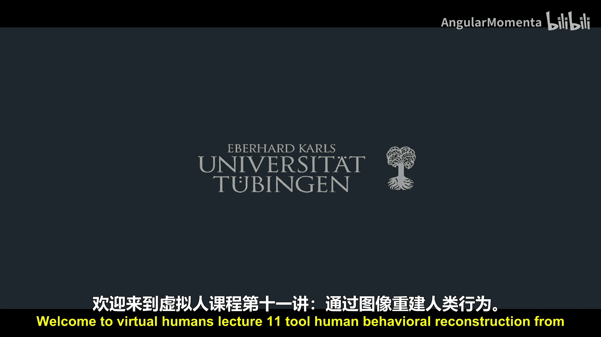
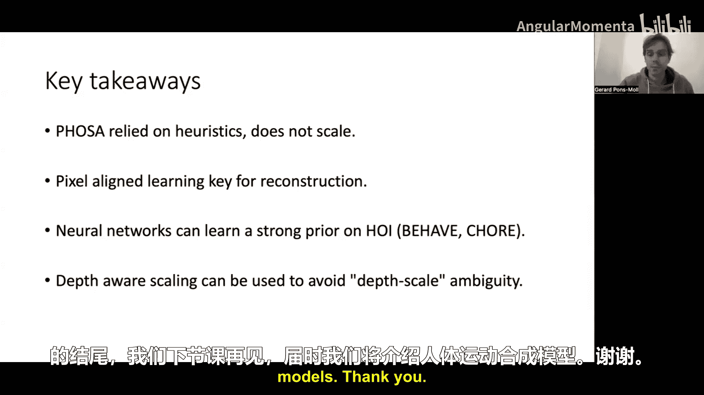

# 【精译】蒂宾根大学《虚拟人类》-p24-11.2-从图像重建人体对象--BV1TAbkzpEva_p24-

Welcome to Vitual Human Lec 112， Human Behavior and Reconstruction from Im。So in this lecture。

 we will see classical work on human object interaction from images。

We will see how to use instance specific optimization to it simple and an object mesh to an image。

Then we will see how to leverage a learn prior over data to reconstruct human and object interactions。

And then we will emphasize on the importance of pixel aligned learning for three reconstruction。诶。

So same as the motivation is from the previous lecture。

 we're interested in human objects interactions because most of the interesting things that happen in images and videos are actual interactions with other humans or interactions with the environment。

And as we previously mentioned， there's many applications in virtual reality， augmented reality。

Robotics and so on。嗯。So the question is like， can we do human object？

Reconstruction and understanding from just images。Not using。

Like depth cameras or multi view setups or even IM used， but just single images。Well。

There's this is a longstanding computer vision problem and people started looking at this。

In particular， looking at detection of particular actions and interactions of humans and objects from images。

 mostly because these were the kind of data that was available， like to the annotations of。

 for example， segmentations or the types of objects appearing an image。

Which is much easier to obtain than just for example， like the 3D models of the image。

So for example like there was work that tried to predict like the type of object。

 the class and the location， and then the human motion， for example， like the type of motion。

 and then it tried to identify the start and then time objectivity and the location and also the object motion and this was typically modeled using by using an inference where you want to infer the posterior of the quantities of interest in this case object and this the motion for the human and the motion for the object conditioned on the video and then basically you would basically use bias rule and use some like conditional independence assumptions to factorize this posterior into a series of likelihood terms that。

Essentially， for example， like you you look at the likelihood of the object。

 given the video and basically you could use a Gaussian distribution around the object to locate a human and this term represented like the detections of humans。

 trajectories and video and so on。This was basically all these terms had to be manually defined based on heuristics。

 and therefore this is difficult to scale。Okay。So other works were basically like also similarly like detecting the objects and。

Like in the humans in a bottom up fashion and then basically these interactions were predicted using a classifier and as I mentioned before。

 like basically because there was an availability of2 the annotated data like tasks like human and object interaction represented as detection segmentation and an action recognition have been very well explored in the past。

However， like the interaction， the modeling of the interaction of humans and object objects in 3D is much less explored。

So we've seen that there's some recent data sets like behave that capture humans and objects and other data set might be。

 for example， like the graph data set and although these data sets are definitely stepping stones in having like a wider。

In having more more3 human object interaction data。

 they are still like compared to single images they are still restricted right in in the sense that they are recorded in。

They are recorded in a confined volume and there's only certain types of interactions that can be captured。

Interactions that are really。Complex involving potentially multiple people。

 very complex outdoor backgrounds and so on cannot be so easily captured using these setups so of course the question is like can we reconstruct humans and object from a single image。

And one of the first works to address this in 3D was the work called FoOSa perceiving three human object。

 spatial arrangements from a single image in the wild。

So the goal here was to reconstruct the human represented a simple and an object ma from a single RGB image。

And this was work that came about half a year before then or one year before then behave and before like there was no data set for learning any kind of 3D prior。

 so this method is purely based on optimization and based on a set of hand defined heuristics。

So essentially like the authors of BoOSa， they defined a set of like heuristics。

 basically they labeled， like which vertices of the mesh were likely to interact with which vertices of the objects so for example like here red and red means that you know these bottom part of the mesh should match with this bottom part of the bench and the back should be lying on this part of the bench or a hand should grab a rack like this。

 and like this defines a set of typical interactions and then basically the idea to detect bounding boxes。

 estimate the 3D human bows and shape using a state of the art method and estimate the 3D retrieve the 3D objects better set and that basically find the proper scaling and positioning of the human and object such that these context that are manually defined are satisfied。

And they showed that you know， indeed， when the assumptions are correct， then this leads to better。

 more coherent results and the objects actually fit with the humans and lead to plausible interactions。

However， the main problem is that there's many types of interactions of a human with the same object。

 for example， with a chair we can see it， but we can lean on the chair or we can move it。

 so there's many possible ways of interacting with the same object。And therefore。

 it's very difficult to enumerate manually， like all the types of interactions。So this is where。

Where FoOSa cannot jointly reason about human object arrangement。In a learned fashion。

And so the question is like， can we use learning to reconstruct human object interaction？

And the answer is yes， there is a method that is called chore contact human and object record instruction from a single RG image。

Which was presented last year at EC。So essentially the goal here is to jointly reconstruct the human and the object in a coherent manner such the spatial arrangement is。

I is correct。Of course this is a very challenging problem because you have depth ambiguity。

 this is the same as for single image reconstruction。

 but now you have like ambiguities because you don't know how far the human is from the object and sometimes you have heavy occlusions because the human occludes the object or vice versa。

 the object occlude the human。Now， before we dive into the details of core， let me recall like this。

Neural implicits and in particular pixel aligned implicit functions to reconstruct an implicit surface from an image。

 this is something that we covered in the lecture of neural implicits。So。

Recall that basically given an image， PyPO was a method that would reconstruct a 3D mesh of this image。

And the way this was working was by instead of fitting a mesh to the image。

 like basically like the surface is represented implicitly and essentially what what is done here is like you have an image encoder that turns this image into into set of features and then basically a network。

 which is a perpoint network or a neural field network if you want。

 like basically considers like different rays that go through the pixels of the image。

And the network is trained to predict at which depth right， for every depth。

 whether that point along the array belongs to the inside or outside the surface。

 so we're going to train a predictor such that you know we're going to shoot a array and we're going to march along the array and we're going to predict whether this point is inside or outside the surface。

So basically， you need a network that takes an image feature which picks it's pixel aligned。

 pixel aligned in the sense that you know， this this feature。

Is obtained from the pixel right that results from intersecting the ray and the image plane。

So basically the 3D point will project to exactly this pixel where we extracted the convolutional feature。

 so FV extracts this convolutional feature which is pixel aligned and you have like here the depth which is given to the network to decide whether this point is inside or outside。

And so basically， this is and the same can be done for the inside outside and also the same network can be trained。

 but to predict the color。And so yeah， so basically this was obtaining results that look much more detailed than previous models that predict directly the vertices of a mesh。

 and this is why virtue' true of this pixel alignment。

So the intuition here is that the network and reason about global and local structure。

 and so then using less data， you effectively have more data because every pixel counts。

As one training data point， so this allows more effective learning。And the results were。

Quite astonishing at the time like this is from a single image where this level of detail was unprecedented so this was quite impressive at that time and I mean now there's methods that work even better than this but。

But this level of detail was obtained thanks to this pixel alignment。So here is to emphasize this。

 you need that the 3D points and the convolutional features are alignedied。

 such that the projection of the 3D point projects to this actual 3D feature。So。Of course。

 this pixel alignment， if we want to train a neural network that predicts like the 3D model or sorry like the implicit surface。

 we have ambiguity because these two surfaces， for example。

 are both pixel aligned and there are two possible solutions that project to exactly the same image。

 we emphasize these ambiguity problem created by the perspective effects of images。Yeah。

So these two solutions are valid， so we need to do something if we have to train a neural network。

So what PFfu is doing is basically fixing depth and reconstructing only the scale。

And is maintaining pixel alignment。So in Pyfu this is possible because this method is trained with 3D scans and with 3D scans you can control how you render the scan and make sure that the rendering aligns with the actual 3D scan so I can you know move the data around and I can have like a perfect alignment of images and 3D right so this is possible because the data is synthetic it's trained from synthetic data。

 but if we have real captured images of humans interacting with objects now coming back to to the theme of this lecture。

 how do we fix the depth while keeping pixel alignment。This is a tricky。This is a tricky problem。

 but it has a very simple solution。So just be reminded that basic perspective projection says that the pixel in the image x more is basically obtained as the focal length times the x coordinate divided by the depth coordinate。

And so basically three things affect the size of an object in the image。One is the focal length。

 the other thing is the physical size of the object， X and y， and finally by the depth。

 how far the object is from。From the camera。So we want to change the depth。

From Z to some Z prime or Z0。嗯。While maintaining the alignment with the image。

Because if we fix the depth， then we can ask the network to predict only scale if we make another assumption about the focal length right so you have three factors of variation which are conflated and in principle can only you have to assume two or known and then you can ask the network to predict the third。

Okay， so from the laws of perspective， so how are we going to like do this， right。

 how are we going to align the real data？That was captured with images， right？

How are we going to align the corresponding 3D mes such that they are always at the same fixed depth without breaking the pixels alignment because notice that if you know I have a mesh and I move it at a particular depth。

 then it will not project anymore to the image so I need to do something with this mesh。

And basically， what you need to do is to scale the me by a single factor。

So the first thing to realize is that scaling the mesh vertices by a scalar S does not change its projection to the image。

So the proof is quite easy， you consider vertices of mesh V， Vx， VY， Vt are that coordinates。

 and you can consider the scaled version of this mesh， which is SVx， S VY as Vit。

Now how do we obtain the projection， we use the formula that we've seen before。

 so we have Fx Vx divided by the depth， which is V Z in this case。Plus the principal point and FY。

 V and Y divided by V Z and so on。Now。How does this change when we scale this vertex by a factor S？

Well， it does not change because you have like S on the numerator and denominator so they will end up canceling out and you will end up that the projection of B prime is exactly the same as the projection of V So this is very intuitive So what this means is that you know we can take this mesh and scale it such that we will make it bigger if the scale is bigger than one。

 we will make it bigger but we will push it further away from the camera and there's two effects that are going to happen here when we're pushing away far from the camera when we project we're making it smaller but when we're scaling it we're making bigger and if you do the things the two things at the same time basically one thing compensate with the other and you end up with an image that is exactly the same。

This is this dolly effect that we saw like this was a cinemaographic technique。

 this we saw in the lecture number two， you might want to check that out if you don't remember。

Alright so now that we know that we can scale a mesh and it will not change the projection to the image now how do we actually scale the mesh to center it at the fixed depth well that's very trivial because like we can we know that the average depth of the mesh has to be centered at the desired depth Z zero so the scale needs to be Z zero divided by muz where muZ is the average or the average depth of the mesh。

So musette heres the empirical average of the mesh depth。

And basically to check that this new resulting mesh after scaling is indeed centered at Z zero。

 you just need to use the linearity property of the empirical mean to obtain that muse Z prime。

 which is the mean。Of this moved mesh or scaled mesh。

It's nothing else than one over N of this new coordinates VI prime Z。

 but now substituting by the scale factor， we end up one over n。

S from I equals to one until n of V I。嗯。V I Z times Z0 divided by mu Z， which is the scale factor。

And now this term over here is nothing else than Musette。

 which will cancel out with Muette and then we end up at Z zero。

So we have proof that indeed the mesh is centered that set zero and because we are just applying a scaling。

The mesh will not change the projection to the image。So。啊。Right。

 so basically now this can be seen from these equations that essentially if we change every point to a scaled version by Z zero divided by Z Z zero divided by Z and Z is fixed at Z zero or we scale Z by Z zero divided by Z。

We end up with the same exact projections as before， oh sorry this should be x and so on。

So what are we doing here， we are doing exactly graphically。

 this is what we are doing we are we want to fix the object of a fixed depth so we are moving it。

To the desired that zero depth。And then we're scaling it。

Or basically we're just scaling the message that it's progressively growing and moving far away until we reach the depth at zero。

So this is what we are essentially doing， we are scaling by these factors z zero divided by Z so basically if the mesh in the real training data is closer to the camera。

 we're scaling it up， pushing it backwards if the mesh is indeed further from the camera than Z zero。

 we are scaling it down and bringing it closer to the camera。

And be reminded that we are doing this prepro such that all the meshes。

Are at the fixed depth while projecting to the image so that we can leverage this pixel aligned idea。

So once you have solved for this problem， you have centered data。

And you can train a neural network to predict the human and object interaction on this human center data。

So typically like before you start learning， it's really important that you think about the type of data you have before you start even training or learning anything。

Because if you have like a good like pre processing of the data， good normalization of the data。

 the learning task will be much， much easier and this is the case here。Al right。

 so basically once we've aligned the data， the idea is to jointly reconstruct the human object and the human and the object jointly using neural fields and then basically uses a neural network to learn the spatial arrangement prior condition on the input image instead of these handcrafted rules。

This network predicts neural fields for the human。The the object and the simple body parts this is very similar to behave the only thing stop here。

 so basically the only thing is that the input is an image and then basically this features are have to be lifted to 3D but then we do similar as pfo like you basically like can turn this into a neural field in 3D and then we do joint optimization similar to behave in order to obtain the human mesh and the object mesh。

And the good thing is that compared to this handcrafted model。

 like the results look significantly better and the reason is because like this is。

The network is capable of learning different types of human object interactions。

 which works much better than just handcrafting the interactions that we expect to see。

And the interesting thing is that the model is trained on a single frame basis。

 but it can produce tracking results that look reasonable。As you can see here。

So these are different results for human object interaction from images taken from the internet。

And for many images it produces quite reasonable results。

 but of course like these are still like some preliminary results。

 this research is still still kicking off and there's many problems in particular when you have like heavy occlusions like you only have a partial body or you have like images where which are very low resolution。

 so for most of the images that are really like challenging and really in the wild。

 then these methods do not work that well。But it's a significant step forward and I'm pretty sure that there will be more and more papers in this direction。

So the take home messages are basically we've seen FoOSSA。

 which is a method that relied on heuristics and it's good because it was the first paper to introduce a new problem。

 but this method does not scale because it relies on a lot of manual definitions。

We've seen that pixel aligned learning is key for obtaining。Like good neuralod reconstruction。

And neural networks can learn a strong prior on human object interaction and behave and chore are two examples that demonstrate that。

 and we've seen the depth of where scaling that can be used to avoid this depth scale ambiguity while training a pixel aligned neural reconstruction network。

Thank you， this is the end of lecture 112 and I'll see in the next lecture where we will see human motion synthesis models。

Thank you。

