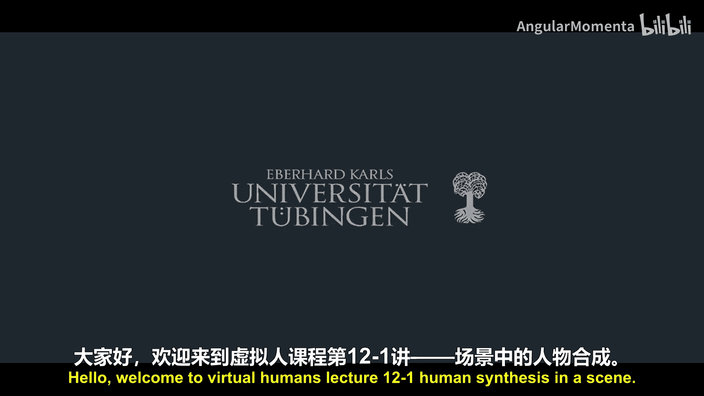
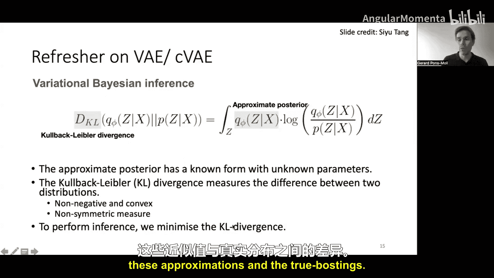

# 【精译】蒂宾根大学《虚拟人类》-p25-12.1.1-场景中的人类合成--BV1TAbkzpEva_p25-

Hello， welcome to Vit Human Lecture 121， Human Synthesis in a C。Yeah。In this lecture。

 we will see how to synthesize static humans in static scenes。

We will see how to represent human scene contacts。We will quickly give an overview of typical models used to produce multiple outputs conditioned on an input。

 those are models based on variational autoenrs and conditional variation autoenrs。Which are used。

 for example， to synthesize multiple possible human poses conditioned on some portion of the scene。

 for example。And finally， we will see how to synthesize motion in particular locomotion in aneven terrain。

 we will see how to incorporate。The 3D geometry of the terrain into a。

Neural model that will produce human motion that is coherent with this terrain。

So if in the previous lecture we have seen like methods that perceive humans or capture humans that reconstruct humans from some sort of sensor data in this lecture。

 the main focus will be to generate fertile human motion condition on the 3D geometry and and so on。

So methods to capture motion where， for example， like behave that was capturing human object interaction。

 and we saw that there's methods that can recover to some extent human motion or human pose and object pose from images。

Now we will be interested in generating this human object or human scene interaction from scratch。

 right so that you know， for example， you can animate a virtual human in an environment in 3D。

So of course， like the first question we might ask ourselves is why is this interesting or useful well。

 at the highest level we one of the goals of in the field of virtual humans is to replicate like the behavior of real humans。

And real humans can navigate in the3D scene can understand what's around them。

 and so being able to do the same with an artificial agent is basically one of the longstanding goals of artificial intelligence。

Now if you want to see more concrete applications， of course。

 this is useful for gaming where you have to make the characters you know interact with environment and sit。

 for example， or grab objects， this is necessary right now how video games work is by pre-recorded actions and then basically those actions are launched that particular predefined locations in the scene。

 which makes it look a little bit unnatural， as we have seen here in this example of GTA for example。

Of course， like this is useful to like train robots to interact with a three environment。

 for example， like it would be quite useful to train virtual agents in a virtual environment before we deploy the physical robots in the real space and of course for VR and AR applications。

We mentioned this a little bit in the previous lecture。

 this is quite useful because like we're talking about these shared virtual spaces in some metaverse and those virtual humans that live there the real ones and the virtual ones they need to understand what what the 3D seen around them looks like they need to understand what they can do with the scene and the motion generated should be coherent with the scene right I mean。

 for example， like also for social interaction。Like of course。

 like one thing that is missing in video calls is like the shared spaces and if you want to shared space。

 of course， basically these renderings of humans in these shared spaces should satisfy the physical constraints of the 3D world。

Okay， so hopefully you're convinced that this has extremely many applications。And。

What do we need actually to synthesize human object interaction well we need to understand we need to perceive from the perspective of the virtual human。

 we need to understand the 3D sin。We need to at least the reason about aance and a forance is a concept that means that the geometry in a scene affords certain types of actions。

 so for example， like a chair affords sitting but it also affords standing。

 grabbing it and manipulating it in many different ways so this is something that is more primitive than functionality of objects so the functionality of objects is that for example a chair。

 the main function of a chair is to sit on it right the main function of a knife is to use it to cut。

But there's many different ways we can grab a knife， there's many different ways we can grab a chair。

 and there's many different poses right that are afforded by a particular object。

So ideally an algorithm should reason both about affordance and also about a function right when a little kid is learning about the environment and learning to drag with the environment typically learns the affordance is by exploring the environment before the kit really knows what the function of the object is so in my opinion。

 like a good algorithm should be able to reason about both things ideally。

And we need to synthesize three humans conditioned on the 3DC。So let's look at some examples。

 these are again recent papers， this is a relatively new topic。

 it's something that has interested the computer visionion community since the beginning since many years ago。

 but only recently we have the technology to be able to study these things in 3D。So for example。

 like this is work that was presented at CBPR， which。

Essentially allows you to synthesize static humans on the 3D scene。

 so basically use the 3D sin and then basically the goal is to synthesize static poses of humans in that sin in a way that it's physically plausible right so that people are sitting on chairs or are like lying on a sofa without intersecting the environment or without like yeah。

 having poses that are not satisfying the constraints。So。

How do we go about this Well we saw that the first thing we need is data so we need a good capture method like I hope by now you realize that there's always a loop between this capture and synthesis like between this。

Perceiving and modeling and yeah， so for example like this this。是。Sorry。嗯。W second。😔。

Okay sorry about that， so basically we have the proOx method that allows you to reconstruct the 3D human pose condition on the scene and this we saw that leads to better results。

 it leads to resolving intersections with environment and so on and so forth。嗯。So essentially， no。

The main problem that we have is that the current models like the simple model do not factor in the S。

 like you cannot condition the simple model on the S and so the question is how do we condition the simple model on the S？

So one possible way， and this is what is done in this work that is called POSA。

Basically like the key idea is based on the human mesh based on the pose。

 the idea is to predict the contact vertices， the likely vertices to be in contact with the sin。

And to predict which objects are likely to be in contact So these are these two predictions first like these vertices that are marked as by the neural network are marked as being likely to be in contact based only on the post。

And and then this like coloring shows which object actually is most likely to be in contact。

 so here like green means that this bottom part of the human is likely to be in contact with the sofa and this part of the hand is likely to be in contact with a table。

Of course， this is like a hypothesis like this problem is multimodal in the sense that there's multiple solutions for a given input。

So how is this modeled so how this is modeled is with these binary variables that indicate whether a vertex or they indicate the likelihood that a vertex is in contact at a given point。

 for example， like this is Fc which takes value zero or1。

 so one is when there's contact zero when there is no contact。

And you have one of these binary variables for each of the vertices BB in the mesh。

And then for every vertex， you also have like a matrix or a vector of binary variables。

 one for every object， L L is the number of objects。

 which indicates which of these objects is likely to be in contact for a given both。

So the questions are， well， first is V I in contact with the scene and。

Which object class is VI actually touching？And I mentioned that there's multiple solutions。

 for example， I could be sitting on a sofa or I could be sitting on a chair or I could be sitting on top of a shelf。

 for example right I mean or a table right so this is like there's multiple solutions so we need to have a predictive model where that gives us the possibility to sample multiple solutions so one way to address this is to use。

Gerative neural network like a variation auto encoder or a conditional variational auto encoder so given a mesh this network will produce。

We can sample here the input and condition on this mesh。

 and then the network will produce different solutions which will indicate which vertices are likely to be in contact and for those vertices which objects are actually most likely to be in contact。

So now let me give you a refresher on variation of auto encoders because this is a technique that is often used in the context of human modeling。

 for example， the to model like the postmanifold and also for modeling these contexts。

So basically like like using bias theorem like we're typically interested in knowing what are the factors that that cause given observations X and those factors are these quantities of interest and so basically where'rem typically interested in like obtaining the posterior these are like the likelihood or the probability of this factors given these observations X and to solve this like we typically reverse the problem using bias rule and then we basically have a likelihood that measures how likely these measurements are produced by this factors that。

Then we have the prior， it the probability idea that this prior is actually there and then divided by the marginal likelihood of the observations。

So we have x， which is the evidence， Z， which are the reasons or these latent variables are the hypothesis。

And then we have the likelihood of the system， and it is an inference we calculate the posterior to infer these blood and latent variables z。

So in most cases， the posterior does not have a closed form solution and is computationally intractable。

So this is where variational inference comes into play because like you can use a simpler distribution to approximate this posterior。

Now， two questions are how do we define this approximate posterior and how do we perform this approximation？

So。WeWe can look at this like we want actually this approximation to be close to the。

To the true unknown posterior， so basically like this kL divergence is measuring the distance between the two distributions。

 ideally this distance should be small， so we have here that the kL divergence is a measure of the discrepancy between one distribution and another in this case the approximation distribution Q phi of conditional X which is parameterized by phi this could be a neural network for example。

And then basically we measure how close it is to the actual posterior we are interested in。

 like P of Z condition X。And the definition of the Kbat glibla divergence is basically like this integral over the over Z。

 which is the latent variable， and basically it has the two terms。

 one term is Q phi of Z conditioner next times the logarithm of Qhi and divided by B。

So things to notice here is that if Q phi and p。Are equal， then this equals to one。

 the whole thing equals to zero， the distance is small。

And also you have here this discrepancy measured in this logarithm is weighted by Q5。

 So wherever you have a high probability mass， like you pay a higher。Cost。

 if you want to think in these terms， right？And so notice that here in this integral x is not moving。

 so we are fixing x and evaluating this integral over set right so for every different z x we have one of these integrals。

So。So some properties of the kL diveence is that is non negative and it's convex。

But it's a non symmetric measure because notice that。嗯。

There is it does matter where I place like if I reverse the terms and I would place here p of x and then here I would place P and replace the Q it would not give the same quantity。

 so it's not a symmetric measure， it's not a distance in the sense of the mathematical sense。

So to perform inference inference， we basically have to minimize the scale divergence。

 we want to minimize the discrepancy between this approximation and the true posteriem。

