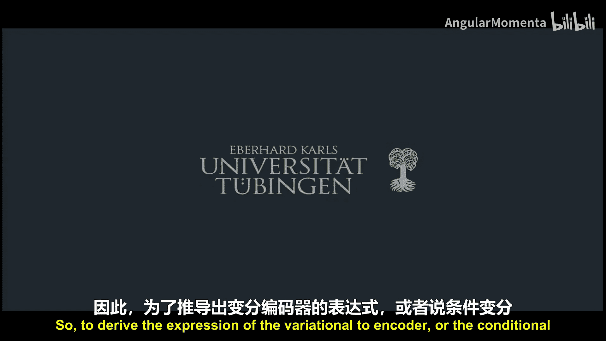
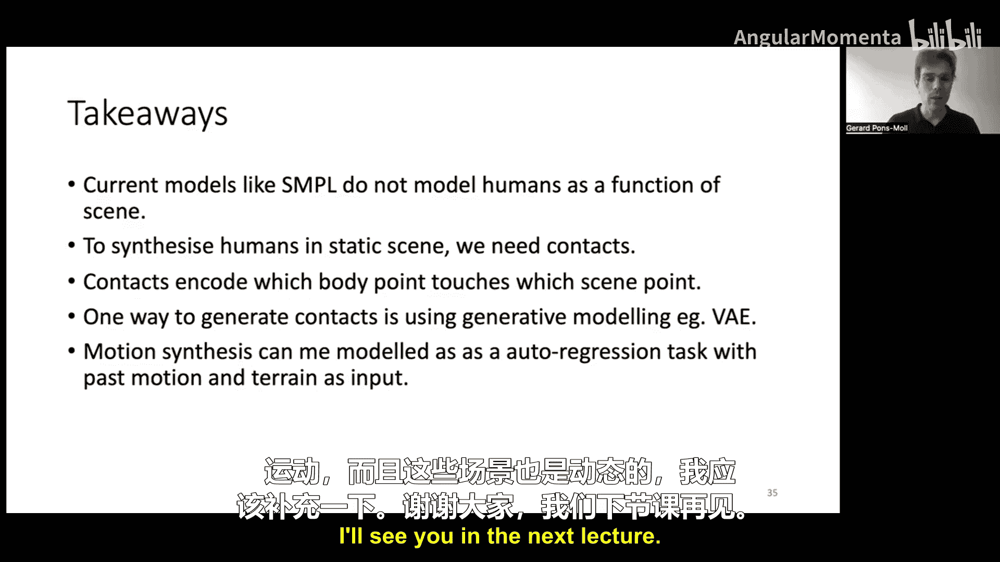
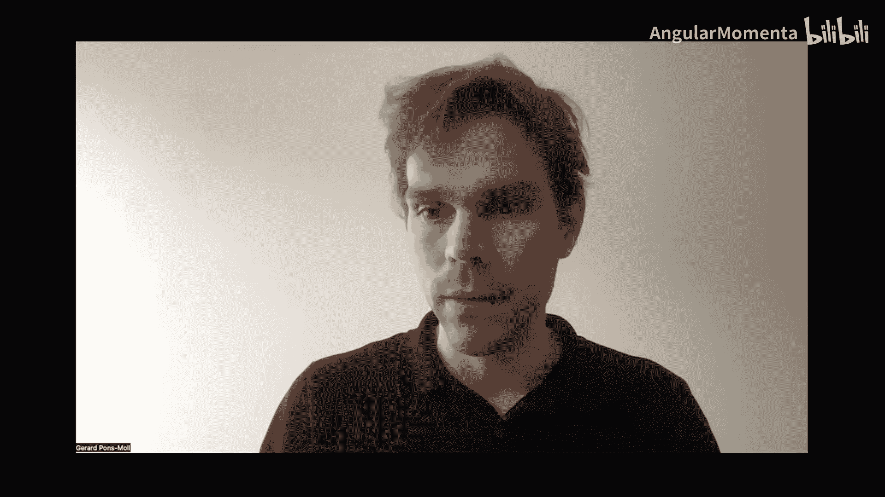

# 【精译】蒂宾根大学《虚拟人类》-p26-12.1.2-人体运动合成--BV1TAbkzpEva_p26-

So to derive the expression of the variation autoenr or the conditional variation autoender。

 we start with the scale dirgence between the approximating distribution Q phi and the true posterior distribution P of Z X and we develop the terms here so essentially we start with the definition that we've seen just right before and can using bi rule。

 we can expand this term， we can invert it better set like P theta of Z condition on x。

 we can revert it and write it as p of x condition on Z times the probability of Z and divide it by the probability of x that will end up at the top of at the numerator and then using the properties of the logarithm remember that logarithm of a product can be turned into a sum。

And then basically like this p of theta of x will come up as a sum。

 which will multiply this Q phi of Z x， and we will have integral of this quantity times p of x which does not depend on Z P of x can move outside of the integral and then this integral of Q of Z condition on x over Z should sum up to1。

 so you have this term here that does not depend on Z anymore。

 and then we have another term which is essentially taking this Q phi。

Of Z conditional x times the log rhythmith of Q Z。Conditional x divided by P of theta of Z and then we have the additional term。

 which is again this term here Q of Z conditional x multiplying this P of x divided of。

P of x condition on Z， but this term here， instead of having it in the denominator。

 we can have it as a negative right so because this is like using the properties of the logarithm。

 so we have these three terms here。So now the first term is the basically the marginal look likelihood。

 the second term is the k dirgence notice that this is exactly the same expression as before right but we have changed some terms so here on the denominator we don't have P of Z。

Condition on x， but we have P of Z。 So now this means that this is the k divergence between。

The approximating distribution Z conditional x and this distribution。

 this marginal over the latent variable Z， so we have the k divergence of Q of Z conditional x and P of Z。

And then here we have this minus and notice this an integral that and we have this term here multiplying this quantity here。

 so essentially we're integrating and weighting every contribution of log of P of theta by this posterior distribution here so essentially this is the same as computing the expectation sampling from this distribution set conditional X the expectation of what of this quantity over here right that's basically from the definition so we have this three terms here now and。

Like moving things like if you look at this and you move this term on this side and then you move these other terms on the other side。

 you end up with an expression that looks like this。We have here the log probability of x。

 this is the marginal of the observations that's the one that we want to maximize with respect to the model parameters data and then we have minus this kl divergence between this。

This an approximating distribution cu of Z conditional X and the true posterior Z conditional X。

And we want to minimize this quantity because we want this approximationq to be close to b right and so this will be equal to this expectation of lock of p of x condition and z minus the k divergence now from the posterior approximating this posterior and this marginal over the latent variable Z。

And so essentially， what we can now say， because the k divergence is always positive。

 we can derive like what is called the evidence lower bound。

 we can say that the likelihood of the observations or the log likelihood should be bigger because this term is bigger or equal than zero。

 this should be bigger than this term over here， which is this expectation of lock of b of。

X condition on Z minus the Kl dirgence。Now。It there's my many interpretations of this。

 but one way of interpreting this is that now basically like we are。

 or let's see this in the next slide， maybe this will be more clear。

So so this term right in the variation of encode this term is basically what is。

Is like the encoder so basically like now we are we start with the observations X and with an encoder we land on those regions of the parameters of parameter space Z which are likely to have produced this observations x that's why it's called an out to encoder or variation out to encoder because like x gets。

Gets mapped to one latent variable to one distribution over Z and then from this distribution we sample and we decode right to produce the observations X so we have here this is the encoder and this is the decoder right which measures the likelihood of the observations condition on this sampled Z variable。

And this is like an interesting。Interpretation because now like to basically find the zs that are likely to have cost x。

 we're using an encoder so we're going directly to the regions that are likely to have produced this x if we had to search over all possible zs that have produced x。

 this would be like more difficult and computationally more expensive。So that's one interpretation。

 so basically encoding this inference given a sample x we derive the inference posterior and draw a lightnt variable Z and decoding is like the generation process where given a latent variable Z。

 we generate a sample x prime。And maximizing this term is equivalent to minimizing the difference between x and this sampled decoded x prime sample。

So this term is used for data reconstruction and in practice in many computer vision and invertto humans applications。

 we use the L1 or L2 distance between these generated samples and the observations that we have。So。

Basically the inference posterior has a known form with unknown parameters and the latent prioror can be either predefined or learned from data and when both of the terms are Gaussian。

 the KLD term has a closed form expression and when this term is0 we say that the inference posterior is independent of x so when this term is zero notice that this is comparing the distribution of Z condition of x with this latent prior so when this is zero it means because this is not dependent on x it means that our inference posterior does not depend on x and when this happens we say that we have a collapse because are not leveraging the evidence of we're not leveraging x to map to Z right so this is typically a degenerate case。

All right， so we maximize this lower bound to train the variational out encodeder via back propagation。

However， we said that the variational encoder requires going from x to Z posterior and then basically sampling from this posterior。

Now and the parameters that we want to back propagate through are these networks and these networks are you have a network。

 let's go back like maybe to understand this better like these Q phi and P theta are parameterized with neural networks and so we want to find those neural network parameters phi and the neural network parameters theta in order to。

In order to basically maximize this lower bound。And the problem is that we said that we are mapping X to Z。

Or to the posterior sorry and then sampling， but then sampling operation is non differentable。

So how are we going to solve this problem so we're going from x， encoding it into a distribution。

 sampling that and decoding it to obtain x prime。But you know。

 if we want to make x prime to be close to x， for example， like minimize x minus x prime。

 we need the derivative of x prime with respect to phi。

But this means the derivative of x prime with respect to Z times the derivative of Z with respect to phi。

 which parameters the encoder here。But how do we know this derivative because Z has been sampled from a distribution？

Well， there's something that is called the repromeization trick， which is actually。诶。

The thing that I like the most about this paper， which basically allows you to take derivatives through this sampling process。

So how this is done is in a very smart way， so if we assume a Gaussian distribution for this P of Z condition on x。

 we can actually have an encoder。That will predict。嗯。Instead of predicting the sample directly。

 I'm sorry about this， it's quite annoying instead of predicting the sample directly。

 you will predict the mean and the variance or the covariance of this distribution and so this mean and variance will be parameterized with this nole network which is the encoder phi and it will be also a function of the input x as well。

And now given this， like the sufficient statistics of the distribution mu and sigma。

 we can sample right that by sampling like from this。

From this normal distribution with zero mean and unit variance。

 and then we can basically obtain a sample by shifting the mean to mu and scaling the variable by sigma so that we have the desired mean and variance and now we can decode to obtain X prime。

So why are we doing this and here's the nice property so now we can compute this derivative of Z with respect to5 parameters because all we need to do is to compute the derivative of mu of this sample right which is mu plus sigma times epsilon epsilon being this sample from the normal distribution。

with zero mean and unit variance， and so when we can basically take these compute these derivatives easily。

 so we have achieved what we wanted， which is differentiate through this sampling operation process。

We is。Which is quite nice， simple， and very useful。あ。Yeah。All right。

 so sometimes we're also interested in conditioning these variational encodederrs on some additional data。

 some conditional variable here C so we can basically condition both the encoder and the decoder。

 many times like we only condition the decoder， but then you have like similar derivations for these conditional variational outender。

And that's exactly how this using one of these variational encoders is how you basically can predict like given the observation in this case。

 the mesh like different。Different possible solutions for the contacts and the object contacts and by sampling like what I've shown before by sampling different once you've trained sorry I forgot to mention something once you've trained the encoder and decor like what you can do a test time is basically sample from this。

Distribution and decode and produce different solutions。

 or you can just use the encoder if you have the observations。And basically using this。

 you can sample different solutions for the contacts and the potential object contacts。

So basically these are the sampled contacts using this conditional variation on encoder。

 which basically it says that for this bow it's likely that these that these are in contact and it basically tells you here with these labels which object is most likely to be in contact in this case like the feet are most of times like in contact with the floor as the one would expect and then you have here most likely to be chair。

 but you have also like you know other potential contacts like in this case like this is likely to be the bed and so on。

So this is a basically like。A way to condition on the scene。

 which basically is very human centric kote looks mostly at the mesh of the human。

So then like once you have these predicted contacts and potential objects。

 you can basically minimize an objective function， which has three terms。

 which is like an affordance term， a penetration term and a regularization term。

 perhaps the most interesting one is the affordance term， which basically says that。

For those vertices that are in context Fc， we want to minimize this FD distance。

 so these are basically thesetensors that tell you for every vertex。

 like whether they are in contact and which object is likely to be in contact。Right。

 we have this penetration term we've seen this before where we've minimized the distances when we have detected penetration。

 this means that the distance is smaller than zero if we have this signine distance field for the Sim。

And we also have like some typical regularization where the pole should be close to the initialization。

And using these， basically， you can generate static humans in scenes。Okay。

 but what about dynamic pose， what about generating human motion condition on the sea？This is a much。

 much harder problem because it requires to do some sort of。

Planning and think about goals and like which things the human wants to contact and so on。

So one of the first papers that produced like really compelling results was this paper called F function neuralural networkss。

 this was a s of 17 paper and basically given 3D terrain and a type of motion basically they synthesized the sequence of 3D pose such you can see here。

The human is like the virtual human is adapting to the terrain and so the bow is adapting to this different terrain。

So how is this done， so there's three main challenges。

So one is how to obtain the data to train such a model， it's not easy to capture。

People interacting with uneven terrains。And how do we encode the motion and the terrain together？

And finally， how do we perform inference？So regarding the first challenge。

 so capturing data with varying terrain is very hard。

But what we can do and this is what is done in this paper is to record a subject walking and climbing stairs right and walking up a chair and down a chair and so on and then like we have the human motion data and what we can do is then to feed the terrain to the feet of the character in order to have the pairs of humans and terrain so this is one way of doing data augmentation to obtain the data that we're interested right so oftentimes you don't have exactly the data that you want so you have to be creative and this is one way so how you feed the terrains is using if I remember correctly like using surface patches which are parameterized with splines and then you optimize the parameters of the spline to feed the feet of the virtual human。

We've seen like these in lecture three， how to parameter Immet like local patches of surfaces with this spd like surfaces。

Also let me play the video here。So this is the originally captured data and notice that this data is captured without the terrain and so you see the human like。

Like going up and downstairs。 and so then this is how then like these different terrains are fitted。

Into the human。Now。How to encode the motion at the rate。 So there's many ways of doing this。

Basically what is like relatively common is to encode as input the joint locations as positions。

 the joint velocities and to also encode the root trajectory because the root trajectory is very important for animation and basically also the root velocity and now the interesting part is how to encode the terrain and so this is basically done by sampling with these are these dots here that you can see along the trajectory so basically you sample along this fixed dots。

And then you measure the height of these dots。So this is basically given to this autoregressive system and based on these height scalar sampled around human trajectory。

 we will predict these future joints， the future velocities and the future root trajectory and root ve。

You might wonder what is this phase here and we will get into this next so the phase is an auxiliary variable that cycles between zero and two pi and it represents the progress of once walking cycle so zero could be a foot lift off and two pi is when we again land the foot。

So without the phase， what happens is that the neural network tends to produce overly smooth results because it averages poses that are not synchronized in time。

 and so the motion looks stiff and has food sliding artifactefs。

And so here I believe there's a comparison between these two。

Like this is without using the F and neural network。And。I may say this is split。Right。

So you see that there's。If we don't use。This phase functional neural network will have like foot sliding。

 which is resolved then。If we use this space。I don't have time to go exactly into the details。

 but then how this is done is like theres a phase that parameter arises。

Like a neural network and then basically basically like a variable that controls all the weights of a neural network and then basically like you have you could think of it as like for every different phase I have a different neural network that makes different predictions and everything is tied together with this global variable。

Al right， so and then like if using these techniques。

 you can synthesize these animations that look quite compelling。 So this was definitely a paper that。

I found it was quite impressive at the time， like what it could achieve。

Although it's a pretty simple model because it just uses this trajectory。

 right and then the sampling points in front on the back。And still。

 I can produce like a model that is reactive to the 3D。 So this is quite。Interesting。

I think what I also like about this is that it really is based on local geometry and I think that's what makes it generalized quite nicely to different terrains and different environments。

 because it's very local。It doesn't reason about what are stairs and what can different types of stairs。

 it only reasons about how high they are relative to the character。

And I think that makes a lot of sense when we think about affordances and how we approach and how we interact with environment。

 I think in some way， my intuition is that that's how humans achieve like this high level of generalization。

All right， so this concludes this lecture so or this part of the lecture。

 we have like that current models like the simple model cannot model humans as a function of the sin to synthesize humans in a static sin we do need to think about context or it's really useful to think about context。

And context encode code which body point touches which scene point and one way to generate context is using these variational outer encodecoderrs。

 there's others of course， but that's one solution and then we have like that motion synthesis can be modeled with this outerregressive system which predicts the based on past joint trajectories and like some information about the environment about the terrain it can predict the future and you can recurrently use this network to predict the future All right。

 and this is the end of this part and in the next lecture we will see more sophisticated models to synthesize human motion in the scene。

In things that are also dynamic， I should add， thank you and I'll see you in the next lecture。

