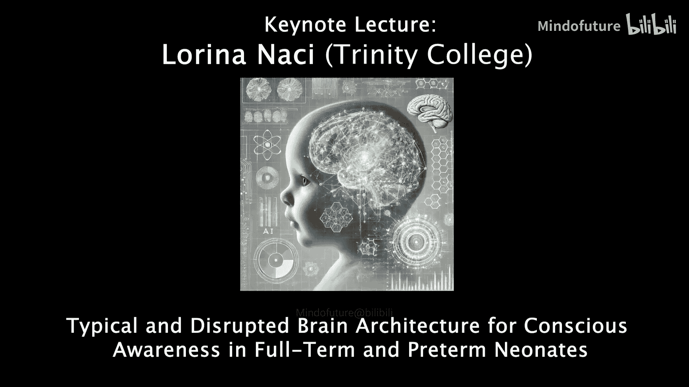
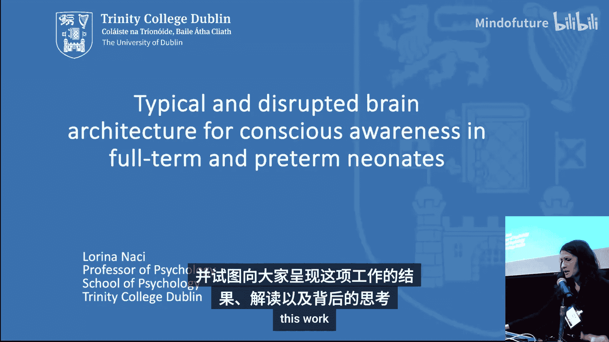
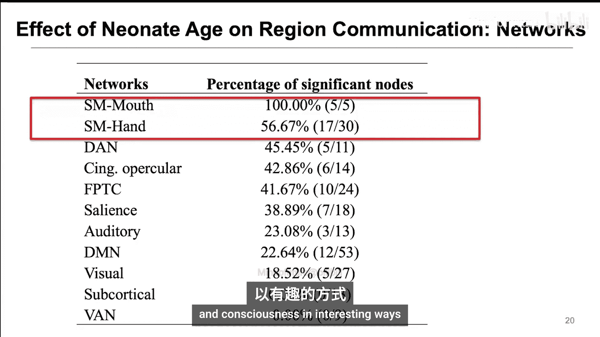
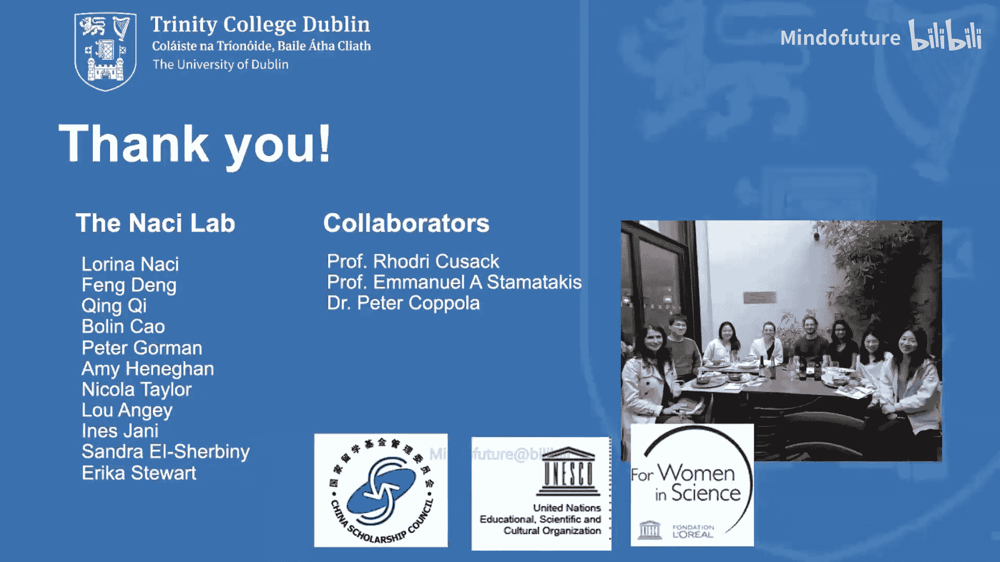
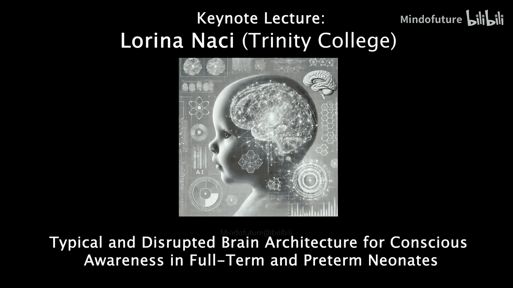

# 【纽约大学】 婴儿意识 ｜ Nyu Infant Consciousness p01 P01_Lorina_Naci_新生儿大脑结构-纽约大学婴儿意识会议_2025 -BV19zZXBUEMv_p1-

Thank you， Claudia， for that fantastic introduction。 I'm very grateful to be here。

 and I'm honored to be among esteemed colleagues and dear friends and very pleased to tell you about our work today。

😊，So this is a very exciting meeting。 It's the topic very close to my heart and to my studies in the last decade and and more。

 And what I'm thrilled about today is also that we have such an interdisciplinary group here that comes with challenges and opportunities and the challenges kind of to pitch。

 the level of description at the right granularity。 So I've tried to do that to my best。

 and we can discuss particularly I've kept the talk light on the weeds of the methods trying to to give you the results and the interpretation and the thinking around this work。

😊。

And。So nearly everyone who's held an infant in their arms has wondered what it is like to be a baby。

 And this is now seems seemingly pervasive curiosity and precupation among scientists and the lay public hasn't always been so。

 and even close to as close as 1980s。 Ins were operated upon without anesthesia on the assumption from the medical profession that there wasn't really anything going on inside and that there was no inner life。

 So。It's fair to say that there is rapid evolution of our understanding and really curiosity about understanding the infant mind。

And it's a very exciting time。 And it is fair to say that this area is probably at one of the great frontiers of consciousness science。

😊，So there is disagreement with regards to when when consciousness starts。

 what's the onset of consciousness in human development and led by Tbane and Jo Fwick。

 we review the literature to understand the state of the art of where people where the researchers are placed in this disagreement and there are two birth camps。

 one that is quite happy to think about an early onset around birth or even in the last few weeks of pregnancy and a late onset camp。

 that really for whom the presence of consciousness hinges on more higher level the presence of higher level cognitive faculties such as decision making reflection。

 introspection and then in that case we're looking at the end of the first or second year of life before we can say that consciousness is present。

So because infants cannot tell us themselves what they think or feel it's very challenging methodologically。

 And from a lay perspective， to really under to。Unravel what their consciousness might be like， but。

As far as my perspective， perspective is concerned。

 I take inspiration from my long work in the area of other populations that are behaviord nonresponsive。

 The lack willful behavior， such as individuals who become。

Severeely brain injured after severely brain injured and then become be nonresponsive and in some cases。

 harbor covered consciousness， so we have to really develop neuroimaging methods to really understand what's going on with their level of awareness and also with reversively abolishing consciousness under dependyia we have learned a lot about neural correlates of consciousness and more broadly features of the functional neuralarchitect that supports consciousness in the adult brain。

So。I'm not going to review that literature， but I'm taking the assumption that that is something we can discuss later that a lot of you will know about in the clinical context。

 consciousness is assessed by looking at two dimensions so this is for populations for home consciousness statuses in question。

 arousal and awareness in all of us is two dimensions are alive and well and arousal refers to our ability to open eyes to have sleep wake cycles and awareness is assess。

By are the individuals able to follow commands in particular like at the bedside。

 the doctor might ask for the individual to raise their hand or to track something in their visual field there are particular protocols around this。

 but this is the gold standard for the clinical science and of course。

 verbal report is really important for determining awareness。Now， in the infant。

 these tools for awareness are not available。 Of course， infants have arousal。 They open their eyes。

 their they appear to be asleep。 They wake up and so on。

 but awareness is really challenging to determine objectively。 And so this is where I think the。

 the challenge starts。And the profound limitations of the newborn infant。

 the behavioral limitations then make it difficult to ascertain consciousness and the approach that I take to making progress in this area is to actually look at whether in the neonate brain has the capacity or the neural architecture。

 the way that we know the brains organized from adult studies to support conscious awareness。

And this is what I'll be talking about today。Importantly。

 this is where neuroimaging comes into play and it's such a wonderful tool for providing a window into the minds and the brains and the minds of the neonates and much as we have learned from brain injuredd individuals。

😊，And traditionally it's been difficult to scan neonates because they are rely。

 but technological developments are really enabling a new era of advances and here's some pictures from the Human Development Connect Tom Project at King's College。

 London， which is leading the way in and acquiring the largest MRI。Cohort of In imaging。

In some cases， infants need to be swaddled to stay still in the scan， but it works。

 And we are starting to learn a lot about the infant brain。

 but a lot still remains to be to be understood。 So， for example。

 we know that the third trimester of pregnancy from 28 weeks onwards is really important for the development of the brain。

 such as the cortical folding， developing at this time and also axonal。

Connectivity and neurogenesis is completing in the perinatal period。

 So this is a time when the brain grows faster than all the other periods。

And so what's really nice about this cohort is that we have a large amount of data。 We have high。

 temporal and spatial resolution of the FI image。😊。

And we have 282 neonates that are born at full term。

 and then we have 73 neonates that are born preterm。And scanned at term equivalent age。

 So this is a really important comparison when we're looking at the effect of prematurity for clinical manifestations or clinical implications。

 because。The infants are at the same age。Another critical comparison here is that of infants that are born prematurely as scand before term equivalent age of 37 weeks。

 because this allows us to have a natural。Moulation of infant age in this in this group。

 and if you're looking to place the onset of consciousness in time。

 then it's really important to have this younger group of infants。

We also have176 adults who are from the Human Connect on Project。

And so here I will discuss three studies that deal with features of the neural architecture。

 the way that the brain is organized in the adult that we have learned over many。

 many studies appear to support consciousness so。Again。

 trying to take a stab at where people's understanding is with regards to functional organization。

Most of you probably know that the brain is organized in functional networks shown by these different colors and functional networks are parts of the brain network together to achieve specific functions。

 and they're not exclusively involved in any function or the other。

 but they primarily carry out certain tasks and they work in tandem with one another。

Important we have learned that two types of brain networks。

 that default mode network shown here in red in the middle of the brain and the fronttoparettal networks which are two networks。

 those attention and executive control networks that are。

laterally on the brain show a reciprocal relationship shown by the scholars that are antipo。

 so hot versus cold。 then they switch， but primarily the idea is that this is one of the most replicated relationships in cognitive neuroscience that one of the network is up and working hard。

 such as the default mode network， the other networks。

 different part networks are suppressed and they work in tandem in this antipo manner。

 and this has also been shown to be abolished with various state manipulations of consciousness。

 It appears to be a robust neurocorrelate of consciousness。

 I'll tell you more about this in a minute， but this is the first relationships that I wanted to look at。

Then we are also looking at the functional small world architecture， what does this mean。

 so this is basically another well- establishedablished principle that the brain is organized in a small world fashion。

 but which supports the differentiation and the integration balance of conscious experience what this means is that connections in local parts of the brain are more dense between the networks and across more distant parts of the brain connections are sparse to enable efficient integration of those differentiated and very specific representation。

 so that is very briefly introduction on the small world architecture it's also very important and well replicated in terms of its modulation by consciousness state manipulations。

 but a functional small world architecture captures more static quality of the healthy brain organization。

嗯。😊，And we know that the brain is not static at all and that in fact。

 the dynamic evolution of the balance between segregated and integrated types of representations has been 25 years ago now postulated to be a generic feature of consciousness and this is the complexity of the brain signal。

 the idea that the more complex the signal of the brain。

 the more able it is to support conscious experience。

 and Tonian and Endman were the first to suggest this and this principle of complexity and became the foundation of the integrated information theory and complexity has been used as a proxy or consciousness。

 it scales down with consciousness in deserves of consciousness with states that are behaviorally less aware。

 less appear to be less aware such as minimally conscious or unresponsive well states。

Complexity scales down。 So it's also very good measure to look at。

So I ran three studies in my group to look at these three features。

 and I want to stress here that we are looking at the capacity。

 understand this to be the capacity like the infrastructure that is enabling the conscious thoughts。

Not the content of conscious awareness。And the first study was published three years ago now and at that time we knew even less than we know now and basically I have described the two frontto parietal networks。

 or attention executive control， they are primarily very responsive to attention to external stimuli and gold-dn behavior in broad strokes and the default mode network again in broad strokes is very involved the self-referential thinking self-aware。

 introspection biographical memory and they expressed this relationship that when front of partal networks shown here in pink and green are up。

 the default mode is down and vice versa， so this is a very regulated relationship when we started the study even the idea that high order networks such as the one I described are actually present in the infant brain was controversial。

 maybe there's two or three more studies now。agreeee with our study。

 but the majority of the studies up to this point suggests that。

These high order networks are developing in the brain by the end of the first year and onward。

 so that was the first gap that we wanted to address with this large cohort of infant imaging that I mentioned and also this antipo relationship had not been investigated so that is what we ask and of course we want to know what the effects of premature birth are from the perspective of early and neonate age。

 those infants who aren't yet at term van， but also from perspective of clinical implications。

 what is the impact of premature birth。So here are some connectivity mattresses looking at network connectivity。

 I'm going to guide you through these in a simplistic way。So we have this pixels。

 this the small boxes represent connectivity amongst the different regions of interest that are part of each network。

 which I haven't represented for simplicity。 But importantly。

 red means strong connectivity and blue means low connectivity and the squares around the center diagonal here。

 represent the connectivity of each of those networks。 So in green， the man。In bluee D A N and E C。

 N in red。 So the more， the more red those colors are in those squares。

 the stronger within network connectivity， the more distinct the identity of that network。

 the more is interconnected those regions are among themselves。DAN is， oh my God。

 DAN is Dorsal attention network and ECN is executive control network and they're both part of the frontip parietal accent。

😊，Thank you for the question。 And this is the adults。

 And this kind of sets the template for how this connectivity looks。

 This is our baseline with very strong connectivity between the networks and in blue。

 weaker connectivity between the networks So the DAM and DAM connectivity is represented here。

 And so what we're looking for in the first instance is whether these networks are present at birth In other words。

 do they have this distinct identity。😊，And you can see that， let's say。

 from adults to full term birth， we see sort of a washing out of this connectivity pattern。

 But still within those squares， you can see a red， you know， connectivity， strong connectivity。

 even though it's more patchy。 And as we go。as we go towards infants before term equivalent age。

 we can see that that sort of structure we can even visually inspect is being diluted。

And at a more higher level， I think a more easy way to represent this。嗯。A term equivalent age。

 term equivalent age。 so that is infants that may be born at 26 weeks as they grow by the time they reach 37 weeks。

 they are said to reach term equivalent age， so term equivalent age is basically close to full term born。

 it's a healthy period to for an infant to be born。嗯。And。

Another way of looking at this that might be easier。

 So I will invite you to first look at the bottom panel doing here at the bottom panel with a three call called it executive control network nodes。

 dorsal attention nodes and default mode network nodes。 So this is multi dimensional scaling。

 which allows us to。Reportray the connectivity profile of different regions in a in a multidimensional way。

 and and basically the regions that are close together are showing a connectivity profile that's similar to one another。

 And so the components， if you were of the executive control network are close to one another。

 that's showing our the distinct identity of this network。And the D A N also has a distinct identity。

 So does the DN in the adult brain。 And this is where're looking for this in the three infant groups。

 So if we go across to the right， then we can see that this regions， this。

 this components of each network are are coming closer together， They're less differentiable。

 but still statistically， you can differentiate these clusters from one another。

 So this statistically tells us that at full term birth。

 the three networks are distinct from one another。 therefore we say they are present based on our。

Definition。And as we move towards before terminal equivalent age， statistically。

 we really cannot differentiate these networks from one another。 They are overlapping。

And they that their relationship is， is still， their identity is present， but weaker at。

Infants that were born premature and have now grown to reach term advantage。

So what this is telling us is these networks are present by full term birth。

 And when infants reach term voltage， they are developing from in preterm infants upper to term voltage。

 according to a pre preprogram developmental trajectory。 They are weaker。

 so we can still see the the effect of prematurity as preterms reach term voltage。

 but they are there。 So that is the first。Finding the second finding is looking at this。

 what I've defined anti pose relationship between these networks。 And in yellow now。

 I have highlighted。Connectivity between the network。 So I think these are a little bit。

Counterintuitive or maybe not so intuitive to look at。

 But if you just go with the explanation that the area we're looking at here is representing the connectivity between the default mode network and the dorsal attention network。

 And it is in blue。 And it is that is a representation of this low connectivity。

 These networks are not active at the same time。 So they they have low connectivity in some cases。

 that might be anti correlated。 And this is what I'm referring to as statistically as this antiposed relationship。

 And this area is representing connectivity between the dorsal attention network and the executive control network。

 and it is warmer in color。 from the parietal network typically function as a pair in their own function。

 And that's why they are more strongly connected。 So if we look at。

At the adults then our definition for the antiposed relationship statistically here is that the connectivity between the default mode and the dorsal attention network is low。

 is significantly lower than between the front of apart idal networks amongst themselves and this is what we see in adults。

 this is sort the fire baseline， and then if we go across to the infant groups。

 we see that this relationship is present statistically in the full-ter born infants and infants and term equivalent age。

 but not in infants who are younger， so they are before term equivalent age。

So this is a very brief summary of the findings from the first study。

 And this is an illustrative representation of what I have just shown。

 We have these three networks and their relationship， and we have these four groups。

 three infant groups。 So at term equivalent。All these networks have been shown to be present。

 including their relationship， the dorsal attention network starts even before terminal voltage。

 but not the other two， and they are in a pro obviously they are developing they are not as robust as when individuals are adults。

 but that doesn't matter for our purposes what we have shown here is that the frontpart networks in the fold mode and their relationship are present but from terminal voltage。

 these are key networks of the brain and they are very important for supporting cognitive function。嗯。

And， and consciousness。So this also shows that the third trimer is critical because the infants that are young before they reach this term advantage of the end of the third trims of development don't have these features。

 So we need that time the the brain needs that time to develop this features。

 some related destruction persists。 and overall， having this。

 this feature of these networks in present in the brain supports an early onset view。

In the second study， we looked at the development of small world architecture and。

As you are well aware， conscious awareness or consciousness has the qualities of differentiation。

 so any experience that you can think about will have a very vivid specific feature site。

 smell sound touch and but they are that while we can hold this in mind individually。

 they are also part of an integrated conscious experience much like being immersed in the street in New York and it is thought that the small world architecture of the brain through its dense connections within networks that supports specialized representations and spae connections across the brain that supports integration of representations is facilitating this qualities of conscious experience and up to this point we didn't really know whether infants have this small world architecture organizations and whether what's the effect of early in your night age and prematurity。

 so that is what we。Studied in the second study。 And here I have three panels。

 And for the purpose of this。I just， I guess the key point to point out is that we have a measure of small wordness that is basically the balance of integration and segregation。

 but we can also measure the extent of segregation and integration on their own and the goodness or the the fitness of each of these goes in slightly different directions in opposite directions。

 So don't worry about that。 the main takeaway from this is that relative to adults which are in blue。

All the three infant groups full term preterm at or preterm before term。

 all of these three groups have a lower small awarenessness and lower segregation and lower integration than adults。

 So that this is sanitary is as it should be。And what another thing that we did is actually。

Use a a more crude summary measure of small word organization。 That is a very well accepted measure。

 and that is a threshold measure that we performed according to different methods to validate。

 and this is the 0。6 value that has been postulated that is a threshold for the presence of small wordness。

 and what we found was surprising。 that was that with this threshold measures。

 we can see that over 70% of infants born before term equivalent age have some version of small word organization。

 So I'd say it the pro small word organization。 But it was surprising to us that even at this young age that this small word organization has begun to to play out。

 and of course， fullter born infants have a big jump。

 So over 97% of them have small word based on this。Treshold measure。

So that is the first finding in that the takeaway is that actually small word organization is present in the majority of neonates。

嗯。We can also look at premature birth and neonate age individually are on their own。

 The fact of premature birth is comparing the two the full term born and infants that are terminal in age of the same age and the and the。

Neonnate age is basically comparing younger infants to the full term born。

And so when we look at the effect of prematurity， there is lower network segregation in preterm infants at term age。

 so prematurity still has an effect by the time infants reach fullterm birth and neonate age。

 so the younger infant relative to the older infants have more pronounced disruptions of their small wordness。

 so small world network integration and small wordness overall。

So this is telling us that differences exist that small awareness is developing as infantsry move through that third trimester。

Now， small awarenessness is a global measure of how the world is the whole brain rather is organized。

 and we wanted to look at more functionally specific regions to see whether there are some regions that develop faster versus slower in this period with regards to small awarenessness。

And when we look at that effect of the prematurities of the infants at the same age。

 we see a few significant differences。That they're there， but they're not massive。

When we compare infants before term conage and infants that are at full term births。

 we can see that out of the 11 networks that were investigated。

9 show disruptions or or a massive rather undergo massive development in this third trim mess or so they are disrupted before term conage and。

If we look at what these networks are， we might glean some information about the kinds of functional relevance of the development in question。

 We expected based on my first study that the higher networks are the ones that are showing the most rapid development in the third trimester。

 because。Amongst other things， the， the infant mind is developing and is。

 is trying to get the capacity to grapple with the world。But actually。

 when we order the effect of the networks。What we see is that the highest proportion of growth happens in the Soatot network theyre mentioned here as mouth versus hand based on their areas that are being represented in the soatot network and that this growth in the soatmo network it trumps so is more widespread than in the high order networks。

 the dose potential singular per frontto parietal control network。

So this is was really interesting and surprising。And in fact， how do we interpret this。

 This is in agreement with recent thinking around the role of em cognition and a recent review by by Anna Sarah Niika。

 I'm sorry， I probably don't pronounce your name correctly。 You know， pointed out that。

Infants in addition to being prepared for movement。

 that the role of the somatootary networks in the brain actually is subserving is facilitating the early development of the individual's core functions of awareness。

 including physical boundaries position facial visceral states all types of development and capacity that the infant must that can be a priority of the third trimester of development and our data supports this idea that this is one in view that explains why the soma network appears to be a key priority of development in the third trimester。

 and it suggests that in addition to movement that capacity。

 the genesis and the evolution of the capacity or the organism to understand its own place and it interrelationship with the world。

 these are really。AityOf development in the early period before birth and around birth。So the。

 the interim of the study， too， is that。We have the in blue， the adults。

 and then we have the three infant groups that show lesser than adult levels of small wordness。

 but they all have it， so that's the check mark， they have some version of it。

And that the the the younger neonates before there is terminal end show this massive explosion of development。

 particularly some motor in high order networks。 And there is significant parameter related differences that remain up to terminal end。

 but。That is really to be seen how what's the function relevance of that is as the individual develops after the full term birth。

So then the， the third study。That I wanted to touch upon really briefly is this the development of neuro complexityplexity in the newborn infant and probably all familiar with the concept of complexity of brain complexity and that in some theories。

 three minutes okay is essential for consciousness it has some essential role for consciousness awareness in disorders of consciousness。

We have seen many times that complexity measured by entropy is decreased as consciousness level is decreased。

 So that is what we expect It might be the case in infants。

 if you come from a view that infants are sort of a diminished version version of of an adult in their capacity for awareness。

But there is also the entroic brain hypothesis that is proposed by heart Harris in 2014。

 And this suggests that actually entropy and consciousness don't have a linear relationship。

 but there is an inverted curve relationship that。Means that there is a critical level at the top of the inverted2 curve where normal consciousness is located。

 could be located。 And then on one hand， we have highly reduced entropy in states of loss of consciousness。

 such as coma anesthesia， deep sleep， this are ordered states with very low flexibility in the and the repertoire of changes that can happen。

 But there is another end to this continuum， and this is the over entroic continuum where sex it's occupied by things such as psychedelic states dreaming and so on that are states of high entropy disordered thinking。

 perhaps and high flexibility in the types of states that the brain can inhabit。

 So this is important in terms of us trying to figure out where do infants fit in this picture。

 and this is what we were trying to ascertain。And again。

 I have three measures here that I have mentioned before。

 and we have adults and the three neonate groups。 So the first thing to take home from this slide that is again。

 complicated is that relative to adults in blue， all the three infant groups have an overenttropic state。

 So they don't exhibit lower entropy than adults， but they have higher entropy than adults。

So infants in the， in our hands come up here at at the higher entropy end of the spectrum。

And so we can also look at where each infant group fits with regards to its entropy relative to fullter neonates and what we see is that again。

 preterm infants are overenttropic relative to fullterm born infants。

 So this is starting to look like a consistent picture。

 So instead of these groups being in this end scaling up with you know with age and and prematurity they are scaling up in this other way。

 so it seems that consciousness or rather capacity is reducing in complexity and we can when we compare the two infant groups together before term that are premature。

 but one is young and one is late we see that preterms before term so the younger infants are even more intropic relative to the fullterm born and we can also look at the relationship with age in the preterms that are premature and we see a negative relationship with。

The age in this young narrow age group。 So again， this is this is telling us that entropy decreases with a young infant age in the third trimreester of development and that Fulernborns have higher entropy than adults。

So on one hand， this is surprising it's not what I would have expected based on my work with thes of consciousness。

But so how do we interpret this with regards to the full term born， this maybe is interpretable。

 and this is not yet published。 I ask that this results are not shared widely just because they are in the process of being published。

And then the journal ask as that。 But so the overentroppic state in fullter burns in particular might be fitting with Aliison Gobnik's idea。

 a proposal of a lantern of consciousness in in infants。

 and suggesting that unlike a spotlight of attention that there is a broader casting of of less focused attention in infancy that and what we might be seeing here is that overentroppic state being the neural underpinning of this a highly exploratory state in which infants are are meant to be exhibiting as part of their development。

 So that is on one hand， but on the other hand， I'm not quite sure how that fits with the fact that preterms reform-term equivalent age have even higher entropy。

 So in that case it might be that actually being anenttropic state is not really conducive to stable representations。

 it's hard to know based on this data， but I do find these result intriguing。

And in the interest of time。I'm not going to go over。Okay， okay， thank you。 So basically， sorry。

 this is the results overall that we have this from the paradigmon default default mode networks and their relationship in study1 and 2。

 the X here is that we did not find these networks in preterm infants before termical and data。

 but we did find some version of small awarenessness。 So things are。

 are being are are not as developed in young infants before 37 weeks。 But the。

 the evidence is patching。On the other hand， with entropy。

 we found that all the three infant groups are over intropic relative to to adults and that entropy actually scales up with younger infant groups。

 So I think this is really intriguing。 And that's why I say the question mark here。

 because I am still trying to figure out what the functional relevance of this finding is。😊。

But let's bring this back to， I started with this idea that its possible to understand the capacity or the neural architecture for conscious awareness in infants so like to what are we learning So how can we put this in the context of what we know about neural markers。

 particularly from adults， What does this all mean。I think， I suppose my。

 my last point here is that we need to be cautious and that there is a trade off between the sensitivity and the specificity of the markers。

 And when we're not talking about behavior， we have to really assess what it is that we are learning。

 So when we are looking at。Healthy adults command following and verbal report are highly specific markers of awareness and particularly they mark agencies so that is very clear and there are they're very each marker has very high confidence they are highly specific but they can also be low in sensitivity because there are situations where healthy adults don't exhibit this behaviors so then if we're looking at chronic brain injury and。

Even more impaired individuals than we can have other markers such as as willful modulation or brain activity in the absence of the behavior can be said to be a mark agency。

 Then we can go to states that where arousal fluctuate。

 So they're not really able to pay attention to instructions and they're not able to consistently colorlocoms with our brains。

 And here is where work that haven't mentioned has look at naturalistic movies to capture attention over time。

 And that is more sensitive marker because not compared by awareness。 but again。

 here we're moving toward less specificity but more sensitivity。 when we're then looking at infants。

 I've presented several potential markers and there's others that haven't mentioned that were reviewed with team and Joel。

 including our prediction as integration。 So we have now。

 I think a cluster of markers that if overall， they point in the right direction， even individually。

 they're not as specific。They are more sensitive。 and overall， they。

 they increase confidence together that we are looking at something more solid with regards to the internal life or the capacity for internal life。

So。In summary， some features of brain architecture are present by full term birth or term equivalent。

 but not before the third trimester of infant development is critical， I think。

 for the neuro architecture。This results support the infant view with regard the early onset view with regards to the capacity for awareness。

 we do find evidence for non nonlinear changes in perinatal complexity and intriguingly。

 this results suggest that experience is different from that of adults and infants。

 And this has challenges and opportunities。In terms of future directions。

 we want to see longitudinal data so that the same infants can be followed over time。

 and we can see after birth， what is the relevance of these markers for。

 for the incipient behaviors that are coming online。 The cluster approach is needed。

And more importantly， we want to actually and try and understand what it is like to to be an infant。

 That is what we're trying to get at。 And together with our results showing that there is higher complexity and the suggestion that potentially infant experience is different from a that of adults。

 We also have evidence from older infants like up to nine months or before of this concept of perceptual narrowing where the infants broader capacity than adults to discriminate faces of the same of a different race from ours or different ethnic groups or to discriminate non-native phonemes in a way that adults can this capacity for this broader discrimination narrows around the age of nine months。

 So there is something different going on there with adults relative to infants。

 And also infants some satisfaction shown seem to have a different sense of time in terms of chunking of events in a naturalistic stream in。

Longer events as opposed to shorter events compared to adults。

 So this is something really that is going to become。

 I think then the next really exciting ground to try and understand what this measures are telling us about the experience of infants。

 And the way to really make progress in this direction is to look at a awake infant infant neuroimaging。

 as they are engaging with complex simulation such as those that I have worked on in behavioral nonresponsive groups。

 particularly movies are very， very engaging for infants。

 So this is a two month old who's paying attention to a movie being shown in the scanner from the work of one of my colleagues showing that really there is a high success rate of scanning infants and that is where we need to go。

 So thank you so much for your attention。Yeah， it was a fantastic talk。

 so it's common in thinking about consciousness in adults to distinguish between consciousness and attention。

But as far as I could tell all three of your measures really didn't distinguish between them。

 you did mention in the discussion of the Gpnik thing that maybe you might think of infants as having a less control over attention。

 maybe no top- down attention with maybe more or less equivalent amount of awareness but anyway I'm just wondering how the distinction figures in your thinking。

 Yeah， that's a very good question and there's very complex a topic so on the one hand when we're looking at at markers in the absence of stimuli。

 we really can't look at attention so that is one limitation and then when we're looking at neuroimaging the capturing of brain activity according to regimented protocol that are stimuli based then we often are looking at the engagement of attention and be using attention as a way to trace the development of the thoughts so a lot of the neuroimage。

based measures of conscious awareness， particularly around similar response agency command following those kinds of more specific markers of awareness that have discussed really I rely on on the capturing of attention to help us interpret what's happening in the mind。

 so I would say generally in my work I haven't made a strong distinction between the capturing of attention in a conscious。

Task related thought process and and consciousness。

 but I know that there are areas where those two dissociate and it's possible to study with other means。

 And yeah， so with attention and the ability to really engage with the information processing in a direct cognitive way that is what I was referring to the work of Aliison Gobnni and I think Aliison is in the audience so she can help me out is needed later as well。

 but。Yeah， I think that's where the boundaries between the two become more fuzzy and also I think when we don't have attention as a guiding kind of light in cognitive neuroscience it is harder than to interpret what's happening in consciousness in states where we don't have behavioral reports。

I don't know if I'm answering you precisely， but it is， it's a good point and it's a complex one。哎。

Thank you so much。 I'm here。Hi thank you so much for an amazing talk。 I really learned a lot。

 So I have two questions。 The one is about how do you define consciousness。 So what do you mean， So。

 yeah， what's your operational definition of consciousness。😊。

Concious awareness and the second one is more methodological。 So let me try if I use metaphor。

 So suppose I am climbing a mountain。 Yeah， so the skills I need the first steps are not necessarily those I need to the last steps yeah。

 but then the question is， if you take are the reference point the adult。

 you know organization your own organization work down to the first steps。

 I wonder if this it's like the good approach because after all。

 what you need at the first step is not necessarily what you need at last step So it's like minimal doesn't mean less。

 it means that you need the skills that you need at that particular step。Because otherwise。

 it'll be like， So then the methodological question would be， is it， it， is it really。

Useful to take as reference point the last， you know。

 the mountain climbing as a reference point for consciousness at very early on。

 I don't know if that makes sense。 Yeah okay yeah， so those are very good question。

 And I think the beauty of being indisciplinary group is that we all need to think about those are those are more comments。

 I would say they're not necessary， I give you my view。

 but they're not points that have a worked out answer because consciousness。

 particularly in groups that don't tell tell us for themselves doesn't have very well worked out answer。

 So in the first first instance， the first question is you know each of us here might have a slightly different definition。

 more more welldeveloped definitions for the purpose of of my talk。

 I look at consciousness as capacity to have an experience a subjective point of view。

 So it's a very broad and。Apart from the studies that are looking at stimulus response。

 I'm not really going really so much into the definition of consciousness from an operational perspective so I'm looking at the capacities and that build on previous work but that's not very controversial second it's very good point that what we are looking at in adults。

And I alluded that to in at the end to that it might be very different to what we're looking at in infants。

 And that's very， very exciting。 So， for example， you know。

 preterm infants before trauma and age are rather young here。 The group is between 32 and 35 weeks。

 So not too young， not too young。 They still have cortic Islamicic connections。

 they still have the the sub。😊，The substrate that enables a conscious awareness in the brain if we see that consciousness is enabled by the brain。

 which is the view that I take， so it is not unfeasible even though some of my results suggested that this infants are not as capable for conscious don't have the capacity as developed as the older infants。

 but they have a higher complexity so it might be possible that there is an in between ground where the way that the brain develops is that it needs to have very inchoate types of experiences at this age that we cannot really relate to the experiences of adults。

 that I'm not quite sure what they would be like from phenomenologically。

 but they are nevertheless part of that conscious experience they are part of a complex brain that is creating representations。

 they might be very fragment representation they might be part of the low frequency of the spectrum and there might be features of that dose parentage are very different from what we typically experience。

So it's really hard to imagine what they are。 but instead of saying well those at that age。

 infants don't have the capacity and they have overintroic brains and they can't represent anything。

 it's possible that they are representing things in the most efficient way that is related to consciousness in a genuine way。

 but it's hard to really postulate。 So the point that I'm trying to make is that we really need to work together to forward to break new ground in the way we understand consciousness in this boundary conditions because it's not at all clear。

 And I think we stand to learn a lot if we work together and we come it from different perspectives。

🤧嗯。hi， this is completely fascinating。 And I love the way in which like。

 you're also tying like agency to consciousness。 I was wondering if you could just really briefly go to the slide where you're showing the finding with the mouth and hand actually related to some of Annana's work。

 becauseuse I don't know if I quite caught that。 And it might just。😊。

And so so this finding in particular， So you're， you're finding very high centrality for mouth and hand areas。

Yes， so we are finding that these areas are the ones that have a lot of regions developing efficient communication。

 according to our measure between before term and。 So younger infants versus by the time they reach term engage。

 these are the areas that develop the most in in that measure of regional efficiency of communications。

 It's a measure of development of those networks。 So that's like fascinating。

Maybe give some support for some like of a like a mad dog embodiment perspective that I've been putting forward and trying to combine different theories。

 like both like global space and integrate information theory。

 But saying basically that like body embodiment and body maps and things like affordance competition are at the core of things。

 And like even like。So like， in terms of， like like early infant consciousness。

 like something like motor babbling and cognitive motor babbling。 And then from there。

 like selecting like what works。 And then this being basically like part of a bootstrapping process of increasing coherence。

 And so it would make potentially some sense with some with hands waving that like the hand in the mouth。

 thinking of like the infant's life world and what it's doing and what's most central to it。

 like nursing and it's like it。Like that that basically would be like the inner kernel from which you might bootstrap the rest。

 and that would have high centrality。 and that this would potentially basically entangle agency and consciousness in interesting ways。

 Thank you。 I agree。 Yeah， absolutely。

Hi， William G from Connecticut。 wonderfulful presentational or not really very。

 very interesting in your research。 My question， I think you just answered the question。

 but I was interested in that less than T E A group that。😊，Yeah， term equivalent age group。

You were saying that's 32 to 35 weeks。 And I understand for research analysis。

 you need to lump into a group recognizing that there's a huge difference between 32 and 35 or 36 weeks。

 but。In doing your research analysis， how do you reconcile that lumping when you know that the changes are so dramatic from week to week。

It's a good question and I think it's an area that we need to again requires more research and it will improve as we develop I think looking at correlations with age so that's one of the graphs that I showed showing the reduction in complexity so that's a measure of development for that age group for example so I think looking week by week at measures that capture the change as the infant develops are really important but also need to keep in mind methodological constraints so for example with neuroimaging is not possible to scan the infant so even that is a constraint because what I showed is looking at crossal data so those different infants at different age you know it's not the same infant going across from 32 to 37 so it's really important that you know we have more research with potentially less costly less invasive measures that will enable that kind of higher granularity of information but I agree there's a lot going on in that time。

Period that is exciting to understand more how infants develop week by week， even at that period。

Wonderful talk I'm Thomas from UVM。 I have a technical question about the use of FMRI since it relies on bold and vasculature。

 do we know whether infants have like their vasculature is still developing the same way their nervous system is。

 do their bold responses in HRFs match what we see in adults。

Like is the comparison biologically valid it is particularly the age group that I'm looking at so have 32 weeks onwards。

 there are ways to models， slight differences in the hemodynamic response and some studies have been done and not huge amounts of differences have been found that there are things that we need to consider methodly in comparing infants to adults in those one of the worries that I had when I started to engage in this research so some of the comparisons that I've presented here the data has been normalized at the individual level so as to take into account the huge difference in force or magnitude activation that can exist between infants and adults that can otherwise contaminate results so there are ways to control for big differences in the capacity of the brain to respond because of the vascularul developments。

But I think we've done the best that we can and we haven't found any real weird atypical results that would suggest that really we need to look at the infant brain in a completely different way from the assumptions that we made for the adult brain。

て。Hi， is it quitter。I was two question in one。 actually， One is。

 what do you make of the fact that complexity can sometimes be observed at a lower level。

 much lower level， say in sleep， for instance， and， and， and how do you。

Draw the inference that actually increased entropy。

 have you shown is actually gonna be some form of evidence for the longter hypothesis。

 It was for the longter hypothesis for， for Gne hypothesis。 So， so， so pick up there's。

 there's more entropy， more chaos。 And， and it doesn't mean basically that yeah。

 so I'm trying to understand this one。 And the other one is still about complexity。

 What do you make of the fact that at least during light sleep。

 There's been evidence that complexity also can be observed and and yeah。Yes。

 so I suppose I'll give you a relatively simplistic answer。

 So with regards to making an interpretation of what an another intropic state and full term born infants might might be it the the reference to the lantern proposal real is basically a way of。

Of understanding what entroic higher entroic than adults' brain might be and the fact that the lantern hypothesis suggests that infants are in a more exploratory state。

 that they are able to cast to represent the world in a more diffuse way that is able to explore a wider part of of the world of the environment than the more focused attention of the adults。

 So I think it is very much at a conceptual level it needs work。

 but it is is a broad analogy that perhaps the overenttropy seen in the full-ter born infant that is otherwise healthy and shows other mark of consciousness that in a classroom-based approach gives us confidence that really there is capacity there that is it potentially that might be the function relevance of having those more flexible and rapidly changing representation。

 but I fully agree that the story of complexity is。Complex one。 and， and also。

 it kind of varies in terms of when you're looking at measures with E G and sleep states。

 there's a lot of depth there and inconsistency and the the studies that I've made use of here and that I'm referring to are looking at it in F I。

 So there's a lot of methodological development， but also inconsistency。

 I think that I'm personally trying to understand in the infant groups。 But I think we need to。

To try and simplify and， and， and， and create boundary conditions as much as possible to try and make small steps forward。

 I think that's。Thank you very much for the great talks。 I was wondering。

 so since this DHCP data set， the babies the newborns were mostly asleep。

 so do you expect the results to change like for example。

 these functional networks to change if these babies are newborns sorry were awake so that's a really good point。

 the functional networks are very robust finding and that is what really led me to this idea of a capacity that functional organization of the brain is very robustly observed in sleep and if nothing else what it is sort of some people some researchers would say is functional manifestation of the structural constraints it's a very robust behavior of the healthy brain that in in tasks and in a awake behavior shows a more distinct utilization and a slightly more disparate behaviors across the networks but the overall behavior is there and so for all of。

The markers that I have used here， they have also been observed in sleep as they have been observed overall our own in wake behavior。

 but of course， awake utilization is what we want to look at because that's where we start to experience things more vividly in a more conscious way you suppose。

This was the last question。Yes， that was an absolutely wonderful talk， thank you。

So I have a positive suggestion and a challenge to。

 I think some of your assumptions from the behavioral data on on neonates。

 So there is evidence for incredibly rich and integral。Yeah。

 there's evidence for very rich and integrated systems of represent。 I don't know whether。

They're conscious， that's the question， but so for example。

 we know that there's in innate representation of faces that supports neonatal imitation so if and this is true in monkeys and chimpanzees as well as babies it's a fragile phenomenon。

 but I think it's a real one。So if you're looking at a neonate and you do this。The baby does。

Where you do this。TheThey stick their tongue out when you stick your tongue out。

 they open their mouth and they purse their lips if you purse their lips so think about the focus the tension to to represent that in the in the face that you're looking at and the fact that you can。

That you have a a。Mapping between what you're seeing and your own face。 I mean。

 that's an amazing piece of organized behavior。 But and another example is that babies。Neionnates。

Are aware when a person is trying to communicate with them。

 And the evidence for that is that there are cues to communication， like direct。Matching of eyes。

Rise raising your eyebrows and speaking in mother ease。 if and only if those things are present。

 then if the the person that's looking at the baby shifts their eye gaze。

 The baby follows the eye gaze。 All right， All right。

 so this is this is highly focused and integrated。 and the methods。

 and I can give you 100 other examples。 the methods for。

For studying them are essentially just measures of eye gaze and pupil dilation and things like that theyre measures that are available for that could be done in maybe imaging studies Thank you that's really really nice suggestion appreciate that thank you。

