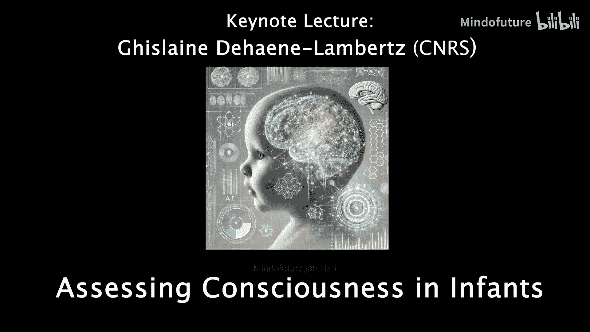
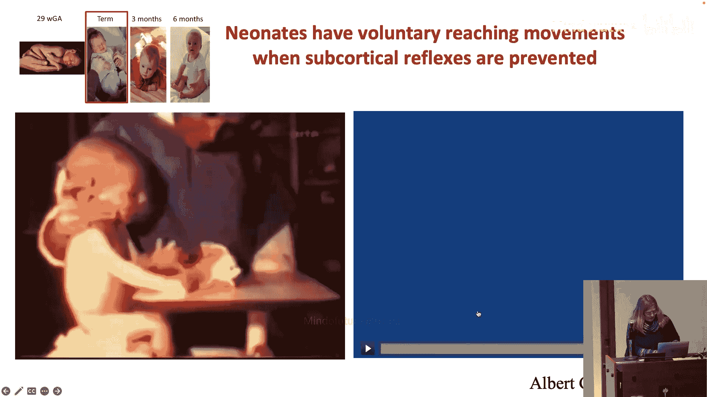
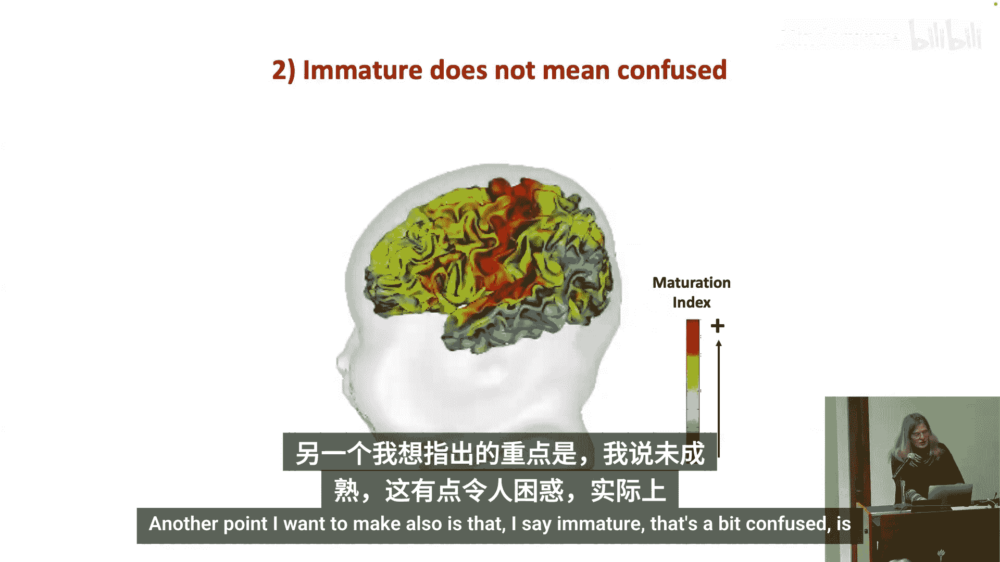
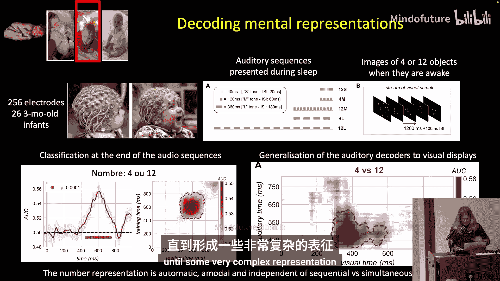
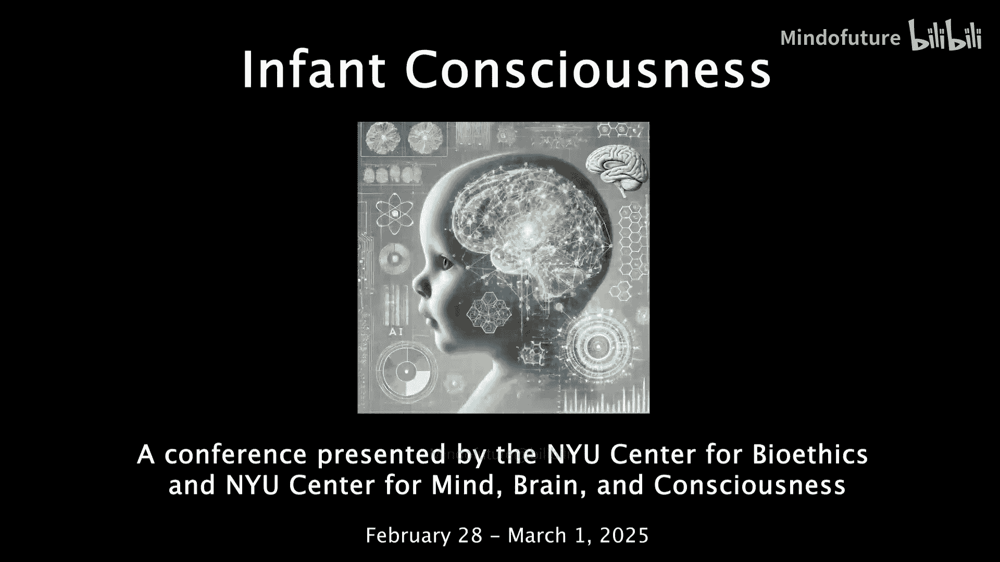

# 【纽约大学】 婴儿意识 ｜ Nyu Infant Consciousness p02 P02_Ghislaine_Dehaene-Lambertz_评估婴儿的意识-纽约大学婴儿意识会议 -BV19zZXBUEMv_p2-

そ。Thank you and I am very app to be here to discuss about consciousness because during a long time。

 as we say already this morning， consciousness was not at all a questions that we wanted to raise in infants so my first。

 I want to start with this movie because I am a pediatrician and you see it in the 80s and when I saw these two movies at that time。

If I am able to start the Su one， yes， I was very intrigued。

 very puzzled and you see that they are nos and when you support their neck and avoid those cor reflexes。

 they can have this type of behavior in which you have the impression that indeed they are they are volatile movement。

 they are cl but they are able to direct their attention to the object and to explore this object and at that time。

😊。

We had this notion that the brain was very immature we got a little bit of that this morning and that indeed。

Everything is still not finished in the8s。And we had the first brain imaging data showing。

 for example， that the metabolism in neural is only around the Basil ganglia so they were multi corical and when you look after that to what brain imaging brought to us you see that indeed we saw with this type of suitable brain imaging that。

Han brain at start is very immature with in particular the high level region that are very。

 very blue in this type of images， meaning that they are very immature。

 but what we have seen already this morning is that in fact this is a very old vision of infant development and that this immature brain does not mean that it is an unstructured brain and that we have very now important evidence that the brain is structured very early on and we see this morning。

 very beautiful data from。The DHCP Connectome project and that also the eyele region are functional and we also see we see and some other speakers this morning that under the right condition preferable infants not only show complex cognitive abilities but they show complex cognitive abilities that may not be only reflexive or statistical or whatever but may have need explicit presentation and that much earlier than expected。

 so I want to show some evidence on that and after that as directly do we have some evidence that infants are conscious and when I say conscious here I am really in the line of this movies that we saw that is the fact that you have a N drive in the babies that make him explore the world so maybe it's attention but maybe what you call consciousness here but it's what I am into。

to understand how a baby， a human baby can have information about the outside world and learn about this world。

And so we will look mainly around this age， so going from three。

 six months to term and to preterm infants。Okay， so first evidence at Imtro doesn't mean nonfunctional。

 we have many FMRI studies in which we have shown that so it's not in that case。

 rest state it's really activation studies in which we show， for example。

 that when a baby is awake and is listening to his native language。

 you have nice activity in the right frontal area that you do not see when they are asleep。

When you present two sentences which are the same at a few seconds of this。

 you see that for the second presentation of the sentence you got activity in the frontal left frontal brain area which we related to some working memory。

 that sounds that we do not say that the baby remember exactly what he said。

 but that the melody and we know that they are sensitive to the melody of speech。

 that they recognize that the melody， the same melody has been repeated and when they are listening to their mother voice。

 you see that you got activation in the middlefrontal cortex。

 which is related to self and familiarity in others。

 and when they are listening to unknown voice which is in fact the mother of the previous baby。

 so it's still a mother but not their mother， you see now that you have activity and more activity for this unknown voice relat to the mother voice in the。

To frontal contexttex and in thedara。 So something more related to a segment of value。

So you see that not only so it's three months old in all these studies。

 that not only they have frontal activity， but also that it's not the general frontal。

 it depends on the task and that you can elicitit activity depending on what the baby is doing during that task。

You have now very nice evidence also like we saw this morning that the functional connectivity so at is similar in a networkceive neonate that it is later。

 so it's what professorfesor actually shows this morning so I will not say it again。

 but you see that when you look in neonate children or others and when you put see them。😊。

In different part of the brain， you got the same selectivity in at this three age。

 even if it neos the selectivity is less important。 but as we have said。

 they are asleep right at the other age， they are awake。

 So it's difficult to make a point about the strength of of this response。

And the last one I wanted to show you the movie， but it's not working， so I just show you the graph。

 we tested the six months old preterm babies so we are really at 30 weeks of gestation。

 the majority of the neuron are still migrating they are in the what we call the sub plates。

 they are not in place in the cortex， in fact， they are more neuron in the sub plates than in the cortex and we make them listen to syllables so ba b b。

 for example， or there was a change of syllable ba b ba So it's what is in。Red and from time to time。

 the change of voice so male to female and it's the green lines sorry the blue line And you see here the response to this sequence of syllables and you see that you have two curves each time for the six oldest and the six youngest and you see it's always very small group and they are very in fact the same and showing that indeed it's present from 29 weeks of gestation。

 And you see first that you have a big response for the red curve， which is a change of phone namess。

 we are very surprised by that because it's bar and gun。

 So the difference between ba and guy it's 40 in our。 So something very。

 very rapid and still they were able to discriminate the two syllables。In fact。

 we didn't get many results for the voice that was also surprising because the voice is supported by the whole syllableus so we were really expecting that the male to female they will discriminate。

 but in fact you see here you have not many response to a change of voice relatively to the standard situation in fact we get a response for the voice on the right side in the right frontal area。

🤧In which we get on fact a response for both tab challenge while on the other side on the left you have a response only for the change of phoneams so again you see that you have a response which is going until the front areas and that you have not it's not everything for everything so when you have a change of voice it's not process the same as a change of phoneme and that indeed you have in humans and we did the same experiment in rats in rats we get a big response for change of voice and almost nothing for the change of phoneam so it's related to the fact that we are humans and that maybe we have a specific network to process speech because it's so important for us to communicate but what I wanted to show with this three three slide is that indeed the system is organized very early on and what we see also what we saw also this morning and it's not on a state it's also activation that we have activity until this。

Very high level areas。Another point I want to make also is that I say imcho does a bit confuse is that in fact。

 thanks to a new type of analysis that we can do now like for example。

 decoding we can see that indeed somemonto presentation that are present very early are very specific and very I can say very specific。

 so for example here we look at with Julia Gen about whether babies have a responses to number and so as you know when you present sequence of number so we choose auditory sequences because we can test their sleep very easily and during a long time you can either present four versus 12 but 12 bis will take you more time than four bis so you want to equal a duration but in that case you have like here。

rithmetically more faster so it means that the problem of number is that you have always a confusion between duration and between rhythm because either you equalize one or the other the advantage of decoding is that you can。

 for example， decocode for versus 12 here in in this two sequences but this type of sequences in which the duration is similar and generalized to situation in which now the duration is different and the rhythm is similar。

And you can see that when you do that you are to decode4 V12 in babies at the end of the sequence。

 and that is not the same that when you try to decode the rhythm。

 which is in purple here or the duration which is green and you see that you have a very specific representation of number which is really independent of the representation of rhythm and of duration。

 what is also interesting is that relatively to add the oddboard paradigm iron and so on is that you can take the decoder that you have tried during the sequence and in the same babies because they have nice we can test them awake and present to them now for v12 object so they were awake so it was before after the auditory sequence。

 but you can use decoders that you have tried on the auditory and see what happens on the visual。

You see that you are able to takecode also the visual。SoSo visual number。 So it means that here。

All the electrodes。 So we were not able to be more specific。But still。

 it means that we have now a representation， which is that we can show is automatic a model independent of sequential versus s use representation and that。

It means that what I wanted to show is that is that the internal world of the baby is very rich but it doesn't need to be conscious for that。

 we did that to sleep and it was working and it has also representation for peach as a representation for phonenas and I can think that there is many and there was some decoding or visual images。

All this stability have already a network and they are already processed until some very complex presentation。

 So the question now is， okay。

You have this complex word， You can see that all this representation can be computed one after the other until maybe eye level regions。

 So the question now is that what I am interested in， I don't know if it's consciousness is that。

 okay， do you have a N drive is a baby a bo。To say I want to look at that。

 I want to be interested of that and I want to learn about this object and I think it's important in our species because we know that we are giving information。

 we know that we are orienting the baby toward learning about that of that aspect just by naming just using language。

 but if you want to say to the baby that that is a grape。

 you need two things you need to have a top down control of the object of attention for the baby。

 you have shared attention between the others of the baby and you need that for the baby to know that if we receive information from the adults。

And you need at the end a symbolic system to communicate the concept between the two brain。

 but I think that it's something very specific in the human species and it's why I am interested in consciousness is to know how the baby knows that he will receive information and that it will help him to understand the world and just to give you example of this type of learning and how early we thought it was that babies were learning world in the second year of life。

 but in fact， there is very nice。I always studies， but that shows that at least they have the capacity to do it and one of the one I like the most is by Soy Waxman and her team in which she showed two three on old and for months on babies images like that and each time。

You got these type of images， you have the look at the toma。

 do you see the toma and so on and so on and suddenly the baby sees these two animals and what you are measuring is whether' the baby orient to the fish in that case because if has contracted the dinosaur or category so fish is new but you we say okay。

 but some where do they know about dinosaurs that's completely a crazy idea but if you look at all these images you see that in fact the share some shape that is you you have legs you have neck you have all this part pottuvering up from the。

From the body， which is not the case for the fish， so there is some commonality between all these images and the fact that you name helps the baby to find that there is something common because they share the same name and that could be opposed to this fish and how do we know that it's because when you name when you say toma you have the orient to the fish at four months and six months when you present backward speech or tos they do not do it so it's really because and there is several other experiment showing that it's really because it's named that they are able to construct the category of the diinoa。

no another experiment we did just to show you also how complex these babies can be。

 it's an experiment in five months old using EEG and we wanted to know whether they can learn a rule like ABA that is and to do that presented to them words like two or two。

 so the first and the last syllables of the world are repeated and each time they hear the word of that type。

 they saw a fish one a later。And we had a second rule， which was a Mime role， in that case， the same。

The syllables is repeated immediately， and now they see the lions。

 and we were changing always the syllables。 So no never no word was repeated。

 So they have to be to extract the rule and not only to learn one word and one image。

 it was a whole toward the image。So after。A few trials to learn。

 we start to present incongruent situation in which for example。

 you had I don't know Google Fe and you get the fish instead of the lion and we introduced a third rule because we wanted to know whether it just they really learn the whole and not just the repetition and now you have world like AbbB。

 So the repetition in that thean and they have 50% of the time the lion or the fish or they cannot learn。

Okay， so what happens we are looking at EG。 what you expect is when you have a mismatch between what they have learned and what we present to them。

 they should have a surprise effect and it's what we get。

 So if you look at the response after the image， you see that in fact， the incongent situation。

 the incongruent pair， you have a decrease of the response relatively to the two or the situation。

 So they are surprised in the sense and we got it several times in this type of paradigm。

 then when you are surprised they are like inhibited no response relatively to the situation which they got the correct pair or they have not learned anything about the not all situation。

 Now if we go back， I don't know I have not say to you。

 but the the image was projected on a flickering background。

And we use that now to focus to follow their attention to this because if they focus on the image。

 they are less exposed to the background furing and so the power to the concurrenent decrease while when they are surprised they have this opening of the attention and you have an increase in the power of of the background so we got this effect showing that they were really priming the correct image and now we can look what happens before so between the noun and and the image and in that case the only situation for which they cannot predict something is the third rule that we gave because in that case they were waiting either for one or the other and you see that you have a big difference。

Between this green condition。 So the condition for which we are not predicting anything and the two other conditions。

So what you see here is really a complex of operation in a baby's brain。

 in a preferable infant brain because they are five months old。

 so they have to detect an abstract structure， they have to associate this structure to an arbitrary image and we can see that how they are doing that through the course of the ERP。

 we see that they have an expectation of the image with this CNV focusing attention with the frequency tagging and the surprise with the mismatch response when the expectation is not huge。

 so you have really this impression that you are going through the time and see how they can do that。

And so the hypothesisesis， and you will not be surprised if I put the global workspace。

 I have some relation with somebody behind on this。 I cannot say anything else or I can。Okay。

 but but still， I am not joking， I think that to do that they need to be able to maintain a stable and explicit representation and to really put together。

 for example， if we come back to the Thomas is visual image and this auditory level。

 so they have to integrate that。 and I think the only way to do that is in a global workspace and after that amplified the image and to learn this relation。

😊，So if I say that I need now to show you that indeed we have some evidence for this global workspace and I will now go back to what's see that shown this morning。

 so I want to show you three properties so entrance is the global workspace is threshold and say you also lead to competition between stimuli and so we will speak again about the attentional blink and masking effect and also that if you have the certain aspect of this global workspace is not only the ign and the entrance is also that you have top down am and I want to show you that you have also top down social amplification when you expect something。

😊，So。Already you have seen that this morning so I will go fast。

 so what we are looking at is to to use the fact that in adults when they report that they have seen。

 versus when they have not seen， you have this late effect， which is maybe not a p3 under。

 but you have a difference while and you contrast that with an early effect in which you are really in line with the stimulus So you want to contrast two aspect in the brain。

 or what is in line with the stimulus and you will vary the parametric property of the stimulus to see this relation between the stimulus and the brain response。

 and after that， you want to see whether you have a certain type of response in which you are no more in line with the stimulus。

 but more in line with a response， except that in babies who do not have response。

 so we are just using the fact that in adults， if you have a response。

 you will have this type of response。So and I will show you。

What see the experiments with Sophie on masking and he has no time to show you the way of your results but I will show you now so in five months old so you see a mask and after that they saw either a face or control trial and on the side and after that mask mask and what you are looking iss whether the baby is looking normally if you notice the face it will orient to the face and if you notice nothing it will orient Holy to one or the other so if you look at five months old you see that at 500 and 100 meters they are Ho so they do not know where is the face why after that they are not very good better significantly better than chance and they are they orient to the face。

While in 15 months old， you see now that they are much better at already at 50 me ago。

 they see the face and pointant more significantly more to the face and to them to the scramble face and you have seen also that this morning。

 so it was a 15 mon see and you see that indeed and you have here the duration of the presentation of the face。

You are going from the short here presentation to the long presentation and you see this perfect linear relation between the duration of presentation of the stimulus between the two mask and the amplitude and duration of the P400 while when you arrive at the end of around one you have now this on and off response with all the response being below the threshold which is here up 50 meters ago the 1733 and 50 are here while all the others on the other side and for the five months so now you have only one which is different which is the 50 meters ago and but still you have it's less beautiful but you still have this linear effect and here the all and on effect。

Okay， so I repeat what seedsd says this morning， you have two stage observe an adult and what we want to see is whether these two stages are also present in the baby and it's what we have the impression to see in this mask experiment。

And as also say， it's much later while because the frontal are very immature。 We saw that at first。

 they are not so， so it's not alieninated。 So you need to transfer the information from the visual cortex until the front area。

 but you have no alienation。 and still quite right。 And also。

 you have no all the synapogenesis and so on is not done。 So the frontal areas are very slow。

 They are functional， but very slow。 It what we see here。哦。So Suone point is the attentional Butne。

 So you see this morning seat presented that。 So and he was saying that at five months。

 the attentional Butne is at one Suon 2。 And we did at the same time， the same experiment in EG。

And so we use the same idea， in fact， you have a here teddy bear which is changing at each time at each trial。

 meaning that it will be novel for each trial so the baby should of young and after that you have on the side either normal face or scramble face and after that the T3 to be sure that the baby is doing something that because if it does not see the it will have nothing to do and so we vary the SA between the presentation of the teddy bear and the presentation on the side。

And we had also trials in which there is no face at all。 So you have two un tris。

And we were measuring several stuff and and we had several anes and it's very interesting because we have both your and EG responses。

 so for example， you have the teddy bear suddenly you have a face， you see the face。

 you willovion to the face normally and you see it they are not very good but at 1200 so guy in a very longest way they seem the or bit more to the face than to the scramble or to nothing。

And when you look at the pupil size， you see that there is nothing， so in green you have a。

I just remember the no queue is in blue and the Q trials is in green and so you see that you have no difference at 400 milliseon 800 millisegon but you got a difference for 1200 so we replicate what seed found although they are swim here and when you look at the no longtri so the fact that you the images were presented over a flickering background。

 no effect at 400800 and we got an effect only at was1 soon2 so again it means that because they are so slow。

 it's so slow to enter in in their frontal area or frontal system it's also they are slow so when they have something it's for them also difficult to disorage and to come back so they need one second2 to be able between the two images to be able to notice the second one。

But what is interesting here is that we were able to， because you can say， okay。

 just because and we discussed that a little bit in the last presentation this morning。

 it's because you have a low level effects and that in fact， when you are going fast。

 their visual system is not very good and so they are not able to to see the two similarimul So you are not sure whether it's a lowle problem or a high level problem。

 So here we were able to separate， in fact。Two type of trials at a very high level of visibility。

 So at 1000 when you have this longest away one second2。

 we look we use a new way of doing stuff is to look at how close each trial come to an attractor。

 the attractor being the topography of this big visual response P400 So for each trial。

 we can see okay， you come very fast， close to this to this topography or you come a little bit slower。

 we are not sure that it will work but we separate you just take the medium and we separate trials which were fast and trials which are slow to come close to this topography and as you can see here。

 the glue and the red line it's not surprising because by definition which shows those were separated but what is interesting is that when you take the light。

P400， you see before that you have this negativity that you do not see at all in the fast response and this negativity is usually the sign that you are processing a face in babies it's not the equivalent of the N0 50 17 others and so you get it here and not when you go fast with the P400 showing that maybe they were more engaged with the teddy bear images。

What is interesting is that you can look backward to what happens before when you look at the pupil size before the arrival。

 the onset of of the teddy bear。 And you see that you have a difference for the two type of trialss。

 So it means the baby was not in the same stage。 So maybe explain why it was more or less engaged with the teddy bear。

 So already it's not trivials that we found that。 But after that you can look what happens for the face that we present on the flickering background。

 So if you look at the blue line， for example， here。

 So you you are deeply engaged with the teddy bear。 And so you have no sacade to So you have。

Reflxive saat because you have no difference to the orientation to the face or when there is a face or no face when you have no cu or when you have this face camera face you see you have no difference between the two types of as number of sas when now you have had this shallow attention to T1。

 you see that you have much more orientation to the face to the side than when you have node T2 and when you compare the two situation you have much more quite sacade in the case here so it means that you have this effects that you see that even when it was visible because you were on gauge to the T1。

 you are blocked to T2。And you have the same effect with the normal on train。 So here when you were。

 they were they were attentive to the teddy bear， you have no difference between the two queue and no queue。

Ts on the flickering background。 And here when they were not attentive to T1。

 they were attracted by the stimulus on the side， and you have a difference between the two type of trials。

 So here you see that really it's an attentional effect。 It's not a low level effect。

 and it's really show that you can only have one element at a time in this attentional window。

 and that is the signature of this global workspace。But again， you see it's very slow。

 we are have one second too， so in others it will be evident that there is something on the side。

And now my saw evidence about the topdown activities coming from the team of D Caline。

 I like it a lot because I think it's so simple。 they just record with neoinfrared spectroscopy。

 the posterior areas or the temporal areas and they just presented biep followed by your smilele。

 So you have biep Sple， biep smilele， beep smileles。

 bieppis and then the biep with no smilele what happens and here you can record directly the activity in the visual cortex and you see here the response when you have the biep and the smilele。

 so blue for the temporal areas red for the visual area， but here normally you have only the biep。😊。

No smile， no visual images。 And still you have a strong activity in the visual area。

 In fact the babies were waiting for for for the for the for the smile and it's not because they are sinister。

 there was this old ideas that babies were sined that as soon as you have a visual images。

 you have auditory activity and receive， but here you see in two of the group in which they got only theep or only the smileey and you have no activity in the cor cortex。

 So it means that here it's really because they were expecting and pre activating the。

Let say I'm using word ethics。Okay， so I think that really I have no doubt that Ba awarenessness is present in the Suon trimester with all this evidence about competition cellular your butneck for successive even top down expectation that we have seen here with the gasoline experiment but also that we got with a CNV when I was showing you the ERP evidence for that and that it's a much slower process than in others The problem now is before。

Intuitively， I have no doubt and we discuss that this morning。 but how do we prove it。

 And we we have a problem because they are very the visual system is very imm。

 They are not very ative during a long time。 So they may be conscious。

 but it will be difficult to show。 and often people have used auditory responses。

 and maybe we will have more on that this afternoon。 and one of these。呃。

I would say apparently that we can use is what they have called the local global paradigm in which you present。

 for example， a series ofep and suddenly you have boop so you are surprised because you have a change but also because it violate the regularity of the block now if you haveop and suddenly you have no local duration because it's a strict repetition but you violateulate the rule of the sequence and with that they have shown in others that again you have this two stage that we describe before with auditory system that respond on automatically if you are asleep if you are in comatos in vegetative state as soon as you have a change so as soon as you have boop you answer but to detect the change in the sequence and in particular to detect。

That B， B B， B here is a。 I think this condition is a crucial condition that B， B。

 B Bs that a strict repition is a variation of higher whole。

 So they show that you got that in in conscious in others and so on。 And it could be。

Sign a signature of consciousness。 I must say that I have reserve on this paradigmd。

 but it's true that he's the only one that we can use very easily in young babies。

 So we have tested it in three months old。 and we get mismatch response as soon as you have a duration。

 So as soon as you have a B book， which is not surprising。

 even I show you at six months of gestation， you got this type of response。

 So there is no problem to get this type of things。 but also， as you can see here， you have a sorry。

And here it was done by Juni Moer and David Presel in Tupingion using this MG。

System and you see again that you get with theMG， this difference between the。Ex and。

 like so as soon as you have a change。 What is interesting now is to look at the global data。

 So what happens now， when you violate the rule of the sequence。 So in babies。

 it's three months old babies， it's the late response that we got also at the sooon again。

 it's very late and you see， especially that you have a difference。

 when you have the strict repetition， relatively when it's a rule relatively to when it's not a rule。

And in the MEEG in Nenets， you see that it was okay， it was that。

 And that is always a problem because you have a why found bo。

 which is very if you have bo just by statistical computation。

 you see that you have a big change because this big book is very raw。 So you have a big effect。

 And here you have nothing。 but in this experiment。

We can split the data as a function of the earth viability。

 and you see that when you have add high earth viability。

 you see a response which is present for both element and not here。

So we can say that maybe neonates are able to to have this fun。

 maybe it's a signature in neonate that they are conscious of of the global response。Now。

 they have gone on and maybe we have more this afternoon about infeticies。😊。

In which you do the same experiment and you see that at 28 weeks of gestation。

 this seems to have no difference between condition whatsoever。

 which annoy me because normally they should react at least at the wide change。

And here you have no response to the local deviians。But response to the global deviance。

 which is very bizarre。 It means that in that case， between 35 and 40 weeks of gestation。

 they are responding。 They are not responding to B， B B Bo。Whatever is a。

 but responding when you change when you say So you can wonder whether in in that case。

 because we are in fetusees here and we discuss also this morning that feusees may be do say you have substances in the placenta sedated Thank you。

 they are sedated。 So maybes they are for them words。 So it's no moreep separate events。

 but the word the word。 So now you have a difference because you change of words even when you is a new And we are saying that is that in fact。

 was recover all those paper in which you have anesthesia in Ma and in which they get exactly the。

I when the ma have been anesthetized with Popo and Popo is a gabi ontagonist I say quietly with ketamines they do not get that at all so it may and we know that the gaba system has a very bizarre function during the development of high change it was in deeper excatory become inhibitory so there is and so maybe it's it's。

Some interesting fact to pursue because you have exactly the same in this proposalesthetic anestheizer Macan in this experiment between 35 and 4 weeks I conclude because I saw that I have a。

So as we says this morning post infants are really the structural and functional architecture which support conscious perception in adults。

 so they can actively store content on which they can act。

 there is competition to access central workspace but this process are very slow and even at the end of the first slide and it's possibly that in the first week of life it may be during short period of vigilance so it may be that it's not all the time。

 but they may have this short window in which they are online mistim。In private infant and fetuses。

 I must say that I don't know we need to see more precisely to have more experiment we already say that this morning and we also should compare fetuses and preterm because it may very different in both we know that births can provoke some changes in the also no transmitter and so on。

 so we need to to do more experiment， my bed will be at35 weeks of gestation because we were speaking about teleelmocoal connection and with EG。

 we see a very big change with signals that become more continuous around35 weeks before it was we have this ta there now it very long period of nothing at all even if it's maybe working but you have this high burst of activity and after that nothing at all high burst。

no at all and it become continues around3 five weeks of gestation so but we have all of this elements to be put together to see better how it can emerge thank you very much。

Thanks that was a great thankslaine I have a quick question about this study in which you have the teddy bear in the center and the areas that it is taking some time to disengage right so that is taking sometimes probably to disengage from the teddy bear and the question is if you analyze throughout the block probably they're getting more use to see the teddy bear and therefore maybe they're tend less to that have you looked through the block to see if it's like know you sometimes you are you it's boring and something for some reason you have one which is particularly attracting changing time so the teddy bear is not always there it's changing every time yes okay I did not understand every time to grab the atom so it's a different object to different animals okay okay。

I have not understood， thanks。Because。Okay。Yeah。Okay。Yes， thank you wonderful for Do。

 so I want to connect the last pal band editorial or that。The question of inner right。

So what do you think the audit story paradigm shows about human like you know。

 it's not my I dont use it a lot and could too patient and there are nice reserves。

 but I think that it's not so。It's not as pure as the other one in which you need attention or to the visual images why here it's coming。

 and I don't know what say you have no。 I mean it does not mean that there is no in a dry for no deter stimulus。

 but I have no way of controlling whether they are I't or not。

 whether they are doing something or not， I could be totally good or not for and some of these results。

 I could totally be explained by statistical relation between the syllables because between the syllables between the tones in the sequence and that if you have a buffer。

 which is long enough， it's sufficient to have the remote effect。

 So we disagree with some people by family。I think it's not the perfect paradigm to see what I want to see。

 for example， in terms of indoor drive and so on。How they can select something I think due to experimental reason it's much easier to do it to the visual Yeah just a follow so you think the statistics they could unconsciously and the inner drive would。

some conscious you can resolve that without being conscious but you can be conscious and take advantage of that the problem is that if you are conscious。

 even if you have statistical process behind you can use them for to discover something in your world but if you are unconscious it could work we can do it in sleep babies and see what happens。

 I think it's not enough in the patient when and they say it predict what they ask the other to count and you have in fact。

 it's not directly the paradigm's because you ask the patient to do something。

But what to raise much easier and younger babies so I'm going to call on myself so we have very good reason to believe that we can be conscious of more than one thing at a time。

 so for example， in the Grk effect，😊，Shows an interference between the visual。

you know that makes it I disagree Mag is not a good example。 can in the cicus， for example。

 a visual and audit integration which are totally impscious and do not need even if you have to it's not too a science that you put together Okay maybe that isn't the best example。

 but know we have plenty of examples right now of being able to see something and here's something at the same time intuitively I say I am not interested in consciousness。

I want to understand。So I want to understand how they love and how it is so this is leading to a question。

 which is if we can be conscious of more than one thing at a time。

 then the global workspace theory has to allow for more than one thing being conscious at a time。

 in which case your reasoning wouldn't work about the attentionalliak because your reasoning was we need the global workspace to explain how we miss T2 when we are attending to T1 and so far I understood your argument it's the only the global workspace can explain this because we're conscious of T1 so we can't at the same time be conscious of T2 but if the global workspace has to allow that we can be conscious of more than one thing at a time。

 your explanation doesn't work。I will let the people of the global world explain this weather I go in the reverse direction I say。

 okay we have a phenomena in which you are conscious only of one thing at a time because you cannot see per you have attention or blink and that I explain because you need to your attention。

 so I know that I am speaking more and attention and consciousness but I think that in babies it would be impossible to separate attention and I think that in that case and I think it's important for baby to learn to have this system which is stable explicit which can because if they are only submitted to very bottom up and noncon stimulus it will disappear why the need to keep that during several seconds to work on it。

That's what is interesting for me。嗯。对。Thank you so much。 Thank you so much really beautiful talk。

 I want to go back to Claudius a question about the human drive and look at different senses。

 not just vision So for instance like it cannot choose of being hungry at a certain point you are hungry so we have to drive to go for food。

 but wouldn didn't be in your theory that unconscious countries only if I have the joy independent of being hungry。

 of going out there in the world， So the is like where exactly the human drive kicks in and at which senses because it's easy to do it with vision engaging with the real world。

 but how about the senses of coming from inside over which we don't really have control。

 I mean I don't have the drive to have my heart beating or being hungry but I need to do it to stay alive So it's like where do you put the distinction between the senses。

Start， you know。Yeah， so I don't get the inner drive thing for me， the inner drive， you know， again。

 I am a pediatriciarician。Because I am always a little you say。

 anxious whenm speaking about in philosophy and so on。

 because I am not at all at this level of theory for me。

 it's just okay I am a baby I am hungry as you say I cannot move。

 but I can choose whether I want this or this that is for me inner order is not really the basic reflexes and instinct and whatever。

 is the fact that you choose at some point to act or not to act to choose that or not to choose that。

 And I think that it's already present in babies they are not little machine that are totally bottom up and they can put and they have already a personal they are already a person that can choose。

 who can choose not that sorry again for my image and that only that that I want to show So maybe I do not have the right terms。

 but I think that we am now the way by。嗯。experimentalperi tool designed by the way that brain imaging bring to us to look at that。

After that， if it's consciousness， attention， it's not really nice。

I want to just to know what I able to do what they think。 So I have a。

 So I say I use because I have a yes which is called baby salt。 And I want。

 the goal is to be able to。😊，To decode what they are thinking at each time point。

 to see what content they have。 what is called you know drive。 What is the content of their soul。

 Are they just losing zombie or are they， are they already thinking about what is happening。

We have time for one more question。it's a really interesting talk。

 I just want to sort of follow up on that sort of idea or leave consciousness aside。

 But the purpose for the baby and for all of us is to survive。 No， to understand。 is to understand。

 I mean， I think to survive is a basic Yeah， but because Yeah， okay。

 the reason for asking this was your last point。 you may really interesting speculation at 35 weeks。

 Yeah， but I like that speculation。 So because around 35 weeks。Without neonatology。

 babies can survive， you know， that's around the time babies can start delivering and survive in the outside world and so at that point。

The babies need to survive in a complex world and I don't think they can do that just through reflexes and instincts so they are highly intelligent little people with personalities。

 but with some basics sort of they haven't got the same sort of naturally higher cognitive processing that you'd expect a toddler you'd expect a child to have。

 but they have some degree of processing at in order to get what they need。Which is food and warmth。

And it was not really a question， but it's just an observation on that comment。

 but one wouldn't lastlie expect the complexity before 35 weeks because evolutionary until very recently。

 those children wouldn't I think they won't survive。 No， it's the problem of the parents。

 I think we completely change the relation between the others and the offspring in humans。

 it's a problem of the parents to make the baby survive。

 the problem of the babies to understand because we are cognitive species and we need's what make our survival is really the fact that we can transfers information and that we can learn from the others to build new information。

 I think we are paraazzitops And so I think that they are driven not at all completely I have not taking any systems before。

But I think that it's really a different push for babies than for other animals。

 Maybe the difference is why we are here and not a chimpanzee。きを。

turns out that's a so is already given by the parents It's a good of the parents Turn out we can go till five after three。

 so we do have time for one or two more questions。I kind of just had a follow up on the last discussion。

 which is， I mean， even if it is our task to understand in addition to survive unlike animals。

 I mean the ways in which our cognitive functions manifest and the time at which they manifest would still be largely determined by what is necessary for survival。

 so I mean maybe this isn' maybe this is also more of an observation than a question。

 but I guess I think I'm not fully understanding your response。About in response， so I apologize。

Yess。Sorry。嗯。You do not understand my response。Oh， you do not understand this question，right company。

But the parents people。Maybe such a terrorist。で。and they evolve to ensure that parents will do that。

 You， vital。 Yes， yes， yes。 So then they the driver is to be cute。よし。

All the younger doing that for their parents。 If I'm in you know， in the private。Through replay。

 Yeah， that's why it's a complex of the right。But I do wonder whether it drops off。

In low just looking at evolution until Okay， I think you've asked the question。

 Nobody but I think that evolution perspective， you are nice when you say that。

 because how can we answer to evolution perspective， What is important in evolution， I mean。

I don't know。 I mean， you are responding for almostciience with data inience in organized to explain what happened 20000 years ago。

I have no idea of that。 I mean， we can speculate and speculate and speculate。

And I think that what we have to understand is why we are humans are so。

Cognitive in some way and while we are using language and why we are transmitting information and that we are doing very early on。

 we saw before that it was after two or three years of age。

 but what we see now is that if you put the baby in some situation then knows that they will receive information so there is some experiment showing that for example。

 if you are speaking and after that turning to the side。

 the baby we look to the side at three months while if you are have some noise and looking to the side is not looking to the side。

 so already is that speech is conveying information。

 which is not really which is quite extraordinary so it means that something is built and that what we are doing is trying to understand I think it's more important to understand that to try to understand why we are why we survive。

 we survive country because we are here。So， I mean。

 I am sorry not to be very excited by high philosophical discussion。

 but I think that our problem is more to see why and how we can help babies now in in our time to learn。

 And because now what is is what parents are doing is they are on their phones So they are no giving any information to the baby And I think that is totally and they speak about screen。

 but they they say do not put the baby front of the screens。 it's not my problem， my problem。

 the parents are in front of the screen and they are no more changingchanging with the babies and we know that is crucial。

😊，And that we should say， and I am more interested by that， I'm sorry， in that note。

 I think it's time to thank saying。😊。

