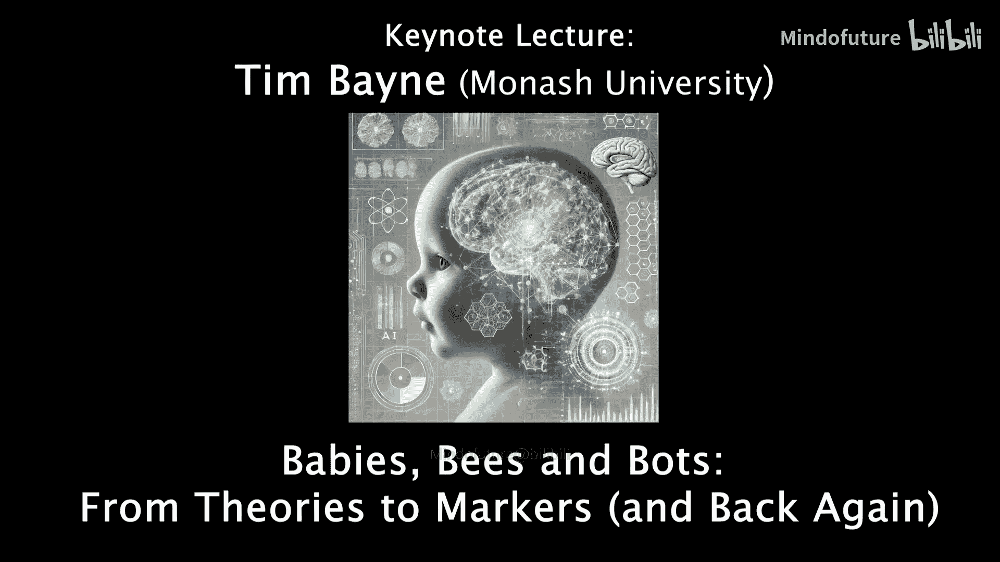
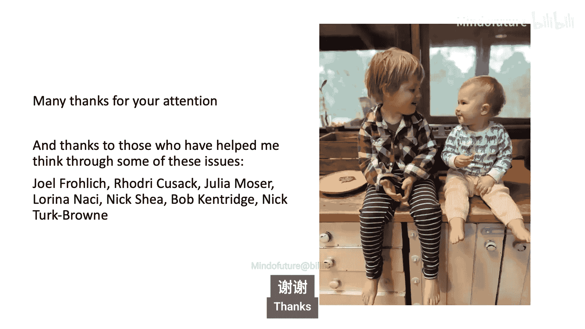
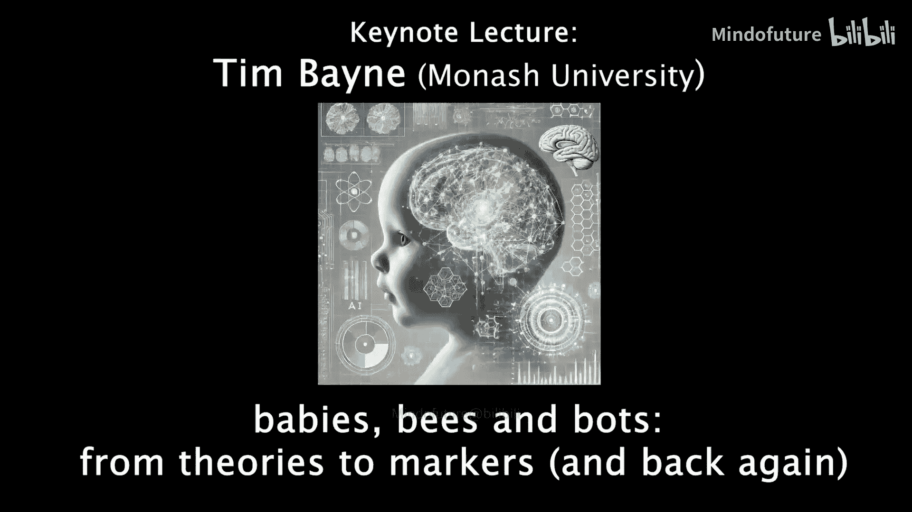

# 【纽约大学】 婴儿意识 ｜ Nyu Infant Consciousness p03 P03_Tim_Bayne_婴儿、蜜蜂与机器人_从理论到标记再回归-纽约大学婴儿意识 -BV19zZXBUEMv_p3-

Thanks very much， Dave， since you've embarrassedbarrassed me， I'll embarrass you。

 I wrote a lot of my PhD not exit under Dave's supervision。

 but living in New Zealand struggling with a postdoc and I would send Dave chapters at any time of the day in New Zealand and it was two o'clock in the morning in Arizona or five o'clock in the morning and I would always get detailed helpful comments back within 10 minutes so I have an empirical proof that Dave never sleep or at least itt didn't sleep at that point。

 so I'm very grateful。So Annana was reminding us yesterday that we're talking about infants but infants should really be part of the conversation and I completely agree。

 so I asked my partner if I could bring our kids and she wasn't so keen on subjecting them to a 24 hour flight just so I could showd them to you so here's some photos instead this is the male and the female juveniles of the species。

And we're told in the textbooks that the best way of studying。

 sometimes we're told the only way of studying consciousness is to is verbal report。

 introspective variable report。 So I asked Oto he was four and a half of the time。

 what are you aware of and you said everything。I asked Allla， she was。

Well one and a half of the time。 And she ignored me。

Maybe because she was pretty verbal and maybe she just thought it was a really dumb question。

 which it probably is。I love this photo， kind of reminds us that the consciousness etymology is knowing together and there's a subjectivity a second person element that Genna was talking about implicit in this。

Photo so， you know， we know that infants are you know， the term itself， infant without language。

 preverbal。But we also know that the connection between language and consciousness is pretty tenuous。

 and I think the rise of LLMs has reinforced that。 So here's one paragraph of a 47000 word conversation。

 It's all on the web if you want to read it。 It's pretty interesting between Murray Shanahan。

 computer scientist and philosopher with Claude about consciousness。

 and it goes on and on and on in this vaguely sensible。

 vaguely kind of Claudeesque way about Buddhism and free will and subjectivity。

 It's talking about consciousness， but not many people think that Claude would be actually conscious。

 certainly certainly Murray doesn't。Okay， so one and a half year olds all are in this in this photo。

 I think most of us think are conscious。 What about if we go a little bit earlier。

 So this is four and a half months。 I was able to take this photo this was taken at LA X。

 so the baby hanging station。I was able to take this because four and a half month olds don't do much and they don't roll。

 So I was able to take my take a camera， even with 86 billion neurons。

 they're not wired up for motor control much at four and a half months。

 didn't have to worry about him falling off of the change map。

 And we know from just La's work work that Siid talked about yesterday work a lot of people were talking about that there's all sorts of amazingly complex perceptual processing going on by four and a half months。

 But the behavioral immaturity of the homoavian is quite surprising。

Especially when you can trust it with what you can get from a bee with a million neurons。

 so here's I'm not going to go through this。 I don't know how much of that you can read。

 but here's a list of what is it 59 fairly distinct behaviors that worker honeybees perform with a brain that's much。

 much smaller than the fetal brain even at I don't know 20 weeks。 So we've got bees。

 we've got babies let's look at what people think about the attribution of consciousness as just a place to start the conversation So here's some survey data from two ASS conferences。

 mostly scientists some philosophers。Most folks think that they themselves are conscious。

 which is kind of good that other people。The people are conscious， I mean。

 there's always going to be some people who it。Monkeys， dogs， octopuses and babies， I mean。

 it's not super well structured survey because we don't know exactly what they mean by a baby。

 but babies come somewhere between octopuses and bats in terms of people's willingness to attribute consciousness to them we don't have bees on this list。

 but my guess is bees would come in somewhere around about fish they're often discussed as sort of problematic cases where you've got complex behavior。

 but very different neuroanatomy， they're very different evolutionary。Pos worms， Yeah。

 get a little bit of love， but it's down below 25%。 Sursly。

 more people think rocks are contrast in trees quite sure， I mean， you know。

 are certain about that side。 Maybe that's just someone， someone having a laugh， I don't know。

 So that's， that's the SS data。Here's data from the Phil Pa survey that David Boge and Dave Tra has put together。

A little bit more helpful because we now know that it's not just babies， it's newborn babies。

Comes at about 85% and again， above fish， which is I guess the closest proxy for what I think people would have said about about bees。

 but usefully they've also included AI systems， not just current AI systems。

 but future AI systems and I guess it's current AI systems that are interested in contrasting things with today and really miserable 3。

5% so maybe philosophers are a little bit more willing to ascribe consciousness to babies than scientists but interestingly more willing to ascribe consciousness to neonates than they are to fish and flies。

I suspect to bees and to current AI systems。 Okay， so speaking of neonates。

 what do we want to say about neonates， there's a lot of discussion yesterday， This is Otto， my son。

 I think this was taken about an hour， not more than two hours after he was born。 He is asleep。

 which is a bit unusual。 I understand Most babies look a bit more like this。

 pediatricians in the room will con correct me。 many things that they might want to correct me about。

 So please don't hesitate。 I'm a philosopher。 This is taken from a leg of crans and slot and very fascinating piece from 66。

 the stress of being born。 but there are there are alert after the first two hours or so after birth。

 And when you think about it， why wouldn't you be alert， here's what's just happened。

 You've gone from a prenatal state， which is very warm。37 degrees in Celsius，98。6 Fahrenheit。

 a highly predictable environment hasn't changed a whole lot while you've been maturing your metabolic needs have been taken care of。

 you haven't had to do anything。 oxygen is supplied。

 energy is supplied you don't need to worry about the regulation for the kiwis in the audience found out is a Maori word。

 which I recently discovered it it's usually used in context of land or people。

 so Tatahennoa the fenoa the Tanoa， the people of the land， so Phenoa is land。

 but it's also it for placenta which I think is a wonderful thing it's that your placenta is your land in Maori it supports you in that way I think that's a very insightful let's go move。

And there are all these suppressing。Neuro multiulators。

 which has it worked sedate the fetus in various degrees。

 postnatal state is is very different in many dimensions。 It's going be colder。

 even in a warm delivery room。 It's probably going to be colder。

 your environment has much more unpredictable predictability it's not just different from the prenatal environment。

 that this predictability， unpredictability within it。 And inside， and this came up yesterday。

 there was a fascinating discussion between token and and just learn about this。 But in some sense。

 the the the fetus slash baby has gone from being。from being to a situation where they're now an ectodder they've got to take care of their own metabolic their own thermoregulation。

 now the mother is going to help them， the caregiver is going to help them but they now sweat can sweat when they get too hot。

 they develop the capacity to shiver after a while they have to participate。

 of course with the mother， but participate in taking in their own energy。

 which they didn't have to do previously they have to latch on they have to look for the breast when when they're hungry and so the responsibility is obviously not just the babies shared with the mother and other caregivers for those basic homeosstatic metabolic processes。

 but it's in part the baby's responsibility in the way that it wasn't previously and they're high high levels of stress hormones so no wonder the process of birth。

Wakes you up and you go to this high alert state Does birth switch punchcesness on。

 I think that's not a crazy thought。Not the first person who suggested。 Obviously。

 it's an idea that's been floated。 But I think it's a really interesting one。

 But there's also room for。Skeptticism and and and debate。 So perhaps neonates。

 filtered neonates are akin to legislativeative state unresponsive wakefulness syndrome patients。

 They are awake， but， but not aware， not consciously aware。 That's one possibility。

 And perhaps the selective responses which you do see in neonates across a range of domains。

 a range of stimuli are akin in some ways to those blind sight patients。

 So there's a representation of of features of the world， but， but but it's not conscious。

That's the sceptical position。 Okay， what about before birth。 So here's the 19 week scan of。

 of autoto giving us a high5。And。You know， you can look at this in sort of two ways， but most people。

 I think， would say。There's very little evidence for consciousness at this age。

 and it's not just the kind of data that William Grraff was beautifully giving us yesterday that I think it was 20 weeks you were saying the brains the size of a strawberry there is that but you know strawberries a whole lot bigger than the brain of a bee its what I think convinces most people that there is really no reasonable prospect of consciousness at this age is the lack of connections between the thalamus and the cortex the neurons or the precursors of the neurons and neuro a blast don't really migrate from the subplate up to the cortex till about 24。

 25， 26 weeks and it's that which leads most people will see some exceptions in 10 minutes to think that even that there's no real capacity for consciousness until 24 weeks in amendment so another five weeks to go before O before there's even really a serious question here。

Okay， so that's a quick blast down through some of the issues that cross your mind as you go down from say four and a half to 19 weeks gestation。

 obviously the question that's been on the table， when does consciousness。

 awareness experience emerge， I'm going to use those terms。

 synonymously and I'm not going to define them。And it's not just a question about infants。

 It's a question about bees， a range of issues， a range of non human animals， organmonoids， asoids。

 xenobots， all the synthetic biology that's coming down the pipe and and AI。

 We're gonna need ways of。Of addressing these questions。

If we can or we just throw up our hands and say we don't know。 I mean， that's the null hypothesis。

I think in the field， if you step back in the way the field is being structured is in terms of two approaches。

 a theory basedd approach and a marker based approach。 and what I want to do in the rest of the talk。

I want to spend a few minutes rehearsing some relatively familiar challenges for the theory based approach。

 and then I'm going to spend a bit more time focusing on the marker based approach。

Which I think is sort of gained ground it's perhaps the dominant approach right now and and just really talk about some real challenges。

 I think that forces us back in the direction of theory。Okay， so a theory based approach。

 what are you trying to do most abstractly if you're taking a theory based approach to infant consciousness？

Well， you take your favourite theory of consciousness， the one that you think is most plausible。

 you try and derive some necessary and sufficient conditions from it。 You interrogate the doubt。

 the data， whether it's behavioral or neurophysiological， metabolic， whatever it is。

And then you try and use those necessary and sufficient conditions to develop thresholds。

 points beyond which you think consciousness doesn't emerge。

 points at which you think it has emerged。Now， there's two problems。 They're both。

Have been discussed， one's obvious， one's a little bit less obvious。

 I'm just going to go through both of them pretty quickly。

The first is there are lots of theories of consciousness。

 So this is a table from a recent review that Anil Seth and I put together。

 It's not totally comprehensive。 There are some theories。

 some theories actually I quite like that we left out。 Unfortunately。

 It's not just that there are lots of theories。 people disagree， as you all know。

 So this is back to the ASSC data that I shared before。Here's what attendees two of those。

 I don't know if you can read that， but you know， you can see that。

People's credences and the theories are fairly widely distributed。

 the one that comes out a top predictive processing theory is to my mind not a theory of consciousness at all。

 so that's a bit odd。Um， but just Ly said you'll be happy to know global workspaces at the top higher order of thought theories is David。

 you'll be glad to know this number。Two or three， depending if you put PPT in in the list and so it goes right since remoter theories is in the mix。

 lots of theories are in the mix。😊，So this is what we know this， there's lots of debate。嗯。

So that's a problem。 And it's a problem because different theories look like they generate different predictions about infant consciousness。

 So then one of the first discussions in the recent consciousness literature。You know。

 in the recent revival， Peter Carrus appeals to a version of heart to argue that consciousness doesn't emerge before the age of three。

Pets doesn't believe how anymore he's got a different approach to consciousness。

 a version of the global workspace theory， so this is no longer his his view。

 but there are people who have gone into print in the last year saying that consciousness doesn't exist before the age of three。

 he's not alone。Back also in 2003， Poer and Dnesh I also appealed to a different treatment of hot to argue that you don't really get anything consciousness before one。

 Just Len in her review paper was looking at drawing on global workspace theory to suggest。

 I think about six months of age， maybe five months of age yesterday was the。

The point where you were suggesting evidence is there。 And Jonathan Burch in his recent book。

 It doesn't say that consciousness is is present from 12 weeks gestation。

 but he says think he makes the claim that the fetus is a sentient candidate。

 So this credible scientific evidence for consciousness from 12 weeks gestation。 That's a range。

 I mean， it's making an obvious point here selfedent。

 but I think it's worth just reminding ourselves what a wide range of views the theory based approach gives you。

And a disagreement wouldn't be problematic if if they converged， if they converged on thresholds。

 but they don't。 So on some of that most of those views， ares not conscious at 19 weeks gestation。

But on the Mer interpret in on Brch's interpretation of America， he's been conscious for what is it。

7 weeks。Or could have been conscious for seven weeks on some of those views。

 Paula celebrating here her second birthday。And I don't know about you。

 but I can see some kind of mix of trepidation， excitement， self awareness。

 She's happy It's her birthday。 She's a little bit afraid of what's gonna。 She's a little。😊。

I don't know if I'm enjoying this， she's on the ver drift she years， but I mean。

 I can see a lot of emotion in that face， but she's not conscious for another year if you put the threshold put the threshold out of three。

So。Second problem， which is less discussed than the first。 The first is obviously very familiar。

 but the second， I think， is sort of in a way more interesting。

Theories of consciousness are almost entirely derived from adult data。

 And it's hard to say how to apply them to to the non human population。

 I'm not talking about validation or justification。 That's obviously an issue。

 That's everyone's problem。 But I'm talking about specification of the of the theory。

 Different theories have this problem in different ways and to different degrees， I think。

And apologies to the advocates of global Work Space theory。

 but I think it's easiest to explain the problem with reference to GWT。

 so here are the two figures that people wheel out in talking about GWT there's the anatomical one of as of were the neural implementation in the human and then there's this more abstract functional specification of GWT。

And here's the question。If you want to know whether a bee or an AI system or a fetus has a global workspace。

 you obviously got to know about the system。But youve got to know what the parameters of a global workspace are to know how to apply the theory to that。

 to that system。 You've got to know what qualifies as a global workspace。 So let's just take the B。

 for example。Could the bee have a global workspace， Well， some people have looked at this and said。

 well， that's， that's what the global workspace requires， requires a cortex。

 bees don't have a cortex。 One sentence， bees can't have a global workspace。

 I've seen that in print by prominent bee researchers。But that seems a little bit too quick to me。

 And Stan himself， when he's talking about non human consciousness， I said， well。

 maybe fish could have a。A global workspace。 Maybe you don't need this。

 You need something that implements more like that。 Okay， I think that's kind of plausible。

 And if you're talking about global workspaces and AIs， you don't want to fixate on the human brain。

 You want to abstract away and talk about functional features。That seems appropriate。

 But then what are the dimensions， What are the parameters of that that you're allowed to modulate in and in how far what directions。

Even in the infant， therere going to be questions about when a consciousness supporting workspace emerges。

 It's not going to emerge Dan over all at once， like Athena fully formed from the head of the zoos。

 It's going to come into。You know， coming into being bit by bit in different ways。

 ignition is going to splutter。Presumably， there's gonna be something that's global workspace ish。

 And you's gonna be judgment calls about when you've got something that's a genuine global workspace。

 Now， some people at this point going get itchy in their seats understand that say， it's just words。

 It's just semantics。 Why do we need the philosophers。 Well， it is words。

But it's not just words because we're in an area where words matter。 I mean， that's the whole。

Thing that there a political background。 We know about that。 words matter。

 So I think there are questions here about how to preify， for example， the global workspace。

 And I'm just using that as an an example in a principled manner rather than you can stip youulate。

 Sure。 But that's that's cheating。 That's got the that's theft over toil。Okay。

 so there two challenges facing the theory， there's a lack of consensus and there's uncertainty about how to apply in a disciplined empirically validated manner theory beyond the adult case。

 but I don't think。We should just reject theory。 I don't want to be against。

 I think some really interesting things can happen when we take a theoretical approach。

 I'm just going to take five minutes out of the talk。

 going to move on to Marcus to make this point with respect to Jonathan Birch's book because I think it's a great book and it's been influential already。

 it's going to be influential。There's a lot of great stuff in it。

 but I have reservations about the treatment of infant consciousness。

 so I just want to make sure I've got the time to talk about this。What does Jonathan say， he says。

 I like the 12 week proposal。The feeder should be considered as sentience Canada。 He's not claiming。

Balance of probably is as that as conscious。 It's a sentient candidate。

 It's a technical term for him。 That's an important point from 12 weeks gestation。

 description that flows from a credible evidence based theoretical perspective。 Okay。

 why does he think it's a sentience candidate from 12 weeks。There's two lines of argument。

 as far as I can tell in the relevant chapter。 The first I wasn't going to talk about。

 but William's lovely talk yesterday， raising the issue of abortion prompted me to mention some stuff。

So partly he bases it on this。Paper， quite influential paper by Debyshire and Brockman。

 reconsidering fetal pain， where they say you don't need the cortex for pain。

 You can have pain experience before 24 weeks between the before the philammical cortical connections are are there。

I'm not going to talk about that paper other than to say if you're interested in that I interested in that claim。

 you need to read this paper by Solomons and John Domenico Iti。Because for one thing。

Deershire and Brotman cite their work and in their in in the view of Solomons and Ionenetti misuse it。

 misappropriate， confused sensitivity and specificity。 So I'm not going to take any more time。

 but I think that's an important debate。 And that's an important paper to look at。

What I do want to focus on is Jonathan's use of Mer's framework， which I think is really interesting。

I like Merrk's approach to consciousness。 His old approach。 He's got got a new view now。

 which I't like that。 people keep changing their views。 But the his old view。 What is it。

 It's a mid brain focused account doesn't deny that the cortex contributes contents to consciousness。

 but the action， as it were， in the mid brain， subs consciousness generates consciousness by producing an integrated representation of the animal in its environment。

 This representation binds interreceptive and extra receptive signals。

That the animal can then use to meet its homeostatic needs its metabolic needs all right Gods behavior so it integrates information about your body about the perception souls。

 reaerence problems， tells you where you are and helps you figure out what to do next。

And Jonathan says， as soon as one grants the credibility of that picture。

 you need to take seriously the idea that fetus may be sentient as soon as the relevant midbrain structures are in place。

 the superioralculus， the Peraqueductal gray， because they're functional at about 12 weeks。

My question is， well， what does it mean for these structures to be functional？😡。

And I think if you're working within Merer's view， which he is at this point。

You've got to look to see what Mercurs says about functionality。

 and here's Birch himself applying Merer's view to the question of animals。What Mercur requires。

 this is， as it were what he means bi functional， is evidence of a core behavioral control unit that constructs an integra model of the animal in its environment。

 the whole animal in its environment， enabling flexible control of whole animal behavior in the service of biological needs。

 that's what would it be for those systems to be functional in the relevant sense。

 we're working with the Mercur's framework。Now， people， Zandy Barron and Colin Klein have said。

 we like Mer's account of human consciousness， we're going to apply it to insects。

Looks like you've got homologous midbrain structures in the insect brain， the bee brain。

 we think bees are conscious。That's perfectly right。

 I mean you know you could take issue with America's account， but I think it's appropriate。

 I think America's account does deliver a very plausible story about be consciousness。

Because it's subserving whole brain， whole animal behavioral control that meets the needs。

But I'm not sure about the fetus。I don't think the fetus has an integrated model of itself in its environment。

 We saw some really interesting data yesterday about representations of the mouth of the hand。

But I don't think it's got a representation of here's me。 Here's my environment。

 Here's how I'm moving as a motile animal through that environment。

 The environment's massively constrained for the fetus。Even if you say it does。

I don't think it's got a representation in the service of biological needs。

 It doesn't have in irrelevant sense， biological needs。 That's what the placenta。Is doing for it。

 I think。Those needs are as it were already cater for it's only when it's only when you're born that you have biological needs that you as a whole animal need to do anything about so the upshot for me。

Is kind of interesting that a view of consciousness， a theoretical perspective that's， I think。

 pretty liberal when it comes to animal consciousness。

America's account animal consciousness is very widely distributed and relatively liberal when it comes to the possibility of AI consciousness。

 I think。Is actually relatively conservative when it comes to fetal consciousness。

 provides little support for fetal consciousness， I would say against against Jonathan， Okay。

 so how am I doing for Tom。You gave me about a 10 minute introduction， by the way。Okay。

 what I want to do is blast from theory to Marcus。And I'm going to start here。

 I possibly in this room， I wasn't present， so I don't know where the discussion was。

otherI'm going to start in the other room I'm going to start in the other room with the new York Decation of animalimal consciousnesss familiar to many of you。

 I imagine interesting strong scientific support for mammals and birds。

 mammals and birds are in theorms。Nectotherms is kind of interest in。

And realistic possibility of conscious experience and a whole bunch of other things。

 including insects。There's another page that's on one page of the website。

 there's another page of the website which took me quite a while to find， but it's there。

Providing you know， a summary of some of the evidence and it's this is what you get on that other page。

 markers。Which makes sense because you couldn't really， in that kind of a document。

 appeal to theory because no one's going to agree on the theory。

 So Mark is give you a more neutral starting point or at least appear to give you a more neutral starting point。

I'm not going to read these through， you've probably read most of them by now。

I'm going to focus on two B show apparent play behavior。

I know someone else who shows up parent play behavior。Babies。

I haven't ever seen anyone say because you play at， I don't know， when does play begin。

Developmentalists， two months， three months's a。Depends what you mean。

 there's a very interesting Je Jessica， just there's a very interesting poster Jessica Babo。

 I don't know。 Are you here suggest to play that the fetus was would play with the。And the code。

Play like behaviour。 I don't know when play begins。

 but it's interesting to raise the issue of play in this context。

Roof flies of active and quiet sleep。I don't know。 It's not my。 I didn't use the word。

I'm not sure I I'm not sure what play is in this context。 I think that's the question。 I'm just。

All on doinging is drawing attention to some interesting connections between these markers and and the feudal baby markers。

 I don't know when active and quiet sleep start to emerge。 I think it's a bit fuzzy。

 but that's very early。But there's a debate with the。

Well i'll leave that to answer Okay so so those are some markers that have been used in the animal context literature let's just before we dig down into the infant stuff think about what we mean by a marker or here's what I mean。

Talk about positive markers， it's a feature whose presence is specific or thought to be specific to the presence of consciousness。

One way marker going to have high specificity。 So if you the mark is there。

 you know it's very unlikely that consciousness is absent， but low or unknown sensitivity。

 you can have two way markers， both highly specific and highly sensitive。

 So if you've got a two way marker， which would be a beautiful thing to have。

The marker provides evidence of consciousness。 You don't need to think it's demonstrative。

 It's almost certainly not going to be demonstrative。 It's evidence。 It's an indicator。

 It's a marker。 I don't like the word signature， which is used here because that suggests it's 100%。

But indicator is perhaps a little bit more useful， and the absence of the marketer provides evidence of the absence of consciousness。

And the key question here， the one that everyone's struggling with。Is how do you validate Marcus？

How are these markets validated。 It's a Good question。

I think there's different stories you might want to try to tell about different markers here。

 I'm not going to focus on that。 The standard approach。

 I think the one that I've had in the back of my mind goes something like this。

 you've got a benchmarking step。 And Niclo talked about something like this yesterday in his talk。

You use a contrastive method and there's different kinds of contrasts。

 because you can contrast different states in adult humans， at's your benchmarking population。

 your source population， you get a fix on the sensitivity。Or I know the specificity in adults。

And then there's a generalizing or projecting step where you go from your benchmarking population to your target population。

 infants， bees， spots， what have you。So for example， we talked a lot about this marker yesterday。

 there's the local global effect where you've got sets of tones， beep。

 and then the crucial one is a one down here where you've got no local logball。

 but it's a global outball because the regularity that you expect the regularity that's been set up in the first sets is no longer there。

And the claim is that it seems to be reasonably specific in adults。

 You often find it in alert awareness， not always， but often。

 but you don't find it or rarely find it deep sleep anesthesia on the vegetative state slash and responsible wakefulness syndrome that's asterisk because there is a study showing that you can find it in about 15% of the yes USw UWS patient。

But that's okay because we already know on other grounds that about 15% of those patients aren't really unconscious。

 so you kind of expect to find it in about 50% of patients。Labels get really tricky here。

It is controversial， and I haven't kept up with all the literature。

 and I imagine here that people know more about this than I do。

 but my sense is that most of the criticisms focuses on its sensitivity rather than its specificity。

 And if you're treating it as a one way marker。It's the specificity that you care about and not the sensitivity。

Okay， so the marker based approach we've seen that it's been applied to the animal literature it's also been applied to the infant the first explicit work in this vein is SiidD's work I'm sure earlier work had something like this in the back of its mind。

 but what I did with。with Joel and Loina and some others in a recent paper that Dave mentioned as we looked at clusters and markers and Clay has done the same thing about the same time。

 and I think that's the kind of the methodologically slightly new move here is you don't try and look at one marker in isolation but you try and figure out muchs convergent evidence。

 isn't it you're trying to look at clusters and together so Lona talked a lot about the first of these markers。

 the functional connectivity networks the other marker we looked at was not just sort of bottom blindight kind of attention that you get in blindight that to down attention that looks like it involves frontal networks that's drawing on some of the work that Nto Brown's done looks like multisensory integration of some kinds the kinds that you see in the Mccururrk effect requires consciousness from adults you can get other kinds of multisensor integration unconsciously。

 but far as we could tell from the literature。We we' wrong is that McGrk like effects require consciousness and then there's the local global effect in related second order odd ball paradigms。

That we look like。 And obviously， they don't line up perfectly。 And that's sort of interesting。

 but there seemed to be a rough convergence earlier than other people have suggested consciousness arises。

 That's the claim we arrived at was consciousness is relatively early。 Now。

 I don't know how much time I have， but I do want to get through some objections to the marker approach and hereoffore。

 I think I can get through。是。Okay， let's go quickly。 May I'll I'll take 7。

 So one objection is you get out of it what you put into it。 really。

 It's a bit like the theory based approach depends what clusters， what mark you start with。

 And this is an objection that Henry Taylor and Andrew Brener made in the letter that they published in text。

 It just depends on which mark you take to be indicative of consciousness。And they said， look。

 take some other markers。 In fact， the ones that Perner and D N discussed way back in 2003。

 intentional means and coordination of action， explicit， know， remember。

 if you look at these markers， they emerged about one year， you get a。 So why you。

 we like the marketer based approach they said， but you know。It doesn't deliver a univical result。

 doesnn't point you in a single direction。 It's as bad as a theory based approach。

 I don't think this quite works。 The problem is， if you're treating your markers as one way markers rather than two way markers。

 then late markers don't undercut their early markers。 So yeah， okay。

Intentional means and action emerges late， but the absence of it doesn't indicate the absence of consciousness。

 So to make the challenge work， I think you have to treat these markers as two way markers。

 you have to say their absence is indicative of the absence of consciousness。 but that's， I think。

 pretty implausible in these cases when you're looking at these particular markers。Okay。

Second objection。It treats the marker approach treats the marker as sacrosanct。

AndWhat I mean by that is， well， credit could come along and say。

 you think you found evidence of consciousness in babies at AX， you know， whatever。

 three months because they satisfy your marker， they show the positive result on the local global test。

But you didn't think the baby was conscious。😡，So why not take the result to undermine the marker。

 Why not use that as evidence that your marker actually isn't really a good marker。

 So motors tolls move instead of the motorist opponentents， for the floilphersses in the room。

 So the advocate of the marker based approach says Ta is M M is marker of consciousness。 Therefore。

 the target is conscious。When cricket critic says， well， why Yeah， I get， I agree。

 You can find the local global。 I don't know in neonates。

But you didn't think the neonate was conscious。 That's why you need the marker approach。

 So why not just conclude that the marker isn't really a marker of consciousness。

 at least in your population。I think the appropriate response to this challenge differs depending on whether you're talking about babies besal bots in a way。

 And this is where I。I can't stuck。I want to say with the bees and the babies。

 it's important to start with a recognition that it's not that we don't think they're conscious。

 They're not like rocks。But they're not like rocks actually are rather than the 2% of people who thought that rocks are conscious。

RightWe're not certain that they're not conscious， they're open cases。

 they're candidate cases we're unsuresure about the prison so。You know。

 we want to downgrade our faith in the marker and simultaneously。

 And this is sort of a weird thing when you think about it。 But I think it's got to be right。

Upgrade our creddence in the。Thinking that the target is conscious。

But that means that the prize matter。 So they kind of survey data that I started。 Some people say。

 oh， just that's what people think， Who cares what people think Let you do the science。

 But once you're in the marker realm， you're adjusting your credences so your prizes matter。

That's a really important lesson here， I think。What about Chude？

You give your local AI system the local global。 I'm not going to think anything。 Of course。

 they're going to pass the local global。 It's not an interesting result。 Why is it interesting。

 not interesting， I don't quite know what to say here。 I mean。

 is it because the system really just isn't a candidate for consciousness。

 We've got some assumption about the kinds of things that are plausible candidates for consciousness。

And， and certain Ha eye systems just don't meet that threshold。 They're not embodied。 for example。

 I it that we're intuitively treating the local global test as a proxy for something else。

 working memory plus。 And we don't think we think we know that that。

The system doesn't have that something else that it doesn't have working memory， working memory plus。

Or is it because， well， it actually does give you a little bit of evidence the fact that Claude might pass the local global。

 but we've got all this massive defeaters。 And so that swamps any intuition that we've got a little bit of reason to think cause consciousness。

 There's different stories to tell here。 I'm not sure exactly what the most plausible one is。

 but I think there's interesting things to think about here。How many a minutes do I have。

I'm begin generous with two。诶。I'm going to skip this one then。

 and I'm going to finish with the last objection。Because it's really the hottest one。

The market based approach needs counter projectability， really。

So there's two ways of thinking about this， we start the benchmarking population of adult humans。

Not always neurotypical， but they've got to be able to convince us。

That they're conscious or unconscious。 So we need at least enough of our prethetical markers in place to know。

That。And then the athropcentric worry is， well， how do we project to， I mean， non human mammals。

 reptiles。Bees and bots， there are very different systems。

 What makes you think that a marker in us is a marker in something else。

But we're not talking at least primarily in this talk about those kind of populations。

And you might say， well， yeah， but we're talking about infants。

 so we don't really have to worry about that kind of problem because we're talking about con specifics。

Now， that's too quick。 I think Anna's point yesterday， I think， is a good one。

 We do need to worry about being adult centric。Just because we're talking about con specifics。

 certain kinds of worries don't arise， but other kinds of worries do arise。

RightWe know that the relationship between the brain the consciousness and behavior changes over time。

 and I think that the work on the attentional blink。

 the fact that it's so much longer as you get younger is really a beautiful illustration of that。

And something that we haven't really talked much about thus far is we know that consciousness itself changes。

 So it's not just as it were the functional package within which consciousness is contrained。

 but the thing that we're trying to get at is also likely to change as well。 And to make that point。

 I think we need to think about the structure of consciousness。 So here's how I approach it。

 there's the generic property that we're interested in， When does consciousness emerge。

But that's modulated in two different ways at the level of global states and at the level of contents。

 The global states， for example， there's wakefulness。There's dreaming thiss the psychedelic state。

 there's a whole bunch of different ways that consciousness is modulated at a global level。 and。

 of course， there's different kinds of contents。And we know。

 or at least it's pretty plausible to think that the global states of consciousness in early infants the year a little bit different。

 they're going to be continuous， but they're going to be a little bit different to those of the adult。

嗯。And we know that the contents are probably going to be different。

 this is one of the things that was raised yesterday for Susan Joel's talk。 What are the contents。

 How， How is the infant passing the world。There' perceptual narrowing contents。

 It's not just that infants start with a few contents and get richer contents。 They in some ways。

 start with rich contents and lose those contents as well。 So it goes both ways。

So we know that the thing which where're we've got our benchmarking population here。

 the thing that we're trying to project onto is not just encased in a sort of a functional behavioral cognitive system that's different and differently related to consciousness。

 but the package itself has got different features。So it's a tough problem。 I。

 I don't know how to solve。 and I shouldn't have left it for the last 30 seconds of my toe。

But I just want to throw kind of one。Set of ideas。As sort of a starting point。

 or at least one way to think about how the problem is maybe not quite so tough as it first appears。

Which is that even within adult consciousness， there's a lot of variation。

 global states are not monolithic。 and this is one of the things that consciousness science has discovered in the last 10 years or discovered in new meditation。

 psychedelics， ego dissolution。You know， malation， there's a whole lot of variety within adult experience。

And there's a lot of different contents。 And you can probe that space to try and get a sense of what features are more contingent and what features are more essential。

 that probing might， in turn guide decisions about when it's legitimate。To apply adult markers。

 how far you can apply them along what dimensions to infants。 And the other thing is obvious point。

 but I think it's just worth reminding ourselves we don't just have adults and babies。

 We've got a developmental trajectory。 We've got four year olds who are clearly conscious。And again。

 I think Si's work on the intentional blinkers is beautiful because it doesn't just go from。

 you know， the baby to the adult， there's a transition， there's a trajectory。

And that gives you a starting point to think about how to project。

Which dimensions are going to be continuous down to development and which dimensions are going to change And when you're allowed to project and when you're when you're when。

 when you're going to get yourselves into trouble taking adult markers and applying them to the infant。

 So I've gone on for too long。 Oh， final point。Here's what you'd love to do。

You develop a new marker based on your hypothesis of infant consciousness。

 and then you go back to your benchmarking population。And say， okay， let's try and see if that。

Where its at at the adult level。 I mean， that's。You know。

 that's the that's the that would be the ho grarail。Okay， are we back to a theory first approach。

 Yeah， kind of in some form。 But really， it's a theory that's bottom up， empirically grounded。

 looking at the rich。Distribution of。Sorry， rich diversity of human experience。

 which is what theories have always tried to do。But they haven't always done it， I think。

 And it's worth I thinking being explicit about what what we should be doing。 Okay， thanks very much。

Thanks， I don't know if anyone knows the answer to this question。

 but do you have a sense of when people make these judgments and the surveys。

 you know are rock's conscious a fish conscious where those judgments are coming from are they coming from markers or are they coming from just looking into the eyes as you did with your daughter and seeing sentient being there that would kind of make a difference to the epistemic weight I suppose we should put on these judgments Yeah that's of that's a great question。

You know， in both surveys。You know， the fill papers is primarily philosophers。

 The ASSC data is two third scientists， one third philosophers。嗯。

My guess is especially with the baby stuff， paperlo looking into the eyes。To what we do。Yeah。

 so that's what's driving it， that's what's driving it。 So， you know， as a as a， as a human being。

 you know， as as a， as someone with folk psychology who's wired to take the phenomenal stance in various things。

 you look at these facial responses， you look at behavioral contingencies， you look into the eyes。

 And absolutely harder with a with a B or an amoere or a worm and， you know。

 you can remind yourself of the data and some of the ASSC people would have had their responses would have been infused by a theoretical commitment。

How much my guess is not awful whole lot， but I think that's it was really interesting。

 I was going to present， I mean， there's data on ordinary folks attributions to LLMs。

And that's really interesting because that， you know， there's nothing， there's no eyes to look into。

 and I was astonished to discover that at least the one study I know of suggests that what is it， 40。

30，40% of people who use them think that there's some degree of consciousness some some possibility I've got。

 Yeah， well， Yeah， okay， so the head the headline。Okay， they report there， they misreported there。

LLMs what yeah， okay they misre their own data， do they some point they they've now switch to reporting some possibility。

 Okay， I。What possibility do you think there is that I which models are conscious。 you say  zero。

 Yeah， and they what you is saying no possibility one， let's get from 0 to 100。

 So you're a better person than I because you looked at the data。 I just looked at the the headline。

 yeah。Yeah yeah so thank a fantastic talk so first I have to point if I can make Renie's regarding Bch's approach I also thought thought that there is a problem in the read he uses Merer's view to justify that features are sentence candidates at 12 weeks。

 but I had a different point as you， I think Merer's view actually opened the possibility that fes might be candidates sentence candidates at 12 weeks of gestation once you get rid of the almostarch structure as necessary for cautiousciousness and if you have some sort of flexible behavior that can indicate playing behavior I think he has a good point that maybe feus。

Might be conscious before the2426 weeks that mark the emergence of the Taamucarto structure。

So maybe you think about2 weeks we don't have like a group a behavior indication。

 but it opens the door that at certain point this might emerges and don' know Yeah。

 I mean I'm not an expert on。What exactly the behavioral repertoire of a fetus might be before 24 weeks。

 I mean， there's some nice posters， people looking at that。I。

 I guess'm I just have the background suspicion that it's。嗯。It's going to be relatively localized。

 It's moving， you know， exploring your face and it's got a reference to twins exploring each other's faces。

That what Merck is interested in is solving the reafferent unit know。

 Where am I moving or is the world moving。That's what you need an integrated whole body because you can't guide action unless you know what whether I'm moving or whether the world's moving。

 right， to track objects， to know how to behave， to know how to pursue your home your metabolic needs。

And that requires sort of an an integrated representation of where I am in space。

You need something like a subject object distinction， and I don't at the level of the whole animal。

 I think that's what America really needs。And surely you can have a kind of hand based， you know。

 you can have local limbcentric representations that might guide very simple movements without having anything like that。

 So that's one bit， But it's actually， I think， in a way， it's the。To guide。Boddily needs。

 I don't think this。 So there's a kind of evolutionary thought in the back of my mind here。

 Why would you， I don't think we've got any evidence that there's a representation that's doing that。

And I don't think there's any need really for that representation。 You might。

 you might argue that you want to build something like that up in the womb so that it's up and running when you're born。

 But you're also the environment's going to be very different and and your bodily affordances are going to be very different once you're born So yeah。

 I think the jury's up， but I'm skeptical， I guess。YeahSo just so I wanted to have good。

Yeah because for pain， I I am lost because we know that to to assess the depth of comatoospat。

 you you make you pinch them to see how they react to pain that they are in coma。

 So it's not to prove that you react to pain that you are conscious。

 So or or I misunderstood something because I mean， comemato those others。

 you pinch them to see how comato their are coma， So they are co they are unconscious。

And they react to pain Yeah I wasn't wanting to engage with the issue about pain。

 I just wanted to put that reference to the very important paper I thought because it came up yesterday。

 yeah。Good。Well I mean， I can talk about the division of Brockman paper I mean they cite some case studies of people that you know the case study where they say the cortical parts of the pain matrix are not there so called pain matrix are not there。

 but the person was still in pain so then they argue that you don't actually need cortical activation for pain so there's at least a possibility of pain and the absence of the cortex。

But they're using pain by definition they're distinguishing pain from no deception。

 so no deception doesn't need to be conscious。有。Um。Sorry， just commenting commenting on this。

 you know， the Merrker evidence has is very， as I recall。

 I have read that paper a very long time ago， is very dominated by your intuitions about these hydroyphalic kids and their reactions may be like the ones that Xs Laar talking is talking about where they just don't go through anything that you call a conscious state。

 They're you know， mediated by some， you know， midbrain they that skips consciousness。

 So I'd be very wary about relying on intuitions。Like that。 Yeah， that's part of the paper。

 There's a whole， I mean， I think that's section 5 of section 6。 There's a whole earlier bit。

Diging down pretty deep into the neurobiology， looking at just how interconnected the mid brain systems are to action control systems。

 how much integrated greater work they do。 And I think he's also resting。 And， you know。

 it's obviously problematic， but we'll do some of this to some degree。On。

Just the intuition that if consciousness were。There's a sort of an appeal to what the function of consciousness might be and how it would be useful for consciousness。

 right， We do need to solve a reence problem in the way that plants don't we're moving。

 a creature that moves to its environment needs to know when it's moving when the world's moving and you've got to integrate that information with information about when you're hungry when you're thirsty although the homeosatitis static information。

 And so you've got to put all that stuff together。 And then you bring in the neurobiology that the midbrain is doing a whole lot of that。

 Yes， of course， you could get cortical contribution to the contents of consciousness。 So， but yeah。

 like I take the point is controversial。 His take on blindside is controversial sicular stuff。

 Well that actually lose to the point I was I wanted to make。

 which is that one problem with relying on intuition。 I mean， quite generally。

 is we do not usually intuitively separate consciousness from attention。

But we have very good reason to think that these are distinct capacities that are， you know。

 causally interact， of course， but you know some of the but if once you start thinking。

 we've got to make this distinction， we've got to be very careful about this distinction。

 then if we look at things like what you were suggesting the varieties of consciousness in people。

 those may be primarily varieties of attention in people。So， you know。

 I guess my general point is you just have to keep these intuitions at arm's length because there are all kinds of factors that we know are relevant。

 but can I can I。Yeah。I'm sorryWell。MaybeMaybe this is not a fair move。

 but can I play a block against block？I mean， I guess I think the background theory is a bit like the theory that you appeal to in your mesh paper where you've got a bunch of markers and you're looking。

 you know， can you pull A apart from P？You know， you're trying to treat it as something like a natural kind and you're trying to converge on something that's going to give you the best explanatory。

 predictive value。 Yes， you don't quite know how attention and consciousness are related。

 And Bob's here and he's done beautiful work sh that they can diseriate it。

 But to think they're not related at all。That's crazy。Right， so。You know， so you've。You know， I。

 I actually wanted to appeal to bottom up attention because I think even with Bob's beautiful work on showing that you can get attention and blind。

 I still think it's a marker。You know， it seems unlikely that all kids are going to be born with blindight as it were。

 maybe maybe so， but that， you know， we're in the probability raising game。

 but co-authors probably rightly convinced me out of it。

 So we were appealing to sort of Nick's work and other people's work on on you know。

 front attention that recruits frontal areas。 It's more indulgencely driven goal driven。

 That seemed it's cognitive。So it's maybe not phenomenal consciousness。

 but means seems more broadly to be regarded as a marker of consciousness。 So yeah， look。

 I take the point， but okay， if we have quick questions and quick answers we can get Andrew。

 So I had a question actually directly on something you just said。

 So I was thinking what if you think of consciousness more as a natural kind then the marker's approach is going to be really attractive because then you're just trying to find a bunch of properties that cluster together。

 and then like some of the objections you had to the marker's approach don't really make that much sense。

 Like holding a marker as like psychoan or something like that。 because some of the。

Authorities of the natural kind aren't always going to be instantiateated by the kind or something like that。

 but if if you think that consciousness is a theoretical kind。

 then the theory based approach is going to be very attractive because basically then you're just stipulating what you think consciousness is and then trying to to workcon some my explanatory tasks。

 So Im just curious story about about that。So， I mean。

 I think theories of consciousness are generally， certainly the scientific， you know， what's badge。

 the scientific theories are， in effect， treating consciousness as a natural kind。

 It's just that they don't always sign up to that kind of methodology that might come along with that。

 right， They think it's a real thing。 generally speaking。

You can find papers that seem to suggest the other， but they think of it'， you know， it's a real。

Structure in the environment that does causal explanatory work。And， you know， we don't。

 it's a contour is undefined into existence。 They're discovered rather than stipulated。

 And so that's， you know， I don't see it as an alternative， but， but maybe。

Puttting it in those terms。啊。Is more maybe that makes it explicit what people often sort of is more implicit in in theoretical approaches and not always signed up to。

So Laie Poe trying to be short。 So thanks for the talk。

 I'm struggling with how you think of the distinction between intelligence and consciousness so。

 and this seems to be like at play with some of these debates So I might say。

 look C elegance demonstrates a kind of intelligence because it it remembers and learns and intentionally moves towards different temperature gradients。

 but I certainly don't think it's got consciousness And then there was you know。

 and then the question is how do we interpret a particular scientific work like about bees playing or dancing。

 My worry is that especially when reading this work， there's a notion of intelligence that's at play。

 not a kind of implication of consciousness and so。I don't understand the distinction that you're。

 I think you're implicitly drawing。 Can you say more about that。U so。

I'm not I'm not equating the two。嗯。I mean， for me， consciousness is what Tom Nagel and， you know。

 you know， is there something it's like to be， that's not a useful distinct。 That's not a useful。

 as it were。Definition， we can give you examples and you can try and generalize beyond the those examples。

You know， what's jazz， Fitzgerald， Louis Armstrong， Dr called Tra。You know。

 when Ornetette Coleman came along， they said it wasn't jazz。Hes now in the jazz Hall of Fame。

 Is it jazz。 Have you gone beyond the， So it's difficult， right。

 I can give you exactly that infant consciousness might be to your experience like Onet Coman Mr。

 Miles Davis or John called Train or Louis Armstrong。 So， you know， it's difficult。

 I don't want to equate intelligence。 But what I was doing with the placing is that in this room about a year ago。

 people said， well， here's evidence that nonhuman animals are conscious bees play。Okay， tu。

Very quick question。 probably， Yes， mate。 you， you talk about the adult centric。 Yeah， world。

 and I haven't read George's book， but in the animal world， that's all they' were all adult animals。

 So people looked at。Imature developing animals with a tapo Con is a。

 is a kitten contra is a a larva， a bela or you know and。

 and is any benefit of looking at the developmental stages of consciousnesses in nonhu animals。

 Absolute， absolutely and I mean we we were having a wonderful discussion at dinner last night。

You know， my photo of autoto at four and a half months he't he couldn't even roll over。

 William was talking me about watching a horse being born full being born after an hour it's gambling away。

The myelination is there to go， myelination doesn't really start in next months。Absolutely。

 when we're talking about， as it werere fetal consciousness。

 we're implicitly restricting ourselves to human beings。

 and maybe we don't have fetal consciousness in humans。

 but maybe you do have it in the sheep or the horses or animals where the developmental trajectory is very different。

 So I think a comparative approach is right But I'll be quite。 Okay， last question， something else。

So this is regarding the issue of how the marker method fails to give a unical verdict so you know you were talking about how if infants and animals pass the local global test。

 we might be inclined to attribute consciousness， but then if you know Cha E passes the local global test that's not going to convince us and one explanation that I was thinking is maybe we most of us are intuitively inclined to think the most plausible version of the marker method will be sort of pluralistic in a sense that in some cases will need different markers or more markers than we do in other cases because I mean it seems like they're kind of a lot of cases across the board where this is true。

 so like for example， suppose my cat randomly started talking。

 that would be or producing language that to me would be a pretty clear indicator of consciousness in my cat I don't think anybody could convince me that my cat wasn't conscious if it started doing that but then you know language clearly isn't a marker of consciousness in LLMs and then so that's a case where we would need different markers for different systems。

And then there also might be cases in which we would need more markers in some systems than others。

 so like a rock would have to do a lot more and show a lot more signs of consciousness to convince me that it's conscious than a fetus would。

Yeah， I mean， so if you you start。With the adult human and you try and extrapolate your markers from us。

An initiativeiter。You know， you use your starting set of markers。 You develop a kind of proto theory。

 You use that to get markers that might then generalize beyond us to other species to， Yeah， maybe。

 I mean， who knows how far this process can go， But it strikes me the further away you get from us。

ong。It's not clear which dimensions， but along the dimensions that seem to matter。

 the more you're going to need theory to guide your development of democracy because you can't。

 as it were。Validate them in us。 Inants are an interesting case because they're close to us。

In many ways， but then there's certain respects in which's these questions about projectability and generalizability still arise here。

 and they can't be unproblematically extended， I think。Okay， many thanks。

