# 【纽约大学】 婴儿意识 ｜ Nyu Infant Consciousness p04 P04_专题研讨1_婴儿意识的神经相关性-纽约大学婴儿意识会议_2025 -BV19zZXBUEMv_p4-

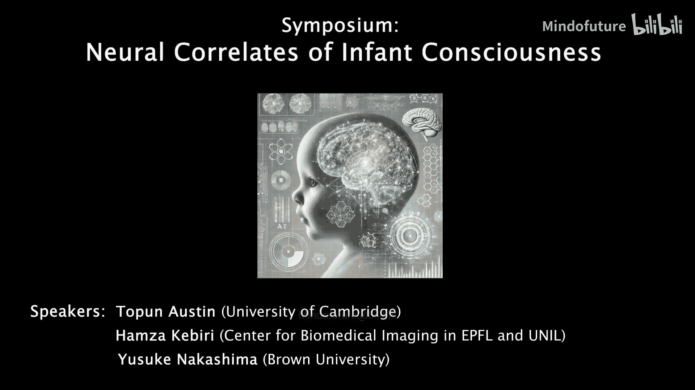

Thank， thank you very much。 And it's great pleasure to have the opportunity to speak at this meeting。

 And I know when Claudia sort of put this out， she wanted young researchers to come and present their their work。

 And I can tell you， now， I'm not young。 But in terms of the field of consciousness science。

 I am This is a new area for me。 And it's great to have such multidisciplinary group。

 And I feel slightly intimidated as a clinician not knowing much about the science surrounding here。

 But hopefully， I'm going to talk about a few areas， which I think。😊。

There I say touch upon consciousness rather than consciousness per se。

 So I'm a neonatologist or a baby doctor。 And I I， I've been working after looking after babies for about 30 years。

 And this is the only photo I could find of me with a baby。 and's actually my son，25 years ago。

 But in my day job， I look after sick and premature baby on the neonatal intensive care unit。 So。

 for example， this baby is born at 25 weeks。 gestation has to have the sort of rest of the pregnancy as it were within an incubate with all the tubes and wires and monitors。

And what I've observed over the past 30 years， we've got much better at keeping these tiny little things alive。

 A lot of my research early on was looking at ways of understanding and preventing injury to the preterm brain。

 But we've got better at that， too。 And and I've always been sort of fascinated by what actually is happening within that brain。

 and particularly when it comes to sort of the emergence of consciousness。

 And there are lots of reasons why I think this is important， But as a clinician。

 one of the reasons is that we are looking after smaller and smaller babies。

 We're moving down to sort of 22 weeks gestation。 And some of the sort of basic neuronal precursors are not necessarily in place there for。

 for consciousness。 So theres a lot of interesting sort of ethical， if nothing else。

 questions to be asked。So just giving a big sort of helicopter overview， how do we build the brain。

 This is looking at brain development from conception through to， I think it's 18 years of age。

The beginning is very much a pre programmed event。 A lot of it to do with sort of cell proliferation。

 You need the hardware in the head， to sort of operate。 And this is a very experienced。

 independent event。 It sort of occurs universally across all infants。 What's interesting。 And。

 and Lorena touched upon this is in that last trimester。

The infant is transitioning from this experience independent world to the expectation of being born and being in the outside world。

 And the sensory systems start developing and start coming online。

 And you get a what we call a sort of sensory sensitive and then a sensor driven components。

 And A lot of this， again， is driven by neuronal migration。

 The the actual connections are beginning to be made。And then we're born into the world。

 and we learn about the world， and our brain is shaped and modelled by the world around us in a very much experienced。

 expectant way。 And again， a lot of thats by synapogenesis， synaptic pruning， myelination。

 which continues well into childhood and beyond。As an neonatologist。

 this is the period I'm interested in that last trimester from 22 weeks through to term in that experience expectant environment。

And somewhere along the line。 And I'm not going to sort of define when it starts and when it， But。

 but from fertilization through to， I think I've stopped here at a year of age consciousness will emerge。

So another way of looking at it is that we go from a sort of structural development of the brain。

 that early hardware to a functional connectivity， which Lona very nicely shows some of the sort of work around functional connectivity。

 And， I'm not really going to talk about this much。

 But two sort of questions that I think is really interesting is what is the role of the subp that's very large structure that you see in late gestation。

 which kind of invalids by term。 and then the developmental thcortical connections。

 which start quite young sort 1214 weeks gestation。😊，During this period of the last trimester。

 the period of that we look after these babies， it's maximal and pretty much is complete by the time you get to term。

Then another way of looking at it is looking at developmental behavioral states。

 So I see a newborn infant as being a sponge to sort of learn about the world is preparing itself to learn about the world。

 And anyone who's had children and see newborn babies。

 their rate of development is absolutely frightening and sort of suck around doing not very much and they're learning to sort look around the world and everything else。

 And so they're primed for that。 So if we look during gestation。

 you start off with basic structural components to build various organ systems。

 The first things to start working at the autonomic nervous system controlling heart rates and things like that。

 then they start making spontaneous motor movements。 And then the development of state sleep states。

 which I I'll talk about， which I think is really important。

 And then that early exposure in the newborn world as a way of learning。

 And I'm going focus on sleep and touch as ways of that sort of final refinement before the infant enters or。

Sents the newborn world。So sleep， this is a paper from nearly 60 years ago。

 looking at sleep actually across the ages， from， from birth to to old age。

 What's really interesting is the difference in the both the quantity and the nature of sleep in the newborn。

 the newborn infant。 I'm sorry of any new parents there。 They do spend most of their time asleep。

 just not when you want them。And they spend half their time in what we would call an active sleep。

 which is kind of a precursor。 It's not quite a precursor to rem sleep。

 And the other half in non rem sleep。 And that changes dramatically as， as the child gets older。

 And even back then， the author of this paper wrote that the prime role of dreaming sleep in early life。

 maybe in the developments of the central nervous system。And if you look， so this is a term。

 as I say， you're spending about half your time in active sleep， half and quietly。

 If you go down into the premature infant by 28 weeks when these sleep states start emerging。

 the vast majority of that time is in this active sleep state。This is work from Mark Bloomberg in in。

 I think he's in Ohio Ohio。 looking at the importance of active sleep in the developing brain。

 And he's done a lot of work on， on rap pus and looking at active sleep quite。 And active like sleep。

 you have these twitchers。And these are self generated activation of the brain during active sleep and is part of forming the soattopic maps in the developing sensory and motor systems and。

I'm not a psychologist。 but this kind of is the framework of the embodied sense of self。

 which is that one of those sort of fundamental things that we have。 We know that we exist。

 and it's all kind of wired up fairly early before the baby is born。

 I don't know if the video was were showing it。 But this is a baby inactive sleep。

 And these are the babies who make little fidgety movements， grimaces movements of of the limb。

 They often look like they're about to be awake， but they're not。 they're dead asleep。

 but they're in this actctor sleep state。So what's， what's going on with active and quiet sleep。

 Well， in active sleep， you get this endogenous， intense neuronal firing。 And it's。

 it's kind of seen as a building a framework of the world and。Quiet sleep。

 which is not very prevalent early on in gestation and increases。

 This is occurs at the same time as you get increased wakefulness and you get the formation of thalamoc cortical and intracortical patterns of innovation and increased synatogenesis。

 So it's one idea is that during quiet sleep， the waking patterns of neural activity are reactivated。

 and the inflation quiet during that waking period are further process。

 It's refining a map of the world。😊，So the way I like to think about it is that active sleep is。

 is like when we were early explorers。 We're building this framework of the world。

 It kind of looks roughly like the world。 I'm sorry to the Australians Australia seems to be missing from that map。

Wakeightfulness in this analogy is going into space， looking at the planet itself。

 realizing what the world looks like。 So then during quiet sleep。

 we refine that map and and finally put Australia where it should be。

So I'm quite interested in this combination of sleep。

 structural brain development and functional brain development。

 And this is looking between 20 weeks and term。 And it is interesting how sleep states sort of mature and develop at the same time as structural and functional connectivity。

 And again， at some point around this。 I think， sort of consciousness is emerging。😊，So again， from。

 from a clinical perspective， if you're born a term and you've got healthy brain development。

 you have normal sleep weight cycling patterns。

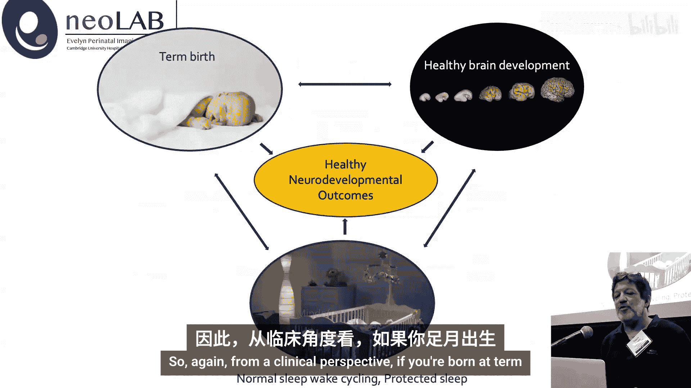

On the DNAH intensive care unit， instead of being in the womb， you're on a very noisy environment。

 lots of things going on。 We interrupt sleep。 We don't measure sleep states。

 And we know that pretimem babies have problems as they enter， into childhood。

 and one of the things we hypothesize is maybe altered sleeps。

 wake cycling doesn't help in terms of developing your ownal connections。

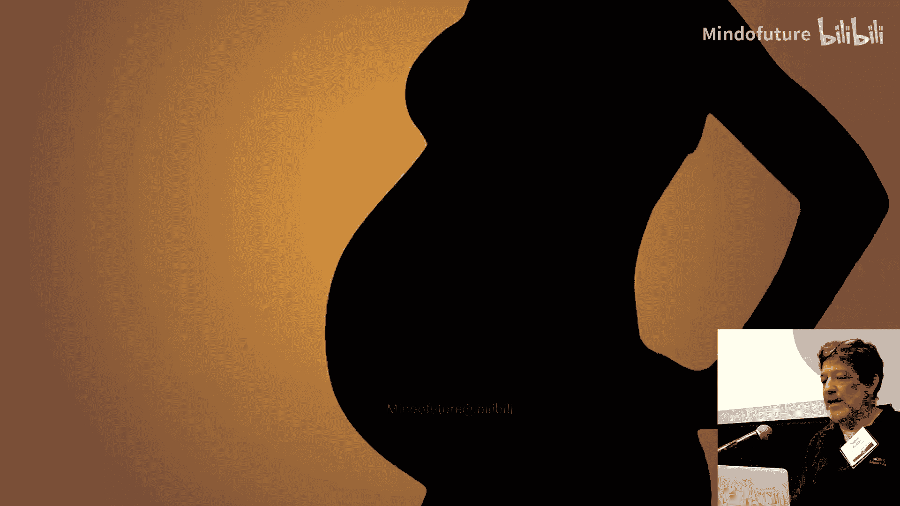

So I've done some work looking at sleep and looking at the relation between sleep states and functional brain connectivity。

 We use a technique of near infrared spectroscopy。 I dont know if people are familiar with it。

 it's shining near infrared light。 This is light absorption against wavelength in the nearer infrared just beyond the visible light can penetrate several cent of tissue。

 And because the absorption of oxy and deoxyomicglobin in slightly different if you use multiple wavelengths。

 you can resolve the oxygenation of the tissue。 So with the single light source and detector。

 you can look at global changes。 But if you have multiple light sources。

 you you can reconstruct images。And this is a system we use a high density diffuse opticalal toography system。

 Eachile contains three sources and four detectors。 And compared to standard defs。

 you get really high resolution maps of brain activity。

 and they all strapped together in a little cap， which the baby has at the coside。

So this is work from Julie， who was my PhD student during actually the pandemic。

 We were fortunate we were still allowed to study babies on the postnatal wards。

 And this is looking at seed based correlation in active and quiet sleep this is over the motor cortex。

 And just by eyeballing the data， you can see there's gross difference between active and quiet sleep。

 And what we found if you in in a group of about 30 infants in active。

 you've got much more inter hemispheric connectivity and in quiet sleep。

 much more short range connectivity。 So there are differences in functional activity depending on the sleep states。

😊，We've taken this a little bit further because one of the things in the world of functional connectivity。

 and I can talk about this outside of the meeting is that you're taking an average over a few minutes。

 But actually， there's a lot of dynamic things happening in that few minutes that you're averaging。

 And there are ways you can sort of look at the data in a much more higher， temporal resolution。

 One is called a thing called coivation patterns where you block up the data。

 looking at patterns of instantaneous activity。 And you look at the way that they change in the sort of fluctuating period over that space。

 the next slide is unpublished work。 We're just beginning to sort of look at this。

 This is looking at a motor cortex across actively looking at these coivation patterns over this period of measurement。

 And the key thing， just by eyeballing the data and we're sort of currently processing it。

 There is significant difference between actively even quietly in terms of activation。😊。

And the other era that we've just， beginning to sort of look at the data。

 we've done a whole cohort of pretminence around 33， 34 weeks on the neonatal intensive care unit。

 measuring their sleep states with EEG。So in the last few minutes， I think5 minutes or say。

 I want to talk about touch。 We go from sleep to touch。 And the reason touch is important。

 and I think it really important in the way the infant learns and develops throughout the world。

 It's all to do with self-regulation。 I think anybody has seen a baby who's screaming。

 They are so self-abored so softened they're not gonna know anything about the world。

 And what do we naturally do as as well， now I naturally just walk out the room。

 But most people will naturally pick up the baby and cuddle the baby to see the touch as as an gone world。

 So in very simplistic terms， the baby states are regulated either through cortisol through the sort of stress response they need attention。

 something is happening。 or when they're in that sort of bonded connection。

 that's where the oxytocin is produced between mother or an infant will care an infant。

And I think actually， we underestimate the importance of touch。 Mother， infant， affectionate touch。

 actually， the， the evidence that it possibly tunes infant neurodevelopment and is the foundation for infant cognitive and social emotional development。

And we should think of the skin less as a sort of protective organ organ from the outside world or just something informing me that I'm touching something hot or something。

 But it's actually a social organ But if you activate the unmalated sea fiberbres。

 they are dispersed into a much wider distribution in the brain rather than themato sensory cortex and provide a lot of information。

 social cues and social information。 And I think we all experience that in the pandemic because we be not allowed to do hug people。

 touch people。 It's a natural thing。 and it starts at birth。

 So one of the things I was quite interested in is。😊。

What's happening between the brains of mother and infant in this sort of early stages。

 And this is work which a colleague of mine in Singapore。

 Vicki Youngong has done a lot of of early parent， infant neural synchrony。

 And shes shown that neural synchrony coordinates these oscillations in the infant cortex and in trains infants brain patterns to social communication and promotes receptivity at key moments when the mother and infant are interacting。

 So I wanted to take a step further。 Well， what's happening in the first few days of life after birth。

 and with PhD students， Grace， who's currently a student the road in Harvard。 she。

 she looked at a cohort of newborn infant in the first few days of life and looking at neural synchrony looking at different social and touch conditions So we had the E G on both mother and baby。

 and then mum would hold the baby for three minutes。

 then slowly string an affectionate way and then do a sort of。Social fast stroking。

 And then we'd repeat the experiment。 Mu was able to see the baby using a sponge with the baby on the cot。

 and mum would do the same thing with a plastic doll。A lot of results。 And so I'm wary of time。

 I'm just gonna， I'll give you the highlights。 So if we look at newborn neural activation。

 where actually a low power equals in more activation。

 it differs across social context and touch types。 What's that saying the baby is able to distinguish between a sponge and its mother within the first 24 or48 hours of life。

 And there's increased activation to socially encoded maternal touch。😊，If we look at connectivity。

 so we can look at connectivity within the newborn E G between this part of the brain and that part of the brain and the same for the mother。

 But we can also look at it between the mother， the baby's brain，1。

1 electrode here and the mother's brain and the same electrode there。

 And this is looking at that connectivity across individuals。

 And what we find is that the the connectivity was disrupted when the baby separated from the mother。

 so。Being with the mother seems to sort of increase connectivity for， for the infant。

 and neither the mother and baby when it comes to connectivity is disrupted with the non social touch。

 I think we instinctively know how to stroke a baby。 And if you do something in。

 in a sort of unnatural way。 both the mother and the baby are still aware of that。

So social and touch related changes in neural activation and connectivity are also dependent on sleep states bringing back sleep。

 So if you look at neural activation， the newborn brain shows increased activation。

 specifically to socially encoded maternal touch， both in active suite and quiet sleep。

 but not in this high voltage， slow， Qui sleep。 I've got this。

 the four different kind of sleep states in the box。😊，If you look at connectivity。

 both within newborn， Mother， newborn connect brain related connectivity is disrupted when the baby is separated from the mother。

 which occurs both in active sleep and in quiet sleep。 but from the mother。

 it's specific to quiet sleep。 trustee ontenand。And the newborn mother and Mother newborn neural connectivity are all disrupted by this fast natural stroking。

So kind of summarizing this work。 And this is three years of a PhD in one slide。

 The newborn brain shows sleep state dependent re to social cues with the mother and socially encoded touch cues。

 So gentle touch And the mother newborn networks are present right after birth。

 These are unhealthy term infants and are responsive to these cues and is dependent on the infant sleep state。

 So I think that's really important when we sort of start assessing these babies with what what sleep states theyrein。

So I'm gonna hint for a really bold statement。 And， you know。

 feel free to sort of shout me down on this。 in the development of consciousness， sleep。

 I think is's essential for developing a picture of the world and our place in it。 babies sleep。

 and they sleep for a reason。 Their sleep stay are very different to that later on in life。😊。

And touch， I think， is one of the early foundations， along with other sensory things。

 smell sounds of voices and things， to help the social， emotional regulation， which is so important。

 Once the baby is settled， and we see this with babies with brain injury。

 They find it very difficult to settle。 And what's one of the challenges we find they're very irritable。

 very difficult to settle， very hard for the parents。 And they also end up with。

 with or poorer outcomes。 So that ability to self-reg。

 I think is so important for then the baby to be that sponge to the outside world。

 So I come up with the idea that these are sort of key foundations in making of the human brain。

So I sit here and present work of all all my clever people。

 I'm not quite sure why this group photo my son appears， but he does。

 And he let me put put his photos as a baby on。 But it's really the work of grace， Julie and Ka。

 who I presented here。 And I'll end with a quote from Victor Hugo。

 and mother's arms are made of tenderness and children sleep soundly in them。Thank you very much。

Great， we have 10 minutes or so for questions。

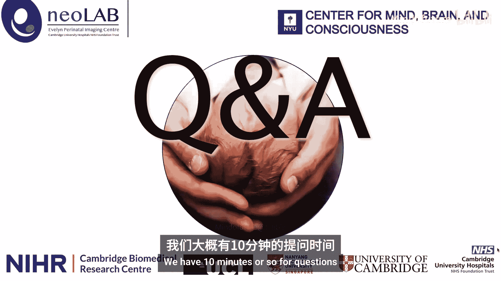

I have a question because it's true that the kgohu， for example， the fact that you are you know。

 perfectly。 But for the other， the fact that you put the babies on the motherer during when they are born preterm。

 But I was wondering relatively to your experiment whether it is really to be against the mo and to feel the smell to hear the beat of herbe and so on and so on。

 And what is the touch relatively to this all of that。

 And do you think it's important to also ask a motherer to have some touching and Yeah I think a really good question with this study。

 And this is working with Vicky， who is a psychologist and know。

 good scientist she really want to try and refine the touch question。

 Hence we had the paradigm of just holding gentle touch fast touch and a sham control to focus on that。

 But you're right in the real world。 you know， one of the things the mother was more attuned。😊。

The baby when the baby was in active sleep。 Well， when the baby's in active sleep。

 he's kind of wriggling and moving。 he's giving the mother cue。

 So is that a touch thing or is that something else that's going on。 And you're absolutely right and。

I will confess we should put all premature babies on mum's press。 This should it saves lives。

 It's universally accepted We don't。 We are very bad。

 particularly in high income countries at doing that。 We separate mothers and babies。

 It's a passion I've got。 We need to bring them together for all sorts of reasons。

 And I'm quite interested just in that neuronal connectivity。 But I think you're right。

 We're trying to design a study now for preterm babies。 I want to move away from just the one fact。

 And I think smell， voice， singing， music， that musicality， You know。

 and it might be very difficult to tease them all out。

 And maybe you have to do a sort of cluster analysis on that。 and the whole thing together。

 interesting， I suspect vision is probably the least。😊，Important at that stage。

 although it becomes very important later on。 I don't know how speculate。Okay， William。

Thank you for a wonderful presentation。 Hot topic and neonatology over the last decade or so has been。

Neonnaal ICU。Niku noise。And how that disrupts brain development。 What are your thoughts about that。

 that's really really good in that a spin of project。

 which I've struggled to get going what's called sound asleep。

 where we had noise meters in the car and looking at the responses of babies。

 and we are not particular， Well， we're not particularly good at controlling for noise。 But we。

 we also don't understand what noises they respond to。Anecdotally。

 I think they're much more sensitive to the frequencies of the human voice than and maybe even lower frequencies which you get in the womb than the high frequency alarm。

 So we come in and hear an alarm banging on and we think， oh， this is terrible for the baby。

 But actually， the baby doesn't just not bother about it。 But the nurse comes in and says。

 has anybody got the keys for the drug covered。And the babies kind of respond to that and disrupt their sleep。

 So I think it's really important that we control noise， but also look at noxious noise。

 So silent rooms are not good。 There's a very nice study of。

 I think it was done in the US where they had single room nurseries versus open mods。

 And the language development was delayed in the babies who were nursed in a single room because there was less communication going on。

 They were not hearing as much stimulus。 So it's trying to find what's good for them。

 but not excessive noise and the same for light， etc cea， etc cetera。

 And I think it's really important now， because as I say， we we're better at keeping them alive。

 But we need to try and optimize that early environment for them。And it's cheap， you know。

 not making a noise doesn't cost anything。嗯。Yes， so you mentioned at the very beginning of your talk that phammacortical connectivity is pretty much an adult level by by term by the time the baby is born and as I'm sure you're aware that thamma cortical connectivity has been played a major role in of studies what happens in adults when they're under deep anesthesia。

 I mean one of the most notable things is deep is that phmacortical activity is greatly reduced in deep unconsciousness with anesthesia。

 and that suggests that piece of data suggests that certainly by the time they're born。

 they may well be conscious。Yeah， and if it's very high， even like， you know， a month before。

 maybe they're conscious then too。 Yeah， so I will go with radar that sort of early。

 early development。 I I think a newborn infant is， what I think is really interested in that perinatal period is if you look at the waves the neuronal migration and the sort of connectivity。

 you get all the sort of sort of glutamate type neurons sort of migrating first。

 and there's a sort of wave of the gabereric neurons and gaer itself。😊，G so conference in itself。

 what Gabbba does in the newborn is the excitatory inhibitory， et cea。 et cea。 Doing funny things。

 which could be part of the reason that these babies are in a slightly higher enthropic state maybe。

 So maybe there well， the preterm baby maybe in the outside world。

 maybe at a heightened consciousness that you could。

 could speculate when because of these sort of connectivity。 There are things going on in the womb。

 which potentially depressed consciousness。 the various hormones coming from placenta。

 which kind of make them in a more sedate state， and it's much harder to sort of observe any Joel has done amazing work on on looking at that sort of fetal consciousness。

 But I would say， yes， and， and you know。Push back at what point do thmocortical connection start being made。

 It's actually quite early on。 and， and at what point how much how many connections do you need to the cortex from the thalamus before the lights。

Yeah， you know， interesting questions。😊，U。I've always been curious about this question and thank you for your talk。

 I was just wondering。Whether a baby could tell they are being held and cared for by like first say。

 let's say a father or a。Presumptive， adoptive parent， you know。

 if they are producing that oxytocin st， they still tell it's not a mother。 Yeah。

 I think I think that's a really interesting question。

 I suspect the big signal is in being held and not being held。 And we know that from development。

 the famous Romanian orphanage story where orphans were found sort of in a。

 minimally sensory environment after the communist regime and things and they had a severe brain injury。

 The moment you put them in her foster home。 their development sort of ro it up。

 I think having any physical contact is better than none。I suspect evolutionary。

 it would make sense that there's gonna be a， you know。

 the rules voice of connection is with the mother。 just maybe not politically。 I'm a dad。 I do still。

 I don't think anymore。 they're far too big to to cuddle。 I I hug my kids。 I， I think it's good。

 And we， we have on our annaal unit。 We get medical students to cuddle babies。

 because parents aren't for all sort reasons or utterly available all there。

 And I do some work in Singapore。 They get grandmothers in and things。

 So it would be fascinating to work out。 But I suspect that it will be quite small。

Cuddling versus non cudd is probably where the big difference is。

Coming to your point of synchronicity between the baby and the mother。

 where youll be able to look to these slow corial potentials because these are seen in this underlying long waves within the EG。

 synchronizing and oscillating the brain in terms of underlying structural activity。Yeah， I mean。

 it's really good question you've opened up the sort of one of the big gaps in my knowledge。

 my expertise is in functional near infrared rather than E G， But my understanding what we would do。

 we were looking at， I think the alpha waves which are slower waves driven by the newborn rather than what the mother's having because the mothers am I right。

 the fota waves are are less well developed to that。

 So it's a chicken and egg problems because we were looking at these sort of slow waves in the baby and trying to see is that in the mother But the mother way doing other things which we're just not focusing on that that makes sense。

I was just wondering， to what extent do you think that studying the critical purpose of ReM sleep during infancy can provide us with insight into the purpose of REM sleep during adulthood？

That's a very good question。 I got shot down by somebody who knew far more about sleep than me to say that active sleep in the newborn is。

 is a precursor for Rem sleep。 There's a lot of similarities。 There's also a lot of differences。

 And so there's one school of sort actually， would say this sort of active sleep component。Yes。

 it it it we evolve into Re and nonrenly， which have distinct purposes a lot to do with memory formation。

 etc cetera。 as well as other sort of health related benefits。 But what's happening in the newborn。

 It's about wiring up the brain。 It's a very different sort of purpose。 And it's interesting that。

 you know， that very preterm baby spends most of it time in that sort of endogenous， driven， active。

Which， which is slightly different to what's going on in the adult。

 So I'm not sure it's the honest answer to your questions。 It's's a good question。

 Two more quick questions。 Hey， sorry， thanks for the talk。 really interesting stuff。 yeah。

 my question is just about active sleep and how you kind of character it。

 This is not to shout you down， by the way。 like you invited us to。

 But it's just about the idea that active sleep is building this picture of the world or something and our place in it。

U when I think of like the classic case of building a picture of the world right or something。

 it's something like building a cognitive map or something when you're navigating your environment right。

 or RA is in teammate is navigating its environment， but notably neonas don't move that much。Right。

 I mean， they move， right， but they can't navigate。You know。

 and so I what's the sense in so it almost sounds like a metaphor that they're building their picture of the world If the main way they're doing If the main way one does't is actually I navigate So what's the。

 what's like the specification of the sense in which they're doing it。 Does that extent。 Yeah。

 I think I think does and you're absolutely right。 I use that analog it's a nice thing。

 And I spent ages digging out the paper where it came from not many people say this is the way and the evidence is very。

 But it's， it's to me， a nice way thing of this endogenous driven activity not dependent on external sensor information versus quiet sleep。

 which is coming or increasing after a period of now when you mean navigate the world。

 do you mean in terms of motor function getting around the world。 I mean， they do。😊，In。

 they do move a lot relative to themselves。 and that early movement。

 certainly in the preterm baby is around developing this matter of most cortex。

 That's that's translating the work of the sort of rat stuff。

My view of navigating the world after you're born is， is more a sensory driven the smells。

 the voices trying to understand。 And， you know， maybe the increased entropy they're in that psychedelic state。

 All the senses are sort of mergeed one， And they're slowly trying to pass that out。

 Do you see that with language development。 they hear all this jumble of sounds and slowly。

 they refine sort of music out language So that's that's why what I meant by navigating because you're right。

 it takes months before they literally startvigating。 Okay。

 we're out of time but one very quick final question from very quickly。

 think it so much fascinating work。 So。My question is about gravity adaptation。 So in womb。

 you're already surrounded by water。 So do you see relationship between you know the pressure that you got against the skin with the important of touch later on and being held thing because the gravity adaptation is very different medium。

 Yeah， I mean you know， what's it like to be a fotus， what's it like to be about。

 what's it like to be you know I don't know they're in a very。

 very different sort of environment and they're sort of moving around one of the things we do with premature babies is we put them in boundaries with with with blanket things so they can push against something because the resistance they will get in a liquid it's much stronger than you get in the air and there is good sort of developmental sort of cue that if you leave a baby strangling they struggle a bit So we give them those boundaries to sort of resist in。

 but fact it's an interesting question person。Thank you very much for the introduction。

 So I'm very happy and pleased to be in front of you here。

 So I'm a postdoc in the Center for Biomedical imagingaging in Losagna Geneva。😊。

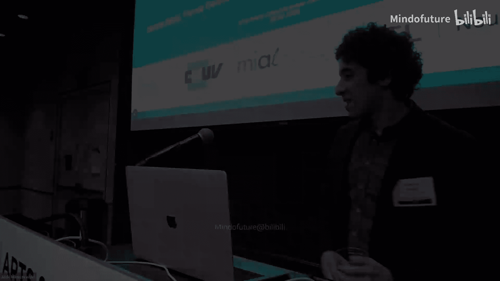

And my talk will be about the functional parcelation of the neonatal telus across development and then potential links to consciousness。

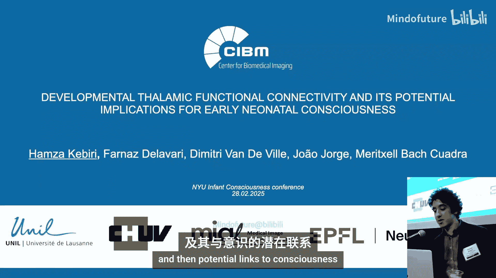

So I have nothing to disclose。So there have been， so the telamus is a very important region in in the brain。

 So basically， it's a responsible both for low sensory processing。

 but also for high level co co cognition。 So there have been few works that try to segment the telamus in neonates。

And yeah， here are listed here。 So there are some common patterns among them。Basically。

 there's this gradient from posterior to anterior。 There is also this gradient from medial to lateral and functionally from sensory motor to more executive functions。

However， there are， as you can see， they also don't match。

And we think it's basically because of the number of subjects that might be not so high and also because of the method that they use which which is basically a winner text hall method。

 So basically each part of thetamus so each voxel， which is just the 3D pixel， so it's connected to。

 let's say one to one to the brain。 So to the to the cortex or the subcortical regions。But the。

 the truth is that probably there is more。 we need a more fine grain method to， let's say。

 quantify this whole co connectivity， so。Yeah， so basically， they have also some common patterns。

 So mainly this' overlapping the teleelamic connectivityities to different brain regions。

 through this convergence property。 And also， there is a dominance of the sensory motor and somato。

A sensory cluster。 and also there there is no significant DMMN as default mode network connection to the tunnel。

So yeah， what we try basically to suggest is to use a high number of subjects。

 so this DHCP data set that Professor Naci。Presented before。

And the goal is basically to really have a group level parage of the telamus or we dressed in states FMRI using some kind of confidence。

 uncertainty to get more robust clusters。And for this we use a camem means clustering。

 so basically each vox in thetelamus will be represented as a vector of functional connectivity to the different brain regions。

And then the idea is to cluster these these voxels basically。 So， so it's a voxel wise clustering。

And yeah， so we use more than 700 subjects。And the data is already pre processed。 weird。

 So the data is already pre processsed， but we add some more prepro。And basically。

 we to quantify this robustness。 So we basically use either a bootstrap on subjects or on time points by basically just taking 75% of the subjects or the time points and then clustering the telamus and checking the variability of these of these clusters。

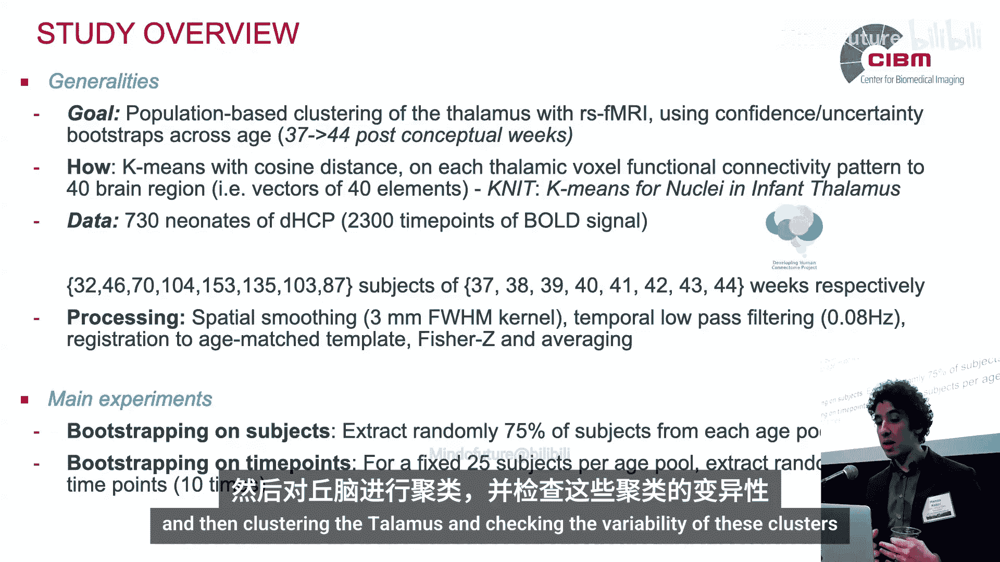

So here are some results。 So basically we can see the bilateral symmetry。And also。

 we can see the physical proximity of the voxels that belong to the same clusters。And below。

 we can see some uncertainty maps。 So basically the majority predict label across the different bootstraps。

 the subject bootstraps here， and we can see that it's more uncertain in the borders。

Which would be intuitive。And then we also compare it to this winner takeol approach by basically just merging all the labels that we have to the different lobes and。

What we could see is that the results are， are more noisy。

 They are less symmetrical and mainly dominated by the frontal and the parietal regions。

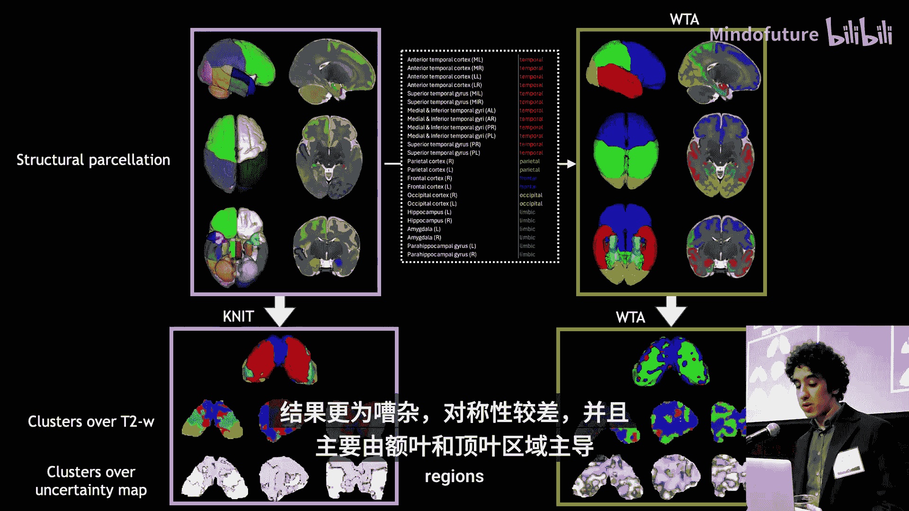

So here the idea is to start with the oldest age group。

 So the 44 weeks and then go down and analyze how， how functional connectivity changes with these clusters。

 So so we， we can actually see some patterns。So namely we can see， for instance。

 that they have similar yeah have there is some regions that are highly connected and its it's pretty common for mini clusters so there' is this noisy cluster。

 this green cluster which has a very low volume actually so we will discard it。

 but yeah there so there are some commonalities。And since this is a lot of information。

 So we basically merged the left and right hemisphere。 and we also discord。The function conivities。

 And then we considered whatever is higher than one。 It we will be highly connected。

 and then whatever is less than -1 will be disconnected。And so again。

 so we see some these commonalities basically the parietal。

 so all the clusters are mostly connected to the parietal。

 the frontal and the superior temporal jar is responsible for auditory processes。

 but there are some specificities to the different clusters for example。

 this cluster1 is mostly is the only one actually that is highly connected to the occipital cortex for vision。

 and this cluster2 for instance， that is connected to the insula and also to the Ontario singleulate cortex。

 so probably linked to the salience network。

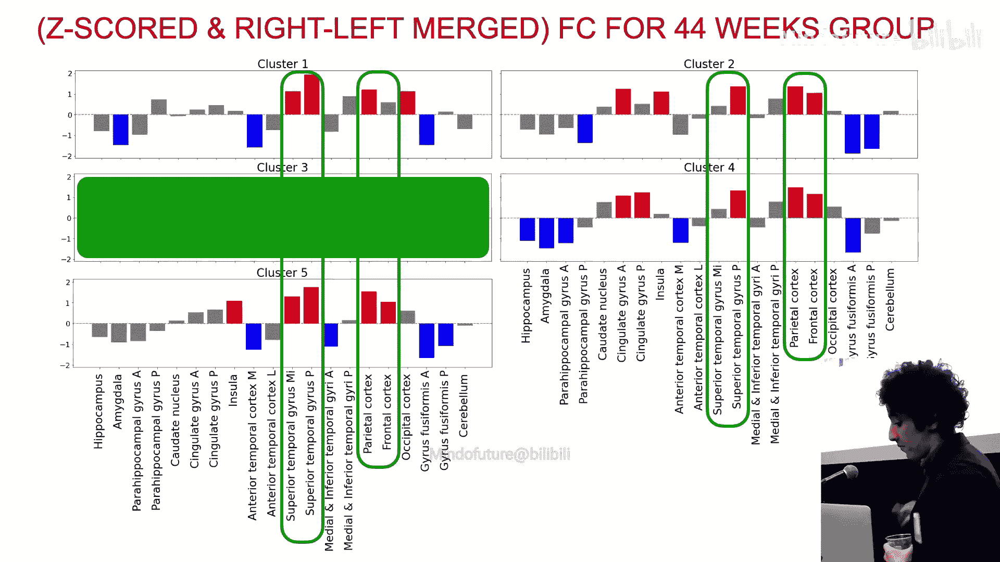

So， here is the。Basically the results on across age development of the clusters of the nuclei of the telamus。

 so we can clearly see this pvear cluster here as in adults that is very consistent across age and that is responsible for the cognitive processing of the audiovisual stimuli。

You can also see this salience cluster in blue that starts around 40 weeks here that grows。

 and then we also see this ventillateral motor cluster that is in X and and what we mostly see is probably this thread cluster that is basically growing in age and that is the dorsal cluster that we think it's connected to the frontal parietal network。

So we also see some increase in symmetry actually， and yeah this is just to this is just basically the relative volume variation and we can see this is the dorsal cluster that increases in volume and then the ventralola motor that decreases basically。

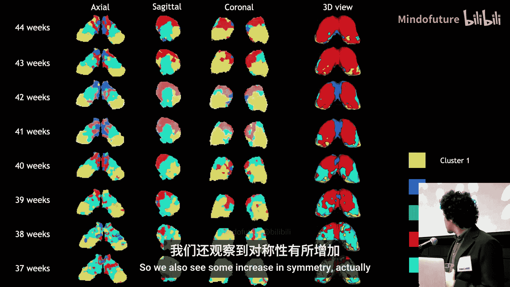

收。So here the， the， the idea is just to basically select the number of clusters and to see how many。

Clus or how much can we cluster actually do taamus across age。

 So this is use using the robustness and how much are these clusters varying using these bootsraps。

 And we can clearly see， for instance， in the left that。So the more we go to older neonates。

 the more robust is the clustering， so the more they are repeatable。

 so probably we can actually cluster neonates with more clusters。

 the more we go across age basically。And we actually see a similar result on the right it's just that the number of subjects goes down。

 so this is the red curve， that's probably why we don't see it from 41 weeks onward。

But we basically got stucked to five clusters because we had to keep a similar number of clusters so that we can analyze across age development。

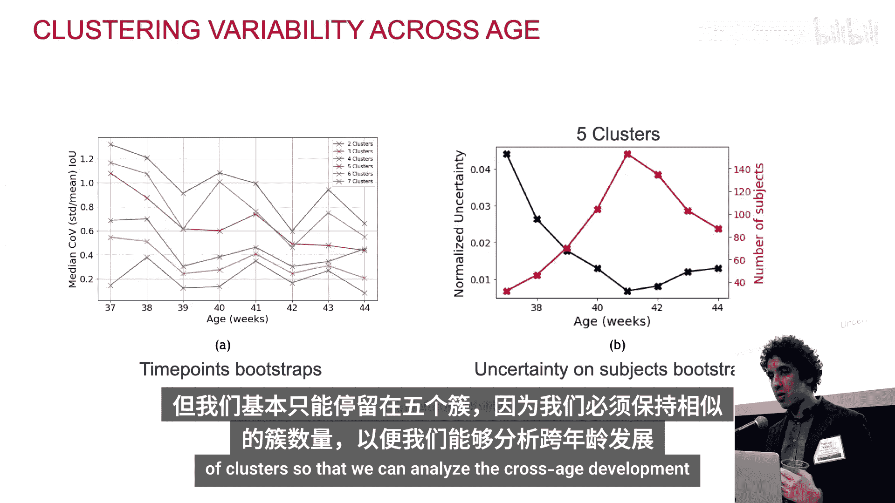

So this is just the other methods that the winner the x all and we'll clearly see that it's dominated by the parietal and the frontal so it it doesn't allow。

 let's say， a high level granularity to get more information。

 so it's basically dominated by one one region。

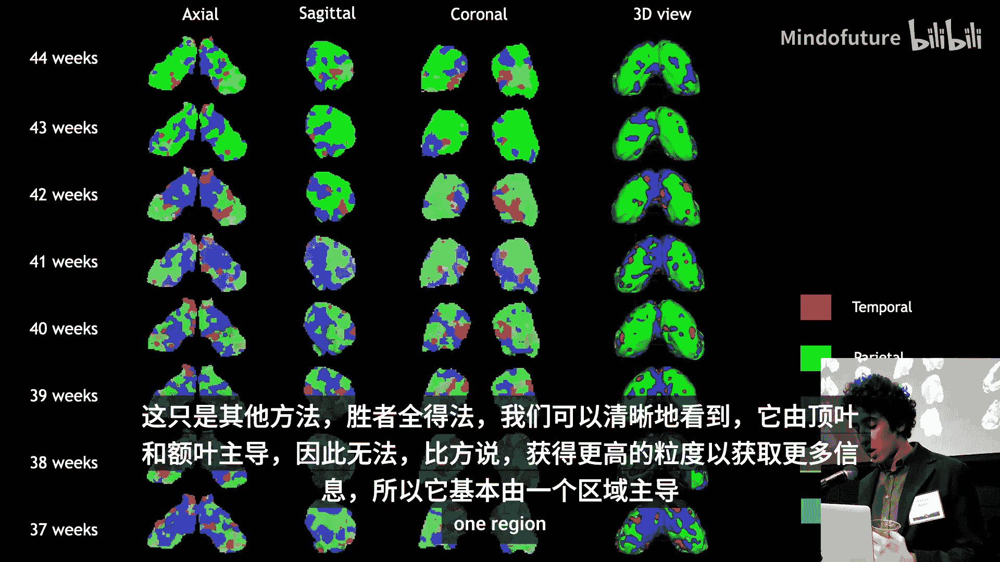

And this is just the bilateral symmetry。 so for the Ka means method， it's more symmetrical。

 but for this winner takes all it's much less。So this is unrelated to the clusterings of the telamus。

 so it's basically linked to the connectivity between the tamus and the different brain regions。

 so independently of the clusters and what we clearly see is this high connectivity to the parietal the frontal and per grus again responsible for auditory processes and to the singleulate cortex。

And we also see this burst actually in the cerebellum at around 40 weeks。

 And this is also a general observation。 Actually， we， we see some kinds of burst around 40 weeks。

But since the thamus is a part of the brain。 So maybe its activity is actually modulated or guided by。

 by the whole connectivity of the of the brain。 So we aim to analyze the。

The region of interest to region of interest connectivity so without the thamus and we see somehow similar patterns so mainly we have these frontal and an partal regions that are also highly connected。

 the single regions that are highly connected and we also see a similar kind of trajectory compared to the Tamus as here。

 however for the superioremp gus which is actually a highly connected region in the thamus so it's not actually highly connected to other brain regions here it's mostly ranked around I think in the ninth position。

But in the Taamus actually ranked around the second position。

 So this is probably more specific to the to the Tams。Okay， so now， so how， now that we analyzed all。

 all these results。 So how， how can we actually。Link our results to consciousness， so。

So I've been through the literature and then I found out that actually most of the neural correlates of consciousness have historically focused on the cortex and if even considered the Taelamus was only playing like a gating role。

 so these Taelmo corical groups just playing like a gating girl and however there is a lot of evidence and maybe should give the Taamus more chance and then because there is a lot of evidence that is's really involved in different in consciousness。

So namely the damage to telammic neurons and especially the ones in the dorsal telomers have been associated to low levels of consciousness。

 such as vegetative taste， disability and even comma。

And also the thelamus is one of the most depressed brain regions with anesthesia。

 so among and eight anesthetics， it was the most common one basically to be depressed and also there is evidence that the brain stimulation in the thelamus can reverse the loss of consciousness and there is an involvement of thetamic neurons in the detection of the viaxia stimuli。

And also， there is somehow consensus that this。Wite Matt fiberb bundles of thermo cortical fiberbs that we saw that start to emergemer around the 60 weeks。

16 gestational weeks up to maybe a term。 So they are somehow necessary for consciousness。

 So they can be considered as a。As as a lower bound。Let's say in the， in terms of。

 in terms of consciousness。 However， the upper bound is pretty open， I think。Okay。

 so here are basically the four。So for hypothesis or theories about the use of the telemine consciousness。

that I and that I found。 So mainly the， there is this one saying that the basically the ta was。

The tanus actually compresses this high dimensional classical information into low dimensional representations。

Using the tlamo cortical loops。 So basically， the idea is that we have the corsicicalalamic projections that basically send a high dimensional signal to the thelamus。

 and basically this and the telamus actually sends。

 So compresses the information because because we have much more neurons in less neurons in the telamus than in the cortex。

 So this this information is actually compressed and then sends back to the cortex via via the。

The telemocraical loops and this theory basically splits somehow the state and the content of consciousness by associating a type of neurons to state and then another type of neurons to the content。

Then there is this other theory that basically tries to unify the state and the contents of consciousness since consciousness is experienced actually as a whole。

 and they argue for these layer 5 pyramidal neurons that they actually necessary for consciousness。

And the idea is that basically any process that doesn't include the layer5 pyramidal neurons will be unconscious。

And then sorry， there is this last theory also which is very interesting， so basically。

It claims that the the Telamus actually is is somehow like an active blackboard in the sense that it displays the contents of consciousness and these contents of consciousness are actually computed in in the cortex。

And。Yeah， so it's's it's a very interesting theory and there are it uses some arguments such that the fact that we are actually only conscious about the results of the computations。

 but not the computations themselves。And yeah， so these two  theories are the one that let's say could be linked to our work and let's just try to see the nuclei be actually involved in consciousness。

 so there is this polyvear cluster that also exists in adult that basically is responsible for sensory integration and it could be linked。

 for example to the perceptual consciousness， actually the study below actually showed that the cluster is one is among is basically the most the cluster that has its functional connectivity mostly changed after anesthesia。

And there is also this medial cluster that is basically linked to the salience network。

 and that could be linked， for instance， to the interceptive awareness or the modulation of attentional states。

And this could be a link to the self referential consciousness。

 and then there is this dorsal cluster that we actually that grows in age and that we believe is linked to the front Operaal network and that could be linked to the high order goal oriented executive functions。

So based on this。 So basically， the， the hypothesis here are are are， are that maybe。For instance。

 this conversiont telamic connectivity that we saw is that many tammic voxels are actually connected to many brain regions。

 or let's say the same telammic voxel is connected to many brain regions。

And so this could be basically the the theory of the whiteatal and of this integration and the imary reduction。

 And， and this is somehow aligned with the， with the phenomenal consciousness and the fact that。It's。

 it's somehow a low dimensional's low dimensional property that is actually context reach。

 but a detailed poor。 And so yeah， this can make sense。Or for example。

 this increase in bilateral symmetry that we see across age and that could be， for example。

 linked to a transition， let's say from a more reflexive and conscious behavior。

 as thats let's say more random in early gestation and to more adapted and structured responses later。

And then there is this which is I think maybe the main hypothesis of this work。

 is this growing dorsalalamus and we have seen how this dorsalalamus is very important in the ter of this active blackboard or this dynamic criteria of war。

And the fact that is actually increasing in both volume and in connectivity trend。So。

 and the fact also that we saw this development developmental burst in the global tramic connectivity and also in other brain regions。

 So it around the 41 weeks。 So this could be maybe kind of an emergence of of some basic level of consciousness。

 I mean， since consciousness is is a gradient， or maybe we can say it's a milestone at least。Okay。

 so this is basically just a summary of our study。 So we have seen this growing robustness and bilateral symmetry across age。

We have also seen this burst in connectivity at 41 weeks and also for the whole brain。

 except for the super temporal gyrus， which is responsible for the auditor processing。

And we have seen that this gamingming clustering that is more granular and that has a vector space that is more rich is probably better than a winter text solar approach。

 and these are the fourtammic nuclei that we have found so mainly the pvear， the medial。

 the dorsal and the ventralter mortar。And the main hypothesis that we suggest here and that I will be happy to discuss with you is this emergence of rudimentary conscious states at around 41 weeks。

And yeah， so just before finishing， I just want to add that so my knowledge about consciousness is actually mostly related。

 it's like， it's like taken from articles and and books and documentaries of such as Professor Chalmers that I've been watching on YouTube since 10 or 15 years ago。

And the。Maybe my only direct link is this first stage of my thesis and from the hard problem of consciousness。

 but actually my thesis is about deep learning and fetal imaging。 but yeah。

 I've been always passionate about consciousness， but it's been challenging like to find room。

 let's say to grow an academic career So these conferences and events are very welcome and and thank you Cla organizers for this。

 and yeah， so these are my colleagues that I would like to thank as well and you for your attention。

😊。

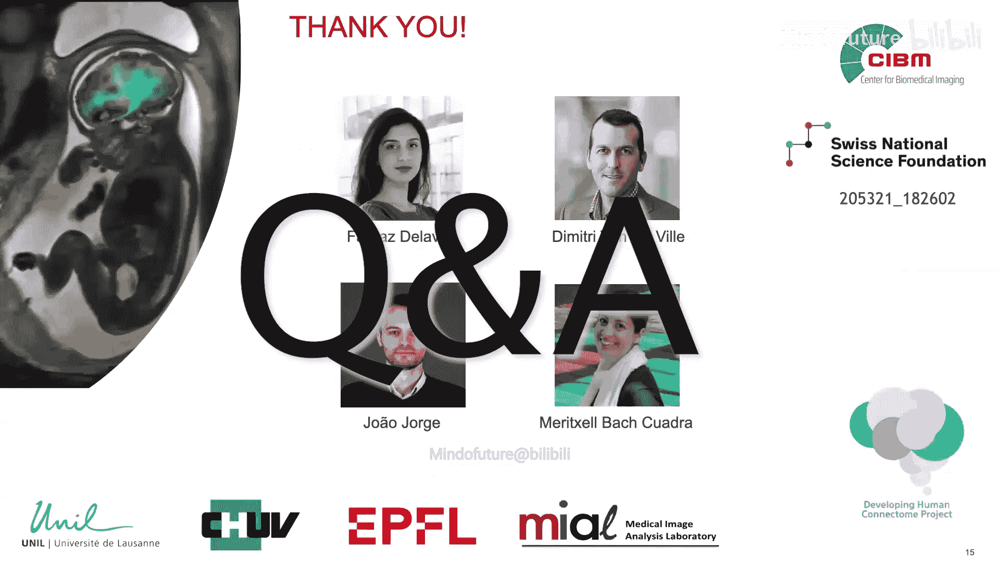

Yeah， thank you。 I have a question regarding the role of the telus。 So if I remember correctly。

 the sense of smell is kind of unique because its information doesn't pass the Tamus。

 I don't know if that Edpar evidence has changed， but it would be a problem for your。You know。

 emphasis of the telamus for the NCC。So I wonder how you deal with that。 That's a good question。 I。

 I think the literature still claims that the only the sense of smell that is not modulated in the thamus。

嗯。I mean， yeah， that， that's a good question。 Maybe。

 maybe there are some other paths in which the sense of， of smell goes through。 but yeah。

 I'm not able to give you what it's say yeah。 Adams。I'm high。

So you brought up the Talus as a blackboard。 But I was wondering if。

It it could be not like mutually exclusive， but could it be like the Talamus enables certain types of synchronous activity that could establish a kind of like functional dynamic core that could serve as a blackboard。

 but it's like a necessary thing， or is like the Talamus doing a particular kind of work。

As a blackboard。 I mean， it could be like a multiscale story。

 And also you bring up like L5 primammal neurons。 I was wondering what you thought about like predictive processing because I mean。

 clearly predictive processing is not like adequate theory of consciousness But the idea that。

 for instance， though that like a Bayesian brings some hand waving that there's a sense in which consciousness as a grounded hallucination that like that L5 primmmal neurons via their ability to loop the thalus and in theory and code predictions could be involved。

Curious for your thoughts。Okay， thank you very much for the question。 So for the first one， I think。

 yes， it， it could be the case。 I mean， maybe we can even link it， for example。

 to the global workspace theory。Yeah， in this that there is like a kind of a theatre and there is like a projector。

 let's say， or some attention in some in some in some states。Yeah， so Im I'm not sure if。

 So according to this theory of of war， the the， the this active blackboard。

So I think it's basically based on on some on， on some， on some evidence。

 or let's say on some some ideas that for instance， the the， the the Taamus has a lot of convergent。

Convert projections。So many projections apparently compare to the one that diverseer。

 so the projections that actually come to the Telus are huge compared to to the one that actually go outside of the Telus。

 So this is exactly this is somehow maybe one strong evidence。

 let's say for the time but I mean I agree I mean it's just a theory and probably we need much more yeah。

 much more iPod much more experiments basically to validate all this。

 Thank you to point just a quick question very nice talk I was just wondering if you've looked at the preterm group in this developing human Connect cohort So that's a very good question。

 So in this in this in the study actually basically just use the scan age So from 30 seven weeks up to 44 weeks So we didn't really split into preterm。

 so we didn't like take the birth age in consideration。

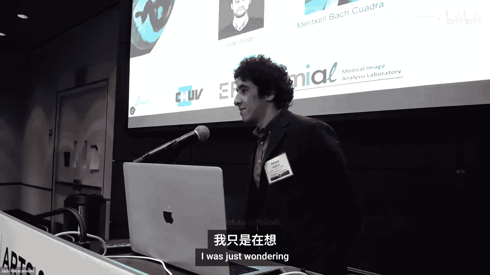

But this， this could be really something next to do。 definitely like to split。 But yeah。

 our goal was really to maximise the number of subjects and to really， yeah， get something very。

 yeah， very re representative。 Let's say。 thank you Chnaika。Thank you so much， this is really。

 really beautiful work。😊，I want to come back again to my climbing example。

 because I think there is a methodological challenge here of like， looking for。You know。

 the neuro correlates of conscious experiences through the lens of the adultcentry understanding of what consciousness is in adults。

 and then squeezing to the lower level in the infant。

 And I think that's that's problem because as I said， if we develop。

 if you take a development perspective， then what you need at the first step。

 it's optimal for that step is not minimal。 It's just optimal。 yeah。

 So this means that maybe we're looking at the regions that are。

Let's say optimal for an adult centric perspective of like experiencing。

 but not necessarily for the lower level， but not not lower in the sense like she put is like like less。

 but。Like primary， like the the first steps。 So and then the question would be。

Because if you take really a development of perspective。

 then you have other type of system that develop before the neuro systemem in。

 in the womb and very early on。 And those have like a really。

Major role and you know constructing sensory perception。

 and I think somebody already asked the question about the relationship between the neural correlates and other type of physiological signals in the body。

 so do you envision in the next steps to basically a couple also physiological measures from the body in relation to the neurals systemss and look at different type of systemss。

Yeah， thank you very much for the question。 I think it's very， very important。

 I think to think about the buddy and I actually saw your conversation with Michael Levin on YouTube。

 and I think it's very very interesting view。 and like being stuck。

 let's say with the neurons is not maybe the it's not I mean。😊，It。

 it's maybe similar to being to the cortex in the brain。

 So probably we should get more broad and really， yeah do experiments that that include the whole body and and try to link maybe that with the brain and。

Yeah， thank you。Okay， so it's great。Okay， so thank you for the opportunity to speak at this wonderful conference。

 so I'm honored to be here。 So I'm I'm currently postdoc in Brown University。

 but today I will talk about the research I I conducted。😊，In Japan。 So that is research。

 which examines immateur processing early infantancy reviewed by regional background masking。

 So this study didn't aim to examine infant consciousness。

 And so so actually I was told by reviewer that we should not use the term consciousness in the process of behavior because we we use just behavior major。

 So， but I believe that yeah， our finding our research could give some insight into infant consciousness。

 So so I will discuss infant consciousness in the last part of this talk okay。

So it is well known that the human visual system develops substantially during the first year of life。

 So most basic visual functions emerge during this period。Yeah， so like including features activity。

 global con processing， consistency and attention。So although visual development continues quantitatively beyond the first year。

 So it becomes qualitatively similar to other visual processing during this period。However。

 the mechanisms underlying this qualitative change in the visual system are still unclear。嗯。

So to address this issue。 So we focused on feed forward and recurrent processing。

 So it is known that sensory processing is mediated not only in a feed forward manner。

 but also in a recurrent or fieldback manner。So there is growing evidence regarding the role of re processing in visual perception。

 However， the development of re processing in infant is poorly understood。

 So we investigated the development of re processing by using visual background masking。😊，嗯。

So visual backward masking is a perceptual phenomenon in which a visual stimulus is rendered less visible by a mask stimulus firing the target。

So this is meta contrast masking， one type of background masking。 So a target is briefly presented。

 and then it's followeded by your mask。 that's， that's not spatially overlap up with their target。

So when the S OA between the target and the mask is from 30 to 8 millisecond。

 the target visibility is greatly reduced。So backward masking has been used as a tool to investigate the temporal dynamics of visual perception。

 So by using masking， we can infer the neural processes occurring from stimulus onset to the emergence of conscious perception。

So previous neurophysiological studies have shown that backward masking sues only the late phases of neuro responses in the visual cortex。

So these are single unit recordings of V1 neurons developing a visual task we is masking。

So when only the target is presented， both early and late activities can be observed。

But when their mask follows the target， only the later activity is suppressed。

Several studies have shown that background masking suppresses neural activity in early visual areas from approximately 100 millisecond after a target onset。

And it has been suggested that recur signals from higher areas。

 which we run around 100 millisecond afterAs onset。

 So this suggest a temporal consistency between backward masking and recur processing。

So based on these findings， some models propose that background masking disrupt visual processing。

 including recurrent signals from higher areas to lower areas。

 but does not affect the initial field forward processing from lower to higher areas。

 So we used background masking to investigate the development of recurrent processing infants。

So in our first study， we use object substitution masking over OSM。

 another type of background masking。Also known as common onset masking。So in this type of masking。

 target perception is impaired when the target is presented with a surrounding photo mask like this。

 and the mask remains on screen after the target disappeared。

But if the target and the target and mask disappears simultaneously， target。

 the target can be perceived。So OSM is also thought to occur because the integration of feedfor and recurrent signals is disrupted。

And indeed， an M ED study has shown that re activity in the in the R Vi cortex is moderated when the target cannot be possible due to OSM。

So a few studies have investigated the development of recurrent pathways in human infants。

So anatomical studies of post mode human brains suggest that the development of re the pathway is slower than that of fieldified pathways。

So。By four months of age， fear for connections between V1 and V2 are relatively mature。

 That is the adult like la laminina timing pattern emerge。However。

 the feedback and horizontal connections are still immature at that age。So in particular。

 the different connections terminating in layers 2 and 3 are imm in in younger infants compared to to adults and older infants of children。

So these findings suggest that until at least four months。

 recurren processing may be immature and visual information may be processed mainly in a field forward manner。

But this possibility has not been extensively examined so far。So we tested tested this idea。

 So we hypothesized that if recur processing is immature and visual information is processed。

 mainly in a fitified manner in a infancy， So OSM may not occur in younger infants。

 So that is if infants lack lack re processing， the mask stimulus wouldn't interfere with target processing because because the mask wouldn't be able to catch up with the target signals without recurrent processing。

So in other words， we tested whether younger infants can perceive a stimulus that older infants cannot see because of masking。

So we， we examined all the same in infants at 3 to8，8 months of age。So in the experiments。

 we used the， the preferential ro paradigm with face stimuli。 So in， in the simane offset condition。

 a face and a photo mask disappeared simultaneously。 So， so this is a mask condition。And in the。

 in the delayed mask offset condition， the mask remained on the screen after。

 after the face disappeared。So this is a masked condition。

And each stimulus sequence was repeated 10 times per trial and and trial from these two conditions were presented alter and repeated five times。

Sorry， and so we measured infant looking time at the monitor school during these trialss and compared it between the two conditions。

So it is known that infants prefer face faces。So if OSM occurs。

 the face stimulus would not be perceived in the， in the delayed mask of that condition。

And looking time would be longer in the simultaneous offset condition。嗯。So the。

 the paragraphs shows the looking time in each trial。

 and the row shows the total lookinging time across five trialss for for each condition。

So as you can see， looking time was longer in， in the simultaneous of condition in 7 to 8 month old infants。

 But there was no difference in 3 to 6 month old infants。

So these results suggest that OM occurs in 7 to 8 month old infants。

 but not in3 to six month old infants。However， we may not be able to conclude that masking doesn't occur in younger infants based only on these non significant results。

So， so to further test the absence of OSME younger inferences。

 we compare the no phase and the delayed mask of condition。 So。

 so these are the same as in the first experiment， except that the phase was not presented as the target position in the no phase condition。

So in this case， if O S OM does not occur， the face can be perceived in the delayed muscle set condition。

And looking at time would be will be longer in the dead mask of that condition than in the no face condition。

So we found that looking time was longer in the delayed mask offset condition for。

 for 3 to 6 months of the inference。 So this indicates that they could see the phase in the delayed mass offset condition。

 However， looking time wasn't different between the conditions for for 7 to 8 months of the inference。

So these， these results suggest OS SM is ineffective for 3 to6 months old infants。

 and younger infants can perceive faces that older infants cannot see because of masking。😊，And so in。

 in another study， we also investigated meta contrastst masking in infants using a habitation method with shape discrimination。

 And so we found that meta contrastt occurs in7 to eight months or， but not in 3 to six months old。

 So， so this is similar to the， to the result of OM。So from these studies。

 we found that OSM and metacontours are ineffective for three to six months or the infants。

 So previous studies have suggested that these types of masking may interfere with recurrent processing and recurrent connections are immature at least until around four months。

 so based on these findings， our results could suggest that these types of masking are ineffective for younger infants because they are recurrent processing is immature。

So our findings suggest that the visual system substantially changes in the second half of the first year。

 So until around six months， major visual processing may be primarily mediated in a field forward manner。

 whereas after six months， it is mediated by by recurrent loop incorporating field forward and feedback recurrent processing。

嗯。So our results show that a stimulus that can be perceived in our infancy becomes imperceptible during development。

 so this may seem a little bit counterintuitive， so we infer that some visual functions should emerge through the development of recurrent processing。

😊，So， for example。ReRecurrent processing is embared in integrating local information into a global context。

 such as figure ground segregation， illory counter and surround suppression。

And infant study studies have shown that these functions emerge around six months。

 So this is consistent with our， our findings。And another important function related to recurt processing is predictive processing。

 such as predictive coding。 So some models propose that there a visual system integrates top down predictions with sensory inputs to resolved perceptioncept。

 ambiguity。 So indeed recent studies have shown that recur processing is crucial for robust perception of ambiguous stimi。

😊，So in our infancy， such predictive mechanisms may still be immature and。

 and perception may be vulnerable to， to visual input input ambiguity。

So we could say susceptibility to backward masking might be a trade off for。

 for the acquisition of these important functions。So here。

 I will explore how our findings can be interpreted in terms of consciousness and they the in implications for some theories of consciousness。

So the theory most relevant to our study is that frequent processing theory。

So this theory hypothesisthesize is that reant processing within the visual pathway is necessary for conscious perception。

And so， so I will introduce three possible interpretations related to this theory。

So the first is that re processing is necessary for consciousness or。

 so that is meta theory is correct。 And therefore， younger infants who lack re kind processing do not have conscious perception。

So in the context of our study， this may be possible because infants could orient to a visual stimulus without conscious perception through reflexive responses mediated in sc pathways。

However， this will be inconsistent with some findings suggesting that infant under six months may have conscious experience。

And the second interpretation is that。Recurrent processing is not necessary for consciousness。

 and young infants can have conscious perception， even if recurrent processing is immature。

So this would suggest the salary may not be correct， at least in part。

So it is possible that re processing facilitates the generation of consciousness。

 but it's not the NCC itself。So。For example， yeah， so recurrent processing may help degraded stly reach consciousness。

 as the recent study suggest。 So in this idea， recurrent processing enhances N activity。

 and it facilitates conscious perception of weak input signals。

But consciousness can emerge without recurrence if N activity is sufficiently strong。

So this could also explain backward masking because our masking doesn't always render the stim invisible if they input signals are strong enough。

So if this is true， younger infants can have conscious perception。

 although it may be less likely to occur for for degrade or ambiguous stimi compared to older infants and adults。

Yeah。So the， the third interpretation is that re processing is necessary for consciousness and young infants can have conscious perception。

So this is possible if the recur processing disrupted by masking defaults from the re processing required for。

Conscicious perception。So there are multiple types of re pathways。

 such as one from higher visual areas to lower visual areas。

 so which I will refer to as local re processing and another from frontal or priortal areas to visual areas。

 so which I refer to as global re processing here。So one possible interpretation is that local recurrent processing is necessary for consciousness。

 as proposed in La theory and backward masking specifically OSA and metacontours。

 disrupts global recurrent processing which comes from from or parameterta areas。So in this case。

 masking doesn't affect young infants because because they lack global recurrent processing。

 but they can still have conscious perception because they have local recurrent processing。

So this could， this could reconsideide our findings with theory and the idea that younger infants have consciousness。

But its， but it's somewhat unclear how masking reduces visibility without disrupting local recurrent processing。

 So， I mean， local ret processing would occur earlier than global recurrent processing。 So。

 so it is possible that。Local recur processing emerge before masking disrupt global recur processing。

 and this would allow consciousness to occur。Okay， so。

 so each interpretation has some inconsistencies with， with existing findings and theories。 So。

 so at this stage， I can't determine which one is the most possible。 And， of course。

 other interpretations can exist beyond the three interpretations。So thank you very much。

This is really， really interesting。 Thank you。 So I'm。

 I'm just wondering whether there's not even another interpretation。

 which is a little bit more mythological。Which states that actually， you missed the conditions。

To obtain masking in younger infants， because the delay between the mask。

And the face is just too short。 So what I've shown a little bit earlier is that it takes like one second or something for them to。

Have the first stimulus。Emerge， and we didn't even go down to three months old。 So it might be that。

Actually， what you， I mean， what they're perceiving。

 the stimulus of the mask is just like a single integrated stimulus。

 There's no interruption masking here because they don't have time to process it has two different things。

 But if you really allow a much longer SoA then you would observe the backward masking effect even at the longer。

 So so my question to you is like， did you run a paramedic study that that lets look at the different durations。

 and maybe actually they have recurrent processing。

 but we might be missing it here because their processing is too slow。Okay。

 so thank you for your question。 So you mean therere， there， yeah， the time。

The duration of the face and so the， the， the S Oware is too short， right， Yeah， so， yeah。

 so we used only these durations in our experiments。 So， yeah， so I think that that's possible。

 So I mean， in younger inference， masking doesn't didn't occur。Because the duration is too short。 So。

 and yeah， so。So I think that's all in， in many studies using。Back onm asking in infant。

 So I think are the， the duration of the stimulus is around around 100 mill second or 200 me second。

 So， so we use this yeah， duration and。 but so， yeah， if。嗯。In in younger inference。

 the li processing。Is still much。 but， but， but it it's very slower than the older infant or adults。

 So yeah， it， it could be possible。 But so， yeah， Yeah， yeah， yeah。 I think so。Answer in。

Other types of types of masking other types types of masking occurs in even in early ins or。You know。

 so the like noise or pattern masking occurred in in five months or， yeah， five months or infant。

 So I， I think so， yeah， so that is， yeah， so like。

 there is a difference between our study like O A and metacon and the those types of masking。

 So I think that is， I show you this。

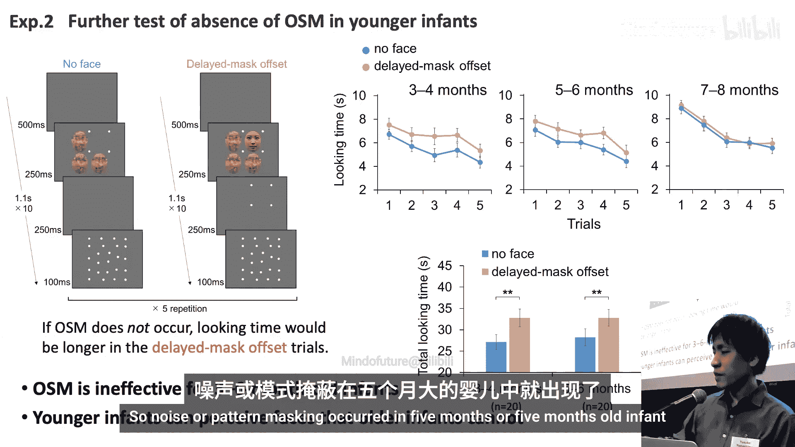

I wonder if you're familiar with the more direct test of local recurrent processing from Svanto Kawi and Walsh two papers。

嗯。There is a more direct test。Of of local recurrent processing in two papers from Svanto。

 Cowi and Walsh using a perception of motion。where they used transcranial magnetic stimulation to stop the local currency and found that they did not that got rid of the perception of motion。

 so I wonder if you could possibly use that，Kind of technique。Well， I don't know if you can or not。

 Yeah， so so I think。At the moment， it's， it's difficult to T M S fancy Yeah。 but so， yeah。

 so I agree that so yeah， that T M S study is most like a direct method to to。

 to test the role of recurrent processing。 So yeah， so and yeah。

 other like so just measuring M activity were easy are to be different to。

 to segreg the field and recurrent processing。 So especially in human。 So it's very nice to。

 to use T M S。 but so yeah， now we， we can use that。 But so yeah， we yeah。😊，Its。

 it's very nice story。 If you actually use that your methodology， but or， or。Yeah， yeah。

 something similar similar 1。 I don't know we are。 Yeah， but so yeah， thank you。Andrew Ru， thanks。

 thanks so much。 I just had a question about a comment you made in passing about a trade off from going to 3 to 6 months to 7 to 8 months。

 So if you need recurrent processing to get things like stability， that's definitely a good thing。

 But I was wondering what you lose。 in making the transition。

 So the backward masking phenomenon seem kind of artificial。

 So I was wondering if there's any adaptivity to that and why you would see that maybe in development。

 go away once you get to just regular adult vision。Okay， so。

 so are you asking that So why bulk masking are， can can can O becomes effective during the development or。

Yeah， I so you mean the the to offer。申唔。So to cook could you repeat that I there any benefit。

 I there any benefits for infant Okay， not getting back I。 Okay， so I is there any benefit from。

 from， from back of masking。😊，Yeah， yeah。 I there from not getting back with that。Yeah， so the I see。

 Yeah。 So background askinging is。Phenomeeno， it's thought to be like， not， not be like。Yeah。

 so humans basically do not benefit from background masking。

 because this is like just experimenter phenomena。 So in daily life。

 So I guess record masking rarely occur。 And， but so backward masking occurs only in in the like experimenter environment。

 So， but so this。This phenomenon shows that just shows that so perception or conscious perception does not occur just only by by either likeulating or activity or very fast fit for processing bus or like pa activity or re processing needs to。

 to for consciousness to our right。 So， and。I think so， yeah， so。For infants or yeah background mask。

嗯Does't mean were there are I guess there there are no benefit from God asking in反好。Yeah。

 it's just we runoff time so just a very quick point so you show the implications for the results for recurrent processing theories and you discuss three interpretation and you show that the three interpretation each of them have some tradeoffs but I was wondering which one you favor regarding the results you have。

 which one you intuitively think is the one more close are infants seen having conscious experience are they not having conscious experience or are they having conscious experience with early recurrent processing thank you so actually I I。

Do not have any specific。Ipoize but so I guess yes so there several findings。

Suggesting that infant even even for infant under six months， conscious。

 conscious experience can occur so。I think， yeah， I speculate that or if。In front， at these， these。

 these ages can have conscious experience。 So in that case。The。

 the second or third interpretations are more possible than the first one。 And yeah， so。

 and the third interpretation is that so this yeah can reconcile our findings with with La theory and the idea the idea that infants can have conscious experience。

 but so this interpretation yeah， so it's a little bit difficult to。

 to explain the background masking itself yeah， as I said， in in my talks or yeah。

 because OM and metacon are thought to occur because。Yeah they在 disrupt嗯。

I think several researchers think that these types of masking disrupt like more perceptual processing or visual processing rather than attention or processing。

 so。This means， these。Masking these types of masking may disrupt like lower sorry So local recurrent processing。

 which within the visual pathway。 So in that case， yeah， so in this interpretation。

 is quite a bit difficult to explain the， the the masking effect。 Yeah， so。Yeah。

 but yeah for the second second interpretation。 So yeah， so we we we may need to。嗯 yeah。

I that ra theory is a little bit yeah incorrect at least the。

 So but must so this could explain yeah asking。 So yeah。

 I think the second interpretation may be pro Yeah， at at this moment for me。 Yeah， but yeah。

 I'm not sure。 if I， I'm correct。 Yeah， thank you。 Okay， well， thank you very much。

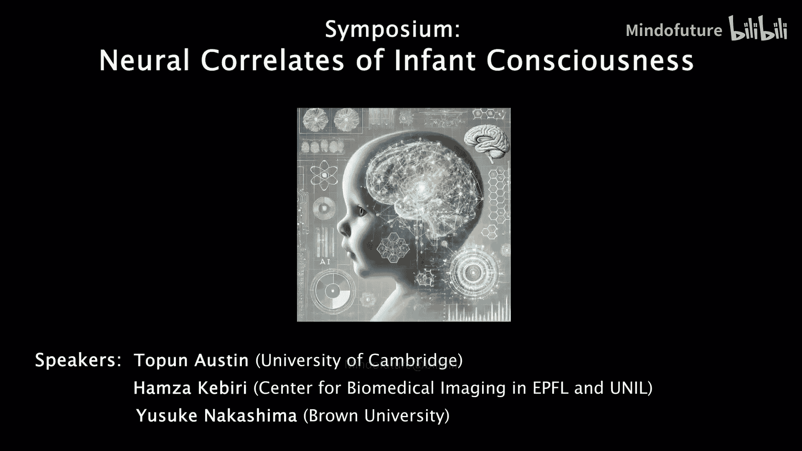