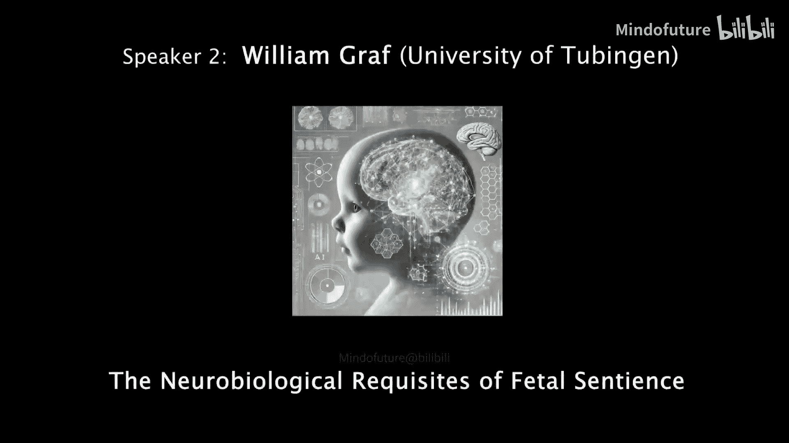
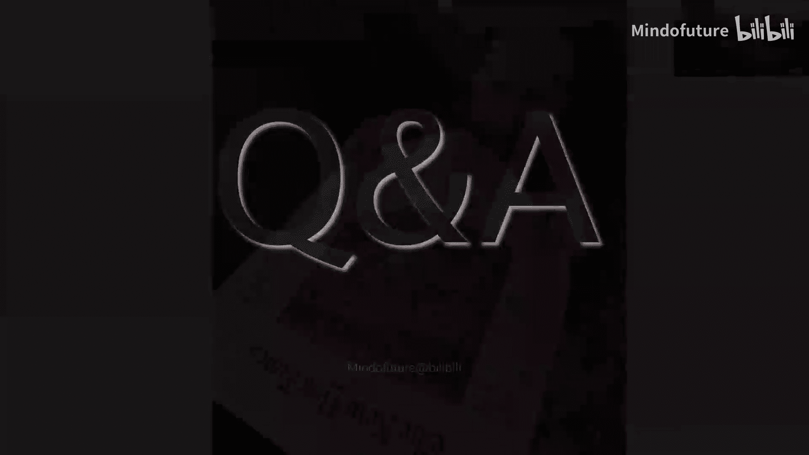
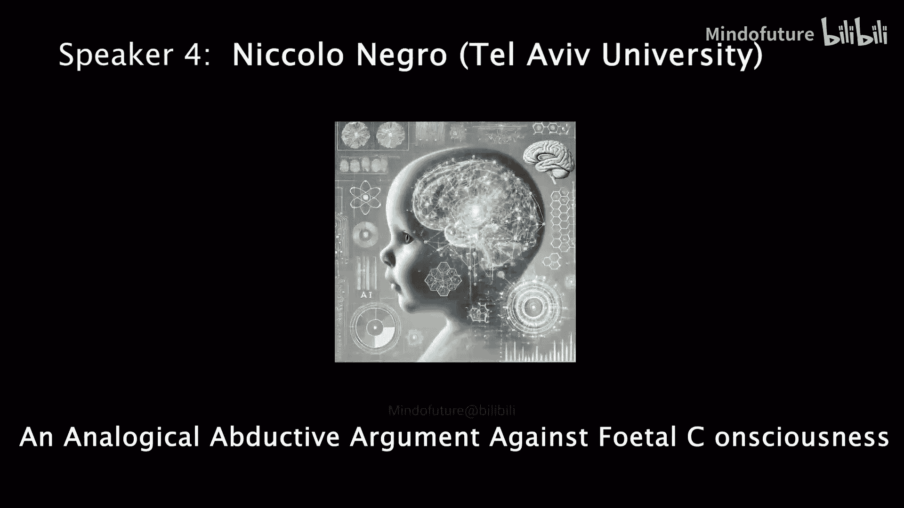
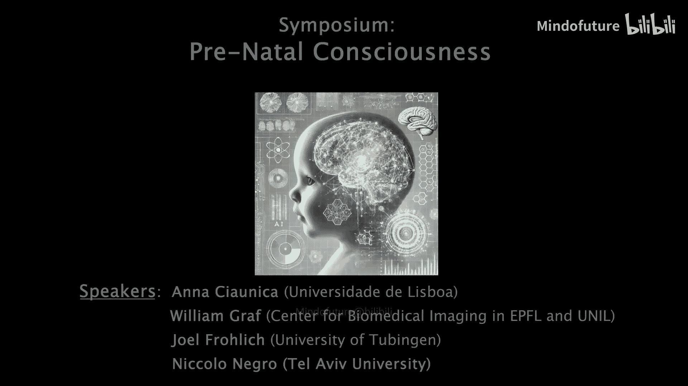

# 【纽约大学】 婴儿意识 ｜ Nyu Infant Consciousness p05 P05_专题研讨2_出生前意识-纽约大学婴儿意识会议_2025 -BV19zZXBUEMv_p5-

First of all thank you thank you to the organizer for having me here it's a really pleasure to be in New York with you so a bit of my background so I was trained as an armchair philosopher and as any respectable philosophers I was obsessed with the problem of consciousness and phenomenal consciousness subjectivity of our experiences and I don't think I need to introduce to this crowd you know the famous knowledge augment Mary but there is something what it is like to see red like a red tomato yeah。

😊。

But me being from Burgundy。Where we really like wines and food， my first thought was like。

Who cares about seeing a tomato I mean the most important thing is to eat the tomato yeah so and to drink the to yeah so how about how the knowledge argument on the what it is likeness of experience would be for different senses that vision right like what you put inside a body because you can't really survive without putting stuff inside a body yeah like the one and sorryri Dave I couldn't resist to add an extra slide which is unrelated to the talk it's about reality plus or reality minus so I think the very important philosophical question is whether。

We can drink virtualt wine or not and what actually virtual reality can take away from us if we don't have like all the senses in the real world。

 but that was just like a parentheesis now as I said I was trained as a philosopher but then I decided that this is I had an existential crisis after my PhD and I said do I really need to work on tomatoes in my entire life was said no so I moved to the empirical science so I didn' you know training and cognitive neuroscience and now I have my own lab where I basically investigate the same things but with measures like psychophysiological neurophenomenological computational of both in human and artificial agent yeah。

And I did this for a couple of years in London before moving to Lisbon。I was for six years in London。

 I was like a philosopher residents at the beginnings and my job was to ask。

Annoying philosophical questions that scientists really don't like and one of the questions that I was asking all the time is just like and actually I'm going to ask this question to you as well look around you。

 why don't I see babies in room investigating consciousness？😊，And when I was asking this question。

 my collea scientists they look at each other like this puzzled。

 say Do you we shouldn't have a philosopher we ask all the silly question what do you mean we don't have kids in the room doing investigate is like this is silly。

 but I don't think it's silly I think it' important why。

 because the important point I want to make is that when we start to investigate things were already using certain conceptual lenses and tools that we have as adults。

😊，And that we should be aware of that lens that we use when we start to investigate ourselves and the world。

 so this means that we might have， want I want to argue。

So you heard up to now he had a lot of talks about。

And neurocorrelates of consciousness which are super cool but I want to bring in the body I want to make a radical shift and hope you're going to follow me on that yeah and I want to say that the focus on the neural correlates comes from this lens that we have tacit lens which is adultcentric neurocentric and also I want to say male bodycentric and you're going to see why I'm saying this yeah and why is this important because if you want to understand the system let's say we want to understand what is the fundamental structure receptor certain system and you take is the fully fledged like system as it develops then you might be very tempted to squeeze whatever properties you have like adult system and just put it in a minimal thing and say that's what the thing is but I don't think that's the case and I'm going to move a bit to make you understand so。

The properties that we have here are very different from the property that you have here as a system。

 Yeah， so this means that if you want to understand the system is not enough to look at squeeze。

 we need to understand how it works like that。Yes。I want to go back to this example of the climbing mountain because it's an important point I want to make。

So。Infants and babies have a way more developolfactory system that we have。

 so they smell better than we do。Doesn't mean that we are who are less mature no doesn't mean it means that a certain stage of our development would need certain things to be in place and those are optimal for that s and this idea that we have somehow a continuum we start very dump and we end up very smart I think that's that's naive I think we really need to pay a close attention that every single step of our development if we want to understand how the system develops yeah so as I said i'm still obsessed with subjectivity of our experience but now I understand i'm more obsessed with not what consciousness is and what self-consciousness is but how we become selfware and how we become selfconscious and actually I want to say。

I want to say something like provocative I want to say that there is no such a thing as consciousness and people say what do you mean well I want to say that consciousness why consciousness is not a thing it's not a thing it's not a noun such a psycho consciousness that you can you know pinpoint measure and download from one head to another I think it's more related it's more like a verb。

 something we do but I'm not going to develop this in the talk because I would be too much I only have 20 minutes so I very much interested as I said how we become self web。

And how we develop our self awareness through our body experiences why， because， as I said。

 I'm very interested in。humblem origins of whatever experiences we have yeah and I want to start with something like you know kind of like obvious so going back to the picture of like the event so again this idea of adultcentric you know and we talk about consciousness experiences is somehow is related to the head and to the brain and to the neurons and then consciousness then we squeeze because we think that consciousness related in the ugly brain adult brain then in order to understand how consciousness develops we need to just like squeeze and look at what's happening in the infant brain and I think that that's not a good strategy and I'm going to try to convince you in my reminder of my talk why this is not a good strategy。

So the key idea is that well minds and brains don't first of all I do have a have。

 again I'm not going to talk about this in length， but I do have a principal objection about the very distinguish between brain and body I think it's kind of like a side effect of the taciid dwell is that inherited between mind and body there is no principal reason why the brain shouldn't be part of the body。

 there is no ontological difference system called the brain which is different from the body I don't say that brain is part of the body and we have one single system which is then body system yeah。

So yeah so that's a side thing， but let's suppose that we kind of like take this view and say， well。

 you have this beautiful things called drains， but they don't they emerge a vacuum they developed and have evolved a system dedicated to control and subing the survival and reproduction of the organism yeah。

😊，So it's not as if the body is some sort of like you know vehicle like a car which is supposed to fuel and transport the mind that way around actually the mind has evolved to make sure that this animal。

 this body stays alive and survive as long as possible and there's something we share happily and proudly with other living species like animals yeah。

But in mammals， our body do not emerge in vacuumcom either。

 they emerge in a different body in another body。And I want to stress this point because I think it's super important。

 so when we talk about pregnancy typically people associate a state of pregnancy with a certain category of individuals that have the ability to carry babies and their bodies。

 but if you look at the state of pregnancy through the perspective of developing，Organism。

All of you here you shared your body with the body of another person and I want to say that the pregnant state is universal state so it's not concepts just some people with basic concepts all of us。

 this is how we kick off our left Johnny inside another person's body in humans yeah so we need to start not with the individual individual we need not to start with the brain but we need to start with the body and not just with the body but with body within and all body case yeah so it's a bit more complicated the picture yeah。

So。I wrote about this idea that well， if you want to understand the self it's not enough to look at the self in relation to whatever environment because the mother's body is not an object where you like a basket when you drop an egg and there's like things happen。

 it's an active， it's a biological living system that you know there is a negotiation there yeah so and there is lot of evidence you know that we already saw by now that the common view that the fetus is being passive contained is really statisticalally trapped in the solitude and the silence of the wound。

 it's inac， there is active bidirectal correlationregulation between the two organism from from the very beginning。

So I want to say radically that our life journey is basically。

Massively depends on the other and the second person comes first right it's a constant negotiation between the two organs at the very low level before we have neurons。

 we have cells developing cells， and I think the really interesting question is like how you get from one cell to a self you know and you order to understand of going back to the you know the plant image that I show yours like it's not enough to focus just on the adult plant because that's going to tell you much about you know the developing organism we need to go back really the humble cell roots of our living system yeah。

And as I said on humans that is necessarily in connection with another living system。

 so there is a negotiation going there sometimes I mean all of us here we the product of a successful negotiation because sometimes that doesn't happen and you know there is other miscarriage or worse so。

Living system are open system and vulnerable and this idea that like self-preservation mechanisms and they are typically composed of cells which need to maintain the centinel stable state by converting food into usable energy again keep an eye on the ball whereas the food yeah and grow and reproduce so what I want to say here is just like I invite you to step back a bit from the like neuro perspective and just like we really take a developmental roots from really beginning because afterward neurons are one type of cells。

It's just like cells are more fundamental on neuro yeah。😊。

And I want to say something even more radical and something I developed with some colleagues here in Boston just is this idea that actually again。

 the distinction between brain and body body is something that we inherited from the Caressian dual is tacitly and somehow the mental are necessarily related to the brain but I want to dispute that。

 we want to dispute that， we want to if you go back if we get a bit about the neurons they go back to the cells because he cannot really have neurons without having cells before so that's the idea yeah and then at the level of cell processinging。

 what does the system that tells the organs which one is the self which was maped the self so the immune system is very important for that because if you don't have that in place you don't develop later on and interestingly enough because I work on the field of embo cognition the fscovaria who is like the pioneer in this field he was a biologists by。

By training and he was like obsessed with the immune system he wrote a lot on the immune system with mea okay so here's the point I want to make I want to。

😊，And raise a flag， so to speak like。We need to be careful first of all not to focus on what is happening zooming in just in the fetal brain or the infant brain independent from the body and more importantly not to erase and forget about the body the other body because as I said the pregnant state is universal state all of us here shared our body with the body of another person so this means that the fundamental steps in life or necessarily embo it from the very beginning and we depend I think I really like the touch talk this money from I'm sorry I'm really bad with me but he was based in Cambridge this idea of like the tactile experiences be so important under activity from the very beginning and as I said this is something like I think this is like the new。

The new way forward， as I said， is slide just forget about just focus on the brain but also the brain in relation to。

Other the systems in the body。One very obvious is the cardiac system because of the rhythmumia but not just one and there is already a beautiful work and I hope is going to be more and more the relationship between the two systems yeah this is something I also wrote with Adam I think he was there somewhere。

but I think we can gain a lot understanding about ourselves by looking at the humble roots of our boil experiences and just not focus on the special side of the brain and I'm going to end with a bitter self promotion。

So I'm writing a book， so here's the thing， so here's the pe。So you know in French。

 if you're not the knee Renee becomes a female first name， like Renee， the Bridge Jones here yeah。

So I am a female philosopher， I'm lucky to live now but if I had lived like 100 or2 200 years ago。

 I wouldn't have been able to give this stuff in front of you so females were allowed to go to university very recently in our society is what does it mean it means the entire concept of toolboxs that we are operating when has been developed just by one side of the humanity and I think we are missing out things by just like not bringing in insights from where well actually had a half of the humanity so in my book I imagine this parallel world in which also women were allowed to do philosophy and there is this like French philosopher called Renee they Car withni。

And she's puzzled like her， you know our counterpart about the mind body problem。

 except that she's pregnant， yeah， so how that the mighty mind body problem would look like。

F a pregnant female Reenne descarte。So that's going to be my book about this like how you change the fundamental puzzles and philosophy through the perspective of a different type of embodiment which is also part of our humanity and that's me of course。

Yeah， and with that I would like to thank my funders for giving me a means to make my idea happen to my lab who all the beautiful work and the organizer for inviting me here and of course you for your attention。

 thank you。😊，What do you think of a microbiome， another body within a body。 Oh yeah， Well， I。

 I actually like this idea of like open system and porous system。 I find it reassuring so。😊。

So I know that we are focusing a lot on vision work talk about conscious experiences。

 but actually I can survive without saying I cannot survive without breathing so this means I need and without eating so this going back to my tomato writers like that was like I think oh I had my hit me I said well I think we。

As my grandmother from Burundy its like all I just say food is so important it's all about food and this is why I was so happy this morning when Lona presented the findings about hand well yeah it's like I need to keep track where know stiff who cares about seeing the tomato yeah so that's for us adults we are puzzle obsessed about but you know I can't really get there if we don't have the food before so。

😊，And so this means that if you forget a bit about vision and we look at different senses that you can。

Relate with the world engaged with world like breathing， for instance， young or eating。

 then we are constantly but constantly exchanging。Sensory information we are composed by foreign。

 you know， was when you breathe in breathe oxygen because you need oxygen to survive。

 but you can also breathe the virus and then you're dead。 So we are open system， as I said。

 volume for better and for worse we can because we kind of like depend on others with the exchanges and some people find us like you know。

Terrifying， but I find that on the contrary， I find it reassuring， I found like that there is like。

You know there is a bridge there and there is a connectedness and well sometimes we have friends coming over。

 sometimes you have enemies， but somebody' is coming over。

 you know you're not alone and I find that really ratioassuring。

Here I want to come back to to your image of the bean with the plant because I wonder whether it's a correct image of what we are doing in the sense that babies of fetusees have already a body like we have they have already and we saw this morning and that they have the same brain network and so on and so on so I think that we are more in the situation of the tops that the bean with the plant。

 but the big plant against a small plant because otherwise I do not know how you want to to ask question of how to understand the early age if you do not at least as a first step say okay there is something describing in others I tested it in babies until。

I am on the wall and I cannot progress， but I do not see how you want to to to。

To launch a consciousness research in feesis， if you do not assume。

 or maybe I misunderstood that there is some analogy or some same stuff in others and。

Yeah so actually I want to bite the bullet on that and I want to say that my cat and fittus that probably way more conscious than we are and I want to say by conscious in terms of like eve depends on where the defining conscious is here so if thinking stands in the way。

So basically overthinking I actually have a paper called I overthink therefore I'm not because I also work on people that are detached from themselves and too much in the head so if you are overthinking basically are disconnecting from the body and then you feel unreal but that's a different thing and I didn't talk about this today but I want to say that if the basis is really important like the sensory experience then maybe my cat and the fetuses and infants are some sort of like blissful existence of like presence of you know presence little literally like being which we lost just because we kind of like you know try to cognitively use a lens to understand it and actually this is just speculation on on my behalf but I think this is what people going on the mountains they want to retrieve right like and just meditationitation things they want to just like you know。

Just be without thinking， Yeah， and then they retrieved a state of like pure awareness。

 pure being How you it join like because answer is your way。Ask the question to reserve the equation。

 because I can say。Just okayYeah so I no no you're right so I so I have two papers on theory work that I want to do on this and then I want to test this like with you know pregnant persons is I have a paper called to notions of experience because I think there is。

Experience is one of those words that everybody uses and has many， many different meanings。

 and I want to be clear what exactly we mean by experience。

Philosophers are obsessed with the phenomena what dislikeness of experience which is the experiential side of it but then there is a way where my grandmother would say well I have experience in opening the wine bottle because I will put the wine bottle before right so that's also terms of experience the problem is they can have the second the first one without a second so it's just like we engage in the world through the experience of my grandmother senses before we kind of like have this like sophisticated experience or thing that we as adults consider that to be the pinenale but I don't think I mean it's just a speculation of mine but I think if we go back to redefine experience in such a way that actually we allow。

Does exploratory think of the environment through the senses to be a way of engaging awarenessly。

 not。Being aware of its not not the content of it yeah like in the thinking part。

 but yeah like the phenomenologist will say it's just like the state state of being through the subjectivity then I think we have a different conceptual toolbox to look at that and then you can use that to measure。

嗯。Like the connectorus with with with the pregnant person yeah longitudinally for instance like through the movement through the way the people eat or smell or move in the flat whatever so you can can track that at the sensory level yeah so that that would be my。

My first hunch， but。Oh， I forgot to put the slide， but and I said to a couple of people here。

 so I'm going to organize a workshop Claudia knows about it called the NASse in Lisbon in Sintra next year。

 and we're going to talk exactly about this or how we can contrast different type of understanding of experiences and how we can actually come up with clever program to measure them。

 which are not necessary through vision or language。

IIs consciousness a prior or is an emergence when you consider sensor motor development in the NATO and after the kids are born Yeah。

 so I actually， I want， as I said， as like I want to stop talking about consciousness。

Now I mean we shouldn't talk about consciousness per se。

 we need to talk about consciousness something， experiencing processinging information， whatever。

 but it's like it's not a thing so it's not a thing that like a light bulb that appears when you have the required number of neurons to connect yeah and then we have before that is complete darkness and then bum and there is consciousness it's not a thing it's not an object that you can download like the upload or series like your consciousness the from one head to another in a different body and then you live forever I don't think this goes this way here。

So there is， would， as I said， it's like， I'm happy to buy the bullet say that there is a way of experiencing。

In the sense I said it like the exploration that is in place early on。And its fully。

 fully functional， it super important and it' like blissful state of luck not knowing what's coming next。

 and that makes you very conscious in that sense， yeah， very much present。😊，Hi。

 so with this co embodied view。😊，And your move to say， okay。

 let's stop talking about when consciousness arises， which I think is very interesting and I'm like。

 I really like this。But is it fair to say then that for know。

 this conference is about infants and it seems more like you're focusing on。

Fettuse is here with the co embodied so I mean like would we say that the fetus and the mother both together there is consciousness like would you want to associate the fetus embodied in the mother as participating within the consciousness that the mother has because the mother is conscious of the baby making decisions based on that and the baby is。

Not like intentionally acting on it， but there's a duality there so we could we could we could push push consciousness or refer to it as occurring to both simultaneously Well again。

 I want to refrain to say that they have consciousness like like a thing right know I don't want to say that but I want to say that。

I mean， none of us here choose to be alive， you know。

 literally is' like a thing that we drive us like keep going and that depends of another and actually even depends on another even if in infants because。

You don't have like close connectedness with the caregiver to give you foods you know like you don't really survive so the other is there and has to be there。

 you know from the very beginning but yes I would say that is precisely in the process of this negotiation that you understand what is the self in another and if you close your eyes and try to make an effort of imagination what it is you'll be like your first sensory experiences when you well if you are inside another person's body you have already a sensory rich presence because the Mar the heart of the mother's beating all the time even when you sleep so you have a rhythmical life that is like there from the very beginning and also the movement so there is yeah as I said the second person comes first so it's like is there and then you have to negotiate so I want to make an argument for consciousness is a noun。

Because if you think about the work that Lorena did with Adrian Owen。

 the ability to say that these group of unresponsive people are。

Different in a morally important way than another group of unresponsive people。

 you know the conscious versus the unconscious， that seems like a very practical and compelling reason to think that yes consciousness is a thing that is present or absent and our ability to distinguish is important I understand but I mean morality is something like high level you know it's like you't deny an infant consciousness just because it cannot be charged in a court yeah it's like you know it two different things。

Great， let's thank Dr。 Chanica for our excellent topic。

So thank you， yeah I'm a pediatric neurologist， developmental pediatrician， pediatrician。

And I had training in embryology as well。I'm humbled to be here。Amateur philosopher。

 I'm interested in philosophy， but not trained in that。I think about the developing brain。

I've looked at it from the very beginning for many years。

 I have more questions and answers here today。Thought about how do you talk about this topic in 15 or 20 minutes。

 I'm going to show you some fetal tissue， talk about synapogenesis a little bit。

But I thought maybe we should just frame this topic a little bit。

 and I just flipped together 10 axioms， and I'm going to define that three conjectures。

Talk a little bit about thatogenesis show your tissue。

Interject some ideas about definitions and beliefs and then lastly what does this have to do with fetal health care I work in group with a group of doctors that see pregnant mothers。

 most of whom are halfway through pregnancy and having some problems with their fetus so this is all coming together this means something to many people。

Ancing here。So axioms are。Self。Explanatory， I think for the most part these are truisms。

 this is what I mean by axiom here is that we have robust evidence in that this is readily acceptable。

 conjectures are something that's getting close to that。

 but we can still debate I'm going to give you plenty of material today that will be something that we may not agree with。

So axiom1， neurodevelop is continuous and I think we can all agree with this。

 all of the different presentations today that are showing evidence about how things change over time would support this。

 whether it's behavior， synaptic plasticity， functional adaptation， imaging， all of these modes。

These boundaries between areas and development are artificial。

 the example that I like the best is that even the words first trim and second semester and third semester are artificial that was invented by actually Justice Harry Blackburn。

 Blackman who wrote the decision in 1973 on Roe v Wade that was just invented and he agreed that that was arbitrary。

Axiom number two， this slides already been shown this morning。

This is a very sophisticated audience I don't have to repeat this。

 we know that most neurodevelopmental events are sequential and very time specific if you miss a stage you can't go back and repeat that stage。

We start with neurohilation， proliferation， neuroblast， migration， neuro differentiation。

 synapogenesis comes after that。Synaptic pruning comes after that and myelination。

 and this goes on throughout， well， at least to adulthood。So axi number three。

 maturational processes are continuous。We start out with stem cells。They become progenitor cells。

 they become neuroblasts and glioblasts。They migrate， become mature neurons， specialize。

And different brain regions at different rates， so this is a number three， we can agree。

Axiom number four， and this was mentioned this morning already。

Not all neurotransmission is the same it changes over time and again my favorite example is gamma aminobutaryric acid。

 which acts differently on neurons and early development as a stimulator of cell proliferation and later on it's of course the most common。

The most robust inhibitory neurotransmitter in the adult brain。So actually number five。We can debate。

Fetal brain， volume， weight， mass and neuron number do not fully explain function or consciousness。

When we think about how small these embryos are， especially in the first。12l weeks。

 as you can see fit any the palm of your hand。We're seeing pregnant mothers who are getting a anatomic ultrasound between 18 and 20 weeks。

 and we're seeing anatomy and we're making judgments on those brains。

I have to remind myself that's a brain that weighs between 40 and 50 grams and then trying to picture this and I do this for parents as well。

 that's the size of a strawberry。So。There's obviously rapid growth we think of。

The full term infant brain is about 300 grams， doubles in size in five months triples in size in a year。

 so 900 grams by a year of age the adult brain weighs about 1。

300 grams so you're about two thirds of the weight to the adult brain at a year of age。

 but when we're making decisions medically we're talking about a strawberry size brain。是。

And we can measure this when were imaging as well， you can see。Morology。

 how the brain develops functionally。So there's something like 86 billion neurons in the human brain。

 80% of them live in the cortex。In a part of the brain that doesn't。

Seem to be responsible for consciousness we the cerebellum is a very important organ。

But only about 16 billion of them live in the cerebral cortex this where we think consciousness lives。

Human beings have the most cerebral cortical neurons。And other species。

 we can compare this to other species in terms of the numbers and then compare what they do。

 but brain size in and of itself s solveismt can explain it。So action number six。

Final and brainstem reflexes do not equal consciousness this has been very confusing to a lot of people who are looking at 4D ultrasounds。

 ultrasounds that show movement。And we know there are a number of spinal cord and brain cell reflexes that occur very early。

 and we can list them， startles at in hiccups at nine weeks of age， gestational age。

 periodic breathing， 10 to 13 body thrust， nonnutritive vaing， 13 weeks gestation。

 tongue protrusion 18 to 20 weeks。When we talk about early nutritive sucking。

 that's the time when babies can survive， that's a survival mechanism。

 midline hand touching 23 weeks， facial expressions， 25。

We see o factoryy reflexes at about 30 weeks gestation。

Pupil Constriction 31 and then coordinated sucking around the time of where babies are destined to survive。

So we can take each one of these reflexes and actually neuro anatomically explain it this is a yawning center and the。

Particular activating system， this can be explained， there's a loop。

 there's a neuroscience behind this。But as mothers may look at prenatal ultrasounds。

 they may confuse this， say but this braintem reflex is actually something more meaningful。

Axiom number seven。Valamal cortical syn epiogenesis begins after fetal viability。

This is the final phase of aal pathfinding， this is the data that I'm going to show you now in this statement about looking at synapses at。

22 weeks gestation。And this is done best through。From the neuropathology point of view through immuno psychochemistry。

 which is actually using antibodies looking for immuno reactivity with markers that justify。

Looking at synapses， so that the tissues that I'm going to show you are from normal fetal brains collected over 20 years by my colleague and friend Harvey Bst。

 who I've been working with for the last 30 years。These are 80 brains ranging from 6 to 41 weeks。

 these were spontaneous stillbis or pregnancies that were terminated for non neurological issues and all of the bleeding brains。

And chromossomepathies and all of the malformations of the brain syndromes were eliminated。

 so this is our best effort to try to look at tissue from what we think is normal fetal tissue。

This is a comment where。Definitions are very important。

We tend to want to use the term gestational age if you use the termconional age you'll see that in the literature you're going to be about 14 to 17 days off one of the problems with both of these terms is that according to studies。

 50% of women can't really remember when the first day of their last me period so straight away we're making an estimate half the time and and so whether you use one term or not or the other you have to know which one you're using and in order to gauge。

Ege。So this is a 21 fetus on the left by imaging coming from the publicly available atlases by Ws。

 but just looking at imaging tissue at a far level you can see。

The subventricular zone intermediate zone cortical plate blown up， you can see that。Looking at。

Actual neurons under the microscope give you so much more detail and we just don't have access to this most of the time。

 but we can learn from it。So at this age。These are cahallovitous neurons up here。Three of them啊。

In the molecular layer。This is the cortical plate， which is the future cervicral cortex。

Looking at fiber oriented distribution and just T2 weighted images of a 26 week old。

 we can now see that in the molecular layer， there's strong synapifies in reactivity。

In the molecular zone， and this extends into layer two of the cortex and there's robust immunoic reactivity of the thalamal cortical neurons。

 even at 26 weeks， but very little at the outer levels， level five and level6。Yeah。The 33 week fetus。

 by this point， we can see strong synapifying and reactivity demonstrated in the molecular zone。

As well as the deeper cortical layers with still less intense reactivity in layer two。

And then by the time you're at term， there is very robust some。Immunocytochemistry。

 immunomunreactivity at all layers by the time an infant is born at 40 weeks。So axiom number eight。

Not all neurons are created equal this was is。Demonstrated by San Diegoiago Romanmon Icahal in 1896 or something。

 but with the beginning of microscopy， we've known that these are his drawings from 1905 for which he won the Nobel Prize in 1906。

Describing that basically all neurons are not the same。Now at all synapses are created equal， again。

 this has been a topic。Of discussion for 2，500 years， Aristotle talked about vital pnemo。

The card described mechanical corpus skull， Galvinni described an electrical phenomenon。个好。

Who did the drawings knew that there was something that these neurons didn't quite link so well。

 but it wasn't until Sherrton。At the end of the 19th century。

 you actually described the word synapse。And if you haven't had a chance to look at this book。

 which is available online， this has been compared to Isaac Newton's Principia Mathematica this is the most incredible book written。

Just the fact that it was written 125 years ago is is just so incredible。

 he won the Nobel Prize for this in 1932。This is a snippet from that book in view。

 therefore of the probable importance of physiologically。

 this mode of nexus between neuron and neuron。It is convenient to have a term for it。

The term introduced has been called synapse and again， there was a time when we didn't have a word。

So。Not all synapses are created equals some synapses we know are permanent。Spinal cord。

 cranial nerve cerebel and cortistrattum。Other synapses continue to evolve throughout life。

 so they delete and form again， especially in the hippocampus， cerebral cortex。

 olfactory mold and thalamus。嗯。Because of time， I will skip over a lot of this。

 this article came out earlier this month。It's an incredible study。

Bottom line all synapses are not the same there's a lot of different types of synapses。

 neurotransmitter effects， receptors， brain regions。Plasticity， different types of neurons。

 aomy synapses。And these authors break it down to all the things that can go awry at the RNA level on the transcriptscriptome。

 proteome， and they talk about this concept， not of the connectome。But of the interactactome。

 which is again， at the molecular level， so getting digging way down the complete set of molecular interactions in a cell or organism or between proteins。

So it's as complicated as you want to make it。And that leads to axiom number 10。

Neurvariation or neurodiversity。Not neurodivergence。Is infinite。Why is that well we have 20，000，22。

000 protein coating genes。Of perhaps 140，000， if you look at inrons it are not protein coding。

Something like five bottom six of every neuron is expressed in the brain。

 at least we think half of the neurons are only expressed， excuse me。

 the genes are only expressed in the brain third to a half。

10% of the genome has copy number variants on the chromosome。

 and we know of over 10 million benign variants SNPps previously called polymorphisms。

And then we have environmental factors that can cause mutability。Ranging from todons。

 timing of tridos， which tridogen， maternal tradition。

 and this overlaps with Anna' talk from the last hour， I agree。A field in and of itself。So again。

 nerve variation， infinite。16 billion cortical neurons， the average neuron has 10。

000 synapses depending on where it is。So then you can get your calculators out and try to do the math here。

 I don't know what the exact number is 1。6 times 10 to the 13th。

 which is I guess is 100 trillion neurons beyond anyone's imagination in terms of complexity and this is just the cerebral cortex。

And the word complexity in its definition means that it's adaptable。

 that is what complexity means biological systems are adaptable。So。The philosophical。

Area which I've know very little about， but I've read about a little bit is myorology。

 which is this part to whole relationships as a field of philosophy in and of itself。

Studying brain as a whole we've done this with our brain death literature when we're looking at loss of consciousness at the end of life in terms of what functions are lost and is the whole brain lost。

At the end of life， but it could be applied as well to the emergence of。Fetal consciousness。

So okay so what is it axioms1 through seven talk about antigen consistency and axioms8 through 10 talk about developmental diversity so what is it for a minute so we know that trajectories are reproducible they have a certain sequence。

They're precisely timed， all these fetuses are doing it the same way unless they have some type of genetic disorder。

And on the developmental diversity， all of these other actoms say， women， we're all different。

All of us， and especially in this era of DEI and everybody， you know。

 criticizing that it should be the next frontier of humanity， I think。

 that we talk about how all human beings， all Ho sapiens are universally diverse， of course。So。

That leads me to my first conjecture。Not all consciousness is created equal。Now。

 we haven't been talking about this too much but。We have the potential that when we talk about these fetuses。

 they're not all going to have emergence of consciousness at the same there' going to be variability here。

65，67% of the population has an IQ between。85 and 1，15， if we look at that type of thing。

Most infants walk it around a year of age， but some walk at nine months of age。

 some walk at 14 months of age and they're all normal there's this range， so why wouldn't。

Consciousness also have a distribution， conjecttion number two。

And I think this is very important for this conference。

 a required minimum threshold and others have written about this of functional connectivity is a requisite for consciousness。

 in other words， below some level， whether you're talking about the strawberry size 50 gram 20 week brain。

😊，Or you're talking about some。Some further level in the 20 gestational weeks or 30s based on number of neurons。

Dalmo cortical connections， number of synapses， regional networks， but below some level。

 you have unconsciousness。And conjection number three。嗯。

So this would be something that we can discuss at length。

 I think this is still a conjecture but that sensory perception comes first。

 self-awareness comes afterwards cognition later and then whatever words you want to use interoception before Exoception and if you want to use the 17th century literature or terminology sapiience and sentience which I haven't heard yet today。

 but I guess it's outdated， but one probably comes before the other， and that would be。

To my conclusion。So recent medical research and analysis， especially since 2007。

 provides strong evidence for the conclusion that a functioning cortex is not necessary to experience pain。

Well， that's not my definition。That's what it says， a bill in front of Congress。

Called the Pain capableable Unborn Child Protection Act， and that's what it says。

Which implies that feettuses are feeling pain。Before the level of the strawberry size brain and their feeling it more intense。

 M mattertterif， you can get。Opinions of people that will say things like this。

 it is my opinion that the human fetus possesses the ability to experience pain from 20 weeks of gestation。

 if not earlier。And the pain perceived by a fetus is possibly more intense than perceived by term newborns or older infants。

 so this is an opinion。Coming from a report commissioned by the United States Justice。

Used in that bill。Which has passed the United States House of Representatives three times。

With a majority vote and the United States Senate with a majority vote twice， and it's still up。

But there are ramifications of what all of this means， which I can get into。So。

We look at babies and what they can do and there's a variation。

This is a 10 month old Cavin again my granddaughter。She's not really reading the New York Times。

It's a cute picture， but we also see this variability and want to get back to that because we've seen infants。

 I have seen infants that can talk at eight months of age。

And can read around eight or nine what's been described and we have this hyperlexia phenomena which we see in babies。

And then if you come to my clinic you'll see lots of kids who can't do any of that。

 that's what we see in child neuroology， but there's this huge variation and I would like。

 I think of all the things I've said you today， I'd like to open up this concept that the emergence of human consciousness also has a range。

A spectrum。And lastly， if there is time to discuss it。

 I'll talk to you about what this means for fetal health care。Um。

I can comment on that in just a second if needed， but I'll end there。喂。

Quions。Thank you very much and this is very interesting however a question about link between the range view and the minimal threshold view so is you a view that the minimum threshold is required because of some emergent properties that emerge at some point but do you have some particular evidence or do you have like a strong strong sort of a causal mechanism that you said you okay so the bill in front of Congress I'm not going to be political here at all it's not my intent。

Is to change the criminal code。Of the United States to criminalize physicians。

For mentioning the word abortion。After 20 weeks。Because of pain。Because of the feudus's ability to。

Perceive pain。So if you watched the NewshHour last night。

 there was a report on the rising rates of maternal。嗯。Sepsis。

AW not getting care because physicians aren't allowed to care for them when a woman is hemorrhaging。

Or a woman is。Mis。 Cary。And this is leading to an inaction， this has nothing to do with fetal pain。

 but it overlaps because。This Texas law happened a year before Dobbbs。

So we already have data for those of us who do fetal medicine。About half of the country now cannot。

Discuss the option of a termination of pregnancy in a mother who' is carrying。

A fetus with a severe malformation， both mothers in Texas would have to go to term and carry that。

And what we've seen now documented this paper came out a year ago。Last me。

That it results on a rising rate of maternal mortality。

So this all gets back to the pain capable unborn child act phenomena and this is where。

The things we're discussing today actually have real life consequences， from my perspective。

Of course， we believe in fetal medicine that。Women need to make the decisions。

 We only inform women about。The health of their fetus。

We are not pro abortion that has nothing to do with it。We're talking about fetal health。

And if there is a belief。That fetuses below 50 grams。

 2018 weeks ofest stationation have intense pain responses。

 which I think there's very limited evidence to support that。

Then we get into this area between knowledge。And believe。

And in a era where there's lots of misinformation。We have to think about how we define these things。

Thank you so much is really fascinating just a quick comment when I just said I think we should focus on the you know the diet between I mean because well。

A pain from a healthy mother will be felt by fetuses as well。 So we need to make sure that the。

The coin body system is happy not just one， but as was just a comment I want to go back to the distinction that you said that actually the first trimester。

 the second or third the kind of like random invented you know distinctions but I read that actually those distinction were made in relation to the reactions of the immune system and the placenta yeah so here is another thing that is kind of like left to side in this discussion which is the placenta which is like the relational ogre parxom between the two system and the reason why there are three trimesters is because in the first。

3 months。 There is an inflammatory response to the new thing。

 This is why most of the pregnant person know that the first three months。

 you're just like earn well。 You're not happy。 and then you have the next three months where there is like negotiation is successful。

 So the immune system are working in tandem for developing or the baby。

 And then you have the the the third part where you need to well get a baby out。

 So then you have like a， you know。Yeah， the explosionul。

 So do you think that if we look at the relationship between。

The immune responses between the two system that makes actually that distinction makes sense is not just random。

I always think of the most complicated organ system in the human body is the brain and the second most complicated organ system in the human body is the immune system。

And that too， is an evolution and actually very dysfunctional。

 which is why babies are so susceptible to infection。嗯。

I think some of the points that need to be made in terms of lumping into first second。

 third trimester or cutoff。I actually was very happy with the concept of Ro。

That we talked about viability， I don't think anybody really had a problem with that。Right now。

 viability has come down to about 22 weeks。About a 50% mortality rate and a lot of disability。

 both for 22 and 23 weeks。And then the further you get into pregnancy。

 the higher the survivability is。As we've discussed already today。

I guess my only point with this arbitrary cutoffs in terms of the timing。

Is there's a big difference between it。27 week and a 30 week。On EG in the ICU。

27 week babies do not have enough cortical activity to create a seizure， for example。

 even if they're bleeding and they have a sickring。Their EGs aren we cannot diagnose。

Seesizures at that level， there's not enough neuron activity。To produce this。

 whereas that could definitely happen in the 30s， it gets very interesting in the 30s week by week。

As we've heard about already this morning。U but all of these factors。

 that's why I think axiom number 10， which is that this is infinitely complex。

And beyond will remain beyond anyone's completely understanding because if you get down to the molecular level。

When you're talking about individual transmittterters and neurotransmitters and proteins。

 it's just as complicated as anyone wants to have it。Which makes us so humble。

Hi yeah great thanks that was a really great talk so thanks for that I just wanted to go back for a second to the kind of practical societal impact of this like pain ability of the fetus and I have a very naive kind of point to make about this I feel like the consequence might be perhaps to bring in some pain management to these situations and I wonder what you think about that and whether that could kind of help the whole debate and bring in onto another level。

😊，So repeat this you're talking about pain at that level or what pain perception perhaps consequences。

So that it容可。Not hearing that as always she has on the potential to mother。So for me。

 this is the crux of the whole discussion at what point I actually agree with Antonio and Hanna demasio in their multiple papers where they use different terms but talk about homeostatic feelings and the emergence of consciousness。

Pain perception requires consciousness。So at what point。

 and then you have all of these field reflexes。Which are。Stimulus induced。

 most of them are spinal cord and brain stem reflexes。

And yet this is a process of continuous development。And。

It's basically our understanding that this cannot happen until after fetal viability。

Probably after 26 weeks， just emerging。That's what our synapogenesis studies which that would be our bias and other people can debate this。

 but women aren't getting abortions at 26 weeks that nobody has a problem。Let me make this very。

 very clear， abortion is controversial， but 90% of abortions happen before eight weeks。

The American Academy of Obstetrics and Gynecology， ACOG recommends that women get an anatomic screen between 18 and 20 weeks and 3%。

Have an anomaly。And these are women who want to be pregnant and want to have a healthy baby and are getting health care。

And we're having。Laws now that would prohibit。A discussion between a physician and a mother。

About what to do， decisions to be made。And in part， based on an assertion。

The fetuses at that age feel pain。So I actually don't believe that personally。

 so I don't think that that's true。But there's room to disagree。ま question。

So my question was it really about the same issue， which is？How would we。

 what evidence would would be brought to bear on distinguishing between。

A reflex to withdraw of your poke tart and feeling pain， and mean I'm on your cycle。

But that's really Well， I think this is why it's confusing， I mean。

 if you go on the internet and you look at these 4D ultra ultrasounds and you see these babies sort of moving and grimacing。

A lot of mothers emotionally will say this baby's feeling things， but actually neuroanaatomically。

 we don't have that evidence。U。嗯。Anyway， but。Wonderful question， thank you。

All right， well， thank you all for coming to this fetal consciousness symposium。

So I'm here to talk to you today about the temporal grain of fetal perception。

 assuming that maybe fetuses are conscious in the third trimester， obviously an open question。

And I'm going to be showing you some evidence to address this question coming from fetal。

 magnet encephalography， or MEG， okay？So just to give a little bit on my background， who am I。

 how did I get interested in this topic， so I'm Joel Fliick。

 I'm a postdoc at the University of Tebingham in Germany at the Fetal MEG Center so I work with a very niche application of MEG which is fetal MEG so many people have heard of Ad MEG。

 fewer people have heard of fetal MEG and I'm going to show a video to explain how the fetal application works on the next slide so we'll just hold that till then。

I have my PhD in neuroscience from UCLA in 2018 and in my dissertation lab I was working on neurodevelopmental disorders。

 so I come from this developmental world but then in my first postdoc I was working on disorders of consciousness and sleep and the nice thing is that in tubingen really these two worlds converge of course。

 on my interest in the developmental origins of consciousness okay so I'm lucky enough to get to study third trimreester fetal brain activity using this rare and expensive tool we have in tubben under the supervision of Professor Hober Chrysel who's in this photograph with me here next to our fetal MEG device。

🎼Okay so what is fetal MG so here's a video showing how this works probably you all know about adult MG with a helmet that comes over the head。

 so this is a concave sensor array that complements some maternal abdomen So you see here the pregnant woman nails in front of the device we can display visual stimuli for the fetus using red light red LEDs that pass through tissue and we can also have auditory stimuli with the sound balloon here which is MG compatible and plays auditory tones okay。

And so I'm going to be discussing some auditory stimulation data today。

 this was a work that started before I came to achieving it， so this work started with Dr。

 Juliao Moser， so her work was mentioned briefly during Professor Dehanne Lambintz's keynote this afternoon。

So this was applying the local global auditory oddball paradigm to fetuses。

 of course this has also been applied in infants but Julialia most who decide to apply this paradigm to fetuses and I mean it's already been discussed earlier today so I think most of you are generally familiar with it。

 but this is a passive auditory task that at least has better than chance accuracy for detecting consciousness。

 the idea is that you play these auditory sequences。Okay。

 you can have auditory deviance both between and within sequences。

 but the idea is that you know to detect devvit within a sequence is trivial to detect a deviant between sequences。

 the bar is much higher for that。It requires a longer memory trace dependent on working memory and in turn it' thought that working memory is dependent on consciousness。

 so there's some reason to believe that perhaps the global prediction error is linked to consciousness so that's been investigated since Beckckgensteinatal 2009 PS and anesthesia and since then disorders of consciousness and so forth。

So again， this paradigm has been discussed earlier today， for example， during the keynote。

 so I won't go into too much more detail， but if there are questions feel free to ask later。

So to cut to the chase with Julialio Mosso's work， she actually found that you do get this global prediction error 600 milliseconds after the stimulus onset。

However， what's really strange here is that the local prediction errors are missing in fetuses。

 okay and that's unusual because the bar for local prediction errors should be much lower than the bar for global prediction errors。

 okay， so what's going on here？Well， Professor Dehanne Lats doing her keynote。

 mentioned this explanation that was also in her review paper from last year in Journal of cognitivetive Neuroscience。

 so this is a pretty compelling hypothesis I'll call it theus stimulus hypothesis。

In a nutshell what this is saying is that maybe。The temporal grain of fetal perception is low enough that these individual stimuli within a sequence are just sort being smeared or fused together。

 okay and if that's the case， then the fetus doesn't really stand a chance of showing a local prediction error because well from its point of view。

 the whole sequence was one stimulus to begin with okay so just to be clear。

 instead of four separate tones in a sequence this would just be smudged together into one big stimulus。

So before I continue， I think this is easier if I can actually play the stimuli for the audience。

 I have to switch off the mic so I'll just explain first what each of these are so first you're going to hear what an example auditory sequence would sound like to you as an adult。

And then I'll play a couple possible simulations of how the fetus might perceive the stimulus。Yeah。

So again， the first one you heard that's roughly what you would hear。

And then we've sped it up to simulate how a fetus might hear it。

 assuming that the temporal resolution with which the fetus might hear the world is very low for instance。

 you might expect a sequence to sound like four identical tones，op，op，op，op， okay。

 say you just heard that a00 times over during the training phase of the experiment and then during the test phase。

 you hearopop，op，op。Okay， so that would be both a local and a global deviant now it could also be that during the training phase you expect there to be a deviant at the end。

 it could be that you hear boop boop bo boop。Okay， so now you expect the last tone to be different and then during the test phase。

You hearopopop for identical tones， so obviously there's no local deviant within that sequence right it's for identical tones。

 but it violates the template that you were trained on so to speak okay okay。

 so going back to the few stimulus hypothesis。I think this hypothesis has a lot of plausibility。

 especially based on what we already know about the temporal grain of infant perception this has been talked about in other presentations today we had two presentations about stimulus masking this morning so I think you all know what I'm referring to。

 but for instance。The attentional blink is much longer six times longer in infant than it is an adults and also the multisensory integration window is longer in infants than it is an adult。

 so all of that all of that suggests that very early development you just have a more coarse grain of temporal perception。

All right。So if this hypothesis is true， then it should be that when you have this sequence of four tones。

 you you don't get individual neural responses to each tone。

 you just would get one overall neural response to the sequence as a whole and just the same way that you know if you're watching a movie and say the monitor has a 60 hertz refresh rate and we're recording EEG from your scalp。

 we're not going to get a 60 hertz train of neural responses an the EEG because the 60 Htz film is just being fused into one continuous stimulus right？

Now， on the other hand， if this hypothesis is false。

 then we might actually get individual neuro responses for each stimulus in the sequence， okay？

And moreover， because for the stimulus sequence， we have regular intervals。

We should expect to get frequency tagging。Okay， so what does that mean well specifically for these local global auditory data。

 the stimulus had a 600 millisecond interval from the onset of one stimulus to the next。

 so that corresponds to a frequency tag of 1。67 parts。

 which we would see in the frequency transform of the signal， okay。

Now there's a caveat here which is that unfortunately fetal MEG data are extremely noisy。

 as you can imagine， it's really hard to noninvaively record fetal brain signals。

 but we can get around that by just optimizing our signal to noise ratio our SNR by averaging across all of our recordings。

 okay。So that gives us a better SNR and therefore we have a better chance of actually seeing this frequency tag okay so basically the way this would work is we average all of our recordings。

 we do a frequency transform specifically the FFD or the fast Fourier transform with very high frequency resolution and we would look at a frequency of interest 1。

67 herz in this case， we would compare the SNR at that frequency to the fllinking amplitudes on either side okay。

Now， of course， our experiment has four conditions too local to global。

 we just concatenate those conditions horizontally， okay。

 that gives us one long signal and like I say， we stack an average and then we do the FFT。

So you might say wait we've averaged across all of our recordings that don't we lose all the between subjects variance so like how do we do inferential statistics Okay。

 so there's two approaches to this。One is a parametric approach and in this approach we we look at the SNR in our frequency neighborhood of interest and using the mean standard deviation across different frequency bins。

 we assign a Z score to the SNR at our peak frequency。

And then we convert that Z score to a one tailed P value， so in other words， that's like asking。

 how does the amplitude at 1。67 Hertz compare to that of other frequencies？

Okay so that's pretty straightforward if you have a frequency amplitude spectrum you can also get an SNR spectrum and then just do the Z score and your neighborhood of interest。

The other approach is a nonparametric approach so this relies on something called surrogate data so before we do the stack and average we can actually manipulate all of our recordings to destroy the temporal alignment between them so that when we actually stack them we don't expect there to be a timelock signal that gets preserved in the averaging so that's done by basically scrambling the Fourier phases of the signal but preserving the Fourier amplitudes so again that's called surrogate data we can just do that a thousand times build a null distribution and then compute an empirical P value I know that's a little bit technical but the bottom line here is that with the nonparametric approach we're asking how does the 1。

67 herz amplitude compare with the surrogate data okay so these surrogate signals they will again they'll have the same amplitude spectrum but different Fourier phases so stack those together many times and build your null distribution。

Okay， so with that， let's just dive into the results。

So on the left you have the time domain grand average signal from the fetal data all right。

 so this is 80 something recordings from 40 something fetuses meaning that some pregnant women return to the lab multiple times。

 so theres some longitudinal data the vertical dash lines or the stimuli onsets。

 so good thing is we don't see any time time locked artifacts that's really good of course。

And then on the right， you have the power spectrum the way you might typically compute it。

 for instance， using more lay wavelelets， but for the frequency tagging。

 we don't actually want to do this spectral smoothing or tapering those of you who are into signal processing。

 know what I'm talking about， it's rare that you just take the raw FFT but in this case we have a very frequency specific effect that we want to look for。

 and what's been done for instance， in frequency tagging EG studies and ins。

 you just look at the raw FFT， and then you look for the peak and that amplitude spectrum。So indeed。

 we have the peak at our frequency of interest， and this is statistically significant according to both the parametric and the non parametric approach。

 which is great。So then newborns return to the lab in a few cases， 20。

 specifically we have one recording from each newborn。

 we can actually actually record with the same device。

 you just put the infant in a cradle head first toward the sensor array。

 lie the infant's head on the sensor array and then you put this infant friendly headphone on to play the stimuli。

Okay， so in this case， again， on the left， you have the time domain grand average signal on the right。

 you have the power spectrum。And now I show you the FFT amplitude spectrum。

 we have a clear peak at our frequency of interest。

It's significant according to the parametric approach。

 not significant according to the non-parmetric that might be because we only had 20 recordings。

 remember in the previous case we had over 80 so our SNR is just lower。

 but at any rate a little bit unclear， nonetheless our main hypothesis here was about the fetuses now。

Next， of course we would want to ask if this can be replicated in other data and fortunately we have a really good data set for testing generalizability。

 this is a statistical learning data set wherere 32 fetuses refusable data we're exposed to this random stream of three random auditory tones per second so obviously that should give us a threeHtz frequency tag so again i'll just play an example of what this sounds like if we switch off the mic。

Yeah。🎼，Okay so yeah that's the stimuli that we exposed the fetuses to originally there were two experimental conditions。

 but they're not really relevant to the hypotheses we're testing here so again we can horizontally concatenate data across conditions and just like last time we stack an average so again the left is the time domain grand average signal the right is the wavelelet power spectrum。

And then we have the FFT amplitude spectrum。And again。

 this is statistically significant according to both approaches。

 like what we saw in the first experiment， which is really great。So just briefly。

 I wanted to talk about how this relates to some previous work。

 there's another fetal MEG site at the University of Arkansas Medical Center here in the US they did a similar experiment a few years ago。

 they didn't actually look at trains of discrete stimuli。

 but rather this amplitude modulation of a 500 hertz carrier wave actually I also play this stimulus。

Okay， so you could hear that kind of had a ringing sound to it。

 but it's not actually separate stimuli， so indeed they found that there's this 27 Htz auditory study state response。

 but it doesn't actually demonstrate that the fetal brain responds to individual stimuli。

And then similarly， about 10 years ago at Chi there was a study looking at numerosity detection and fetuses do they respond differently to sequences of four versus two tones。

 the bottom line is that they do， but that could still be consistent with a few stimulus hypothesis because at least the analysis that was run didn't look at individual responses and so you could say okay they're distinguishing a longer sequence versus a shorter sequence。

Okay so I think that the data I've showed you today are actually the first direct test of this few stimulus hypothesis it's a big technical achievement for fetal MEG。

 it opens up the door to new ways to analyze the data but most importantly for you all it shows some evidence perhaps that the temporal grain of fetal perception is finer than we may have thought and it's also very important context for understanding this paper by mostceral from 2021 again this is the work that showed global prediction errors but not local prediction errors and fetusees important limitation to note this still could be consistent with the few stimulus hypothesis it could be that in higher higher order association cortices maybe the stimuli are still being fused there most likely the signals we recorded are in primary sensory cortices although fetal MEG it's impossible to do source localization and of course the fetal head is oriented differently in every recording so it certainly doesn't falsify the few stimulus hypothesis but you know it seems like a challenge to the hypothesis at least。

Okay so I just want to thank my collaborators， Dr。 Katriine Sipple， University of Chiingin。

 who did the preprocessing algorithms for the data very difficult work to clean these fetal signals。

 again， Dr。 Julialia Moser who started this work and fetuses Professor Tim Bin who's here with us whom might've had many discussions about infant consciousness and we've written several review papers together on the topic and then Professor Hober Priceisel who's the director of the fetal MEG Center and supervise this work really quick shameless plug I have a subst newsletter if you want to hear my opinions on fetal consciousness in particular this post which I think is really relevant to the previous talk on why it's very difficult to communicate this work to the public because they hear the word fetus and they often think of early term fetuses's second trimester fetuses and they treat this neurobiologically is the same thing okay so there's kind of this public ignorance of the fact that fetuses are really different at different developmental stages and I think it might even be appropriate for us to start using different terms of。

Different words for fetuses and the second trimester， versus the third trimester。All right。

 so thanks so much for your attention and I will take questions now。Yeah。That's that's very nice。

 but you just say that I was saying it it was just trying to explain why you do not have x66 y response so and you did not answer why they are not able to discriminate when you have a local change which which is the main problem of the and I was trying to find an explanation that they may be fusion So I am totally convinced but what you show it's not fusion at least at the low level。

 but how do you explain that they are not able to discriminate x66 boop when we know that they are able to do it in many other experiment good question so there's a lot of different ways they analyze that data again。

 I wasn't actually at when that work was done what I recall is that they compared the third tone in the stimulus to the fourth tone in the stimulus。

You could also compare the fourth tone between sequences we've thought about other ways to do this i've actually played around with it a bit I think there might be something there in the data but I don't want to say until we've really gone a chance to thoroughly analyze it I think what's actually going to happen is we're going to use a much larger data set that only has the first order auditory oddball paradigm so like the classic paradigm not the local global so we have a very large data with that experimental paradigm and then we could really do a thorough test with a really good sample size of whether we get the local deviance。

Yeah， right， right。We have a lot of data， yeah， and I think you know it was it was。

And about no because。they have no effect at all from 20 whatever to c5 and after that。

 I was surprised by the fact that you do not have the local effect which I can understand maybe a lack of power。

 some of whatever， but what do you say now about the earlier do you think you have effect or not at all the different so for some reason is which can happen in babies data and federal data。

 you do not see statistical statistical effect of local devviian but you should have it given that they are able to follow and that in previous papers that your group publish。

You find a mismatch response when you have an odd ball。So okay。

 I admit that everything is okay from 35， but to come back to our question here。

 I was wondering whether you have looked also and especially with your new frequency tagging analysis about the earlier age so between 28 and 35 and do you confirm that there is no effect or is it still a question？

Okay， so to break this down， you're just asking have I broken down the frequency tagging effect by age Yeah okay so good I kind of have a supplementary slide that addresses this it's a little bit tricky because of course we do the stack and average across recording so to actually do any kind of correlation with a developmental variable we have to do this bootstpped resampling so in other words you have to resample a subset of the signals and then average within that subset and then also you would average for instance。

 the gestational age within that subset and so you keep repeating that and repeating that and you can then look at correlations for instance with gestational age。

And。I still need to kind of you know discuss with statisticians if that's a valid approach to computing a correlation。

 it's obviously like a very unorthodox sort of correlational analysis。

 but the short answer to your question is we're looking into that。Just a。

Well this is with the mother's age， so for instance。

 there is some evidence in the data that actually the strength of the responses correlated with the mother's age。

 I don't think we found anything at least anything consistent between experiments with the gestational age of the actual fetus。

 but again this is really preliminary and I want to make sure that this is the right approach because you know we had to get a little bit creative to do this given the fact that normally we are averaging across all the recordings。

Yeah， I'm still trying to understand。Why what's the link the direct link between the SSVB response？

And your conclusion about the local global。A steady state can be in principle observed even in a dish it's something that could be observed at very high frequencies there's even a method called rift rapid invisible frequency tagging where basically you can stimulate very early neurons in the visual cortex which have nothing to do with our conscious awareness of what's going on there and it's just like basically an an enment response of the neurons there so I think it's one thing to demonstrate that you have like this response and if you take a screen ats 60 hertz。

And you measure。A response in the early visual contexttex you will I won't be able to see the changes on the screen at six years。

 but you can record the changes by looking at my so I think that this is a slightly different situation than the local global in which basically it's a much higher。

Order level， so I'm just like。Yeah， so for me， it's not a direct demonstration of the fact that the local。

 the absence of local devviance。It should be should be considered as an absence of segregation of this stimuli or something like this you see so yeah yeah。

 so just to clarify two things， I mean first of all。

 the frequency tagging that we see iss obviously not evidence per se of perceptual consciousness that' that's separate it's really just providing the context to better understand the local global work done by most at all which in the right context may or may not be suggestive of perceptual consciousness right。

This might be a bit of a jumble， but。I guess I'm wondering if like you could get something like。嗯。

Coherent。Hiererarchical， like next token prediction。And have like local and global effects。

 but you still might be missing something like embodied simulation。

So like something like a transformer like system where you're like able to like。Like。

A corical hierarchy can like do like a very sophisticated type of statistical learning and still requires and still。

Having like。呃哎。You're still picking up patterns both both both large and small patterns。

 but you're not actually。Having alongside it another code of or another unpacking terms of like a stream of experience。

 potentially， but you're still。Doing sophisticated statistical abstraction like as an alternative interpretation that may have made no sense whatsoever so Adam I mean there's there's definitely more sophisticated versions of this paradigm the one could implement I think the you know the classic local global oddball paradigm is just like you know starting point。

 but yeah I mean we should definitely talk offline about more sophisticated versions of the paradigm now。

So I want to。Second， SidDs。Admiration for this work think you what for the technical achievement。

 but I want to make。A distinction， two distinctions。So you know。

 you actually gave a version of SID's alternative in your last， you know。

 I mean you're very well aware of that alternative。

 but there's two questions what is what is the representation that the baby is using。

Such that they notice the deiant， but this involves a working memory of some sort。

And this is a part of whether it's conscious， that's separate from it whether it's conscious。

 so there's two issues， but it seems very likely that what you're cap I mean many people have said this。

 that what you're capping and what you suggested as an alternative interpretation。

 what you're capping is some stage of sensory processing。

Where the four are actually being registered like on acochleier or something right and a reason to think that that that that's the right and but but。

A reason to think that that's right is that。Auditory working memory for distinct sounds has a。

It's a very， very。Individual limited you know it's limited by the number of individuals and in babies in afterborn babies it's the limit is one or two so it's very unlikely that these fetuses are able to make a working memory representation of that sequence of four sounds so they must be you know so that's a reason to think that maybe I mean they're forming some representation of all four of them。

 but I love your blurring ones， so one question is if you do the blurring ones of the the four。

Different conditions。How do those blurry ones differ in discriminability in a way that matches to us？

It matches the pattern in the base Yeah so I mean， first of all。

 I think I would want to admit that yeah local global is not necessarily the best measure of perceptual consciousness even adults much less so on fetuses and I would also just point to the work I've done with Tim Bain where we advocate for this cluster based approach where we don't think that any one of these measures per se is going to be like the marker of consciousness right should be yeah great Dr。

 Frey。

All right， thank you everyone， thank you to the organizer for this fantastic。😊。

For this fantastic event， this is going to be a philosophy talk。 Okay， almost an epistemology 1。

 I would say。😊，As I am interested in exploring the potential of this type of inferential reasoning called analog abduction and trying to explore whether this can provide just attribution of consciousness to other entities and specifically in this talk we will apply analog abduction to the question of fetal consciousness so this leads to question the first one is what is analog abduction obviously and we'll try to clarify this in the first half of the talkque and second word do we mean by fetal consciousness exactly so which stage of fetal development is irrelevant to consciousness science。

And here I will focus on the fetus at the end of the second trimester as I think that as we already saw from today's talks this is quite interesting both epistemically and ethically and I will not say much about the ethical side of things only in the very end I think I will try to explain how on logical abductive arguments have this sort of practical import as well。

 but I think that what we heard from William already kind of exemplified this point but yeah the focus would be on the epistemolology so what is analog abduction in a slogan we can say that is abduction driven by analogy so in an abductive reasoning we select hypothesis given the explanatory merit given how good of explanation they are。

And。We do this here with analog adapt， but we generate this hypothesis in virtue of analog considerations。

 in virtue of considerations of similarities and dissimilarities between systems。

And in this paper that we have written with Led Mudch。

 we argue that analog abduction is the best type of reasoning that we can use to build and assess arguments for justified attribution of consciousness to other entities and our goal is to define this logical reasoning that underliess such attributions independently of the type of evidence or test for consciousness that one decides to exploit right so the question is not what is the evidence that justifies our attribution。

 but what is the logical reasoning behind the evidence that justifies the attribution。

 so we think of this question as a complementary and preliminary to approach such as Jonathan Burge' theite approach for example。

 or the natural kind strategy promoted by team and others。Now。

 we suggest that the problem of other consciousness ses should be treated as an extrapolation problem and this is a classic problem in the philosophy of science and in the sciences themselves。

 and this is how Francisco Walla， phpher of Science， Francisco Walla defines the problem。

The problem of expolation concerns in principle any attempt to generalize from an episteemically privileged system to a less privileged target of interest so we call source domain。

 the domain that is episteemically privileged that we have study that we know a lot of and targeted the target of interest in our case。

 the source domain as we saw today is normally like adult humans， typical adult humans。

 while for the purpose of this talk， the target domain will be the fetus at the end of the second premiseest。

Okay， so if we frame the problem of other consciousnesses in this way。

 we can take advantage of some of the literature in the philosophy of science about extrapolations and we learned that there are two problems that extrapoators face when we try to jump from one domain to another。

 one is that we should not assume that neurotypical adult humans in this case are good models for target。

 this is what Daniel Steel in this beautiful book on extrapolations called the extrapoator circle。

And we should determine how much difference can be tolerated by our inferential practices and this is the problem of difference。

Now， our claim is that analog abion is superior to the common inferential reasoning that we find。

 especially in the philosophical literature， which are normally influenced to the best explanation。

 IBE or the argument by analogy， and each of these strategies individually taken。

 seem to struggle with either the extrapoator circle or the problem of difference while analog abdion by combining aspects of both strategies seem to have the resources。

 to deal with both problems， we say has the resource in the sense that there are some issues for an logical abdion as well。

 especially the problem of difference does remain， but the fact that we can appeal to abductive consideration seem to put this strategy in a better position to than pure analogy。

So let's have a look at how it actually works， how the reasoning actually works。

 so here we define our source and target domain， POP stands for publicly observable properties。

 these can be functions， behaviors， Ne neurobiological properties， what， C stands for consciousness。

 these are two hypothesistheses。And importantly， this is an explanatory connection。

 this arrow here between public properties and consciousness is a sort of explanatory model， okay。

 that stands in between the phenomenon and certain data set。

Now the key idea is that analogy tends to operate on relations and not on montic properties。

 so what we are trying to extrapolate here from one to to another is not just the property itself is this explanatory relation okay between the observable properties and consciousness right so there is a。

At this point， the abductive reasoning kind of splits into two parts， the classic IBE。

 the classic inference of the best explanation is an example of a selective abduction when we already have like some hypothesises and we just pick the best。

And this is actually operating here when we are ready in target。

 but the point of analog abdion is that we are not justified in selecting the best hypothesises in target unless we do some analog work before so we establish some similarities and structural similarities across domain and that is what justifies the formulation of the a that the target system might be conscious and only then we would be justified in asking whether we can select the conscious hypothesisthees over the nons one and here ideally we use the same tools that standard IVE uses so technically we need that taxonomy of expplanatory virtues that tell us what good explanations should satisfy and we should determine the best hypothesises against this comp。

See taxxon。So， given。In this context we can come up with a simplified recipe for analog abduction。

 so first we need to find a model that expplanatorly connects consciousness with certain publicly observable properties in source。

 so in our case that would be the human domain the adult human domain and then we need to look for relevant similarities and dissimilities between the observable properties in source and similar observable properties in target and finally we need to determine whether the observable properties in target are expplanatorly linked to consciousness or not or whether instead the differences between the two domains are actually differences that make the difference with respect to the property of interest。

So I will now apply this simplified recipe to the question of fetal consciousness again with a focus on the fetus sub the end of the second trimester。

So first we need to determine a model of consciousness in neurotypical adult humans。

 I heard this is not very easy to do， so for the purpose here of we talk。

 we can distinguish between models that are more theory heavy to use Jonathanberg phrase or more theory light here I will just extract a sort of theorylike model that identifies only some necessary conditions and constitutive difference makers for consciousness according to different theories of consciousness so where there is some convergence。

诶。And the important point is that the more coarse grain or generic the model is the lower its justfiatory force in the extrapoulation process because it might leave out important difference makers that are identifiable only at the fine grain of analysis so just low justfiatory force means that we are not justing accepting the hypothesis at best we can use it as good conjecture for future studies so now the model is just as I said it is like a caricature of a model it's not precise particularly it's just for the purpose of the the argument and to show how the analog adaptive reasoning works so these are three points that we might want to care about if we are interested in adult human consciousness so a lot of theories seem to suggest that alamo corical。

Connectivity must be established there seem to be some convergence on the fact that this is a necessary background condition for consciousness。

 even if most theories of consciousness are formulated at the cortical level of analysis and another interesting point is that feedback connectivity recurrent connectivity is necessary as we heard this morning different theories will provide different reasons for this obviously and then these links to Loreina's talk this morning there must be a balance between activity that is distributed and integrated the activity the burn must strike a balance between specialization and integration now this is normally。

Linkked to IIT integrated information theory， but this is something that， for example。

 the architecture of the global war space seem to imply as well。

 so this seem to be compatible with the global war based theory and in his 2018 paper even Victor Lama who's proponent of a different theory also seem to be on board with these principles so there seem to be some convergence on the importance of this balance for source consciousness for adult human consciousness so now the second step is to list the various similarities and the similarities I will go quickly here because we already so most of these thank you most of these evidence so we know that by week 16 we already have rapidly forming synapses we know that we have billions of neurons that are already produced we know this is。

A study that one， I don't know one over there also has in is poster。

 I guess it's a very interesting result that the overall brain connectome structure adults amphiusosis shows an organization over a lap of 61。

66% that suggests an important structural resemblance here I think the mean age in this study was 33 week。

 or the mean is already in the third premiseive， but some of the specimens were in the second trim so that certainly evidence that also pushes to study these structural correspondence further。

And we already heard that a proto the full mode network seem to be in place when mediageestation and major fibers connecting in different regions begin to take form at the end of the third trimester of the first Soviet trimest。

 which might be a sign of integration。And finally the teleelmocortical connectivity seems to be almost established and most of it is established by the end of the second trimester。

 but there are also important thissimilities here I will go quickly here because we already know this I think the most important dissimilarity that works almost as rebuting the feer for the deposit that the feus here is conscious is this one that the development of long range functional connectivity that is enough to break modularity and is enough to strike that balance between specialization and integration seems to develop only in the third trimester right so given the model we are operating with this seems to be a piece of evidence that really pushes against the idea that the fetus are。

He is conscious。So I think that clean the fetus at the end of the second term is conscious amounts to saying that human consciousness is possible even without certain necessary difference makers and this hypothesis seems to score lower in terms of parsimmony coherence with background knowledge than the hypothesis that the fetus is not conscious at this stage。

But now interestingly analog and adaptive considerations are interlinked if you take this conditional almost it almost seems like a truism if ites were more similar to then the hypothesis that air consciousness would be better right so how do we model this interconnection in analog adaptive reasoning so this leads to open question and future direction this is mostly speculative but can also lead to future research for example。

 I think that formal approaches to analog reasoning like structure perserving mapping approaches or category theory might be used to model degrees of structural correspondence between source and target。

And given the assumption that we do a good job at extracting the relevant properties。

 the are expplanatorly relevant properties in source。

 we might use this degree of structural correspondence as a sort of shortcut for the goodness of the hypothesis right the higher the degree of structural correspondent the better the hypothesises that the target system is conscious and finally different degrees of structural correspondence might be mapped onto different probabilistic levels for the attribution of consciousness to the target entity and this is important under the assumption that probability assignment to an hypothesis is driven by the goodness of the hypothesis so hypothesises are probable because they are good not vice versa。

And this leads to the practical import of onlogical abdions that I mentioned earlier and I think it was exemplified in the previous talk as doing this sort of correspondence between abive and logical consideration into a probabilistic assignment leads us to try to do something like this。

 this is also based on Jonathan B's work on animal consciousness。

 so where they try to establish a probability yardstick for probabilistic attribution of consciousness to animals in that case and the point of doing that is that it helps translating the entire process of analoglogical abdion into a language that is easy to communicate it helps and facilitate communications about attribution。

of consciousness and I think this can be used for practical decisionre making and can have like practical effects and these would establish analog abductive arguments as a powerful tool at the juncture of epistemological and ethical issue surrounding other consciousnesses in this case surrounding fetal consciousness and that's why I think this type of arguments and this reasoning is worth considering and studying and I think that's thank you very much。

Thank you， that was really interesting I'll take a while to sort of digest it all。

 but your last slide that you had on。😊，I don't know if you sort of fell down up。

 but where where do we where should we sit on this because do we go for the precautionary principle。

 which presumably is sort of5% or less do we go for the。

The balance of probability the the Brexit 5050 or do do we go to the beyond reasonable doubt and because the implications we talk about that you talk really well about that。

 you know the elephant in the room is is。The political or the legal issues and the law will want。

Certainty on one of those three scales and you know we can talk talk how going home about whether consciousness exists or not。

 but at some point we need to say。Based on。One of those sort of percentages。

What the evidence should be。Yes， yes。 I totally agree。 The point is that。

This is the result of a complicated process that goes through all the analog analysis。

 sorry for the alliteration and the adaptive procedure and this。

Probabilistic mapping right and that requires also a method to determining and quantify and formalizing structural correspondence between this domain and we are not there yet。

 I guess but you can take like an sort of auristic shortcut and say like well given the model we're operating with and given the evidence for example。

 in the case of feal consciousness we are in the lower end we are probably in the highly unlikely section。

 something like that， but again that is like an auristic shortcut I think like a proper process would require more much more than this。

thanks for your talk so two questions one about the relevant dissimilarity claim and then one question that's methodological So the relevant dissimilarity you said is something like that long range functional there's a lack of long range functional connectivity that indicates that like there's not central central processor or something is only modular or something at that point but that doesn't seem right because long range functional connectivity is only like a heuristic for identifying something like a mod I mean to take an example language processing happens in lots of different areas of the brain that are quite distant from one another yet it still may be modular so it doesn't seem like that you know this heuristic is going to like。

it's not going to prove what you think you want it to prove and then the methodological question I have is just why should we try to formalize or give a purely formal account of abduction when we can't give a purely formal account of confirmation theory in the first place this seems like it would be like a problem for your view so yeah。

Fantastic thank you。 So about the the first point， I think the idea is that。😊。

The type of brain activity that is observed at this stage doesn't seem to be global enough to give rise to like high level of complexities that would measure that interplay of specialization and integration。

 I think that that would be the idea。But the the。The second point I think is just a matter。

 yeah maybe it's ambitious but it's just a matter of trying to clarify you know try to map like informal reasoning into formal semi formal type of reasoning that can more easily be quant probabilistic attributions and I think that。

😊，The benefit of doing that will probably be quite substantial。

 so I think it would be worth the attention。对。The literature on theories of consciousness has been dominated by a dispute between cognitive theories of consciousness。

 like the global workspace theory and higher order theories on one side and sensory theories on the other。

 like the local recurrence and IIT， which emphasize processing in sensory areas。

In the light of that dispute。The entire result that you get is based on which features of the adult consciousness you decided you stipulated were the important ones so you you picked this long range connectivity that just assumes that the cognitive theories are right because they depend on long range connectivity the local recurrence and II would not require that so I don't see that the model you you know the abduction and analogy models you have are doing the slightest bit of work Everything in your result is driven by the original choice of what。

What features of the adult to extrapolate so I'm not。其得嗰个方我。I agree。No。

 so like there is certainly like an important weight of the evidence posed on the explanatory model for sure。

 but that's why I went with a theized approach， which is supposed to try to extract different type of evidence。

 a different type of evidence and the idea would be try to find a conceal of evidence based from different sources。

 different type， and ideally different theories should be able to account for the different type of evidence in a comprehensive manner。

Answer to the previous question， appeal to what you call complexity。Rules out modular accounts。

 But that is the very thing。 Do you pick a feature of the adult， you call it complexity。

 But if it dictates lower range connectivityivity， then that's something that is assumed by the cognitive。

Well， but it's not just a theory base if complexity is chosen you to be like a relevant property is because we have extracted enough evidence we have gathered enough evidence to say that there is like a data to phenomenon inference allowed and afforded by that type of evidence right so。

Different theories will try to go and gather the evidence that will feed like into their own theories that for sure。

 but we can try to do like I believe that congen science goes beyond the theories of consciousness so as a field I think we can try to extract different models that are able to find convergence of this type of data independently of other the specifics of each theory。

Yeah， okay， I'll try to be very very briefly， so thank for the talk。😊。

I was wondering who is the target of the simple inference of thes explanation method that the on abductive arguments are trying to give a superior account？

As far as I understand the classic neurocorrelates of consciousness and inference of the best explanation that plays a role in the methodology in those cases is pretty close to what youre presenting here。

 so I won't just pinpoint to what is what is the difference so the argument goes like this。

 we start with behavior observation of behaviors and brain mechanism or brain functions that correlates with consciousness in the adult case。

 and then from this we isolate correlations infer correlations between those behaviors and brain mechanism with consciousness。

 once you have those correlations we can isolate on the marker or behavior marker and then you see for the system。

 if infant or animals or AI or cboorganized if the system has those neuro markers or behavior markers so correlations play already the role an inference of the best explanations。

In the very end of the argument so what what this argument is bringing to the table that is not already in the classic inference of the Baes argument because I don't think they work with the properties exactly okay perfect so what's the extra ingredient of on abion so I think so。

Actually。Let's stop here first partly of what you said is actually true。

 I believe that there are people in the literature that are already mixing the arguments from analogy and the influence to the best explanationation what we're trying to do here is try to provide an analysis for that end like how to systematize in an argument form this merge basically between analogy and the IBE and I believe that the extra ingredient that analog action brings to the table is the fact that when we operate through IBE in this case。

 we are basically just observing。So like people at home can see as well。

 we're observing these p server properties and we just assume that there is an explanatory connection that will allow us to trace back consciousness from those properties and it might be true that whatever we found in the in the source domain in humans is already playing some sort of analog work here if that's the case。

I think we are already in the realm of analog logical abion。

 so that would be an logical aion masked as IBE what analog aion brings to the table。

 I believe is that we are not really justified let me go back。Without the analog process。

 we are not even just in formulating。This hypothesisses。

 we're not even justify formulating the hypothesis that the target system is conscious without certain analog consideration。

 I think that's the missing ingredient。So I guess I have a general worry about how to conceptualize analog abduction so your step two is to look for relevant similarities and dissimilarities between the publicly observable property and the source and the publicly or then the analogous property and the target but I guess I sort of worry that maybe we need a step to determine what the relevant similarities and dissimilarities are because I mean maybe there are some things there's that we would all take us relevant regardless of our views on consciousness but I mean I think there's a lot of disagreement within the。

Community of consciousness researchers about what kind of structural property or behavioral property is relevant in the first place。

 and so in order to you know not kind of just bake in assumptions about what is relevant and what is not。

 I kind of wonder if maybe you need an additional step。

Yes I totally agree and the point is that of course we can be theory driven in what the relevant properties are。

 but then we have the problems that Ed mentioned earlier I think that it's definitely true that this second step should be actually is a step that comes in iteration very iterative cycles and that's why I think is actually compatible with the natural kind approach as the idea is to look for you start with the structural similarities like independently or whether you think that those properties are explanly relevant or not and then you start the cycle of iteration depending on which properties and with the investigation ongoing depending on which properties seem to be more relevant than other for the phenomenon of interest。

Through cycles of iteration， you select to identify what you consider the exponentialplanly relevant properties。

 so I totally agree that the second step is not a single step， should not be a a single step at all。

Great， let's thank Dr。 Negro。

