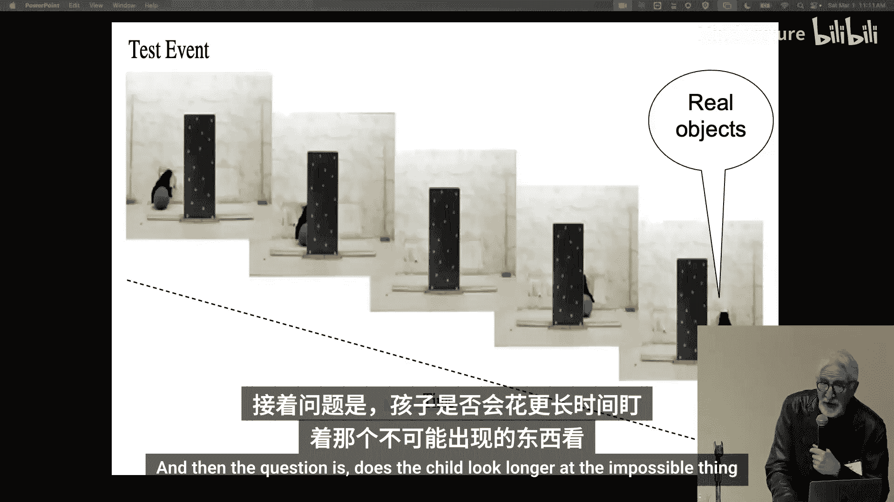
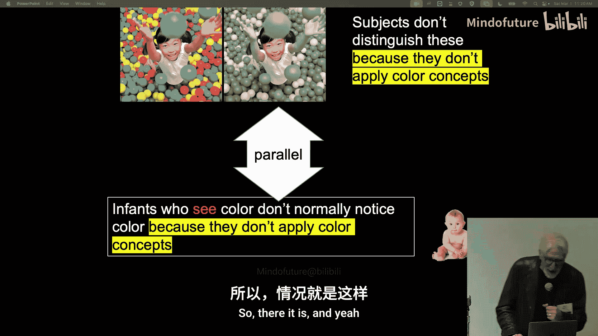
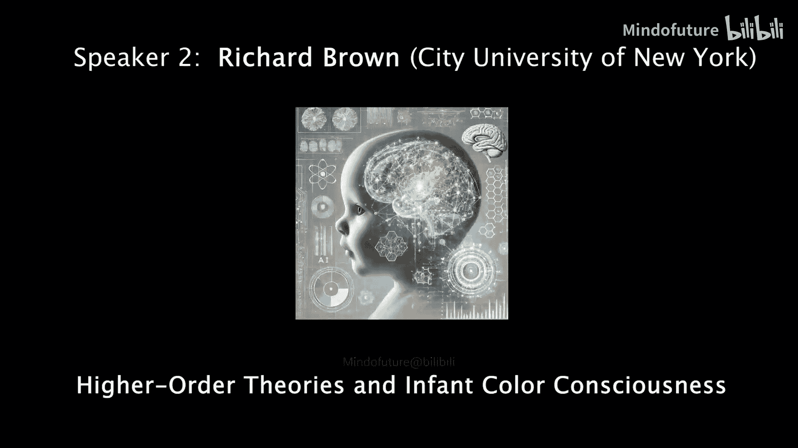
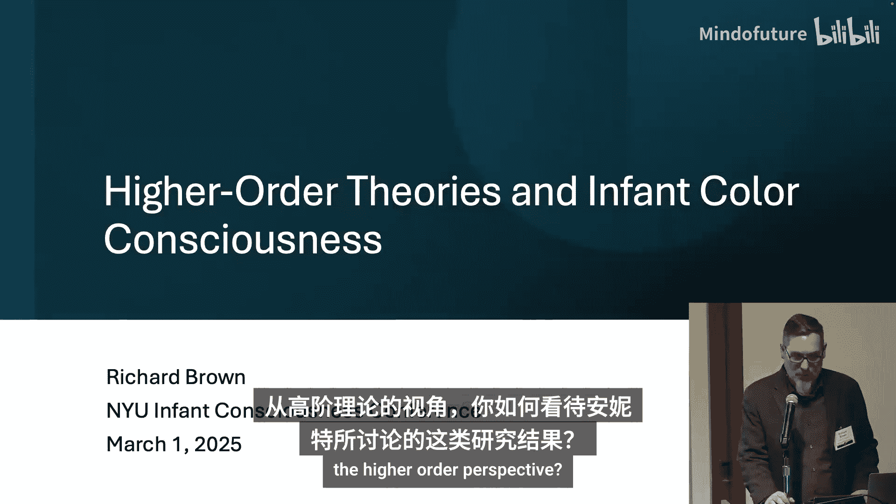
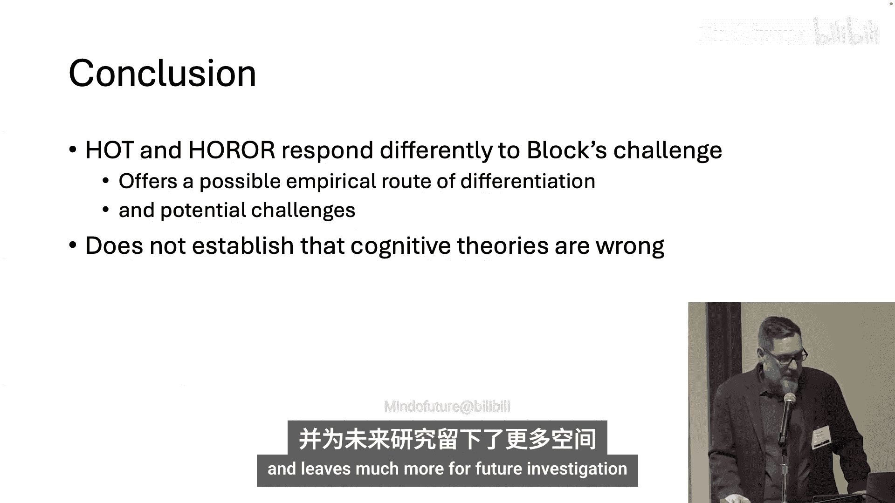
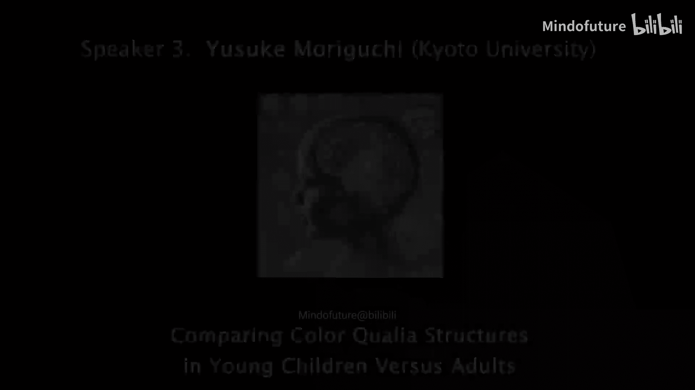
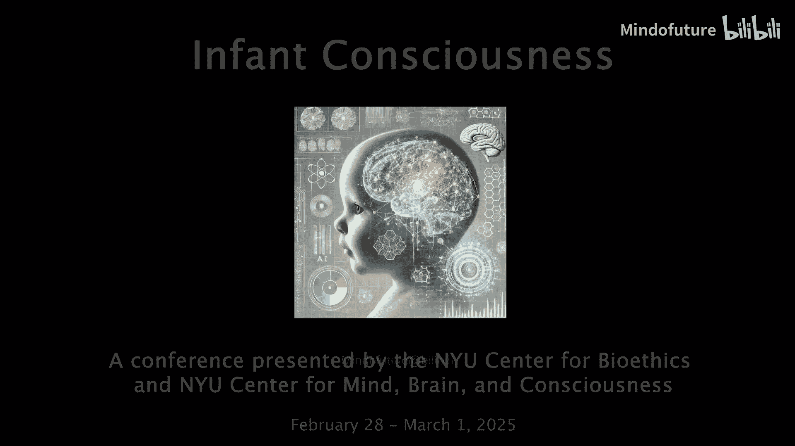

# 【纽约大学】 婴儿意识 ｜ Nyu Infant Consciousness p06 P06_专题研讨3_婴儿颜色感知-纽约大学婴儿意识会议_2025 -BV19zZXBUEMv_p6-

This talk is going to be more about infant reception than about infant conscious reception。

 but I will say something about consciousness somewhere in the talk。

 but I think these these issues they're closely tied， okay， so starting with adults。

 many of you may be familiar with this really cool set of experiments by Michael Cohen。

 where people look，At pictures， which in the raw form look like this。

 but then they're wearing an eye tracker and wherever they look， that's in color。

But the rest of it isn't and the amazing result is people tend not to notice that bleeding out of color and so this raises the question why and there are two answers one is and this is generally true for all these change blindness things there's these two answers。

 one is people aren't really seeing the color in the periphery。

 that sparse perception more specifically we have as Michael Cohen likes to say we have vague gisty ensemble visual representations that don't distinguish between color and no color in the places where you're not actually attending the other option is we fail to apply color concepts we don't cognitively。

Register the difference between color and no color and so we don't notice it in a cognitive sense and so we don't know alarm bells go off because those alarm bells are tied to cognition I favor the sparse cognition view but of course we're not specific we're not talking about exactly this today。

 but here's what I want to do I want to，Compare this case with something about infant color perception so basically what I think is there's a parallel in these two cases that sorry parallel is I claim subject don't distinguishes because they don't apply color concepts and I claim in the case of infants there are infants between six and 11 months who see color but don't normally cognitively register color differences because they don't apply the color concepts so that's the similarity that I want to draw now there are two possible reasons why they don't apply to color concepts one is they have the concepts but don't apply them the others they don't have the concepts now I favored the second。

don't have a concept but this difference is not going to be important so that's what that says。

 I should say that they don't normally apply to them I'll mention some circumstances and there are other that I'm not going to go into in which they do apply color concepts but theyre rare peculiar and the idea is that normally they don't reason with color so they see color but do not normally reason with color so there are three stages in representation of color by four to six months。

They have color category representations and I'll say what what those are at by 11 months they have the beginnings of color concepts。

😊，And it takes another two years before they get linguistic color concepts。

 so this I'll say something about this why this is so incredibly difficult。

 but it just shows something about the great difficulty that infants have with color so my claim is that in this period they have between six months and 11 months they have color perception。

Normally without color concepts， although I said there can be peculiar cases。

 So just I got these pictures off the web， these are supposed to be actual children of these ages。

 but it it's that intermediate age So that is going on here So just to remind you about categorical perception we all really know because we've seen rainbows that we have categorical perception of color。

 So the rainbow is a continuous band of wavelengths。

 but we see it as stripes right and that is categorical perception the behavioral indication is faster and more accurate discrimination between categories than within categories。

 So if you have a red in a yellow differing by a certain amount and then two reds differing by the same amount。

 the two reds look more similar and you categorized them it the same color。

 Now there have been fantastic。😊，experiments on infants color vision by Anna Franklin at the University of Sussex。

 and she has a number of different ways of measuring infant color perception and color infant color categories。

 so it's really cool work， but the simplest method，😊。

Is they have a screen of one color with a disc of what we see as a different color。

 if the infant sees it as a different color， they just move their eyes through it and you would do the same so all humans do that。

 you know I mean with some degree of regularity and if they move you can use this method to gauge their color categories because if the background and the disc are of different categories you move your eyes faster。

Okay。And you can use that to map out the color categories。

 The color categories can also be mapped out by other methods which agree with this method。

 So it's a really cool case of you know of different behavioral tests that converge。

 they needn't to have converge， but they do converge making you much more confident that that this thing is real so。

😊，This is one at test this is habituation， the kids see the same thing on left and right， same color。

 same color， same color， they lose interest， they start looking at their feet and then a different color pops up and you can use the measures of how long it takes them to lose interest in that as an indication of whether there's are different color categories and it's a novelty preference。

 different methods yield the same color categories。

 there are five categories in infants across culturally and I'm not going to say any about it。

So do they attend to color or notice color， well， they'll simply show attention。

That it's cognitive registration that is the the issue Okay。

 so I've just talked I'm going fast because I don't have much time so that was all about the perception of color now I'm going to turn to the cognition of color and I'm going to argue that despite。

Adult level color perception by four to six months and color categories。

 the infants do not normally cognitively register color here is a great experiment。

In this experiment， you can have same shape of different colors and there's a rule which the infant learns。

 which is if you have two things of the same shape。

 then some really cool thing will happen on one side or the other and the infant will learn that rule as shown by the fact the infant will look to the side with a cool thing happening。

 you know， jumping frog making wonderful sense， but the 12 months old can learn this one。

 but they're just beginning to learn this one， the same color on the top。So they。

 they have a lot of trouble until 11 to 12 months， learning a rule， same color look left。 Okay。

 so that is an example of how they can do a cognitive task。

With shape but not with color okay so below 11 months they can't do that。 Of course。

 this requires some kind of appreciation of sameness of color cognitive appreciation Here' is a different paradigm that Susan has a pioneered you have a thing of one color come out from one side of the screen and then the relevant question is do they expect two things and under 12 months they don't expect two things so they don't cognitively register the color difference in a way that allows them to reason with it So they use shape and also kind information and forming expectations months earlier than they normally use color Here's another paradigm this is Trily Leslieian hall where what you have I'll just focus this is the control you have something of one shape coming out and going back。

There shape going on and going back and then the screen comes up。

And you can have an expected result or an unexpected result。

 they're not surprised under 12 months they're not surprised by two things。

 if you have a red thing going out and going back and a green thing going and going back and then you have two red things are not surprised。

So I'm talking I'm really giving a very quick rendition of a chapter of this book which is available free free download on the OUP site and this is chapterpt6 one of the issues I discuss is salience so this is something that immediately comes to mind and what I say is these the results just describe involve a contrast between color in the one hand and shape and kind on the other perhaps color just isnt just isn't as salient as shape and kind perhaps but that isn't an objection rather if true it may provide an explanation of why the infants normally lack color concepts and have such stark cases of nonconceptual perception so I now think that perhaps as wrong that definitely salience is involved there but but salience is very closely tied with the lack of concepts I don't know quite which way the。

The causation goes， but so here is another moving right along here is another kind of experiment。

 so this is something a phenomenon called the tunnel effect so you have a very narrow screen。😊。

Only slightly wider than an object and you have a green ball that rolls to the screen goes behind it and then either a green ball or a red ball or some other color ball emerges and then the question is does the child look longer at the impossible thing and what you find is the result here is that three and a half month olds show increased looking time compared to a wide screen it compare with it takes a narrow screen for this tunnel effect to work but not if a red ball turns into a green ball still at seven and a half months they're not using color and it isn't 11 and a half months that they use color Now this is an important case because it raises the question of whether the infants have a color concept that isn't activated and some evidence for that is that。

The same Wilcox and colleagues found that you could train the babies to notice color and the way they did that was so just training them nine and a half months old look longer the red ball changing to a green ball but even with three rounds of training it took three rounds of training for seven and a half month old to do it and the seven and a half month old didn't didn't transfer from red green to blue yellow so it looks like the seven and half month olds aren't really noticing color per se but only specific colors I'm going to skip that so here's the way that they train them they used different color cups to do different things so one color might be used to pound and another color might be used to pour so a repeated examples of using the different color things to do different things then the kids started to react。

The change of color， I just said that。Okay， so。Now here is an interesting question。

 does training change a perceptual representation into a conceptual representation or does it activate a present but inactive concept。

 So a conceptual representation is one that has a certain role in reasoning thinking another cognitive processes we can call that the R role。

 and so we might raise the question does training give a perceptual representation the R role。

 or does it activate an inactive R role， So what is the R role。Well。

 one thing the R role does is learning rules like this same color predict something。

What we I prefer this it gives a perceptual representation the R role because I don't see any reason to think there are these schemas like saying color do you know look left just hanging around these features of the R role。

 what is the likelihood that they're just hanging around waiting to be activated， so all right。

 so moving on how much more time do I have。Okay， yeah， Okay。

 so what about the possibility that infants have a concept of color as a temporary property of things？

Well， this is a cool experiment that explores this。

 so six to eight myths prefer to look at these normal colored things rather than these odd colored things and you one might speculate that these odd colored things look weird do the kids as well as weird to us okay so so just to summarize。

 below 12 months babies don't normally use color concepts in reasoning except with special stimuli and special training and here is this really amazing thing。

Beginnings of color concepts come start at 11 to 12 months and at 24 months they can use a year later they can use color you know your toy my toy because mine is this color in years of that color it isn't until three years old that they know the four basic color words。

 I should say that this is probably decreasing Bennas early IQ tests from the beginning of the 20th century show that children did not in his sample did not have the four basic color words until they were seven。

Okay， now， of course， the kids are early and why you might ask， well， why are they earlier， Well。

 come on， you look at plastic， you know， I mean， these kids are bombarded with plastic things of many different colors so。

In 1980， Mabel Rice did this teaching experiment， she took a group of two to three year olds who didn't know any color words and taught them the difference between red and green。

 and what she found was for most of these children learning this difference took over a thousand trials over several weeks。

And， you know， parents have long noticed that their kids have words for other things。

 and they surprisingly lack the words for the color words。

 It was a scientific American article which went into great detail about this。

 quoting a lot of parents。 And the odd thing is the parents think the kids know the color words。

 but they don't。You know， the kids have memorized some color names for various things。

 but they don't actually know what the words mean。So parents are often highly misled about the color terminology of their children。

 and this was very nicely not the misled part by Charles Darwin， who said。

I attended carefully to the mental development of my young children。 and with two， or as I believe。

 three of them， soon after they had come to the age when they knew the names of all common objects。

 I was startled by observing that they seemed quite incapable of affixing the right names to the colors and colored engravings。

 though I tried repeatedly to teach them。 I distinctly remember declaring that they were color blind。

 And in the German literature， there was a term for this far and dumb height。😊，嗯。Color stupidity。

So anyway， just to summarize kids between six months and 11 months， they see color。

 color they haveceptual color categories but they do not normally have concepts of color and that shows that it's possible to see color without cognitively registering it and so getting back to the sparse perception fallacy so the。

😊，Fact that subjects do not cognitively register a difference doesn't show that there is a difference in the way things look。

So the alternative explanation is they do not apply the relevant other concepts。

And I think the same story can be told about this case that they don't distinguish these because they don't apply color concepts this is about consciousness because this has been a major this idea of sparse perception has been a major motivation for cognitive theories of consciousness so as I'm sure everybody realizes there's been a controversy recently between the sensory theories of consciousness like the recurrent processing theory。

 IIT versus the cognitive theories of conscious global workspace and higher order and cognitive theories of consciousness typically come to the conclusion that that perception is sparse。

 and the reason for that is that cognition is sparse you know the global workspace says we can cize maybe one or two or three things。

At a time that we're very limited in our higher order thoughts or higher order pointers。

 so those views all come out on the side of sparse perception。

 whereas the sensory theories come out on the side of rich perception and so this was a talk advocating the rich perception point of view in a sneaky way。

 so there it is and the end。

Soin thank you very much lovely talk in a version in a longer version of this I use of your stimuli so I had I guess two points I'd like to make and like to hear you think about both relating to cereral a chromattopsia so an absence of color experience caused by acquired people I look at brain damage acquired in vent medialocccipital cortex and so first question is a question about you know perhaps what the nature of infant color consciousness might be so our cereralla chromattopic can use differences in the wavelengths distribution of light reaching his eyes to segment of visual scene into figures and background so if we present a red circle against a green background and ask him what he。

😊，He sees a disc。But he can't tell us anything about。

The difference between the colour of the disc and the colour of the background so you've got a situation where you're processing chromatic edges and you can do that with strac cortex but you can't then from from that earlier position you can't generate and identify the colors of surfaces so I just wondered if that was a plausible explanation of what infants are doing and then a slight follow up to that I once I must be like 20 years ago。

Tested a guy who was a hemi a chromromattopic。 so he had damage to。

Fusiform andingual jarri and tramedialocccipital cortex on one side of the brain but everything fine in dandy on the other side and so what you would expect is that he'd have color vision in one visual field and no colour vision in the other visual field he certainly didn't report that but the anatomy looked right and he was a bit difficult to test so I had to do you know。

Cheap and cheerful bedside testing so stare into my eyes and now tell me what color the pen top is and on the side on the in the visual field which was。

Normal whether there was no brain damage， you know。

 I could have the pen somewhere out here and he'd tell me what colour it was in the affected visual field。

 I had to bring the pen right into central vision。But he had no idea that he had no colour vision in one Hemmi field。

 He was really shocked at this result。But of course。

 he did have perfectly good color concepts because he had color vision in his good visual field。

 so he was perfectly capable of。I guess representing the different colors that potentially were present in his。

Affected field。 but first of all， he didn't do that。 And second。

His failure to do that didn't then result in him。Actually noticing that there's a difference in experience。

 And so that seems to me slightly at odds with with your position。

 sorry if that was a bit long and rambling I'm not sure why it said odds with my position I mean I don't know what to make of that case you know。

 maybe it's anynosia maybe it's some kind of filling in or something what did he say when you had it you know in in the the chromattopoxic field but before you'd gotten to the point where you could identify the color。

 What did he say the color was he just couldn't make a decision he was just what did he say it looked like uncertain a guy I can't tell I can't tell why can't I tell So he sounds like ansynosia to me because yeah what is that experience of can tell Yeah but we。

But we can we know we have very good reason to believe that he wasn't having。😡，A color experience。

 Yeah， but analyst knows you no color experience， but failure to recognize that fact。 Yeah， yeah。

 anyway。 but the first point you made is is is， you know。

 I'm more worried about that because all the paradigms all the Anna Franklin paradigms involve differences。

 You know， can do you move your eyes to a disk of a different color， You know， do you habituate what。

😊，But the habituation involves a memory of the difference so it can't be yeah。

 so it can't be that that's right here yeah。Yeah， that's true to that yeah， the reason she did yeah。

 okay， yeah。Right so maybe that does answer that Yeah hi Barbara hi I was wondering how you distinguish between not having the color concept and it just been more difficult to do some of these tasks's maybe just that's not quite salience。

 but I was thinking I mean maybe for adults if they were to see it would be more difficult。

 they'd be slower it maybe identifying same different colors than different shapes I was thinking I'd probably be slower at doing that。

 yet I have color concepts So yeah， so yeah you know。

 all I can say is that a variety of experimental paradigms do not reveal any ability to use color in reasoning or you know ex forming expectations now it's possible that making everything slower would help or but you know。

 I don't know if anybody's tried that。What about in your paradigm。

 have you tried making everything really slow， no。So I don't know。Okay。

 that is the kind of intuition that should lead to an experiment if you really。

Have some force behind that intuition。 Somebody has to take it seriously enough to do the experiment。

嗯。Yeah， thank you for a great talk and Okay， so this is a population based question and I just want to hear your thoughts about it。

 So after a three year pediatric residency added a two year what after a three year pediatric residency here in New York starting here right at NYU 40 years ago。

 I did a two year fellowship and developmental pediatrics and every pediatrician knew about the Denver developmental screening Tu which was based on a couple of thousand to or 300 kids。

Actually， it was done twice Baltimore and Denver， it was a Denver one in Denver two。

 and they looked at screening for children based on thousands of children。

The1 I struggled with the most was color and naming four colors， naming， identifying four colors。

 And how old were the kids， Well， it goes from birth to5。

And there are different levels of developmental screening in terms of motor， cognitive play language。

 and one of the， I don't know， 25 items on this developmental test。

 which all pediatricians administer to all children as a screening test， not an IQ test。

 but a screening test， was this identifying for colors。So I became parent while I was doing that。

 and I tested this on my own children， and my kids are bilingual。

 and they could identify  eight colors in two languages at age 2。 And on this bar。

25% of kids could do that at age2， but of all of the developmental milestones。

The color identifying four colors was the one that baffled me the most I could never figure it out because on the 90% of kids。

 they give you 25% and when 90% of kids can do it。And then 90 percentile was born and a half。

So of all the developmental milestones on that developmental screening test。

 recognizing four colors and naming them was the broadest and I think my kids went to graduate school。

 I think theyre you know smart kids and things like that， but that was the norm for me at home。

But I could never figure out who are these kids。 Now。

 8% of boys are colorblind while they can no see blue。That's an X chromosome genetic condition。

 And that's not for that reason。That。At least 10% of kids。At four and a half can't do that。

 And I don't think it's because of an intellectual disability either。But anyway。

 this was the milestone that pediatricians screened for that had the broadest variability。

 and personally， I've thought about it for the last 40 years， I could never figure it out。

What is your thought？And I don't know that I listened to your talk very carefully。

 I don't know that you answered that for me no I did not and I mean I can speculate。

 but I'm interested in that and if I would love to see some papers on this on this Dan test。

 if you could send me a reference or something， but look here's my speculation， my speculation is。

Kids do not usually notice color， but there are various things that can be done to get them notice color like that training thing that I mentioned。

 So I'm guessing that some kids for whatever reason。 Not color early on。

 and others kids just need to have it， You know， Mabel Rice，1000 trials over several weeks。

 Other kids have to have it， You know， you know， knocked into them。

 And I don't know what the relevant， very variable is here why some kids get。

 It may just be random chance。 Did you happen to notice this in a circumstance in which it LED to something。

You know， you tend to see in the developmental literature that I looked at。

 you do tend to see averages and they don't tell you that you knowre more they're not that interested in individual differences。

 so I'm sure there is a lot of work on this。

That's a tough act to follow so I'll do my best so this has been a great conference I've been learning a lot at it and I've been really privileged to be here and it's really cool I come at this from thinking more about theories of consciousness than specifically about infants so my question is what would you want to say about the kinds of results and that is talking about from the higher order perspective and since that's my job I do want to start off with a disclaimer which is that I do think that higher order theories are empirically false if they're false at all so what I mean by saying that is I've not really a true little as a thinker guys as a thinker I'm not a true convert of a theory I don't think that it enjoys a special status or that it should be thought of as ahead of other certain theories I think of it as one of a class of theories that has just got to the point where you could develop it in enough detail that you could start to see what kind of empirical predictions that I would make and what we want。

do with all of these kinds of theories is develop them in the detail that would require allow us to see whether they are empirically refuted or not and so for that reason I do really want to highlight and emphasize that Ned's kind of insistent and relentless challenges against these kinds of theories is much appreciated because I do think that these are the right kinds of theories okay so we just heard Ned's case and I'm not going I'm not going to repeat the case that he makes here but it is an interesting experience be reading his book because you're reading along you get the chapter6 and you're thinking yourself this is very good very interesting and then by the time you get to chapter 13。

 he suddenly said， oh and therefore cognitive theories of consciousness are wrong and it's really that part of the of the argument that I want to challenge so that I think that really what he does is highlight some some need for further empirical work but also a way to differentiate certain kinds of theories so I think that we get two challenge。

From this work the first is just do these infants have phenomenally conscious color experiences and the second is if they do are these nonconceptual in the sense defined by Ned where to have a nonconcept color experience is roughly to have the experience but not have the concepts that you would need in order to specify the experience so it's those two challenges I think that we want to address and I do think that higher order theories can escape unscathed here I do think that different versions of the theory will respond to different ways。

 but I don't think that we have anything that amounts to a refutation of these kinds of theories that we have something that that point to areas where we would like to see more thinking being done and more work being done okay so that's gonna be my general argumentative strategy。

What is it that I mean by a higher order theory surprisingly enough even here you find some controversy people mean different things by higher order theories as I use the term higher order。

 a theory of consciousness is a higher order theory when it sees a special role for inner awareness in the explanation for phenomenal consciousness so if you want to say what phenomenal consciousness is then higher order theories are just those theories that say part of the explanation or account of phenomenal consciousness involves a kind of inner awareness where inner awareness here means an awareness of one's own mind or mental functioning so by that reading first order theories are simply theories that don't see a role for any kind of inner awareness in an account of phenomenal consciousness so global workspace theory IIT local recurrency and these other theories that we find often on the market are all versions of first order theories as I understand things because at least as they put forward now they don't see a role for inner awareness you could easily think of versions that do see a role for inner awareness some。

ha actually tried to defend versions of like global work experience theory that sees it as a kind of inner awareness so there's a lot of debates there。

 my point is just that there's a lot of first order theories and people tend to think of higher order theories as just another kind of theory that you add to the list but I think that instead we should think of them as a class theories just like there's many kinds of higher first order theories there're still also going to be many kinds of higher order theories coincidentally enough since we're all mentioning our books here I will mention that I do have a book coming out on this where due out in April where I try to say what the various kinds of higher order theories are what my count as empirical evidence for against the different kinds that there are out there and classify them and think about them in a kind of orderly way I'm not going to be doing that today。

 but I do want to focus on two versions of the higher order theory in particular because these are the really cognitive versions of the theory so if any version of this theory we're going to be challenged by networkwork。

Be these kinds of theories so in particular I want to talk about the higher order thought theory which has been championed by David Rosenthal and others and then also a version of the theory that I had developed that I call the higher order representation of a representation or the horror theory so these theories are related to each other but they also different from each other and I think that N challenge gives us a way to differentiate the theories and see that they make。

They make different different commitment so that each version of the theory will respond in a different way。

 so and that's good because even though these theories are very similar。

 there are ways to empirically differentiate them。So what I want to do then is say a little bit to give a caricature of the higher order thought theory and contrast it with what the other versions of this theory might say so now you get to see my PowerPoint slides as conceptual art segment of the talk so if we imagine that the world has certain properties we could call these properties here we have the property all we might call it a perceptible property because we might imagine that in the mind of some organism there comes to be states which allow that organism to be responsive to the perceptible property so in the typical case this might involve some kind of conceptualization of the property in the external environment as well as maybe some non-conceptual component like a mental quality we could think of this as what in the higher order theory business we would call the first order state because it is an awareness of the external property so what you're aware of is something in the external environment so these kind of states have their causal effect due to their connections to other such first order states and according to the。

At least in the limits， one thinks one could have a bunch of these kind of states generating some pretty interesting behavior。

 even though there was no conscious experience。In order to have conscious experience on the view。

 you need a kind of higher order awareness which the higher order thought theory sees as a kind of thought something to the effect that I am seeing red where something more specific along the lines might be I'm in a red star state where red star is the mental quality that the first order state has so at that point there's something that iss like for you and you come to see red now at this point we could think about Ned's challenge and we might think to ourselves well is what is it that he's actually arguing for well he's arguing for color perception in the absence of concepts but what kind of concepts So one thing that the higher order theories might point out is that plausibly what's missing in this case is the concept of the external environmental property of the surface but according to the higher order thought theory the concept that applies in the higher order thought is the concept of mental red is a concept of something which is mental not something which is in the environment So one response you could have is simply to say well。

 you could take Ned's evidence at face value and say look what these。

Bary my show is that these infants don't have the concept of the perceptible property。

 but maybe they acquire this concept which figures in the higher order thought in another way。

 and in fact that is sort of what I think the view here is。

 that maybe early on in infancy they are having all sorts of sensory states。

 maybe they're comparing them and wondering whether or not they go together or not。

 in which case they might easily get the kind of concepts that would figure in these kind of higher order thoughts。

So I think that is one possibility here， the other possibility is that you could argue well look in this range that you just are no higher thoughts so that the higher a thought theory predicts that the infants are just not not conscious even though they do behave and respond in the various way so I do think that there's a bit of attention here for the higher order thought theory it'd be interesting to hear。

Proponents of that view， what they think of it because on one hand， we have。

 I think the kind of argument which we see in various places in David's writing in David Rosenthal's writing where he wants to suggest that these kind of concepts could be had early on very。

 very early in the perceptual workings of infants Now how early is not exactly clear。

 but on the other hand， there's a background theory about intentionality。Which is at work here。

 which sees it as a product of a kind of holism whereby the thought I am seeing red is going to have its content。

 It's meaning its reference determined by the relationships that that thought has to all other kinds of thoughts of that nature as well as to utterances。

 which one might use to express it and this is not something just as a matter of empirical fact I think that there's going to be a period of time in the infant's early development when they just do not have this capacity and therefore the higher thought theory is committed to at some point in the infant's development they're not having any higher thoughts and therefore no conscious experience。

 Now， whether you think。That's a problem or not depends on how how early you think consciousness consciousness emerges。

 which as we've seen has been a subject of a law of debate at this at this conference。

 So some people may like this more than others。 on the other hand。

 the theory cutter does predict that you would have。

The same kind of behavior even without consciousness so so I think that one thing you could say is look they do have the concepts。

 they have the experience they're just a different kind of concept than one block is talking about。

 on the other hand you might say well look maybe they don't have conscious color experience at which point block says well。

 this is problematic because we have some indirect evidence that they're conscious。

 the indirect evidence being the kind of behavior that they present which we just went over and we don't see that really occurring in blind sight and other related examples。

And I do think that it's obvious that we don't have any kind of actual experiments that present the kind of data that block is looking for that you get bored look away and those kinds of things。

 but we do see a kind of general trend in discussions of blindight that the stimulus does affect the reaction times of the subject they can become quicker we have evidence where they pair them at the same time and there can be distractors so that there is a kind of adaptation or response in terms of neural terms to the stimulus and not's not exactly the same thing and I acknowledge that but the evidence is indirect here and if you pair that with just as we were saying a second ago。

 Bob's in the audience here so this is Bob's work about bottom up attention in blindight does suggest maybe you could have unconscious control of attention。

 maybe there's even some evidence for unconscious popout this is from a different paradigm continuous flash suppression so we could argue about that but I do think it's kind of just turns this into an empirical question about like at what age you expect these kind of behaviors and do they have the relevant。

Order states that are posed by the theory and how。How serious do we want to take all this stuff so that if one kind of independently had reasons for thinking it occurred at a certain point。

 then you might have some reason to doubt the higher order theory。

 but you're already a long way away from Ned's challenge at that point。

 you're already well downstream from the sort of data presented in the cases。

That that he appeals to so I think that the higher thought theory either way you go kind of lives to fight another day now。

 on the other hand， I also tend to think there's another way that you can go here。

 which would be more in line with the way I think about the higher order theory。

Wwhichch is to allow that the infants are phenomenally conscious。

 but to insist that maybe their consciousness is not like ours。

 and I think that that's kind of an assumption that's in Ned's work we just heard some people talking about that just a second ago。

 but just to give you a brief kind of idea of the way I think about the higher order theory which is somewhat similar but I think different as well so I can agree with I don't really want to fight about the first order states here I think there's going to be some states that allow the organism to be informationally responsive to the environment。

 I think maybe those could be the globally broadcast states， they might be the integrated states。

 they might be the local recurrent states， I think we could debate about that。

 but according to my view to have the conscious experience you have to have the higher order state。

Which represents you as being in the first order state in a way that I think of as like a complex demonstrative。

 So in something similar to the way when you say that dog is vicious and the that in there picks out some animal in the environment and then the。

You characterize it as a vicious dog so there's a kind of demonstrative element and then a kind of characterization of the demonstrated thing so I don't really think of the higher order states as being akin to ordinary thoughts。

 I think of them as representations I don't think of them as the kind of thoughts that you could think which I think is a big difference between David and I I also think that the arrow which I have pointed up in here is going to play a psychological role in the mind of the organism so it's going to allow the first order state to become globally broadcast or be held in the global playground for global further broadcasting or sensory processing et cetera so I think it's going to have causal effects which we could test for so that the arrow is a real psychological phenomenon and then finally I also think that the concept that's involved here is the concept of the perceptible red not not mental red actually am very skeptical that we have concepts of mental red which the higher order thought theory。

Suggests that we do。 So there are all these differences， which occur。 But we。

 of course the overlap is that we agree that if the there's conscious experience and there's going to be these kind of conceptual representations。

 So as I view it then the assumption that's underlying blockss work is that。

The infants are going to have the same kind of color experiences that we do。

 but if you take the higher order perspective and in particular you take the point of view I have。

 which is that you have a mismatch between levels of content and instead of thinking that as an objection to the theory I think of it as an empirical prediction that the theory makes so something surprising that we could look for well there's kind of straightforwardly follows that if the higher order state determines what it's like for you and it can misrepresent the first order state then you can have cases where those two come apart where you may be in a first order state representing red and in a higher order state that's representing it in a different way and in fact that's what I think is happening in these infant cases so if you show the infant something red it may go into the red star state no concept and then it may simply the higher order awareness that shows that may simply represent you as seeing a dark square or a colored square or an opaque square so there are many other kinds of concepts that are more generic related to color which don't involve being red or green and at this point。

The theory says， well， you have phenomenal consciousness。

 it's non conceptual in the way that block stipulates because the red star state is not being conceptualized in a way that would describe it。

 it's being conceptualized as simply。In an incorrect way。

 so I do think that that's kind of quaarifies it in the sense that's relevant here and it would explain what's going on。

 on the other hand， if you present them degree in case they may represent that state in a very similar way simply as there's another dark square at which point even if there were differences in the first order states they may not be characterizing them at the higher order level so that if they were both there indeed you may have this difference so I think that the upshot out of all this is that if you grant Ed pretty much everything in his interpretation。

 you still get an explanation of the data without a challenge because these infants could be trained to notice maybe there's some subtle difference in the conceptual content。

 maybe they acquire the concept in that way but even if they have anomaly conscious experiences and even if the kind of thing which they are aware of is nonconceptual it doesn't falsify the theory and I just want to end by pointing out that this is kind of giving as much to N is I think you can namely that these are conscious。

And that they're conceptual but just withholding one thing。

 which is that the concept deployed are like red or blue or green in the ordinary way and of course。

 I think as I just said， you could argue that they do have these concepts and just don't use them to form expectations I don't think that there's a lot of strong evidence there's a lot of indirect evidence about that but I think you could debate that there so that my strategy was really try to give as much as possible to Ned and to point out that we have these different versions of higher order theory that respond in these different ways。

 one of them suggesting that we would find certain kinds of higher order states with one kind of conceptual representation the other one suggesting a different kind。

But that while it open ups interesting questions， it doesn't establish that the theories are wrong and leaves much more for future investigation。

 all right， thank you。

Thank you very much， so I don't know anything about consciousness or the hi order theories。

 but I literally don't understand your proposal， so the question is what is the status of this is me looking at a rich thing that sounds like you need a concept of me which children don't have to。

You know what concept of self do you need for that and then the other one that you had two different gloss。

 this is me looking and the other one is this experience refers to a property of that thing or something like that。

That requires the concept of an abstract concept of experience。

So I mean this is this is not a challenge， this is an exp I just don't understand what the state is I can't understand the theory because I don't understand what that line is up there Yeah about that's a good question I mean and I didn't have time to to talk a lot about this but I did kind of try to drop the me out when I was talking about the infants so I do think it's an open possibility I mean it's just something another place where higher a the will disagree but I do think it's an open possibility that you could have the higher states that just represent that there's a seeing going on but not that it's you who's doing the seeing and I do find that。

Probably。变晒了月。Well， it's not clear that they do or don't have it so it seems to me that it's an open possibility that they could have it we don't have any evidence against it and the evidence that we're talking about here doesn't suggest that they don't so i'm more just suggesting a way of interpreting the evidence that is consistent with the theory which would suggest that we'd want to look to see whether they do in fact have these sorts of things。

But I agree that if we found out that they didn't have these kinds of things at all。

 then that would be very troubling for the kind of view I'm suggesting， But the selfcon， though。

 I do think that so some people think that you need to have the self involved in order to count how you're aware of some specific kind of content。

 I do kind of want to challenge that I do think that if you just have the kind of demonstrative components saying that's the seeing of red that that's a good enough to count as being aware of the first order state so that you don't need those problematic concepts until they show up later。

That's how it explaineds the selfcon， but the other ones。

 I think that we don't know if they have them or not。Oh。Yeah。

 so that was it was a great talk and there's a lot surprised I I disagree with a lot of things。

 but so in the first version of the what you call the higher order thought theory。

 you said that they could handle us one of two ways， one is that the kids have a concept of。

What you called red star I think or so the idea is the red star means the experience you have when you see red so。

This strikes me as a really lunatic puzzle I mean， honestly。

 they have a concept of red star and they don't have a concept of red。 Yeah I mean what in the world。

😊，Well， I mean a lot of that means the experience I have when I see red's an experience that you have it's the state that you're in when you see red or it's the seeing of red I think the likelihood that they have a that they have a concept of their own experience of that sort anyway I'm just going I think the argument maybe here so he can he can talk for himself。

 but I think that the argument hinges on the fact that。

Infants will be doing crossmodal comparisons I know that there's somewhere that says I do this at like three weeks old where they're like。

 you know， just a simple example of you hear a sound so you turn your your head so you're asciating the sound crossmodal things for color。

Yeah， color， yeah yeah， right。But you still want to know whether you want to pair it up with something like if something's red。

 is it sweet or is it bitter or is it gonna be hot or cold。

 So there's lots of other things that you'd want to pair it up with。

 I think that opens up iss an empirical challenge I'm happy to see the higher or thought they challenge It's not my favorite way of thinking about things I just think that this would be a way that you could try to empirically challenged of you by suggesting that either they do or don't acquire these kinds of concepts。

 but it's an open possibility， which isn't ruled out by the evidence you presented。

 which okay the second thing is are these infants conscious。

 Yes and that I think is a serious independent thing so I presented a few things that sort of slightly indicate that they are one is the strange colors they don't like to look at the strange colors Yeah seems like intuitively kind of a conscious reflecting some kind of negative experience when you look at the strange colors but then you know I mean。

 just moving your eyes to think of the different color。

I don't know if people do that in unconscious perception。 I'd be yeah curious to know about that。

 What about habituation， real habituation， unconscious perception， Does that happen， I mean。

 I think it's， first of all， just note that it's odd that you're appealing to the intuition when I heard you earlier。

 I thought rightfully suggesting we should stay away from those kinds of intuitions in this kind of case。

 So I do think that we want more than the in the intuitive here。 And so yeah， well。

 we could circle around it。 So so I think that's exactly the kind of thing which this discussion opens up is that there's a lot of empirical actually empirical questions that might be tractable that if we had the answer to would weaken or strengthen our credence in these other kinds of claims。

 So that I think that that's what's interesting about this but that it doesn't on its own。

 All it does on its own is suggest if you knew this。 and you would know something else as well。

 and saying intuitively it seems like that to me you know is I want more than that。

 But I agree that those are the kinds of questions we want to answer to。嗯。Quions answering beYes。

Your account made a lot of sense， I believe， actually in light of。

Of the distinction that we often have between like say detection and discrimination， for instance。

 so so it might be that infants are and probably they are detecting。

 they know that they're saying something colored but they just can't discriminate which color it is they they don't reach that level yet right but but you don't need to instantiate like two very different。

Levels of like two types of consciousness involve here。

 But you just need to account for the fact that they have。Conscious is at a certain level。

which is a level of saying that there is an object with a certain property but but the inability to reach a higher level where basically they know to distinguish that from another instance。

 for instance so this could be operationally very well explain you。

 I think you explained very well and it makes a lot of sense it doesn't need to instantiate like two different types of experiences。

 I believe so for me it makes a lot of sense， nice to hear that N。😀Yeah。And。Okay。

 so I just want to understand the positive proposal letter and ask if there's any independent reason to believe it other than it explains this particular case。

 so is the positive proposal just that you do have a high representation it's just a misrepresentation of what's going on the first order so。

I understand the dialectical move because you want to show that。

This is compatible with this set of empirical data so you can always make a theory compatible or this set of empirical data by adding on aux then the question is。

 is there any other reason to have that about I was just curious as to whether there was independent motivation for the addition Yeah no I agree with you so my goal was really just to show that there's an interpretation which is consistent with all the data but doesn't falsify the theory but then also opens up areas where you go oh wed want to know more about that area in order to really make an informed decision here so it was really more of like an advertisement that this is a cool place to look for further kind of data that we don't have yet and now we can see that this theory doest make actually fine grain prediction about what you would expect so I didn't really have independent reason except the kind of intuitive idea that it just seems like they would have be thinking about these things at some point at some low level so you would kind of expect and then fitting with what Sid was saying that it makes sense in terms of some other things that we。

about discrimination and detection so that it's just kind of vague intuitive stuff。

 but then it used it as a springboard to look for more empirical details and then to show that well this by itself doesn't refute the theory。

 but it certainly does open a doorway into an area where we'd like to know more and that's what I appreciate about it。

I thank you。Thank you so much。 This is really interesting。 Very quick question。

 So suppose I buy the star thing for visual perception perception。 and I。

I have this like state of like seen with no point of view。

 What would be the equivalent of exactly the same thing for different modalities， like for instances。

 like touch。So what does this start in a different modality of seeing without a point of view Yeah。

 so for instance， like can you， can you can you conceive like tactile perception without。

Point of view。嗯。Yeah， so I do think that maybe you could think a about cases like some paraphrenia and other such cases where people will deny being touched on a certain body part like an arm or something like that but then if you say I'm touching your cousins or nephew's arm they'll say。

 oh yeah， I felt it so you could。Well they'll they'll say it was felt on by the cousin or something they'll deny that they felt it so I do think that there are ways of interpreting those kinds of cases that don't go in the way I suggested。

 but there's also a way of interpreting it whereby they have the conscious experience。

That they think of as someone else's or that they experience as someone else's and so rubber hand illusion is another kind of case I could think of where possibly something like this could show up so I think that there are kinds of cases that can be interpreted that way I just don't think that we know enough to say what definitively what's going on in those cases I just think that suggestively you can think of it in that kind of way as being a kind of analog but someone else could think of it in a different way and then it becomes you know what differentiates it。

Hi Richard thank you for the talk I'm curious what your horror theory and so psychological notions that you're proposing mean for the neural correlates of where this might happen and of course it' says implication for the developing infant brain you know this suggestion about conceptual representations being a rerepresent that then renders some first order representation conscious makes me think that this could happen sensory cortices right even at the most ammodal representations and might happen in say temporal pool right so where does something like the prefrontal cortex factor into this is this position still something that you know the prefrontal cortex is important for or can you get that just from you know higher order multisensory regions or amodal regions which are you know at the farthest extent right you could even think about categorical perception of a table rather than chair or syllables and so on this is usually at the apex or included in some sensory pathway yeah that's a good question I mean I do think that a kind of tendency in the literature chair。

to kind of assimilate higher order theories to prefrontal theories largely because some people that are associated with the former have endorsed the latter sort of hesitantly。

 but I think that people tend to over identifyentify those theories so I think in my opinion these are psychological level concepts inner awareness first order perceptions and we don't have a clear understanding of where we would expect to find those so for example I think of the global workspace theory as a possible candidate for what the first order states might be the ones of which we become aware in which case maybe first order states are in the prefrontal cortex maybe they aren't so it's an empirical question if we become aware of our mental states where are the states of which we become aware so I think that we're in an early stage right now and when it comes to the higher order awareness then it depends a lot how you think about it so a lot of people want to think of this as a kind of metacognition or akin to it or sharing the neural machinery of metacognition in which case you might look in the prefrontal cortex。

Other people think of it as a kind of self consciousness， a kind of self awareness。

 in which case you would expect different areas to be involved， not necessarily prefrontal。

 more parietal and medial， as opposed to dorsal。 So other people see it as。

A kind of non-conceptual awareness in which case maybe you would find it in the sensory cortices so I really think that we are at the lowest level of trying to link the psychological concepts to the neurological and we have some good guesses and I think the word following up but I don't think that the higher order theory commits you to any one of these things what it commits you to is the idea that inner awareness plays some important role and then you have to go on from there and say where would you expect to find that so I think it's reasonable to look in the prefrontal cortex but I don't think that's because the higher order theory dictates that I think that's because I'm sort of convinced loosely by some other evidence that the prefrontal cortex is a likely candidate but if it wasn't then it wouldn't falsify。

The theory theoretical approach， would falsifies some specific version of the theory that postulated implementation in that way so not going go back far sorry。

 I'll talk afterwards yeah。 Yeah， so last question from Jake。 Yeah。

 thanks for the talk interesting So one thing I'm wondering is that。

There's a persistent thread in the worries that you know the second order content。

 the higher order content is over intellectualtelized right that it's too conceptual for infants to have right and so you said well you could get progressively simpler you could even have just like a demonstrative thing like that that that thing is red or something like that right but even that which is I think the most minimal。

Conceptual kind of account that you give requires quantify like a grasp of quantification because it's that right and so you're quantifying and so if you haven't need a conceptual grasp of quantification that emerges quite late and will not probably explain the color like the nonconceptual color data or something like that I think so I mean how do you how do you answer that。

😡，I mean I think that's a good that's a good point as far as like the quantification goes the that part。

 I think you can model it in many different ways， my own way of thinking about it。

Is the thing about it like an HTML address encoding whereby you have some bit of code when it introduces what you're going to do like the hypertext protocol transfer。

 and then you insert the address and the address is like literally the place where you'll find the state that's being referred to and that's the way I think of the demonstrative element in the higher order state so that it kind of lists as an address。

 the state where it's describing， in other words it's like the state of this address can be described in the following way so that I think that you don't really need to have a full。

Conceptualized notion of。Um。Generalization or existential import or anything like that that you might get for sort of formal logic you get something much more lower level than that。

 but yeah but I think you think later it does develop into something that's more quantificational。

 but not at this stage。

Okay， thanks so much for the introduction and I really appreciate all organizing this amazing events really appreciate So today I'm talking about ongoing project and comparison to adult So this study is not about in or but I this kind of research to your understanding of origin or development consciousness。

😊，好。嗯。Doesn't work。😔，The arrow was work。Yeah what。滚。It doesn't work。Okay， sorry。

So my research interest is to examine whether children's experience or qualitative aspect of consciousness are similar to or different from adults。

So if you think about it。You know if you see let up， you may explain or littleness of， right。

And my question is whether children who have a different brain or who have a different visual system have a similar kind of experience of lateness of lead。

But do you know， it's very difficult to characterize， you know， people's experience， even in adult。

 right so。And you Chi you immate language skill and introspection。

 So second question is to examine how to characterizeize children experience without language and introspection。

So in this study weユストラクチャルアプローチ toアドレス thisィシュ。Iテー yesterdayーシンシ exampleストクスリ。😊，Like you know。

 if you know red length of red is like a similar to pink red of pink that are very different from the blueness of blue。

 right， So we do have some kind of structure of color experience。So corn。

 which is difficult to characterizeize in isolation。

 can be characterizedized and compared through the relationship with the C， that's a a。😊。

たて、のディブリレーショナのトラクチャーオミリティストラクチャブディロアダルトリラチ。😊，アクシリテーザーコントパーシーリディングディスカイドリッシュバタアズファーザイのフグザミンディスカインドィッシュインヤングチロレン。

So in this study， we focus on the children， perceptural structure of color experience using psychophysic experiment。

So we compare the structure of color experience between children and adults。 Here's our assumption。

We adult， we do have some structure of color experience。My question isウザーの知ハミードストラクショ ofカラーエスペス。

So based on the discussion you before difficulty acquire car language or a color concept right so we assume that the or color can be lessト compared to adults So we test this assumption in this study using four。

So this is we call a this is with actually。😊，And based on true and responses。

 we can create a disimilarity matrix。あ、つねの。Sorry。So。This is this matterト for example is。

This is a relationship between letter and letterと is the same。

 So challenge should respond you know very similar， right。

 So similarity is represent as a like white color in this this matrix。

And but you knowレタド blue should beベリデ， right so such kind of pair is represented in the more dark color in this direction。

This is matrix。And we visualize such kind of disability matters usingマルチ differentialベシ or scalingkating。

😊，嗯，第一次看录个。あのカラーマップカラーストラクチャーイツああクリエイティそディスカイドストラクチャーキャンリプレゼント。😊，あチ円あ know。between is。

So weコンアディイトカルチャ in this case， we compared theジ and the Chinese case in this study。

And strong point in this study is we use smartphone to conduct this experiment and which is conducted online。

Actually thereセルプログム youオ I understand it butウ address this later。 So this is our approach。😊。

So in the past experiment， we conducted a PC online and a Japanese 5 to 12 year old participated。

 and adults also participated and Exp to two and3， we use patch panelet device especially smartphone online。

 and a Japanese prechool kit and Chinese kids participated。啊。

In just study weユ9デスクト color likeレオレグン blue purple there are nine colorら so we nine by nine8 one trial。

Butたエィアルィアセチレンズン知レンズンササイムズイヤランダブリチオョドレ。So total to receive 162 trial。

This is a demonstration of our experiment。ごちのプレゼンテトザートゥカラパーチスクトレザシミラリティイーポイントベリーディミラライトリディミラーライトリシミラーオベリーシミラソチプレゼンティディエスリ。

So young kids took 20 minutes to complete this explain and I took just 10 minutes to complete this explain。

パースアイリポーザリライアビリィオブチ療エンドレスポンスソワイアキセルプゼンタあコリレーションビトントゥシーケエス。

So correlation coefficient is a Vi axis and exces represents the age of the joint。So as you see。

 adult showed that mostリ response， which is not surprising， right。

あた、イ文3やホヤケ showedザライブレスポンスでし studyり。Jo correlation coefficient between two sequence increases as a function of age。

好。また三キエクスノリアポゼロダサティイブエクムシス。Thisメあの main study ofトワ two and three。デあイチのデイマンシエンディファインエージグループ。

So as you see。リザルターカインドベリーススミナーアクスティファントエイジグループライ。は。

For exampleディアイザライクラスタオブザャグリンライカランクラスタブブライカラディザイドクラスタオブザブインディフンエイジグループ。イーブン三アのホ屋を手。But as you see。

 there are some， you know， differences in the。ライデエリアアザクリアリィスミィントカティブブラィデジョリブラクジョスライトリレスのクリアそう。

リリザーターオブザタジェアリリザーターリリスミーアクロスィファンージグルプコレーションコンリハイアバゼロポイントナイソアクロスエイジグループ。

Gーレベル correlationション is aト are really high in this study。Soウビジザバ usingエムディエス and一ポイントルて一からエクスペリス。

Like red， pink， like purple and the nearer color represent a similar color， right。For example。

 this pink is very similar， but the blue is veryデ。And each symbol represent a defian group。

So for example，デ square represent56 zeroスン2 and this triangleを represent729 yellow T inトマ。

Butジェネアリーリザルターセミナーアクロ政治グループ right？とああアコディングザートからこれストラクチャはジェリマチアコスディファインテーグルーディファインデバイスピーシーやスマーフォンダントまたジャパニズチャイズダトまたジェザートマッチアロディファイングルー。

Butた this isオンラインュト in university。😊，So weリ gate into theララ and using the same smartphone。

 the same lumin condition and we major cod using carメ and the conducted the experiment for the pres and adults。

また、リザートは0。So do you see， you know， this is a symbol of the im person experience of adults and kids。

 but maybe you cannot tell which is you know where is a imp person experiment， right， so。

そイーブン増インパーソンオはオンラインン確かのぶのあ。インパーソンオンラインエクペンダドントマト、そちリザーター、ホワイトシミラーアクロスああ、ディファインテージグループ。

デのグループレベルアナンルレベルレィンディアルコションプシンア。😊，What exampleイス一ハオディトィ fromアレレルデス。コションアダチャルーダキャコレションチャル。

I believe is the correlation coefficient and put the result into this figure。And。Actuallyナンティコーションコア。

Finally which。たた。サムハウヤングチロレショーダースライトリーシミラーコンピアトトアダウツ。また、インタスティングリンポパンン。Like this。This isサマリオブ。

あ、ブルーアローリントああ。パァーカラアペアウアアチロレンレスポンディトセミラーコンペアトアダウト。あたレトカラペアレトアローリプゼンターあカラペアウアチロレンレスポンデ。

リティディスミコンピュートアドト。Actuallyウドグッスレンシ butワズ somethingでド timeルスプで。😊，So to summarize。

からコエストラクチャー壊てみラアクロスエイジグループカルチャー。And device。Or Xit type。

That we foundィ theレション of the same Soンチジス behind theカエクスペリス。

また有クだたィナインスクトアナああ startingテン newプジトカンド addressイッシ。ワンワン本プロジェクトーズクロカルチャルコンリソンジャズャベだジャンチャズベカサプイソアクトコンアィイトルャディフイントカタ。

Alsoナアターティングユーザ三カらアンストから anotherたり。オルそアディスプレアテッション weア interタティリ between theディスカイドパーテプチャトラクチャーはリンガスティックストラクチャーはコンセプチストラクチャー。

そちアクワイアカラタングトゥイアオルエイソウアンタティンズリレーションシのもパーテプチャルアスクトブオンセプチャルアスペクト。So。

系诶诶。Very interesting。 I think this is fascinating to use M S to yeah， look at the structure of quas。

 I was just wondering in your study when you're doing the comparison between。😊，Infants or sorry。

 kids and and adults。 How much can you account for shift in criterion。 So the fact that some of the。

I mean， some of the kids might be just a little bit more liberal or actually more conservative saying that it's more dissimilar than adults。

 and then maybe you would need to basically show that this is specific to colors and not to other forms。

 for instance so like if you did another manipulation。

Yeah sorry can you repeat the final part so the final part is that maybe you would need a baseline to demo that there's no shifting criterion because if you ask them to do the same thing not for colors but for say shapes for instance shapes that are similar or dissimilar maybe you would find exactly the same difference understand but based on the discussion the maybe shape easy maybe I don't know but yeah of course yeah thanks for suggestion I should address so thanks I have a question about what you were saying about the sort of similarity structural similarity and I just wanted to know hear your thought about is it the idea that the approximate。

Similarity that gets closer and closer。 Is it structural similarity like on all points or would it make sense to say maybe there's a dimension where there's radical dissimilarity and then very close similar like so saturation or something like that。

 right， so if you can yeah， but in this， we just you know conducted the correlation between the this you know dis maths so。

ェィアドイメントテクニックメテクニック。This need more colour like more than 20 was colour so we are now yeah so that's why we are now running to use more color。

 So yeah， I was thinking that maybe when you saw the difference between far and near。

 it could be actually that there's some kind of dimensional language right right Yeah。

 thanks so much yeah。Thanks for the talk was super interesting my question is just I guess either a request for you to speculate or just tell me if there's because it seems like this is still in the earlier goings and you have more studies to do and things like that。

But。So you say there are some subtle differences in the color Claia spaces between adults and children right and you kind of just leave it at that right I mean do you have any inklings or ideas about what the difference might be I mean the the most or the cause of the differences I mean the most obvious distinction is going to be that like adults mastered color terms right but that。

Maybe would have a larger effect or something like that。 it's a pretty big change。 Yeah。

 that's a most important point in our project Yeah we have not great idea。

 but maybe one important to kind of Also maybe I'm not not is one possible candidate but do you have any。

But yeah， thanks。question quick question just in the double pass do you take into account how different it's over here how different the similarities sorry sorry so you have four。

Calories right they can rate him four different ways and in the double pass are you only rating for the identical one or are you also reflecting how different so if I went from one to four how is that code different that if I went from2 to so it's just correlation between actually although of the stimulusim fixed in the second6 we just calculate each trial correspondence between the response between past six so you take into account the distance between the and can you normalize by observer is a little bit similar to a previous question so that is a waying which you could take into account the viability of the so we connected transformation of the normalized value in the paper So on the issue of why the children think red and blue or more simple than the。

And the similar dissimilarity so you suggested maybe the language is playing a role where the you know adults are saying to themselves。

 well， that's red and that's blue， so they're really not at all similar。

And the children don't have such a firm grasp of of those linguistic color concepts， okay。

 this there is a simple test for this and that is you give the adults a verbal shadowing shadowing task。

And see what their similarity judgments or dissimilarity judgments are like when they are doing a verbal shadowing。

 this has been a really good technique， so it's this technique has been used。

InThere's been a lot of experiments on the issue of in Europe。

 some languages make a distinction between light blue and dark。

 so Russian Greek make a distinction between light blue and dark blue and many other languages like English do not make that distinction。

And it's been a repeated result。That if you give the subjects a verbal shadowing task while they're making their judgments。

 that difference goes away I I So it suggests that the perception is really the same and that the cultural differences are just affecting the concepts and you can you can get a line on that through verbal shadow right yeah。

 thanks so much Yeah， actually yeah， that's really yeah amazing Yeah yeah yeah proposal thanks yeah actually we cannot to now but that we can yeah try to check yeah。

ExExper， Thanks so much。 Yeah It's amazing。Yeah， it wasn't 100% clear on what conclusions you wanted to draw from these structural similarity facts so you know just say we decide we discovered that。

Adults and kids or people in two different cultures have the same structural similarity matrix as seems to there's three different kinds of conclusions one might want to draw one is that yeah same structure same quality then goes that very very controversial one philosophically's one way to understand it and another somewhat different claim is we're actually learning something about categorical perception and color color categories built into built into the perceptual level you might think that similarity and different judgments reflect something about categorical perception the third is that actually no it's not reflecting anything about the character of the experience or the perception it's actually reflecting something about our concept or perhaps even our language there's three or four different hypotheses there and I'm wondering to what extent you want to commit yourself on any of that's a most difficult part of city we cannot tell possibility in this experiment but yeah。

II don't know yet。アプリウャンやクーションデスバのたにグッイ。😊，Do you have it in categorical perception I think in some ways an interesting intermediate plan。

 at least to aim for but that still would require saying thatity and similarity judgments reflect underlying perceived categories right always been complex you have another question there。

😊，Is in this point okay？😮，嗯。Okay， thank you so much for your presentation。

 I'm not a philosophy student or I'm interested in your experiment when you were selecting so you were focusing on cross cultural comparison of Ka。

 So you were selecting Japanese kids， Chinese kids。

 So that's based on your design experiment to compare what different languages and culture background could influence the children's reaction。

 correct repeat so。😊，That's part yeah， that's the question。 And also my question was。

 when you were designing that experiment from Japanese kids and Chinese kids。

 Yeah So those who were those are the kids in Kyoto。

 So here' from Kyoto all over the Japan all over Okay。

 those kids biingo are only mono actually mono in。 So those Chinese kids。

 they don't speak Japanese at all。 because Chinese kids in China in China okay， okay。

 yeah that read my other question is I feel I don't know Japanese， but I know Chinese and English。

 So my understanding that in different languages。 for instance， in Chinese。

 the color vocabularies according to my understanding is much less than in English in English we have different share of color。

 quite more vocabulary。ForMaybeング。Yes， my question yeah， my question is along the same lines。

 this is really interesting。There is a beautiful line of work by somebody named Nogan Zzlsky on Er NYU yes。

 that's how I happen to know about this work she does computational modeling from the point of view of information theory and she has systematic studies of what there are really huge cross-cultural differences in color categories like how many they are and which ones they are and where they draw the boundaries and she can model that in terms of the structure of the and underlying innate color space and then various information theory statistics。

 but it would be I highly recommend you read that paper read her papers。

 but also study cultures that are in different places on you know。

That category to address the kind of question that that they've asked right thanks so much can you repeat repeat just me email thanks so much。

