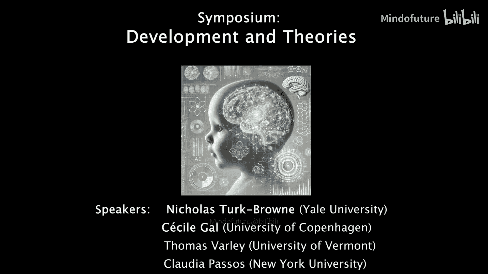
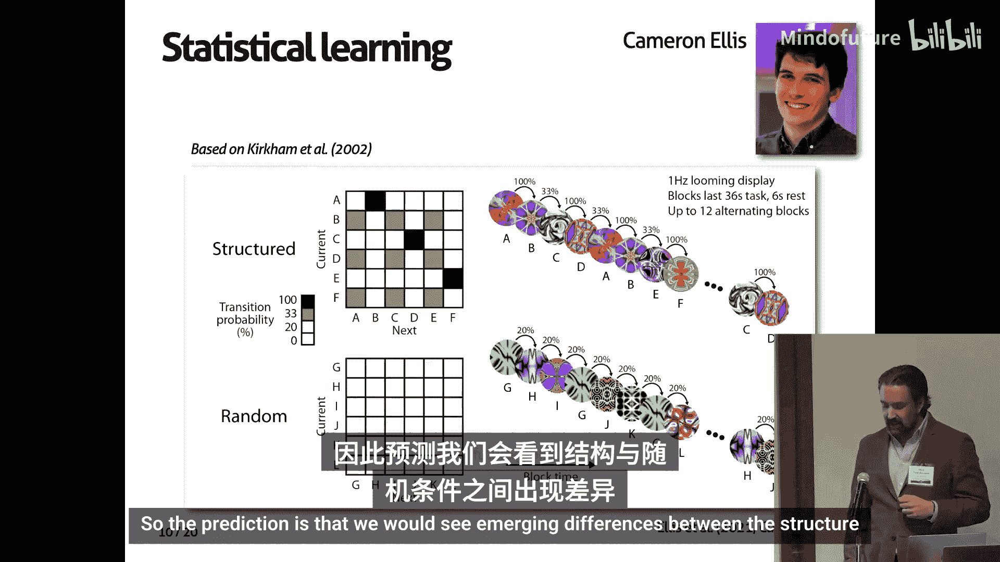
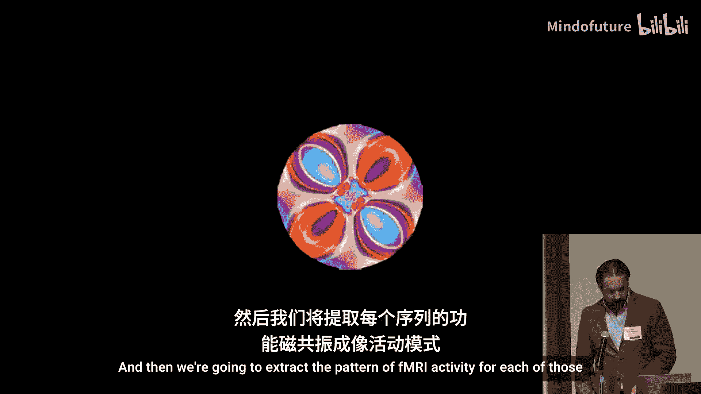
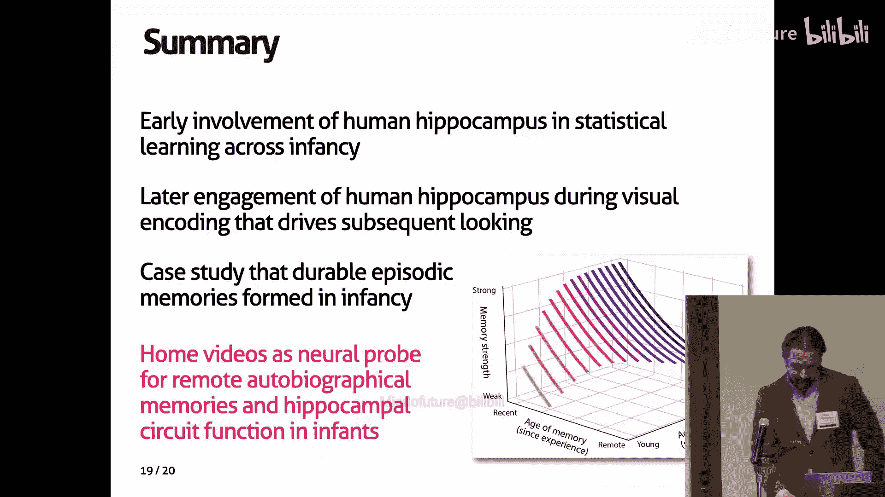
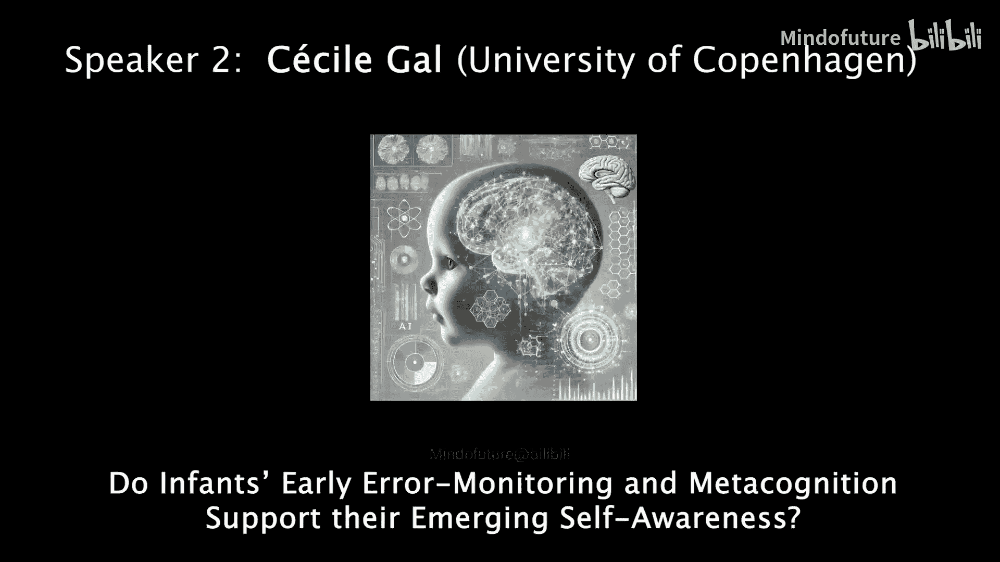
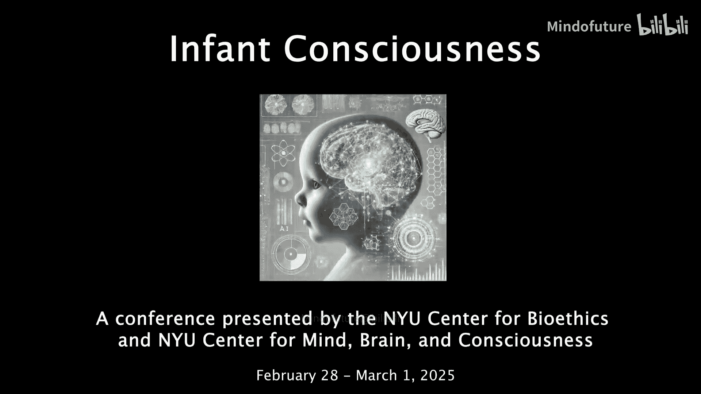

# 【纽约大学】 婴儿意识 ｜ Nyu Infant Consciousness p07 P07_专题研讨4_发育与理论-纽约大学婴儿意识会议_2025 -BV19zZXBUEMv_p7-

Okay， thank you so much for having me in the memory literature the hippocampus is synonymous with conscious declarative episodic memory so for example。

 if you're out a dinner last night you can remember who you were with。

 maybe some of the topics of conversation where you were in the world what time of night it was and most importantly today you can mentally travel back in time to that event and relive it in a way。

嗯。What's especially striking about episodic memory in the context of this conference is that we don't have this kind of memory for infancy later in life。

And so。What I'm going to talk about today is， is a bit of a story that's still being written。

That has kind of changed my thinking about episodic memory and infancy。Typically。

 people treat the lack of episodic memory from infancy as indicating that the hippocampus is immature and unable to support episodic memory function。

 and what I'm going to tell you about is a line of studies that suggest that the hippocampus is engaged in infancy and may be able to support the formation of episodic memories。

Okay， so this story starts with。It sort of a circuitous story， so bear with me。

 but the story starts with the finding across several of our studies and other people's work that the hippocampus supports more than episodic memory。

So for example， we've done a lot of work on statistical learning。

 which is our ability to extract regularities across episodes。So yes。

 you might remember that particular dinner， but also you've learned more general things about restaurants。

 what they look like， the order of operations， you go into a restaurant， they greet you。

 you sit down， you order， you pay， you leave Also spatial regularities is， for example， in New York。

 what neighborhoods tend to have certain kinds of food or certain qualities of food。

This kind of statistical learning we've shown in a series of studies in adults is also dependent on the hippocampus。

Those studies involve， for example， showing that statistical learning activates the hippocampus and FMRI or intracranial EEG。

 that the size of hippocampus and subres of the hippocampus correlates with statistical learning abilities that lesions to the hippocampus disrupt statistical learning。

And so on。Why I'm wrenching statistical learning in the context of infants is that infants are remarkably good statistical learners。

The pioneering work of Jenny Saffron Dick Gaslin， Alyssa Newport， Natasha Kirkcomb， Scott Johnson。

 and many others have demonstrated that even very young infants。

 even newborns are able to extract regularities in the auditory or visual modality。

So we have a bit of a conundrum here， the canonical hippocampal function of episodic memory seems deficient in infants and adults we've shown that the hippocampus supports statistical learning。

And infants are really good statistical learners。So it could be that hippocampus is im mature and that infants learn statistically using other brain systems。

 that's one possibility。But another possibility that was pursued by a former graduate student Anna Shapiro who's now a professor at Uen。

 her theory was that， in fact， the hippocampus supports both of these functions along different pathways。

 and so I'm not going to go through the circuitry of the hippocampus other than to say there are different routes。

Through which information flows through the hippocampus， one of those routes。

 the trisynaptic pathway seems to be supporting our ability to form discrete episodic memories for individual events。

 and another pathway， the monosaptic pathway seems to support our ability to extract patterns across events。

So this was a computational modeling paper using a neural network that's built on the structure of the hippocampus to show these different functions of the hippocampus。

From a developmental perspective， this is quite interesting because in tracing studies in non human primates。

 these two pathways have different developmental trajectories。So if this is in McAques。

 if you were to trace the connections in the hippocampus。

 you see the monosaptic connection being established by juvenile monkey age。

 and you don't see the trisaptic connection emerge until adulthood in Macaques。

So there's a differential developmental trajectory of these two pathways。

 which might help reconcile that initial sort of conundrum that perhaps the hippocampus supports statistical learning。

Before it's able to store durable episodic memories。

And so this licensed us to think about well is the infant hippocampus learning statistically。

 and to do that we developed a series of methods， if you were to study the hippocampus in adults。

 you typically do this with functional magnetic resonance imaging。

 it's a deep brain structure away from the surface that's very hard to image with scalp EG or with near infrared spectroscopy。

嗯。In adults， the methods are very clear， but in infants doing FMRI research is very difficult。

 Hopefully， for some obvious reasons， For example， you can't instruct a baby not to move and one millimeter of motion can really you know screw up FMRI data。

 So that's one example attention span So putting a baby in an experiment typically an adults we get an hour an hour and a half of data and in babies you know we'd be lucky if we get three to five minutes of data So there's also a data quantity issue in addition to a data quality issue And any event I'm not going to go through the long story of the past decade of developing methods for doing awake in fMRI I'll put some links here I'll bring this back up at the end if you want to look at it some of our papers and all of the data that we've collected over the last decade is all the published data is publicly available as well as some software for analyzing it if you're interested。

We've scanned more than 350 infant sessions。And again， this is a dense plot。

 the dark green in each column here refers to the amount of usable functional data that we acquired。

 and so you can see that you know on average about five to10 minutes of usable FMRI data。

 which is not a lot and requires us to be really creative about developing experimental designs that can accommodate so little data。

 if you're interested in learning more about infant neuroscience that Dick Asslin and I wrote a review paper last year reviewing both FphMRI。

 but also other infant friendly methods。Okay， I was tempted to summarize some of our results。

 but I'm not going to， for the sake a time to focus on the question of episodic memory。

 but just to say that this is such a nascent field that we've been working with Rebecca Sax's group。

 who is another leading group doing this kind of work to try to find sort of general properties of doing these sorts of experiments。

 what are perhaps some best practices for making this work well and so we have a preprint out now if you're interested in doing this kind of work。

The earliest work in this line was conducted by a former graduate student Cameron Ellis who's a professor at Stanford now。

 I'm mentioning this because because earlier Tim mentioned it。

 our initial work in this domain was really in addressing questions about perception and attention so Cameron did a study of retinatopic mapping。

 he also just study on the role of frontal parietal control regions in sort of endogenous attentional control and so this is showing a video of the task。

 the eye tracking that we perform so there's a camera in the MRI machine and then the brain images as they stream in。

 so I'm not going to go through this study other'm than to say it' produces a really clear attentional behavior which is looking time to targets is a function of attentional queuing and also engages many of the same frontop parietal brain regions involved in controlling adult attention。

Tstan Yates， who's in the room。Bluushing， I don't know why is his beautiful work。

 who is a former graduate student now a postdoc with Nim Tottenham has also conducted some really exciting studies in the space that may be relevant for thinking about infant consciousness in particular。

 this is a study from a couple years ago in which we presented infants with movies and we used hidden Markov models to try to understand the structure of their experience。

When adults perceive a continuous movie or stream， we don't actually experience it continuously experience it in sort of discrete events and using data- drivenve methods we're able to extract sort of what the event structure of an infant's brain is as they watch a movie so that's sort of verrgging into saying something perhaps that might be informative for understanding the nature of infant experience。

And I'll skip over that for a sake of time okay。Back to the main thread。

 So we had this hypothesis that the hippocampus might support statistical learning sort of earlier in child development than its ability to support episodic memory。

So Cameron did a relatively simple study， this was modeled on work by Natasha Kirkham。

 in which we presented babies with a continuous sequence of fractal patterns。

Embbedded in that sequence were pairs。 So after A， you would always see B next in the sequence after。

 but after B， you could see the first of any of the other pairs。C would always be followed by D。

 E would always be followed by F， but the pairs would be randomly interspersed in the sequence。

 and there's no other cue to the boundaries between the pairs。

 So this is modeled very much on the sort of original saffron style syllable learning task。

So we showed babies sequences that had a pair structure embedded in them。

 and we contrasted the evoked FMI activity with sequences in which there were no regularities。

 so same number of items， same frequency of the items。

 but the transitions between fractals were not predictable。

And so this is a very crude kind of simple FMRI experiment where we're contrasting the overall level of FMRI activity for these two conditions。

 we're also going to look over time。 This is a learning task。

 You don't know what's paired the first time you see this。

 You have to be exposed to the regularities。 So the prediction is that we would see emerging differences between the structure and random condition。

Okay， so this is just to give you a sense of what the task looks like， babies are watching it。

 they're looming to you know keep them engaged， and then we're going to extract the pattern of FMR activity for each of those sequences。

We're interested in the hippocampus and so we manually define a region of interest for the hippocampus based on anatomical scans。

 and we extract the epher activity from this， I'm just showing sort of the highlight result here which is if you compare the activity evoked by structured versus random sequences in the first versus second half of the exposure what you see is an emerging difference where by the second half of exposure。

 there's reliably greater hippocampal activity for the structure than the random blocks。

This time by condition learning effect does not vary over infant age。

You can tell I'm a bad developmentalist because we didn't actually pay much attention to age on on the input。

 We're looking broadly across 3 to 24 months， but we use age as a variable that we try to relate to the effects。

 This is partly a practical necessity。 It's extraordinarily difficult to recruit infants for this kind of research。

 so we take all comers。I'll skip over the rest of this just to say that this study provides evidence of that the hippocampus is involved in statistical learning in infants perhaps as early as three months。

Now we didn't see an age effect on the statistical learning。

 This isn't to say we didn't see an age effect at all。 In fact， if you look at the anatomy。

 there's really dramatic changes over this same age period。

 so this is showing the volume of the hippocampus from you know three or four months up through 24 months So the volume of this brain region is doubling。

 but the learning related interaction did not change with age This is normal this is unnormalized。

 but it's the rate of growth that hip campusamp is faster than the global brain。Okay。

 so this fits with that theory that maybe this circuit develops faster for statistical learning than it does for episodic memory。

But these results got me thinking， well， how good is the evidence that the hippocampus isn't encoding episodic memories in infants。

 Most of the work on infantnessia is sort of retrospective surveys where you ask older children or adults。

 what's your earliest memory and people typically are report 3，4，5 years old。

There is some work in infants using tasks that have some characteristics of episodic memory tasks。

 the classic work by Ro v Colllliier， we mentioned earlier， someone mentioned deferred imitation。

 and so there are some ways of studying memory， but trying to understand whether these are really the kinds of hippocampal encoding that's really critical for autobiographical memory was unclear。

But we now had a way of getting at that using FMRI。

 we could image the hippocampus during an episodic memory task。

 so this is Tristan's work which is going to come out shortly and in this study。

 we basically replicated a design that was developed in the late 90s by Anthony Wagner and others called a subsequent memory design。

 John Gabrielli had a paper like this as well。So this is a study in which you present discrete items one at a time on the screen。

In the adult version of this， you ask people at the end of the experiment which pictures do you remember。

 which pictures do you forget， old new judgments？And then you go back and you recode the FMRI data based on the subsequent behavioral responses。

 so if a person says old to a picture they saw before， that's a remembered trial。

 if thiss a new to a picture they saw before that's a forgotten trial and you can compare activity during encoding。

For images that were later remembered versus forgotten to index what's going on in the brain when you're forming a memory。

We couldn't ask babies they what they remember explicitly like that。

 so we used a preferential looking paradigm， a visual paired comparison in which on the test trials。

 we presented two items from the same category， one that had been seen before， one that was novel。

After single shot exposure to a picture like this， babies tend to look more at familiar things。

 I don't want to make a global statement about that， but in general。

 we expected to get a familiarity preference because they just have the sort of minimal exposure to an image once before。

 So they're not habituated to the picture。 In this case。

 we were predicting that the degree to which they looked at the familiar item would be a measure of the strength of memory that they had for that item。

 And so we're going to code the encoding trials based on subsequent familiarity preference。

This is what a sort of baby doing this task looks like。You know。

 pacifiers are not good for head motion， but a necessity。

 And so you can see this is a test trial and they're looking back and forth。

We manually code the amount of looking left versus right。 This is very crude eye tracking。

Here's a demo of what the task looks like。The crazy psychedelic background is to keep the babies engaged。

 These sort of discrete events are not baby friendly。

Tstan could tell you about our first attempt at this where we did not have a background and the baby fused out very quickly。

And I think a test trial will come up here in a moment。

And so then we're measuring the lateralized looking in that case。Okay， so again， same idea。

 we're going to extract a region of interest from the hippocampus anatomically。

 and we're going to compare hippocampal activity。During encoding of the pictures where they later showed a familiarity preference versus trials where they didn't show a familiarity preference。

And what we see across the whole infant sample is that greater hippocampal activity during encoding predicts later familiar looking。

Interestingly， and I don't have time to go into this too much。

 but that circuit that I talked about the trisynaptic pathway that supports episodic memory is more based in the back of the hippocampus。

 the postior hippocampus and indeed when we break down anterior versus posterior these effects are really driven by the posterior hippocampus now this is within subject analysis we comparing andcoding remembered versus forgotten or familiar versus unfamiliar items within participant。

 if you break it down and look across participants。

 these effects are driven by the babies that show the highest familiarity preference on average。

And so this is breaking a median split on the strength of the familiarity effect。Now。

 whereas in the statistical learning case， we didn't see an age effect here based on some of the data that were talked about before the behavioral studies of memory and infants。

 we hypothesized that there might be a transition around around 12 months in the ability to encode these kinds of memories。

 and indeed， that overall though there was an effect in the overall sample it was driven entirely by babies over 12 months。

You can see 11 out of 13 babies over 12 months showed this effect and there was no effect under under that this is also true in a more continuous type analysis。

Final thing I'll show is that these effects are relatively specific to medial temporal lobes。

 so this is a whole brain analysis， again showing that the greater activity during encoding of subsequently familiar items is really specific to the older infants。

Okay， so those are the main data I wanted to show where we're going from this is to say， well。

 item recognition is a kind of episodic memory， but if if you think about episodic memory more generally。

 it has much other many others are richer components so。For example。

 it's not just about encoding discrete items but also about the relationships between items who when where what you know from dinner last night。

 and so a current student Lily Bem has been running studies inspired by work in adults by Traron Ragenath and Debbie Hannila and some work by Jenny Richmond and Chuck Nelson and infants。

 a relational memory task where you see a scene a face appears on top and then at test。

 the scene appears again at two faces。And the extent to which the babies look more at the face that was previously paired with the scene indicates that they formed an association between the face and the scene and we're looking at what happens in thecamp during en codingding of pairs where you later show this associative memory she's also interested in looking at spatial temporal relationships So in this case you learn a sequence of these sort of fun cartoony characters that appear at different locations and we can test memory for by looking at predictive looking so if you remember a sequence and you see1。

2，3， do you look to the expected location of the upcoming item。Okay。

 the final thing I'll say and this is very much still ongoing。

 we just finished a longitudinal study to try to look at episodic memory and infancy over the kinds of time skills that were usually thinking about in the context of infanttnesia thinking back as an adult to being a baby over the span of months or years we've collected a longitudinal data set where we followed seven families that we had them record home videos across infancy and we scanned the babies every three months to sort of track how their hippocampus responds to videos that were recorded from their own experience versus from another baby's experience。

 sadly I don't have any data to show you yet on that。

 but what I will show you is that we ran a pilot study which is there's a great data set called saycam Mike Frank and others collected in which they put a headmounted camera on three infants and track them for years。

This is an example of the kind of video that was recorded。Are you ready？

Let's put the stick at the bottom because we can hurt ourselves。

IfWe carry it while we're doing the slide。哦。うわい。😊，We made it。 We made it。H嘅。Yeah。

 what do you want are you want this stick。不是。So these videos were collected by somebody else。

 but we brought two of the three families to New Haven and we scanned the kids when they were older。

But we had their experiences from one they babies， the videos were collected sequentially。

 so the latest kid who did this was three years old when we scanned them。

 the first kid was nine years old。And so the sort of pseudo， you know， case studies。

 pseudo longitudinal thing where we can compare a three year old's response to watching their own versus other experiences and a nine year olds。

Response watching their own versus other infant experiences and just to jump to the key result。

 only the three year olds hippocampus distinguished self versus other not the nine year olds so this indicates that not only are infant experiences encoded as we had shown before but also that they might persist into early childhood and what we're working on now is trying to figure out why do they become inaccessible and I have ideas about that I'm happy answer and the question period and i'll just leave up the summary and take any questions but thank you to everybody。

M that item recognition was an example of episodic memory。

 couldn't it just be familiarity without knowing why something looks familiar Yeah。

 so in the episodic memory literature， there's a under the umbrella of episodic memory people distinguished between familiarity and recollection as two forms of remembering。

 And so we do think that it is familiarity with the stimulus that's driving looking。

 but even in that case， it's one shot andcod。 So you've seen this picture just one time before。

 And so it's not like a priming type of familiarity where it's this longter habituation or where you're seeing something back to back here there's many intervening items and there's a lag between the initial presentation the repetition。

 So we think this kind of familiarity is more hippocamply dependent。But， but yeah。

 we want to look more broadly at things like recollection， you know。

 can they take a partial cue and sort of fill in missing details yeah。对。Yeah。

 so just building off of that point。 it it， it's not， I'm not sure how you'd be able to。

So like my understanding of episodic memory is， like you're saying recollection。

 this memory of being there of having a sense that you saw this before。 And so with the faces， yeah。

 it might just be a matter of familiarity and so you reply to that。

 But then I'm curious about this other study that you had to like go over to see if this might help with the potential episodic memory of babies and you were talking about the films。

 and you were talking about how we see that adult brains watch films through events。

 but then you didn't describe whether or not what the research showed about babies watching the films。

 if they're seeing just a constant stream or through events。

 So I was wondering if you could talk about So we haven't linked that study to memory。

 but I can tell you the result of that study was that infants do show systematic structured events while watching movies。

 they don't perceive it continuously or their brain regions don't， but they have fewer events。

 they actually have longer timescales of processing in most brain regions than adults。

 adults carve up。The movie into more events than the infants do。

 And it's not just that the infants have a blurriier or noisier representation。

 We think they have a sort of a clear representation。

 but the window of integration over which the brain activity is stable is longer。

How this relates to memory is a really interesting question。This was our Tristan study。

 not my study I was I was an author， but she was the one I did it yeah。Yes， thank you。

 I'm following up on on that lovely study。 you So the study you ran with this slide。 Yeah I mean。

 there are old data showing that eventually you remember yourself from the outside Yes。

 you don't remember your father's feet egocent it was a father but even on the earlier study where you had the faces embedded in the scene Yes I wonder what would happen if those were little vignette。

 Yes， I love the question， yeah， what you're referring to is that you know over time memories get somewhat deconttextualized and you represent them maybe moreocentrically or even ultracentrically from somebody else's perspective we don't know here how like the frame of reference changes what I showed is that the three year old's brain does respond more to watching their own perspective than watching a video with similar content that was recorded from another baby。

 but what we couldn't do because the videos had already been collected as manipulate sort of。

What perspective they're viewing their own event from。

 but that would be a really interesting study and the hippocampus in the domain of spatial navigation is really important for forming allisecentric representations of the environment and so linking those functions would be really cool but is's the second question about giving them vignettes where the people and the scenes makes sense Yeah yeah so you mean actually how would you give it to a baby of vignette you show them a movie of short vignette someone taking something moving interacting and then change the way that would involve presumablying theircampus integrating those different aspects we haven't done that it's a great idea yeah thank you。

I have a quick question。So so a dominant theory of infantile amnesia is that the categories in terms of which you see the world change with development and thats。

The way that the child encoded the environments a version of the barbar step but you said you have somebody idea as well yeah yeah thank you for the prompt there's some of my favorite research in this domain has come from rodents there's a couple of really elegant mouse studies where you have a baby mouse learned something。

Could be fear conditioning， but also be a spatial learning type task and then if you let them grow up you know 20 weeks later and you put them back in that same context they don't freeze。

 they don't have the fear memory they don't go back to the reward location so it's a model of infantnessia that people have used but the more recent papers what they've done is use optogenetics to stimulate cells and theypocampus during the baby learning experience so they're tagging some neurons as being part of the memory。

And then in adulthood， you put the mice back in the familiar context。

 They don't show the learned behavior。 But if you stimulate the hippocampal engram。

 then they express the behavior。 They freeze or they go back to the ro location。

Which says that the hippocampal memory is there。But just being in the environment。

 the sensory cues of the environment aren't sufficient to reactivate it。

 And I think what you're getting at is the reason why it's not that the hippocampus is immature in infancy。

 It's that the cortical sort of mantle through which our experiences are represented that provide the input to the hippocampus are changing dramatically。

 And I think this subsumes various theories related to language related to categories。

 So what we're working on now is developing ideas about how to measure that。

 There might be some cortical domains that are fairly you know， early developing or consistent。

 where you might actually be able to get back to the hippocampal memory。

 maybe ol faction or maybe face perception。 There are other domains like language or orthography or categorization or changes dramatically。

 So you can look at the similarity of encoding retrieval kind of representations to try to predict whether you can get back to an early experience。

 But that's the ongoing idea。Fascinating findings。I was wondering if you had further thoughts you mentioned navigation it's like I've done some more with roboticis where they use the hippocampus system basically to inspire architectures for slam problem or simultaneous localization and mapping and there are models of for instance of much of high level cognition including like ways of like dealing with counterfactualism referencing some of like Hasabs's old work and in terms of like generalized navigation and I was always wondering like what you thought of that framing is it like competing。

 compatible as one more thing is if you have thoughts potentially like human uniqueness of the hippocampus like there's old debates about like the hippocampus Min or kind of discarded。

 but then more recent things about like maybe there's there's less pattern separation in the human hippocampus and ways in which that might like in ways human cognition might be distinct Yeah I know I think it's the latter questions quite interesting my current view on that is that maybe it's not so unique。

Not as unique as sometimes people think we find pattern separation in adults and other things。

 I think what's perhaps unique to humans is the capacity of our memory。

 the fact that it's not always spatial you know there's some sort of species specific things in other animals that don't necessarily apply to humans but the basic circuitry and some of the basic computational principles are somewhat conserved with respect to the first question I think it's really interesting idea you know to think about to the extent the hippocampal system is available in infancy。

 what other aspects of cognition is it supporting it's been implicated and many other aspects of cognition and those haven't been considered so much in the infant cognition。

 that hasn't been the motivation for thinking about those functions in infants。

 but that could be a quite interesting sort of framework you know there's a lot of work。

 for example showing the hippocampus contributes to value-based decision- making to attention。

 memory- guided attention and so on and so thinking about some of the canonical infant cognition work by excuse。

Many other people through the lens of hippocampal memory and hippocampal systems could be really interesting。

Yeah， so I was wondering what would be the relation between those experiences that are encoded and consciousness I you assuming avoid that question I you assuming that they are that it requires consciousness to encode experiences or。

Are you authority to experience or with conscious experience or we might have cases where were encoding those representations without conscious。

 Yeah， so， you know， I was really inspired by Tim's talk earlier。 and， you know。

 I think to some memory researchers。Hippocampal memory or memory of one shot experiences like what we showed could be thought of as a marker of something that tends to be conscious in adults from a memory researcher perspective。

 I've never put as much weight on consciousness is sort of the defining characteristic of episodic memory or hippocampal process folks like Larry Squire and others have really made that the centerpiece of what the hippocampus does。

 I have less of a stake in that， I think most episodic memories are formed incidentally we're not sitting there at the dinner saying I really need to remember this but the actual sort of process of remembering is often a very a very conscious experience the sort of psty and like you know zooming back to the past。

 and so understanding in the nature of that process is sort of recollection。

 the reinstatement recall， I think that that would maybe speak to this more specifically。

 but we haven't done those kinds of experiments yet。One last question。

 Dave it just point you mentioned John Gabrieli and I remember back in the 1990s used to give talks with titles like consciousnessness as the gateway to memory and attention as the gateway to memory kind of implying that without consciousness you don't get the kind of serious encoding and memory。

 I'm just wondering what is this the status of that hypothesis 30 years on。Okay， well， I mean。

 I think attention certainly。For the reasons of your time about before modulates cortical representations in a way that influences what gets input to the hippocampus。

 so there is a tensional modulation of both item and relational memory for sure。

 whether you are whether you need to be conscious how we define that I'm not sure in order to encode a memory is an interesting idea I don't think it needs to be intentional that doesn't have to be your goal to encode but it is the sensory experience that is what is being stored in memory。

It'd be interesting to try to decouple that。 Yeah， I don't know。Great， thank you very much。😊。

Okay， so。😊，So I will tell you today about some work that's part of a longitudinal study that。

Has been conducted in Copenhagen， which is led by Kaina Beguche。

 and in this study we were actually not primarily interested in consciousness or metacognition。

 but rather in curiosity in the sense of information seeking。

 so maybe rather this type of inner drive that we heard a little bit about yesterday。😊，But obviously。

 information seeking has a lot to do as well with metcognition。

 which we can define as the ability to evaluate one's own informational states and the efficiency of one's own learning in order to regulate subsequent cognitive activities and behaviors。

😊，So infants historically have been denied that capacity because it's been thought to require some maybe conceptual or self reflective capacities that nonver populations such as infants or animals are thought not to be able to use。

😊，But we have some evidence that there might actually be some at least rudimentary form of metacognition in infants。

 And so you've heard about the results from Louis Gope and Sidquier's study yesterday。

 so they've shown that infants。Are able to ask for help and to persist in their decisions in a way that is consistent with them tracking their own states of uncertainty。

They've also shown that infants have a neural signature of internal monitoring of their own errors。

 so that's the error related negativity or the ErN。

 which is a negative deflection that appears in front of central electrodes after ones made an incorrect as opposed to a correct decision。

😊，And so very briefly you've heard about this yesterday。

 and their paradigm what they're doing with these infants is that they're queuing a side of the screen with a face that's briefly presented and then the infants can make a to the cute side to then see the appearance of a reward on the same side so they have to actively make a a pscade themselves in order to make a decision in that task。

 but they're still subjected to the sequence of the task itself so they're not controlling that。😊。

And in our experiment， what we wanted to do is to try and replicate these findings。

 but also look at some further questions that remain unanswered。

 such as whether these rudimentary midacogni capacities are in fact utilized by the infants and whether it might guide the behavior in context of free information search and learning。

So while both metcognitive monitoring and metacognitive control could work in a non-reflective level to develop a more explicit and a more reflective form of metacognition。

 probably this is quite tightly linked also with the development of self-a and so that's also something that we wanted to look at and to kind of look at the potential link between these different abilities。

And by studying infants， we have the unique opportunity actually to investigate the developmental changes in possibly the only population that goes from non-verbal。

 pre verbalbal and preconceptual metcognitive capacities to more reflective abilities later on。😊。

So here by following the same babies over time， we can actually capture these developmental changes and then look at whether the early metter cognitiveognitive capacities might contribute to the emergence of self awareness。

Great， so how we approach this is through a longitudinal project。

 so we've been following 124 infants that we've seen at 12。

18 and 24 months we've just finished the data collection for this in January。

 so we have not looked at all the data that we have collected and so today I'll focus on the data from the 12 months olds mainly but I'll bring in some components with the 18 months old。

😊，And so what we do at 12 months。😊，Is that we use a gaze responsive paradigm with eye tracking and concurrent E G recordings。

And then at 18 months， the same infants come back and we do a mirror test with them to test their self recognition。

 So probably， you know how this works。 But very briefly。

 what happens is you put a mark on the infant's nose without them being aware of that。

 And then you put them in front of a mirror。And you try and see if by seeing themselves in the mirror。

 they make the mapping between what they see in the mirror and their own bodydy and rich directly for the nose when they see this unexpected mark。

 which gives us evidence that then they have this sense of self。So。

18 months is conveniently the age when about 50% of Western babies are passing a tests so we can try and compare those that do to those that don't and then link all of this back with what happens at 12 months。

Great， so in practice， how we do this is that we use a match to sample task at 12 months。

 So the infants are taught that finding a matching card is rewarding。😊。

And we use gaze contingency for this so that we can look at free and active information sampling because the infants are controlling what's in the screen themselves。

So this is what it looks like。 It's loosely based on the game memory。

 so they have to make pairs of identical objects， but here we only have three cards and first they see two of the cards that are visible with objects depict depicted on them and then a top card that is face down。

😊，And they can visually explore those two bottom cards for up to 20 seconds。

And the moment they look at the top card， then this card will highlight and then if they keep looking。

 it will flip and that will flip the entire set of cards so that the same object as either one of the two cards they saw before is now depicted on the top card。

😊，And at this point， they can look back at either of the bottom options to try and make a pair。

So if they look at a card it will highlight and then eventually flip if that was the match。

 then they also get a rewards， if they do not find a match。

 then the cards are just silently fading away so we don't do some negative reinforcement here。😊。

So this is what it looks like for an actual infant。 So this is the infant gaze as a green dot。

 which hopefully you can follow。😊，And so theyre first just triggering the start of the trial。

And then they're in the exploration phase now so they can look at the cards freely。

 They just looked away whenever they look back。 they're back now。 now they're in the decision phase。

And they picked an option。That was the correct option。 Yeah， okay， you， okay， so they get overs。

And so here they found the match and made a correct decision。

So another feature of our design is that we're using an adaptive difficulty throughout。

So we can make the match more or less difficult to make to find by making the images more or less similar that we present them with so they can have very different images like an elephant and a strawberry。

 but then in a harder level of difficulty， they could have items from the same category。

 which here is vehicles。Next level， they would get the same subcategory。

 which is here cats within the animal category。And then in the hardest level。

 they're even of the same color， which really makes it quite challenging for them to find a match。

And they don't go through these levels randomly， they actually go through them in a way that depends on their performance。

 so they start off at the easiest level here you can see correct trials in green。

 incorrect trials in red， and so as soon as they make two correct answers in a row。

 then they move up difficulty level。And again and again。

 until they make two incorrect answers in a row and then I move them back down。

So that ensures that we can have a good proportion of both correct and incorrect trials and then try and compare them in our analysis。

Great， so we have a set of hypotheses of what we think might happen in this context。

 We're interested in metaognitive monitoring。 and if infants indeed have this capacity。

 we think that they should be able to detect when they're making an error and that this should be reflected in their brain activity so we can look both at this internal monitoring window right after an immediate decision。

 which is the E N window， but we can also look at the feedback window and look at the FN signal。😊，嗯。

To look at metacognitive control， we use eye tracking and we think that if infants are able to use some sort of metacognitive control。

 they should be able to adapt their gaze behavior with respect to their prior mistakes。

And then the last thing we look at is the emerge of the emergence of self awareness in relationship with these abilities。

 and we think that the early metacognitive monitoring and control abilities might link with the later emergence of self awareness。

Great， so we'll start with the results in terms of metaacognitive monitoring。😊。

And so the question here is do infants detect their own errors。

 We look at their EG activity to look at this， and we've based our analysis on the study from Reese and SiID。

 So we're using the same set of electrodes that they used。

 There's 58 infants out of the 124 that were tested that are included in this analysis and they have to have at least six trials per condition to be included。

So here we're looking at the kind of decision phase of the trial when they have explored the bottom two images here。

 they flipped the top card and then they have to make a decision。

 so we aligned the signal with the moment that their gaze enters one of the two cards before it highlights or flips just when they make the acade。

We baseline with a previous window and then we can look at the correct answers in blue and the incorrect in red。

And so if we do a time series analysis of these two signals。

 we find two significant windows when the correct and incorrect brain activity differs in these kids。

And that's a little bit different， but I think still quite easily con with the results from Louise and Siid。

So in their study， they looked at a later window which aligns quite well with the one that we find。

 but did not look at an earlier time if we look at the shape of the Orendo。

 I think they might have an earlier peak similar to the one we find and actually initially they found a really long time window in their time series analysis that was composed that included both our early and or later peak。

And then they focused on the peak that was the most negative。

 So I think even though there's a few differences here。

 probably were kind of quite green quite well in what we find in in these infants。

 these responses are also in areas that are well centered on the electrodes that they found。

So all in all， I think we replicate this funding pretty well。Then we can also look。

At the time of the feedback， so the infants have highlighted the card and now it's flipped so they get a visual feedback on whether they were correct or not and here again we find significant window when those to brain responses significantly differ。

 which happens in the same areas than the ErN signal which again goes well with the literature on the topic。

😊，Great， so I think with these results， we're validating offers hypothesises that infants at 12 months probably have some form of met cognitivetive monitoring of their own errors。

So we can look now at the metaacognitive control part。

 and so here the question is do infants adapt their behavior following an error？And for this。

 we look at trial T in which they've just picked made a choice and that choice could be either correct or incorrect。

 so we just track， we just keep notes of the accuracy of that decision and then we look at the next trial and what kind of behavior they have in there and we try and see if there might be a difference between the trials when they've just made a mistake and the trials when they've just been successful。

Here we're actually discard all the trials when there's a difference in difficulty between trial t and trial2 plus one so that we don't introduce a sort of confound in how difficult it is。

😊，Great， so we can start by looking at the exploration phase actually when they just visually look at the cards they're presented with。

😊，And here we have several measures of how they're exploring。

 so just the time that it takes them until they trigger the next phase。

 the number of fixations that they make and the number of switches that they make between the two visible cards and whatever measure we look at here。

 we do not seem to find significant evidence that they are adapting their exploration to their previous mistakes or successes。

But we can also look at the next phase， which is when they have to make their decision and then here we can again look at how much time it takes them to make their decision and there does seem to be a difference between whether they were just correct or incorrect in a sense that they take longer after making a mistake we also look at the proportion of trials when they just do not want to make a decision so after 10 seconds without looking at either of the bottom cards。

 the trials just automatically stop and here there does not seem to be a significant difference in how they do that depending on whether they were just correct or incorrect but they do take longer to make their decisions after a mistake。

Which I think is a way to verify also our second hypothesis that they have some form of meta cognitiveognitive control in this setup。

So we can look now at the last part of our question。

 so the relationship between these metacognitive abilities and self。

 and so we can start with the monitoring part and so go back to the brain activity of the infants both in the EN and in the FON window。

😊，And。Look at the scores in the mirror test that they had six months later and then go back to their brain activity and see if there is anything different going on six months earlier。

嗯。So if we look at these two EN and FN signals for the windows that we identified earlier。

 we see that in the group that does recognize themselves at 18 months。

 there is a significant difference between the correct and incorrect brain responses。

 both in the EN and the FN part of the signal。But for the group that does not recognize themselves。

 there is no evidence that the correct and incorrect signals are different in the Er end window。

 there might be something in the feedback window。Important。

 those are kids that do not show any difference in their general development that we looked at through a questionnaire that the parents filled in。

 so it seems like it's much more of a specific type of ability that we're looking at here。

 which is more related to error monitoring and self than just fast development and performance。

Overall。Great， so now we can look at the relationship between the development of self and the meta cognitive control。

😊，And again， we split the infants based on their 18 months score in the mirror tests。

 and then we look at their behavioral adaptation to their errors in the exploration phase quest。

So again， we have different measures here and pretty much for all of our measures。

 what we see is that there is a significant difference in the difference between prior correct and prior incorrects between the two groups in the direction of the recognisers taking longer to explore。

😊，After a mistake。If we look now at the decision phase。嗯。

We do not see a difference between the two groups， either in terms of how long they take to answer or in terms of how much they opt out and just skip the decision between the two groups。

 which I think is interesting because the first variable。

 how much time they took to decide is the one that we found in the whole group initially。

 So it seems that this one is not specific to the kind of mirror label of the infants。

 but more the maybe more instrumental phase of the exploration that comes before the decision。

Great thisiss from before。 So now hopefully with these results。

 we can agree that we have verified some sort of link indeed。

 between the emergence of self awareness and earlier meta cognitiveognitive abilities both in terms of monitoringing and control。

😊，And so to summarize a little bit what I've shown you with all these results。

What we found is that there is some evidence for meta cognitive monitoring in 12 months old。

That we see in their urine activity， there's also evidence of medical cognitive control。

 They seem to adapt their decision making following a mistake。

And then the link with the emergence of self awareness also seems to be present so infants that show evidence of self awareness。

 self recognition at 18 months also show evidence of internal metacognitive monitoring and control at 12 months。

 and we did not see the same relationship in the infants that did not recognize themselves at 18 months。

Great， so to conclude already at 12 months， it seems that infants do demonstrate rudimentary forms of metacognition。

 both in terms of detecting their own errors， so metcognitive monitoring。

 but also in terms of adjusting their behavior， so metacognitive control in a free infant led paradigm。

So the other thing we find is that early met cognitiveogni capacities seem to be related to the emergence of self awareness and so that raises the idea that maybe these functions develop in concert that's an idea that has been proposed by other people before you can ask me about this if you want but yeah there might be quite a tight in between these two。

😊，So thank you so much for listening to me， I would like to thank my PI Kaarina Begosh our technical team army of students that haven't been helping us and obviously all the families that joined the study。

😊。

Bs。So this is very interesting。For some of the box plots that you showed with significant differences。

 just eyeballing it from my seat， It looks like the results are being driven by a subset of infants。

 There are a lot of bars that are just flat。 And then you've got a few that jump way up。

 Is there some way that you could。Tse those apart is there a special super performing group of babies that is extra sparkly or something？

Yeah， you're entirely right。 I think there's a lot of variability in there。

 but both in the infants and in the trials， so we're also trying to maybe keep more of the data of what happens throughout the experiment to maybe try and look at more kind of fine grain differences from one trial to the next for example。

 depending on the value from before and things like that。

 it's a bit difficult because we're quite exploratory here so we have a lot of variables those are not corrected that EG is corrected for multiple comparisons but those are not because we're still trying to figure out exactly how to include all of these different things we want to look at we're also actually interested in how infants adapt to perhaps errors that they anticipate so to the difficulty of the trial to how error prone the trial might be and they also seem to adapt to the difficulty level but then if we include all of this together。

 it's a little bit too many things at the same time so we're actually in touch with。

Statistician to try and find a good way to look at all of that together。

 So this is still kind of working progress。 yeah， this is very nice first of all。

 glad that you can actually replicate quite well this early study and you have two questions。

 So the first one was about the first component and what do you make of it I mean it looks very similar to the earlier studies but my my most important questions sorry I is like。

😊，What， what。Why would we expect actually such a strong correlation between something which is about bodily awareness and something which is about basically like decision making of course those are two internal mechanisms they're boling too roughly to self-aware those are still very。

 very different components but it's really nice that you find this difference but I'm just like still trying to understand whether there's a model mechanism which is driving both of them or whether they just like it's just like they're just correlated because they maturate at the same time yeah maybe I'll start with that one。

 so there's actually some work in their curiosity literature that has this idea that they might be related there's been no evidence for that it was just a bit of a blue sky idea but so that's work from Pi and Fred Kaplan。

And the proposal that they have is that when infants are starting off。

 they maybe don't have this sense of self as we adults have it。

 so they receive tons of inputs from internal input。

 external input and that's just more less information to learn from without distinction really possibly while they try and predict what happens and make sense of all that information this information that is actually coming from themselves might be slightly easier to predict or at least cluster together with different inputs。

 and so they might be this sort of fuzzy concept of self that emerges from the necessity to make sense of all that information and so that's how then those early abilities might be linked and then as they complexify maybe the link also becomes less important。

😊，Hopefully that answers your question。And then in terms of the year peaks so I think the early peak is quite in line with the timings that they find in adults。

 it's a bit later but that's what you would expect in infants it's the same type of topography so I think probably that is quite similar to what they describe when they look at the year in adults and then they have a later peak around 400 which actually is positive we have a later peak at the same time which first of all probably isn in the same thing in infants which is negative now I am really not sure what that would mean in your study actually I don't think I think I've cut it but yeah you find this later peak even later because of 500 meiseconds we have the feedback we do not have a chance to look at that but I'm not exactly sure what would happen because there's a big time lag and those are much more integrated。

Processes so I don't know， I think they might be quite similar the early and the late peak。

 but I wouldn't know what's the。Distinction I'm a little bit confused about exactly what happened to here and what I'm wondering so you have when the card was fixated。

 but when is the item revealed is it right then No so this is internal monitoring so they it isn't revealed at all It is revealed afterwards so I didn't give you the timings but basically so when they look at the top card first it highlights after 200 milliseconds of looking at the card and then for an extra 300 milliseconds of still looking at the card then it flips we allow for the infants to look away a little bit in that time so there's a tiny variability in how much time it actually takes from the fixation to the flip which is why we entirely realigned the Fn signals to the actual flip of the card but more or less it's 500 milliseconds between the could you go back to the previous one on before。

So I see so that's long after the graph you're showing here so is what they're okay so i'm just wondering what the form of the metacognitive awareness is taking in the kid's mind is it there is a so look at the upper left there's a bicycle and I have an image of a bicycle there but I'm being told that that's wrong is I mean what's what is the error but they're not they haven't got there it's just visual feedback so there's still evaluating based on the fact that these two images are the same or not whether they think it's correct there's no reward or anything is this like a matching failure to match。

But what is the failure to match between so I mean so when when maybe that will slight like going from an under angle。

 maybe that will feed into your question， we've had some worries for example about the extra hard trials in whether they will even understand what was an error or something because the images are so similar by then so maybe these have to be treated slightly differently but if you have an elephant and the strawberry here I think for 12 months old infant it's quite evident that they're not matching and they've been taught there's a whole feminization phase that goes before that teaches them that they can flip cards with their eyes and that they should match them in the feminization they actually get two chances to match the card and all the cards are revealed once they pick an option so they're given a little bit more we're taking them a bit more by the hand to try and teach them what's happening there's no guidelines it's so implicit but we think that they understand what they're trying。

To do push some of them at least okay， so then in that case。

 maybe it's a internal sign of uncertainty。Yeah， I do not argue necessarilyally that this is not related to uncertainty I think correct and correct is a very kind of experimental binary setup that probably has more to do with uncertainty。

 but you know the term metacognitive moderate suggests that there is another state。😊。

That is trained on the first order state and that is saying something like mistake truth。

 but I'm beginning to wonder what the rationale for that is， maybe I mean。

 suppose it's just a sign of this is but it could be that。

 or it could be a reflection of your own uncertainty you can't really decide between the two're。

olI just want to add something about this very quickly， I think one point that makes it。😊。

Important whether it's uncertainty or not is that there's also the metaacognitive control part so it does have an effect on behavior。

 whether they've made a mistake or not， so we can discuss whether that's really metacognition or not。

 but I think because it affects behavior there's I would call it at least a rudimentary form of that and then the other thing you can look at which is a bit more just eyeballing and quantitative but if we compare the recognizes and non-recognizs there's some quite interesting levels of activity here so in the recognizes the correct answers are really at zero I mean this is obviously baseline but it doesn't really changed from the baseline the incorrect is quite negative but in the non-reogni the group of non-recognizs the correct and incorrect are at the same level in the negative side of the signal so it might be that they they don't know whether it's correct or incorrect they know that they don't really know that which is then I would call that uncertainty I'm not sure。

I really won't want to make a distinction that strong between correct and correct and uncertainty。

All right so i'm coming to you guys from the University of Vermont and the complexplex system Center and I want to preface this by saying there is a sort of minimal amount of mathematics that I had to include in this I've tried to make it as painless as possible。

 but you are welcome to ask questions if you're not following along this was also a collaboration between。

My people and the people in Finland and the people in Finland were the baby people。

 so i'm happy to answer lots of questions about mathematics。

 I have less capacity to answer questions about baby development because they're on the other side of the Atlantic Ocean。

😊，So we have been talking a lot over the last two days about consciousness as this sort of thorny philosophical problem and as I was making these slides。

 I was thinking you know why just stop at one thorny philosophical problem when you can have two for twice the price so I want to talk to you guys about emergence which is another one of these。

Pennial sort of bug bearars and hopefully it is not controversial to say that consciousness appears to be an emergent property of brain activity I realize that there are some philosophers who may disagree hold your tomatoes until the end and I'm just going to ask that you give me this one for the purposes of like the rest of the talk making sense and I think the good evidence that consciousness is an emergent property is that we can perturb it you know you can give somebody LSD you can give them propol you can hit them on the head with a baseball bat and by changing the structure of connections between the brain and the dynamics of neurogene neuro communication the quality of consciousness changes so there is some sense in which you know what we experience phenomenologically is a function of the collective guestal state of the brain。

And so I would propose and again please just give this to me for the time being that if we could create a formal algebra that could quantify the degree to which a system is capable of displaying any kind of emergence we could then kind of backdoor our way into a measure of whether that system might be able to support consciousness specifically assuming that consciousness is just a specific kind of this more general property of the general phenomena of emergent properties okay and so this comes from a sort of a longer lineage of work attempting to find quantitative measures for consciousness people talk about a thermometer for consciousness I don't like that I like this term a lithiummeter and 10 points to whoever knows what the root root for that is and actually some of this。

And so， you know， there's been a lot of work， you know， looking at things like leel zip complexity。

 fractplformemention， sample entroies， tons of entroies。

 and Lona talked a little bit about some of this yesterday with her work。😊。

I find a lot of these measures of complexity quite unsatisfying。

 typically because if they are entropy-based， they will be maximized in the case of random noise。

 you know and it seems very odd to me that if you were to take a brain and put it in a blender that you know your brain smoothie would yeah technically be more complex than a brain but it's probably not any more conscious than the brain is and so it would be nice to have a measure that really captures this idea of emergence。

 you know that there is something happening in the whole that is not trivially reducible to its parts and so now we are going to have to do a quick foray into the wonderful world of multivariate information theory which is this formal logic for describing how parts of a system will disclose information about each other and the whole system of which they are a part。

And there are two particular sort of flavors of interaction that I want to highlight here okay the first is redundancy and this is sort of associated with synchrony。

 this is information that you could learn about anything that you could get by observing X by itself or y by itself or Z by itself right if you think about a synchronized time series if you observe any one of them alone。

 you automatically know the states of all the other ones because they are synchronized。In contrast。

 synergy is information that can only be learned when you're observing X and y and z all simultaneously and crucially from no simple or combination of sources okay and so I don't have a pointer up here but redundancy and synergy are kind of duels of each other they are related by this very elegant lattice structure the lattice is not important。

 but I think it's cool and I'm happy to talk more about where it comes from and why it has this very particular shape afterwards so we have sort of the ideas of redundancy and synergy。

 but what we still need is a summary statistic that we can actually compute given real data you know we're still right now in the land of sort of formal idealism which is where I like to live and so to compute this our summary statistics can be a measure called the O information O for organizational information and can you guys see my。

Csor okay， so the O information is a function that takes in what we will just call a system this is technically a probability distribution。

 but we'll just call it a system because the distribution is a model and if the O information of the system is positive then this system is dominated by redundancy okay it is more synchronized than it is emergent。

In contrast， if the O information is negative I my cursor。

 then the system is synergy dominated and all I will say about the formal notation is you know is to say that you this measure t os this measure Tc。

 the total correlation， you can think of it as how much information is there in the whole system So you take this number。

 you multiply it by by n minus two times。 and then what we're going do is you're going to subtract off the total correlation of all of the leave one out marginal。

 So x to the negative I is the system every element excluding the I element。

 So if this term is greater than this term， then there is some information that is in the hole that persists even after you pull out all of the parts and then you slap a negative sign on there for sort of weird historical reasons that I won't go into that this is our summary statistic and are we all kind of hanging on for dear life here。

Okay so you've made it through the math and so the question you know coming down from the 10000 foot view to the 5000 foot view is how does the distribution of emergent higher order synergistic information as indexed by the O information changed over the course of infant development okay we have this measure we have some data we had with measure we have a questions and so now we need some data and specifically we needed babies and know we went looking for babies and we found them at Columbia University and so we had about 300 infants and they were this was data collected as part of a project on neonatal intensive care and so the data was collected from the infants between 33 to 45 weeks postconception 124 electrodes that we then source modeled into 57 cortical parcels and we only use data that was collected during the quiet sleep state basically just because that made it easier to get long onaracted。

Time series because the O information is fairly data intensive and then what's really cool is we also had a cognitive testing done about two years later using something called a Bailey score and I could not tell you anything about Bailey scores beyond that they measure something like infant IQ or toddler IQ and so the hope is that we can learn something about how the structure of the information architecture and infancy inform on the future cognitive performance of the children later on in development。

Some of the infants were also involved in a clinical trial called the family nurtureture intervention and so this was a test to see how enhanced mother infant interaction could facilitate positive outcomes for babies that were in neonatal intensive care and so the babies that were in the FNI intervention they got an extra six hours of time with the mother skin to skin contact calling sessions supervised by a family nurture intervention experts and all of this was sort of designed to help facilitate autonomic co-regulation in infants that are in a very stressful situation and so we had 60 babies that were just getting regular NICU care and then another 74 babies that were getting this extra family nurture intervention so we're trying to connect the information architecture of the brain with cognitive development and then the social emotional bonding with the mother as a sort of a triangle。

Okay。All right， the last piece of conceptual machinery that we need is something called a simulated andneling algorithm and the simulated anneling algorithm is an optimization algorithm that is designed to find the best set of cortical brain regions that has the most negative o information we can call the most synergy and we did this because we wanted to see how this changed over the course of scales we didn't just want to look at the whole brain we wanted to look at you know the sets of three brain regions the sets of four brain regions this says five brain regions and so you'll see a lot of these plots where you have the optimal o information plotted against different subset sizes。

 every dot corresponds to a trial of the simulated andneling algorithm and what you can see is that there's a very nice sort of ushaped curve where at around you know let's say 10 brain regions the curve kind of bottoms out so 10 brain regions is approximately in this particular trial is approximately where the most synergistic information can be extracted that's you know what we might call a natural scale。

With the most synergistically informative degrees of freedom as you continue to increase the number of brain regions eventually this redundancy swamps in your signal becomes too compressible to be interesting。

So what yes， they were source models to 57， yeah， and you'll see a plot you'll see a plot later。

And so you know we started just looking at the whole brain O information so there's no simulated an here yet every dot is a baby you can see a conceptual age on the X axis whole brain O information on the Y axis and I've shown you know four frequency bands just for the spirit of completeness that everything is always the same across all four frequency bands so just pick your favorite one and look at that and so you can see that the very。

 very premature babies at like 33 weeks they are extremely redundancy dominated this is a very high positive O information okay the brain data is highly。

 highly synchronized and then as development occurs going from。Going from 33 weeks to 45 weeks。

 you see this drift from the redundancy dominate condition all the way down to zero and in the high frequency bands that actually crosses zero into a synergy dominated regime so you're really seeing a transition from two very different information architectures one dominated by compressible copying of information to one dominated by emergent which you might call sophisticated integrated information okay and I'm not using that in the Juliaulo tooni sense I'm using it in a much more sort of handwavy way。

Then if we look at the simulated kneeing results on the top。

 you can see trajectories for these U shaped trajectories for every baby。

 but it's easier if we just bin them by two week intervals。

 we've plotted the bottom the mids of those curves by。

With these little dots and you can see that as the babies get older。

 that is to say they transition from purple to yellow， the bottoms get deeper。

 That is to say there is more synergy overall， and they shift to the right that is to say that the optimally synergistic ensemble the number of brain regions increases as well so you're seeing over the course of development。

 not just an increase in the raw amount of this stuff synergy but you're seeing more and more brain regions getting recruited into participation in these synergistic ensembles and one of the things that I want to mention is that you if you go back to this。

 each one of these dots is a run of the simulated and kneeing algorithm。

 there is not one optimally synergistic group of five brain regions there are in fact a huge number of equivalently synergistic brain regions So there's a lot of degeneracy here and so you know there was some paper recently talking about the idea of synergistic core know its relevance for consciousness。

 we're not finding that what we're finding is something more like a synergistic scaffolds which I'll talk about later。

Of multiple overlapping sets of brain regions。And so then if we look at how different individual brain regions。

 how frequently they are recruited into these synergistic these optimally synergistic ensembles。

 we've got over columns ourrb frequency bands and then over rows are our ages and you can see that early on in development。

 where there is less synergy the synergy that is there is all in the frontal regions with just a little little bit in the occipital regions。

 and then as development increases as those synergistic ensembles become larger and more potent。

 more and more brain regions are recruited until by the end， you've got to 40 to 43 weeks。

Every one of these major major sort of cortical parcels include frontal。

 central temporal and occipital all contributing so we're seeing a kind of a growth that starts in the frontal cortex then being recruiting the occipital cortex and then finally the entire brain is integrated into this sort of higher order structure again not a synergistic core。

 but a synergistic scaffold。Now looking at the cognitive performance。

 so on the X you've got Ba scores on the Y you have the whole brain infant O information and so remember that more negative is more synergy so the negative relationship here says that those babies that were scoring very highly or not baby toddlers that were scoring very highly on the bail scores that two years of age they had more negative O information at the whole brain level in infancy and you know this is even if we regress out for age。

 you still get this effect and so this is very promising to us because it tells us that this isn't just some kind of numerical shell game where you give me data and I give you arcane statistics back but this is actually telling us something about how the development of information processing architectures in infancy tracks the oh God really okay tracks later cognitive development。

And then so finally。When we look at the the family nurture interventions。

 we can see that the red babies that is to say the fM babies they have a very smooth almost linear trajectory you know again this is full brain O information on the the Y axis time on the X and the red the fMI babies you know they have this smooth almost linear transition from redundancy dominated down towards synergy dominated while the standard care babies the ones that are just in the ecu boxes they retain a redundant redundant architecture right up until almost full term age at which point they very half very quickly have to catch up and you know they lay they they reach the same sort of level of。

Oh information but the trajectory of how they get there is very different and so this is something that we're still trying to figure out what this means。

 but it suggests to us that mother infant social interaction is also involved in you know the emergence of this synergistic scaffold。

And then so in the interest of time summary， all the stuff I just told you。

 I want to take just I want to take just a moment to kind of speculate wildly here we know from work by one of my collaborators Andrea Lopi and Emmamanuel Tamas that loss of consciousness in adults following anesthesia or traumatic brain injury is associated with a collapse of synergistic structures in adult human brain data okay so again we already talked about the issues of generalizing from adults to infants I also want to note that anesthesia and TB are gross perturbations to the brain if you like run over somebody's head with a truck everything changes you lose synergy but you lose everything else as well the structural scans are extremely know cortex in ventricles have expanded so I don't know how。

How much weight to put put on those particular results。

 but I do think it's worth mentioning that you dominant the change from redundancy dominated to synergy dominated is gradual and mostly linear right so there is not a phase change here this is not an easing model where you go from one to the other like that there's no like off on so maybe instead of a light switch we're looking at something if the link with synergy and consciousness is valid we would be looking at something more like a dimmer switch a kind of gradual illumination that occurs as the brain transitions from highly compressible redundancy to highly structured emerge synergy。

All of this and more can be read on the preprint， and that's a QR code that will hopefully take you to the bioio archiveive link。

We are in our third round of review， there was one recalcitrantt reviewer who I know some of you know I will not shame him。

 but he' has been very difficult with the best intentions but hopefully is coming out in communications biology very。

 very shortly。And then so finally this work was done started during my PhD now continuing my postdoc with Dr。

 Olaf Sporns at Indiana University， Antontokerreve and SamMsa Vanonhalo are from the University of Helsinki。

 they are the baby experts and then I of course I'm coming to you from the University of Vermont where I work at the newly christened Vermont Complex System Institute we now an institute no longer a center。

 so that's very exciting。

Hey great talk so I have a question about your criticism of Liple ziv and then how it relates to O information so you said you don't like limpple ziv very much because it's a compression measure and so if you have a maximally random signal then you have maximal limpple ziv but then you also describe the O information as a sort of spatial compression right because if you have maximally different signals across space then that will maximize O information or。

So yeah so let's we're going get very， very briefly get into a little bit of math here Sure the O information is constructed in such a way that if it is very strongly positive。

 the system is compressible， if it is very strongly negative the system is synergistic and and I didn't mention this and if the O information is zero all of the parts are independent so a system that has high entropy but no structure could have high lump of and an O information of zero that's。

I did not mention that， but yes， the synergy is distinct from entropy in that you need a certain amount of entropy to support synergy but high entropy is not entropy is neither is necessary but not sufficient for synergy you need this extra level of structural organization that comes from all of that cool and one more question if you don't mind so I'd be really interested in trying to replicate this with fetal image but we only have sensory evoked data well technically we have spontaneous data but it's extremely noisy do you have any kind of intuition for how this would behave if you applied it to well in your case ERRPs rather than just sleep data so we used。

Continuous Gaussian estimators， which requires stationary signals and so if you have an ERP where there is assumed to be some nonstity。

 like a response to an event， I would not do that。Okay， thanks yeah。

Thanks a lot that was great just a different way of thinking about it that might be fun to talk about is rather than think of a dimmer switch but something like accruing granularity looking at different ensembles a colleague and I in Columbia were looking at persistent homoology as well and it was a lot of fun and you can actually look at interaction effects at higher budty numbers and so love to speak with you about that because I think it'd be a fun twist and。

The approach we should talk because I am just in the process of getting ready to preprint a paper showing that cavities in the topological sense are correlated with synergy in the information theory sense we're trying to link these two approaches to higher order interactions that exciting yes they are very very much linked great。

Somebody back here。But。Thank you this is very very exciting stuff but my question is about I mean is the obvious question is so what is the link between this informational synergy and consciousness and different senses of consciousness right so I mean can you apply this math to informational processing system and just to look at the kind of like the capacity to process information and more synergistically it's capable of serving certain cognitive tasks or solving certain problems but you know where does the consciousness part in a way sort of come in is that sort of more the speculative part or is that you do see that that's like strongly related to the math behind it I have two answers to that one is that there is some empirical evidence from Emmamanuel Sta Haas as a group suggesting that synergy changes with level of consciousness we have been looking at Psyche Alex that's kind of the usually other direction people go have found some promising signals but nothing publishable yet I would say。

You knowRight now the assumption， it's kind of an assumption。

 you know I don't want to claim that there is an identity between synergy and consciousness i'm not doing the Julia to know anything the thought is that synergy is a general measure of the capacity to support any kind of emergent property the thought is that consciousness may be one of those or you know whatever particular configuration is necessary to maintain consciousness should be some kind of emergent property so that's as far as I'm willing to go call Andrea Loy he'll be more philosophical about an。

Yes。So it's really interesting to do this kind of work where you try to come up with a single number that captures something really important about high level structure。

 basically that makes a difference to thought and consciousness and so on。😊。

Presumably there are going to be many， many more kinds of high levelvel structure than you can capture using a single real number like this so in some sense you're collapsing many。

 many， many different different on the surface highly relevant kinds of structure onto a single dimension in order to do this kind of work which doesn't mean it's not interesting but it' but I think it's got to be just the very beginning of this kind of mathematicization of this sort of loose notion of structure that we all presume is doing the work of making people intelligent and conscious and all the rest yeah so mean I think that's going to be true of any attempt to make a scalealar measure like a scalealar is just it's one dimensional you're always going to lose something。

😊，I also want to say sort of in defense of our fields。

 you know this a lot of this started back in 2010 you know this is Williams and Be。

 you know the field itself is quite new and we've spent about the lab like 2025 now we've not probably the first 10 years as a field since Williams and Be sort of trying to work out all the formal details so like we're it's a very very nascent field and so there's a lot of you know now these deeper questions about you know how does this stuff relate to biology or cognition or you know。

poliolitic， whatever you want， that we're just now getting to the point where we can start to ask those questions because we were sort of getting our own house in order for most of the last 15 years。

啊。Thank you this period of time seems to correlate with increasing connectivity in the brain is that fair yes。

 and I understand these were more or less sleeping infants yes。

 what happens when they have a simple task？Oh I have no idea we did look at active sleep as well we have this in the supplements for the paper there's all the active sleep results and the effects are for the most part the same so at least I can say that whether you're you know this is not unique to quiet sleep。

 but you know these babies are no longer babies they're grown they're long since left the Ncu so we're just we're limited by the data that we have but you would think if the infant is doing a task like listening or looking or whatever eating you would have more focus and less synergy。

Because you would be recruiting certain parts of the brain and not others。

 so I'm about to start a project with Hugh Garavvan up at UVM looking at synergy in adolescent brain data。

 so not infants。Assuming that like。We all still have jobs in a year。

 get back to me and I will hopefully have more of an answer for you because I don't know right now。

I think my prediction actually would be increased synergy during task and the reason is a little bit sort of mathematical。

 but if you have a system that contains a causal collider。

 something where an element needs to decide at state as a function of multiple independent inputs。

 you will see synergy there that's like kind of built into the mathematics of how a collider works。

 and so if you are doing a task where you have to integrate multiple streams of sensory information that's in some very handwavy sense。

A causal collider and like the cognitive configuration space is I would expect to see synergy there but again i'm more on the math side than the br side so one question I was wondering if you could briefly wildly speculate on particular theories of consciousness because the synergy in the aiplobes is a little surprising to me in know it made me think of a couple of options like some of Juliao's speculations about like the phenomenology of space and V1 or maybe even like returnren processing theories or like maybe or is there even like a relationship between the synergy in the final lobes and the aipitallobes in some sort of like higher orderer thought sense like。

You could speculate speculate well I can always do that so the easiest one to speculate on is IIT because a lot of this sort of descends from Juliao's original ideas about trying to quantify some notion of graier than the sum of partssness I think Juliao comes on way too strong and I'm not making that kind of identity claim。

 I also think that IIT has become quite baroque and how you compute it I think synergy is much more elegant As for other things like higher order thoughts。

 I mean maybe it would be a natural hypothesis that know higher order thoughts might be represented in the hardware through higher order synergistic dependencies between neurons I have no evidence to back that up。

 but it seems plausible global workspace has always been kind of a question for me because。

I don't Andrea Loy has a results about that actually now that I think about it and I don't remember what it was we just count how many times each one appears in a in one of the optimal bags like there's no we don't look at the interaction between the two different lobees。

Thank you very much， Susan。

So the part of my talk is in consciousness， however， whether when and what？

And so what we'll say a little bit about those five questions。

 I'm not actually giving any argument is more the idea of the talk is more giving a framework of how we shouldstead infant consciousness and I will instead of giving my own answers to those questions I will present the survey and your responses to those questions so this is the plan of the talk Okay。

 so those five questions so the how question is a methodological question。

 how can we start consciousness in infants what are the methods。

The second question is the rare question， so where in the brain is infant consciousness located。

 what is the narrow basis for the infant consciousness？

The other question is the existence whether newborn infants are conscious。

 we could ask this question for other creatures in this conference we're addressing the main pose for us newborn infants。

The one question is that we can then be great to the the question of infant brain are consciousness or not when consciousness emerges in development。

 so the one question tries to capture the margins of consciousness in human development you might think that maybe the capacity is in place earlier than when the capacity is deployed。

 for instance， and the final question is the what question what is infant consciousness like。

 so what kind of phenomenology they might have。Those I don't think those questions are the all questions。

 there are further questions， but I think they are the main questions。

 you can also ask about the function of consciousness。

 the why question and we can also ask the question the which question okay and I think those survey will try to go further than those five questions but I think they are the main questions and I will say a little bit more about the questions。

So I'm not the first one to propose this approach to this framework for consciousness， for instance。

 butvin Bur in his entry the E in philosophy his entry is based in some variations of those questions。

 what are the features of consciousness， how consciousness exist and why this consciousness exists Joald and Qin Ben in a recent paper mark of consciousness。

 they have some versions of those questions， which markers constitute a closer when this consciousness begin。

 He will later grants that were mentioned in many talks during the conference when was a piano in infant consciousness。

 he also has a classic paper where he has a variation of those questions so it's this attempt an attempt to systematize what。

The relevant questions and how we could reply to those questions。

We can also see the program of the conference and try to map talks on those questions so for instance the firstote talk by Le andna and the first symposium male corlates of consciousness or infant consciousness。

 I think they're trying to answer the rare questions whether the mirror basis for infant consciousness。

 I think just talk maybe as a whether whether only bands infants have the inner drive and。

So maybe rather questions about consciousness， I think the last symposium yesterday in fetal consciousness we're trying to answer the one question。

 so when consciousness emerged in human development。

 the first talk of today by Qin B was about the methodology so how we can study consciousness and the markers。

 potential markers for consciousness and the infant color session I thought was trying to answer what kind of phenomenology if color the experience of color would be one of those that phenomenology or not to sensor phenomenology regarding color perception and this last symposium is a mix it bag of weather what interact questions probably。

So it's a less focus impose， but I think that covers some of those questions。

Okay so now a little bit of what I think each of those questions try to capture so how can we instead consciousness in infants this is summary of most of you said a little bit about this so we cannot directly to reserve consciousness in others in other humans we rely on verbal reports。

 infants we cannot use verbal reports or come under the followinglly we cannot rely on past memories although I think Nick is strange convince us that there are more there than weve thought before。

 so maybe memories might be a good way to start to looking for but what evidence can we use so we have less how question we have those three potential methodological approach。

 no markers behavioral markers or few。of consciousness there is a discussion what of those methods we should favor I think Qin be give excellent talk explain the difference between what would be a marker first approach or a theory first approach we can also suggest a hybrid approach maybe approach maybe a Jonathan B's approach is that an attempt to have a hybrid approach。

 we don't start with the theory we start with a marker a behavior or neural marker。

 but the theory will inform whether the markers， those markers。Should the more relevant。

 so there is some room for the theories in a hybrid approach。Okay。

 so there rare question where we use the neurobes of infant consciousness we can divide these questions in three potential responses。

 either the neuro basis is a sensory basis or is a frontal cort basis or a subcorrtical system basis。

whether your blind infants are cautious is straightforward question。

 whether you think or not they're a conscious based probably in the methodology you think is more appealing or whether the markers the behavior or neural markers are a type of evidence that would settle the question。

 so there is the as or nerve for this question， and you can have the similar question for self-caciousness。

 so when infants are self-conscious。So when does consciousness emerge in human development？

So recently， Qingbei Mar andnati， Tpholic and others have been proposed to divide this question in two big areas one would be all set of consciousness and a late onset set of consciousness。

 I propose a more fine。Approach to this question， most because I think that some of the early and the late approach they end up catalyzing different views in the field。

 so one way to to reply to the one question is think about those five answers either you endorse early prenatal view。

 so consciousness emerge in fetus before 24 weeks of pregnancy or a late prenatal view。

 consciousness typically emerge in fetus after 24 or more weeks of pregnancy the NATO views those that think that birth actually plays an important role so consciousness emerges at birth。

U。Only personal view of consciousness or consciousness typically emerge in the first six months after birth or a late postal view of consciousness。

 a consciousness would emerge seven months after birth， okay。Okay， finally。

 you get what question what type of phenomenology infants newborn infants have。Censor experience。

 just perceptile consciousness or effective experience， being employable。

 cognitiveative experience is experience of thinking or aive experience， experience of acting。

This probably varies with what type of。AN bases you think is the narrow base of a newborning infant consciousness。

Okay， so as I said in the beginning， instead of giving my own answers to those questions I will turn to the survey and see what the this community think about those questions。

 this is a joint work with David Chummers so we don't think that the survey gives us the truth of those questions。

So it's not but I think this is an important community there are a lot of experts in this community so whatever the response that have it's more endorsed by this community I think might be a response at least you have to take seriously as an important response Okay okay so now I will turn to the survey if you didn't take the survey you can still take the survey not for the purpose of this talk。

 but will continue collecting responses until we finalize a number of response we think that has some sort of statistical power for the survey okay so。

😊，Demographics， so this is a conference organized by four philosophers， Matthew Ndge， Dave and I。

 so 53% of the of the participants in the survey， so the majority is so this is a survey that the majority was philosophers so Mike might make an important。

😊，Difference is the way the questions are answered。

 but you also have important representation of psychologists and neuroscientists in other academic fields。

Okay so。3035% of 5% of the of the。Of the answers come from experts that work on infants。

 but the majority， if you do not work in infants， there are huge parts of the demographic that work on consciousness so。

So it's experts on consciousness that actually are replying to this question。Okay。

 so the weather question， newborn human babies typically conscious， 8% said yes， just 50% says no。

 but surprisingly surprisingly there is too agnognostic， so almost 14% of people are geognostic。

 what is going on in newborn human babies。😮，They one question。

 I also thought this is a relevant response。So I don't think some years ago the late prenatal would be the phase that people thought that consciousness would emerge。

 so 9% think that early prenatal 47% late prenatal at birth 11%， earlynatal to12 percent。

 but it still have 5% of response that consciousness might emerge late late than six months or after six months。

 so but I think there is a shift of at least some endorsement of a sort of late prenatal emergence of consciousness。

Okay， the one question for self consciousness， self awareness。

So the majority think that I think there are less disagreement on this。

 just few would think that selfconsciousness would emerge in early prenatal stages。

 there is just 8% that I think the late prenatto onset would have an onset at 8% of people think that selfconsciousness would emerge at late prenatal pace。

 at birth 3% an earlynatto 20%， but the majority think that is after six months that selfconsciousness might emerge。

Okay， the word question。😮，Although there is a lot of of of。

Of answers that didn't compromise within of those marker those baseses。

 some 44% of response are agnostic where is the neuro bases of infant consciousness。

 but the majority think that is in the sensory cortex or s cortical systems。

Sug less than 20% think that the frontal cortex would be the narrow basis of infant consciousness。

So now the what question？😮，So。8 almost 90%，87% think that infants have effective experience。

 experience of pain。And but there is still 10% of agnostic whether they have any phenomena knowledge at all。

And 79% thinks that infants have sensory experience and the minority think that they have cognitive experience。

 experience of thinking and adjuive experience experience of acting。嗯。

Okay you can the question about the markers， the methodological questions。

 and although we discuss a lot of the neural markers in this conference。

 the behavioral markers are still the most popular markers for consciousness in infants so 62% favor the behavioral markers。

 55% of neuro markers and just few think that theories would be relevant as a guide to infant consciousness so theories is very unpopular those days。

 maybe the marker approach is actually winninging。😊，Okay， the which question in the sense。

 so one question we can ask is the distribution of consciousness in different systems。😊。

We plan later to compare those responses to the to the newborn infants response， so of course。

I'm happy that 100% think the adult humans are cautious， so it seems you don't have a doubt on this。

Yeah。😊，Yeah， so a less of agnognostic， what？😊，Okay， cats。

 93% fish surprisingly is getting high and higher， 72% flies 41% plants we still have plants some some people in the this。

Two minutes I think plants are cautious and future systems is getting higher and higher。

 You got 37% of potential consciousness。 okay， I'm seeing that we have it the newborns。Yeah， yeah。

 so babies is less than cats。欢。I a joking。No， hope or not， this is a serious survey， don't joke。Yeah。

Yeah。Thank。Yeah， no I totally agree。Yeah。I think one interesting correlation is the marker you favor and which systems you think are cautious。

 I there any correlation between the markers and。Yeah， yeah。Okay。

 so those which of those theories do you find the most promising。

 I know that to be very happy biological theories are winning。I of favor of his view。

 but which you have important readance on burdenary space theories and integrated information theory and high order theory and okay whats there is another one here。

yeah， the current processing field is not as popular as we could expect。诶你反正点关。

Yeah okay before the question okay yeah and I just have one slide and just just to we are we're having a special issue on In consciousness is edited by me and such such a thing will be a special issue of the phosopher and the Min Science Journal and supermissions are very welcome we'll launch to the coffer papers soon Okay thank you。

😊。

Yeah， thank you so much， Claudia this is really wonderful。 I have one comment and one question。

 So the comment is we really need to be super careful about the demographics and the population because I have this hunch that philosophers are now representative of the general population and actually have a dream of mine just like the next workshop that I'm going to do I'm basically going to do interdisciplinary audience and collect neural and physiological data on the people when they do the you know the workshop because you know researchers research stuff but nobody research researchers。

 and I think it's really interesting because they make claims be claims and have this dream of like me putting philosophers in the scan to see what is different from the you know general population because I'm pretty sure going to see many differences。

 So that's the comment but I think my question is about the list of the important questions that you have。

 I think there is one which is。important is not there。

 which is how consciousness emerge is' not how we measure and not where and where how but how actually does it happen So now how the how the how question for me was not how we measure because yeah。

 of course， this like this things that we can measure or not。

 but then I think the really important question is like how exactly is happening and then I see why the biological theory is they have they are so popular because then the question would be was like how you get。

Self organization in in that system versus living system。

 and then to which degree does biological self organization leads to some sort of like， you know。

 high order sorry。Forget what I said， not high。Sophisticated way of like experiencing so for me that's the core question that needs to be added to that least and it's not there because the rest is kind of like easy if you get if you get I mean obviously you know that I disagree with this idea that we should somehow find it in the brain I don't think we're going to find it in the brain I think this is loss of energy I think we need to look at physiological interactions between you know different systems in the body and the chronology。

 immune system， phsiology and neural but yeah， so what's your comment on that。Yeah。谢。Thank you。😊。

Yeah， maybe so this is those questions I'm developing in a paper loop， but what will we be out soon？

And the last session of the paper is like what are the photo developments and have maybe I captured the question you're trying to press me on in the why question。

 so what's the function of consciousness so why we are conscious。

 maybe this could be a way to capture what you have in mind。

I don't have like a good answer for this question， but N and Dave organizing a confidence on the function of consciousness or workshop book。

😊，Nve2 have this year， so invite you all to come， but I think it's a good question so why we maybe how consciousness w could be captured。

 I'm calling this the why question the function of consciousness。OkayThank you， yeah。

 you'll opposed to what we have in the survey， why related to the theories， okay？Yeah。It。

For the which question I was wondering whether you were looking for confident answers or just kind of answers we were inclined to give because I remember when I was filling out that question。

 I wasn't sure whether to put down rather to say yes to things where I think it's more likely to be the case that you know members conscious or that some members are conscious but where I'm not sure so you know like I think it's more probable than not that some fish are conscious。

 but I didn't put down that I didn't put down yes for fish because I don't feel confident about that answer。

 so I guess I was just wondering how confident of you know an answer were you looking for for it to constitute so this question the which question was not the question we developed was a question for few papers so maybe before to because we just。

the question。Actually， in the instructions for the survey， I don't know if everybody read them。

 we asked people， sorry I know that who reads the instructions for a survey anyway。

 but we did suggest that people respond with the view they leaned toward rather than views that they rather than requiring acceptance or certainty on the film papers survey we gave the choice except or lean toward but there was also a part where we defined consciousness by the way。

 someone in terms of subjective experience and what it's like。😊，But yeah。

 I think the instructions were to respond with a view。

 even if you lean towards that view without accepting it。Okay。Hi Claudia。

 I have a yeah so I have a question about your passion for the research so I've actually never considered infant consciousness before I heard about your research and then I heard about this conference I thought oh I've got to go you know we hear about are animals conscious or machines conscious but I think the question of like when infants become conscious or whether or not infants are conscious really had never occurred to me and so it's really exciting to hear all this research from at least reveal to people working on this so I'm curious how you came to being interested in this topic since you seem to be know one of the main organizers and it's your research so I just wanted to hear like where the passion you know like I don't know why infants right like out of all the consciousness yeah yeah I can respond from my own perspective of probably is kind of a personal story and very boring maybe they're A。

😊，P year， Beno Gi La had been studying infants her entire life。

 so probably has a a more better approach for why because in the question of why this topic is relevant。

 so I started my academic career interested actually introspection and self consciousness。😊。

And for understand subconsciousness， I realized that I had to understand what happened in the early stages and there wasn't too much litacy on the topic。

 so I was searching for philosophical guidance for infant consciousness。

 consciousness in early stages and there was much more hypothesis and questions and actually development of the topic。

 so I wrote my thesis on 2017 on development of consciousness and in writing the thesis I become much more interested in this topic and the markers and the theories and this become。

 I don't know， with the advant the technological advants that you can battle the brains of infants and those brilliant neuroscientists who have here that actually when there to test what's going on in their brains I think make the few。

 much more interesting and。And it to just respond to those questions， and this is， yeah。

