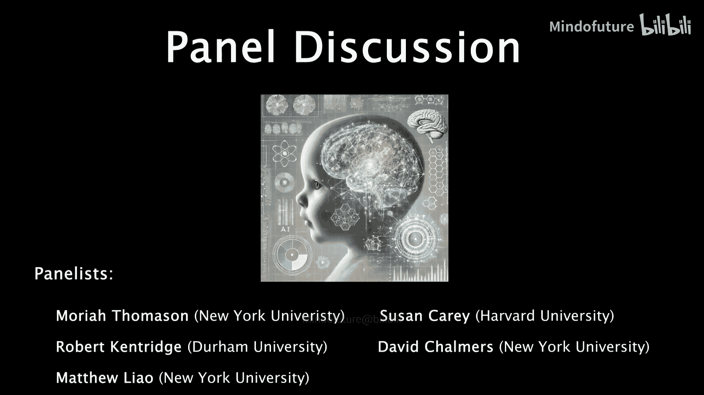
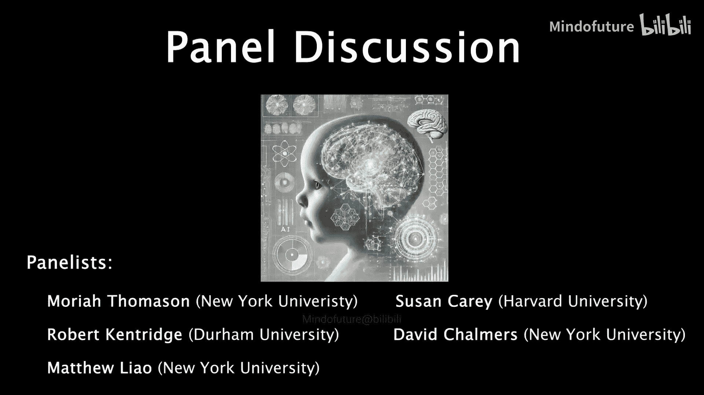

# 【纽约大学】 婴儿意识 ｜ Nyu Infant Consciousness p08 P08_小组讨论-纽约大学婴儿意识会议_2025 -BV19zZXBUEMv_p8-

So I'm Mariah Thomas and I'm a fetal neuroimager and I haven't had a chance to meet everybody so I just wanted to give that by way a background also what I bring to the conversation has really to do with studying the fetal brain so a lot of my work is focused on building blocks and I have this idea that understanding sort of the beginning of brain。

 the beginning story of the brain gives us some insight because as an architect building something。

 building a complex system， I feel like there's something to be gained from understanding how you start it's it's hard to start a complex system and so I'm just going to share two ideas that I have when I talk about our findings from our lab。

Often because there are a couple of themes that come up when people think about fetus's thinking So what do you think about fetus's thinking Well。

 first of all， anytime you look at neuroscientific data。

 there tends to be like a need to kind of anthropomorphize the brain so we give the brain humanity when we talk about how it works as like all of us across our fields we really tend to use words that are really operationalized because of our own perceptions of ourselves and I often in my work have to remind people know the brain isn't that that's you thinking about what the brain is doing and so this is really heavy duty in a fetus so the second point is that the job of a brain when it's being built is a very different job So in early papers that I would put out I'd get reviews back and they would very quickly tell me that my。

You know， as an example， prefrontal parietal network。

 a network that's important for attention later in life。Why would a fetus have that。

 that's what they would say they would say like well why that doesn't make sense like they're only expecting the fetal brain to have those early systems right the sensory motor systems。

 but in fact why wouldn't the fetal brain have that right and so I really had to do some sort of gentle sort of explaining that I'm not conceptualizing these areas that function together as having the function that the leader have because that's not the job that they have to do and right they really just have to get built right and it's far more important to them to get built than to do attention tasks right so anyway those are just like two things that I think of a lot when I try to share my work with people because a lot of people that are seeing work of labs like my own are really going to take these concepts and they're going to place them from their own reference on top of the fetal brain and so I really do like to remind people that there's no gold standard and it's actually one of the biggest challenges for my field is when I publish a paper。

I can't say oh that's a picture of what good looks like or that's a picture of bad and in fact it's been very hard to do that because a lot of times my questions do have to do with risk and so how can I say this is bad that this fetus has been exposed to cannabis for example because I've worked with very challenged populations that are highly stressed low resource that' smoke cannabis and maybe have been exposed to trauma throughout their lives and I don't want to publish a paper saying well that's a bad picture in that fetal brain because I have no basis for saying that so I've tried to do some clever things like follow the children longitudinally study their development。

 do that hippocampal connectivity map， make a map of what is a good representation and what is a bad representation。

 meaning what predicts better outcomes in the future and then reclassify all the voxels as to whether they fall within the good map or the bad it's terrible that I'm even saying that and maybe get some traction。

Really what we should be saying is we have no way， but I do love experiments。

 I do love opportunities to actually test， and I think one of the fun conversation things we could consider would be what are some of the experiments that we could do as a field to begin to get more traction on some of the topics that have been discussed。

 you though really interesting。Yeah。So this has been bothering me all weekend， you know。

 when we talk about consciousness， I feel like many of us assume that it's， you know。

 consciousness like I have it， you know， the the usual five senses， you know， the sense of self。

 you know， something that I would understand if I could beam into the baby's experience。

Do you think it's worth making a distinction between， you know。

 perhaps consciousness as we experience it versus more exotic forms of consciousness。

 like might there be something it is like to be an infant that is just very。

 very alien to what we experience as adults， Is that a meaningful distinction。

I've been suggested by a number of people。Sure I mean like AI consciousness。

 like if if AI systems are conscious， presumably very， very different to how humans are conscious。

 then there's because this psychedelic induced consciousness and meditative consciousness within humans is already you know very different and kind from。

Ordinary。Consciousness， well yeah that I think the conservative view here is that we're just occupying some tiny portion of the space of possible consciousnesses and you know we want to try and explore as wide a space as we can but we're limited by。

Yeah what systems we have and what evidence is available。

So I want to ask the question between development and consciousness。 So with infant consciousness。

 this seems to be the developmental story。 the brain is developed。 connection is developed in humans。

 So it's a developmental theory of consciousness， something that's fundamental when you want to have a theory of consciousness like you can imagine the development theory of animal consciousness。

 you can imagine the development theory of machine consciousness。

 So when we have those kind of consciousness theory do we need to tell a developmental story of like how it comes to be is that like ontological fundamentalal like yeah whatever you call it for the developmental scientist and consciousness scientist。

I'm happy to say that when it comes to humans that's part of my concept。

 almost everything that we all of the concepts that we experience have a developmental framework。

 but also I'm a developmentalist so like I don't know how to say the world in a different way but even things like stress or uncertainties。

 a it's something that means something different and again at certain times of life you have different demands。

 different things you need to do like I want to say like responsibilities in terms of what you need to accomplish to be successful at that phase of life and so I would argue yes。

Okay。This is a conference on a neonatal consciousness。

 so there was no question that development had to be at the center of it。

 but whether development is you think development is a central digitalum in understanding consciousness or the mind。

It's a theoretical。Commitment， I mean I happen to think that it。

That if you can't at least imagine a story by which you could get from a fertilized egg to the adult mind。

 then you don't understand the adult mind， but that's you don't have to agree with that it's also just an interesting question on its own and with respect to alien consciousness。

You can't study it if you can't imagine it， so that's hard， but secondly。

Many people thinking about the development of minds。

Assume that the baby is an entirely alien creature， you know they have only sensory motor primitives。

 for example， or they have only you know it's a blooming buzzing confusion right so they're imagining an alien mind but is that right and the answer is no neither of those are right right so but what you want is a positive characterization of what it is like。

Maybe I can say something Yeah， so I wouldn't have thought that developmental thing is necessary like so it's certainly in the case of humans。

 you know， but that's the trajectory but if you just think of like you know Dave talked about AI consciousness right you can imagine that you build a system and immediately has consciousness and there's no developmental stage training well but you can imagine imagine imagine where you build a system where you don't need the training or like or alien consciousness where you know you just kind of build it right so I think as a matter of fact sort of practically you know whatever but metaphysically speak。

 I can imagine you know maybe they're these aliens and they just pop out and then they already they're already conscious and you knowt need to go to any developmental stages yeah it's an interesting question I mean whether it turns out there is some like central developmental pathway for consciousness you go to go through that developmental pathway and if you don't you won't be conscious I mean there's one obvious counterar to that which is the one you。

came up with came up with a you know samp consciousness the system which somehow emerges in a swamp for randomly without any of that developmental background。

 but you know without be conscious， if that's conscious。

 it looks like it's a counter example to the strong claim for that but wait a developmental trajectory you imagine it but you haven't found it yeah then the next question is。

 let's。We have a developmental theory of existing beings like say humans and it turns out every human has to go through a certain developmental pathway so I think what we can have is obviously species specific developmental theories of consciousness。

 but whether we're going to have a universal one that seems somewhat unlikely to me。

 maybe there's just many different developmental pathways in principle that could get you there and a particular set that humans use。

😊，So I've got a a comment and a question the comment sort of observation on what you were talking about David about the sort of gold card or et cea as a pediatrician actually this is what we do with an older child we ask the child phenomenology what's wrong with you and they' back for the young infant。

 we can just rely on their behaviors and the neonatologist once you'll start looking at preterm babies their behavior repertoire is pretty limited。

 we rely on imaging markers， other markers etc so we do that kind of already it kind as interesting that actually in the conscious world that's what youre sort of method you proposed and yeah ultimately the child telling us what's wrong with them the fetus will never do that the preterm you know do that the question though is is more related to the ethics so again as a clinician。

You know the elephant in the room here is， you know。

 should we be resuscitating babies at 22 weeks should should we the whole abortion debate hinges on some of the sort of things which are discussed here and I think it's really good and important as a scientist that you kind of are blind to that。

 you look at what the science your experiment shows objectively it shows if it shows that a 12 week fetus is conscious。

 whichever experiment you're doing so be it if you but but at the same time I think it is worth。

Emphasizing why these are important， bringing the ethics in bringing the philosophy and I mean it's been amazing for me as a clinician to be surrounded by people or different disciplines to sort of see those points for you and sometimes you either go one extreme and I think it was mentioned yesterday in the talk with you know fetal pain at 20 weeks and they feel excruciating pain and how you can say that but obviously that's being politicized by a credible individual and I think we need to be nuanced and we also need to decide what is our balance of probability as a scientist we want the 9895th% confidence interval full but assigning consciousness to a very tiny baby is it on the balance probability or is it you know proportioncaary principle and I think you know having those sort of frameworks that is still important。

So there's like the Charles court case in the UK and then theres in US。 there are a bunch of cases。

 but there's like the Tinsley Lewis case in Texas where these doctors basically didn't want to continue to treat and wanted to kick the baby out of the hospital the mother sued when all the way to the Supreme Court the Supreme Court sideted with the mother and you know so the doctors at the time like all these experts they thought there was you know you would have to be very aggressive in treating this child and there's just no you know no prospect of a good life as ce tri cetera。

 they didn't want to do it but the mother disagreed right and so we actually talked about this pace and the interesting was this Tinsley Lewis had a heart condition and what they were treating was like you know like they just thought that it would need to go go through another surgery。

Like all these different surgeries and like why put the child through just you know let the child die you know that was the doctor's perspective and and now so what we argued in the paper was that actually the heart condition doesn't preclude you from being able to live a life like you know in terms of fundamental conditions you know like you can actually you know be able to still have interpersonal relationships you know and things like that and so five years later since Lewis is still alive and she's kind of interacting with her mother you know like so they sent her home and then you know the mother decided to raise her and she's you know like we actually reached out to her to her mother to a legal representative and she's disabled but she's like it seems like she can sing she can kind of watch TV with her you know mother and things like that and so in that case we thought we argued that this kind of showed that we shouldn't just rely on quality of life assessments。

But you know if you look at what the child can actually do and so in that case we argued that the doctors actually got it wrong right because they were just focused on this is just going to be too much pain for the child and et cetera。

 et cetera， yeah。嗯。Thanks。I guess I want to ask you。

 Dave to say a bit more about your hierarchy of markers。🤢，And。

I guess the question is in what sense is it a hierarchy in the way you're thinking of it？

You started off with the vegetative state county cases where you don't have behavior。

That motivates us to move down to the neural markers and。

And then maybe down to the computational market。 So it sounded like you were thinking there that。

We go with the behavior where we've got it if we don't have it， we go down to the neural markers。

 if we don't have those， we go to the computational but。I mean， one problem is we've got。

 as you said， we've got too much behavior with the AI， it's not a lack of behavior that we've got。

 it's that we just doesn't feel right to put much weight， maybe any weight on on the behavior。😊。

So I guess that's one question about， you know， is it a hierarchy of defeaters or what。

 And I guess the real issue， which I think hasn't quite been grasped here。

 but it seems to me really the fundamental one is。If we start where many of us want to start。

 not everyone that's clear。 but I certainly， I think where you're inclined to start and I'm inclined to start。

 which is。Doing science where you privilege。You privilege the phenomenology in the sense that you privilege people who are able to introspectively report that and then you try and bootstrap your way from that。

It seems to me entirely possible if you can do that and you privilege to to markers that you can use across the a variety of domains。

 if you can do that， and I don't know if you can， you may well come up with markers that are computational and they give you the better generalizations。

 they give you more explanatory purchase， they explain the other markers。

And they look like they're more tightly tied to the phenomenology。

 they capture structural isomorphisms and the like and the behavior， you know。

 you get a month one many relation with the behaviors。

And and that enables you to say as people were wanting to say quite often， well。

 you can't trust the behavior how do you know your being could just be an illusion could be noncious。

 you could be gamified So I guess that's a long winded way just asking you to flesh out in a bit more detail the traumaler's hierarchy of markers or because and you weren't being recorded So now for the now for the now for the film for the tape Its not like this is a well thought out hierarchy。

 it's like what am we going to talk about in the discussion hey well hardly inspired by hearing your presentation and Clauds and Nicholass at a number of the of the others。

 it's like yeah， there seem to be this interesting structure at least in practice among these different sources of evidence。

 I certainly don't want to make it an absolute wouldn't want to make it an absolute hierarchy or even say it's exactly a structure of theers。

 I mean， a lot of it just is going to be a function of what kind of evidence of a given kind。

How much evidence of a given kind we have and whether it's useful or relevant。

 as you say in the AI case， we have a whole lot of behavioral evidence。

 but it's not terribly useful as evidence because it because it can be defeated in various ways various ways mainly because of the way it's produced so yeah so stop back so maybe in a。

😊，At some point， maybe I can develop a more serious epistemological。Story here， butum。

But I do I am inclined to think that the point I'm inclined to accept the point about the primacy of phenomenology and or verbal report that's our basic evidence about consciousness。

 if I hadn't experienced consciousness myself but perhaps hadn't interacted with other people talking about being conscious。

 I think I just wouldn't really have any serious strong evidence for。

believing in postulating per postulating phenomenal consciousness Susan wants to jump in yeah I thought you'd discussed these issues very。

 very beautifully this morning， but as a scientist about I think the idea that you can say in advance what the what any ordering of evidence is just ridiculous right you have to so。

And I don't think there are any neural markers， actually。

 but the things that we're taking as neural markers are validated。

 even in the vegetative state work that I know nothing about。

 but I've heard a little bit about in this conference。Is that？Things like the。

I forget the global local test okay so they noticed that there was variance in the global local test。

 but then they validated it against something else something being able to follow a command or whatever I mean so you're always going back and forth and the idea that。

That you can do this without theory is also ridiculous right and so I mean theory isn't isn't something like a marker。

Right。It's it's an iterative process where you go back and forth but it's just necessary think I agree with Susan that yeah neural and computational markers have to be ultimately validated by reference to behavioral chronological evidence as far as you can get evidence about them and this is so hard。

What's so moving is the progress that's being made on these fronts。

 but it's so early days compared to other areas of neuroscience and psychology。SoCan I have a？😊。

If if there's that real deep fundamental priority to the verbal report in the behavioral markers and that's the as it were the yardstick by means of which we validate these computational ones because it's a consciousness I mean right。

 Okay， but that's the story。 I get it。 And now we've got the AI system that's got those。

 as it were verbal reports and behavioral markers。Isn't it a little bit odd to think that you？

It's got the markers that are doing all the gold standard work again us I share the intuition that that's not enough。

 but you see from as it were an epistemological point of view that scene is a little bit weird it's got the thing today why that won't work right is because there also has to be the relevant similarity the theory tells you what the relationship is between those markers and what you're looking for and that those conditions aren't met in an AI system So there's no operational marker for there's can't be an operational marker Rob long has given a nice analysis of the AI case I mean' not just looking for verbal reports about mental states we're looking for verbal reports of mental states caused by those mental state there's some internal state that actually triggers the report and he think in the case of AI there's not a lot of evidence to believe that the verbal reports AI systems but what's the assumption you've got that in your own case and。

The behavior I also said behavior in the AI， you don't know that that's true in your own case specific theory that we picked up from other people。

 that's a that's a view seed。Yeah， actually， this was almost the same question related to the gold standard and。

 and I wanted two things， actually， the first one is that。

If we want to study that from a scientific perspective， we had to start somewhere and the goals。

 if you told me that the gold standardunder is going to be phenomenology，10， 15 years ago。

 we would never have started this research program because this is。

Something that you learned from the beginning is we are taught that phenomenology is what's left after you explain everything from a cognitive perspective。

 so if you tell me so that's why I was a little bit I want to say that really from our perspective it's exactly the opposite hiarchy。

We start with a computational law。Mars， then we go to the neural markers。 Then we go to the behavior。

 which is much less interesting because of the zombie arguments and so on。

 and we take philosophers very seriously。 and basically phenomenology is what you don't want to talk about because this is this is basically something that yeah you don't want to talk about for what purpose if you're in phenomenal experience。

 that's what you have to talk about。 Sure， but in terms of like measures， objective measures。

 that's something you don't want to talk about because we， I mean。

 I mean you learn very clearly that actually， I cannot even demonstrate that you have phenomenology yourself。

 you see except that privacy argument and so on。 So so when it comes to basically this ya and maybe it fortunately was not recorded earlier。

But I'd like to really like challenge the fact that actually not challenge。

 but just say that we had to start somewhere we know it's not perfect it's actually and even myself I have like a lot of。

Yeah I'm not very convinced about the current neural markers per say。

 but at least they give us some information I think they're taking us in the right direction。

 but still we this is the best we can do I believe so far I mean all my claims were about about phenomenal consciousness and there's were questions studying phenomenal consciousness is hard there's a lot of stuff which is easier yes study studying access consciousness and so it's clearly much more is much more straightforward so in some sense sure start with all those other things we're here among friends and we're what we're interested in is phenomenal consciousness and then given that we're studying that hard topic。

What。How do we get evidence of it and yeah well phenomenology is great but I've only got there for one person therefore we go to verbal report is is number two and we gradually we want to make contact with things like computational models of access consciousness and so on。

 but when you say phenomenology comes last they take the question is always don't even worry about that as a subject matter until you've。

the rest of your science and you know。Yeah， touch in access and so on some point have to start working on phenomenal consciousness Sure buts yeah that's what you're interested in and that's where we're going but right now we don't have I mean we don't have a good marker of it and that's it and it's going to take a little while I believe so I want to follow up on that and I think one of the problems with studying phenomenology is we ask people and they tell us and we know as cognitive psychologists that people don't have insight into their own thinking they make up stories they can be wrong。

 you can hypnotize somebody and and give them posttechnotic suggestions and they'll confabulate so and it's not just AI that can so I worry about the reliance on language and see studying infants as a way to get around it I mean what about a musician。

Language can't get into the conscious experience of music or the conscious experience of painting or any of those activities that clearly take consciousness。

 but the language of phenomenology is brutal and can be wrong。So right， I'm just stop there。这里不有。对的。

Yeah， I think it's on the same line in a way， but I just thinking as a cognitive and perceptual psychologist and neuroscientist。

I was surprised by that hierarchy because I don't want to go to the neural substrate only when I don't have behavior。

 I want to understand the relation between those levels right and if we can get to the phenomenology that's great。

 but theory has to informing and that hardly comes from the computational and so I if we're thinking of the neonate and I'm not an expert at also probably one has to go in a different way。

 but I think of at all consciousness clearly I will go against that hierarchy and I would think that what we're trying to see is what's the relation and I may have different behaviors that even associate so which one do I go with my eye movements or what I'm aware of。

Right so I think that it's suddenly with much more nuance and that you do need the CR to be generating at least some questions right but that the only way to advance is by having a change of ideas among those different levels rather than just resort into the neural one if I think that I don't have another one Yeah I think the infant cases particularly interesting and messy in this case because it's when we're all three of those mark clearly have some central role to play like in a couple of those other cases the behavioral markers are useless in one case the neurobiological stuff is unavailable in the infant case we've got behavior not quite as useful as in adults but still useful we've got we've got neural markers to go to town on and increasingly computational markers and yeah I didn't really intend to suddenly say that。

In any such case， we should just you know work down the work down the hierarchy。

 I think almost suddenly we need all three of those methods。Yes。

Thank you all very much for an absolutely fabulous meeting。

 I'm Rebecca Fulerth I'm a neuropathologist， perinatal pediatric neuropathologist and what I hear being said is that we really。

 really need multidisciplinary meetings just like this to bring together theorists and psychologists you know。

 I'm very happy that Dr。 Grff and Dr。 Austin in their presentations talked a little bit about the actual fetal brain。

 the actual cells and so on and of sequences of development。Because that obviously I'm biased。

 but to me that's the gold standard and if you don't have the structure there and say with what Mariaia was talking about。

 there's nothing to discuss you cannot have consciousness if you don't have the ingredients the infrastructure and the you。

And again， it does depend depend I've said this a few times on a broken record。

 it depends completely on how you're defining consciousness， but as you know in as physicians。

 if you're unconscious that's a well understoodstood state or if you have a disorder of consciousness and consciousness is not having those things being awake and having awareness。

 that's the definition of consciousness， obviously without that you cannot have any of these other things。

 so that's kind of the bare minimum but I would love to see this kind of dialogue among various specialists continue and I would hope that I could get some of my fellow neuropathologists to come and share what work is being going on because there's a lot more since Kastoic and the other things that were presented which are definitely beautiful pieces of work but there's a lot。

Going on and correlation with imaging， there's a lot going on that I think could shed some light on this。

 but thank you very much for the chance to comment。그。

Actually this works so thank you it's been really fantastic meeting I feel like I could just you know sit for a week and listen to what everybody has to say I've learned so much and I think there is so much to learn from you know everybody because we are getting such different perspectives on the issue of infant consciousness。

 but my comment it dovetails really well with what was said there in the back and what I just wanted to go back to what you said Maria about I think as a cognitive neuroscientist who was traineded in visual perception and how features become meaningful representations in the visual stream I think putting aside artificial intelligence for a moment I think really kind of bringing the issue of consciousness back to how the human brain realizes it is a really grounding principle for all of us and to some extent should。

😊，Particularly in the consent for the infant consciousness should inform how the hierarchy of those markers。

 so I do actually agree with the hierarchy that you proposed Dave。

 but I think our priority as a field at this point in time is to understand how the brain is built because without those structures that enable the capacities that we know our part and parcel of。

Having feenomenology， such as having memory， having representations of oneself， extended over time。

 knowing about the world， having sustained attention so that we can think about the world and contemplate various aspects of it without those faculties we probably can't have feenomenology but maybe some people will disagree and we can have those faculties without you the building blocks that realize those faculties so I think it's really important for us as a field to realize that at least from the science perspective。

 the priority is to understand how the brain is enabled how the brain is developing from inception onwards and to take that really seriously。

 so maybe we don't have markers yet but understanding what capacities are present in structure and function at what points in time really inform this debate I think so just to ground us in the physical reality of how we are able to be conscious。

humanan beings and that's very different from machines I I had a little little bit of a response to that which was in the middle of your comment there was a lovely stream of behavioral markers you know working memories sustained tension and I built half a career I guess on picking on behavioral markers for consciousness and showing that they weren't unambiguous and so have I have a worry about Dave's hierarchy which is just that。

😊，When we look at it we might think， oh well you know the computational level there's high theory there and that's really difficult stuff to deal with actually I think behavioral markers are just for people who don't know the blindside half of your career based on with relevant behavioral markers were performance。

 yeah， thoseal markers going the other way and then going the other way and well so the blindight and the cereb chromattopsia where the patient can do things。

 but the patient is doing things in a way that don't resemble the way in which we might achieve the same goals if you ask him for his verbal report。

 his verbal report of his experience is very， very different from。Mine， and yeah， at service。

 you know， you might think that the cerebral a chromatopic is processing wavelength in the same way as we do。

 you know， you might think that the blindside subject has。No vision。

 but with the consciousness deleted。No， all sorts of masking experiments in normal observers showing。

Every which way flavor of attention doesn't correlate necessarily with consciousness。

 So I just think that。It might be an error to assume that the behavioral level is easy because I don't think it is as far as any know you don't break the association between consciousness and verbal report of consciousness that's true I you rely on that I rely on that that's yeah guess。

Or at least on I rely on patients saying nope。Yeah。

 I just have a very little point regarding the interaction between Susan and Dave and you trying to defend a little bit the marker of culture yeah I think the marker approach can agree totally agree that the markers are established with some theoretical assumptions and observation。

 but I think the main point is you don't start in the marker approach with assumptions on theories of consciousness that you have to find a necessary and sufficient conditions in the system that correlates with the necessary and sufficient conditions of the theories of consciousness。

 so you are not trying to find the global work space you start with the marker。Is this， am I correct？

So。When I I'm talking about theory in philosophical in markers。

 some markers are based on theories of consciousness assumptions like the Pre。

And the global local paradigm。But you don't start with all the assumptions of the fear of consciousness。

 You you， of course， you have theoretical assumptions about consciousness， but not。

You don't start with endorsing one theory when you are。But the point is。

When I say that all science is theory based， I'm talking about scientific theories。

 not philosophical theories of consciousness。Yeah and and actually if you look at the global workspace work。

 it's actually been very productive about access consciousness right and but it was based in a huge amount of theory about。

😊，The relation between。Perceptual and cognitive representations and their neural underpinnings right so when I so that's what I mean by theory based I don't mean that you you certainly don't start with the IIT theory and develop markers right because that's not a scientific theory。

The marker approach is proposing that we don't start to endorse any theory of consciousness。

 even the scientific ones， we start with markers， some markers derives from the theories like the global local global effect。

 but other markers they don't derive from the theory， for instance。

 the Mo sensorensory marker the multi sensorory marker the Bagker effect。

 it doesn't come from one theory of consciousness comes with a observation that that capacity probably requires consciousness to be capable to have a that capacity probably requires consciousness that needs justification and need a theoretical you need for justification but not necessarily assuming one theory of consciousness completely that's not the claim the claim is that it's got to be theoretically based in something。

And you're presupposing lots of theory， lots of developed theory in neuroscience and in in。

Representational computational theories and。And there's just no。Alternative to that。

 there's no theory neutral markers。I maybe there's these yeah。

5 you% trading global bond humans the market that's not like you know， I mean， relatively。

 there are situations in which we don't believe what people say I mean。

Ned brought up anygnosia before。 People will say black and blue。 I've had this experience。

 and we look at the brain damage。 We look at the behavior and we say， no， we don't believe you。

 they're conab。 they're not lying。 So it's， it's， it's sincere introspective report。

 And we know they've got mental states not like L IM。

 So there's some story about causation of mental states。 But anygnosias。

 I think we we don't always treat， you know， in first person current。 There's no memory problem。

s very first contemporary introspective report as inviolable。 We've got these background assumptions。

 I think there's really， I mean， there has to be a continuum from from markers to to theories。

 actually， I quite like， you know， the old line that a language is a dialect of an army。

Maybe a theory is a market。Okay， and language is a dialect with the Navy。 Okay。

 so a theory is a marker with a Navy。 It's like， you know， you get enough markers together。

 Then basically， you get something like a theory。 And yeah。

 the markers are the things you have which are relatively close the way I think about， you know。

 there's things which are at the close end of the epistemological chain and the things that。

 you know， kind of go further down and。😊，Theories are closer to the mock is are very strong on the evidence。

Mars are ultimately sources of evidence theories we want to be more than just sources of evidence。

 we want them to be you know explanations of of the phenomenon and that does actually require a lot more and once you've got a good theory we can use it for all kinds of things like producing all kinds of markers but then the other theory itself has to be grounded in markers and it's going to be a very long complex negotiation among all these sources of。

Of evidence as we see at a conference like this。Wondered if I could make a few comments about ethical significance following up on Matthew's interesting remarks。

 so I do think that it's one of the things that makes this topic so interesting is it feels like there's something ethically at stake and that came out in the talk where we discussed the possibility of pain in a 20 week old which I'm skeptical about。

One point you made in your comments Matthew is that we need to be very careful in making inferences from the premise that something is a welfare subject with moral status to a conclusion like we must keep this thing alive at all costs so those inferences I take it to be quite dicey one point I wanted to make is that here's another dicey inference something is not a welfare subject therefore we can do what we want with it my favorite example is dead people so the controversial issue but I don't think that dead people a welfare subject though they used to be but it's not true that you can do what you want with them so for example you can't take my head and put it on a spike when I asked for my ashes to be you know scattered in a beautiful wood but。

It doesn't follow I think that you would be wronging the dead person you might have been wronging the person when they were alive。

 so conversely， if we could show that the 20 we called theetus was not conscious to not yet a welfare subject。

 I mean I think that would be extremely interesting and important。

 it wouldn't necessarily mean that that we don't have important moral obligations in terms to how we treat that thing。

 but so that's just to say I think these， as you rightly pointed out。

 any of these inferences from the claim that something is or is not a welfare subject too further moral conclusions are going to be highly flraught。

Having said all of that I do think and not everyone's going agree with this。

 I do think that the question of whether a being can feel pain is of the utmost ethical significance and is one of that is one of the most interesting correctionets in this area yeah so thanks for that I totally agree with you and actually that correspond well with my view and you can think of like I mean they're disputed by whether plants are welfare subjects right but you might think it's wrong to just chop down a tree right you know so and I agree with like I think your example of the debt is really good one as well and their disputes about like so if we think you know I think how that did the survey if you thought that consciousness in really come online until 22nd week right so before then some people think that you know that could be a subject like of moral status without having consciousness or as cea et ce but there。

You might think you know and as I mentioned like you got the Thompson line right。

 you it depends on the location of the fetus and so even if that were true。

 you know there's still the right of the woman and things like that so that's like a further consideration and then just on the pain thing like a lot of people and this was I think this is a problem for Peter as well this was what I was kind of getting at was like if you just take pain which is different from consciousness I think but if you take like sentience and pain as sort of like you know something that's very significant。

 then there are all these bug like all these cockroaches in New York you know and like whatever it would be wrong to you know like kill them for one thing and then if you buy into singers easy rescue argument then it's actually very easy to keep them alive you should leave your food like over the place keep them alive right because it's easy rescue。

Right and so it seems like you might have a positive obligation to leave your leftover food like everywhere so't know it's very very altruistic of you very charitable My mother who was in a concentration camp during World War I actually did think it was her obligation to eat a leftover food and she saved it in I the next day or the next day oh yeah。

 but did she think that was。😊，She had an obligation to leave it for the cockroaches and no no yeah oh eat it I leave it you said not no leave it leave it。

 first of all， thank you for organizing the meeting and for this fascinating discussion。😊。

Partly sparked by the distinction between you know。

 behavioral neural and computational markers and Tim's point about sort of the。

Not perfect reliability of verbal reports， I wanted to raise an interesting special case where I think these lines blur。

 which is you know some of the classic work of vegetative state patients with neural markers require a scientist to interpret the brain imaging。

But there's you know really amazing advances happening in brain computer interfaces right now。

 for example， the work of Eddie Chang and others where you can get verbal reports from the brain that is you train you know decoders sophisticated model to read neural activity with invasive implants and you can generate speech and so what is that is that a neural marker in a way。

 there's a model there's a computational model looking at brain activity。

 so it's a neural marker is a verbal behavior， yes， I mean it's speaking， is a computational yes。

 because the model required to interpret the neural activity to generate the behavior So I don't know what that means。

 but it just strikes me that you know that to me would be would have some believability to it as long as we think that the model's working。

Well， and we don't have reasons to believe it's not because the person might endorse what it says。

 And even the classic vegetative state work， a lot of it was about saying yes or no by following one command or another。

 And so I wonder what status we give So computer generated speech from brain activity because our speech is generated from brain activity。

 So you just have a computational intermediate， I that less good or similar， What do people think。

This actually connects the whole field in or doing similar things in AI where it's a whole regime of mechanistic interpretability where we're trying to take a giant neural network and figure out training the decoder on that to figure out you know what it might be what it might be processing at this point maybe ultimately something itkin to mental state but maybe at the very least certain forms of representations because one question here is what is you the ground truth that you're training these systems on and a。

you know， for doing it with neuroscience， you can start。

 I guess with relatively relatively normal patients for whom we know what they're thinking about and validated by verbal reports and then we use that to。

To figure out， okay， well， this goes along with're thinking about that， I don't know exactly。😊。

What people use is validation in the work you're talking about on disorders of consciousness。

But I don't know that it would look kind as exactly as a verbal report。

 I mean want to be verbal report of a mental state had because you're accessing that mental state。

 it feels more like it could be akin to like a reflex response。

 which isn't necessarily the most recent generating speech in response the original stuff is yes or no but the latest published the last couple years is actually brain the brain is not is not going through particular speech modes there but it's like you're decoding some speech signals from the brain and it's an open question what what's actually being experienced in this case people want to say this is。

Actually， the subject is conscious and understanding the conversation and with the subject degreeal cord speak。

Ex speech that you compare it to a brain interface。

 and then you can do that in real time and interact with the person and the person is here totally alive in doing some gesture。

 they cannot speak except to conversation。And it's validated on other patients or on refx by this patient this is entirely intact presumably whether。

Thank you so much， it's really really fascinating， thank you for organizing this。😊。

So I have the feeling that we have like three like a triangles， so we have。

The brain which is the neuro thing and then we have the behavior and then the phenomenology and there' is like a big hole in the middle which is something is missing so how you put this together and for me the big hole is well is the body is the physiology of the body that actually connects the behavior to the brain and that keeps the phenomenology and actually going back to discussion about the patient。

 presumably this patient already had experience of going through certain events in life through the body and that was encode somewhere in the brain is not popping up from you know nowhere so it's coming through going through the experience and because we're talking about developing the things and we。

I'm sorry for coming from a very different perspective I still have the feeling that this meeting is very much neuroocentric and stays in the head and I want to get it out from the head。

 actually the first neuro developed they're non developinging in the brain that are developing in the belly in the guts and there is a robust body of work that show that actually our conscious perception depends or the neural activity is highly dependent on the cardiac activity that is like connected with the brain So there is like a very active brain body interaction it's like you don't see the same stimuli whether you present in systemly versus diasphy fors here so it's kind of like a massive change there So what do you feel about this like。

Big hole in the field on the presentation that we had。 So that's about the。Where is the body？嗯。

There was a lovely poster in the poster session about the development of interception in the infant。

That's a good place to start。Another approach would be to expand that that node of the triangle that has the brain and expand that to include the body。

 so the the physical basis of consciousness may or may not be just be just the brain so yeah。

 so that would be I don't know if that would satisfy。He urge to fill in the hole in the middle。

 but somehow that would be another way to work the body in。

Yeah I just want to extend on some and echo some of the things that Suzanne was saying and Marisa Crrasco is also saying。

 I really think this neural markers thing makes no sense。

 we have no idea where in the brain this is happening。

 you know Rus Bald shows that we can't even do a reverse inference from the literature for Broca's area like you can but it's just barely mathematically reasonable to do it you know to now go and get a neural marker of phenomenal consciousness or something like that and say this is a marker of where it exists in infants I just don't see it so I' am actually in this camp of finding these behavioral markers。

 but I think there we run into a different issue which which you guys are also hinting at。

 which is that this is also theorybased right not theorybased like Suzanne saying in the consciousness theories。

 but theorybased in the sense that you have to conceive of what constitutes a good marker right so if I'm doing research in episodic memory I have a sense for how to build a task for what I think the computations and representations like go。

That construct R and if I don't have the same operational definition for consciousness。

 I don't see a good chance as an experimentalists to build a task in infants that could allow me to do that and I think maybe something that could help is both a process model of what's going on with Con' perception and as you guys sort of mentioned are going to meet about what is the function of this thing if I don't have answers to these questions。

 my ability to come up with an experimental design is going to be very， very difficult。

What is the most theory neutral behavioral marker we have apart from verbal reform is there like is is it is there a relatively a theory behavioral marker it is tied up in our concept of what we're you're stuck in a conceptual sandwich where you have concept behaviors concept again when you're server with no such it all goes back to you know。

 pine un him there's no theory neutral observation。😊，Yes。

 thank you yeah I think my question follows a little bit after's question。

So I've heard about different many different types of consciousness， interceptive consciousness。

 affect consciousness， sensory motor consciousness， perceptual consciousness。

 cognitive consciousness， but maybe I missed a lot， I'm sure I missed a lot。

 but I haven't really been told about the way they connect or perhaps whether there's a developmental order between them and for instance I was very。

 very struck by what Mariah said when she sort of was outraged that people would say。

 oh only this part of the brain has to develop trust no they all develop at the same time。

 so does that mean that in fact all the aspects of consciousness developed at the same time。

 or is there a developmental order that we can track and if so is there also a kind of hierarchical degree of complexity and also is it conceivable that you can have if there is a developmental order which I tend as a。

Sort of lay person in those questions but I tend to think there has to be a developmental order because of a kind of vital necessity order then can you imagine that something is conscious without going through those stages and then does not that if you do have to go through those stages does that not tell something about。

How sort of。We might be missing something by focusing， for instance。

 as it seems to be the case on the cognitive aspects rather than considering all that you know sort of vast array of types of consciousness which are interdependence or you know it's a long question but I mean there were different different types of consciousness I heard about without ever really I thought hearing something about their developmental story and their respective connection we say all that。

那。i'm going to be mindful of time I really appreciate that that pointm again I would actually go to that i'm not an expert in terms of responding to this it feels to me like what i'm hearing is that we do think about different levels and it feels like those levels do have developmental stages I would leave it to others to say I think it's important to recognize that and that we think about。

😊，Maybe they don't all maybe we don't want to put them into an order， but for example。

 the ways that we make decisions about what it is we're seeing as representing consciousness we're going to use different markers to say at different stages that that's a signal to me because the capacity of the human talking about human consciousness to give us the response has to do with what that human's able to show us and again I think it does go to this argument that you made also。

 which is what does it need to have to get the job done at that time。对。

So I think your frustration is understandable。But。The way I see this conference is it's mainly been about visual conscious。

 you know visual experience and we don't know how to answer that question even for it so the fact we haven't answered it for all those other kinds you know that's just we don't know how to even do it for that。

So maybe we have to do it for all at once， but that's even more daunting， right？

😀Don't forget the BBB boop， it's auditory。lot people talk about our bank。

I think that's my money that's going to I mean the baby needs that there's a functional role really early on by the mother the breast milk black we know it doesn't go to the family it's got a different you to collapse horrible connection for all fact different groups it's a very special it's a different system it's a very special system I think that's by the that I think that comes on person but the problem is that the system that you might need come on first the ones that that hard study they're less cognitive as it work is they kind an inverse relationship between easy study and what you might think are come on earth。

It。But it's the it's the cognitive stuff that we end up I think。

 mainly getting through verbal report no， verbal report is about whether I see it。I mean。

 it's about phenomenal， it's evidence with respect to phenomenology。I suspect I just agree。

So so memory when we when we see a colour， we end up I think reporting something about the nature of an object in the outside world。

 we don't actually end up reporting our phenomenology where only where our phenomenology is。

Actually dissociates from what we would report about the color of the thing in the outside world well I think memory and memory occurs really early and that's called I mean that occurs even before you're born yeah yeah habituation。

So go ahead I think people Oh boy so a few comments and I hope they make sense I'm a something of an academic bastard slash orphan and I kind of go into these debatebates sometimes it feels like I'm in the middle of the divorce I don't quite know how to feel about like for instance。

 like like in terms of theories like you know it seems like sometimes like。

You want to be faithful to what their claims are， but oftentimes it seems like they're using language differently and not even talking about the same Expplanandum and some of the differences might be overstated in terms of you could potentially like each one is seeing different sides of an elephant。

 but I guess I just。Question is， so earlier someone could comment on defeaters I don't know if I quite follow that in terms of their significance and then a suggestion and a comment。

 So you mentioned a neural markers and I think you're right。

 but I also wonder whether like the hyperscanni work actually might be very suggestive and terms of like some areas that show like when people are engaging in similar sense making showing like high alignment across individuals and so like there's a lot of influential leaps be made。

 but I don't know if it's quite as hopeless as you're saying but suggestion question。

 when you're talking about this triangle。 I'm wondering if this corresponds is something it's an approach I use like I call it a Marian phenomenology So it's basically like it's so it's there's a triangle So it's basically taking like the Marian levels and then you use them like you're filling in acrossword puzzle and then considering to be like these supervenient levels it that similar to the triangle idea where each one's constraining the others What about the triangle。

angleSo Francis like you have like a computational functional description。

 a mechanistic implementation description and an algorithmic description and then you kind of go across some and where you can't make purchase on one。

 you might be able to inform the others and this helps you to potentially move between different kinds of systems where you're potentially ignorant of how functioning So for instance like the latent space of transformer or like decoding from like the brain and it may be like if you have like an algorithmic count you can move between them probably didn't make size but we should talk right've got three levels we've got Annas triangle we've got my free level hierarchy you have a little freeze here but I think that's the end I。

