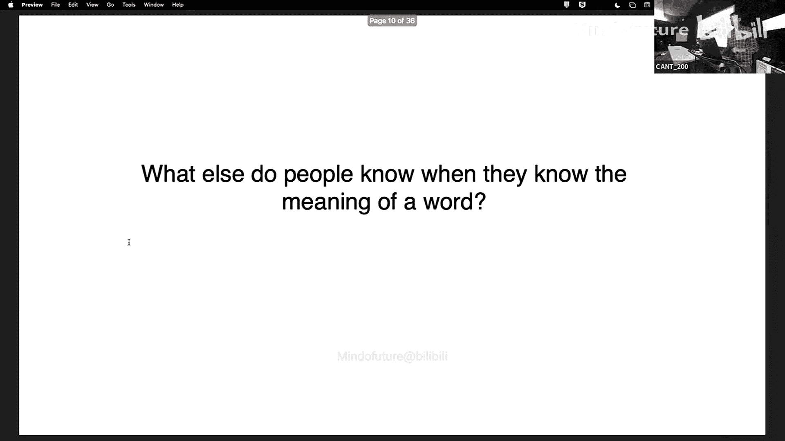
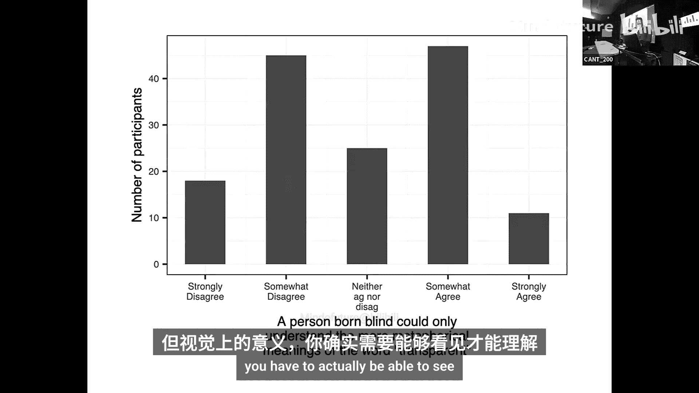
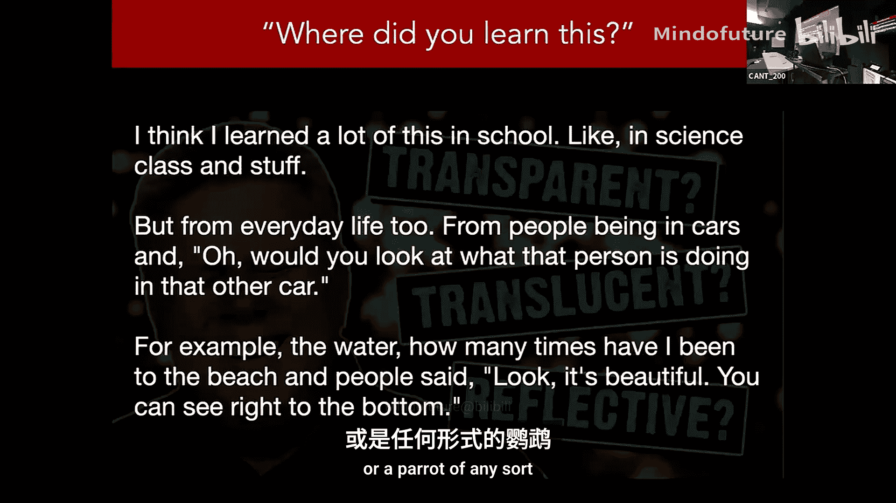
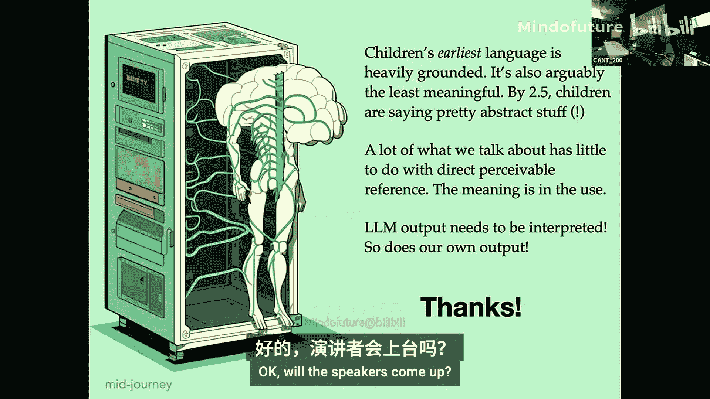

# 【纽约大学】深度学习的哲学 ｜ Philosophy Of Deep Learning 2024 p01 P01_辩论_语言模型是否需要感官基础以获得意义和理解 -BV1u7ZoBnEAb_p1-

Do language models need sensory grounding for meaning and understanding and we have three yeses and three nos the yeses are Yam McCun。

 Brendan Lake， Jacob Browning， all three from NYU， the no are Ellie Pavlock from Brown。

 David Chalmers from NYU and Gary Luian from Wisconsin。

The order will be we'll have a yes and a no and a yes and a no， et cetera。

 Yan is going to go first then Ellie then Brendan then David then Jacob and then Gary and。

I just want to say one or two words about what the topic is。

So there really are two issues I've looked at people's slides and there are two issues。

 one is an issue of reasoning whether you need sensory and motor connections to do certain kinds of reasoning behavior it's a kind of behavioral thing the other is whether there is a kind of abstract content that doesn't require those sensory and motor primitives okay。

 so Yn you are first and I'll get Jann's slides。Yeah。あは。All right， sure， there you， okay。All right。

 this is not actually the first song right。呃。All right。😊，对两为什么路。

The sensor want think for me Im understanding， the answer is yes。

 you can't hear you right you can't hear me now you can hear me。Hopefully。So the answer is yes。

 hopefully， I mean certainly first。Current AI systems or machine learning based AI systems compared to human and animals in terms of their ability to learn。

So we all know the limitations of supervised running， it requires maybe many label samples。

 reinforcement running requires insane amounts of trials and you obviously we're missing something big because we still don't have domestic robots and driving cars and so how is it that animals and humans can run so fast so in recent years cell supervised running has been sort of taken over the world。

And they do require a large number of enable samples。

 but unable samples are cheap so that's a big advantage so the problem is current systems really make really stupid mistakes and they can't reason。

 they can't plan and they don't really have kind of an understanding of the world and that includes large language models I'll come to this in a minute。

In comparison， animals and humans can learn new tasks extremely quickly relying on their background knowledge about how the water works。

 they do understand how the water works， they have pretty sophisticated war models， they can reason。

 they can plan and they have common sense， that's perhaps the accumulation of knowledge that allows them to have common sense。

So current machines not so much or a little bit， but it's very superficial and we need to make that non superficial so sub supervis running SSL has really taken over the world。

😊，And it's the idea that you train a system to predict missing information temporarily missing information。

 so you show a piece of a video clip and you ask the system to predict what's going to happen next in the video clip or some other parts of the video clip and then you reveal what happens and you expect the system to be able to by training itself to predict to have some understanding of the underlying reality and this doesn't work like we don't know how to do this today or not very well at least。

We can do it with text， it works really， really， really well with text， but yet。

Not yet with video or any kind of other sensory information。

So if the answer to the question of the debate is yes， but not yet。

 we don't know how to do it yet with AI systems。So SSL has been extremely successful over the last seven or eight years or so。

 where the idea of filling in the blanks is you take a piece of text。

 you corrupt it in some way by removing words or substituting them and then you train some giant neural net to predict the words that are missing and in the process of doing so the system learns appropriate representations of language that incorporate。

Semantics and grammars and syntax and all kinds of stuff and it's multilingual and it works wonderfully and it's used absolutely everywhere as deployed commercially。

 you may not see it， but it's what does content moderation on all social networks today。

And translation as well。Now within this there's a special case of this where what you asked the system to predict is not random words in the text。

 but just the last word， so a gigantic neural with。Tens of millions。

 hundreds of millions of parameters and you strictly trade to predict the last word in a window of text that typically has a few thousand words。

 something like 2 thousand words。And when you have trained the system。

 you have it generate one word or token， which may be a subword and then inject that sub word into its viewing window and then generate the next word and then inject that into the viewing window。

 generate the next word This is called autoregressive。Generative models。

 and in the case of text it autoregressive large language models if they are large。

So I'm going to argue for the fact that those things also suck。They're amazing in many ways， okay。

 but they are nowhere near what's required for human level intelligence。

 so the systems output put one token after another。

Encodederrs and predictors that are transformer architectures。

 which I'm not going to go into the details of， they typically have billions to hundreds of billions of parameters。

Going towards trillions， they're trained typically on hundreds of billions or trillions of tokens gathered from all the text ever written by anyone available online。

And that creates a problem because we don't know where the training set is。

 we don't have a test set because those things have been trained on the entire text of the world。

 so if you ask them a question you don't know if it's if it's seen it or not because if it's ever been。

Spified the system has been trained on it and the modern systems， as soon as you ask them a question。

 they get fine tuned with the answer， so you can't ask the same question twice or you won't get the same result。

So there's been a bunch of those models over the years and a interesting phenomenon appears。

 which is that as you make them bigger and you trend them on more data。

 there is sort of emergent properties， they seem to be kind of understanding more and more about the world when you make them bigger and trend them on more data。

The little swan being GT4， which nobody knows how it's built， but Ch GT is an autoregressive LLM。

And then Lana from Fair， that was。Essentially open source recently is that Alpeca is kind of an improvement on Lama by it and from university。

 so they are kind of amazing， but they make really really stupid mistakes sometimes completely non factactual statements inconsistent answers。

 particularly if the answer is wrong， logical errors。

They have very limiting limited reasoning abilities。

 there is no way to control them for things like toxicity or things like that is' very。

 very difficult。And it's because they don't have any knowledge of the underlying reality。

 so they're trained purely from text and they really don't have any knowledge of the underlying reality that all of us share and assume is part of intelligence those things don't have it so you ask them questions that are can only be answered by some sort of physical understanding of reality and they can answer it unless。

A very similar situation has been specified in their training set， and they remember it。

And they have like a major flaw， which is that because they are autoregress。

They produce one token after another。Let's imagine we have the set of all possible sequences of tokens and within this set there is a small set。

 which is the。Set of correct answers if you want。I imagine there is a certain probabilityE for the system to make a mistake。

 produce a token that takes you outside the set of correct answers。

That's the average probability for making an error。

 so the probability that the system will produce an error an answer of size n that is correct is1 minus e to the power N。

And that's an exponentially divergent process。So those systems。

 as soon as they start producing too many tokens， will start spkeewing nonsense。Because。

They are autoregressive， they don't reason。They don't plan their answer。

 They just produce one they gun after another reactively。And it's not fixable in my opinion。

 it's not a popular opinion among my colleagues， but I don't think it's fixable。

 so I have a prediction which is five years from now。

 nobody in their right mind would be using any auto aggressive。Okay。

It's a temporary thing that we have to deal with， but they will disappear。So they really suck。

I mean they're wonderful， they are helpful， they help us， you know。

 start writing text and everything， but they're nowhere near human intelligence and they are not。

A good pass towards that。Although they have some other characteristics， they are an off ramp。

On the highway towards human level AI。So we need systems that can't understand how the world works。

 and that's where grounding comes in。Babies learn how the world works。

 there's no language involved in the first few months of life and they learn incredibly complicated concepts about the nature of the world。

 things like intuitive physics and gravity and stability and the difference between animate and in animate objects。

 this is a chart I stole from Imanor Duu who is going to psychologist in Paris。

And this is the accumulation of knowledge that we acquire in the first few months of life that allows us by the time we are teenagers to launch a drive a car in 20 hours of training and obviously AI systems don't do this today。

 we still don't have shadow in cars， so we're be seeing something big。嗯。

So I think that sort of gives us the challenges for AI and machine learning for the next few years。

 learning representations and predictive models of the world I'll come back to that concept。

Using Sal supervisorvision remotely having machines that can learn to reason。

 so basically autore VLM and most machine learning systems today are like Cannyman system one。

They're reactive。We need AI systems that can do system two， basically they can plan their answer。

And kind of reason before producing an answer？And systems that can learn to plan complex actions。

Okay， so to approach that problem of written a position paper fairly along the fairly readable hopefully。

 and it's on open review you so you can comment on it。

 that's the URL it's been around for several months now since June last year。

And it's based on the cognitive architecture that's built around this idea of world models so we have the system has a world model or would have that predicts what's going to happen in the world as a consequence of its actions and basically has a reasoning。

Moode where it imagines a sequence of states that the world may go through as a consequence of a sequence of actions that is imagined。

 and then you optimize the sequence of actions so as to minimize a particular objective。

A cost function of some kind right so the general model for this is very old is called model predictive control in optimal control。

 but we like to do this with complex models of the world that are learned and then perhaps complex inference procedure that figure out sequences of actions and we also would want to do this in ways that are hierarchical。

I want to skip to that here okay。So that。So things like this where we don't make predictions at one level of abstraction。

 but we make predictions at multiple level of abstractions。

 which allows us to do long- term planning in sort of abstract representations of the state of the world。

And that's kind of a general plan， nobody has really built this。

 nobody knows how to make this work yet， but this is basically where I think AI research is going for the next decade or so。

I'm advocating also for an architecture， so this's one that I want to show that I。😊，This one。

 it's a bunch of recommendations are very unpopular in the machine learning and AI community。

 which is that to handle the uncertainty and the prediction。

 we have to abandon the idea of geneative models。So all the stuff that people are excited about today。

 they work for text， they don't work for video and if we want to have work models that work for video。

 we have to abandon the idea that we're going to predict every details in a video so' to use architectures that are called Jeah joint even predictive architecture。

 which is drawn on the right here。So no guarantee model。

 no privacy modeling for reasons I'm not going to explain and no reinforcement running。

 or at least minimize it。So that's it， let me just show when。Insteadt of position and conjectures。

 prediction is essence of intelligence， we use this with known needs for a long time。

Almost everything is run through self supervised running and almost nothing run through reinforcement or supervision or imitation or anything like that。

Reasoning amounts to optimization with respect to a sequence of action， optimizing an objective。

I'm recommending this hierarchical Jear architecture， but that's a technical detail。

 the system will need to have intrinsic costs and costs and objectives that determine the function they're supposed to fulfill and that will make those system controllable。

 which is not the case for current large language models that are not controllable。

And those cost function will sort of provide the equivalent of emotions if you want for AI systems because they're basically anticipation of outcomes。

 thank you very much。う。啊。Yeah。Oh。No job。That's the last that's the last slide sorry our next speaker is Ellie Paavlic。

Yes。H。Yes。All right， thank you。All right， so the main kind of argument I want to make is that this is mostly going to be an empirical debate is the mic okay and if we just look at kind of the current empirical data we have on the models we currently have kind of focusing precisely on this question。

 I think the answer is obviously no。So there's a lot of in principle arguments that we can make about why we don't need grounding necessarily a priori for meaning these take a couple forms so there's this roughly internalist kind of an argument you can make this would be saying that what it means to have meaning is to have the kind of the right associations between concepts and words inside the head and we don't really have any good reasons to think language models can't learn the same types of associations that humans have。

A lot of people don't like this kind of argument because it seems you know weird or unsatisfying to say that you can have meaning kind of just in the head completely untethered to reality or reference in the world and I think even in along that line。

 it's hard to make a case that language models can't kind of inherit that grounded meaning in the same way that we humans inherit a lot of the grounded meaning we have which is to say we learn from other people who have that grounded meaning so there's a good example in in Harmon and elsewhere about the meaning of like oak tree and elm treee like I can use those words I use them very freely and I can say hopefully meaningful sentences including them but I honestly have no idea what the difference is and I could not tell you the difference or identify the difference in the real world。

So i'm mostly going to leave it to Gary and David to talk more about these various more in principle arguments。

 but I want to focus on basically we're having this debate because there are specific models these text only large language models that really seem to have a lot about a lot of meaning in them and that's kind of why the debate is relevant so we don't have to have this debate kind of in the abstract we can be thinking about specific models and I should say that kind of are responding to yen I think。

It doesn't have to be the case that these models are perfect yet imperfect models doesn't mean that like some future model that looks very similar to these might have meaning。

 so we want to focus on the specific questions we're trying to ask and show kind of what does the empirical data show right now so models making mistakes I don't think is a。

An argument that says that grounding is necessarily necessary for meaning。

So I want to focus on two kind of conclusions that I think are supported by current empirical data。

 the first is that if we add sensory grounding to these models we don't see improvements on things。

 so it's true that they're not perfect that stuff they make a ton of mistakes but right now adding in the sensory grounding doesn't make a difference so this could just be neural net problems or something with the architecture or something with the algorithm it could be some other thing。

 but it doesn't seem to be that sensory grounding is the difference there。

And then I think there's a richer argument to make about when we actually look at the representations that we have within the language models that they're actually quite similar to what we would expect representations of the actual world and so much so that we can actually ground the language models' posttac with very little effort in doing that。

So for this first point， I want to say like I said。

 it's really hard to show a difference between text only representations。

 text only models and models that have sensory grounding when we compare them head to head and this is actually coming out of a study where we were trying to show that there's a benefit to having some sensory data because I have a lot of colleagues and students and we work on this and we wanted grounding to make a difference right and we were annoyed that a lot of the studies that were out there didn't seem fair to the grounded models because the text models have larger data and they have richer data。

And so we and have different architectures and things so in this case we're using one of these kind of massed language modeling type of models this is a model called video Bt it's very similar to Bert we're kind of predicting the missing tokens and those tokens might be words or they might be video tokens right and then we're going to train an identical model we're just obbling the visual part so here that the language is the same the amount of data is the same the architecture is the same and so we're just trying to see if there's any effect at all from having this additional sensory information and the short answer is no we tried very hard but the models perform extremely similarly we looked at a physical common sense reasoning task called PEa that was designed to kind of make the case that large language models need access to sensory grounding but then when you add sensory grounding they don't do better we looked at some very semantic probes this would be kind of meaning in a linguistic sense things like semantic roles and co-reence we didn't models perform very similarly there we looked at some adjective nolations so this would be like。

You have the word like Apple does the model kind of know the state of the apple。

 whether it's chopped up versus whole， and again we see models perform very similarly there。

So across the board with the models we have in the metrics we have adding sensory data doesn't help even on these kind of metrics of understanding where we really would have expected it to。

So as I said I think you can go further so that's kind of based on their behavior alone there's not strong evidence that sensory grounding is going to make a difference。

 but then you can also look at actually the structure of the representations that the models learn and I think there you get an even stronger case to say that what these models are learning really does look a lot like what we would consider to be meaning that we would get through sensory grounding。

So we can look at our domain like color。which is arguably kind of a really clear case where we would expect sensory regretting to matter and what we might say is that language model has some kind of you geometry of the concepts up in language space and that it knows some kinds of relations between them so it knows there's some direction that you is associated with the word dark that takes blue to dark blue and green to dark green but this is just all up in language text land right but of course if like ideally this corresponds to some structure in the real world that you would get through perception。

And so if the model is doing it correctly， we should be able to show it some examples of the kind of grounded concepts so we could say this is blue。

 this is dark blue， this is green， and from that it can learn that like this is kind of how the dark direction in text space is realized in the perceptual space and it should be able to infer what is dark green show once you ask it to label that color。

So we looked at this in we were looking at GBT3 in this case and in the color case。

 we look at a few domains， directions， spatial orientation， color is the one I'll focus on。

 and we're basically just asking it to label our GB codes， right？

Now of course the models probably see in many tables of RGB code so succeeding on this is not particularly exciting。

 so the kind of key idea is that if the model' is doing this kind of abstract analog reasoning。

 it should be able to do this mapping even if we rotate the world as long as we preserve the structure so if I tell the model that this dark blue color is blue and this dark green color is dark blue。

 it should learn that like getting greener is how it should realize the dark relation and then when I tell it this light blue color is green。

 then it should infer that this light green color is dark green。

And so we should expect good performance in both these original and rotated worlds。

 we should expect bad performance if we just shuffle up all the things because now we've distorted the structure and the model can't make use of this reasoning。

So I'm going to show results from just the hardest setting and in the hardest setting what we do is all of the training examples the model gets come from the same kind of subspace of the color space or for the other domains。

 so it gets kind of anchor points for the primary secondary colors and then just a ton of examples of shades of red and pink。

 but then at test time it needs to for example label this color patch as navy。

And when we do this we can see that in the random performances here in light blue and shuffled it performs very poorly as expected。

 but then in both the original rotate worlds we actually see pretty significant gains over that random baseline and these numbers are still not you know they're not perfect。

 there's a lot of progress to be made， but they're highly indicative of kind of the right process happening under the hood in terms of this kind of mapping and like I said this is kind of our hardest case。

So we can argue from this that the model has this kind of structure to its conceptual space that is basically the same as what it would have had if it had just been perceived in color directly。

So I think you know it would be valid to push back on this to say well maybe reasoning about RGB codes isn't really the same as perceptual reasoning right because those RGB codes are actually arguably kind of a symbolic linguistic representation already of the raw perception so what this succeed on this task might amount to doing kind of advanced linguistic。

Aological reasoning， but it's not the same as perception。

 so in the follow up work we're basically trying to do the same thing。

 but where the input to the model isn't something like RGB codes it's actually kind of a raw image encoding like pixels like we would get in any of the models that we traditionally call grounded perceptual models。

So here we have。On image encoder we'll look at several different image encoders these are models that are trained take as input an image and learn some vector representation to do some tasks so we'll look at a few different ones there's you know predict like you can do object detection image captioning or various other self-supervised learning techniques and then completely independently we have a language model that's been trained on predict autoregressive language model predict the next word so if you just ask this examples from GP3 as of this morning if you just say what are they doing with no context it says they're playing a board game so there's no relationship between these models or the data they're trained on。

What we're going to do is first freeze the encoders entirely。

 so nothing is allowed to update within the models themselves。

And then we're just going to train a linear projection from the space of the image and output space of the image encoder into the input space of the language model。

 so basically it's going to get a some kind of tokens where the image representation is kind of pretending to be a text token and then we're just going to take this as context and ask the language model to continue predicting next words and in this case we see the models。

Or is correctly predicting he is surfing away？And actually， when we do this， we see。

That we don't get any benefit to full multimodal training the model over just doing this linear projection post hoc into the space of the language model。

 and this is across a variety of these image captioning tasks and these visual question answering tasks using some different metrics。

And so the last point I want to make is that I think you could push back even further many times these image encoders are trained already with some language in the loop and I don't personally think that makes them not perception but this could be kind of a point where we would say well this model might be trained on something like Inet it's trying to detect objects in the image。

 those objects are linguistic categories， so really this conceptual space that's coming out of the image encoder is already a linguistic conceptual space and so maybe we shouldn't be completely surprised when it's able to project into the space language model。

But we can look at other selfvised selfupvised learning techniques that don't have any language in the mix。

 so for example filling in patches of images so there's no language here it's really just learning the structure of the perceptual features within the images thiss a model called be it。

And when we do that we still see an impressive amount of semantic information is transferred。

 it is admittedly not as good as the models trend with language。

 so for example here it messes up it thinks that the tennis racket is a baseball bat or that surfing is jumping into the water。

 but it's really hard to argue that nothing meaningful is being transferred between these spaces。

so that I will wrap up so I think like I said， I think there are multiple very compelling in principle arguments we can make about why grounding shouldn't the lack of grounding should not invalidate a model as a potential model of meaning and I think like Gary and David will talk more about these I think we want to focus on the empirical results because when we're looking at the models we have now they strongly suggest that something must be true in those empirical arguments because we're getting the kinds of models out despite a lack of grounding and specifically I think there's two main conclusions one is that as it is right now adding perceptual information doesn't improve models representations of meaning according to our metrics and we see that these models can be grounded post hoc。

All，Thank you very much。嗯。Next speaker is Brendan Lake。嗯。ビ。嗯嗯。Okay。

 I don't know if that's your first one or not。Okay。Okay。Everybody。

 I'm going to talk about building machines that understand words as people do。

Today's large language models are amazing， I think there's no doubt about that。

 this is from the GPT4 paper apparently you can give it an image of one of the precursor papers of GPT4 and ask it to summarize that paper from the JPEG and it can do a reasonable job summarizing the paper and you can even ask it about specific figures。

This is clearly amazing。But and getting to the question of today。

 that ability to perceive the visual world， look at an image。

 have other aspects of sensory grounding， is that needed for meaning and understanding。

I'm a qualified yes on this question， it really does depend on the meaning of meaning and understanding ungrounded models learn a lot about word usage and the relations between words that's there's no doubt about that。

 but by definition they have no connection between text and the outside world。

 the traditional view in linguistics is this is critical to meaning having that connection。

 that reference to the outside world。I'm a strong yes on a variant of this question， however。

 do language models need sensory grounding to understand words as people do？😊，That certainly is yes。

 and I've written a lot about this with my NYU colleague Greg Murphy。

 we wrote a paper word Meing and Mins and Machine， which is exactly about this issue。

 it was published in psychological review in 2021 and this paper goes on at length about a number of things I won't have time to discuss in this brief presentation but check it out if you're interested in these issues。

 but one of the key things we get at in this paper is what do people know when they know the meaning of a word when they have the concept behind a word。

So take the word umbrella when you have this concept and this is what we often mean in cognitive science by knowing the meaning of a word。

 the word is a pointer to a concept， some mental representation of a category in the world that you have。

And this concept supports a lot of different flexible behaviors。

 one type of behavior is describing a scene and understanding descriptions of scenes。

So when you know the word umbrella， you can look at any of these scenes and you can talk about them right and recognize the umbrellas and it's not that language models can't do this as well。

 of course those language models would have grounding and they have some sensory grounding they have a visual encoder。

And we in the paper we took a 2020 image captioning system and we past these images to it and can do a nice job talking about them again the system has grounding like a close up of a red and white umbrella。

 a woman walking down the street holding an umbrella and so on。

 but these are the types of umbrella images that are readily available from Google image search and so on。

And it's important to emphasize that just adding a vision encoder or just connecting it or fine tuning it doesn't mean you're done。

 human concepts are far richer， more flexible than that。

And in the paper we propose is ad hoc umbrella test because it turns out that animals in nature can actually construct ad hoc umbrellas that when it's pouring rain。

 at least often enough for a photographers to capture it sometimes a frog will go under a large leaf or a monkey or a whole leaf above their head or a toad could seek shelter under a mushroom and of course this isn't literally an umbrella in the sense that we understand the artifact of an umbrella but you can make a very clear analogy to an umbrella right and you take the same system and you ask it to describe these pictures and it's a bird perch under a bird feeder or bird sitting on a car a bird sitting on a branch it actually mentions umbrella in one case。

 this was a 2021 system actually getting a lot of the animals wrong you might say。

 well okay maybe umbrella doesn't come to my mind as like the first word when I see this but below our labels from a strong object recognition system and you can look at all the categories that it thinks are more likely then。

Umbrella， which is one of its categories so things like treere Frog and Lakeside and fountain and Spiderweb and rottiserie are more likely than an umbrella for these particular images so it seems to be missing that that ability to stretch the meaning right and so yesterday I looked at an updated image captioning system this is blip and it's not obvious that there's been a lot of improvements on this particular test you still get two frogs in the rain a small bird in the rain a frog with a frog and a water is getting the animals more right and sometimes it produces kind of weird weird。

You can go even further than this people's understanding of a word is even more abstract and analog and this example was suggested by Melanie Mitchell you could think about the American nuclear umbrella over the West right that's another use of the same concept or an umbrella organization or umbrella insurance policy that provides you broader protection or technology that falls under their umbrella of a large language model just to remind you how much we know when we know the meaning of a word。

😊。

But what else do people know when they know the meaning of a word？

In the paper with Greg we provide this short anecdote of where you're at a dinner party and you're going to have a short exchange just to remind us how many different facets and how grounded our understanding of words is so imagine you're sitting down at this dinner party and you see this in front of you and of course you could recognize the various objects in front of you and the relations and you see some food on the knife and you remark that knife is dirty right that' you're using this word knife in this particular way and this leads to the first deitum Greg and I offer for de doesitta in the paper that we think are necessary for models of humanlike word understanding。

The word representation should support describing scenes and understanding their descriptions。

 much like the umbrella case that we just talked about。

So you say that knife is dirty and then someone else at the dinner party might actually hand you a clean knife right like the one that just appeared on the right hand side over here。

 and this is the second deerrata， word representation should support responding to instructions and request appropriately。

 you hear a word and you can actually take actions in the world in response to that and that's important。

I was hoping for a butter knife might be what you say and reply of not the type of knife you were looking for and this leads to the next deitorotum word representation should support choosing words on the basis of internal desires。

 goals and plans。You have thoughts， those thoughts are often things you want in the world and you translate them into words and that's important that you have these things and you use your words to express them。

😡，And last， you might say when if you're teaching your kids how to set up a place setting forks go on the left and knives go on the right。

And you'd hope that a short phrase like this， a short sentence would help change one's belief about the world based on linguistic input。

 you actually learn something about the world and that's the fourth visit onom。

So how do I think about these things it's not that AI systems must have all these humanlike abilities to usefully model aspects of humanlike word meaning they're already useful models in a variety of ways。

 but humanlike word representation should provide the basis of carrying out a variety of different flexible behaviors。

 physical， verbal and mental that rely on conceptual representation and textbased models and lacking connection to the outside world do not support several of these abilities and it's a non-trivial enterprise to extend them it's not the case that you can just hook up a couple of encoders and expect it to understand a word like a person does。

😊，But to be clear， there's been genuine progress in all of these areas and machines continue to march closer。

I just want to quickly mention a little bit more about the other visit itorta。

 so the second one was word representation should support choosing words on the basis of internal desires。

 goals and plans， I think this is critical and it's not controversial that large language models don't really have their own desires。

 goals or plans， that's not how they're designed， they're designed to respond based on patterns and texts in a way that is useful to us。

And I just went straight to the horse's mouth here in AS GPT do you choose your words on the basis of internal desires。

 goals or plans and it said I am an AI language model， I do not have internal desires。

 goals or plans of my own I'm programmed to generate responses based on the input I receive from users and I have algorithms that analyze the input and generate responses that are most relevant to the input and context so I'll just take this at face value and it seems to agree。

A word representation should support responding to instructions and requests appropriately this is also something that language models can do in principle and in practice we've done work on this and in my own lab where you can take a language model that say can respond to a particular instruction and you could hook up a state encoder might be a vision encoder or something that looks at the state of a little grid world where the agent is that pink triangle and then have another language model that's going to produce this actions in order to respond to the instruction there's lots of variances of this this is a particular variant that we tested in this 2020 Neps paper this is led by Laura Ruiz who was a former student in the group and she proposes there's a grounded scan a benchmark which is basically testing the flexibility of the understanding of these words that you have to act on and what Laura found was that instruction models can struggle to learn abstract flexible。

Meanings of words like walk so she trained the system to walk to various targets in all possible directions except targets in the southwest and then at test time it completely fails to go to targets and the southwest of the grid。

Because it was never trained to do so and our meaning of block is obviously very different than that they struggled to learn abstract flexible meaning of words like small and large in the sense that you could train the system to go to a large red circle or the small red circle and a particular size red circle is always the large one because it's always paired with something smaller but then at test time for the first time it's now paired with a larger red circle and now it's no longer the large one it's the smaller one right and the model doesn't get this at all。

 it goes to a random red circle and it's not learning that same type of relational representation again it's not that these models can't do this。

 but it doesn't seem to they don't have the right sort of inductive bias to do so。U。

Another word we looked at are adverbs like cautiously so you can train the system to move cautiously。

 like to look to the left and to the right before crossing the street before making a movement and even with 50 examples of going certain places cautiously。

 it doesn't generalize well to new places or to new targets。Just to say a word about deitraum4。

 word representation should support changing one's beliefs about the world based on linguistic input。

Your largescale language models have consistent genuine beliefs。

 this is also something that is largely understood that they are not consistent in their beliefs that they're not designed to be so what we tested in the 2021 papers we looked at Bt at the time and looked at it whether it had seemingly true beliefs even just for basic facts like is a dolphin and mammal or not and we found that minor differences in the wording would change the answer of the system like Bt so if you ask our dolphins mammals or what type of animal is it in various different ways you get different ancills like mammals。

 birds， birds， dolphins are mammals and dolphins are a fish if you ask about the singular version of the noun。

Now to give credit where credits due yesterday I was trying to so chat TT and I could not get it to give the wrong answer for dolphins bean mammals even with misleading prompts like dolphins or my favorite type of saltwater fish and it would very politely correct me so at least for such a common fact like this there' there's been genuine progress。

But nevertheless aiming for true humanlike beliefs I think is very important so to conclude text only systems can do amazing things but to understand words as people do their representations must be based on information that makes contact with the world and can be used to talk about actual things in the world it's nontrivial but highly worthwhile enterprise to develop word representations that can flexibly support the forward derata that we talk about the paper and models that understand words like people are higher bar worth reaching for。

 especially if we want machines that genuinely understand us and that we can have more fruitful interactions with thank you。

The next speaker is Dave Chalez， one of the sponsoring organizations is the Center for Minbra and Consciousness。

 of which Dave and I are the co directors forgot to say that earlier。Well， let's see now。Okay。都是没。

Okay， here you are。我就是。Okay， thank you， Ned， I will start with some。

We'll start with some ancient history。Back in 1990， Stephen Hanad named the symbol grounding problem。

 he looked at AI systems of the time， looked at the symbols， they looked kind of meaningless。

 he argued do they have to have some kind of sensory grounding to have meaning or perhaps some kind of bodily grounding and the body and in action。

 perhaps some kind of external grounding in the environment。

 interesting relations between all of those I'll focus especially on sensory grounding here。

 fast forward three decades。😡，We now have a number of people echoing this kind of criticism for current language models。

 they're potentially meaningless， they need to be grounded in senses and the environment Emily Bennder and Alexander Kler perhaps most prominently have argued that language models lack sensory grounding and don't have meaning or understanding they're what。

😡，Bendnder later called stochastic parrots， illustrated here。

This is actually a debate with really a slightly longer history in philosophy。

Where there's been debate for a very long time on whether humans。😡。

Require sensory grounding for meaning， understanding and thinking， for example， Thomas Aquis。

Back in the 1200s， famously said， there's nothing in the mind that wasn't first in the census。😡。

If that's right， it looks like thinking and understanding require sensory capacities， know。

 at least in humans， actually Aquinas made some exceptions for angels， for God。

 which already makes you wonder about whether things might work the same way for AI。😡，Later on。

 in the 18th century French enlightenenment， you had figures like Didderult and Condiac who advocated the view known at the time as sensism。

 which held that sensing perception was really at the foundation of all of cognition。

 no cognition without sensory perception。On the other side。

 though there's been a consistent voice on the other side of this issue one of the prime contributors was Avisner or Incina back in the 11th century argued that in principle they can in fact be thinking without sensing his most famous route to this was actually a philosophical thought experiment。

 the thought experiment of the so-called floating man who kind of appears in the sky at a certain time has no senses or sensory capacities but still。

Is aware of his own existence。 So he said， you know a floating land was created that is stroke fully developed but was not able to to perceive various things。

 preventing any perception。 There's no doubt that he would affirm his own existence。

 And this was meant to be an example of。Thinking floating man can think about himself without ever sensing and arguably without sensory capacities。

 although it takes a little bit more work to elaborate the experiment。😡。

In that direction others argued that the floatinging man could think about all kinds of things without having sensors。

 you could think about mathematics， you could think about logic， you could think about philosophy。

 perhaps you could think about he could hypothesize at least about external reality about other minds。

 even perhaps about scientific theories of the world if that much is right。

 it looks like thinking and understanding don't absolutely require sensory capacities。

 it's at least possible and principle in some systems to have thinking and understanding without sensory capacities that said it's a somewhat limited。

Conclusion。It certainly looks like some sort。😡，Of thinking and understanding may require sensory capacities。

I just think about， you know a pure thinker assistant system without sensors like Avysna's floating man。

 it's arguable that a seeing without sensors couldn't fully understand， for example。

 the experience of the color red， something deeply sensory or likewise things which are deeply bodily。

 like knowing how to ride a bike， could assist without a body， know how to ride a bike， very unclear。

 arguably。😡，These systems could have a system without senses could have a partial understanding of these things。

 perhaps analogous to you'll know the thought experiment of Mary。

 the scientist in a black and white room who does an awful lot about redness has a scientific structural understanding about redness but still in some sense doesn't seem to understand its intrinsic nature。

 I would argue that a system without senses could have these kinds of partial structural understanding of these things。

 even if not a full。😡，Understanding and likewise， I think for AI。

 perhaps even more clear for AI than for humans an AI system without sensory input。

 there's no obvious obstacle to it being able to think about itself to be able to think about mathematics and logic or to form at least hypotheses about the external world and for to have at least this kind of structural understanding。

😡，many aspects of the world， at the same time， there will be limits on its understanding in sensory and bodily domains where I have a full understanding of say sensory kinds like like color or embodied knowledge。

 I think you could make the case that it would have merely a limited understanding of those things。😡。

Which brings us to language models， I think much of what I've said applies in principle to language model models。

 at least for thinking and understanding in general。😡。

In language models that does not require sensory grounding so I guess I'm on the record。

 my answer to the question of the debate is no。On the other hand。

 some sort of thinking and understanding， I would argue do require sensory grounding。

 so that's why my answer in the debate is no， but it's complicated。😡，Like most things。Second half。

 I really want to focus on a slightlyly different question。😡，Not does thinking require sensing。

 but does sensing somehow boost thinking to a new level。

 both in language models and it's a question that arises for you know for humans and for intelligent creatures。

😡，Generally。Here I think it's useful to compare and contrast pure language models with multimodal models。

 as Ellie has already done。😡，Pure language models have text inputs and outputs it's an interesting question whether that should be regarded as a sense。

 maybe it's a sense of a very limited kind， it's certainly a connection to the environment。

 it's not a human style sense but multimodal models process information much more reminiscent of a human style sense images。

 audio and so on and could even have quasi- embodied outputs controlling a physical or virtual body。

 so here's Google's say can it processes， you know visual information about the world and controls a robotic body that's a multimodal model it's clear it's clear that multimodal language models have some capacities。

 the pure language models lack at the very least the capacity to sense in these ways the capacity for bodily action。

😡，Somewhat more controversially， at least if you think that these models can have mental states at all。

 maybe they have some low level form of perceptual understanding， some form of embodied know how。😡。

But the question， really， the crucial question， I think for now is whether multimodals。

How they compare to language models on the domains and tasks that they share， for example。

 do multimodal models outperform language models on text only tasks or on tests of cognition and reasoning。

😡，I think you know， I think everyone's certainly my expectation 10 years ago before language models came along was surely the answer will be obviously yes。

 multimodal systems will just be vastly better than pure text systems at this。

 that pure language models of the kind which are ubiquitous now。

 maybe good for modeling language tasks you know no reason to think they'd be so successful for modeling thinking and reasoning and I think you've got it's really worth noting just how surprising。

😡，The development of language models has been now。We have these pure language models that seem to excel at all kinds of non linguistic tasks。

 showing at least hints of what some people see as general intelligence， multimodal language models。

 as Ellie pointed out already sometimes have a small boost。😡，Sometimes very little。

 here's a bit of data from the recent GPT4 paper where you you've got GT4 doing way better than GPT3 on a million standardized tests。

 but they test the version with vision and the version without vision。

 they're typically just about the same occasionally the version with vision does a little better。

 but only a little。Oh， here is a nice little illustration from last year。

 a discussion that Janan and I had on Twitter about six months ago。

 we were talking about whether these systems have world models and Jann said no。

 there're four kinds of embodied things。That requires sensory or embodied knowledge they'll do badly can a language model figure this out in front of us the six gears that went to six on axles in a row these gears engage for the next gear freezes rotateated clockwise but I have went on six well I tried it for GT3 and yeah yaum was right GT3 made a mess of it that's wrong another model did a bit better but messed up consistency I said I'm holding out for better performance from GT4 so I thought it was time to check in on that on that prediction and I ran GT4 on this yesterday and well the cut long story short it totally nails it gear six goes kind of clockwise year one goes clockwise go this does not prove anything but it's a。

But I think it's nonetheless illustrative of something that we're seeing left and right these days where so many of the things people say these language modelss can't do。

End up end up being done multimodals I think nevertheless are clearly valuable a picture a picture is worth a thousand words people say image training images carry data that a simple bit of text doesn't。

 but if on the other hand enough corresponding text data can match the performance。😡。

Of a multimodal model。 and it looks like sensing is not boosting thinking to a new level that can't be reached without it。

 Okay， I just want to say a tiny So these results I think are unexpected and at least provide some evidence against a strongly census view of cognition where it's essentially grounded in the census。

 I finally want to say something about this question， which is not the topic of the debate。

 but hovering in the background do large language models in fact， understand。😡。

I think to answer that question well we may need some of what philosophers call conceptual engineering where we engineer new concepts of understanding thinking。

 meaning， not just software engineering new models but actually new concepts I mean for example his is one useful distinction or I'll call be understanding is to behave as if one understands whereas E understanding is to experience as if one understand I mean many。

 many more distinctions can be made， but this is about performance versus subjective experiences。

 arguably current language models may be understand to a reasonably high standard but they don't E understand they don't have this subjective experience beyond that you might ask the question do they really understand I think at some point this becomes a verbal question。

😡，Okay， so I will moral understanding AI capacities requires not just software engineering but conceptual engineering。

 oh I had a wonderful ending slide that didn't show up here。

 but I think the final moral was do language models require sensory grounding for thinking and understanding。

Yes， I mean， I mean， sorry no。Do they require it for some sorts of thinking and understanding？😡，Yes。

😡，Doho does sensing give some kind of fundamental boost to thinking and understanding and language models that couldn't be had without it。

 no。😡，Do language models， do current language models in fact， understand mute。😡，Thank you very much。

Okay， next speaker is Jacob Burning。Let's see。 Here's your slide。で。

这次的と。That。但就是我们他。

Where are they， Here they are。聞ってぜひ。So in 1966 MIT's summer Viion project aimed to teach a computer to use to see in a threemon program。

 there was a broad assumption that getting a computer to use language and reason was the hard problem of AI perceiving by contrast was nothing was thought to be a simple nothing more than putting inputs into a cognitive system this project failed。

 it turns out that vision is really hard， but for our debate today is worth exploringing the historical background assumptions underlying the vision project。

 specifically the idea that cognition is essentially linguistic and the corresponding assumption that non-linguistic processes like perception action and motion and so on were all noncognitive and should be easier to solve。

I needed that slide earlier。Is ironic that in the 20th century philosophers came to assume that cognition is essentially linguistic because for much of the modern period。

 as traumamers just noted， perception was the dominant model of thinking。

 understanding something meant perceiving it clearly and distinctly in one's mind eye。

 but can'ant recognize a problem with this view， although some thoughts such as which hand is light left or right depend on perception。

There are other thoughts concerning freedom， necessity。

 causality or logical inference that depend entirely on language。 Kant argued that the laws of logic。

 physics and ethics can only be expressed propositionally as assertions or rules。

For the logicists at the sorry the end of the 19th century。

 this led to the claim that all thoughts are propositional natural languages for these thinkers are just the way we clothe propositions。

 cognition is linguistic， ideally expressed in symbolic logic， but。Natural language doesnt a pinch。

If all thought is linguistic， then there was a short step to saying all knowledge is linguistic。

 the assumption was that the totality of thought just is a massive list of all the possible sentences of language。

This led to claims that for these thoughts and languages to be humanized。

 they needed to be grounded in our experience in the specific physiology and sense modalities of human beings。

😡，Rudolph Kna provided the most ambitious version of this view， a logical construction of the world。

 translating the whole of perceptual experience and the knowledge based on it into sentences so that everything knowable by humans could be expressed in a logical format。

This is where the heris behind the AI researchers at the Summer Vision project came from。

 the thought was that Carnap had already shown how to digitize the world by putting it into logical senses。

 such as defining all colors by their location and threedimensional color space sounds in terms of their pitch volumes in September this took them to believe that all perceptual knowledge could be expressed linguistically。

 allowing us just to read off the relevant information from the logical sentences。

But the problem failed because success in artificial formalizable domains。

 like recognizing how different red is from blue by measuring their distance and similarities space。

 had little to do with actually recognizing a face from pixel values。

 much less understanding what that face is trying to represent understanding a face as a series of sentences of pixel values does not help with the content of what the face expresses this requires interpreting the pixels as edges and relative locations which can be interpreted as features as objects as events and so on in short。

 building up a full visual system to interpret it。The takeaway of this project was that while some thoughts are expressible in language。

 not all thoughts are linguistic representations excel at representing highly abstract relationships between universals using variable binding composition and discrete symbols connected by rules such as the subject verb and object rules or the logical rules of inference。

 Many linguistic sentences such as laws of nature simply cannot be represented in any image。

 how could you for example， picture necessity。But the reverse is true as well。

There are other kinds of representation with their own unique quirks Iistic representations convey a lot of information by passing along some dependent variables like red green and blue values along some independent variables like the spatial coordinates of each color this allows the dependent variables and an image to express things like shape sizes。

 relative locations， edges， surfaces， movements， interactions and so on。

These representations work by isomorphism， they represent because there is something similar between it and the way between the representation and the way the world is。

 this allows for detailed information about the world。

 but it iss difficult to picture abstractions like justice or freedom without resorting to symbolic representations。

😡，But seeing or hearing something in the image lies on another kind of representational format。

 the skillful know how encoded and distributed representations such as those found in neural networks。

 both biological and artificial。The crux of these systems is forming a statistical model of the domain it is representing。

 according to the function the system is trying to compute， put more simply。

 in visual recognition system， the network aims to come up with a representation preserving the essential features of the domain for predicting the class membership and then compressing and ignoring the information that isn't helping with the predictive task。

These systems， of course， have their own limitations， specifically they are continuous。

 not discrete and struggle with the strict rules that underlie linguistic representation。

 they do well on know how， but less well on propositional knowledge and knowledge that。

This leaves us with three different kinds of representational format， linguistic。

 imoistic and distributed the logics this program overestimated the universality of the linguistic format。

 ignoring its many limitations and underestimated the importance of the other two both imistic reasonings and know how this brought with it blind spots。

 it ignores animal and infant cognition for example， imistic reasoning。

 skillful know how and evaluative states like emotions。

 either assume these could be assimilated to linguistic representations or more commonly simply denied that they are representational at all and downgraded them to non-cognitive states that are not properly part of a thinking system。

It's worth noting though， that some alternative approaches from the same period。

 such as the pragmatists went from the opposite direction and assumed the non cognitivetive aspects on the logisticist picture were actually the heart of cognition。

Pragnus argued cognition was grounded in action and prediction。

 perceiving it is not a passive stimulation， but is categorizing the world into what matters。

 what is liable to lead to pleasure or pain and skillfully responding so as to preserve oneself in a hostile environment。

Among those inspired by Darwin， this was seen as part of the evolution of life on Earth。

 the Know how for integrating perception into action evolved in tandem with more compleximoistic representations in evaluative states and more sophisticated behavioral Nojo for categorizing。

 predicting and simulating what will happen next。This approach also provides a different model of language。

 not primarily as a tool for thinking and storing knowledge。

 but instead as a piece of social know how， a tool for communicating between agents。

Communication in these cases depends on background knowledge is really easy to pass along a complex signal in a few words if you and I have a lot in common and really hard if we don't。

For the pragmatist， language arose as a method for coordinating behavior。

 one that rested on enormous amounts of background knowledge， similar embodiments， upbringings。

 skills， cultures and so on， and the more in common， the less it would need to be said out loud。

This second model suggests that language only systems will possess only a shallow understanding for good reason。

That's what language is for。 Language is for capturing the high level abstract information。

 not the nitty gritty stuff we can see and do and interact with the stuff we're all supposed to know language rest on interlocutors already possessing the deep multimodal embodied Knowhow for successfully navigating the social world and the social awareness and reasoning needed for joint action。

Language certainly isn't limited to context sensitive communication。

 obviously as human culture evolved we recognized we could do more with language。

 we could transform it first with storytelling and then with writing into a context free medium one now idealize as symbolic logic and programming languages this allows us to store massive amounts of information and learn complex rules。

 passing these along through the generation's error free。This is what the logistics got caught up in。

And led to fantasies of a general encyclopedia that encompassed every possible fact in an utterly unambiguous。

 rigorous， fully explicit way。But this was over ambitiousious even textbooks and encyclopedias depend on their readers possessing a background understanding and broad capacities to understand different kinds for representations。

 that's why they are filled with pictures and diagrams and involve practical exercises the takeaway of the second model is that a lot of knowledge is bound up in understanding and utilizing imoistic representations and embodied knowhow we can call this praism approach the engineering model。

 where cognition involves solving everyday problems requiring intuitive physics。

 biology and psychology as well as social knowledge and the skills for using whatever tools are at hand。

This strikes me as a far more plausible model for understanding and a better path to a more capable AI。

It also clarifies why building a self driving car and succeeded in open world games like Minecraft have proven to be extremely difficult。

 but building a successful chatbot has amounted to just a scaling problem。

It also explains why language models are so great at linguistic tasks like writing poetry。

 but fail embarrassingly on the simple kind of engineering problems that children perform effortlessly This suggests that linguistic understanding is an important but limited part of a broader multimodal intuitive understanding of the world。

It's a tool， a piece of know how that expands our social and cognitive capacities immensely in humans linguistic understanding presupposes and depends。

 however， on an older nonlinguistic understanding， if we're looking for a machine with human level intelligence。

 even the understanding that linguistically simple twoy old。

 we should look beyond large language models。

Oh。好的，关系。And our last speaker is Gary Lupian。はいま。被告。That。Yeah。out。Okay。No。嗯。

A week ago I posted a survey on Twitter and Facebook， we had about 170 full respondents。

Mostly kxai people reflecting who follows me， I guess many linguists。

 some machine learning and CS folks and。On many questions。

 there is quite a bit of consensus can large language models think most people definitely not。😡。

For the question closer to the topic of this debate， I have to commend the organizers。

 there's a really nice split。😡，People really disagree and you can ask this question in various ways and people are somewhat consistent。

 but you keep getting this kind of split it's impossible to derive true word meanings only from observing how the words are used in language。

Okay， so people disagree。I want to very quickly address one of the elephants in the room。

 which is that。Of course。There is a kind of indirect embodiment because we the producers of the language on which these models are trained are embodied agents。

 but that's a different question right so could。😡，These language models or models of this sort create meaning right without us。

 at this point， I think clearly clearly no， right， but the question is about do large language models need their own sensory grounding for meaning and understanding？

😡，And so I think we need to start by I think sensory grounding of what exact language is not one thing and there are many kinds of words。

 for example there are words like this Apple swan table jump。

 concrete words and then there are it's a continuum there are abstract words and typically when people talk about abstract words。

 they think of things like freedom and democracy and we've argued that this actually marginalizes the importance of abstract words in language because you can say well you know kids don't talk about freedom and democracy even adults like that's not normal day-to-day conversation。

 but there are many words that are in fact its rated by people much more abstract than a word like freedom。

 fun， idea， trouble， imagine， enjoy all of these are fact very words that kids use words that are very much a central part of language。

Agree， nevertheless， what is the sensory grounding of nevertheless？😡。

Some of you will be familiar with this so this is a widely used set of norms， concreteness norms。

 it's interesting this is used very widely in psychology also in machine learning words that are rated on the scale from most abstract to most concrete it's interesting if you actually look at the original paper what the rateers were asked to do when they're rating the words so on the concrete end they're asked to think about word meanings are concrete to the extent that it's something you can point to or enact right like you can convey jumping by just jumping so if that's the kind of word it is rated as concrete if it's a word whose word meaning we know because it can be defined by other words。

😡，That is abstract okay， this is what the task these folks are doing and so here is freedom okay these are the top 8200 English words there are a whole lot of words。

 fairly frequent words that are more abstract than freedom。

And these words are used by these small language models okay so here's an example this is Finn。

's two and a half while listening to a song， these are all words that he's at the time saying okay。

 so he is doing some some metogni here what worry mean what wrong mean， what somewhere mean okay。

 you know he says I love you all of you too what to mean。Alway's not a good friend。

 that's his brother， he' telling me I'm yucky， getting ready for school in the morning。

 or he's been a bad example， not putting his jacket on， I'm telling him， come on， jacket on。

Or it hass been a bad example， I want to be a bad example too， okay， so this is child language。

 all the words in red are more abstract than the word freedom。😡。

What is the grounding of these words that kids are using in reasonable ways。

 and I think we would agree that they have meaning even to these young children。😡，Now。

 Brendan used an example from his wonderful paper of these images and how。😡，Somewhat grounded models。

 but still right models， this was an example that these models lack the kind of extended understanding that our own concept of umbrella has okay right so we might label these as an umbrella but the models don't well what is the concept of an umbrella in a ungrounded。

But a larger language model。 So I ask this is ChadgBT3。

 imagine you're small bug in the forest it starts to what can you use as an umbrella。

 and it sort of like describes a lot of these types of images。 right， All these things。

 mushroom leaf， grass， totally ungrounded it then gives a bit of advice。

 It's important to find shelter quickly。So I'd say that， okay。

 maybe it can't identify a weird picture of an umbrella。

 but this is much more central right to the concept， a human concept of an umbrella。

 and it's getting this from language alone， okay？😡。

This is from a recent paper preprint under Review in BBS from Mahualdal。😡。

And they want to the point they're arguing here is that the knowledge in these models。

 in part because of lack of grounding is again kind of limited and the GPT responses in this paper they're citing was their responses were rated by other humans and compared to human responses and the human responses。

 especially in these more constrained versions of the prompt are better， okay but。😡。

Consider all the implicit knowledge actually， that these responses。😡。

Imerfect as they are have right so this language only model has a notion that roofs are up high right that if you saw a sofa it gets smaller right that ordinarily a sofa doesn't fit through a window right and this is how does it know this right because it is embedded indirectly in ungrounded language。

😡，给。😊，U。This point here is very similar to one made by。😡，By Ellie， that。

My own expectation when I did this analysis back in 2016 or 2017。

 was that because people are bringing a lot of grounded knowledge to bear on various semantic judgment tasks。

 for example， similarity judgments between words，😡。

Correlations between human responses and responses based on word embeddings should be better for more abstract concepts for which both the models and the humans are depending on linguistic relationships than for the more concrete ones and in fact you just don't see those differences so the correlations in this data set。

😡，And the other ones that I don't have time to show you are just it's， it's flat。 It's similar。

 So if people are bringing certain。Concrete， sensory knowledge to bear on what they think a relationship is between two words。

😡，The models are doing somewhat similar things right without having that direct embodiment because those many of those sensory relationships are embedded in language。

😡，嗯。When kids， so this is five and a half year old， when kids often talk about concrete words。

 what is concrete language of kids looks like， some of it is， you know， where's my fork， okay。

 but some of it is like this right planets， the sun， the moon。😡。

We might say these are concrete concepts， but clearly the meaning of a phrase like this is deeply relational。

😡，Right， and。The point I'm trying to larger point is that a lot of the language we use， right。

 is not really it's the meaning， the， the core meanings are not really about right。

 the references to。To external things。Re external things， okay。What about words like this。

 grounding of perceptual word meanings， words like glistening， transparent。

 surely we need embodied sensory knowledge to really understand this。😡。

This is one of those other questions that has a bimodal split。

 a person born blind to not truly understand the meaning of the word glistening， some people， yes。

 some people know。In fact， there is reason to think that blind people do have not identical understanding about these kinds of meanings。

 but fairly deep sophisticated understanding of meanings of concepts like glist and transparent。

 so here's the correlation， semantic judgments between congenitally blind people incied people。😡。

It's pretty strong， both of those judgments are correlated， we see this for many different tasks。😡，嗯。

About the same with word embedding models。Okay and all right。

 what about okay so those are you know how similar are these words what about just more open-ended tasks what does a blind person know about transparency another question you know a word like transparent has certain metaphorical meanings and some people think that well okay sure those kinds of meanings someone who's blind can understand perfectly well but you know the visual meaning you have to actually be able to see this is Tommy Edison he was born blind he has a lot of wonderful videos I can't show you video because of this format so I'll just tell you what he says when asked about transparent so he begins by saying what I know about transparent things is that fight can pass through them you can see through it people talk about you know my presidency is going to be very transparent that means you'll be able to see right through it and know exactly what's going on okay so that's metaphorical what about what about the more the more perceptual side。

Yeah。So what are some things he's asked that he knows or things are transparent。

 he says a window piece of glass， glass you might。Drink of is transparent。

 you can see through right through that sand wrap， kind of stuff that you're at food with。

 glass shelf in your refrigerator， water too， you could look through water if it's clean water。

Where did you learn this says I think I learned a lot of this in school like in science class and stuff。

 but also from everyday life from people being in cars and oh what you look at that person is doing in that other car for example the water。

 how many times have I been to the beach and people say" look it's beautiful。

 you can see right through to the bottom。😡，I he says。😊。

I don't really know what it means to be able to see right through something In other words。

 when you look at something， do you see the window and the thing or do you not see the window So if you're looking out of a car window in another car。

 do you see the car window as well as the other car just the other car see that's the kind of thing I don't know okay so of course there are differences but who wouldn't want to say that when a blind person talks about transparency it's just a stochastic parentro right or a parent of any sort so children's earliest language it is true is heavily grounded it's also arguably the least meaningful language as kids start producing more meaningful language。

 it becomes very quickly incredibly abstract。😡。

嗯。😊，That's。That's it， thank you。Do people get to vote but vote no， stay here， stay here， okay。

 will the speakers come up？

Yeah。数。Okay， so we're going to have a brief panel discussion and then come in from the audience while people are filing in。

 I have a question for the panelists， you know， Janan raised this issue that I find very interesting。

 which is these large language models。Have a window of text。 they predict the next token。

 they don't plan。10 tokens ahead。And of course， as the window gets larger。

 it'll look more and more like they're planning many tokens ahead。

 but I guess Janan was saying there's an in principle difficulty here。

And do you want to speak to that？どですね。That was your point。内用放心区。elseYeah。

 I think there is a fundamental difference between producing reactly one together after another and the ability to plan in the first case in a large rich model。

 but also in sort of the type of tasks that humans do subconsciously or without sort of using all the power of their functional context。

The amount of computation that is used to produce theken is financially limited。So in a model。

 for example， to produce one token， you have to basically prop the signal through a fixed number of layers or something giant neural net and then produce the token and then do again produce token。

 So it's fixed。 There is no ability for the system to think。Longer or shorter。

 it will spend the exact same amount of computation to producer took it。嗯。Whereas of course。

 when we reason， when we think about things， complicated things， we think about the。

 and it probably indicates that we have this process by which we elaborate an answer that is not purely also invested with a fixed amount of computation from the theoretical point of view this theory of computation the idea that the number of different functions that we can represent with a fixed number of computational steps is very limited。

Whereas。The set of functions we can represent through the optimization of some objective。In2 from。

Okay， so on the one hand， system one auto production were limited by the number of computational steps that we ourselves use in the second case。

 we have essentially complete power， So I think there's a fundamental difference between those two things。

 Auto do system one， we need to build system that the system two if we want to reach anywhere。

 anything anywhere close to human intelligence。So does anybody want to respond to that or raise some other issue can I respond to go ahead？

Yeah， so I wanted to say two things on this issue one is I think it's debatable whether large language models are always going to use the exact same amount of processing for every token。

 so if we like we have some studies and I've seen other studies to this effect where， for example。

 for transformer language models you can effectively Dakota every layer and treat it as a language model。

So you can say how early in the forward past did it commit to this as the next token and for very easy predictions it commits right away and for harder ones it takes until the very end and you can even see that in some of this stuff with like chain of thought reason or something you can play that out beyond the actual weights of the model then it can attend to its own outputs and it can it can play out this computation even longer so I think you see。

kind of the early versions of what could eventually be a like arguably a longer reasoning process and when the model knows right away and knows right away and then just passes that thing right along through but I also I guess this came up in a lot of the yes answers and I wanted to ask for more clarification because I think the subject of the debate is do you need grounding for meaning and then a lot of the arguments focused on things that had to do with like weaknesses of like things like sample efficiency or reasoning or things that really seemed like criticisms of neural networks。

 whether or not they're grounded so I didn't actually see the connection between why reasoning abilities directly weigh and onto the kind of grounding and meaning question。

Like per se， so I was just wondering if there was。Kind of a clearer connection to be made between the evidence that models sometimes mess up on reasoning tests and the need for grounding。

I thinkThe quick connection there is that programming。

Programing to be useful with these systems that can learn war models that open predict models that are lesson to。

And that's a necessary moment to our planning。嗯。Planning would be a consequence of being able to run warmar。

 and warmar is the。Toolbo which show one， okay。So anybody go ahead， you can just speak， you know。

Right and to add to that， I mean the examples that I talked about that are really to reasoning is on the basis of this cognitive science view that a word is a pointer to a concept and what's so important about our understanding of words when we acquire concepts is that we can use them for reasoning。

 we can use them for multiple tasks， we can speak about them abstractly。

 we can recognize a very concrete example of it。And while Im at it。

 I should respond to Gary's clever use of GPT3 to ask about the umbrella and I mean toche that was a nice I do think it's interesting how patchy our technologies are you ask the same question or related question one way。

 you ask it in another way in another modality and you get a completely different answer or a different failure if this could be suggest of that we don't know yet the right way to do multimodal learning and to truly link these things together。

 we're going have to look for some new examples。In the sense that it's so hard to know what these systems have seen or what it hasn't I mean I would wager that GT3。

 GBT4 have read plenty of novels that have talked about people getting stuck in a rainstorm in the forest and can seek shelter right so we'll have to find some true examples of a very idiosyncratic generalization。

And as the final yes， I' guess I'll just speak real quickly generally in philosophy meaning is maybe a lower bar but understanding is usually taken as a very high bar。

 it does usually require kind of broad reasoning capacities so it is usually assumed that like if you can use a word successfully that's a low bar。

 but if you can also make predictions about how it'll work in various engineering situations or problem solving。

 then it's more likely you actually understand it and are not just kind of succeeding on the statistical task。

Yeah， I hear that， but I guess I'm still failing to see why the failure of image captioning models is a data point in favor of models needing grounding。

 especially when the text only models like like if we're asking about models without access to grounding really the only relevant data is the success of models that only have text and so the success of GPT3 on that seems like the only relevant data points。

 I think I'm just failing to see why the failures of self-driving cars and image captioning models factors in。

So。Oh， I was just glad to add that the bar for understanding is certainly higher， but by that bar。

 we humans fail all the time where we talk about things that we don't understand。

 we talk about things and we trust each other that that talk is meaningful， right？😡。

And our knowledge is is patchy right I think one reason why it's not as patchy as some of what the examples are showing large language models have is that we we also we want to be consistent as agents so if you ask a question one way and you give a response and you ask a question a different way。

 one reason why you don't give a different response is that you remember what you just said and we have a bias。

 unclear where it comes from right to just be consistent。

 but if you look at a lot of memory experiments， for example you know can a person retrieve a memory totally depends on the retrieval queuee totally depends on context so if you can do it in some context one would think okay the knowledge is there right but you know if you can't access it to what extent right is it。

Like is it being there the point， right， we too are very， very context dependent。

You can also argue like we're saying language models don't have goals。

 but they do it's to predict the next word and so from the model standpoint it might very well know that dolphins are mammals but it's confused about what is a plausible in next sentence and it thinks that the probability of these other words in the sentence factor into that thats it's clearly like wrong as in a human wouldn't give that behavior but I don't know that it's evidence of not。

Meaning or understanding and in fact it might actually be the thing you would expect a model to do if its goal is to predict that you know a plausible sentence that appeared in its training corpus。

Very fair not that is very much the big all those model list their singular focus right now。

 that is the only thing they care about until you at least do course and learning with human feedback and then of course you're bringing all these other aspects of what is valuable to us as people these points about the fact that our use of words is so closely linked to our goals and our thoughts and what we want to say or our use of words are so closely linked to looking out at the world and describing something is to respond to argument that you can make that the language models may not have meaning in exactly the way people do because they don't have sensory groundy but it's really close and like the vector is like right in the right spot and all you have to do is attach a camera or attach a goal and it will work right and it's basically a complete theory of。

Word meaning as it might relate to a person and you know it works better than I would have thought than I mean it's extremely impressive example that you showed where you can just learn a linear transformation and all of a sudden get a language model to talk to a vision model without doing any future learning but。

I see those examples as pointing to how hard it is to understand words in all the ways that we do and to get those edge cases right and how abstract our concepts and use of words can be。

So to elaborate on some of the things I just talked about。

 I think when the absence of goal is one goal that is excited that you need to create so you cannot separately control the task that language with fulfill。

By any other way that by changing the distribution of training training samples they train down or by changing the font。

 those are the only two things that will influence the response。They not specifyable， other than by。

一人方。Whereas we as humans have many ways of defining goals or objectives for ourselves that are not necessarily defined linguistically。

 first of all， and that we can elaborate answers that do satisfy those goals in ways that can't really do one problem with author ends is that there are three different tasks really or three different modules that should be separate。

 one is the sort of creative or model what's going to happen if I say something in the mind of the person I'm talking to。

 for example， the second one is the goal of the task。嗯。And the third one is generating true and text。

 and in a auto， those three aacities aremed into a single。

J&T network that is only influenced by the statistics of the training set now when we accomplish multiple tasks using different goals or one model doesn't change that much。

 we' still doing in the same world and so if we have an architecture which the work model was independent from the goal we could change the goal。

 we would have a system that is emotional in general。

Because it dynamic change the goal without our reach the system。

 you cannot do this with whatever and we have to reach them。

I think we it might be time to have some questions from the audience。嗯。뭐说。嗯。Loud， stand up and loud。

I think itll be useful to identify yourself。😀Yeah。And I just wanted to ask everyone to clarify what they mean by grounding because I don't think you all mean the same thing like I think in some cases you mean like causal interaction with the world involving action I maybe re that whereas other people seem to me just has input in different formats that seemed more close to the kinds of per input that we get so I was just wondering if you actually agree about this did you hear in the back what the question was。

😊，the question is what do you mean by grounding， there are two different things。

 one is the inputs to the system， what was the other one I've forgotten causal interactions with the world yeah。

I briefly identified three kinds of grounding at the start of my talk sensory grounding。

 bodily grounding and external grounding and I do find yeah that the word is used in all three and more of of these ways in this debate for the purposes of my talk。

 I was really focusing on sensory grounding， the focus on sensory connection to sensory systems。

 sensory input， sensory representations， but you know I think a lot of what I said also applies to sensory connections to the external world。

 whether it applies to。Connections to the external world for Johnbi senseenss is more complex so I agree with this。

Caization the。 but I think the I think the argument holds even until the weakest form about。

 which is just observational that visual perception is humans is very high bandwidth whereas language is very low bandwidth。

 And so you know if。If you only， if you didn't have。

 if you don't have vision to learn the similar concepts。

 takes a much longer time because you need to get much more descriptive text。

 which may be impractical and I think it's the same thing for computers， Of course。

 computers can digest a lot more text per second than we can but。

But the language is still a very approximate discreteitized。

Representation of of reality and is' a lot of。All of animal knowledge and much of human knowledge is never expressed in language。

 anything that requires， I don't know， engineeringgen skills to build a box out of wood。ですま the。

The knowledge in this is not present in language， and if all the knowledge was present in language。

 then you wouldn't be practiced to really scale we were is brought by yourings。And we go。这么意思？

The doctors are seen。Next Nick， why would't you stand up and speak loudly？I'll do my best to， Na so。

I want to go back to this first question you asked on the role of planning。

Is that better so whether planning is indicative of having understanding and whether there's this link so it looks like it looked very plausible to say that the large language models aren't doing planning because they're just putting out token at a time but as I understand it there's quite a lot of cases where the attention head is using something that was a long time ago so in a sense and in the very early bits of text it's got itself into a state that it's ready to use much much later and of course it's only reusing its own outputs so it's not getting some any external thing so there's a sense in which it's planned right it's got into a state ready when it's produced lots。

 lots more tokens it's going to use that state to produce the next token so there's you know a common sense notion of planning that that's planning can anyone on the panel give us a notion of planning that's going to rule out auto aggressivegress large language models is doing planning and or separate them from the kind of thing that Janang's talking about is not。

AndSo it can appear。That has that is shock belly。 theres no，'s no way that if you don't doing it。

 that's what you're going to say in the future。Well。

 you know how can you produce a word that is going to be assessment with what even in the same future？

This sort of global consistency cannot occur in this case。

 and that addresses the problem I was mentioning of exponential divergence。

 you know you make a error， a small error of to that you produce accumulate。

 whereas if you have adding， you can ensure global consistency and compatibility with some objective that you have。

 which does not occur if you do with production。哎。I。

Humans are not as good as planning as I think some people think。

 so when you ask people to categorize a dolphin as a mammal or fish， they mostly get it right。

Often they don't but if they're dragging a mouse this is Dale and colleagues work they're dragging a mouse right and you have you know dolphin here。

 mammal fish right the trajectory is curved they first start heading to the fish and then they override it except in the times they get it wrong so in many cases I would say you know we often get the answer right。

 but the planning is is it's not like we just plan and then execute。

We just start doing and correct it as it happens as it unfolds。Yeah。

 I wanted to agree because I think so again if you say that the model knows what it's going to do in the future which is it's trying to predict the next word and if it's setting itself up for that by getting all the bits and bobs in place in these earlier layers or earlier kind of token so that it can attend back to that to make a decision later。

 I think that is a form of planning in that task so it seems like。

The if the question is like we should divorce what is planning where planning is given you have some future goal your're kind of。

Planning make putting steps together in a way that helps you achieve that goal。

 but then we that's kind of divorced from what the goal is or we have an issue with predicting next word as the goal and somehow that's the thing that invalidates language models should me that's actually a different question maybe than grounding or maybe it could be made to be the same question as grounding but those seem like kind of divorible issues that should be discussed separately。

嗯。Hi I'm Susanna Schchoenberg because I wanted to ask about so it seems that you know large language models are at least indirectly sensory grounded because they operate on the language we use and you know our languages are sensory grounded and so you know I mean to connect it to the example of the congenly blind person who understands transparency they understand it because they hear people who are not blind talk about。

Transparent things and so in a sense， sort of pure you know to use Dave's phrase pure pure language。

 large language models don't exist because they're all indirectly centrally grounded。

Ellliot actually made a point a before。RightRight。Yes。

 very briefly and said someone else will make it more and I think it was made more bio。

I think one thing this brings out is if the issue is external grounding interaction with something in the environment。

 well large language funnels actually have a lot of external grounding because yeah。

 their words come from a linguistic community and they're sending outputs which are acting on people it's a lot of external grounding is it sensory grounding well I mean it's complicated issues about what counts as a as a sense it's not very much like a human sense but but that's a delicate question but this also applies to communication between humans。

 we learn a lot of things from other people and they might have had certain direct sensory grounded experiences and we learn it indirectly。

 I don't think that makes that knowledge it's different but it's not not meaningful because it's now kind of only indirectly grounded。

Okay I won't say the first that。It is important to clarify， though。

 that the notion a large was model like GBT3 has no access。

 no contact with the outside world beside through text。

 and yes you can have very meaningful interactions with the rude language we can learn a lot through language and examples from Marina Bentney's work they gave Harry it's amazing how beautifully you similarity judgments and property judgments can align between congeneratively blind individuals and cited individuals。

Of course， as people we， whether we can see or not。

 we have tendency to focus on vision because it's easy to show examples on slides。

 but as people we live in the external world we have。

Other sensory modalities we know there are things in the world。

 we have experiences with them that's very different we don't get all of our knowledge through text these systems are really getting their knowledge in a different way。

Sorry just I think the debate isn't do language models have sensory grounding right obviously they don't it's do they need it for meaning right so。

Just wanted to put another because I feel like a lot of the answers are like I don't think it's really being debated maybe there's some things about external but I don think it's really being debated that language wants have that it's whether they need that for meaning。

I think just to respond to an earlier question about different meanings of sensory grounding so I focused on the kind of direct sensory grounding。

 I think the causal bit is super interesting so I would not have expected like others have said that adding sensory grounding these multimodal multimodal models that it wouldn't improve performance I would have thought that it would I think adding direct interaction with the world my bet is that that's what would allow the models to learn with far less data the reason kids are learning much faster isn't that they I don't think it's because of the sensory grounding I think it's because they're exploring the world and doing running little experiments the three。

But I agree with that， I would argue that three month olds really don't know very much。

They also cry a lot and they got a lot of reactions for the crying right so they're not they're not like playing with blocks but they're crying and they're blinking and they're you know。

 turning their head to breast and things that I mean they are interacting so more about the。

Biggest g。OkayOkay， go ahead。Yeah hi Cameron Buckner philosopher。

 so the question I was going to raise was actually the point that Lupian just made about you know trying to square this apparent tension between the yes camps claim that sensorensory grounding should account Paav stated that it doesn't help was。

 is it because it's not being driven by the kind of world model or active interaction that you would expect is that a way to kind of square the two camps？

Continue to track you。我希望呃。If you want any assets that they can plan actions。

 it needs to know to understand the effect of detection on the world。

 so it needs to be able to establish this by either experimenting in the world itself or by observing other agents that influence the world and ensuring their actions。

Otherwise， of course you can't think。 so what happens purely from purely observational data。

In the first female I write for babies， for example。You may learn rug by the structure of the world。

 but you won't learn causal model that will how you to act in the world。

Just want to pick up on something Brenan said about other modalities。I can think of smell where。

Ground truth might be somewhat murky。How would that affect language models to not have that sensory ability of smell？

Would that not limit there？Meaning and understanding。Has anyone developed a smell language model。

 vision language model？What do language models language models ares？は。Okay。Okay。不行。In the middle啊。し。

Hi Ida Microsoft research thank you so much this has been amazing I wonder Jan。

 I really appreciated your your talk I do think LLMs need a prefrontal cortex so i'm very much with you however I do wonder whether your notion of meaning requires agency you talk about planning you talk about interacting with the world and I wonder to what extent we actually necessarily need agency to understand something or to have meaning obviously the whole Maryrry issue of Mary knows colors as a scientist but can't see colors this you really know color it is related to that but I think it's a little bit more than that it's not just sensory perception or sentience you're thinking about you're really thinking about agency with regards to them I want to ask about that Yeah I think there are several levels so wonderful at which you're works to peer observation and that't you agency and then there is。

😊，The way you know that the because there any other city competent agent。

I you know what these prefer what action should it take？

And then the next level is you take action to sell and those will the results so those are kind of it's our hierarchy and I think we go through this in development because we can hardly act in the world。

That's the young babies， but yeah， AMs don't have preal context， they don't have motivations。

 but don't have the result。They can't really can or credit it， so they don't have a people cortex。

Basically， what them do at the moment is that it has our。

port to model the market area which is the tiny area right here。

That makes you reproduce language and the rest is absolutely modeled after there is an experiment it was done by some of my colleagues at fair in Paris。

 Charlotte Ptu and Sha King and is more and they had a paper in the video was material science recently where they tried to explain observations in activities of the brain being a MRI and tried to cor it with when people kind of listen to stories。

And try quality this with activities we observed in things scratch large language models。

And what they they don't they don't find that large which models are good explanation for what you observed in brain activity。

 Or if you do this for vision， use the home net or something。

 and you correlate the activity of the visual context。 you can explain to some extent。

 the activity you observed in visual context using using home net or all the types of neural net。

 So so this is something structural in the architecture that we probably not capturing there what is this is that the brain does much longer term prediction than current element that is in the soil prediction。

Agents is necessary for me。No， so I think it's a hierarchy that's our next debate topic。Yeah。

Hi yeah yeah and one of your arguments is that current models are doomed is because they kind of accumulate the errors right and like but this is an assumption if you assume that like predicting a lot a lot of tokens has only one correct answer。

 but could it be true that like you know there are multiple answers and like the probability is actually not that low for them？

Yeah， so no I' not assuming that there isze or a cancer evidence assuming there is a set and that set is small within the simple possible answers。

 which is obviously true。 The assumption and making them inive is that the errors are independent。

 which of course they're not。So that the department is multiplly。Thanks。

 my name is Emmauel I'm a philosopher Roz and I was wondering if we accept the distinction David。

Druw between the domains on which the models can reason without sensor grounding the domains in which。

It can't。WellI wonder what the panel thinks about whether the issue of morality without domainful。

In one or the other。Was the question whether whether moral thought and reasoning would fall into the group of domains one could reason about in principle without sensory grounding。

 yeah， I'm inclined to think so， but yeah I think I don't see an obvious reason why morality has to have a ground in the censs。

 but other stronger empiricists might disagree。But more I is an objective that you know to optimize for that you don't get to get by。

这 canで。That's what you say。It is disconcerting to think about raising abnormal morality without having any direct access to the outside world or knowing there are things in the outside world beside besides what you hear from text so that's an interesting question。

嗯。Daavi and his talk asks whether sensing can boost thinking I would want to propose that in some cases it can impair thinking right and so you know the fact that we feel better about you know cute animals right like that sensing perhaps interfering with our moral reasoning and to Y's point about vision being higher bandwidth it is of course true but。

More information， higher bandwidth is not necessarily better part of what language does is it categorizes the world in ways that are useful for humans。

 so one could argue in principle that a model exposed to only language is getting in some cases sort of more streamlined more kind of pure relational data that is more useful at least for certain types of cognition reasoning tasks than the messy world of perception after all。

 like part of what makes it hard to educate people to teach right is that we are teaching people to abstract away from the perceptionceptual specifics to transcend the specifics that is perception and that's a hard process we very in general by default I would argue very concrete perceptual in much of our thinking and language is kind of an entree into more abstract reasoning and so。

It's really interesting to see that these big successes or current successes in AI are coming from the language models。

 I think many of us in Kaaksi， depending on where the camp coming from would not have expected that。

ThereThere's no university in which any machine learning person would declare that less data is better。

嗯谢谢好。Yeah。😀Okay。喂喂系。I do very much like that point that that language really distills and clarifies certain type of knowledge and and I think a real。

A potential path here to understand how these systems。

No so much and are clearly intelligent in many ways。

 but also seem so alien and different from us and the way that particularly they acquire their knowledge is it's quite likely that there are multiple paths to genuine knowledge。

 of course， right and we as people when we have world models when we have multimodal experiences。

 we have a very different path， it's a much more efficient。

But you can get to some of the same places， not all the same places and just still that's why I'm in the yes ca。

 but you can get to some of the same places by analyzing all the text written in most on the internet right and especially for a certain types of knowledge where it's highly distilled so I think that's what's happening and it's an alien route to get there sometimes the knowledge might seem that the reason might seem a little alien to us。

 but that doesn't mean it's not a type of me。It's also worth stressing that the debate title actually was not about knowledge。

 it was about meaning and understanding， which I take to be a lower bar， you know。

 so maybe system could have moral concepts， even scientific concepts and could think could mean things and could understand now would it being without senses be a good say。

 scientific reasoner in the sense of getting to the scientific truth。

 well no obviously not it would need access to the external world for that。

 but it could nonetheless understand certain concepts at least and think and have meaning so I'd really distinguish the question of knowledge and reasoning from the question of meaning and understanding。

Sobody back here什么 yes。Hi I'm Sam I'm a student in El's lab so this question is primarily for those who think that there are。

Fts of meaning that a multimodal model can attain， which a text to model in principle can't attain。

 so it goes without saying obviously that a multimodal。

 say a vision plus language model doesn't have eyeballs what it has is image data in a certain encoding so say for example。

 it has image data in the form of series of pixel values that are associated with the input images。

So in principle， one could replace that quote unquote image data with linguistic data that just describes exactly that image data in more or less fidelity in the limit one could linguistically describe the quote unquote image data in perfect fidelity so you could。

 for example， take the flattened。Pixel by pixelel image values and just replace that with a long sentence。

That bos start of image， the first pixel is at 276。

R 112 green you you know just write off the picture in words and so in principle one can have exactly the same information in text only training data that one can have in multimodal training data and then in principle anything that can be learned from the quote unquote multimodal data can be learned from the exactly。

Once one mapped。Language data。 so the question for those who have been claiming that there are things that in principle notions of meaning that in principle can be acquired from multimodal。

 that can't be acquired from text only data。The question is。

 is that because of the input being distinctively non- linguistic or just because of the input being more data and additive data that is not the kind of data that is usually found in books so are we talking about linguistic versus nonlinguistics or just about you know what's usually in text versus what's not usually in text。

😡，So is those a question about you。So text is produced by humans and for that reason is in limited supply。

 even though it's very large， or as video data， for example。

 is essentially limited and infinite for practical purpose。

 so there is a question about human suddenly you are in principle right that you can always。

Creialize or tokenize only information in an image and try into a string of bits or a string of symbols。

But then there is a question of architecture， so what is the proper architecture to understand the context of those images？

Can you understand the content of an image by merely feeding the sequence of RGD values to a transformer。

 which is again architectures that is used for language and that works to a certain extent is very efficientff。

 but it works to a certain extent what people do in those multimodal systems currently is that the called toized images so they turn the breakup images into little squares of C by pixels also something and then turn each of those into a docan that is kind of like a word。

 but it's represented as a continuous vector of certain dimension。

And then you feed that to a transformer and since the function compute by a transformer is equivalent to feration。

 it doesn't care the order in which you feed the。The difference as long as is always the same order so there is some choose to adhere the you're making but it's basically comes the question of efficiency I mean。

 there are similar debates that can lose a bit of that mean if you talk merely in principle。

 So for example， your physical you don't need giant neuralness with 96 light or whatever it is you can do everything which is two layers it's just extremely efficient and so efficient that's be be practical。

Can I just follow up？I liked the point Brenan made like I think things like efficiency。

Don't directly weigh in on this question right like obviously the。

Like it would be ridiculous to claim there's anything humanlike in the way that models are trained。

 I think that doesn't mean they couldn't have humanlike representations as end state so if it's a really inefficient route to get there so be I don't think that precludes them from meeting the bar for meeting and understanding unless there's like a really good case to be made for why the process why the efficient process will lead to a difference in end state so I think we need an example like a compelling story for a difference in process resulting in a measurable difference in end state if it's just a difference in process and you get the same end state I don't see why efficiency is a relevant factor。

So will the last question Columbia so we've been talking a lot about next word prediction and I think there is room for discussion about the extent to which models trained with network word prediction can plan ahead by precomputing possible paths to completion。

 evidence from meistic and their credibility for example。

 that Nick alluded to but leaving that aside current language models the latest ones at least don't simply get trained with network word prediction they often get fine tuneed with reinforce learning from human feedback right and that involves getting crowdwork to often rank outputs of the model I certain normative goals。

 some of which are epistemic goals that involve truthfulness or earny。So my question。

 especially if I've grown on no side is whether you think that makes a difference because arguably this kind of policy that you learn with the real one model there would learn a world involving function。

 at least much more world involving that than expert prediction。Yeah。

 I don't see why it makes a difference to possessing the concepts。

 but I think it certainly could make a difference to whether they have knowledge because yeah。

 they're reinforced for saying the truth in some domains， I draw that distinction again。

So I think It even worry about this， but I think。the reason why this is so useful was this RHF infrastructure to you mentioned back。

Is that most people ask similar questions and so if you adjust the system to correct the answer for common questions。

 it will work okay， but as soon as you go outside of the type of questions that are already been asked then you are out in space and I think it's going to openless because the number of possible questions is a very long tail。

Yeah， you're never going see that long tail during training。

 there always going to be a lot of type of questions that people are going to ask for which there is no feedback that is directly helpful and so I don't think this is going to fit。

The the e issues or configurationfration， rather that those models have completely is going to mitigate it but not fix it。

 the only way to fix it in my opinion is to use redesign those models so that at inference time。

 they optimize objectives that are here。That I I can imagine the what we're doing it。

Well keep this message。Okay， so这你。Sorry。there we go， Okay。

 so there's now going to be a reception in the Silverstein lounge in the silver center。

The Silver Center I think can probably be best entered at 31 Washington place it's right adjacent to the park no Waverly place oh sorry no no Washington place the main entrance for I cannot get in or they can I believe that we could have check in on Waverley Place 32 all right NYYU people can get in because we will not need any other registration can get in at Washington place okay all right in case that isn't true there's another door。

嗯。And let us thank our panelists。