# 【纽约大学】深度学习的哲学 ｜ Philosophy Of Deep Learning 2024 p02 P02_Cameron_Buckner_温和经验主义与深度学习-深度学习哲学 -BV1u7ZoBnEAb_p2-

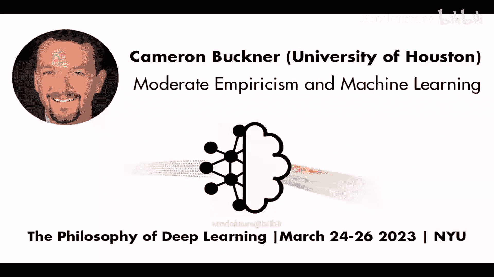

Welcome to the Philoso of Deep Learning Conference。

 we had a very exciting debate preconference debate yesterday and today we have a great lineup today and tomorrow I want to start by thanking our sponsors。

 this conference is sponsored by the Presidential Schal Society and Neuroscience atc University and the Center for Minb and Consciousness at New York University。

😊，And it is organized by Nedlock， Dave Shaalz and myself and with the support from our wonderful colleagues at Columbia and NYU so we I'm very happy to introduce our first speaker today。

 Cameron Buckner from the University of Houston who will be talking about machine learning and moderate empiricism。

 so please join me in welcoming Cameron Buckner。W to see， can the microphone come that I too tall。

Okay， this is on okay， great， so I wanted to start just by saying how very happy I am that you are all here。

And to you online I'm very happy that you are all here too because for a while I have been talking to all the other philosophers who would listen saying I think me need to be paying a lot more attention to what's going on in deep learning right now so i'm very pleased to see you all here interested in these topics and to the other speakers too because you know if I were to organize the conference this is exactly who I would want to see and exactly what I want to hear them talk about and I didn't have to do any of the organizing so thank you very much to Ned and Dave and Raphael so。

You part of my pitch is that I think philosophers and computer scientists should be talking to one another a lot more in particular in a historically grounded way and in that line I have a book hopefully coming out this summer nothinguffing on wood here that tries to offer a philosophical framework for grounding that discussion I'm going to give kind of the basic pitch for that today but due to the time I'm going to have to move through a lot of stuff really quickly it's going to come out with Oxford and they let you post the first chapter online so I put that on my website if I go to quickly you want more details you can go to Phil Arch or my website to read more。

But the basic pitch for the framework that I'm offering in the book and in this talk is empiricist philosophy of mind going all the way back to Aristotle but especially Lock Hume and so on is a great framework for grounding and discussion I'm not the first to note to say this。

 but I worry that it's been a little bit misframed has been framed in the most useful way and so I'm trying to push it back and also give lots of off roadads both to the philosophers to now understand all the different architectures that are out there in deep learning what their philosophical relevance is but also to the computer scientists where they might jump into the historical literature or secondary literature on the historical figures to learn more。

So a little rundown of the talk I'm first going to going to give what are the stakes of this debate。

 which I think is now framed or you another reincarnation of this longstanding debate between nativism and empiricism now in the context of AI I'm going to suggest a reframing of that debate from some of what we've seen in the last five years or so that I think is more useful and then I'm going to pitch a particular strain of moderate empiricism that I think actually characterizes most of the research in deep learning that's maybe more charitable than some of the controls of empiricism that we've seen lately。

 and then I'm going to just give a little bit of advertisement for later chapters in the book to show how much farther you can take this perspective and understanding other recent achievements in deep learning。

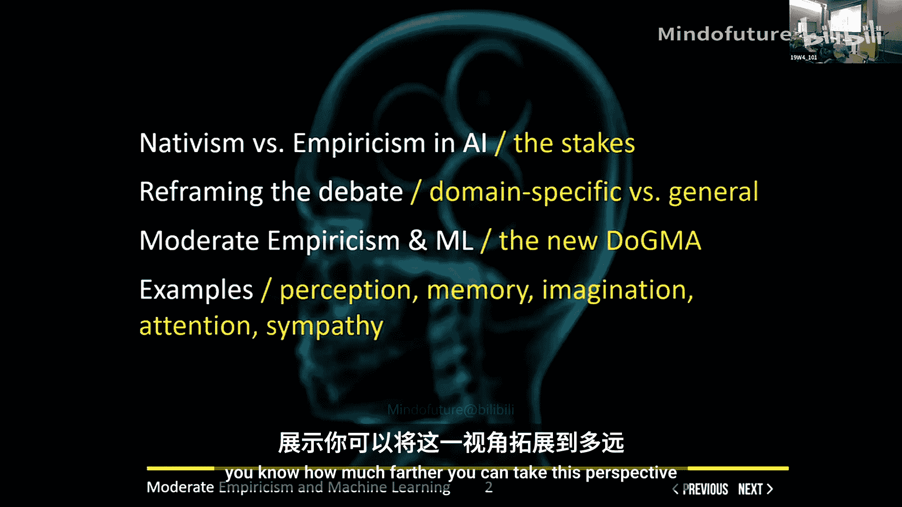

So you know like I said， major figures have already invoked the philosophical history here I'm not like imposing this on them。

 so you know in the Al Ze paper they mentioned the tabooula Rasa and this is language that goes all the way back to Aristotle。

 but tabbuula Rasa referring to the wax tablets that the Greek academies used to take notes which could be blanked by reheating them and that would make the wax clear so you could write on them again。

And they want to say like you know we designed it to do this without any human knowledge built into it from the beginning and Gary Marcus has also then targeted this claim in that paper。

 so you know this is already very much at the forefront of the discussion of what should we be doing in deep learning。

 how do we interpret current achievements and where should we go next and particularly what's an issue is how much knowledge should we be building into these models from the beginning。

What we have here is another incarnation of this very longstanding debate between sort of nature and nurture like is and it's basically is human knowledge more the result of sort of interpreting the cipher of experience or are we kind of unpacking an innate mental endowment to get the kinds of abstractions that make human cognition possible and this is a grand dualism like sort of many others you know between good and evil or reason and emotion mortal and divine and I think these dualisms have a very powerful attraction on the human intellect they pop up again and again and again throughout the centuries in different forms and but they can also cause us to kind of。

Oversimplify things and sometimes misinterpret one another's views。

 sometimes you get opposing intuitions rubbed against each other in a way that's not very helpful and you always so you always need to carefully tend them。

I compare these dualisms in the book to like the discovery of a basic technology like fire where now you can like do things。

 you can formulate new hypotheses， new methods that maybe you couldn't without the dualism。

 but they also have sort of like attendant danger you know the fire can burn out of control or generate a lot of smoke lets you not see what's going on in the details。

 so we need to be careful and I think philosophers have some experience tending to this particular fire。

And there is some benefits， so you know I know philosophers of science in the audience。

 especially those with a background in biology， might be going oh no here we go again right nature and nurture you know。

 didn't we learn after decades of bitter disputes in biology that everything's really an interaction between environment and genes why do we need to do this again but。

YouThere have been some big success stories where this dualism has influenced some of the most important achievements of 20th century science。

 you know Einstein， John Norton has this good paper about how Einstein's reading of Hume's and empiricism sort of inspired his general theory of relativity or special relativity sorry and Noam Chomsky famously invokes Descartes nativism in his design of his linguistic theory。

 so know it's been very influential and sometimes it's very successful source of inspiration for theorists so we shouldn't give up maybe too easy we should see if we can reframe it in a more useful way to avoid the talking past that maybe occurred at sometimes in that debate in biology 13。

So really I think what's going on here is there was this disagreement 2500 years ago between Plato and his student Aristotle about the source of universalizable or generalizable knowledge。

 right Plato thought that the sensory information was just two paltry a starting point to get the kind of knowledge that we get that can generalize to future experiences is universalizable and Aristotle no insisted that it has to somehow come from sensory experience and we've never really recovered from this basic fight between teacher and student a long time ago。

 I'm not sure why the empiricists always look right and the rationals always look left I only had to flip one picture here actually and you know Dave used a couple of the same pictures in his talk yesterday so I didn't I'm not doctoring this but it shows up like I said again and again and again and new incarnations in every century and the current one is no exception。

In the present incarnation， you know a number of thinkers here's today a pearl with an influential blog post he made worrying about a kind of radical empiricism capturing recent machine learning deep learning research。

 according to which you can learn everything just from conditional probabilities in the data in this influential BBS critical article by Lake Pullman Tenon Baumman Gershman。

 they put a little more meat on the bones they go back to Tring and say Tring had this kind of imppiricist view that the mind had rather little mechanism in lots of blank sheets and they tie this to echoing behaviorism。

 a dominant psychological tradition and Tring's time and they say this view the simplified behaviorist view was repudiated by cognitive science right this is kind of standard sort of postchmsky and tail you get again and again again lots of different places this is a narrative I kind of want to challenge that that's really what's going on in decaring today。

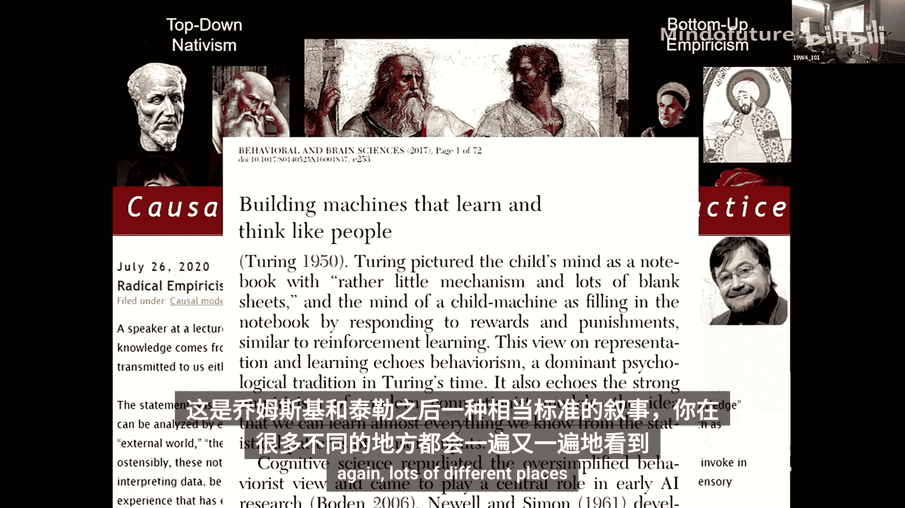

What we could do， I think instead。You know okay so instead of the timeless unsolvable philosophical riddle。

 we could try to convert this into a testable empirical question right namely we have a set of methods that are inspired by nativist philosophy and a set of methods that are inspired by empiricalpiricist philosophy we build bots according to those methods and we just see which ones are most successful or human life right so instead of being something that we need to resolve with a priori debate methods we can treat it as a testable empirical questions to be arbitrated with empirical methods to the winner go the spoils and you can see all the good robots over here so you know all right。

Like very quickly just do some terminological stuff what do we mean by innate and learned here we could give a three hourour lecture just on different approaches to innateness and philosophy I'm not going to do that I'm just going to do a citation dump instead and say for present purposes all I'm going to do is say innate means not learned kind of minimalist view that's good enough for present purposes that puts all the wait on what has learned me here again I'm going go minimalist just for time's sake all we really meet me to me here is anything that a parameterized neural network architecture trained by gradient descent and end can do after training which you couldn't do before again you can you can write a whole dissertation means waters if you want but there's not time。

So one way to give some grounding to the basic question is you know what is the origin of abstract knowledge。

 you know， for example， a particular example that was actually talked about at length in both the history of philosophy and in current cognitive science。

 what is the origin of the abstract idea of a triangle is it innate or derived from sensory experience and the reason that this is a difficult thing to do you know is when you're exposed to triangles you see a lot of different triangles right they idiosyncratic in their in their presentation of particular features they have different angles。

 different sizes， different locations in the visual field。

 different angular orientations and so on and how do we abstract you know the abstract general idea of a triangle that somehow is shared in common amongst all the idiosyncrasy how do we do that there is a question lock raised directly。

It essay。嗯。And I also want to in generalizing to the current moment。

 ask what kind of empiricism should we attribute to deep learninging。

 so is it like the simplified behaviorist view that we've seen in a couple places or should it be something a little bit more subtle and I think historical empiricists here were indeed much more subtle If we look to the critics you know Stephen Piinker has famous book the blank Slate he has not entirely charitable view of what empiricism is in that book that a number of people have called out he kind of dismisses it of being silly。

 blank Slates don't learn anything you can throw any amount of stimulus you want at a you inert mineral slab it's not going to learn anything I think all major empiricists have recognized this but Gary Marcus more recently you know Piker Piker was his mentor。

 he kind of tries to formalize this view a little bit better and this is in his archive paper that I mentioned earlier。

 he says one might think of cognition as a function over four variables A R K and E where a is innate algorithms。

 R's innate representational formats。

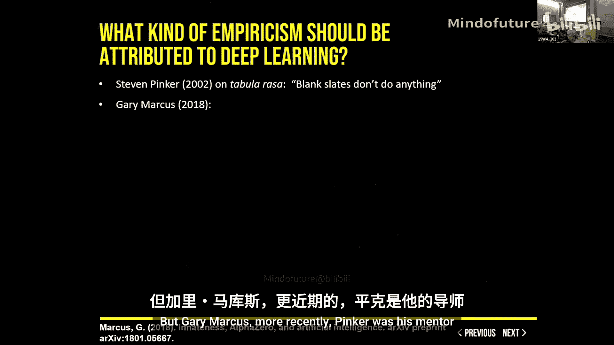

In acknowledge and Es experience and he says the true blank slate would set KN R to0 a to some extremely minimal value and leave the rest to experience and he says this is the view that Locke articulated when said all ideas come from sensation or reflection Now this was the part in reading this where I said what is going on here because if you read even the next few pages of Locke he talks about attention and imagination the fancy by which he means imagination he talks about psychological faculties right so the overarching theme I'm going to try to correct here is that all of the major historical empiricists you know were to one degree or another faculty psychologists that is they believe that they might have a kind of cognitive architecture that allowed it to extract abstractions from experience。

 they appeal to these faculties again and again in their explanations of where we get particular abstract ideas like triangle for example。

 but also even more advancements like justice or goodness or whatever。

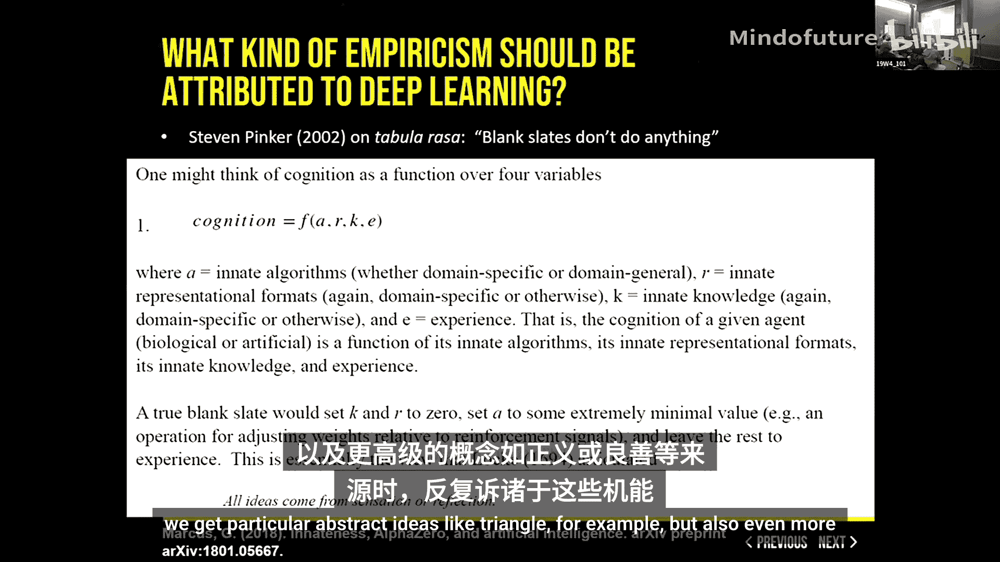

So I think we should reframe this debate instead of is anything innate versus is something innate。

 that's not a useful frame to one versus is what's innate domain specific or domain general， okay？

So in particular， all of the historical empiricists and I'm going to argue current many。

 many current deep learning theorists assume that there are some rather rich domain general resources that can be built in from the beginning that are not learned by gradient descent in particular the architecture of the networks you know I know some people say that it should be learned also but most people don't they think you can take that for granted and that it roughly corresponds to some kind of brain structure wiring motifs or whatever。

Nativist philosophers Lawrence and Margolis for what it's worth so they are kind of on the other camp。

 they've also worried that this way of framing debates where current empiricism is just neobehaviorism has the consequence that for some time there really aren't any empiricists and maybe there never were。

 maybe even the radical behaviorists had a more subtle view than this is something wine even complained about explicitly quite a while ago that even the radical behavior is presume some innate structure。

 the debate I think should rather turn on whether domain specific representations are acquired by specialized domain specific systems or by domain general learning systems being repeatedly engaged so like memory attention。

 imagination being repeatedly engaged for lots of different domains memory for example being kind of a paradigm domain general resource in that it can perform its operation on sort of any type of content whether it comes from perception or imagination or reflection whatever。

As the Stanford Encyclopedia entry on Locke puts it while the mine might be a blank slate in regard to its content。

 it's plain that Locke thinks we're born with a variety of faculties to receive and abilities to manipulate or process that content once we acquire it。

 thus for example， the mind can engage in three different types of action putting ideas together which i'll talk about in a second。

 and in addition to these abilities there are such faculties of memory which allow for the storing of ideas。

 these things don't have to themselves be as an empiricist to card carrying。

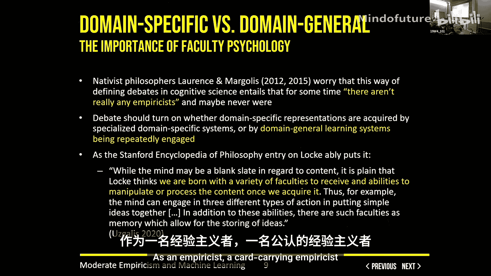

Here's just， you know an example of Hume's faculty taxonomy， for example。

 from the Hume scholarol you see familiar set of domain general facult， memory， imagination。

 and so on。Now to be charitable to the other side， you know don I do think there is still space for a meaningful debate between two groups that disagree with one another and both of which are empirically plausible。

 the most popular nativist option would be something like core knowledge。

 I think this is very popular amongst critics of deep learning today say we need to build a little bit more core knowledge into these systems in order to get them able to intuitive physics theory of mind。

 arithmetic， maybe some naive logic， and to do that we need to build at least some small number of slightly domain specific concepts into them from the beginning。

😡，So the moderately empiricist alternative that I want to articulate that is not the radical behaviorist caricature。

 but the moderately empiricist alternative is that we have domain general faculties governed by domain general inductive biases could be implemented via wiring motifs or architectural constraints。

 global parameters in the model are sufficient to extract domainspec abstractions from rich structured environmental input here's a few position papers from some major empiricists deep learning researchers。

 some philosophers commenting on them that I think you can get this justist from these position papers pretty explicitly。

 and by the way they argue that abstractions that are extracted in this way rather than being manually encoded will be in the end more flexible。

To larger number of situations here's an example of what some of those domain general inductive biases might look like from a position paper by Goel and Benggio a couple years ago you get things like group equivaris from convolution operation recurrency gives you equivariance over time soft attention gives you equivariance over permutation like transformers and so on right these are all domain general I think it's the important part why they're still inpirosis。

So I think if you do this reframing。As I suggest， you get a much more subtle continuum of use right between sort of radical behaviorism on one end。

 radical empiricism on the other， but then most of what's empirically plausible is somewhere in the middle and you have to think about like where do I fit on this continuum where the line is at least something like how many domain specific concepts or learning systems do I need to put in in the beginning to get humanlike cognition and how much do I think iss going to come from experience。

 I've shaded this area here because I think this is the part that's still empirically plausible we've learned a lot and I think empiricists are basically one most of the field I will say compared to you know like original government and binding Chomsky where you have potentially hundreds of principles and parameters or Plato thinking basically every simple concept is innate from the forms I think this is the area between like maybe core knowledge being sort of the most nativist option that's still empirically plausible and then maybe some version of lock or something a little bit further to the left of that。

The most option it's still empirically plausible for empirs。

So interim summary before I start getting into some specifics。

 why is the history of philosophy here potentially important both to computer scientists and philosophers interested in the state of the art。

 the question of nativism versus empiricism is seen as having crucial consequences and engineering methodology right in particular should we manually program chron knowledge systems into intelligent agents usually using things like rules and symbols in a classical or hybrid system or should we enable them to learn the domain specific abstractions themselves through the use of domain general inductive biases implemented being architectures or whatever？

But this connection is not being drawn in the most productive way so far。

 deep learning channels the historical empiricists not the psychological behaviorists and deep learning engineers might continue to mind gems from the history of philosophy especially for more general cognitive architecture and more systematically rational decision- making like I say if you read the first few pages of Russell and Norvi's know AI Bible they give a paragraph from Aristotle in the first few pages right and they say look at this。

 you can sort of read an algorithm for rational planning out of what Aristotle said I think you can do that dozens of places in the history of philosophy and I'm going to give you a couple more examples today and I don't think that's a coincidence like I said I think the problem space of historical andpiricist philosophy is the same problem space that deep learning engineers are working in today I actually think if Locker youor are alive today they would just feel like kids in a candy store with everything they can say that we knew the mind did this but we had no idea how and now you have some mechanisms that can do that。

 isn't that great。So philosophers in particular can dispel magic from classical andpirrcist accounts Locke and Hu repeatedly got savged by their commentators you know where。

They would do this thing Hu in particular would do this thing he says look I know the imagination does this thing。

 but I have no idea how to explain that I'll give you the evidence that it does it but there I'm just going to step back because I'm going beyond what I could say responsibly you know a modern cognitive psychologist might think that's a responsible thing to do but the commentators at the time svaged him for just sort of wishful thinking hail Mary passes but now you know we might finally。

It's a really exciting time to be interested in Empiricistist philosophy and be following deep learning because it looks like for the first time we have some systems that can actually do these things that they were just speculating about。

 isn't that great？So returning to this question， okay， specific example。

 how do we get the innate idea of a triangle， this is something that deep convolutional neural networks of the sort that like laccooon and others were so influential in developing could do pretty well right and you do it by having a stack again I'm not going to get into any of the mathematical details point you to other publications like this ph compass piece I talked about here where you stack a number of different operations in a kind of deep hierarchy convolution and pooling in particular and by the end of it you get a kind of transformed input signal that you can pretty well classify pretty abstract types of objects set and it has performance at you know human or maybe even superhuman levels of accuracy。

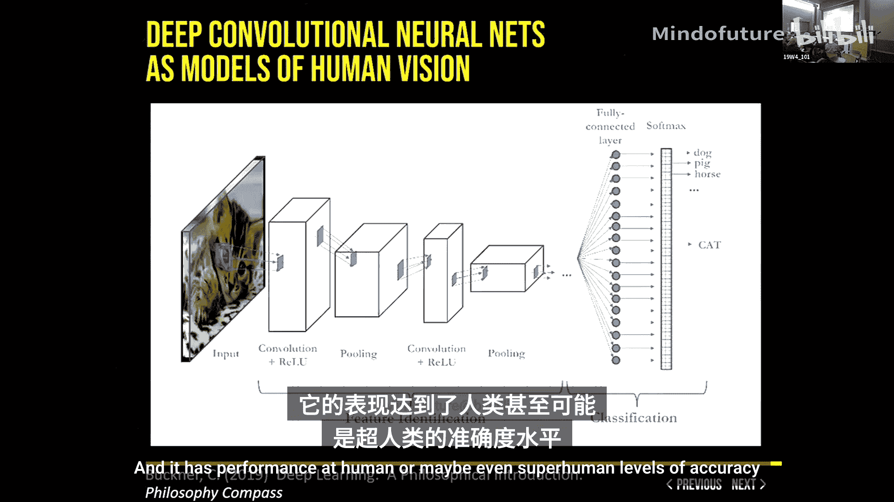

One thing I want to clarify before I start talking about the relevance of what like a deepconvolutional neural network does to what humans and animals do is a question of whether they're really intelligent or really agents versus modeling intelligence or agency I think a modeling languages a little bit more useful at least for now so what does the success of these models teach us about intelligence cognition or rationality I think current models are likely and this should be kind of obvious they're only slivers of rational agents right they're kind of parts of rational agency I think they're relevant they're not nothing they really are modeling real aspects different making aspects of these systems but they're obviously not a full rational agents for some of the reasons that came out in the debate yesterday。

So I think this is helpful to remind in the beginning。

 it's a separate question which aspects ground the moral social。

 political or existential value of rational agency and we need to do some additional philosophy to figure out。

 you know， are the aspects that we've modeled in these systems so far the important ones。

 that's separate philosophical task。

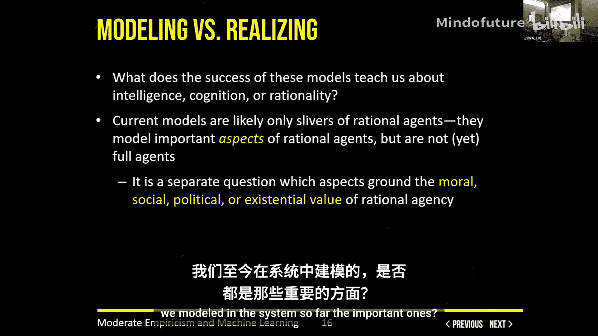

One way you could try to make sense of the relationship between these models and what the mind does。

 Catherine Stinson， who I saw here earlier and talked to her later。

 has this view that there's maybe a kind of generic mechanistic kind that is a kind of abstract mechanistic structure that's shared between some of these models and maybe the mind or brain。

Decarlo and Yemens， for example， have claimed that a deep convolutional neural network and the ventral stream processing in the perceptual parts of the brain share what they call a linear nonlinear decoder mechanism that's kind of pitched at the right level of abstraction to explain how both of these systems do the job of controlling for that sort of nuisance variation and say recognize and triangles that I talked about earlier。

I asked Rosa if she was going to talk about this， but Rosa also has a good paper with Dan sort of giving an even more technically subtle version of this sort of view that could you could define the similarity between the model and the target system using precise behavioral decoding measures and transform similarity metrics and I will forward all questions about that to Rosa well she said she've probably not going talked about it。

 you can ask her about it later。So you can make this sense of aspects very precise if you want in one way or another。

 and if you know I'm not using aspects as a hedgeword。

 Galtero Piciini has a recent book where he you know goes on the metaphysics of aspects for several chapters you can really do high church metaphysics if you want。

 it's it's a technical word， I recommend these other resources。

But what are the aspects then in this particular case for deep convolutionial networks that are now quite successful at category recognition object detection。

 I think again this is the case， empiricist philosophy of mine gives us a really good framework for understanding what those different making aspects are and also making them intelligible to non-specialists and I think this is really important because these networks are now everywhere right they're doing all kinds of things and people want to know what are they doing what does this have to do with what I do when I recognize objects and I think empiricist philosophy of mine is a great resource here。

So if we go to lock and we ask， okay， so how do we recognize the abstract idea of a triangle he gives us a few different methods of abstraction so the first you can call following Chris Gawker abstraction as subtraction so that's like you put together a bunch of triangles with all their idiosyncrasies and you just subtract out the ways that they differ from one another and whatever's left is the abstract idea of a tri that's one method of abstraction lock talks about another method lock talks about is now you start with abstract components you start with like the abstract notion of a line。

 the abstract notion of an angle， maybe the abstract notion of three and you put those abstract concepts together in the right way to get a more abstract concept right so you know the dotted here indicates these are already a little abstract and you put them together in the right way to get a more abstract concept that's another method lock talks about。

Another method Lock talks about。Is called abstraction is representation and that's where you don't actually really do any any abstraction leaving out or assembling that way you just use one particular example to kind of stand in for the rest of the class right and this was favored by Barclay and Hume when they were kind of criticizing law for the earlier two methods and there's another method that you can pull in particular out of Hume that's maybe most useful for things like mathematics logic。

 the most abstract domains I call it abstraction is invariance and that's where you try to figure properties that are conserved across some systematic set of transformations or permutations right you kind of try to do these transformations or permutations at the limit and whatever's left is the abstract property know there's theorems in physics for example or an example of abstraction as invariance and so here's some citations if you want to get further into that。

What I think is particularly interesting in understanding the relationship between deep learning and philosophy here is that the history of philosophy often treated these methods of abstractions as competitors right like we got to figure out which is the right one or you know argue against one to make a case for the other。

 but one thing that I think that's cool is that if you look at deep convolution or neural networks。

 they really have components that do。

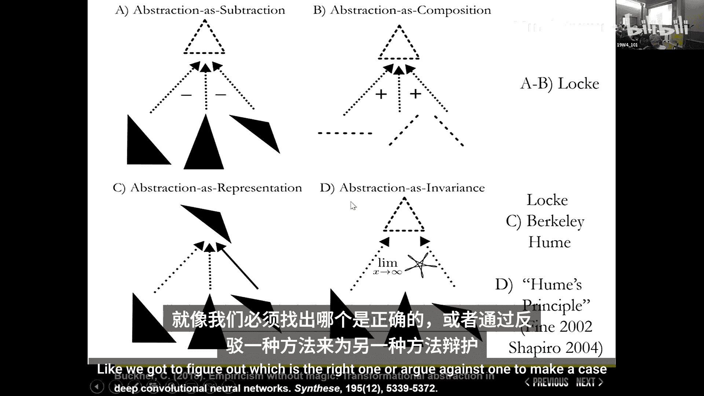

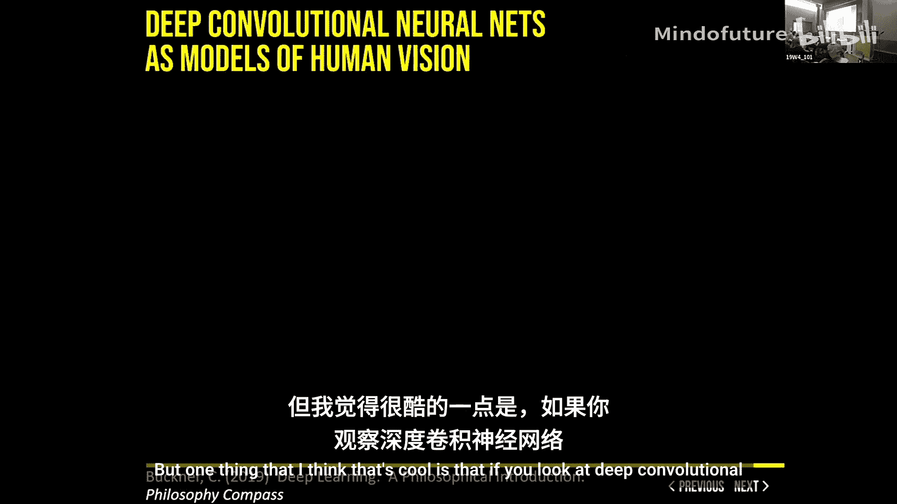

At least three of these things okay at least abstraction is abstraction。

 abstraction is composition and abstraction as invariance so the convolution operation。

 one thing I argue is that it kind of does abstractionist composition right it's a filter that is a feature detector it builds more complex features using the weighting convolution operation from simpler features that it gets at the previous layer。

Right very much like law describe。The max pooling operation right。

 so you know if you're doing letter recognitions I figure I made to kind of visualize one particular application of this for like word recognition。

Is the max pooling operation you could have say different ways of detecting a feature like a bee。

At a lower level right and the max pooling node only fires if one of those potential ways of doing a be goes above a certain threshold and then it passes that information that one kind of be was detected about here in the input it's a little more resistant to the nuisance variation。

 the different ways that you could write theses right。

And that's kind of like abstraction is subtraction right you're you're leaving out some of the details or minimizing some of the idiosyncrasies at the previous layer to say they were different ways of detecting a more abstract feature。

And you can keep going so every abstract every abstract feature that you build at an earlier layer can be reused again and again again and it becomes more and more and more abstract as you go up the hierarchy。

 okay， you're not really going to the full limit the way you would want to for full abstraction is in variance。

 but the deeper the network， the closer it can approximate one of those limits。

more and more controlling for nuisance variation， I think this is why deep convolutional neural networks are so efficient at the things that they do it's very consistent with what like Yemons and Dec Carlo and Fukushima and Coun have said about why these networks work。

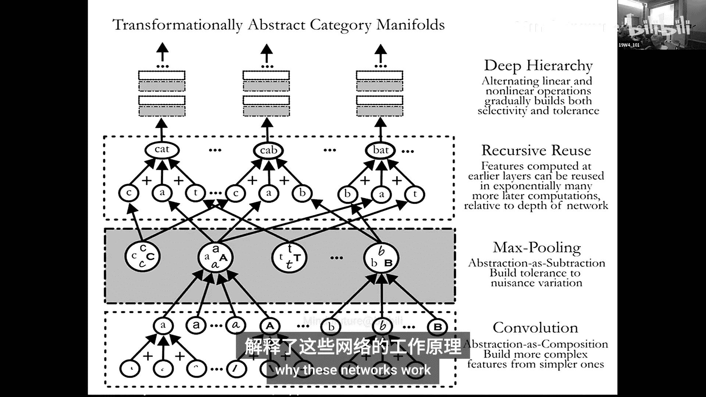

So what is the basic tenet of empiricism， a lot of people go to Hume's copy principle to kind of justify the simplistic view。

 all our simple ideas are in their first appearance derived from simple sensory impressionpressions。

 which are exactly correspondent to them and which they exactly represent。

And you might read this in that kind of really restrictive way saying oh gosh。

 well everything's got to just be a duplicate of some sensory impression and that's all the mind can do with these things and the kind of concatenated with one another and so on And he certainly gets read this way a lot even by philosophers but there's a lot of textual evidence that he all along allowed for more than wrote reproduction with the copy principles so for example。

 when talking about a faculty， the imagination he says nothing is more free than the imagination of man and though it cannot exceed the original stock of ideas furnished by the senses it has unlimited power of mixing compounding separating and dividing these ideas in all the varieties of fiction and vision that sounds pretty permissive about what's going to count as being an approach to inpiricism here I think to mo the Meter has a great paper here where he specifically robusts voters rather restrictive reading of Hume in these passages Humes often interpreted here as wanting to be like the Newton of the mind to give us a kind of basic set of physical laws。

governing how mental representations interact with one another to produce rational behavior and you get this picture of like ideas are like kind of billiard balls bumping into each other the way life basic physical objects would be but Demeterter argues the better model is like mental chemistry for human where the thought is the imagination is like a laboratory where you can combine different ideas and you can maybe get a new compound that has properties that aren't just the sum of the parts they not just bumping into each other but really forming new things。

So I suggest the basic tenet should be something more like the transformation principle。

 the mind's simple concepts or conceptions are derived from systematic domain general transformations of sensory impressions。

 and those transformations can have domain general inductive biases built into them of the sort that you saw on that Gy Island。

So I know there's a bunch of generic criticism so you know take yourself back to 2016 or 2017 if you can when we were thinking gosh our deep convolutional neural network is going to be AGI right and there were a bunch of criticisms well no obviously not because there's a bunch of things that are wrong with them they're very sample inefficient they're brittle and subject to adversarial examples you know the panig given they're opaque in terms of what features are learned they have difficulty transferring as well as humans to very different types of stimuli。

 they have difficulty distinguishing correlation from causation for example。

 I know all that I'm not going to engage with any of these specifically I'm rather going to paint a strategy for answering some of these criticisms in future research and the strategy is。

All of the historical empiricists worried about these things too in their own historically situated way and they had some really sophisticated ideas about how to address them with domain general faculties。

 maybe look at that if you're interested。So in particular。

 I want to say yeah DCNNs on their own shouldn't be taken as models of full rational agency。

 They're rather models of early vision right and they're pretty good models of early vision they get some of the key difference making aspects but that's all they do to get you know a full model of the rational agent we need to build more that cognitive architecture back in with other types of parameterized domain general neural network modules so rationality needs to be characterized by a greater degree of flexibility。

 efficiency， insight， creativity to control and faculties can help with that So this is you know the picture much like this one that Lacooon showed yesterday is a great example of this general approach to empiricism that I'm saying is characterizing most of the headline achievements in deep learning these days so this is the rest of the chapters of the book。

 it has a kind of philosopher of the weak style where each chapter focuses on a faculty and an empiricist philosopher who had a particularly interesting。

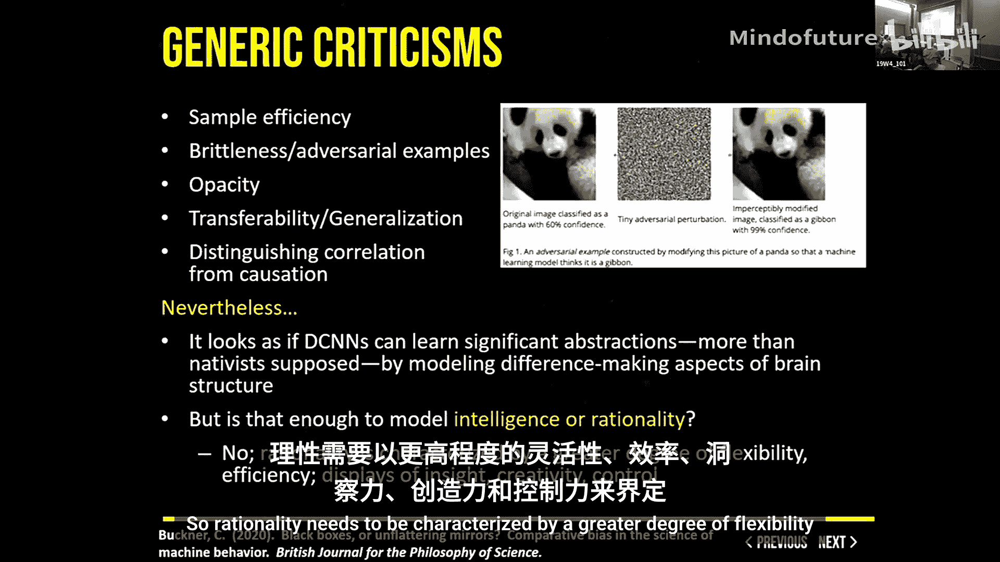

Useful theory of that faculty and then I show how some of the most ambitious speculations they had about that faculty are already implemented or you know maybe could soon be implemented in some particular neural network architecture and again this is kind of how I help philosophers digest all these different architectures is by tying them to like this is kind of like the imagination this is kind of like attention this is kind of like memory。

嗯。And I call this strategy， you know tongue in cheek， the new empiricist dogma。

 where dogma is the acronym， you got to have an acronym for computer scientists to take you seriously。

 domain general modular architecture for cognition。

But it's also like a sort of Damocles right it shouldn't actually become a doctor right we should only keep defending this insofar as it is useful and continues to deliver results and is empirically plausible。

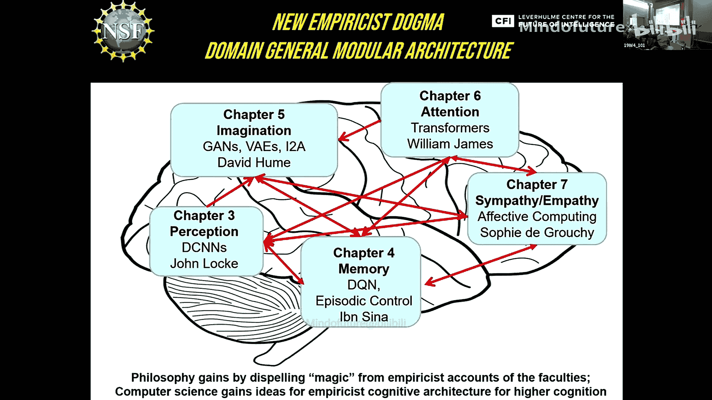

So what could the faculties do to help with these problems for example。

 Well memory could replace successful experience trajectories for offline learning and rapid consequent sensitive decision making。

 imagination could help us compose novel ideas and experiences。

 engaging in offline simulated learning and choose on the basis of imagined future or counterfactual possibilities attention could help us have more efficient and selective processing of input。

 binding features together into holes， approximating variable role-binding operations。

 solving coordination and control problems across modules。

 predictive modeling and anticipation of an attentions target。

 sympathy could help us imaginatively simulate others perspectives from more mature social and moral decision making and there's just a ton of great stuff in the empiricist philosophers about all of it。

this is me slightly translating into more machine learning friendly terms。

 but there's lots of great stuff， also interest， passion， reflection。

 well I don't even get into those in the book but you could write lots of great stuff about those two。

So give some quick examples Inciina who Dave mentioned yesterday had a really cool theory of memory so his starting point was Aristotle's battle metaphor of abstraction。

 which is really the first statement of an empiricist theory of abstraction but it's just a metaphor people have been having a hard time making sense of it for millennia he gives this metaphor it's like a route in a battle when sensory experience comes at you it's just Russian at you and your line breaks right but then you make a stand and one stand and another stand until you repair the front of the line and by then you've got the universal okay that's cool but like what on earth does that mean and Inciina saw that he tried to fill in a lot of the gaps there okay so how does that actually where he fills in the gaps with a kind of hierarchical cascade of inner senses was he dissected some corpses he knew a little bit about the brain it's based on this theory of the ventricles these fluid filled cavalities in the brain we now know that theory is nonsense but the functional part of it was quite sophisticated Kemp。

Letletchers some historians of psychology have this nice paper where they talk about how well Inciina's theory of the innerss fits with 20th century cognitive psychology and some of the hierarchical processing use that are popular there where you have kind of innerasciation trading zones here and then they get kind of assigned with reinforcement value here and then finally stored in the kind of the abstracted memory gets stored in a final storehouse at the end of the process and one thing that both Aristotle and Ivanciina were adamant about here it's very interesting to me from a modern perspective is that you didn't even have the kind of data that was worthy of being abstracted from until you had memory until many particular exposures to the same stimulus had already been abstracted and sort of collated by a faculty of memory and one of the reasons Incien in particular was adamant about that is he thought you needed the affective value of the situation to be kind of encoded in the memory for it to be useful for offline decisions。

making and rational decision procedures。So I compare that approach to memory in rational choice to the DQN architecture from Deep Mind。

 this is one that was used to play Atari games I'll show you the picture real quick of the architecture so you have a Q network don't worry about the details but it's learning a value for performing certain actions in a particular gameplay scenario directly from the pixels on the gameplay group right and it's got a kind of convolutional neural network structure you've got a decision procedure but crucially you've also got an experience buffer here okay。

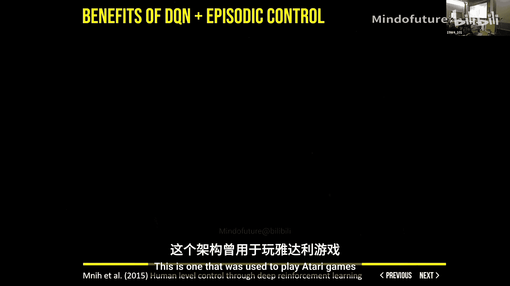

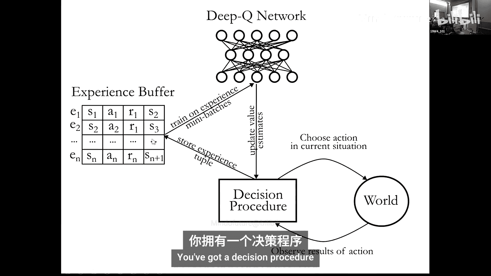

So the way it works is you have hierarchical abstraction from gameplay input screens。

 associate reward values with abstract gain features and use this in adaptive consequent sensitive decision making。

 and the experience replay buffer allows the network to be much more efficient and its learning because it can repeatedly replay sequences of gameplay actions in an interleaved way that provides efficiency benefits and helps avoid catastrophic interference there's a long story in the history of connectionism there about the dangers of catastrophic interference。

The the explicit episodic controller buffer can be added that reintroduces a lookup buffer for much more rapid decision making so this allows like one shot learning in other words。

 the buffer now can be used as also as a kind of lookup table where you say I haven't had much experience in this type of situation but the last time I did this thing in exactly the circumstance it was successful so maybe I just do that instead of trying to consult my Q values from the abstraction process which takes a lot more samples and crucially the memory module here stores the Q values that is the reinforcement value。

With the abstracted situation representations， this is very much like what Ivanciina insisted on。

 you know， thousands of years ago。

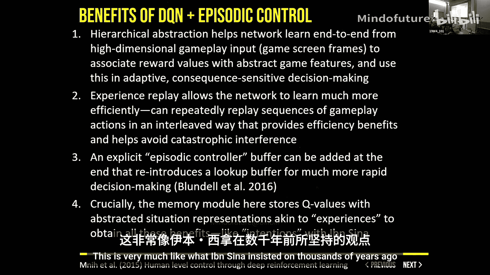

So you know if you look what gets stored here are four tuples。

 this is the abstracted situation representation， this is the action that was performed and this is the reinforcement value from the Q learning network and this is the next abstracted situation what happens at the next time step as a result just like it' and seen as said so you know halfway joking here but you can really plug in the various components of this network into it've and seen as abstraction workflow and it works pretty well and he has a lot of other interesting things to say about how it works。

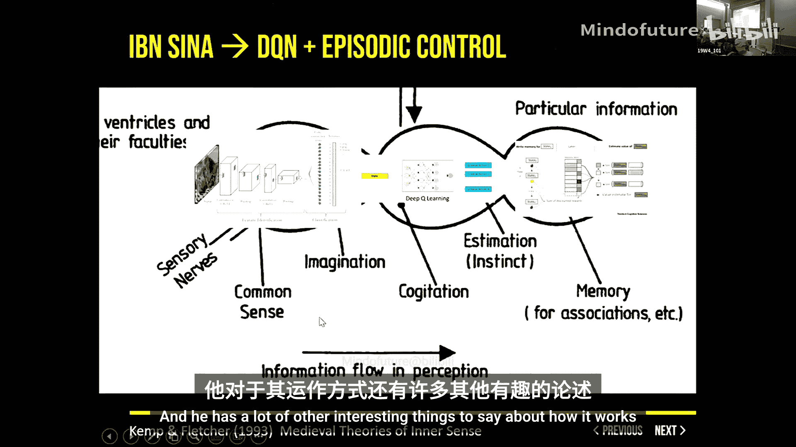

So that's one example Humee also had a beautiful theory of the imagination that often gets overlooked or just misinterpreted you know Foder is even kind of completely stymied by this as I'll show you in a second Hume's raw materials for furnishing the mind are start with the three principles of association this is what photoder for example in reading Hume pays the most attention to so the thought is you're supposed to get everything from the principles of contiguity。

 resemblance and causality that is you know precedence。

And Photo raises these problems for Hume's associationism。

 he says it'll have difficulty synthesizing instances of abstract categories for use and reasoning。

 composing novel or fictional ideas， Hume actually himself and the treatise talks about composing the idea of a unicorn you've never seen that how do you get it or the new Jerusalem with streets of gold and walls of rubies。

 where does that come from I've never seen that in my experience， how do I do it。

 and he says also has difficulty decision making a novel context say based on planet。

So For complains in the Hu variations book where he sort of engages with Hume over a long period of time that Hume solves all of these problems by appealing to the imagination and he says it's cheating for an associationist to appeal to nonassociative faculties that I think is just the misreading of empiricism all along but you can see how his reading of empiricists as psychological behaviors is kind of interfering with his ability to get what's going on by the end of the book he eventually conceived by chapter4 of Hu variations he eventually he's like okay yeah。

 Hu gets the imagination but he still doesn't explain how it works。so he still says， like I said。

 Huum kind of begs off in a few places， I have no idea how the imagination actually does does this。

 I just know that it does。Here's the evidence。So I think now today， you know。

 you've been playing with u Gs， you've been playing with Dolly too。

 like generating novel exemplars comes like pretty cheap。right and in fact。

 I think some of these models the way they work are quite similar to Hume's ideas I talk about this a little bit in the 2018 synth paper it's kind of like the process of transformational abstraction in reverse and again what you get is a kind of specific specification hierarchy in the generative network and I won't go into the details again for time but it goes from a very abstract latent space code gradually filling in details kind of doing the inverse operations they call them deconvolution and unpooling to go in the other direction in other words transform it from a more abstract to a more specific representation and you can generate as many specific exemplars as you want doing that。

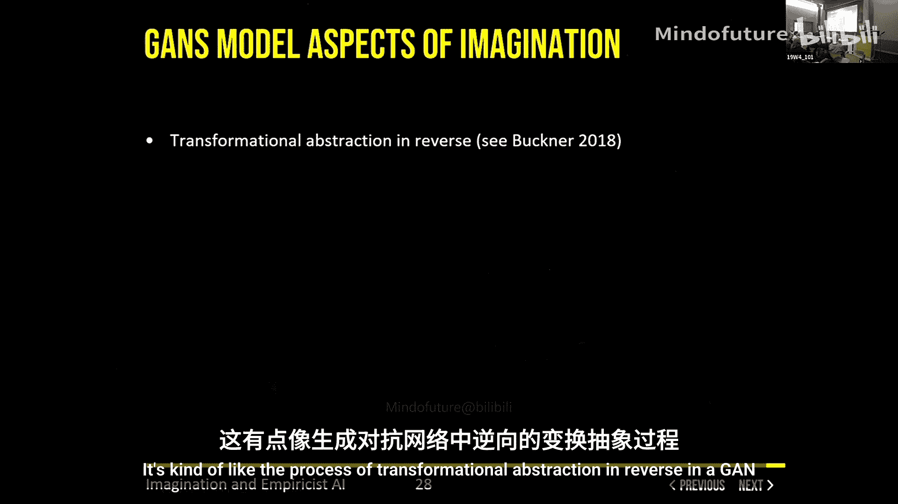

We've also learned that you can do some quite sophisticated composition using methods of vector interpolation。

 so this is you know an ancient paper by deep learning standards today。

 but they found that if you took the vector for man with glasses you subtracted the vector from of man and you added it in the vector of woman you could get a pretty good set of exemplars of woman with glasses even though the training set contained no women with glasses and that was pretty cool there were limitations to this though so in particular David Watson in this paper complaints but it's not a real compositional understanding of the sort that photor wants of the visual scene because for example it takes this picture of Kim Kardashian and thinks you know if you rotate the visual features around it still says this is 100% Kim Kardashian just like this one。

Okay， if you were forced to pick a label it's still 100% more Kim Kardashian than it is any other figure but leave that aside。

 I think there's subtle points about what are we comparing to what in the evaluation here。

 but granted it seems like deepconvolutional neural networks don't make a firm distinction between like what is the exact compositional relations between the future you know maybe it just got lucky for example that sunglasses appeared in about that place and every picture and when it sticks sunglasses on they just get lucky being in the right spot but you can do more with this and we especially by adding transformers and I think this is a general theme of the dogma。

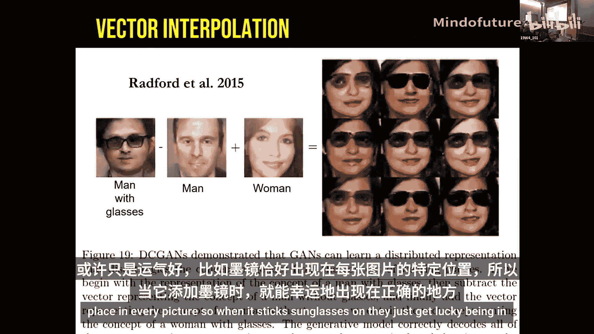

Is that you address the computational limitations of one type of deep neural network architecture with the computational strength of another type of architecture and vice versa if you add in a transformer。

 which again， I won't explain but they are very good at detecting long distance relations know that's why they work for language you can get some of these compositional relations So in particular I like this taming transformers' paper to make this point they kind of add a transformer in the middle of the GAN composure process where the CNN encoder picks out the abstract features that occur in particular locations in the input image and the transformer learns the long distance relations amongst them in this kind of quantized codebook and it learns them just like it would grammatical relations in a sentence。

 It doesn't care like Lacoun was saying yesterday。 He actually talked about this type of architecture。

 It doesn't care that it's operating on features in a 2D array versus words in a long sequence It's able to compose。

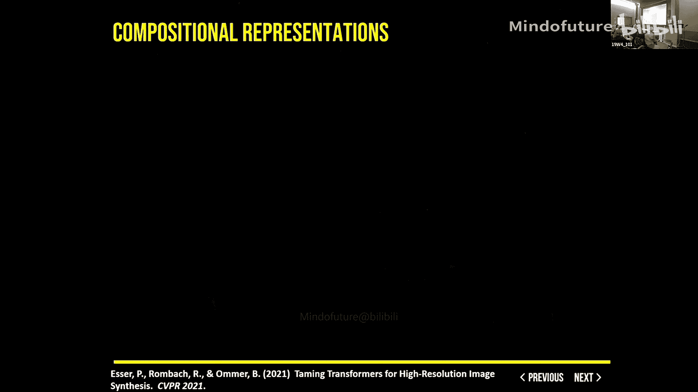

distance relations in the same way， then you pass that quantized relation that's been transformed by the transformer to the generator and now it gets those relations right by and large that's one of the things that's improved the results at least at some intermediate stage of this technology。

They say our key insight is to obtain an effective and expressive models that taken together convolutional and transformer architectures can model the compositional nature of our visual world。

 we use a convolutional approach to efficiently learn a codebook of context rich visual parts and subsequently learn a model of their global compositions using the transformer so I think this is a great example of the dog action use different general modules to kind of address the computational limitations of one another。

Even cooler you can use generative methods like in Deep Mind's imagination augmented agents model to do consequent sensitive planning and future decision making so they use this to play the Sokabon game for example。

 which was very difficult to master with the previous reinforcement training DQN network that I mentioned earlier because if you put one of these you're supposed to put all the crates on the dots right and if you get a crate in the corner it's stuck right and you never get a reinforcement value in other words so it was very difficult for reinforcement learning methods to get any traction on this game compared to a lot of the other games that it was really good at it seems like you need to plan out you know51015 moves in advance before you start doing anything to make sure you're not going to get stuck and not get any reinforcement value and this network in fact can do this I'll give you like the 2 second spiel on it it has a set of rollout encoders that are kind of many generative models themselves where they imagine what action。

Could I do in this case and they explicitly call an imagination course and compare them to the human imagination and then what would be the result in the environment of doing that action and then you just do a bunch of sequences of those right okay action result。

 action result， action result， action result and it builds that rollout before it even makes a decision。

For what it's worth again， read the chapter when it comes out。

 you could almost read this algorithm out of hum for what it's he has a very similar story about how you do planning on an empiricist perspective by kind of melding together forward models。

 forward predictions of what's going to happen as a result of your actions and kind of compressing them together based on how often did I achieve my goal in various circumstances that makes he says something like ideas vivacious and proportion to the degree to which I satisfy my desires in the situation and that's how I make a choice again just another example of something that fits really well。

I use William James for attention which I think is in many ways the most interesting faculty and here we start to get to some places where I think the historical empiricists are still out in front of what we've been able to do so far in deep learning so this might be a place where machine learning researchers could still get some inspiration from the historical empiricists James says attention consists of two things。

 organic adjustment and ideational preparation the latter one being the interesting bit the accommodation part is just the adjustment of the sensory organs moving your head eyes pupil dilation and so on won't say much about that but the second part is the cool part that's anticipatory preparation from within the ideational centers concerned with the object to which attention is paid。

I'll unpack that a little bit for you so he says this is a modification of the imagination it's imagination attempting to guess what will be kind of in the attentional spotlight before it shine there so he has all these discussions of like。

😡，Ppheral vision， what is it to attend to something in your peripheral vision。

 it's nothing more than the attempt to form the clearest picture in your mind of what you would see if you were to direct your eyes。

😡，Before you do， and that forward model accentuates processing in all the ways that cognitive psychology associates with attention by。

 for example， making it more vivacecious， making it more sensitive to divergences between your expectation and reality and so on very predictive processing type view of what attention is doing as we describe it today。

You form as he says， an imaginary duplicate of the object in the mind。

 which shall stand ready to receive the outward impression as if in a matrix。

 it's a cliche in psychology that James ispressci， but James depressionpress。

You might have heard of Grace Lindsey she has a great overview paper of different ways that attention has already been implemented in deep convolution in deep learning more generally mentioned very briefly a couple ways region proposal boxes can be seen as a kind of attention where you kind of mark up the image with places where an object is especially likely to appear and then you focus more processing there it makes the process much more efficient you get accuracy gains to you could also do salient mapping right where you kind of reweight a place where important features are very likely to appear that's kind of like a soft feature attention that can be like enhancing the vivacity of what yourre processing in historical and piist terms what about transformers obviously the one that most people are talking about today their key implementation their key innovation was the self-attention mechanism right that allows you to pay attention to reweight the current prediction of the next word according to words。

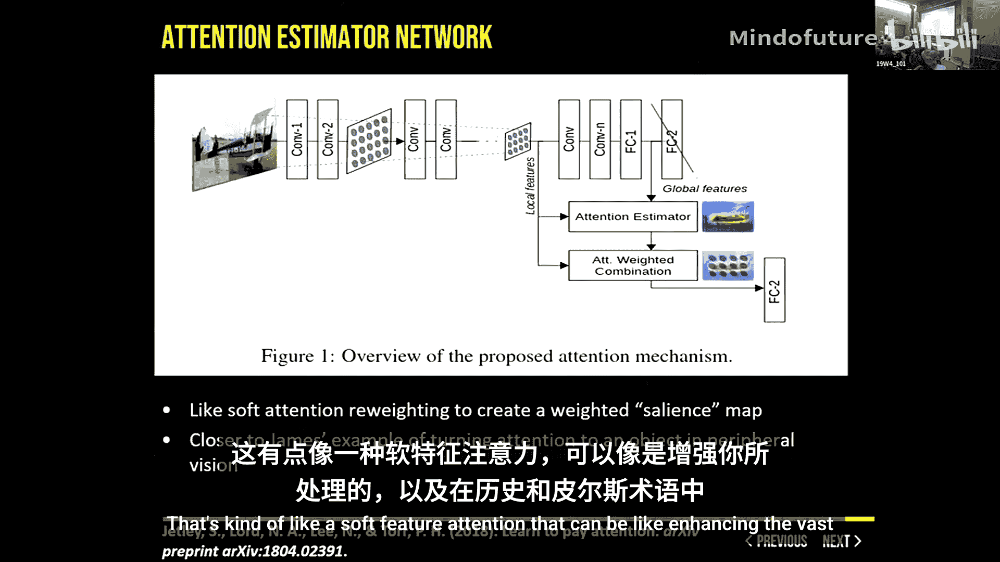

It might have appeared quite distantly in the in the previous context they operate using this multihead self-atten mechanism This is a proprietary operation maybe least like biological attention。

 at least in the brain Raphael and I made a pact before the conference that we weren't going to try to explain it so honoring my pact we'll see if he does I'm not going to I'll just point you to anthropic AIs analysis of transformers and Jay Alammar has a bunch of great gifts trying to help you understand how attention works here i'll just point you to that the quick thing that I want to emphasize and this is where James is still ahead I think of the。

Of the state of the art in deep learning is that I think you know disagreeing now with Lacoon I'm really scared to do that he's a big figure。

 but I think transformers will probably be around here to stay we're just going to use them more modestly we're going to stop thinking that they need to be the whole rational architecture themselves I think they would be super useful for inner speech though to play some of those predictive modeling roles that James ascribes to the attention right so you know you might worry the attention doesn't have goals and it doesn't have really coherent world model and it doesn't satisfy multiple constraints simultaneously flexibly in the world but if you just had a kind of train of thought that was unfolding。

And it was driving and coordinating a bunch of other modules to produce forward models to produce actions and it was in turn getting say reinforcement type learning back from how successful all the other modules were at doing their work that's a whole different game now transformers don't have to do everything on their own they're just one part of a bigger architecture with lots of other modules that again fill in some of the computational gaps that are difficult for transformers to do and I'm not the first to have this idea there's a couple other papers Google has Google robotics has this paper they call inner monologue for robots that is one implementation of this idea and's there's a group in France the flowers group that's very much in favor they call them Vigotsky and agents。

I'm excited about that idea Now finally getting out almost entirely ahead of the cutting edge of deep learning。

 I think are the sentimentalists in the empiricist tradition who their take on moral and social cognition emphasized the moral sentiments。

 which is what they took to be innate in this part so in particular there I focus on Adamam Smith and Sophie deGauci who was a commentator on Anna Smith and wrote along series of letters elaborating her take on his view and I think this points to a surprisingly promising dogmatic research program in social and moral cognition so their take was that or this might take I think social cognition and deep learning is in danger of taking on board too many kind of rationalist Machiavvellian or nativist assumptions about the structure of social reasoning in particular starting with epistemic theory of mine like false belief attribution as being the primary goal I really think that's just a tiny part of social and moral cognition and we need to focus on a lot of other stuff。

 especially under others affects。ingOther goals that's going to be a lot that's going to be the foundation and then maybe we get false belief attribution much later when a bunch of other stuff is online I think we need to do a lot more foundational work first Smith argues in the theory of moral sentiments that the heart of moral and social reasoning is a kind of sympathetic simulation from various points of view which eventually allows us to reach an impartial observer perspective so the idea is like you know kids get angry kids get scared and they are taught by their caregivers and their peers that there are certain cases where it's appropriate to exhibit this emotion on the basis of situational factors in certain cases where it's inappropriate。

Right and you get enough of that learning and also observing other agents getting feedback about when they exhibit their their passions。

 you eventually achieve a kind of impartial observer perspective in your culture where， you know。

 you would be justified in other words in being angry。

 you'd be justified in saying this is unfair to me。

So this view there's some great papers by Sarah Sogoian Fiery Kushman talks about this a little bit in his BBS paper Julia Haas has some great reinforcement learning papers of Deep Min recently this view has many advantages in a world of two systems accounts of social cognition because it can translate material from the particularist effective system and the impartial fairness system in a way that's compatible with reinforcement learning based approaches so。

I'm getting the stop sign so this is the last slide anyway but De Groochi takes one reason I like her view in particular is that she takes reflective sentimentalism down to the earliest reciprocal effective interactions between a newborn and a caregiver she was a mother and she said Smith starts way too late in development right she starts where you're already doing some you know pretty sophisticated abstract reasoning。

One of the things that was very difficult in the history of moral theory was how do we bridge this self- other gap in other words。

 from selfish solipsistic egoism to rational regard for the value of others you know this where you get like colon and morality and this is one of the reasons why I'm so passionate about the gruchchi is she said。

 look you start to care about others at a very basic effective level before you even have developed a representation of the self right infants learn that what happens to their caregiver matters to them and vice versa before they even represent themselves as being different from their caregivers and I think this is a super cool view and so like from that perspective rational egoism is like the aberration that's the theoretically motivated view in the normal course of development。

So this would suggest that future progress in deep learning in this direction should focus on controlled rearing and curriculum learning that's more like the stages through which children learn to develop this say。

 impartial observer perspective to render effective responses robust to what you might think of as social nuisance variables。

 very much like the visual nuisance variables that happen in visual tasks。

Okay so takeaways enough already with the Association of Str Pers。

 somebody tells you deep learning is just skinkinner again。

 don't listen to them tell them to stop all empiricists get active domain general faculties the dominant view amongst most prominent DL researchers today is what I've called the new empiricist dogma architecture should be composed of trainable parameterized modules implementing domain general inductive biases in performing roles attributed to domain general faculties to extract domain specific abstractions and empiricist DN researchers might start thinking more systematically about how these faculties function and could be integrated together into a coherent cognitive architecture I don't think we've seen this yet the way we did like soAar and act R in previous incarnations of AI。

And by the way， many empiricist phosophers felt longer and hard about this。

Take a do thank you if you want those backgrounds， I skipped over workers。累死了。All right， questions。嗯。

So Cameron， I know you know about the controlled rearing experiments with chicks for those who don't know about this。

 this is done by a group in Italy headed by the Lord Tagara there's some recent stuff in the US as well。

 so you take eggs， farmers give their eggs to these experimenters and then they let the chickens hatch in the dark。

And then they can control every single thing the chicken sees and the upshot is that for many aspects of perception。

 they're entirely innate， for example， occlusion there's nothing domain general about lots of aspects of perception so you did mention perception a bit although you focused on other aspects of the mind。

 but what do you think about that no perfect I mean great so。

I think the take is that the empirical tide has actually turned on this so the last few years of studies from Justin Wood at IU。

 which you know I think Ive mentioned in the past before is that he he's done now paired controlled rearing studies where you have the chicks in the controlled environment and they're getting input from you know screen and then you have artificial control rear agents that are driven by relatively vanilla deep convolutional neural network and they get the same visual input as the chicks from the beginning。

And the artificial models without any manually encoded concepts。

 they're able to do a lot of the same core cognition stuff。And I've talked to Justin about this。

 you know， because he started in。In those areas right you know he says I started out looking expecting all the deep convolution neural networks to fail and instead they succeeded。

 they've succeeded almost everywhere I've looked at showing some of the same social biases。

 some of the same perceptual biases that you would have thought needed manually encoded knowledge at the beginning so my take and but this is all very new you know could swing the other way next is that this is showing again。

 the power of the dogmatic view。Domain general inductive biases can actually let you get even from very simple basic input。

 some of the same domain specific abstractions that you might have thought needed manual pre specify。

Okay so thank you for your talk so my question is about causation and your understanding of empiricism and so first on the one hand。

 like for example Gary Marcus when he frames his criticism of empiricism and of decoing he emphasizes that maybe there has to be an innate concept of causation。

 something kanting alongside these space and time but on the other hand my concern is that causation seems like it's domain general instead of domain specific。

 you have a notion of concept causation that you in theory of mind intuitive physics and so on。

And so the the question in like， well， then how is your approach going to categorize it so if Gary Marcus thinks there is this inmate。

 but domain general concept of causation， does he qualifyl as an empiricist？Great question， yeah。

 I mean I think the question of causation is to me in some sense the most interesting question for the next five years。

I started for whatever it's worth little intellectual autobiography I started encoding Judea Pearl's causal baysnets in logic agents as an undergrad and that was great stuff and I have the deepest regard for it I do think you know it would be at least slightly nativist if you had to do something like actually specify axioms of causality in terms of an innately prespecified symbolic concept of cause that would pretty clearly be on the nativist side of this。

But I think， you know， if you think about some of this ways of leveraging the imagination。

And getting more interaction with the environment， you start to get a little hope that maybe you could get some of the aspects of Judea Pearl's causal hierarchy of reasoning。

 he talks about the imagination all over the place too right you might be able to start to get things that approach the causal baseline calculation at the limit。

 kind of imperfectly as a kind of heuristic through imaginative simulation and learning to distinguish things that I did versus things that I merely observed by interacting with the environment different types of learning。

嗯。But I say the very last thing I say in the book is I haven't said all that much about causality and the reason that I think you could write another whole book。

Just about causal reasoning and it would be super interesting you know I've talked with like Jim Woodward at length about this who somebody you might think would be pretty nativist about it he's really he's really not if you get into the really nitty gritty of the developmental stuff with when and how do kids learn to make causal inferences it's just as complicated if not more than the developmental story about different stages of social cognition and stuff which has been studied quite extensively and you might think you need the same type of curriculum learning to get them to do it you know what you start out with with an infant。

 for example that can't do anything for the first few months of life as looking mentioned yesterday and then gradually it starts to be able to interact with the world and so on it's getting very different input at least then you know most of the most of the models that we've talked about so far have been trained on and I'm more optimistic that we'll be able to get a。

A dogmatic empiricist approach that does much better in distinguishing correlation and causation that we've seen so far。

Thanks Cameron so suppose i'm playing devil's at Piia suppose I thought that look all of this is really cool but what you've given is a sort of like a sort of just a range of idealized local models now the question is how do you put all of this together we know that's like really part of the the great difficulty explain in general cognition how do you put all of this together you know this。

These different models might explain local parts of this you agree。

 local parts of professional and I think towards the end you sort of suggest that there's this open problem。

 how do you get to a sort of soil like architecture and put all of this together and。

Get what do you really want which is a explanation about general I mean obviously I don't think you're going to be able to read like a specific algorithm that will let us go get rich off of humor or whatever right but I do think you know there's general things so one of the things I talk about is the theme throughout the whole book is what I call the control problem。

So this is me more sort of motivating。U this is something everybody should be worrying about now maybe more so than they are。

 I mean maybe they worry about a lot of behind the scenes and they don't talk about quite as much of print。

But as we add more and more modules， it's a well known problem。

 it becomes more difficult to keep them all kind of working together the empiricist philosophers of the past for whatever it's worth often put a lot of weight on attention。

And what they would call the will as solving this problem and there's a lot of proposals you know there's proposals about meta reinforcement learning as to kind of simulate the role of the prefrontal cortex in coordinating other modules philosophers you know contemporary not historical but current philosophers I think like Wayne Wu for example other theorists of attention have a lot to say about solving what they call the many。

 many problem or these control problem where you've got a bunch of different systems pulling in different directions and attention is kind of like the solution to that coordination problem what's exactly the right architecture I don't know and the historical andpiricists disagree with one another right I mean we shouldn't pretend like there's one view that you could take off the shelf they thought a lot about what is the exact set of faculties and what is the exact set of interactions between the faculties which job should be assigned to which faculties and which others and we should expect that to continue you know I expect to see a few different。

More global architectures putting together， but I do think that everybody needs to think about this control problem maybe a lot more actively how are we going to get all these things to talk together and more we've seen a lot of models where you've got like two different types of architectures working together and you get good results and maybe it's harder to train than one of those architectures in isolation but I think the problem is really going to compound。

And this was this is for whatever it's worth something that like Hume and Locke。

 they wrote about at great length what if imagination differs differs a different verdict than perception。

 what do we do right and they talk about madness as an example of where you know one of the modules kind of loses its provennce or it gets too much power and the deliverances of the imagination become too vivacious Locke writes。

 you know， the person who imagines himself to be king and starts demanding everyone else supplicate to him is not a problem so much with his rationality so much as the coordination between his modules you might say like if he' working king。

He's behaving rationally， right， but it's more a problem about the provenance of his modules coordinating。

So there's a lot of stuff there that's interesting。Hello。

 I'm a student at the University of Pennsylvania。 I want to thank you so much for presenting this was like very。

 very mind blowing for me。 I want to ask it feels like a lot of the。😊。

Concepts that you're able to cherry pick from philosophy are directly relevant to our deep learning systems today and I would like to ask what about failed machine learning theories for instance。

 the symbolic paradigm seem to dominate in the 1990s or like you might see like certain algorithms that seem like they would work good in like a philosophical sense but don't actually work as well and I'm curious if we're able to tell which philosophical theories are flawed or create like failable testable philosophy as compute power increases I mean I just I approach all of this more empirically I don't think that we were ever going to be able to solve these debates with a priori armchair reasoning the way that maybe some philosophers cope I think they're all empirical to some degree we're just going to have to see how things go but I think there's an inductive argument that empiricism is more likely to be true。

I， I have a slightly little bit of the question about what is it that we're actually trying to explain with the dogma because I feel like I've heard a lot of discussion of what machine learning systems have to work。

How we can describe human behavior， the behavior of chicks， the behavior of children。

 but it seems like in practice， if we're doing experiments empirically the constraints under which machine learning models operate may be quite different from the constraints under which humans operate the hardware is different the amount of data is different and like。

I I feel like I've heard us kind of like equivoating between are we talking about machines are we talking about humans。

 how do you think about what it is we're trying to explain with dog mind what does progress look like yeah yeah I would。

's equivocating I mean I'm trying to say they share an abstract similarity right that was the part where I was trying to gesture gesture at Catherine's view and Rose's view and this kind of abstract aspects picture and I think people just need to be a lot more explicit about that which aspects am I targeting you know for example the BBS paper that's coming out that a lot of people have seen criticizing models of vision I think a quick response to that is to say most of the people that were building deep convolution neural networks is model of vision they were only meaning to target early vision and they were explicit about it's a lot of a more right so of course there's going to be things that humans know about the visual scene that a deep convolution neural network doesn't because it's just not even trying to replicate that what they really wanted to explain was how do we solve this nuisance variation problem and I think they did a pretty good job of that。

Now I want to clarify a little bit though， like I'm not offering a specific hypothesis。

 it's more like a general methodology。And that kind of thing it's not like you can publish one study or two studies that says oh the dog is true。

 the dog was false， it's really about you know thousands of studies。

 how does the evidence add up over much longer periods of time and what I'm trying to do is characterize two different methodologies sets of methodologies and。

We we track like what's a fair way to construe your opponents in this game and what's a fair way to understand what the other people are doing。

 let's all be charitable to one another so we have a kind of useful productive competition over the long term that's more what I'm trying to do something ats a little bit higher level if that makes some sense I do have a lot to say in the book about other rules for fair comparisons that's kind of relevant to what you said like a lot of times the deep models are being asked to do something in a situation that's extremely dis analogous to what the humans are doing like the humans maybe could reject the question and say I don't think that's Kim Kardashian but the model is forced to choose what's the likelyt celebrity here and of course it says 100% Kim Kardash because that's the best answer that has its disposal and I think there's tons of examples like that this is one place where my history and comparative psychology kind of comes up and I see a lot of the same mistakes that were made in comparative psychology comparing humans and animals now coming up again comparing humans to machines so we should always always be really careful about that。

我。So that question really relates to what I wanted to ask so your answer partly addressed it but I want to push back a little bit or maybe make it more specific in terms of a fair comparison what deep learning has to do is usually considered a replication of evolution development and lifelong learning and so are you thinking about how to make that comparison fair to humans against the machines because evolution didn't the raw materials evolution were done didn't have these faculties so so a bone that's often offered to the empiricists by the nativists at this point is to say well you're just recapitulating the whole process of evolution that's why it's more sample inefficient right so you know if you're thinking well all the history that animals have ever seen in the design of their visual system then sure I think this is like a poison pillar we should reject right we should say no we're actually trying to do the course of development at least you know if that's what you want to do maybe people want to do other things but the question I'm really interested in is this nativism empiricism one and if you。

Accept that。That that gift from the nativist you've lost basically right because then they get to say aha。

 so what evolution gave you is a bunch of innate concepts right and so the part that's recapitulating evolution is the discovery of which innate concepts are the right ones to build in from the beginning。

What I really want to know and the way I would rather focus on is the stuff that you know like the baby cam data that like Brenendan's been working with bunch of other people have been working with recently where you try to do much more ecologically plausible data that's how I think we should really be aligning the the human and the models in a better way and then making sure that。

The choice situation that's offered to the human is as similar as possible to the choice situation that's offered to the model。

 so more ecologically valid input， better alignment of the choice situation。

 that's the way I would like to go to arbitrate this debate rather than accepting an evolution。

thank you Cameron so I wanted to ask about the faculties so know there's quite a bit of evidence from neuroscience recently that you know the carving of our brain or mind and two fult might not be as helpful as we used to think it is I mean so Louise Bailla's work is particularly relevant here and I mean both because the faculty know the borders between faculties are very fuzzy but also because for any sort of task。

Typically many different faculties are employed I mean very many different of our traditional faculty are employed and one thing that's cool about connectionness models is they seem to not。

Require any kind of modularity of the mind and don' be on the face of it and you're sort of bringing that in and I'm not hostile to that。

 but I just want to。Ask how you see you know those issues of you know the voters between faculty being fuzzy and them will typically be intertwined yeah so thanks this is a very helpful clarification question here so what I mean by module here is like the most minimal thing you can mean by module today something like what Carru says for example。

It doesn't have all of the properties of fedorian modularity。

 but there's at least some informational encapsulation and distinctive operations to each module and I would push back a little bit that deep neural networks don't need that because all all the successes that I talked about here where get gains in efficiency gains and planning those all actually did depend on having multiple modules with different architectures put together the pushback from neuroscience I think it's fair enough and something we should all worry about I think you know there's room for different andpirs to have different takes on this and I think that's all a happy family dispute as long as you don't think。

In modeling the brain we should just have this one big undifferentiated architecture that's doing everything I think that feels hopeless and not right that's a view of what the brain does but like Felipe de regard for example you know worries it may like imagination and memory kind of grade into one another that's fine like let's explore that you can get that in a model and then have that combined with attention or whatever let' let's try it out see what happens。

But I do， I think the key idea of the dogwin there's a number of places in the history of the Connectist research that bears this out is this idea that different architectures can kind of bootstrap together to something more powerful than either can do in isolation is the way forward it's the way again and again and I'm getting even more optimistic in recent achievements than I have in。

Yeah you focused most of your energy on arguing with。Nativists。

But you're actually a pretty conservative empiricist by the standards of contemporary Mer learning so i'm actually wondering what you're you know what you say to a much more radical empiricist basically you says big enough transformer enough data that's all we need for general intelligence yeah I mean with with the large language models and GP for this all in all our minds right now。

So that is the one place but I think it's a more recent appearance just like radical behaviorism in psychology was kind of an aberration from the empiricist norm scaling maximalism is a similar kind of adberration I almost think Gary Marcus is kind of brought this into being by making people sort of react against his interpretation they think like oh no nothing's innate doesn't need to be right and they react and I want to say like no you can be a card carryinging empiricists and have a few domain general distinctive innate operations it is an empirical perspective I mean I don't find that most of the scaling maximalists actually saying we're discovering human intelligence though right the vibe by get。

From talking to a lot of them it's like we have an alien type of intelligence。

 an entirely new type of intelligence， it's very different from our own。I would start to， you know。

 as a philosopher get all natural kinddy on this， right and say like， yeah。

Yeah right and and I would also that's their view I think and I would kind of challenge like what's the utility of calling this the same type of thing right okay intelligence is super squishy and evaluative I prefer I actually make a long case in the book why we should talk about rationality rather than intelligence I think it's a better target for lots of reasons。

But I would challenge that there's a natural kind a generic mechanism and Catherine terms's been shared between the large language model if you want to call that an intelligent agent and the human it's not useful to call them the same thing anymore because we shouldn't really expect that there are other inductive similarities kind of under the hood waiting to be discovered maybe the surface level behavior is similarities is all there is so just call it a different thing ad hoc decide how we should treat it。

You know， as a result of what we know about it and don't think because it acts like us that it's got some deep underlying similarity。

I know there are other questions， but we're out of time。

 you can continue the discussion during the break， but please join me in thanking Cameron。

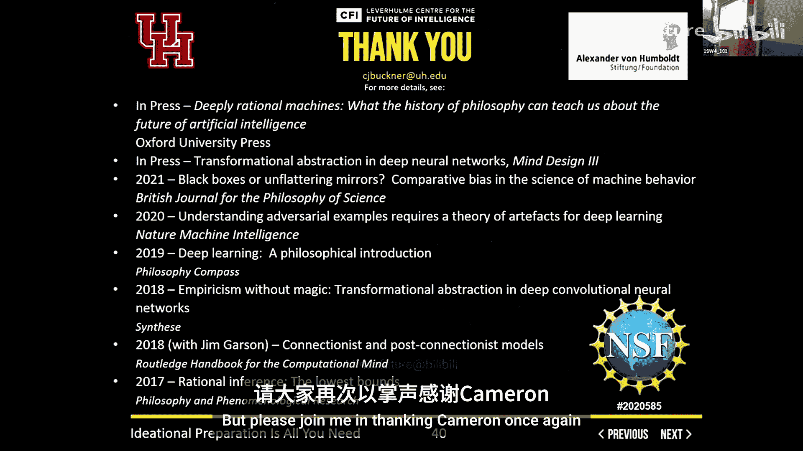