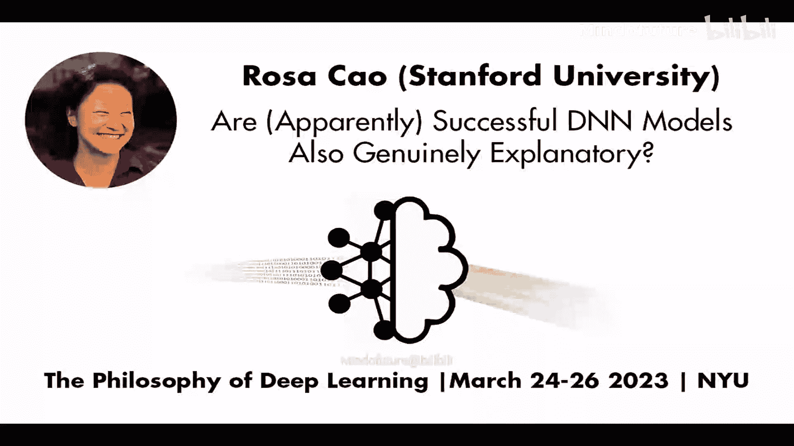
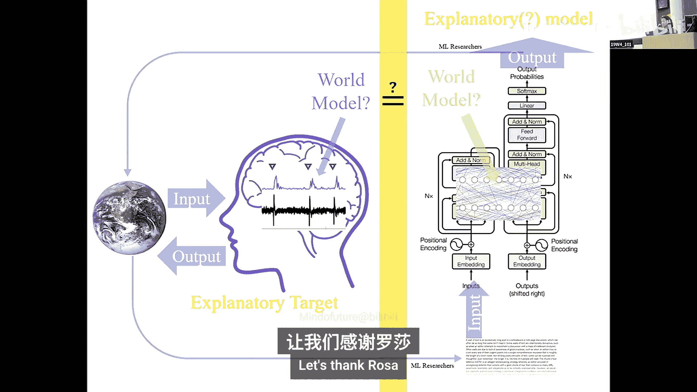

# 【纽约大学】深度学习的哲学 ｜ Philosophy Of Deep Learning 2024 p03 P03_Rosa_Cao_表面上成功的深度神经网络模型是否真正具有解释性-深度学习哲学 -BV1u7ZoBnEAb_p3-

Okay， our next speaker is Rosa Sao from Stanford and her talk is about apparently successful D models and asking whether they are explanatory。

 truly， thank you。Thanks that。Okay， so。I was really excited to be at this oh， I don't know， is it？地方。

Okay， can people hear me now？I thought I got real close。Okay。

 so I feel like these are super exciting times to be alive and one of like the most exciting。诶。Okay。

Rightです。I thinkOkay， is this better？Okay， I was I was going to say these are really exciting times to be alive and one reason it's exciting is like it feels like we're living in the future。

 but the other reason is more philosophical like there are all these questions that we've been thinking about in like philosophy classes that finally seem like they have some like immediate obvious real world application like like all these questions you might have asked yourself about like whether machines can think like now now there are real questions and think I think that's super cool。

Okay， so I was you know， looking at Raphael's handout about what this conference is about and he lists this like set of motivating questions for everybody。

And I just want to， you know， I don't think I need to tell anyone that deep neural network models are apparently very successful。

 so at the debate yesterday like we heard lots of different examples of the things that they can do that maybe once upon a time we thought they definitely couldn't do when I got into philosophy I was really excited by Dreyyfus's book about what computers still can't do and I feel like many of those claims have sort of blown out of the water by developments of the last five years。

But we we're still asking a bunch of questions about what we are to make of this apparent success and in particular I want to focus on two threads in this set of questions so one is you know。

Is the effectiveness of these models does it come from there being accurate models of the world are they doing something like that's like what we're doing or is it something that's like mimicking some aspect of what's going on that isn't really important so I've sort of highlighted places where people have asked these questions in the abstracts of their papers。

 but I think like this question is just kind of in the air。

And and they're in yellow in these questions so like the question is some version of you know are these things for real or are they faking it and i'll try to make this question more precise later and of course technically yes's day's debate was not about whether language models like have understanding or have meaning as El you pointed out it was about what's actually needed to have these things but I think it was on everyone's mind what。

😊，Whether what we actually want to say about these models。Okay。

 so I was really curious and I'm surprised that the organizers didn't ask。

 but I wanted to know if anyone changed their minds after the debate yesterday。

 like did anyone like start out thinking yes and go to no or start out thinking no and go to yes。

 I'll just ask for a show of hands。Okay， so a few people and in which direction。

 like who went from yes to no？And who went from NoD yes？Oh， interesting。All right。

 I think we know who won the debate then。😊，Okay， so。I think I'll also take a poll on my question。

 which is like who thinks that these things like broadly speaking are for real like they really do understand they really do have cognitive capacities。

 they really have representations that are like ours。Who thinks that？

And who thinks they're like totally different and we shouldn't be thinking about them in the same。

Okay， so that's that's also pretty evenly sp， but okay， that's interesting。

So how do we try to answer this question are these things for real Well I think the parts that I've highlighted in green suggest a kind of answer and the answer is something like。

 you know， the same answer we would give if we wanted to know if a human were faking something。

Like in fiction， we might do it by looking into their minds right we want to like read their minds until tell and like figure out they're just pretending or like if something real is really going on in there。

 we want to look at what representations they have。And so too for artificial systems。

 so figuring out what representations are operating in a deep neural network might help us develop a theoretical understanding of those systems in the same way that investigating representations and biological systems might give us a theoretical understanding of how humans and animals produce their complex interesting behaviors that we think of demand explanation。

Okay， so maybe another way of asking the question like are these things for real is are they relevantly like us and I'm just going to talk really briefly about this example that Cameron already already mentioned like we want to ask are these systems like us in their relevant respects and like one important relevant respect that seems to license attributions of meaning and understand to their behavior and make us think they are good models of capacities that we have capacities like vision is do they have internal states that are like ours and do those internal states play the same kinds of functional roles in them as ours do in us and if they do then that's at least kind of provisional evidence that they are for real in some sense？

Okay， so in the case of convolutional neural networks， I guess Cameron already described it。

 but the thought is if you have a multilayer neural network that is trained to do image classification。

 it turns out that you can actually use the activations and intermediate layers of these networks。

 to predict neural activity in the brain and that's kind of surprising because that's not what the models were trained for。

 the models were just trained to be good at image classification。

 but as it happens that made it the case that they were also surprisingly good at predicting neural activity and much better in fact。

 than。The kinds of predictions that people had been making on the basis of directly making recordings from the brain and trying to make sense of them。

So。That that's kind of some kind of evidence that they're relevantly like us in at least some important ways。

 they're relevantly like us in their ability to classify images and they're relevantly like us in the sense that some of their internal states serve as good approximate models of some of our internal states。

Okay， but they're not， so they're good at predicting some neural activity， but again。

 as Cameron already mentioned， there are lots of criticisms that say well。

 these aren't really like good models of human vision。

 there are all these psychological psychophysic， visual psychophysics results that they completely fail to account for probably because they're not really trying to do so and you might think okay well。

😊，That's fine that's kind of reasonable what we should be thinking is like not are they identical to us but given that there are models like we want to know what aspects of vision they are capturing and which ones and which ones they're not so I think usually the question to is the model relevantly like us is you know yes in some ways and no and others and I think that also goes back to something Cameron said earlier that that these sort of sharp dichotomies can sort of hide hide informative structure。

Okay， here's the second example， which is maybe the central example from yesterday。

 like we want to know if large language models are relevantly like us if we want to understand them as models either as models of human language generation so。

😊，This is the human language capacity understood sort of narrowly what Mahowald and Ivanovava called formal competence。

 so one aspect of this might be syntactic and semantic constraints on production you can also ask like are they models of human language use understood more broadly as encompassing our actual use of language in our lives so that's what Mahowd and Ivanovava called functional competence。

And one aspect of this might be that our utterances respect certain pragmatic and situational constraints。

And so we can ask， you know， do chatbot outputs satisfy similar constraints and I think the answer is going to be like sometimes yes。

 sometimes no， and they seem to be okay for language generation。

 maybe better at it than they are for aspects of use？So if we're asking like， are they relevantly？

Okay， if we're asking， are they relevantly like us then。

The answer again is going to be kind of yes and kind of no。

 it doesn't seem like it's a question that directly admits of a yes or no answer。Um。

That's just in terms of behavior though， so if we want to ask like are they relevantly like us in in some deeper way。

Then you might be asking something like do they have representations not just sort of causal interstate that play the same kind of functional role for them as our sort of causal interry states and early visual system。

 for example， play for us we want to know something like do they have inner models of the world that structure their behavior in the same way that we think our inner models are supposed to structure our behavior that gives us a kind of way of operationalizing do they understand what they're saying？

Okay， so。Here's here's the sort of picture that I have in my mind of how this explanatory project is supposed to work we call these things models so let's take them seriously as models so on the left side of the side I have I have basically a picture of what I take to the explanatory target in this domain and that's you know a human who's getting sort of perceptual input from the world and producing all kinds of behavioral outputs of which linguistic output is you know a subtype and they have some kind of neural activity in their brains that we think is like causally important for their ability to do this and。

We think for various reasons that that neural activity corresponds to their having a world model。

And on the right hand side of the slide， we have what。

May or may not be a good explanatory model of that target system where you have something like a language transformer that also has a bunch of internal activations in the middle and you want to ask like are those internal activations constitutive of it having a world model of some kind？

And then the answer to that might be yes or no， and given you know these these two kinds of activations。

 you might want to ask well。If it's the case that they both should be understoodes world models。

 like are they， in fact the same world model？And if the answer is they are the same world model。

 then you might want to say， yeah， this thing is a good explanatory model of the explanatory target and if they're not the same world model。

 then you might want to say something more nuanced。Okay， so。

Now I'm going to take a little bit of a detour to talk more about representations because I think the sort of explanatory target picture is itself not completely obvious。

You know， when we ask does a language chatbot have a world model that's responsible for the kinds of outputs that it produces。

 I think we're kind of assuming that humans do have world bottles and I think Gary Lupian said yesterday。

 well you know there are lots of ways in which humans are also bad at the things that chatbots are bad at and I know Cameron is is a big advocate of applying the same standards when we're trying to compare what humans can do and what chatbots can do and what capacities human have internally that may or may not be displayed in their behavior and correspondingly what capacities chatbots may have that may or may not be displayed in their behavior until we find you know the right way of prompting them for example。

Okay， so why do we think that humans have world models？That's an actual question for the audience。

Planning so planning manifest in behavior right are are there any other reasons that we might think that humans have internal models？

So how does science tell us that humans have internal models？Oh， we're able to do science Yeah， Okay。

 so I so I would say that that's another behavioral criterion and。

I think if we think all the way back to the cognitive revolution。

 our primary reason for thinking that you know， creatures that aren't ourselves also have internal models is because of certain kinds of characteristic behavior。

And。I think in a way that's that's a little bit surprising right because I initially said we should think about representations because that can help us answer the question like do these things really understand？

But then when we try to think about you know what licenses us to say that something has an internal representation of some kind or another with some content or another。

 what licenses us to say whether something has an internal representation。

 it seems like we're sort of directed back at behavior right we're directed back at you know does it behave in the right kinds of ways and if it does then that's like。

That's supposed to be somehow。Constitutive of it having behavior okay。

 so at this point you might think no that of it having representations at this point you might think no behavior is not constitutive of it having representations that was the old behaviorist mistake that that the ctists sort of renounced。

what it really is is a kind of diagnostic and it seems like that's a reasonable thing to say about chatbots as much as it is about humans and other biological creatures。

But the point of trying to appeal to representations is to get something better than that is to get something that gives you。

Gives you a way of deciding whether something has the right kinds of cognitive capacities。

 even if you don't have the ability to probe all of their behavior in all possible contexts。

It's supposed to be like a shortcut to figuring out the best way to predict how they're likely to behave in new situations and that's the thing that we're really after when we're thinking about。

 you know， does a thing have internal models or does a thing really understand？Okay。

 so if we're looking at something more than just behavior， what is it that we should be looking at？

So there are kind of two approaches that you might try here。

 one is you might try to apply some naturalistic theory of representation from philosophy and see what it delivers when you apply it to particular cases so you might think about you know we might look at internal states and try to figure out what kind of information they carry which might try to figure out what kind of function they're serving and then we build a theory about that relationship that gives you contents is the best explanation of functional success。

 for example， so you know Nick's book on representation cognitive science does something like this。

Um。But those methods of trying to assign contents， first of all。

 don't always give you determinate contents so and and second， you know， it seems like。

It's not always the case that people agree about what kinds of contents are delivered by these kinds of theories。

 so if you go back to these older debates in philosophy from the '80s or these like sort of representation wars where it seemed like people really weren't able to come to agreement about what kinds of representational attributions are really licensed on the basis of these kinds of these kinds of facts about information and function。

So as an alternative， second approach， we might look at what neuroscientists and cognitive scientists do。

When they're actually assigning representations in the brain， or maybe not exactly what they do。

 but what we rationally reconstruct them as doing and what we rationally reconstruct their justifications as when they assign representational contents to brain states that you can actually measure with you scientific instruments that give publicly observable data。

And I think what ends up happening then is that we look at one decodability。

 which maybe is a kind of measure of the information that's available in this state。

 we look at what we can decode from an internal state as a guide to what we think it's representing。

And we also look at whether we can manipulate those internal states that we can decode。

So I'll say a little bit more about this， but to sort of put my cards on the table。

 I think that even when we look at actual neuroscientific practice。

 these representational attributions don't end up being cut and dry and they don't end up being the kinds of things that you know everybody agrees on。

So here are a couple of。Examples so。In this case， in sort of the early days of neuroscience。

 we probe for brain representations using like single tungsten electrodes and that's how we got things like edge representations in early visual cortex。

 we just go looking for functionally relevant patterns of neural activity。😊。

With literal metal probes that we stuck into the brain。You know。

 now we have more sophisticated probes， here's something from the neuropixels paper。

 so you know gazillions of contacts， a lot more data。

 and then we have to look at that massive data and try to decide you know what does it correspond to that's functionally important in the environment and on that basis try to assign representational contents to it。

You can do this， you know not just in brains and not just with electrodes but you can do it with fMRI in brains and you can do it by looking at activations in artificial neural networks and try to interpret them in the same kinds of ways。

 I think that's sort of a practice that's been growing over the past few years where machine learning learning people are sort of thinking about their systems as artificial organisms that they're trying to understand in the same way that neuroscientists have been trying to understand their model organisms。

So we can understand probes very generally， here's an example from research on transformers from natural language processing that's a few years old already。

 but in this case you can think of a probe as something even more sophisticated where it's a kind of a decoder that might need to be trained in its own right in order to recognize the patterns and show how they correspond to things that we think might be meaningful in the performance of a task。

And I think what these examples kind of show is that the kinds of patterns that we can find in the brain。

 the kinds of information that we can decode from brain states and intermediate and interstate of artificial systems are going to be relative to the kinds of probes that we employ。

So if we have a more sophisticated probe， we'll be able to see more patterns than if we had only a very simple probe。

Um。And so a sophisticated probe can find patterns that this simple probe cannot。

 you might worry at this point that if you have an overly sophisticated probe。

 it might find patterns that aren't really there that instead of you know discovering something in the brain we're projecting something into the brain instead。

And I think there are sort of systematic and helpful things that you can say here。

 there are lots of controls that you can do and I think Jackqueline Harding who has a great paper on Pros is going to talk about them later。

 so I think I'll just say that like my takeaway from this is that even after you do all of these controls is not going to be the case that there's going to be some like objective probe independent fact about whether a pattern is present therere just going to be facts about whether a pattern is you know salient to us when when we try to pick it up with the instruments that we have。

And that's going to be as true in humans and animals as it is in deep neural networks。

So given this fact when we think about， you know。What representations should we try to attribute to patterns of internal activation either in animals or machines we have to take a bunch of pragmatic considerations into account so。

There there are some like sort of basic requirements like we think a pattern of activity that counts as a representation should be causally involved in a behavior of interest。

 and we think that that pattern of activityivity should be manipulable at the representational level。

 by which I mean that you ought to be able to by manipulating that pattern of activity also man the content of the representation and get results of that manipulation that are predicted by your representational theory of what's going on。

And。If you if you put these two things together with the fact that the kinds of patterns that you're dealing with are the ones that you picked up using a particular probe that you designed for the purpose。

 then。It's going to be the case that what representations you ascribe to a system。

 whether you think they're present at all， and what you think their contents are are going to be kind of relative not just to your probe。

 but also to your explanatory purpose in trying to find the representations in the first place。

Okay that makes it seem kind of you know there's kind of like okay pluralism and then there's like well anything goes and I think it would be quite bad if it turned out that you know we don't have a good enough we don't have a restrictive enough theory of representation that basically anything goes so we should so one way to sort of narrow down the the story about representation and make it actually practically useful is to say well。

We should restrict the kinds of probes that we allow ourselves and。You know。

 there are lots of different things you might say you might say， okay。

 we should only allow ourselves linear pros because those are the things that are picking up。

 you know， real facts， you might on the other hand， say， no。

 we can allow ourselves more complex pros， we just have to make sure that we do the right controls where you know we can look at a network that we think has the relevant property and one that doesn't have a relevant property and make sure that our probe however complicated。

 like still isn't able to take it up from the thing that definitely doesn't have the property。Okay。

 and I think the short way of summing that up is that at least for the purposes of neuroscience。

 the kinds of probes that。Look like downstream parts of the brain are going to make more sense for our scientific and epidemic purposes。

 which are something like finding what representations in the brain are actually responsible for generating the downstream behavior that we're interested in。

So we've talked about。Two different kinds of probes like physical probes and then sort of machine probes for looking inside artificial systems and I just mentioned downstream processes which is like basically everything downstream in the brain to the pattern of activity that you're interested in evaluating for representational content and I think like one sort of helpful way to think about it is that these are all basically the same kind of thing。

😊，U。They might initially seem quite different， but in all cases you know whether they're employed by us as scientists or by our brains and bodies。

 like their goal is to make sense of neural activity as representational to sort of translate it into whatever it is that we're trying to explain in case of the body。

 its behavior case of the decoder might be like what the relevant stimulus was that caused it。And。

To the extent that the interpretation that these probes embody is successful or useful。

 we can say that the representation that's relative to that decoder really exists。

So one consequence of this view is that I think it should make representation seem less real or less objective than you might originally have thought。

And I think I would say you know， that tells us something about the nature of representations and why even though initially I said there're sort of a natural way of addressing this question。

 does a system really understand， does a system really have an inner model？

It might turn out that they don't actually give us the sharp verdicts that we want because it might be that you can decode the relevant pattern but only with a really complex decoder that maybe doesn't work in other kinds of systems and you might think the kind of like the whole point of poiting representations in the first place is to try to make explanatory generalizations across different kinds of systems and say look even though these things are quite physically different or like different in their particular physiological details they're doing the same thing like that's one of the prime motivations for thinking that there are representations in the first place and if it turns out that they only representations that you can find are ones that require very different decoders across different systems then you might feel less good about whether it makes sense scientifically to actually attribute them in these cases。

Okay， all that being said， I think that there are cases where you can take this framework and like get things that are quite suggestive。

 so this is the same paper that I flush up as earlier and it's just a suggestive example。

 but I think it's illustrative of some of these points。😊。

So this is a paper where the authors trained some GPT like clone on a bunch of transcripts of games of Othello。

And their claim on the basis of this training is that when the。

When the model was able to successfully predict the continuation of the transcript。

 it was they were also able to probe its interstates and find what they took to be representations of the actual board state of the game on the basis of the transcripts so。

I don't really know all of the details of what they did。

 but I looked at this and I was really struck about how struck by two things。

 one is that they were able to decode these representations of the board state。

 but only using a nonlinear probe， so they weren't able to get very good decodings using a linear probe。

However， they were able to get better decodings with the nonlinear probe from。

They're actually trained work network then from a random network， so you might think okay。

 that's a reasonable control that pattern really is in there。

And the second thing that they did was actually manipulate those representations and find that the board predictions about which scores were going to be relevant to the next move changed according to the manipulations they made about what the system thought that the actual board state was at that time。

 so that's satisfying both the decodability and the manipulability criteria that seemed like they're important for our in practice attribution of representational states。

So the other way that this that this paper is really interesting is that you know。

 the authors are really pushing this line that we shouldn't。

It shouldn't be the case that just because something is fitting patterns of data that we should also assume that it's not doing anything else they're really pushing is that you sort of get world representations for free as a consequence of becoming really good at a prediction task and I assume that that's also what people who think that the answer to the yes is no is thinking at least in some in some sense。

 so the thought is，If you learn enough structure， if you become successful enough， then。

There's going to be something real that's underlying that success。

 it's not going to be possible to be successful without having some kind of internal state that is tracking something that's important for generating the behavior that counts as successful。

I mean here's the deflationary alternative， right， so people will say。

Caapbots are mirror stochastic parrots， they're just doing next word prediction。

 they're just capturing surface patterns， they're just cur fittingtting and when I was reading about this debate。

 I found it very reminiscent of older debates about instrumentalism about scientific theories where people said you know it's quite possible for a theory to be successful without being true in a bunch of ways it also reminded me of this classification of models that I think Kraer but also many other people have where they say well some models are merely phenomenological they're merely like redecribing the data but they're not really explaining it。

😊，And。In each of these cases， it seems like the debate is about quite similar contrast to the contrast that I think is you motivating a lot of the discussion around deep neural network models。

 which is you know are they merely successful or are they also you capturing something real about the world？

Okay， so I think the line that I'm pushing is you know we shouldn't think that it's one or the other in many of these cases we we should think like it's one in virtue of the other so in the extreme case you might think that something like curvefi is just equivalent to building a model so this is a paper that came out last week that got a lot of attention from Steve Cantosi where he's responding to Chomsky about the status of large language models and he says these things really are。

Identical to scientific theories， they are scientific theories。

 the parameters of these models come to embody a theory of language。U。

It's it's a really well written and amusing paper， especially if you read to things like the end of the quote so I don't want to go as far as panosi because I do think it makes a difference to us whether something should count as a model or as a theory how hard it is for us to discern the actual claims that it's making about the world from the tangled web of parameters that it's actually embodying so this is related to the earlier point about probes I think it's as true when we're looking for theories is when we're looking for representations if it's really really hard to discern what your actual model is saying about the world then maybe that makes it a less good model and something that's relatively that's relatively clear and simple。

On the right hand side， you can see Claudes sort of standing up for itself in this like more nuanced way where where it's saying。

 you know， sometimes you can get scientifically valuable things from curve fitting。

 sometimes you can find out real things about the world from curve fittinging。😊，And in fact。

 I think the first example that I presented is a good example of this。

 like there's a case where you might think a large convolutional neural net that's trained for image classification is just kind of curvefi that function from images to labels。

 but in the course of that curve fitting， it develops a kind of structure that's actually capturing some real structure in the world。

 mainly structure about facts in the brain and how patterns of neural activity in subsequent brain regions early vision are related to each other。

😊，Okay so here are some other analogous contrasts that I think share similar features so I already said contrast between realism and instrumentalism about science。

 explanatory models that tell us how something actually works how some phenomenon is actually produced versus a model that merely red describescribes the thing that we want to understand there's that earlier debate that you know Tollman's maize sort of pushed everyone towards one side of the difference between cognitiveivism and behaviorism where we might ask。

 you know is is there anything more to what's going on than just stimulus response patterns maybe quite complex ones or is there actually some kind of internal state that's being updated and responsible for the kinds of behavior that we see I think you can also see it in something like modelbased RL versus model free RL where in the model- based version I think there's something inside that can genuinely be interpreted。

as a model of the world with articulated parts that could be independently manipulated maybe。

 whereas in model3 URLL， we want to say something like there's nothing inside that's like that。

 even though there is something inside that is responsible for generating the behavior of the organism。

And I think the last contrast that maybe feels like more socially salient is like。

 you know with the rise of chatbots people in higher education have been talking a lot about cheating and it's a similar contrast to ask like you know what's the difference between cheating such that you are apparently displaying confidence on something like an exam and actually understanding what's going on I think what I want to say about all of these cases is that。

It isn't such a sharp contrast and and you know if you're good enough at cheating right if you've actually memorized all of the answers to all of the possible exams。

 you might think like you can't do that without having some kind of understanding like that constitutes the same kind of competence with the relevant facts as what we might have intuitively called understanding would give you and similarly if you have。

Sort of。The kinds of competence that you gain from model free reinforcement learning on the basis of you inoc trials under where you've managed to explore every single possible combination of states。

 then you do have something that is behaviorally equivalent to allow you to generate behavior like the one that you would have from having a full model it's just that it's less efficient in various ways and maybe you can't update it in various ways but in principle you could decode the same kinds of information about the environment from what was going on in the internal states of such a creature right in order for it to generate all those behaviors it has to have something inside it's just that thing inside doesn't have the simple form or like the elegant form that you might expect or want from something that had a more obvious model。

Okay I'm going to wrap up pretty quickly Okay， so I want to go back to this picture where we're sort of where we're asking。

 you know， is the is the chat bot a good explanatory model of sort of a human to speaker using language in the world？

And。I think if you think of， you know。These two answers like yes。

 it is a good model it's it's truly explanatory as being on one end of a continuum and no it's nothing like this is being on the other end of the continuum like surely as with all of these other sharp contrast like the right thing to say is something in the middle so they explain some aspects but not all of them you can ask like in what respects are they similar what functional roles are actually shared by the internal states of the two systems and you might ask like what contents are shared。

So。You know， instead of asking like， does it have the same world model as we do。

 you can instead ask something like， does it make sense to posit the existence of internal models of various aspects of the world given the behavior and it might be that it does make sense to say that the thing has a world model。

 but it doesn't make sense to say that its world model is the same as ours。

Or maybe it doesn't make sense to say that its world model is actually you know true of the world。

 but that doesn't mean that it isn't a good model of a system that generates its behaviors on the basis of an internal model。

 right so you ought to be able to separate all of these different pieces out。

You can ask whether the world model in the artificial system is good in the sense of underlying its success at the task for which it was trained so that could be like word prediction and like not pissing off。

😊，People are giving it feedback on the internet。And you know。

 it might turn out that its purposes aren't our purposes because our purpose in talking is not word' prediction and en listing positive feedback from our audience。

 although presumably that's also part of our purpose in talking。

 it's certainly part of my purpose in talking right now。So you might think sure。

 it's a model of language use that's legitimately symbolic and referential。

 but a less good model of idiosyncratically human language use that depends on our particular concerns and our particular interests in the world。

So it might make sense to ascribe a world model to the artificial system for the same reasons that it makes sense to attribute a world model to an animal or to ourselves。

 both on the basis of behavior and on the basis of the internal states that seem patterned in systematic ways with respect to that behavior。

But we don't have to restrict ourselves to answers like yes it understands or no it doesn't understand or yes its's words have meaning or no they don't it might be that their words do have meaning but they're not the same as a ours or that they only partially overlap with ours because the world that it's experiencing and interacting with is so different from our own it's such a restricted subset of our own know Witgenstein said if a line could talk we wouldn't necessarily be able to understand and I think you can think something similar is going on here that our language carves up the world in ways that are useful for us given the kinds of interest that we have and if you have a system whether it's an animal or an artificial system that has you know quite different interests and parsulateates the world in quite different ways。

 it might be that even though it's using our words， it's using them in quite different ways。

You might also ask something like， you know what if it doesn't have a full-fed world model like still it might have beliefs that maybe aren't knitted into or into something that could be like run independently of its inputs and outputs。

 well if you think that beliefs are given by their functional roles。

 then you might think well it has these interstates that share some of the same functional roles as the things that we call beliefs。

 but are different in a bunch of other ways like they're not constrained by non-contradiction or reducing coherent action with respect to stable goals over time。

 but there still might be enough a partial match that it's worth saying it is a good model of that aspect of our of our internal states that we call belief。

Okay so what should we ask instead of you know do they really understand or are they you know truly explanatory models I think we should ask things like you know what aspects of your explanatory target does the model actually capture so I think Cameron was saying earlier that the CNNs capture like a small sliver of the human visual capacity but they can they're quite good models of that small sliver of the human visual capacity and similarly you can ask you know what aspects of the human of human language use to your chatbots capture and they capture you know maybe a small sliver of it。

 the part where we're sort of shooting the shit with someone in conversation but not lots of other ways where we might use language to try to actually like accomplish nonverbal outcomes in the world。

We can also ask you know to what degree does the model capture it like how well does it account for variance in the kind of data that you're trying to explain and you can ask under what kinds of assumptions。

 including assumptions about what constitutes representation you can ask like how robust is your model how well does it generalize in how efficient it is not just sort of in a way that's subservient to does it exhibit genuine understanding or is it genuinely explanatory like these aren't just questions that then allow us to get to the real answer of is it true they're sort of independently interesting questions when we're assessing a model as a model and you know not as a threat or as a copy of our humanity。

Okay， so I think I'll stop there。Thanks Roa， it's really interesting I have a question about your。

Frank， Egan， a philosophy Rus。So I have a question about your representational pragmatism。啊。

IThe originator of representational pi。Well just a clarification so the one requirement is that the。

😊，The patterns of activity be manipulable and then when you were explicating that you said that their contents have to be manipulable and I was wondering what do you mean by that so content is abstract so you've got clearly got something in mind there so could you say a little bit more about that yeah so I think I was thinking like if you think that this vehicle has a particular content。

You should be able to by manipulating that vehicle manipulate the content that it has。

 and the consequences of that manipulation should be just the ones that are predicted by your theory that explains how the system works by appealing to its representational contents。

嗯。Okay。Hi， I wonder， is this I'mta Thedon， I'm visiting scholaru。😊。

I wonder we have this discussion lot I do computational neuroscience。😊。

There is a question how much explainable can it be a model when you don't understand it。

 when you don't understand the mechanism that leads to the pattern you identify。

 whereas if you do a computation in neuroscience， which is like a field existing way before this hype of AI it's kind of my worry that shadows it and it strives to be close to the physical substrate of the system you're trying to explain the brain and and it strives also to be understandingable and it treats like I don't know in different facult in different cognitive functions or memory decision you're making and you have an understanding so in my mind that would mean understanding it to find to have a system that gets you the mental representation or the functions you're studying。

 but also understand how first understand how it gets there。

 understand the mechanism and be related to the substrate。You're studying。Yeah。

 so I do think I'm saying that traditional computational neuroscience is worthless。But。Sorry。😔，Okay。

 yeah， I mean， I think that traditional computational neuroscience like has the same virtues of as other kinds of computational theories that we had before our computers got。

 you know， way too big and complicated for us to intuit by sort of intuit their function by looking at them。

😊，That said， I guess I was thinking， you know there are lots of different senses of model here right and I'm not trying to say that like these kinds of neural network models are the only kind of model to the extent that they are models。

 I think they're probably more like model organisms than they are like the simple models of traditional computational neuroscience where we also think that model organisms help us explain how particular systems work by you being a sort of version of the phenomenon that we care about that's more easily manipulable and might be simpler in some kinds of ways and it's certainly true that it's easier for us to see what's going on at a。

At at least some level of description a relatively low level of description in these artificial neural networks and then you say well they don't really work as models because we don't have this higher level description that we that we did have in traditional computational models and I think you know。

😊，First， that might be something that's changing as we come to have higher level。

As we come to have understandings of these of these networks at different levels of abstraction。

 but I think the。The other thing is that。嗯。Well， maybe I'll just stop there。Ia Mo。

 I'm at Microsoft Research background in cognitive neuroscience also I agree that it's。

Appropriate to look at a model in terms of the particular task or the particular lens that we are going to understand it。

 but I have a worry that maybe some of the words that you are using are being conflated like world model cognitive map internal representations or behavior relevant representation these are not identical they're not identical in AI they're not identical in neuroscience they're not identical and cognitive science so I worry that some of the merkier boundaries might be due to the fact that the kind of the boundaries between these words become have become a little more blurry cognitive maps is a lot less demanding like the Toulmanian examples that you were giving us a very simple model-based tabular model can do that however the world model we would expect a lot more of it so I wonder if you could talk a little bit about these distinctions thank you。

Yeah so I completely agree that these are these are quite different things and there are lots of different things that we might want to call that fall under sort of the umbrella of internal representations so so I think for example the things that people call representations in convolutional neural networks those are something just that are like you know me causal intermediaries it's not obvious that attributing content to any of those states actually does any work for us it's more like。

You know， calling them edge detectors or calling them， you know。

Whatever features they are is a way of naming them whether theyre activation states in their network or like sort of complicated arrangements of neural activation in the brain it doesn't seem like their content is crucial to the role that they play in the explanation I know some people disagree about this but but I think that's a reasonable thing to say so that's like a kind of minimal kind of representation on the other hand you might have something like you might think a world model is the kind of thing that you should be able to run offline right where you ought to be able to simulate different kinds of outcomes with it and。

You know you could have some kind of representation of the world that was not yet a world model in that sense。

 something because it couldn't be run offline in any kind of way like maybe maybe a perceptual representation that you could do lots of different things with that's higher up than early vision would be an example of that so you could have like something that was like minimal like activations you could have something like just a representation of how the world is right now that's driven by perception like a more demanding notion of representation and then you could have something like an offline runnable world model as something more sophisticated and I don't think we should blur those boundaries but I think in each of those cases you would want to apply the same criteria for deciding whether they exist in biological organisms and an artificial systems you wouldn't want to use different criteria。

Hi my name is Attua Cassirza I'm a philosopher so in philosopher science there are all these different distinctions between kinds of models like representational models explanatory models and predictive models and there's load of discussion basically trying to understand how these kinds of models relate to each other so from your talk I got that maybe we have good reasons okay obviously these models are predictive models so they maybe have a predictive war models maybe they have some kind of like representational word models but I was not sure where did this explanatory kind of element kicked in and also can you say what do you mean by truly explanatory as opposed to non-t explanatory models thanks so I don't think there's any difference between those that's just like rhetoric because I think people get really worked up about the difference between like merely predictive and like actually explanatory truly explanatory but there's no difference between those。

😊，嗯。Yeah， to the first part of your question， I think I was thinking of examples like the ones that were given yesterday where you know。

 you train the model to predict text successfully and it seems to you know from that。

Have also captured relationships between things like colors。

where it seems like there are these sort of real facts about the world that are encoded in the statistical facts about our language。

 and so you're capturing one in virtue of becoming successful at the other thing。

Yeah Gary Luian cognitive science I really enjoyed your talk I thought there was some slippage in your use of the term representation and some of it I guess is maybe inevitable in differences in kind of its uses in philosophy and its uses in at least more contemporary cognitive science and cognitive neuroscience where it's a very loose term to refer to。

😊，You know， mental states that are causally involved in something but。They have， I think when。

 especially in cognitive neuroscience， when people talk about representations。

It doesn't come with any sort of baggage of a particular format and i'm wondering how you think about it so for example。

 something like a cognitive map one could。😡，Infer on the basis of experiments and how the animal generalizes from one environment。

 learning from one environment to another that okay， it is learning not just a sequence of turns。

 but has some representation of the world， but that representation need not be I think in how people tend to think about it anything like some。

You know， a symbolic model， right or a concrete perceptual state。

But often it's somewhere in the middle right where it's not just a concrete perceptual state。

 it allows some generalization， but it also that generalization has limits and same thing I think for our knowledge of。

 for example， Othello， yeah， your knowledge of Othello comes with knowing how to play。

 but you don't necessarily， you can't necessarily transfer it。

Completely to for example a larger board right so there are just limitations and I wonder how you think about it so does do those limitations mean that it's less of a representation。

No， I don't think that at all and I think I agree with actually everything that you said just now。

 it does seem there are lots of different kinds of representations that play these mixed roles。No。

I hope I didn't say anything that made it sound like I didn't believe that。

But my consistency checker is imperfect。Hi I'm And， I'm in Columbia College。

 I just wanted to know what are the most promising real world applications to your research that you can foresee。

That is a rough question to ask a philosopher。う。😊，So I think that maybe the application that I care the most about。

 just is why it's kind of horrifying that Gary asked me that question is that I think people should be more clear about what they're talking about when they talk about representations and they should distinguish between the different kinds of representations and not equivoate between you know the kinds of intropectively accessible。

 like experiences that you might have， you know as part of your mental life and like the kinds of things that neuroscientists are finding with their electrodes。

 it seems like in lots of cases those are just like not the same kind of thing， example。Hi。

 my name is Adam Morris， I'm at Princeton studying computational cognitive science。😊。

So I'm trying to think through like。Where are some of the intuitions？

That I have and maybe other people have come from for why we might want。

Like why it feels like some of these models might not have real understanding so I'm imagining like imagineagin that you know GBBT6 or whatever like has you know passes every behavioral test we can throw out it of compositional reasoning or whatever like it really behaviorally seems like it has a world model and then imagine that we can you know we can decode some of what looks like representations of world model stuff with some complicated nonlinear probe right。

To me， it feels like a lot of the residual intuition that no it still doesn't understand the way that humans do comes from introspection right it comes from the like no but when I。

When I reason， when I do compositional reasoning， like the representations are extremely clear and decodable like they're againt I don't know how much to trust this that's part of the question。

 but like my sense is that that's where some of the intuition comes from for people like。

LikeI'm trying to imagine if I literally if I had no introspective access to my own or。

 you know or seeming introspective access to my own composition reasoning planning， whatever and。😡。

I don't I think people would look at a model behaving exactly as other people do and in all the relevant ways and and the you know like complex you nonlinear probe decoding and be like okay。

 great， it has understanding of the same degree people do。😡，Um， so I'm just wondering。

 like do do you agree with me that a lot of the intuition there comes from introspection about。

What my myself am doing， what other people are doing or and we should we trust that in any relevant way？

Yeah， before I answer that question， I guess I to ask whether you endorse that。嗯。Okay。Yeah。

 I really like that question because when I think about like what I am intropectively clear about like like I agree with you。

 it feels like I know what I'm thinking when I'm reasoning through a problem。

 but I think the you know the reason I have introspective access to or apparent introspective access to my reasoning。

Is because I have like my brain is built in such a way that it is picking up just the right。

Um patternstterns of activity from all the different places in my brain that are responsible for my ability to do that reasoning and sort of like。

Outputting something that is like super salient to my global workspace or you know my working working memory capacities and so it seems like if you were able to build a probe that had exactly the same kinds of access to the relevant inputs and performed exactly the same transformations on those activity inputs as your actual brain does when it's producing your sort of introspective story。

 then。It would be just as clear right and I think the fact that it's actually like very difficult for me to decode things like your beliefs from your brain activity tells us that it would take an incredibly complicated probe and probably one that's like tailored just to you in order to do that so in fact it's completely unsurprising that this thing is super clear to you and super unclear to science and given that that's true for humans I don't think the fact that we might need a really complicated probe for the our system that behaves just like you should make us think like I think we shouldn't trust that intuition。

Hi thank you Rosa so my name is Nta i'm a philosopher at Columbia so the question I have and and i'm still I have I need to think about your talk a little bit more but i'm thinking about this from this sort of lens of giving us this like pragmatic account and using these probes you know will be better than others for our scientific and epistemic purposes and here i'm thinking about like。

😊，Okay， you're moving us away from you know this alternative way of thinking about things。

 but where those scientific and optemic purposes have come from， how they've been set in place。

 have oftentimes come from a representationalist view that you're kind of disagreeing with and so I'm just wondering if you've thought if you could say more about like how those you know purposes come about。

 who determines those purposes， how do we engage those purposes when they've already been set in place by something that you're kind of disagreeing with？

Um， you know， reflecting from them， yeah。Yeah'm not I'm not totally sure what you take me to be disagreeing with but I guess I was thinking the expatory purposes come from something like here's this incredibly complex behavior it seems like we can explain it unless we posit something like an internal state or like we can only explain it efficiently and across and make good generalizations if we posit some kind of internal state I don't disagree with those motivations at all then we then we take our probes and we go hunting inside the brain for the physical manifestations of these functionally important states and we find things that seem like they are relevant to behavior like they' they're active at the same time as behavior they're like specific to that behavior。

I think so far everything seems fine， I just then don't want to say now let's automatically identify that activity with the original theoretical positive of representation because the connection is not yet strong enough to license that。

yeah， so I sometimes worry that this term model has applied to digital neural networks。

 mud is the weather a little bit， and you've touched on this。

 but the reason why I say this is that because it seems like they are different。

Projects in different ways in which you can you know use these models with different expatory targets。

 So one of them would be building using deep models of neural activity。

 as we've been doing with CNNs， as we've been doing with transformers。

Another project would be using them as models of cognition and perception at a higher level of analysis perhaps so the original project of some of the connectionists when they were resisting the charge of being merely implementational merely computationalal models there is also the project of building a model of behavior so when we talk about psychophysics and the barsers and college papers and it's targeting this explanation of behavior。

 I mean these things are connected of course it depends on the commitments you have about the expplanatory independence of different things and then there is a different thing altogether which is trying to understand these depend neural networks in and out of themselves regardless of whether they are good models anything related to humans and often these large language models are not built to the models of cognition or neural activity and with this latter project it seems that perhaps as you mentioned we have ways to probes these models。

 this also involves yet other。It those were use right so classifiers and other things we can use。😊。

But that hes with with this latter project， it seems that we have finer grained interventionist approaches we can use to make perhaps make more determinate prescriptions over professionalal content。

 so I was just wondering whether you can youve already touched on this border you can clarify how you see all of these different things as。

Being related and。Yeah， I think one of the one thing I really like about like the recent scientific philosophy of science literature on models is。

Is this？Focus is this emphasis on how pluralist we should be about them so like you can take sort of the same model and use it for a bunch of different explanatory purposes and when you apply and you could apply it to different kinds of phenomena and like when you do that then different different aspects of the model becomes salient so like things that。

know parameters that didn't have interpretation in terms of like a real causal variable in the world in one context might acquire that in a different context。

 so yeah I don't think it would make sense to say that there's like one way of understanding these models it seems like you know the CNNs weren't built or not all of them were built as models of the brain but that doesn't mean that we can't use them as models of neural activity。

 even as they are also maybe less good models of human you image classification behavior。

Hi thank you I'm Susanna Schenberg from in philosophyphy and cognitive science at Rutgerurs so here's a take home message that I took from your talk。

 which is meaning and understanding come degrees so long connected to yesterday's debate large language models that are not since re grounded have some understanding。

 but it will be。Highly likely to be different understanding than the ones that we have because ours is sensor re grounded and that seems true to me。

 but it also seems very unsatisfactory so I wanted to ask you to say if you can say a little bit more about ways in which we could。

And you said some， but I just wanted to hear more from you， ways in which we could you know。

 assess and rank or， you know， different types of understanding so that we can have a bit more than just this somewhat。

You know， permissive degree response that you gave。

Yeah i'm not sure what would be satisfying in this context right I think I want to say something like do they understand well I don't think they have the same joy of understanding that we have right like when when we understand something like maybe it feels like there's some phenomenology associated with it。

 it seems like unlikely that they have that phenomenology。

Is there there's the kind of understanding what we say like when you understand something you're able to like do stuff with it。

 you're able to apply it to other contexts you're able to expandend or you're able to like hook it up with the other things that you know。

It seems like the more complicated and the more sort of like buried in its capacity a artificial system is the more likely it is that understanding could play that role for it if you think of like a really stripped down artificial system you might think like there's this much more minimal sense of understanding where。

It does have something like a consistency checker so it's not just sort of like throwing out on is it random。

 but I don't think I have a strict hierarchy of the different kinds。Okay， we'll have to stop now。

 let's thank Rosa。

