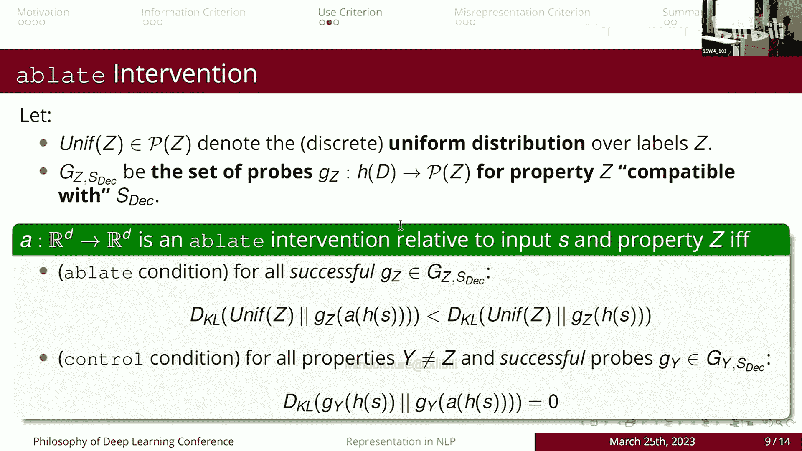
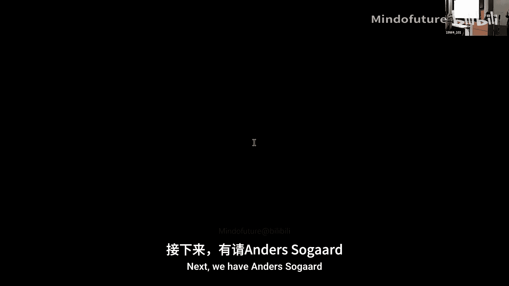
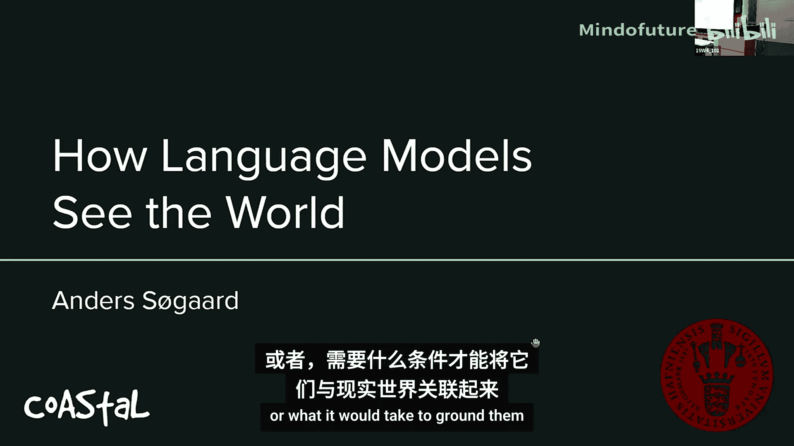
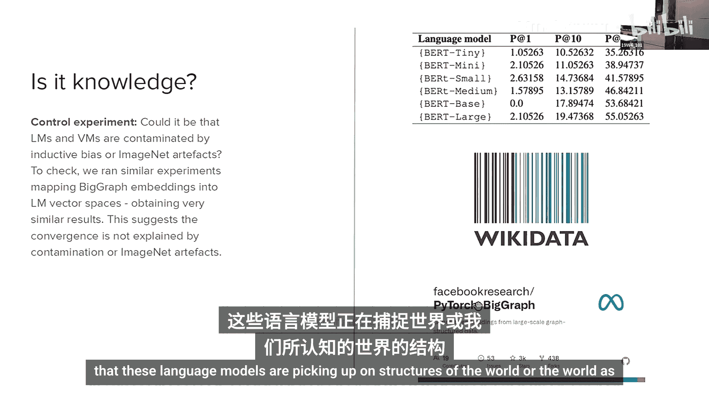
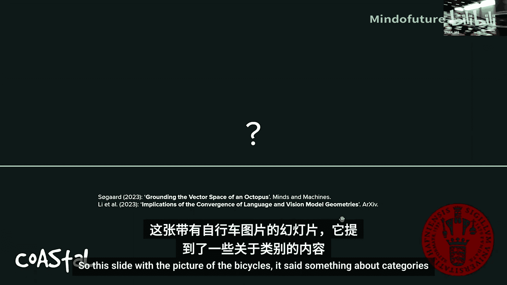
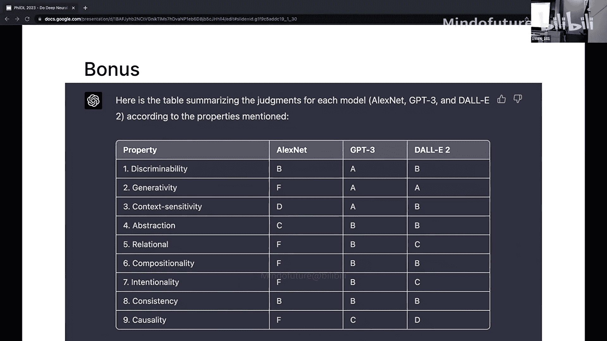

# 【纽约大学】深度学习的哲学 ｜ Philosophy Of Deep Learning 2024 p04 P04_研讨会_深度学习系统中的表征-深度学习哲学 -BV1u7ZoBnEAb_p4-

Welcome to the Lightning roundund representations and deep learning System。

 our first speaker is Finton Mallory from the University of Oslo， he's on a postdoc there。

 he can't make it in person so he it's been arranged that he can do it through Zoom so everyone please welcome Finontelio semantics for neural word embeddings。

Hey， okay great thank you and welcome from Oslo I'm sorry I can't be there I think Id probably have to be more apologetic if I turned the conference into a super spreader event。

 but I think Raphael has offered to buy a pint for everyone at the conference on my behalf。

 which is just a lovely thing to do so thanks for that Okay great the。😊。

First thing I should probably engage with if this slide starts operating is default advertising that this is a conference on the philosophy of deep learning and I've literally brought word to Vec here Word theVc has three layers it's not really a deep learning system at all it is about as shallow as you can get but I want to make a kiss in this talk for Google fashionashed incremental theory building that is methodological incrementalism by which we try to develop theories for representing what's going on in the simplest systems and then we incrementally extend them in order to handle more complex representations as the theory gets more complex I think that this is desirable for many reasons one is that we can understand the novel editions that more sophisticated computational devices enable us to achieve but another level if we want to understand the history of the field we need to begin with where most a lot of the recent work on neural language modeling began and that's word theveec which was one of the first widely implemented systems and this is also I'm just flagging a part of a wider。

Project of mine， if you are interested。My website's at the opening slide or get in contact with me。

 I'm over here in Oslo。What do I mean by having a theory of representation for deep neural networks and specifically large language models in this case。

 one I'm assuming that there is an objective fact of the matter about what a network represents and that's the kind of thing that we want to study and be able to understand。

I take it that there are a couple of reasons that you might be interested in this if you're interested in things like artificial general intelligence and you're going to want some kind of condition for distinguishing between the actual original intentionality of an artificial intelligence from things that we are merely attributing to it or misinterpreting or finding in it alternatively if you think that in some sense semantic internalism of some form is true and you think that our interpretation of the content of the text generated with large language models should be constrained by the internal representations that those models possess。

 you're going to want to have the theory of representation for those internal representations I'm going to assume that there' is roughly three visiterta on a theory of representation here。

 one is that they it can explain the role of representations play in the operations of a system。诶。😊。

We can say oh well the language model produced that output because it represents the world as being in this way a second is that it can constrain the kinds of contents or representations that we ascribe to the model that is again as I was mentioning we don't want to be reading too much into these models we don't want to be attributing them in representations that they don't actually possess so having a criterion for saying this is a genuine representation versus this is a spurious representation seems to be a desirable thing and a third element is just we want to unify the methods of probing that currently exists in the literature undergar who I think is also speaking at this as a wonderful recent book I mean recent and so as we can speak of recent literature in this field the highlights just the diversity of different probing paradigms that exist out there from close sentences to probing classifiers and lottery tickets and pruning attention heads we assume that they all get at something which is the representations within the systems but figuring out how these。

Different methods hold together and tell us about the same thing is something that the theory of representation should be able to tell us about。

Now， slightly more controversially and also old fashioned。😡。

I'm going to be assuming something like a minimal form of teleosemantics if you don't like teleo semantics if you don't think teleosemantics is the right way for understanding human cognition or representations in the central nervous system that's okay hear me out for making the case for teleosemantics in the case of very simple neural networks secondly I'm not going to be making any claims like that tosemantics gives the right account of the linguistic outputs of either humans or any of these machines I do think it can shed some light however on what's going on in word tovec I'm not going to be hitching myself to any particular development within teleosemantic tradition i'm going to try and keep a lot of these claims as ecumenical and broad as possible。

What I'm going to present is going to be a largely consumer based account of teleosemantics。

 but if you like Nick Shay's very tale semantics， that's great， I do too。

 if you like Karen Neander's informational teleosemantics， that's great I do too。

 it's a diverse field and that's one of the virtues I think for taking it as a framework for understanding the representations in these systems because。

😊，It's not entirely clear that one framework is going to capture every single possible language model that we have at the moment。

For the purposes of this talk， I'm going to reduce it to three broad claims， three general claims。

 G1 to three， and then one particular claim that's relevant for this case of word toveec。

The general themes are that systems contain mechanisms for producing and consuming representations the second general claim is that the contents of those representations are determined at least in part by the functions of those mechanisms and the third is that function in this case needs to be understood in some broadly evolutionary sense such that there has been a process of selection over time。

😊，The particular thing that I think is relevant in the case of Word toveec and that it' slightly more controversial is that some simple systems have a form of representation that Ruth Millick calls a pushme pull representation。

 one for which our notions of descriptive and directive content aren't really separable by directive content I mean something like an instruction or an imperative signal that it sends to the consumer system like a blueprint。

😊，And by descriptive content I mean the condition under which that direction or instruction is successful。

 so the classic example in the literature is a he call indicating both come here and eat and there is gray in here it has both the direction and the description built into the same content and Millan's interesting suggestion is that only a more sophisticated systems do we actually manage to pull these apart and have purely descriptive representations I hope by the end of this talk i'll have indicated one way in which work on deep learning at the moment can shed light on that。

No two word to V。But actually I should say the questions that I'm trying to answer first and pre-reging the questions that we're going to be interested in are what are the mechanisms that produce and consume these representations and we're hoping that teleomatics can shed a light on that。

 what are the functions of those mechanisms， can we appeal to those functions to describe constraints on what is represented。

 the representations we attribute to these systems？😊。

AndDoes the framework make sense of any further semantic claims about the system。

 this is one that's closer to my heart， by further semantic claims about this system。

 I mean the kind of part the kind of y side to the computational level explanation that you get within the Mau framework。

 that is after we've identified what mathematical functions is being computed by the network。

 can we say why that is the function that is being computed。

 and that's what I'm treating as a further semantic claim？Okay， now to word to Vec and you can see。

That I am indebted here to the work of the gene wrong is as I think everyone that works on Word Gevec really is。

 this graph for diagram was taken from his influential introduction to work tovec and all I have done is turn the w's upside down to make them into rather implausible Ms that's M for matrix m for mechanisms because I'm treating the weight matrices as being the mechanisms which evolved during the process of back propagation。

Now very very quick overview here of the simplest possible way that you can set up Word toveec I'm not going to cover skip ground negative sampling in this talk。

 I mean you can discuss it in the Q&A if you like， I know it's what everyone likes。

 but I think a lot of these claims are going to generalize to more richer versions of Word toveec。

All I want to do is give a very simple introduction to a continuous bag of words model that takes a one word input and is tasked to predict predict the next word in the data set so there are three layers as I mentioned to word of that here we've got the input layer。

Which takes a one hot encoding vector of a word from the lexicon by one hot encoding vector。

 I just mean it's a vector with lots of zeros except for one。

Denssion that is marked out and identifies what the word is。It then。Well。

 it then processes that through the first weight matrix to produce an embedding vector which is projected into the hidden layer and these are going to be the word embeddings that we're interested in developing through the process of training and then that word embedding is fed to M prime which is going to be our consumer system and that consumer system is going to output。

After the application of a softmax function。A probability distribution。

 though I'm going to flag now that I've just made the first semantic claim。

The first thing I wanted to just flag is we have two mechanisms here we have a producer and we have a consumer M and M prime these are the things whose evolution we're going to want to understand。

 but i've also made this further semantic claim or at least I cannstru this as a semantic claim calling the output of a softmax a probability distribution is。

As I understand it， is semantic claim， it's a claim about how the output refers to the world。

Lots of things add up to the number one， but that doesn't mean that we should interpret all of them as probability distributions。

 softmes are used all over the place these days in machine learning and often we don't call their outputs probability distributions that further claim has to be earned and I think a theory representation should play a role in explaining how it is earned。

😡，Second， if you're interested， yes， this isn't the standard process of evolution。

 but gradient descent actually satisfies the standard tosemantic conditions on a replication process。

 that is each stage the weights that are altered during the back propagation process are similar to how they were before。

 they counter factually depend on how they were before。

 and the update that is occurring in enllmological fashion。

 according to a natural law or in this case， as you see in the bottom right， the update function。Now。

 during the process of back propagation， well this output， this is the semantic claim。

 is a probability distribution that is compared to the actual data。

The distance between that is computed， you know how this works， it's fed back。

 the weights in the system are changed and as a result and M prime alter their internal structure in order to be able to perform their job more effectively。

 so we have two mechanisms that are undergoing a process of evolution in order to produce representations that allow the second mechanism。

 the consumer mechanism to perform its task more effectively。Now the representational claims。

There are a lot of representational them we can make about the resultant embedding spaces that you get with Word tove。

I'll just run through that the five normal ones and each of these seem to correspond to different levels of mathematical complexity or mathematical abstraction。

 one is what you have at the end is a set of word embedding so it is a set of vectors that seem to correspond to the items in the vocabulary and you can compute cosine similarity between these vectors and that seems to correspond to something like semantic similarity that's why the system was developed in the first place。

😊，A second thing that Miov discovered in the original wordve paper is that these vectors can be added and subtracted。

 so the classic example is that you can take the vector for king， subtract the vector for man。

 add the vector for woman。😊，And the location you end up in is somewhere like the vector for queen and so you might then say on another level。

 oh， it's representing conceptual relations that it wasn't trained to discover a third kind of trick you can play is to identify use linear transformations to capture skills so Gibe Grton has shown a way that you can plot a line well okay like at 300 dimensional hyperplane。

A fancy line between anonyms in the embedding space and find a linear transformation to map。

Entities within that vector space to that line such that it seems like we can say the system is also representing scale and it's not just for small and large it's for dangerous I really recommend the paper it's a beautiful paper and a really interesting result it's technically I think using G rather than Worddoec but again a very simple very very simple neural language model。

Another kind of representation that you might think you found in Word the Vc is what I call a PCA map so one thing you can do is you can take these vectors。

 there are like 300 dimensions， you can reduce them to two dimensions with principal component analysis and hey look I think this is a fairly familiar example。

 whenever you ask for the locations of European cities according to this two dimensionmensal vector space you get something like a map of Europe do we want to say that the word embedding model represents this because in a sense that it is part of the content it is an original representation rather than just something that we're reading into the system a theory of representation should give us an answer to this。

And finally， whenever you're done， you can run a linear probe over these things and see if they track something like numerossity。

These are all different possible kinds of representational content we might find in word toveec what I want to do next is to ask well look are these intentional representations according to a system like to semantics what is it to give a teleosemantic analysis of the system well we're just going to look at it we're going to consider it in these evolutionary terms and we're going to ask what is being produced and why is it being produced and who is producing it。

We'll start like consumer teleosmatticists at the output layer。At the output layer。

We have the mechanism M prime that is generating a probability distribution and this is where we have the answer to the softmax question earlier in virtue of what can we say it's a probability distribution。

 we can say that it's a probability distribution because the mechanism has evolved to produce a probability distribution that is what it is tested against during the process of back propagation that is what the mechanism M prime has evolved to produce or has been altered in order to align with。

Knowing that， we then reached the interesting pushushme pullu level， the word embeddings themselves。

Seem to have both directive and descriptive content。On the directive level。

 the word embeddings seem to provide instructions to M prime our consumer mechanism。

The embedding c right instructions or a blueprint for generating probability distributions。

 so that's the directive content it's what it's telling the later system to do。

 but it also has the descriptive content such that ultimately over the process it has also the mechanism m has evolved。

In order to produce distributions that better record with the distributions that are actually in the data。

 therefore it has the descriptive content of tracking the distributions in the data and the one hot encoding layer I'm merely highlighting because I think that's a stupid question we don't often ask。

Why don't we say that word embeddings represent their one hot encodings？

And it isn't simply because I'm not sure that there is much empirical work to see if you can reconstruct one hard encodings from the word embeddings。

 but I think the deeper reason is that the word embeddings。

 like many representations as Drretzsky highlighted many years ago。

 pass through these most proximal stimuli in order to latch on to what they are representing in the world。

 I think it is an empirical question as to whether or not in some sense they represent that encoding layer but we have no reason to believe that they actually do which also gives us further reason than believe that they represent something more distal than that。

No。If this is correct。Then I have given a really conservative result because I've listed five different kinds of representational content we might a to a system like Wordvek and then I said。

 actually all that's being represented is distributions in the data。

 at least that's what Cattheo semantic framework seems to be suggesting to us。😊，The hidden layer。

 we have our word embeddings that are directions to produce our kind of representation。And。

In virtue of being so they are also therefore serving some kind of have possessing some kind of descriptive content that is the representation that is the actual distribution in the data。

No。That's fairly conservative but I think it begins the process and this is again the very first step in this by which we can begin to ask further questions about what it would take in order for a language model to have purely descriptive representations so everyone likes it when philosophers make conjectures I want to end kind of conjecture here and at what point does the system it is an answer to the question at what point does the system go from representing mere distributions in the data to representing something like the relations that I highlighted in the first two possible kinds of representation that is cosine similarity and internal conceptual structure I think that it goes that the system goes from having purely push me pull you representations。

That represent a distributional structure to representing more rich structure whenever you have something like attention heads。

 and is that in virtue of having attention heads that makes the further structure that exists within the representations exploitable。

😊，And so。That I realized I've actually come in within time that's great I'll wrap things up there because I don't want to hog everyone else's time。

😊，If you are interested in this project， feel free to drop me a line。

 if you hit it also feel free to drop me a line， I'd like to hear all the things that are wrong with it。

 thanks。So we actually Fin time， as I understand it。

 you cut in a little into a little of your question and answer time。

 so we only have about five minutes。Yeah， no that's， I mean， we were glad to hear it。

 but we only have five minutes， I think or so for questions who's got some questions， yes。

Thank you for your talk， Do you hear me？What do you think about the emergent functions that were not intended in the original training of any of these sort of large language models will work would be a small language model but all of the language models there is a lot of emergent functions that were not intended it wasn't intended for consumption however in the training set which includes text by humans there were some other functions intended that's not in the objective function of the LLM how do you address that with your to semantics so I think one of the virtues so I think one you hit on what I think would traditionally regarded as a problem with this which is that。

Tomatists generally regarded the function of artifacts like neural networks as being determined by the intentions of the designers。

 I don't actually think that that is going to be I don't think that that holds up in the case of neural networks where we don't actually like our intentions whenever we train a network。

We try to get it to do what we want， but often it will be it like if it serves the if it serves the method of training to develop representations that we weren't intending for it to track。

 then I think in that case our intentions at least don't really matter I think that the psman framework can give some kind of indication as to。

How these networks can develop representations that are not what we intended I don't feel like that's an adequate answer to your question though and like I think I should also flag the five things that I noted earlier the five layers of representation。

I'm fairly sure the only thing that Milo highlights in the original 2013 paper that they are aiming to capture is semantic similarity in accordance with a kind of cosine similarity metric for the vector space。

 nothing there is mentioned about capturing conceptual relations like the man King one or anything about PCA maps or the linear projections that Giab Grs discovered all of that was unintended layers。

 but I don't think because it's not used for downstream computations。

 we can really say it's a representation within the system。😊，In accordance with The semantics。

 at least。嗯。Yeah thank you so much so I just had a curiosity as to what you think the actual contents of the output layer are so usually when you put forward a to semantic theory you're trying to give you're trying to answer the question in virtue of what does this internal state represent this distal property or something like that but when you went to go describe how your theory worked you seem to suggest that the output layer represent something like softm or a probability distribution so I was wondering if you could clarify how that relates to the standard way of understanding to semantic theories。

Yeah， absolutely so one thing is that I think that well an important thing is that whenever I say that the output layer represents a probability distribution。

 I think I'm making a fairly strong claim there， I think it's often treated as being a like a weak claim because we just say softmax outputs probability distributions and I think that that's a kind of further semantic claim that has to be earned。

 I would suggest that it represents the output layer represents a probability distribution over in this very simple bag of words model that I'm showing here or I'm using today。

 I would say it represents a probability distribution over the most slightly next word but the reason or at least the argument for why that's the case is simply that the mechanism and prime。

 the consumer mechanism has been effectively has the function in the heliosomantic sense of producing probability distributions because probability distributions are what it is assessed against。

And。In the training。哎。Okay thank you I want to ask where are you based to separate the different stages and say that its matrix。

 connectivity matrix is a mechanism is separate than the other because as far as I understand mechanism in the neural network is a result not only of the connectivity matrix。

 but also on how the units are connected， sayless structure of the differential equation that relates a units with the matrix if if it's a linear differential equation iss easier to just look at the matrix。

 but if it gets more complex it's not that straightforward。

 especially if you have different levels which makes sense to look it as a whole as a system so I don't know how you separate them that is a brilliant question I think that this is like so in one sense the incremental approach that and'm taking all of the difficult questions like that I see as being things that are coming up in the future。

😊，In the case of word to V， I think yeah， the first layer is purely linear and so that's how I individualdividuate the mechanism by just saying that like we treat the matrix as the mechanism in the second mechanism。

 it has that soft max， but again，😊，You know， every。

Like the entire output vector from that softmax is feeding into the output layer and so I would individuate it in that sense。

 but yeah I think in much more like in more complex systems where you've got like attention heads and you're trading on lots of different information it will not be possible to get through this one to one matrix to mechanism account and so I yeah no that's like an important question I'm not sure it causes a problem for the tosomatic approach to work to V but it's definitely going to be an interesting empirical challenge whenever this is applied to richer systems or more sophisticated systems。

Okay， thank you， Finntton， we should cut it off there， let's thank Finton。

I'm going to try to be pretty strict of course remember you'll have an opportunity I'm sure she'll be eager for follow up but meanwhile our next speaker is Jacqueline Harding she's in her second year in Sic systems at Stanford and she's going to be speaking on do probes and natural language processing discoverover representation so yes I'm a PhD student in symbolic systems at Stanford I'm advised by Rosa and also by Thomas ICOs and today I'm going to present a small part of a larger project is definitely a very lossy compression of the larger projects so the aim of the project basically is to present some hopefully plausible criteria on assessing representational claims as the maiden NLP and then take some first steps towards operationalizing them so this is kind of a philosopher's operationalization so it's still very idealized in ways which we can hopefully draw out in the Q&A。

😊，I just want to make a clarification at this stage。

 there's a kind of thinner sense of representation in the vicinity here which is ubiquitous and NlP which is where any intermediate state of a model counts as representation that's not the sense I'm using here i'm using it in the sense it's used in kind of philosophy of cognitive science still quite a thin one subpersonal representations。

😊，Okay so here's some motivation for the project suppose we're testing a model on the KoA task COla is just a binary classification task model takes sentences input outputs。

 whether it's grammatical and grammatical and suppose the model is processing the following input。

 John dances， waltzes across the room， so this is grammatical and we can imagine two different cases。

 one where the model gets it right and one where it gets it wrong。

Contemporary models are going to get this right。😊，So if it gets it right。

 maybe we want to explain why it got it right and we want to say something like oh it's representing the dependency structure of the input sentence or something like that and if it gets it wrong。

 maybe we think about why a human might get that wrong and we say。

 oh it's misrepresenting the part of speech of the word walttz's so it thinks waltz's is a verb when in fact it's a noun here。

The point isn't that their explanation is true or even plausibly true is that it presupposes a notion of representation。

 so it's really just that it's plausibly true act and the question that I'm concerned with is what does it mean for a component of the model to represent a property of the input？

So here's the general setting I'm considering we have a system S performing a task D。

 I'm going to think of a task for simplicity as just a set of inputs with some associated goodness measure on outputs so that could be a loss function the abstract picture as follows we have inputs which are encoded as intermediate activations I'm going to call that the D dimensional vector and then mapped by a downstream system S deck to an output。

So more concretely we could think of the system as like transformer inputs could be a list of token IDs。

 this intermediate activation could be the value of the residual stream at some layerir and position in the context window and then the output could be a probability distribution of a token。

So two more notes on terminology so when we process the inputs comprising a task we'll get them intermediate activation for each input and this will result in a pattern of activations across the task which I denote H of5 D where interested in properties so I'm going to treat a properties as just like a finite set。

 set of labels so some examples of properties could be part of speech tags。

 dependency heads we could have sentence level properties like whether the subject of the sentence is singular or plural we could even have more kind of high level semantic properties。

 the gender of the subject of the sentence。I'm assuming that each input is associated with a gold label distribution over the property labels。

 so this big P of Z is just a set of probability mass functions over this finite set set of labels。

So I'm going to assume that the kind of natural vehicle for representational claims in this setting is the pattern of activations HD and I'm just going to briefly give three criteria which seem relevant for assessing representational claims in this area。

 I'm intending these criteria to be amenable to lots of different ways of fleshing out representation but they do have this kind of broadly teleosemantic flavor so if it's good just spoke on this。

😊，So the first criterion is that the pattern of activation should bear information about the property。

The second is that the information it bears about the property should be used by the downstream system to perform the task。

And then the third criterion is that this account should allow for an activation to misrepresent the property with respect to an input。

 so just as we want to use representation to explain success。

 we want to use misrepresentation to explain failure。Okay。

 just to briefly introduce like the probing paradigm， I assume this is familiar to many of you。

 the setup looked like this， we had an input map to an activation， map to an output。

 and then the input was also associated with this gold label distribution over property labels。😊。

So what we do probing is we try to train a supervised classifier to predict the gold label distribution directly from the intermediate activation。

 so we just use labeled pairs to do this so the classifier takes in an activation and it predicts distribution over labels。

😊，We say a classifier is successful just in case it achieves like low cross entropy loss on some test set and this suggests a natural way of operationalizing the information criterion。

 we just operationalize it by saying we can train a successful probe for the property so this is a pretty cheap。

😊，Success。We could make this more formal in terms of something like mutual information。

 but hopefully it's intuitive that this is what's going on。So moving on。

 it's much harder to think about how we should understand use and misrepresentation。😊。

What I want to say about these is that the right way to understand them is causally so we want to think about if we could do the right sort of intervention on activations and measure its effect on the downstream system this would be a way of testing a use claim now what's the right sort of intervention well heres kind of intuition。

What we want to do is we want to intervene on the activation with some input to strip it of the information it bears about the property。

Fixing how the downstream system is using that information。

but we want to leave it otherwise unchanged relative to how the downstream system is decoding pattern of activations as a whole and if we did that intervention and the system was in fact using the information we'd expect its performance on the class to degrade so the problem with this picture of course is that the downstream system isn't explicitly decoding the information in the pattern of activations at all it's doing to the extent interacting with the information it's doing it kind of implicitly we'd love to be able to write the downstream system as the composition of something like a probe and then some other model which takes the predictions of the probe and produces some output but we can't and in a sense this is what motivates the whole probing paradigm it's that we use probes as proxies for the sorts of things the downstream system could be doing to the information。

So we can use this insight to operationalize the intervention at hand。Using probing。

So just some terminology， this big set GZ S is going to be the set of probes for a property compatible with the downstream system。

 so this is kind of vague what I have in mind is something like the downstream system can implement these probes that's also quite vague we'll think of like the probe selection criteria further refining this set but just to give a more concrete example if the downstream system is linear we want this set to only involve linear probes we don't want them to have nonlineararities because then the downstream system couldn't be doing what they're doing。

And so this is going to be a bit notation heavy but I'll just try to get the intuition。

 so an interventions just function on RD and I'm saying it has to satisfy two criteria。

 so the first one is relative to any successful way of decoding the information that is compatible with the downstream system。

😊，This intervention should push the predictions of those decoders。

 those probes towards the uniform distribution over the property。

And then the second condition is that it should kind of preserve the predictions of other decoders for other properties and that kind of closer and preserve I'm just suggesting we could operationalize using KL divergence。

😊，So having defined this intervention， we can give a natural operationalization of the use criterion。

 which is just we have an intervention of this sort， we apply it to an activation。

 and if in fact the downstream system was using the information about the property。

 its output should degrade relative to the task。So how to understand misrepresentation。

 I want to understand this quite similarly to use。We test claims about misrepresentation by applying the right sort of intervention on activations and then examining their effect on system behavior as a whole。

So again here's a kind of first attempt just to pump some intuitions intuitively what's going on in a case of misrepresentation is the downstream system sees the activation and it interprets it as saying something false about the property label distribution。

😊，So in theory then if we could intervene to make the downstream system believe the true thing about the property label distribution。

 then this would improve its performance on the task this is just an intuition of course for the reasons I just gave like we shouldn't think of downstream systems as doing anything like this they're not looking at activations in trying to directly predict property label distributions at all。

 but maybe we can use things that do probes as proxies for the sorts of ways the downstream system could be interacting with the information。

So again we have this true label distribution and then we can define what I call the correct intervention so correct intervention is basically just the same as an obbl intervention except rather than satisfying the obbl condition which pushed predictions of successful probes towards the uniform distribution here we want the predictions to be pushed towards the true label distribution and again we want to control for other properties and other probes and obviously the task of controlling in this way is incredibly difficult and it's something that can be drawn out in the Q&A as well。

😊，So having done this， this suggests an actual operationalization of the misrepresentation criterion。

 again we have this correct intervention， we apply it to an activation and then we see if the system performance improves relative to the task and the thought is that if it does。

 this provides some evidence that the system was misrepresenting or specifically the component HS was misrepresenting the property。

For the system。So here's a summary of where we're at so far we can I'm saying we should think of representation as just we can train a successful probe。

 we can apply the right sort of intervention to test for use and then we can apply the right sort of intervention for misrepresentation and so kind of some obvious issues with the account I've proposed are。

Firstly， how should we understand the set of probes compatible with the downstream system and here there's a very large literature on probe selection which we can get into but I imagine questions in that literature will bear upon how we select this set and then the second I think main issue is to do with controlling for various properties and we can talk about ways that we could maybe start to think about that and there are some examples I think which provide approximations of the account I suggested in the literature which again we can get into more in the discussion。

Thanks so much and I'm looking forward to your questions。😊，Yeah。Thank you， Andrew。

 if you could start getting set up， oh you have a question， but we'll go to you first。

Maybe we'll get to your question as well， And。Yeah。

 thank you for the wonderful presentation so so I'm also so when you talk about this approach I'm thinking out loud exactly the paper of fellowello。

😊，And I mean we are working on something on this as well。

 but so do you imagine implementing this concretely for example。

 in the Otello you do some control of the probes more carefully and actually claim something about the world representations and second question is I think you know along the line of。

The representations， the hard question is。I mean， to to control the probes wow， is already hard。

 But I think another hard question is like to ask what kind of representations the probe is going to select。

 right， Like so far， I think it's easy to。Say come up with four states and certain concepts like diagonal certain things but it's hard to say it represents say yeah understand the rule of flipping the chess pieces so on and so forth so how do you think about that so I guess the questions sorry there are two questions there which I think are both really good ones so yeah I think I've been talking about probing as it's use in NLP but of course everything I said here could apply in principle to any model with intermediate activations so I do intend that some of the thoughts here could generalize to other settings or of course we'd want to make modifications with respect to the question of basically how do we select which property to probe for in the first place or how should we think about the property the probe finds Yeah here in my view is quite close to the account that raor outlined earlier I think the sort of representational claim。

Will want to make will earn their keep by allowing us to make robust predictions and so to that extent I think the sorts of properties we'll want to pick out of the ones we think are plausibly relevant to explaining system behavior across a range of inputs and of course spelling that out in a given domain is an incredibly difficult task and should be viewed in that way just to say one more thing on the kind of athello point I mean the objectives I've given here all differentiable so in theory there's no way this could just be implemented quite simply and indeed you can see this kind of these gradient-based interventions is basically doing this but maybe they're not thinking about it in exactly this way。

Thanks gosh， really interesting thought I'd have so many questions but if I have to pick just one。

 maybe I'll focus on the misrepresentation control condition。

 I just want to make sure I'm understanding it correctly。

I'll go back to a familiar case baby eating frog right with me。

Ive I've had the intuition on that one that we need something like a stronger misrepresentation criterion that it needs to be a kind of error for the frog。

 so un intervened on if we just keep flicking Bs and the frog never detects that it's made a mistake it just can't represent fly because it doesn't have any。

But is it right here that so the equivalent in that case would be like we intervene on the frog's brain and give it a more accurate fly representation and now it stops responding to beBs would that then be evidence on your view that it all along represented flies whereas I would think no you're giving it a different representation in some sense and you still haven't shown that that was a mistake to the frog what do you think about yeah that's a really good question so。

Yeah， I think we need to separate misrepresentation from。

Questions around indeterminacy of representation and obviously they're closely related questions so I think to the extent that properties are highly correlated in the input data we would expect a lot of indeterminacy with respect to the kind of representational claims we're going to make here so in that sense I would expect that any intervention。

In the frog's brain。woul end up making it just respond to small black flying things that particular example I would imagine we just have a case where the properties are so tightly correlated that they in a more general case this kind of idea of good for the frog so I guess naturalizing this is one of the big questions in natural organisms but I think in the case of artificial systems it's a little bit clearer what the task we're talking about is in that it's kind of externally imposed by the sort of Expandum like it's by the task we want to explain and I think spelling out this expandum still involves a lot of philosophical work but that's kind of the hope。

So this seemed to be really nice work to take these philosophical ideas and make them much more specific and actionable and even differentiable I mean that's amazing but I want to ask you something very specific on the probe constraints the constraints on commmissible probes so you said look at all downstream processing and the probe has got to be something that kind of make sense that it could be extractable so I wanted to push you on whether we should look at all downstream processing or just what the next layer could do so suppose this won't be a real case but suppose the next layer was just linear and then there was some non- nonlinearities further down。

If you looked at all downstream processing you'd allow on linear probe。

 but really we want to know what use is being made of this vehicle is information by the next layer of processes so would you agree that that constraint on probe。

Promissibility is really about what the next matrix can do to the current so I completely agree with that intuition so I think how this would work in practice and how it indeed does work in practice we' probing every layer in every position and then we're maybe studying something like how the information changes over time and to the extent the information is present in layer X but not present in layer X plus k that means all the processing has happened in those k layers so definitely that would upbound it straight away to the extent the information doesn't disappear in the next layer it's kind of unclear to me exactly whether we should treat the downstream system in that way is just a single layer I think in practice probably thats that's what that would make the most sense to do because it's much easier to control for a single layer but I think conceptually。

It might not be doing anything to the information in between layers。

 it could just be passing it forward or something like that。

Someone in here had a question and I lost them。I know you have one。

 but you've asked one before so if someone else gets priority， there no。Well。

 we can go back to you then， I guess， sorry， I'll be right over。嗯。🤢，哦， sorry。

can'tMireation and indeterminacy because you can't know the conditions of misrepresentation until you've determined the content so maybe I was just misunderstanding what you had in mind by misrepresentation and the other thing that in your when you give your a sufficient condition for content it is quite strange to have a sufficient condition be that the state is capable of misrepresenting because typically if you've given the sufficient condition you fix the discernminacy conditions so you should know exactly when misrepresentation occurs so maybe i'm just confused about what you have in mind by misrepresentation so it's really just a clarification。

Yeah， of course， sorry。I think there are lots of things to say here and I totally I think I totally agree with this intuition that there's something deep about。

The extent to which this can distinguish between indeteracy and misrepresentation。I think。

So I guess what you meant by fixing the conditions I take to be fixing a successful decoder or something like that。

 so it's still relative to this whole pattern of activations and not just talking about misrepresentation on a particular input it still kind of stands in this larger relation to the entire pattern of activations and decoders to it。

 so it is supposed to be very much tied to how the model。

iss actually interacting with the information across the set of inputs we're interested in I know that probably doesn't fully answer what you were getting at but hopefully it gives some intuition。

We could have time for one quick one since she started a little late， sorry back okay。

 is it quick promise， all right。Yeah， I just think this seems interesting。

 but I find it kind of hard to like。Try to understand the math And like this brief presentation is wondering if theyre like。

 is it like a paper or some kind of resource that I could like， look up and like。

Read up on this Yes is there is a paper it is going to be kind of under review but I if you email me my email address wass I can send you I'm happy to send you a draft and take those to everyone there as well and I'd love to beat that。

😊，😀Thank。😊，So that was not only quick， but also an invitation to a plug。

 so let's thank Jacqueline again。

Next we have Anders Sogard， he tells me that's his conference name， the Danish pronunciation。

My Danish heritage doesn't entitle me to， but he's from the University of Copenhagen。

 he has background also in the industry and he's going to speak about how language models view things。

Let's welcome Anders， cool， thanks。You guys don't hear me either。Try to get。Thank you so much。

One of the questions of this conference is whether language models are you know JPEC compressions of huge lookup tables or whether they in fact have models that are kind of vehicles for inference or thought another question is whether language models are in some sense about something or what it would take to ground them and i'll try to say something about both of those questions presenting a very simple。

Experiment。I'll frame this talk as a direct response to a thought experiment in a paper that I'm sure a lot of you read by Bennder and Culer calledCing Toward Natural language Understanding。

 this is the paper in which they present the Swincarnation of Cr's Chinese room thought experiment。

In their version of the thought experiment。The protagonist is an octopus listening in on a conversation between two people on deserted islands。

 they're talking through an underwater cable and the octopus endowed with a perfect language model is listening in。

 training to simulate one of the two at some point cuts the cable and starts acting as one of the two people and a beer and color interested in whether that's going to be possible in the limit。

 but also whether if so that would amount to understanding it。

I'm not actually going to talk about that part of the paper because there's a lot of problems with a thought experiment。

 but I'll talk about a second thought experiment in that paper， which is a bit more concrete。

So Bennder and Coller write as the second example， imagine training a language model and just text。

 so with no associated indications of speaker intent。

 and imagine that system has also provided a large collection of unlabeled data and you can sort of train on that but in the silo so there's no connection between the text and the images so they say for the image data。

 the training task could be anything so long as it only involves the images。

Then they imagine at test time we present the system with models or with utterances。

 text with photographs and you ask the utterances are going to be questions about the end of this so things like how many dogs in the picture are jumping or how many dogs are there in the picture。

They are saying that obviously this is not going to be possible because the model has never seen a link between the text and the images。

 I want to say that's。An empirical question it doesn't really necessarily follow from the fact that that these two things are trained in silos that it should be possible to ask or to answer those types of questions to。

What an MLP we call visual question answering and I'll try to present an experiment that I think is good reason to believe that in the very near future we'll be able to do this。

 we can do it quite yet， we can do it with very minimal supervision， but without any superion at all。

 we can do， but it should be possible very soon and I'll try to convince you。嗯。

I take inspiration from work in something called uned machine translation。

 so this is a sub area of machine translation。So people doing things like Google Translate。

 normally when you do that， you try to learn a function from one language to another and you use supervision from human translations。

 so you induce a function from say German text to English text。

 but you adjust your parameters so that you simulate human translations now an unsubvised machine translation you try to do that with no human translations in the loop so with no links between say German and English。

Now， how is that possible？Well， what people do is that they look at the word embeddings of language models。

 so you train a language model for German and you train a language model for English。

 and then you look at the geometry of the word embedding space。

So you basically plot your vocabularies。As point sets or point clouds and you look at their shape because it turns out。

That at least for recently related languages， vocabularies have similar shapes so you can think of these as just sort of clouds that are floating around in space and they have a geometry now what you can do is you can scale and rotate and translate these clouds so they align on the best possible way just like you do in points set registration and computer vision。

And it turns out also that if you do that， then at least for related languages。

 the alignment is so precise that you can extract bilingual bilingual dictionaries from those alignments。

So empirically， something like three and four words you're going to have right next to its translation equivalent。

So I want to transfer that idea to this case where in the Bener and color example。

 you have a language model on one side of the fence and you have a computer vision model on the other and ask whether the same thing can be done for language models and computer vision models。

To get translation rolling， you need a bit more because at this point we only have word by word translation。

 so you need to basically。Bring the language models back in the Luba do Co training of two systems in both directions to get the thing rolling。

 but we can ignore that because we only need the for now。

 only need to establish the links to get about this。Okay。

 there's an important lesson from this literature that I want to tell you about。

So doing this in an unsupervised fashion with algorithms like generative adversarial networks is possible if the spaces or the geometries are very similar。

So what this means and here's some results from an old paper on unsubvised machine translation。

 basically if we can do it such that more than half of the words end up next to their translation equivalent unsupervised algorithms tend to work if not they tend to fail and this is because if there's no obvious solution to this alignment problem there's just a lot of local optima that you can get stuck in but it seems that there's a threshold around。

Kin of we about half of the words align with their translation equivalent and then unsubvised algorithms work as well as supervision or minimally supervised solutions。

 I'll get back to how we do that。Okay， so basically what we do here is we do with vendor and color instructors to do。

 we have a bunch of images， we have a bunch of texts。

 say synthesis we have a visual encoder and a text encoder， there's no interaction between the two。

 we get the image embeddings out， we get the word embeddings out， we look at the spaces。

For some vocabulary and then we do alignment based on in our case minimal submission。

 so this would be something like maybe 100 words， then we evaluate whether we're picking out the right things from this alignment on heldout data so this is a minimally supervised setup for bilingual dictionary induction except that we're talking about images and works。

We've done these experiments for a lot of different models and this is an unsvised vision encoder。

Called MAE， three different sizes。And this is the performance of three different families of language models so along the X axis of each plot you have language models of different sizes。

 and as you can see so the lower set of lines here that's precision at one score。

 so this is the number of words where we going from images to the language and the vocabulary here is 70。

000 words so the kind of random performance here would be one over 70，000。

We see that for the best models here， which is。Gb two large sized models。

 roughly about 10% of the words or the images end up next to the word that happens to be the label in the image node data。

嗯。If we're a bit more loose in the evaluation and we just ask whether the word is in a neighborhood of 10。

 which is roughly what corresponds to a synonyomy class， for example， so for car this could be car。

 automobiles， vehicles， et cea。About 30 of the percent of the words do that and if we're even more a loose and we just ask whether the right word is within a neighborhood of 100。

 so this would correspond to something like a fine grain semantic category。

 we see that about 60% of the words do that so for 60% of the words we can tell what the semantic category of the image is if you like with very minimal sub。

The most important thing about these plots is that we see a convergence right so the bigger the models get。

 the better the results， the bigger the vision encoders get， the better the results。

 the better the language models get， the better the results。There's still a gap。

To what was the breakoff point in unsurvised machine translation。

 which would be a precision at one score of about 0。5 that's 0。1， so that's quite a gap。

 but there's certainly convergence toward that。And。😊，Even if we can't do it in an unsubvised fashion。

 this still points to the fact that these models are learning the same structure。

It's just that we can't do the mapping right now。In the complete absence of supervisition。

Here's some。Results with supervised mission encoders， Oec former models， investment models。

These are supervised， so you could maybe argue that introduce is a bit of a bias。

 but point is the results are the same and you see the same convergence phenomena。嗯。

Of course there's you can do a lot of error analysis on experiments like this。

 clearly some words are polyssimous and that affects performance so mono。不是。

words that only have one sense are easier to do this mapping for also dispersion in the images as a factor。

 so if there's low dispersion we do better so that's only a natural we're basically extracting static embeddings here from the language models right so we're not capturing context in any。

So all of that is sort of making， I think， the results even more。Interesting because。

The results from just a moment ago were across the board。Now， of course。

You can ask whether there's sort of biases creeping in or forms of contamination from the inductive bias at the algorithms or maybe the fact that we evaluate this on image netname so we we can do the same experiment with。

Other target bases or other source bases in this case I've been doing the same experiment with the Burt family of models and then mapping into the Big graph space。

 so Big graph is a graph embedding of Wikidata so this is a knowledge base that's supposed to say something about how we like to organize the world。

You got exactly the same convergence phenomenon here。

 and I think what all of this is saying is just that。嗯。

The reason that we can align the concept level representations of language models and vision models is because they're about the same thing。

Namely， the knowledge that we also have put in Wiikidata。And I think in some sense。

That result was already in that first。Thing I talk about namely the unsupervised machine translation。

 because why would a language model for English and a language model for German represent concepts in exactly the same way？

If it wasn't because English and German are being spoken by speakers to speak about the same thing。

 namely the world。So I think in some sense， there's。

Not bulletproof proof because of course languages are related。There's there's all sorts of things。

 all sorts of kind of arguments， but I think this is at least suggestive of the fact that languages。

Where language models are already。嗯。Or that you can see in those experiments already that these language models are picking up on structures of the world or the world as we think of it。

上次。Yeah。Okay， who has questions for Andrews？And with Tony， if you want to start setting up。

If he's here， I haven't seen him。Hi really cool work there have you tried any unsupervised alignment algorithms one could imagine say looking at the within pair similarity of different labels and deriving a cosine similarity matrix from that and sort of just trying to align the visual elements in the same way without the use of any labels or paired examples and all yeah right yeah yeah we did so。

The problem with。We've been playing around with Gs to do this and the problem is that it's super initialization dependent。

 so if you if you sample from a space that's not too far away from the correct solution。

 an unsupervised algorithm will get you there， but if you sample or initialize at random the chance is very low and it's just because there are too many kind of bumps on the road。

It's a great question and certainly I think so my whole argument is that。

I think the structural similarities are not good enough yet that we can do that with the existing algorithms。

 so you can think of that as a problem for the existing algorithms or as a problem for the language models and the computer vision models。

 but I think either way we'll get there。So this slide with the picture of the bicycles。

 it said something about categories， so just a clarification。

Have you got all of the pictures organized into categories before you start right。

 so we're evaluating the way we're evaluating in this experiment is that we take imagenet images。

So and then we look we ask whether the alignment will give us the label for the image that we're currently looking at。

 so we sample an image from the image in the data set and we ask whether the alignment is going to tell us what the label of that image is。

mNot sure if I understood your answer my worry is that。If they are already sort of put into clusters。

Then there's some semantic information getting in just sort of without the label。Right， so。

The vision encoder is on service， so it's not actually seeing the labels。

Right so we only see the label。At test time in the unsupvised setup and then the minimally supervised setup。

 we have we we see the labels of a few held or a few other categories and the ones that we're evaluating on Does that answer your question。

And also training on imagenett is not， so we can do this with unsupervised vision encoders that are not trained on the imagenett set of image。

 so I don't think there's any risk of contamination or bias。Oh， here we go。

Thanks and so De Car one of the things that kind of he proved was that he showed that we can think about algebraic geometry and like visual geometry there's like this interesting kind of correspondence between these two these two things so we have we can have an algebraic representation of geometry we can have visual representation of geometry and so if you kind of want to kind of。

😊，Extend his project to what is happening here， maybe we can say these models don't really see the word what they're seeing is that they're finding correspondences between visual representation of the word and the analogtic representation of the word and I think we can have like a nice kind of like background story similar to what what De car did so then if you kind of push that idea forward is that these models don't see the word。

 they're just seeing representation they're seeing connections between different representations of the word what do you think about that proposal right yeah that's an interesting suggestion I think I mean clearly what at least the minimalism experiment show is just that there is second word isomorphism here that is equivalentvalence from the perspective of the neural network。

In terms of seeing， well， I mean， clearly， humans are endowed with the capacity for doing points at registration。

 whether this is what enables， say， colorblind or blind people to infer what the color of blue means。

I guess this's a question for cognitive scientists and not me。

 but it definitely is suggestive for how that could come about。嗯。

Yeah thanks for the talk it was really interesting I wanted to maybe push a little bit further on this idea of the image data set having some builtin structure to it that could be at play here because even if you're not using the labels you're still of course using pictures that were taken by humans that probably point to things that have labels because that's how humans are you in the world so just wondering if you thought about like if you how extreme you could take this if you could really have an image set that was kind of random and not guided by human concepts if you think you could still get some sort of alignment out of it right I mean that depends so some of these models are trained on image but we can do the same experiment with models trained on just random Fl images now whether that still comes with the bias of course I mean but so does the language right I mean there's a tokenization of the world that's implicit in all of the data here and you know that's。

That's part of the bootstrapping we have to do as kids。

 but and we're sort of jumping in in the middle of things here and I'm not sure there's a way around that problem。

We have time for more questions。This is very striking。

 but I wonder if you can speak to whether the structure of the space is used by either one of the models。

Especially the one that's got a task， the language model so I mean it's reflecting something that it can pick up on the world but we've seen in lots of earlier talks there's a big interest in whether that's being made use of in order to perform the next word prediction and can you have you got data that would speak to whether yeah aspects of this structure right that's a great question thanks so yeah we got a couple of papers on one is in the cross angle space whether this ismorphismism is correlated with downstream performance。

And that's a clear yes， the other thing is so Phentom have these examples with the analogies and if you do analogies in the limit you get isomorphism and one of the things that we've seen is that if you do analogy training so you basically train your language models to optimize for this analogy so you just you know you take wikiid data and you generate all the analogy as you can and you use that as training data your language models become better at Amstreamrian task too so I think those two things combined is suggest that yes the language models are actually using this geometry as a vehicle for thought inference。

 whatever you like to call it。Okay。Hi， I had a question about the experience are the dimensions of the image and word spaces pretty similar and would this still work if they were like vastly different？

Thanks for asking that question because I promised to tell you guys about the supervis alignment and I didn't I forgot that and I can do that now yes so we do two different things one is procratous alignment in which the dimensions have to be similar and to get that we do PCA of one of the two spaces first in the other set of we do just linear regression where we have a linear regression model for every dimension of the target space and then you don't need that so the answer is you know no they're not the same dimensionality you can do PCA to get rid of that problem but you can also just do linear regression and then it's not a problem at all。

Hey thanks this is very interesting I was just wondering I imagine that the conceptual spaces of vision and language might not be directly overlap or like completely overlapping。

 I was wondering if you can hypothesize where those might be most similar and also like more interestingly where they might be least similar for like what concepts。

Jesus。That's a difficult question I mean we so i'm not going to give you a good answer to that。

 but I can point to those results saying that dispersion is a phenomenon so it's a source of error and I mean the nice thing about language is that it's。

At least presented it to us in written form it's discrete and that's a huge advantage and I would think that has sort of trickled an effects I know it's a lastusy answer sorry about that but it was a difficult question actually related to that I'm wondering you if you find there are certain kind of basic concepts that really help in the alignment I mean one obvious thing is space spatial relations big events small events structural things that go across all kinds of common environments there right any indication of that kind of thing playing a role we are about to do some more experiments in which we sample vocabularies and of different semantic categories and I think that would tell us more about that we know that I mean I think I missed out on the panel discussion yesterday but I think Ellie talked about some of the color stuff that we've been working on theres there's other places in which there's a sort of you know there's a physical space too that we can that we can map onto and I think that it's very likely that it's going to be easier to do for those domains so we've looked at geography have a some students。

The paper called like do language models know the Way to ro or something like that， and yes。

 we do see alignments there too。Still got up， here somebody。Sorry， where'd you go？

Hi sorry my question is related to that gentleman's question it makes sense to me that German and English would have approximately isomorphic semantic geometries because the models are learning language as it is used so the assumption of this project would seem to be that images as they are used by humans would be approximately isomorphic to language but it seems that at least naively it seems that humans are likely to use images in different and often complementary ways to text so why would you I mean there might even be some duality I guess in the representational spaces why would you expect them to be approximately isomorphic。

I wouldn't and I think you're right there's dual in the space and we know that from disinformation from reviews where like often there's there's duality。

 but I think that。We're looking at representations deep down in these models where things are very compressed and I think there's a lot of use that sort of filtered out in the process of building these so I think there's a lot of ways you can sample your data and still end up with your with the same lexal representations if your model is big enough and it's trained for long enough so I think we're distilling something that's less sensitive to that phenomenon。

Having been tasked with running these lightning rounds， I can't resist trying to actually be on time。

 we might actually make it， which I think would be a first in my experience I don't know so thank you。

 let's thank Anders。Great， so hi， I'm Tony and this is said and along with our other two co authors who are in the audience。

 Micheltchell and Hokang。We're going to talk to you today about whether deep neural networks have concepts or not。

 so like we were introduced we're a group of firsty grad students at MITVCS and like as first year grad students。

 we obviously have an incomplete view of landscape or maybe I should say like as first year students。

 we obviously know everything there is to know about concepts and actually maybe you guys should just like sit back and let us tell you all the answers。

嗯。So in many ways， I think the structure and the goals of this talk parallel the ways in which we came to and came at these questions。

 so the four of us are all interested in things like concepts。

 but we come from quite different backgrounds such as computational neuroscience and for us computational cognitive science and philosophy。

 and so when we started talking about these topics we often found that we needed a shared language or a common denominator to start from。

So given the you know， rapid success and excitement surrounding chat GT and other LLMs trained with human feedback。

 I think a lot of people have started asking if GBTX is like intelligent or if it's thinking。

And I think it's natural to first start asking whether these systems have concepts or not。

 especially given the long history in cognitive science and philosophy。

Takes concepts to be the fundamental building blocks of thought。So maybe when we ask this question。

 it might be good to start with a system that's simpler and potentially easier to understand a visual classifier and pattern recognition system like Alex Knight。

So we could ask， you know， does Alexnet have concepts。

 well to know we would need a working framework that would be able to formalize what concepts are in neural networks and in a way that we can empirically verify。

So this motivates our starting point， we're going to take concepts to be manifolds in neural latent space and you know for the purpose of exposition I'm going to use vision。

 but this approach extends to other modalities like language and text。Um， you know， formally。

 manifolds are defined to be these objects that are， you know。

 locally homemorphic to Euclidean space， but for our purposes。

We're basically just going to take them to be clouds of points with some rough topological structure。

 For example， you could take a picture of a dog。And that would map to a particular point in the intermediate or hidden space of a neural network。

A different image of say a different breed of dog might map to a different point。

 but it's still an image of a dog， and so the set of all points corresponding to images of dogs form this dog manifold。

 which you can think of as a very extensional characterization of a concept of dog。

So we're going to ask add the additional requirement that these manifolds be separable from each other so that is the manifold for dog is separable from that of a cat and that's a key property that allows for successful classification。

And this is a really common view that's often held in neuroscience and sometimes in deep learning。

 and this is partly motivated by the fact that this framework is really directly applicable and easily formalized in neural networks and a lot of the concept learning or work on concepts in neuroscience and some parts of deep learning often focuses primarily on very concrete and perceptual concepts which are easier to formalize in this paradigm。

So。Under this framework， we might say Alex probably does have concepts。

 but this is mostly because this concept as Manafoldt's framework focuses primarily on discrimination as its relevant behavioral property of interest right and as we know like this is something that neural networks are great at。

But I think in this way， concepts as manifolds also gets at a common denominator among theories of concepts。

 namely that while these series often disagree on exactly what concepts are。

 most of them do agree that any conceptual system should be at minimum able to be discriminate between valid and invalid instances of a concept。

But on the other end， human conceptual systems are far， far richer than that of a CNN like AlexNe。

They can exhibit for one a much wider range of behaviors， such as analog reasoning。

 imagination and planning， and what's more， our conceptual system often encompasses more abstract concepts like fun。

 like good belief is and nine， just to borrow a few examples from the debate last night。

And it's not a priori obvious how we would formalize these more abstract concepts as manifolds or whether they even have a manifold structure at all。

 and so for those concepts we won't have much to say here。Um，Finally。

 the point that I might make is that it's also intuitively clear that this is not enough， right？

The reason that GPT3 is better than GPT2 or GPT4 is better than GPT3 is probably not primarily because its concept manifolds are like more linearly separable in high dimension that doesn't seem quite right。

And so for the remainder of the talk we'll use this motivation to take a first step towards two goals first we're going to draw on some hard won insights from psychology and philosophy to name several properties that our framework is currently missing but should capture。

And some of these properties are going to be global ones of conceptual systems as a whole。

 and others are going to be properties of most or all of the concepts within this system。Importantly。

 we want to stress that we're not proposing a new theory of concepts here and we also acknowledge that this list is like also missing the mark in many ways as to the full richness of human conceptual systems for us we just see it as a way to formulate a shared ground that any characterization of conceptual systems and neural networks should aim to capture。

So in that spirit， our second initial step will be to propose a few basic ways that this concept as manifolds view can begin to account for some of these properties and with the obvious caveat that this is really preliminary work and a lot of these formalisms or maybe all of them will be insufficient in many ways。

So to begin with a conceptual system should be generative。

 it should allow for sampling of instances of the concept。Take an example of something like a dog。

 I could imagine a mental image of a dog， I could imagine the sound of its bark。

 or I could imagine the feeling of its fur under my skin。

And although this concept as manifold is primarily focuses on separability and discriminivity。

 we could readily extend it to include generativity by specifying a way to sample from our concept manifold right this could involve like placing a probability distribution over this manifold or just some way to smoothly traverse the manifold and stay on it。

A clear illustration of this is with variational auto encoders that can be trained on MNIS digits。

ll what you find is that the digits often form separable manifolds in the latent space and you can traverse these manifolds to sample instances of digits。

So the next property is context sensitivity， we want concepts to be flexible and not rigid。

 so for example， if I won$1000 or a million dollars。

 I might say I'm rich in both cases depending on the context in which I want that money。

And to use another example from the debate， whereas most times I might perceive that leaf as a leaf。

 there might be context in which I see that leaf as an umbrella， namely if it's raining。

And so when we started we presented manifolds as these sort of static things。

 but this doesn't allow for context sensitivity， and so what we really want is when we project inputs onto our latent space into manifold space。

 we should allow for the projection to be a function of both the input itself and also its surrounding context this can be the surrounding words or conditioning on some goal or other things like that and in modern large language models this often comes for free as a consequence of。

The architecture。Okay， now I will move on to some properties of concepts that are harder to define。

 And the first one is abstraction。 A concept should be abstract。

 robust and general intuitivetuly this means a conceptual representation should extract some essence from the appearance。

 And for example， we can all recognize the all the image on the left are dogs。

 And we also know that the relation on the right hand side should hold true。

 regardless what type of argument it takes。 So this kind of invariance is very important for abstraction。

And how， how might we formalize this in the concepts as a manifold view。

 We suggest that the manifold should be closed under some irrelevant transformation。

 such as rotations， viewpoint shapes， noise and irrelevant context。 That is。

 if we take a picture of the dog and then rotate it， it should stay on the manifold and not leave it。

 So as illustrated in the picture， repeatedly rotating the image may shift around the representation。

 the input， but never in a way such that it's no longer in the manifold。Next。

 we consider the property of concepts that it should be relational a conceptual system should capture the relations between concepts here are two examples of such relations on the left as net has discussed in his famous work on conceptual rosetics force is now really defined in terms of mass and acceleration rather the equation f equals MA is an equation that specifies the relations between force math and acceleration。

On the right， certain concepts naturally form hierarchies such as a cat is an animal。

 and within hierarchies， we can also talk about similarities such as cats are often judged to be more similar to dogs than birds。

In order to bring in a notion of relationality into concepts as manifolds。

 we need to impose some between Manifold structure to specify how different concepts relate to each other。

 this can be done by imposing a similarity function or a distancesymmetric on this overall space as that specifies in some sense semantic similarity between two concepts。

Additionally， we should have compositionality in the conceptual system concepts should be able to be combined with other concepts。

 furthermore， the combined concepts meaning should be determined by its constituent's meanings。

 for example， the concepts red and dog can be combined to form red dog and we can apply a negation operator to a proposition to form a new proposition。

In the context of having a manifold view of compositionality。

 we specifically consider the compositionality of bullying operators under this view。

 bullying operations correspond to set operation or manifolds that is the manifold of red dog is simply the intersection of the manifolds for red and dog while initially the concept the manifold view holds that manifolds to be separable。

 we explicitly revoke this assumption here to allow for compositions。

 but again this is a rudimentary notion of compositionality and does not capture its for richness。

So finally here are some other important features for conceptual system that have been long discussed by philosophers and cognitive scientists。

 but at the moment we are also uncertain about how exactly the man concepts could or should account for these features intentionality is that conceptual system should be about things in the world is also sometimes called aboutness。

Also， it should be internally consistent， which is arguably what today's GPT type system really need to improve on。

 and a conceptual system should have a rich causal structures which can support robust hypothetical and counterfactual reason。

 as I just mentioned， an important question is how we could formalize these properties in neural systemss。

So to summarize if we are interested in whether neural networks have concepts。

 simply discriminating of being able to decide information is decode information is not enough。

 and we want a formal characterization that we can empirically test。

 we propose a non-exhausive list of properties that any conceptual system should satisfy and give a firstpa attempt as how some of these properties might be partially operationalized and some of these properties are incredibly important and of philosophical and psychological interest。

 but it's not clear how we might how they might be formalize。

Given that we do not have a complete theory yet， we also asked G4 about these opinions。

So specifically we asked G4 what it think about whether deep learning models such as Alexnet。

 GT3 and DoO E2 sat the list of properties we talk about here and we ask it to give letter grids like ABCD for each and this is the prompt we provided and here is the answer it gives。

So we think this is pretty impressive and we would like to invite you to think about how you would judge the systems and where do you think people would disagree the most can some of these properties define in terms of others and what other properties are missing from this picture or is this even the right framework to think about concepts in neural networks So at the end of the day we would like to have a satisfactory theory。

 the expense to what extent the systems have concepts and what their conceptual systems are like。

So for acknowledgement， we would like to thank Josh Taman and members of the Kokua La for help or comments。

 and we would like to thank you the audience for your attention。Who's got questions？No one up there。

 one one down here。Can pass this up。Thank you Well one of the rightful critiques of earlier models。

 particularly convolutional networks had to do with the cherry picking and reporting results when it comes to capturing those concepts where you know in practice many of those concepts wouldn't be captured but wouldn't be reported in a paper or so and this seems to be alleviated in later models。

 particularly when it comes to text to image models where the outputs are clearly capturing some concepts to a better extent。

 but these are more I'd say like opaque models they're larger and less interpretable so where do you think folks attention should go when it comes to judging the ability to learn concepts more on the output if it's satisfactory enough or the inner workings of the system。

Yeah， I think that's a great question and I would say that like behavior matters a lot and in particular。

 probably a lot of these properties are going to be falsifiable from behavior。

 but I think that we explicitly tried to articulate a partial very partial theory in terms of representations because we're interested in trying to characterize not just behavior but actually like how the inner workings our organized and I think this can be helpful for like you know both interpretability but also when we try to think about how how we might design better systems。

These are basically properties that are important beyond just knowing how the system works or like what input output relation it does。

Yeah， just to add I think that's a great question。 and really face the theme our conference here。

 And I think some earlier speakers also talk about like whether like behavioral tests enough or like we really in the inner workings。

 And this on this point， like we internally also had a lot of discussions。

 So maybe when view could be like extensive like carefully design behavioral tests is kind of enough to answer the yes。

 no question， but really to get a theory that can do explain the notial work。

 we maybe be really need to look at the inner workings。😊，Yes。

 thanks so one thought about the compositionality criterion is that you might want to go for something more ambitious。

 more like manifold interpolation where you're actually creating a new manifold by combining the two and this has been like you know cognitive science。

 sometimes the criterion has been like if you combine two concepts。

 maybe the composition has some properties that neither of the components has like industrial tomato might be artificially ripened or pet chimpanzee might have a diaper whereas chimpanzees don't normally have diapers and pets don't normally have diap。

Yeah yeah yeah right I think that's again like a really great point and this is actually something that we've been thinking a lot about we articulated a very modest notion of compositionality。

 but we've recently started thinking about how we can define compositionality in ways that aren't just logical and also ways that in which there are like immersion properties that aren't present and I guess just to make an allusion to it like one of the ways we've been thinking about it。

A way to define a manifold is as the set of zeros of a function so like you can take a bunch of points。

 look at all the points that map to zero under a function and this often leads to like a quite interesting picture of compositionality where each manifold has a function is induced by a function and if you take two manifolds induced by two functions and you combine their functions。

By some like higher order function you get another manifold that is quite that can sometimes be quite different and this is a view that like strictly generalizes the account that we put here and this is obviously very。

 very preliminary so we didn't even put on the talk but like I just want to acknowledge that we've been thinking a lot about these issues as well。

So this is following up on this and also something you said about context sensitivity so your suggestion for context sensitivity was deforming a manifold and this kind of compositionality would lead to a deform manifold and that looks all empirically plausible but one of the things we were supposed to get at compositionality of concepts was that concepts make a stable contribution to the determination of the meaning of the complex are you just happy to give up on that and what of the theoretical costs of giving up on that。

Yeah right I can say just a little bit about this， this is actually something that we've grappled a lot with because you get a lot of flexibility with context sensitivity。

 but you also sort of lose like an objectivity of like there being like a place in the space that corresponds to dog and to be honest we don't have a great great answer for that like I think our view is that you could have。

But basically we started with like an。A context insensitive language like a network and then you add in context and then what happens is that the manifold sort of get shifted around。

 but I think it can still be helpful to start with the wrong assumption that theres some region of space that is like semantically interpretable and stable across contexts。

Nice was very nice， I'm wondering about whether you you are thinking about the capacity when it is implemented in the network。

 you can have I don't know， infinite ways of interpreting anys can you have infinite configurations of the neural network you know of the activity of the neurons？

😊，Yeah， right， this is something that like I think the two neuroscientists among us have know a lot about。

 but there are definitely like analyses of so-called manifold capacities。

 which is like in a hidden layer of a neural network。

 how many manifolds can you have that can be like linearly separable。

 which is a slightly stronger criterion and what you find is that it often changes and it fluctuates throughout the neural network。

 the layers of a neural network so。I question about like big concepts or concepts that have fuzzy boundaries that does the manifold have a fuzzy boundary or like what's the math that I'm yeah a manifold does not have a fuzzy boundary。

 but one of the things that we like are talking about in empirical settings。

 you almost always assume that there's some true manifold but everything is like generated from that manifold plus noise。

Um， and so there can be a sense in which like classification or membership is a fuzzy thing just based on like how much noise you think was contributed to like when that instance like arose。

But you're right that in like the formal definition。

 like a manifold is just an object it's like not a probabilistic or fuzzy entity。啊。Hey。

 do you mind going back to the table？yeah， great I'm curious how you think about learning concepts in the context of this table。

 so someone who fails to recognize a particular dog breed as a dog right we don't say。

 oh I guess they didn't have a concept of dog after all for someone who didn't know that right dogs were domesticated from wolves right again like yeah。

 they're missing something but again。It doesn't endanger their having concept and the question of whether someone has or doesn't have a concept is probably an ill post question。

 but do you imagine so there's a developmental process， do you imagine。

A person or a machine right getting kind of better in parallel。On all of these properties。

 is there some ranking， right， some order that you think？Is likely to be followed。Yeah。

 I think on the learning， you should like in an early version of this。

 we actually have like learnable or like supportive learning is being one of the properties。

 but also it's kind of like。😊，Like too hard to say like exactly what it means like in this kind of mindful view。

 But I think， yes， certainly， I think even like humans like each of us may have like different like levels of like knowledge or experience of learning。

 So like I think we all have like very rich conceptual systems。 but like through learning。

 we can even have like， even potentially even rich ones or like discover new concepts。

 So I think this are like， very important things to like further investigate。

 But in terms of like a ranking， I think I would say that like，A lot of this together。

 like if you have like the more you have， like maybe like the more supportive learning。

 the system of guess， like you can imagine having computationalality really allows you to learn like a more like complicated concept easier and like causality my use like you can think about。

 oh， what didn't happen So you can like offline and think about， you know。

 like what you could have done differently。 And maybe that's another kind of learning process。Yeah。

 and maybe one really quick point that I would make is that Se alluded to this。

 maybe some of these properties are not actually like totally different and they arise from something deeper and it could be the case that when you acquire that deep understanding。

 you suddenly get three of these properties at once or something like that。

Let's I want to register first。 there are a few other questions in the queue so I hope you hunt them down later。

 I'm sorry we didn't get to you， but let's thank our speakers and。

