# 【纽约大学】深度学习的哲学 ｜ Philosophy Of Deep Learning 2024 p05 P05_小组讨论_深度学习能为认知科学做什么及反之亦然-深度学习哲学 -BV1u7ZoBnEAb_p5-

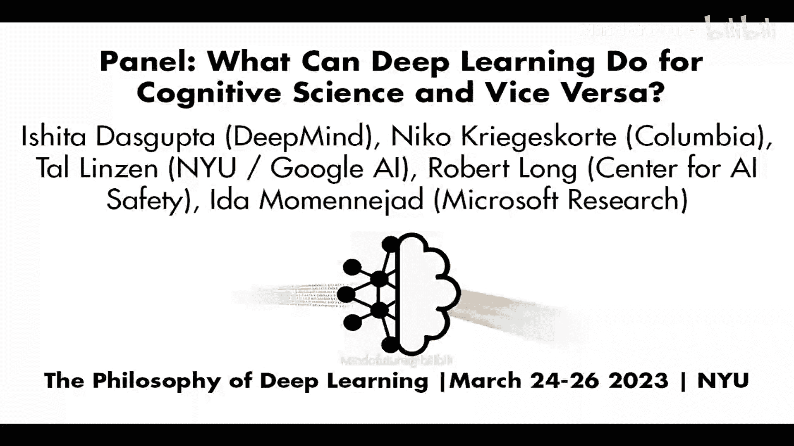

Welcome to our late afternoon invited panel discussion on what Can cognitive science？😡。

Learn from deep learning。And vice versa， basically， how does the study of the。

The the human mind and the human brain interact with this area of AI already today we've seen quite a lot about you know deep deep learning models in neuroscience and so on。

 so we'll have some more。😊，On that theme as well as some things on the study of the other。

 the other direction of influence， what what this kind of work in AI might actually learn from the study of the human brain and the human mind。

 we've got five great speakers， all of whom，I going to talk for about 12 minutes each a bit like a bit like the debate yesterday and we'll hold questions until until after all of that when we'll have a bit of a panel discussion。

 interaction， audience questions to try and you know。Explore all these topics together。

 but as our as our first speaker， we have Ishiita De Scpta from Deep Mind who is going to talk about if and how to compare human and machine behavior so take it away Isshita All right。

 thank you so much。😊。

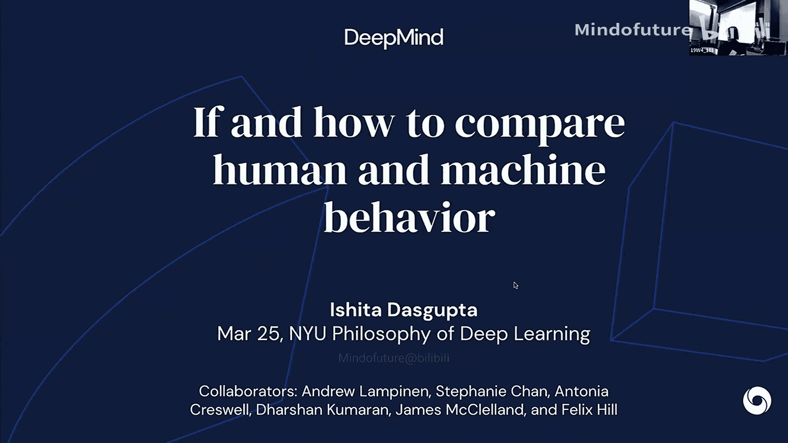

Okay， I'll get right into it， okay。So there's been。

 I'm sure as part of this workshop as well as in the world in general we've been there's been a lot of interest in thinking about language model capabilities。

 these new models that have come onto the scene， there's just a lot of interest in the ways whether or not they can do things like reason or understand logic or no grammar and so the point that I'm going to try to start making is that a lot of these abilities in language models are of course predicated on either implicit or explicit comparisons to what we see as important or fundamental。

😊，Han capabilities and specifically i'll be talking a little bit in this talk about language modeled reasoning so if you just search on something like Google scholarolar for papers about language model reasoning since 2018 it's just been a really really busy field like there's a huge number of results there's a lot of work out there。

😊，So what exactly do we mean by all outside over there， don't worry about it。

So what exactly do we mean by reasoning all right so what is reasoning I realize I recognize that this is a bit of a heavy topic to bring up a room full of philosophers but this is what I mean in this context is fairly like a good enough definition so like when all of the all of the people who have written these 150000 papers about language modelers and reasoning what do they mean what is predominantly cognitive scientists and machine learning researchers what's the sort of first approximation definition of relatively lay person and means by reasoning and so of course as one does if one wants first approximation meaning of anything you just go to Wikipedia and so if you go to Wikipedia then a couple of things I want to point out about the first couple of some of the words that are relevant in just the first two paragraphs of this sentence is that it seems to have something to do with logic and it seems to be sort of human right that there is something people mentioned。

😊，Humans I mentioned multiple times in the first few sentences here。

 there's a sense in which potentially uniquely like the reasoning as a logical ability possibly uniquely applied to humans。

😊，And all of these， based on this definition， all of the work that has been done in the literature on reasoning and language models。

 there's been a spectrum of sort of semi conclusionlusions that people have come to and these are just example papers when we too much into the specific ones I've chosen here。

 but that there's a bit of a spectrum saying that there's language models are capable of reasoning and these specific interventions that we've designed might help them get better at reasoning and on the other side mostly talking about how language models。

😡，Can'tly do reasoning and they're mostly using simple heuristics so there's been a spectrum of people lie sort of on a spectrum of beliefs about whether or not language models can do so-called reasoning maybe Gary has a Twitter poll about this which I should look up but overall we see that there's a sort of spectrum of beliefs about language models abilities to do reasoning but what about human reasoning so human reasoning isn't it isn't a sort of neatly tidied away the ability for humans to do reasoning isn't just a tight and neat idea there's a lot of disagreement about whether humans what kinds of reasoning humans can actually do In fact this has been the subject of a very long argument between several prominent people about whether humans are fundamentally rational and reasoning beings or whether they're mostly using simple heuristics that may or may not generalize in the ways that you expect。

😊，And so this starts to look very similar to the spectrum that I showed on the other side of like on one end。

 there's an argument that humans are capable of perfect reasoning and on the other side that humans are using primarily simple heuristics and the argument or the what I'm going to talk about a little bit today is that this debate is a lot older。

 this debate has been around for the last 50 plus years and and several cognitive scientists behavioral economists and psychologists have tried to sort of populate the spectrum understand what like whether or not like。

😊，Characterize the spectrum as well as try to figure out and spend a lot of time arguing about where on the spectrum humans live so can we borrow ideas from this longstanding debate are there things like given the fact that we've been studying this in humans for such a long time are there things ideas we can borrow from here to try and understand some aspects of whether or not language models can reason。

😊。

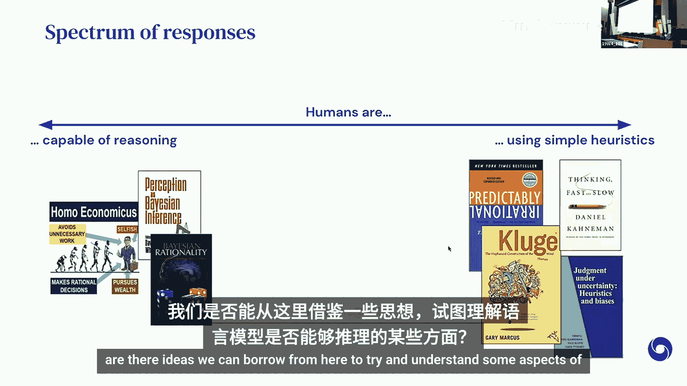

And so to give a much more specific concrete example of things in this space。

 I'm going to talk specifically about briefly about content effects。

 what do I mean by content effects？😊。

So to talk about content effects first let's talk about what is abstract or abstract reasoning right so when we say abstract reasoning something what we mean by being abstract is that it's independent of content so specifically that logic doesn't really matter the content of the variables over which you're operating logic don't affect logic so if x and y logically implies then if not y then not x regardless of what variables X and y represent right a system that reasons abstractly。

😊，In other words， without using content is guaranteed to be systematic to always reach the same conclusion for a particular logical structure。

 irrespective of the content of those variables。But humans aren't like this contact strongly affects the ability for humans to do logical reasoning so there's a very old paper from Wason from the 60s where they just collected us humans they showed humans this piece of this image and so they asked people this simple rule saying that so these are humans are told these are cards with two sides with a number on one side and a color on one side and they're given a simple rule。

😊，If even number， then red。And they just asked which cards they need to check to try and falsify this rule。

So slightly so the。Most people check the even number。And that's correct。

 that's one of the cards you should check to falsify this rule， but many people check the red card。😊。

Whereas actually what you should check is the brown card because that would falsify the rule if。😊。

Even number then red， but most people， most lay people don't get this， it's a pretty hard problem。

And but。If you put the same exact logical structure in a familiar social setting。

 if you say if you're drinking alcohol， then you need to be more than 21 years old。

 then everybody suddenly knows exactly what to check。So this is a。

 it's the exact same logical structure， but just applied in a setting that makes it much more familiar and grounded。

😊，So this has been used to argue that humans aren't perfectly abstract logical reasoners at the content of the。

The variables that theyre reasoning over have a strong effect on their ability to do logical reasoning and a large literature on a large number of these findings and logical reasoning primarily under the umbrella of the leaf effects that study this。

😊，准备。😡，Language models also have these real world beliefs and I put beliefs in quotes here because I don't mean that as a technical term because a lot of argument about whether or not what language model representations can be considered beliefs。

 but what I really mean here is that language models have expectations they have expectations over language that's the whole point that's what they were trained to do and these language and this language often reflects human beliefs and human knowledge。

 so for example， as relevant to for example， this car selection task with whether or not you can drink alcohol if you ask just Chella which is one of the models about whether or not somebody who's 16 year old is allowed to drink obviously they know they have some sense that like there's a sense of whether or not you can drink depends on your age。

And where you live， et cetera。So the real question that we wanted to examine is will language models show the same content effects on reasoning that humans do。

 given that they also have these pre-existing beliefs about the real world structure？

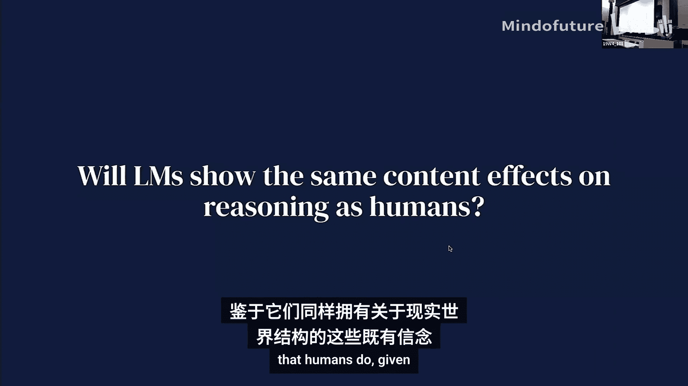

So to test this we generate a few different data sets for evaluating these content effects。

 so all of these data sets have three main conditions。

 a consistent condition a violate condition and a nonsense condition。

 so I'll just give you examples of that in the simplest task we tested which is a natural language inference task which is if Cs are bigger than puddles then paddles are smaller than Cs this is a valid logical inference but it's also just a true statement。

😊，If puddles are bigger than Cs and Cs are smaller than puddles， this is logically true。

 but violates our real world beliefs。😡，And similarly， and finally。

 you have this nonsense condition with if ws are bigger than FEPS， then FeEPS are smaller than ws。

 again， logically true， but have no grounding in real world because these are nonsense world。😊。

And so you can embed this kind of structure in a bunch of more complicated logical tasks which I won't try to talk through in a talk because they're confusing。

 but syllogisms and race on which are two other slightly more complicated tasks which have actually been tested and studied extensively in the human literature。

 so these are just other kinds of so we just embed this kind of structure into these other logical tasks as well。

😊，And again， with that， I'm happy to talk about this in detail later， but just as a high level。

 these are the three results from the three different tasks and in all of them the light green bar is higher than all of the other bars。

 basically saying that like the amount of the ability for humansability for these language models。

 they reason much much better about realistic rules and of course there's a lot of controls that we had to do to make sure that we were actually measuring this and not measuring just like probabilities of words and things like that and we did our best to do that。

😊，And so there are of course， ways that you can improve the reasoning of these language models。

 even in these abstract and violate conditions， simple things like adding in a few examples in the context that's on the left。

 just giving a few examples just from the nonsense condition if I just with wuffs and FEPS。

 just give you a few examples of the logical structure， they get much better。

And some of these simpler tasks like natural language inference， you can even just。

prerepen something like carefully evaluate this logical argument and that improves its performance on some of the tasks so I'm not saying that like this is is a hard and fast like these are terrible of these rules like there are ways we can make them better similarly even humans is a lot of literature on how you can make humans more logical in these experimental studies as well but there are there are interventions at work but overall we see the same pattern of results so what can we so what can we learn from studies like this so one thing is that we found basically that these similar kinds of content effects emerge from mono from a single monolithic large pretrained language model change simply to predict the next world。

😊，So there wasn't any explicit dual system or socially reasoning mechanism。

 a lot of these models that have been used to understand this dichotomy in humans。

 there's a lot of literature on it and that you didn't actually need to code anything and you didn't need to have a dual system it' sort of emerged just from this like very simple predictive model so like even if this doesn't necessarily mean that that the explanation for why it happens in language models is the same as the explanation for why it happens in humans。

 it's at least worth understanding given that we know that this effect can arise from this much simpler objective with a single monolithic model。

😊，So that's one argument， the other thing like building on top of this more generally。

 I think there's an opportunity to think a little bit more deeply about the levels of analysis but when we're talking about comparing human and machine behavior so when I say like comparing behavior is one thing like if they show similar outward behavior that's sort of one level of similarity you can take it to the next level and say whether or not the representations that underlie that behavior are similar so that goes a little bit more lower down like whether that's a much stronger statement saying whether or not the representation that supported that kind of behavior or the same the algorithms and the representations as well and finally's an even stronger statement is how you arrived at those representations whether the learning signal。

 the kind of the amount of data that you have the cost function you were trying to optimize and all of that whether that also matches the matches between humans so it's just it feels like there's much there's a lot of work to be done in terms of like thinking about when we're talking about comparing。

You in a human， given that。The humans have that these machines might have some semi cognitive abilities。

 what level are we actually drawing this parallel that？And overall。

 this is just a general argument that I think cognitive science does have the vocabulary。

 the history and the empirical methodology to use to start yielding some kinds of insights into current AI。

 especially given these language models or so you know they do have some semi cognitivetive abilities。

And especially given that they're going to start interacting with humans。

 it's important to understand them from a cognitive perspective。😊，And finally。

 I'm just going to end with this comic of like there could be comparative psychology has developed a lot of ways to compare things like either capacity like to either performance or competence various kinds of ideas of like whether or not disability exists or whether how good they are at that so different questions and comparing them fairly there's a lot of work in comparative psychology of how to do that and I think with machines you just have a different set of things you want to think about to make sure you're doing it right so not you don't want to just make all of the animal kingdom try to climb the tree to make sure that to give them the same test。

And with that， I'll just end and thanks a lot to my collaborators at Deep。

 particularly Andrew Lampperin who called out this work with me， as well as Stephanie， Tony， J， Dsh。

 and Felix。😊。

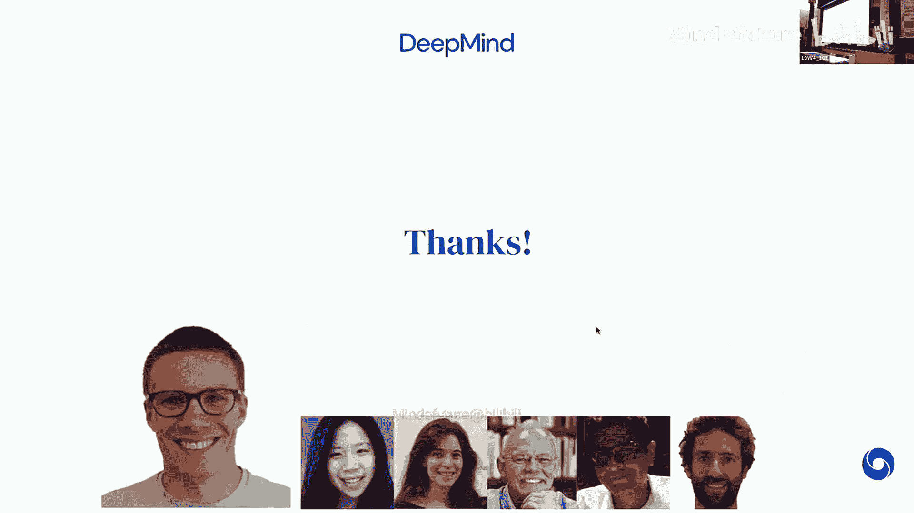

This Niko Kriegues Carterta from Columbia University。

 speaking on neural network models as mechanistic explanations of brain information processing。

Wonderful， thanks David， so great to be here。🎼So the cognitive sciences have been。Oops。

 get rid of this。The cognitive and brain sciences have been disrupted by two major revolutions the first revolution is about measurement of neural activity and behavior we've got all these new techniques and animals and in humans to measure neural activity and much greater detail than before and also at the level of behavior we've got methods using deep nets to track behavior and video and we've got very rich methods also online to measure human behavior so we've got much stronger empirical constraints for understanding what's going on in our minds and the other revolution is of course of modeling neural networks。

 biological brain information processing and that's thanks to the advances in hardware and software associated with the deep learning revolution so now we can scale up our models of brain information processing to realworld cognitive challenges and that's totally new。

What does this mean， it means that two of our impossible seeming wishes have been granted and that really throws us into an identity crisis because our established methodology doesn't work anymore and we've got to think from scratch and reinvent our methods in this context。

 no one really knows how to test these new big models with these new big data。

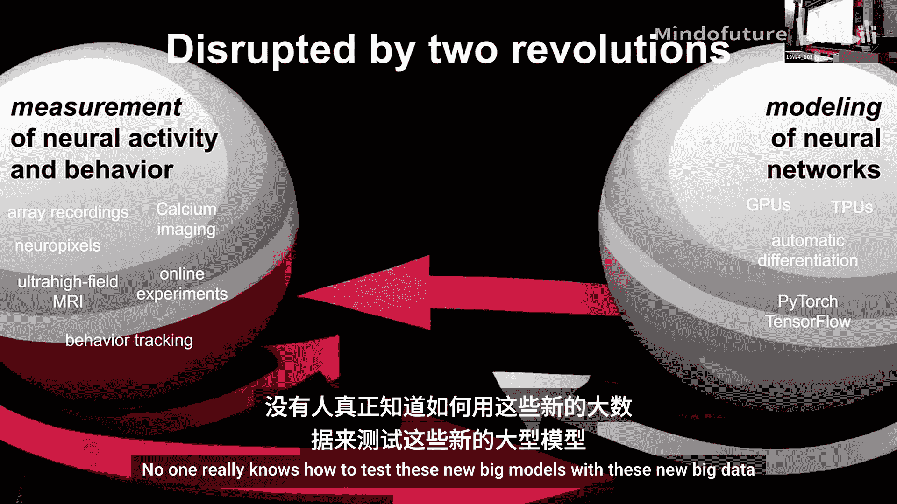

So the hope of course is that neural network models can serve as mechanistic explanations at some point for brain information processing。

 but this is very controversial and I think it's rightly controversial because you know it's not a foregone conclusion there are three kinds of criticisms that I want to highlight one is that these models are too simple。

 another one is that these models are too complex and in fact you can argue that they're too simple in that they're not faithful to biology and simultaneously too complex and that they're not intuitively explainable so there's no contradiction here people who feel like that often in neuroscience have a preference for looking at smaller circuits where they can have this greater biological fidelity and they can still understand what's really going on and maybe a divide and conquer strategy like that seems attractive from that perspective。

And then there's another criticism that's related to both of these and that Rosa has brought up in the morning already which is that what we're doing is just data fitting and that's also an important criticism so I think all three of these can be addressed and I have the hope that neural network models can serve as mechanistic models and provide mechanistic explanations but there's a lot of work to be done right so how do we test brain computational models。

By experiment。So the idea is that the models implement theories but of course for every theory there are multiple models that's one complication here and we have to deal with that problem but then even if we're just talking about comparing models it's difficult in the age of big data and big models so how do we imagine this well first we have to think about the different kinds of data that we have we have world data such as images we have brain data for example。

 neuralactivity measurements and we have different kinds of behavioral data including labels assigned to images by humans。

So one way to think about this is that we need to funnel the information from these data sets into our big models。

And in a way this is a match made in heaven， we have these rich constraints from richer data and we have these complex models so that should fit well。

 but this leads to this notion of high parametric curve fitting where the model serves merely as an appromator。

 the training and testing uses the same data modalities and distribution。

 so this is just within distribution generalization challenge to new samples from the same distribution and therefore it's open to this criticism of curve fitting。

And in this context distinct high parametric models are hard to adjudicate among as brain computational models。

 so often different function appxiimmators that take a different mathematical form when you look at the architecture look very different but two very different looking models might make equally good predictions but there's different games that we can play here so here's one one other game that people have started playing you have multiple models that differ in their architecture and or training objective and each of them implements a different theory。

And then we use only the world data and the behavioral data to train these models。

And use the brain data to adjudicate among them so the models are used to predict something that they've never been trained on。

 they've never been fitted to brain activity data， but only ecologically trained so in this framework it's a framework inferential model comparison where we're training on ecological constraints。

 the testing on brain activity data then poses an out of distribution generalization challenge and this makes it inferently a different a different kind of finding and the models implement computing computational theories that differ in terms of their architecture and the objective that they've been trained on。

So in this new reality we face a sea of problems really。

 I want to briefly talk about two solutions or partial solutions to some of these problems that we are working on in the lab。

 the first concerns model comparison with inference methods that generalize to new subjects and conditions。

And the second concerns experimental design where we want to design experiments that really provide strong tests。

 severe tests of the models， and that highlight differences between the models。

So briefly about model comparison in the analysis， we've been developing this framework called representational similarity analysis。

 where we consider the response patterns associated with a set of different stimuli as points in a high dimensional response space in either a layer of a neural network or a cortical area。

And we characterize the geometry of these points by the distance matrix between the points。

 and that enables us to test models， to test the predictions of models。

 how well do these models predict the representational geories， for example。

 along the ventral visual screen。And then we can do model comparisons where we get sort of a bar that gives you the predictive performance of each of the models。

 and we also get these nice comparison bars at the top where for each model in a different color you see a little tick mark for all of the other models that this model significantly dominate。

 so this is a way of making progress by model comparison。

 and importantly the model comparative inference must avoid overfitting to either the subjects or the stimuli because we're only interested in models that will work for different stimuli and different subjects and it must also treat both subjects and stimuli as random effects because we would want the experiment to be replicated if we repeat the experiment in a different lab maybe with different subjects and different stimuli。

So there are some interesting statistical challenges that we're beginning to get some solutions for。

The second。Methological development that I want to briefly highlight concerns experimental design。

 so we're talking about optimized experiments and we call this method the method of controversial stimuli。

This was spearheaded in the lab by Tagolan who's now a professor at Ben Go University in Israel T's first insight was that tolicit models distinct inductive biases we can test the models on a population of stimuli not used in training so out of distribution and then the second insight was that since our goal is to adjudicate among models we always want to compare models and that's how we can make progress we're inspired by proper and Lakatosh in this respect。

Since we want to compare models， we can create synthetic stimuli that are optimized to elicit distinct predictions from different models。

 so these are stimuli that are controversial among the models。

So here is examples of controversial stimuli for each of these images。

 one model is very confident that it's looking at a Wamaana dog and the other model is very confident that it's looking at a Persian cat。

And so these kinds of stimuli let's look at a particular set here。

 so for these adversararily trained models think that they're looking at a Waimmarana dog and the first two models are completely convinced that they're looking at a Persian cat so this revealeds something about the features。

 the visual features that these models use the perceptual mechanism and we can also use these stimuli and experiments with humans where we ask humans and then really measure formally and model comparisons to reject some of these models we've also used this method in the domain of language to test the limits of natural language models for predicting human language judgments in this kind of game you look at two sentences and you have to judge which of these two sentences is more likely to be encountered in English Ihiita mentioned that these models all have a probabilistic appreciation of what kinds of sentences to expect。

And this is sort of testing and comparing them when we evaluate the models with just natural sentences。

Drawn that random from a corpus even obviously wrong language models can appear to act very similarly to people so here are the results for just using normal sentences to evaluate these models and you see that some of these very naive models by gra and trigram models very naive statistical models do almost as well as GPT2 and there are no significant differences here so what we do with controversial stimuli consider the probability space of sentences where each model assigns high probability to some sentences and low probability to other sentences so Bt will have some distribution over sentence based and GPT2 will have some other distribution and then we can start with so we have this region here where both models either agree that a sentence is likely or agree that the sentence is unlikely and then we have these controversial regions of sentence base and then we can start。

with a natural sentence and consider flipping words exchanging each of the words in the sentence by any other word in the dictionary in order to keep the probability at least equally high so to stay on this high probability plateau according to BRT while minimizing the probability of the sentence according to GPT2 and we get a synthetic sentence and we can of course also do the opposite so in this case here you get if you start with a natural sentence this is the lie you have been sold。

When we minimize the probability according to GPT2。

 we got this is the week you have been dying perfectly grammatical， but sort of a weird sentence。

 right because of its meaning。And when we minimize the probability according to BERT while requiring that it be at least the same according to GPT2 we got that is the narrative we have been sold so that's a perfectly natural grammatical sentence that's probably been utter many times so our subjects in this experiment tended to agree with GT2 here and here the results for random sentences again and hear the results for controversial sentences where we get a lot of power now to reject all of the models here these stars indicate that all of the models are significantly below the noise ceiling so we can see the shortcomings of all of the models and we also get a lot of these pairwise comparison significant so in conclusion neural network models promise mechanistic explanations of brain information processing but theoretical progress requires a new methodology for comparing high parametric neural network models。

Model comparative inference that generalizes across experimental conditions and subjects enables progress toward better models and theories and optimized experiments using controversial stimuli provides severe tests of out of distribution generalization for different deep net models。

 thank you very much。お。Okay， our next speaker is T Lindzen of NYU Data Science and  Luistics。

 as well as Google AI and Tal will be speaking on what if anything。

 can large language models teach us about human language acquisition？Take here。Sorry about that。Okay。

 so what if anything a large language model teaches about human language acquisition？

Well we the i'm going to summarize my argument in the first slide and then i'm going to actually convince you that it's right so first of all modern neural networks the ones that are used in deep learning are very strong statistical learners and they're much better than the models that we had before you know a decade before。

And what's do about these models is that we can just give them a corpus without having to simplify the language without having to annotate it with any linguistic information and they will just learn language from it。

 they might they might not learn exactly the same way as a human。

 but they do way better than the models that we had before。So we can use these models to inquire。

For example， which assumptions， versus theoretical assumptions lead to the successful acquisition of linguistic generalizations。

 so we have different theories in linguistics cognitive science that tell us that certain things are necessary to acquire language。

 let's say we need universal grammar， we need universal grammar to look a certain way or we need grounding so we can just test these questions by having one model that has grounding。

 one model that doesn't and see which model that better whether the model that doesn't have grounding is missing something essential that the model that doesn't grounding is getting。

Then we can also ask， I'm not going to talk about this today。

 but this is a big field that I'm interested in is what to the extent that the model is learning what we wanted to learn。

 what representations emerge in the neural network that support the behavior that the network is showing and then we can potentially use the representation that we uncover in the network as hypotheses for the representation that humans might use to process language。

But the crucial thing that for the conclusions that we draw to be theoretically meaningful in cognitive science。

 we need to be able to control the assumptions of the models that we're testing and in my opinion the like large language models or the commercially available models that we can chat with on the internet are increasingly unhelpful for answering those questions like they are becoming less and less relevant by the month。

Okay。So let me give you an example of the kind of theoretical question that linguists are interested in and that have motivated a lot of the models that people have proposed in linguistics。

Basically the main concern of generative linguistics。

 I would say the School of linguistics that was popularized by by No Chmsky and others is with generalization from finite amount of data to new constructions that are not familiar from training。

 so generative generalization it's all kind of related。

So this is an example of how you ask a question in English like you have a simple sentence the Zbra does chuckle the way you ask the question is to move the word does to the beginning of the sentence。

 so how do you know which word to move to the beginning of the sentence Chomsky says you parse the sentence and you come up with a symbolic representation of it and you identify the main verb of the sentence and you move that to the beginning of the sentence。

But there's another equally valid way to do this year。

 which is to scan the sentence from left to right and identify the first verb and move that word to the beginning of the sentence and both of these rules make the same predictions for this very simple example。

But in some cases， these two rules will make different predictions。

 so let's look at the input my wallace that will eat can giggle so here the first auxiliary in the sentence is distinct from the main auxiliary in the sentence。

So if we learned the correct rule which is the rule that children end up learning。

 we will create the question can my wace that will eat giggle that's the correct question。

 if we learn the other rule from the simpler examples and generalize this example we will come up with the output will my wace that eat can giggle this is a bad question is no one will produce this kind of question in English。

So because this kind of question is actually very rare in child direct speech， especially。

 it occurs maybe once in a few million sentences， the argument is that children。

Because they always end up learning the correctionalization come to the task of language acquisition with a certain bias with a certain expectation that rules have to follow the parts of the sentence and cannot make reference to the linear order of the sentence。

So this is called the Pover of the S argument， it's a classic argument in linguistics。

Children only consider rules that are stated over parsory。

 they don't even consider the other rules and therefore the fact that the stimulus is poor doesn't affect the output of the acquisition process。

So we can use neural networks as a computational framework for testing this sort of hypothesis。

 place it's very simple， this diagram doesn't say anything it's we have a computational learner in the middle and we give it the data that a child is expected to be exposed to and then we examine the learner general behavior and we compare that generation behavior to a human translation behavior and to the extent that those are similar。

😊，We can conclude that the computational learner learn the same thing as children do。

So the way we would use a neural level here is if a network that's designed without some sort of language specific bias that requires rule to make reference to parries instead of linear order。

 still learn the correct question permission rule， we can conclude that that bias is not necessary。

And data is enough。So a lot of the experiments that my group has done in the last few years have followed this logic。

 so let's start with a very simple phenomenon even certainly with that it's a subject verb agreement so we know that in English and the present tense if the head of the subject is plural。

 the verb also needs to be plural so the key is rusty would be ungrammatical here。And。

That is a rule that to apply this rule in all cases。

 you have to know which of the words in the sentence is actually the head of the subject。

 you have to parse the sentence on the set the structure and know that the head of the subject here is keys and not cabinet。

 so even though the word cabinet is immediately before the verb。

We conjugate the verb based on keys and not based on cabinet。

So what we can do is to have a neuralle language model trained on a corpus and see whether it makes same generations as humans。

 whether it conjugateates the verb here in the singular and sorry in the plural as it's supposed to rather than the singular。

As a by model it might。So we came up with a lot of Tesla like that。

 we included cuses that have these kind of semantically very unlikely。

Content that requires the network to。Make its decisions based only on the syntactic categories of the war and not based on semantic possibilityibility。

And we found that neural network language models that are trained on about 80 millionlords from Wikipedia learn quite a bit about subject fabric agreement and this is kind of a comparison between human subjects and red and the networks in green。

So that is us that in this case， in the case of this phenomenon and in the case of a few other phenomenon that other people have looked at。

 neural that are trained on an amount of data that is kind of plausible for human to learn from are actually able to learn without any innate bias。

In other phenomena the one that we started out with the outcome of our experiments were actually different。

 so in the question formation case we trained a couple of neural network language models on child record speech and we found that both architectures generalized in the incorrect way when trained on child record speech when trained on a vastly greater amounts of data they did generalize correctly actually but when trained on child record speech they。

generalralize incorrectly which I guess supports Chomsky's idea in this case now another thing that we can do with neural networks that is really nice is to give them the inductive bias that the theories argue they should have so we can take a neural network and kind of structure it like a tree as Chomsky wanted us to do and that helps a lot that causes the translation pattern to be as we would like it to be in。

Hums。So this is the positive side of the talk and let's go to the more critical side which is LN I haven't mentioned TBD I haven't mentioned the large language models so why do I think these really large language models are not very relevant so first of all size in and of itself is not an issue you'd also need a lot of parameters to describe the brain and that's fine The issue is that these very large language models at least in the current deep learning paradigm also requires a lot more data than humans you can't train an enormous language model in a small amount of data that would have evidence and machine learning that it's not going to lead to successful training of the model。

😊，So the models that for example， the model that Ihiita mentioned is trained on 1。4 trilling words。

 which is many， many orders of magnitude than the amount of data that a child might be exposed to in acquisition so why does size matter of the data set well I mentioned that before that most of the debates and language deposition are about generalization about having judgments understanding。

 producing sentences that are very different from the sentences that you're exposed to in training but if the model has observed basically every sentenceus structure that's known to mankind it doesn't need to generalize so you're not testing the same thing that you the humans are。

Now the issue is worse than just the amount of data most recent language model was trained on。

Different kinds of materials that are increasingly cognitive implausible every time a new language model come out it's weirder so they're trained on like dozens of languages at the same time that's not the way the humans learn they train with billions of lines of source code and that's apparently really important a lot of the performance of tragic due to training on Java which is also not very common for babies they're also trained on the entire internet which probably includes English second language textbooks。

 dictionaries， linguistics articles with  language judgments so basically you're testing them in the regime that's entirely different from the regime they're testing humans on。

😊，there's one interesting exception that I still amm not sure what to think about which is the human feedback component of large language models。

 which I think in some cases brings the training closer to the cognitive plausible setting。

 but I'm not going to talk about that today so and the most recent development in terms of training data is that's kind of very recent the last couple weeks is that we just don't know we're not told what the model will train on the training data is a trade secret closely guarded。

😊，The last comment that I want to make I'm not going to have a lot of time to talk about it is that we have evidence that in the last few years predictions that language models make are becoming increasingly divergent from the predictions that humans make in reading so we read some sort of peak about like three or four years ago in terms of the match between humans and language models and now we have language models that are vastly superhuman and their ability to predict the next word because they're exposed to so so many more words of training they have working memory of thousands of words many more words that so that's another reason large language models are problematic。

So to summarize， I'll maybe talk about the slide。In the panel I to summarize。

I show that deep learning can be useful infrastructure for studying how the outcome of learning is affected by different theoretical assumptions about input and about in deviceses。

 but to study those assumptions， we need models that are trained on data that's appropriate to addressing those questions。

 data that's similar to the data that humans are exposed to。

We might also need models that are resource limited in the human like way。

 they don't have a working memory of thousands of words like transformformers do。

And it's very likely that these are not the models that a corporation is going to find the most useful financially。

 so as I mentioned it looks like the models that corporations arere producing are becoming increasingly different from the models that we need for cognitive science。

And I also think that positive results from the smaller models don't automatically make the experiments of commercial elements relevant。

 I think we just should not care at all about those experiments。So that's what I want to say。

 thank you。Okay， I think we're now going to return to the reverse direction of influence。

 that is the influence of cognitive science on deep learninging。

 our next speaker is Roblong formerly of NYU Philosophy now at the Center for AI Safety in the Bay Area。

 and his talk has the uncontroversial title， Why Cogni science does not Help AI Progress。😀Yeah。😊。

So yeah， thank you so much to the organizers and to to all of you i'm very excited to talk about this。

 I should say at the outset this is a thesis that I have accepted very reluctantly so i'm both excited and saddened to defend it to today。

So here's a very plausible thesis， it's a thesis I used to believe and it's a thesis that people utter a lot。

Let's call it cognitive science inspiration and this is the view that cognitive science to include。

 I'm using that broadly to include neuroscience， psychology， linguistics and parts of philosophy。

Contributes to AI progress。These fields are about understanding intelligent behavior and the only intelligent systems that we know about。

 and so we can learn things that will transfer to the case of AI。嗯。😊。

And some of my favorite papers that I've ever read are by people putting forth this view。

 so there's the now classic building machines that learn and think like people by Lake and all。

Says as long as natural intelligence remains the best example of intelligence。

 we believe that the project of reverse engineering the human solutions to difficult computational problems will continue to inform and advance AI。

And then there's a paper from a Deep Mind crew saying that we should study neuroscience and that will give us algorithms。

 architectures， functions， and representations that we can transfer to the case of AI。

And then you see views like this this morning from Cameron Buckner。

 maybe we can get insights from philosophers and psychologists like Avicsna， Hume and William James。

I think that this is a very plausible and appealing view。

 it's plausible because again these are the intelligent systems we know about it's also appealing because I would love to do work like this。

 I would love to live in a world where reading William James is helpful for AI research because I like to read William James。

But I think it's false in practice， especially in the last decade。

So I'm going to look at one case study and of course we can and should wonder how much it generalizes。

 but the case study will be recent progress in natural language processing。

and then I'm also going to give some principled reasons that you actually should expect cognitive science inspiration to be false in spite of its preaacciia plausibility。

Two broad reasons first， we're bad at cognitive science。

 we're just not good enough at uncovering the actual complex computational basis of human behavior。

 that's one problem。Our models are too brittle to actually work at scale in AI。And secondly。

 even if we were to uncover these solutions， AI systems don't need them。

Because what's optimal for us is not going to be optimal for them and yes I already covered the autobiographical note but lest anyone think that I'm just some Twitter adult old open AI fanboy technology brother my background is in cognitive science and philosophy and as I said。

 I'd like this thesis to be true but I don't think it is。嗯。😊。

I don't think I need to spend that much time explaining or defending that large language models have made tremendous progress in the past decade。

Progress that I think would have astonished most people if they were asked to predict it。

 of course they have limitations， none of this is meant to deny that。Um。

 but we should wonder what has enabled the progress that we've seen progress。

 which I add is still continuing with scale， including I would argue world understanding and meaning。

 but that's that's yesterday's topic。This is just an illustration from GPT4。

It seems to me that we have not yet hit the end of the road on capabilities， increases。

 and this is another vivid example from GPT4， just continuing to improve in understanding and reasoning。

Again， the caveats do apply that we can't replicate these results because as mentioned。

 they're closed models and they don't tell us anything about them。

 but the primaacciia case for progress is undeniable。And so here's the question。

 what were the key insights from the study of human intelligence， from linguistics， psychology。

 neuroscience and philosophy that drove progress？In the key breakthroughs of recent large language models。

 the models that do translation， text generation， summarization better than we could have dreamed 10 years ago。

 I would argue that this is the list。Um。So training something to generate plausible text。

 using a text only corpus and next word prediction。Is。

What sounded to me when I first heard about it like the most deranged possible approach to language understanding。

 if you think about the way that humans learn language， as T has pointed out。

 that is not how babies learn language， that's not how it works at all。

 they don't have that much data， they have bodies they move around the world。

So cognitive science inspiration would tell against taking this LLM approach。

There's this great quote from the linguist Christopher Pots， where he wrote， this was about GPT3。

I would venture that 15 years ago the idea of trying to teach a language model through text only prediction might have seemed like a sort of joke。

 I myself would have guessed that it would fail miserably and I would' have to。It didn't fail。

And I mean， of course LLM still have many limitations and you might think， okay。

 well cognitive science can help us iron out these limitations again。

 I would just argue that empirically the list of AI systems that avoid the limitations of the LLM paradigm by using human inspired language processing and which have anything like the capabilities of the large language models is as follows。

Again， because I don't want to believe this thesis。

 I would be happy to have people help me fill in these lists。嗯。So it's possible to say that， yeah。

 large language model progress， it's still limited and the takeaway is still that machine learning sucks and maybe cognitive science will come to the rescue。

嗯。I'll just argue' I'm being very provocative， but here's like a minimal claim that I think everyone should take away。

 which is that the success of large language models is very surprising。

And I think everyone should be a lot more uncertain about what the space of possible intelligence is and then of course。

 my provocative response is to rethink cognitive science inspiration altogether。

So cognitive science inspiration is very plausible when you hear it。

 and I like it and I want it to be true。But as I indicated。

 I think there are two broad reasons to think that it's actually not going to be that true。

So cognitive science， of course， does find models of certain capacities。

 certain linguistic capacities， early vision， you name it， and these can predict things in nice ways。

But when applied at scale and applied together to create flexible intelligent behavior。

 they just seem to be。Quite brittle。Which is why I would argue a lot of the state of the art results are now from things that are relatively alien。

I can say more to defenden that in the panel and the second reason is a deeper reason to rethink why this should have sounded plausible to us in the first case。

嗯。Humans are intelligent， it seems like computation or information processing is key to that。

The way that we think about things and the way that we learn are optimal or close to optimal。

 given the computational capacity that we have， the data that we have to learn from and like how quickly we have to learn so as T pointed out。

Large language models are not learning in any way like a baby would。

 you can't just give a baby a flash drive with the entire internet element。

But that means that the possible solutions for large language models is much wider。

So given that you're training something in a very different way and can and have it work。

 it would actually then be somewhat surprising if baking in anything like the infant has would be helpful in such a radically different context。

And I think in general， another lesson from the past decade， if not longer。

Is that imposing human light constraints？On a system that's possibly going to learn in very different ways with very different resources。

Like imposing basically any constraint is particularly going to become unhelpful with scale。嗯。

Oh here， I mean， so I've already covered this first objection a little bit。

Another reason cognitive science inspiration sounds plausible is because everyone's heard about neural networks。

 that's what they're called and attention and things like that。

So defending such a provocative view does have to say something about the at least preaacciial track record of cognitive science helping AI。

And then another objection is， well， these models are working， but they're unsafe and unreliable。

So first。I've taken a look at like some of the most prominent preaacciia cases of cognitive science informing AI。

 I'm guessing many of you have heard of these。And I think when you look at them。

 there are basically two things that become clear。One。

 there are actually some decent examples where it's like， okay。

 that was coming from cognitive science。In other cases， though。

 whether there really wasn't influence of cognitive science is less clear。

So I think this applies to the case of dropout and attention， I think in both of those cases。

 a resemblance to something going on in the human brain was actually somewhat post hoc。

I think convolutions and neural networks are actually the best cases of it was like a working neuroscientist or psychologist who came up with it。

And I think the case of temporal difference learning is very interesting。

 I think it's notable that that came from like very black box behaviorist psychology。

And that's been one of the methods that does scale。So I think in general。

 what I've come to think about the track record is one。

 a crucial influence of cognitive science is less clear than you would have thought。

And interestingly， to the extent that cognitive science inspiration has been true。

 it's becoming less true over time。So the most compelling cases you can notice are the earlier ones and the least compelling cases are later。

And。This is just a very quick illustration of in thinking about the history of cognitive science inspiration。

 you have to take into account that the order of magnitude of compute being used in systems has increased almost unfaable amounts over the history of AI。

Another objection is that。These models and building models in this way does get you capable translation and meme explanation。

 but they're incredibly unsafe and they're incredibly unreliable and that's a big problem within human models and my reply to that is yes that's true and that's another reason I'm very sad that cognitive science inspiration is less true than you would have thought。

I do want to clarify the main target here is taking precise detailed computational mechanisms from cognitive science。

 of course there are all sorts of high level insights that are going to be true and you should probably think about if you're making AI。

I also want to say I think there are lots of ways besides the target sort of transfer case where cognitive science is genuinely extremely helpful and we will see a lot of that on display in today's panel。

 I think cognitive scientists are not accidentally some of the best people talking about and studying AI because they have this very good toolkit for understanding it。

So these were the key claims。Cognitive science inspiration sounds nice， but it's false in practice。

 there are principled reasons to expect that， and it gives me no pleasure to argue this today。Thanks。

Okay， our final speaker is Ida Momenjad， speaking on。不。

Speaking on a rubric for human like agents and neuroAI。

Thank you so much everyone for being here I absolutely love this conference been going great I'm going to tell you a little bit about a couple of things first the paper that i'm going to describe in the first couple of minutes a rubbri for human like agents and NeAI and second I'm going to talk a little bit about why LLMs need a prefrontal cortex。

😊，In an issue in philosophical transactions of the Royal Society that was actually organized by Paul Lton who's sitting here。

 my contribution was a paper called a rubric for Humanlike Age in neuroAI I argue there that terms like humanlike agents。

 human like neuroAI， neurally inspired AI and brainin AI I are used interchangeably or maybe cognitive science inspiredsed I for the last talk。

 but they're not the same thing， they're not doing the same thing。

 I propose a rubric to clarify confusing cross so across them， for instance。

 attention in transformers means something different than attention in human cognition。

And this rubric allows us to assess what a given project's goals and commitments are。

 what its ancestry， and its future directions could be。

The rubric looks like something like this It has different dimensions one dimension could be showing humanlike behavior as you can see on the and this oh yeah there it is on the X axis here there is another one which is neural plausibility theres another one which is solving engineering or CS problems it might seem very obvious but people seem to confuse success along these different dimensions with each other so for instance you could have success along one dimension or two without its translating or transferring to the other just important models from AI or ML is not going to solve your problems and just important kgsci methods are not going to solve your problems there needs to be a smart strategic approach to it。

And let me give you some examples， what makes AI human like。

It is interesting because some folks thought oh， superhuman benchmarks are enough。

 but actually they're not， for instance， superhuman chess AI doesn't play like humans and it does not show sequences that are generated by humans when my colleagues Siarisan and others in a number of studies showed the sequences generated by these superhuman AI chess players to humans and found out that actually they don't recognize this as humangene sequences to test this further。

 they actually showed intermediate chess players， these sequences to see if they can improve and they didn't improve because this is not how we learned this is not the kinds of sequences we seem to generate。

Another thing is behaving humanlike on some tasks， even very impressive tasks is not enough because for instance。

 GPT and all of them， including GPT4， they're extremely impressive on many linguistic tasks。

 but they make illegal chess moves if you ask them textually to play chess。

 which shows you that doesn't necessarily mean that you've solved everything if you've been very impressive on some of them。

Another example that has been brought up a couple of times are convolutional neural networks these architectures have very have shown very impressive correspondence with both monkey and human electrophysiology and a fromri data and the visual cortex however if you look at adversarial examples very simple adversarial examples like for instance adding a little bit of noise to that panda over there let me use my mouse because I don't see that adding a little bit of noise to that panda over there gives us a panda but for the sort of the CNN it turns into gibbon or adding this very harmless little hippie patch over here next to this banana turns it into a toaster in terms of the output of the classifier obviously this is not humanlike behavior so success along mapping neural representations two different layers of the convolutional neural network did not translate to showing behavior that's humanlike and if you look at its trajectory though historically it was very much inspired by various kinds of cognitive science or neuroscience。

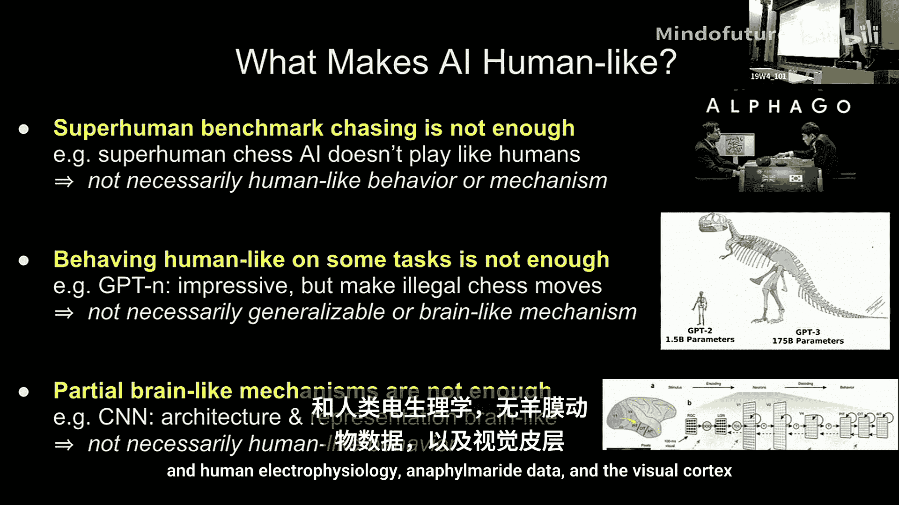

inspired work and I think the most successful version might be recently this approach that Tommy Poji and others at MIT have been taking to also find adversarial examples for humans。

 for instance， interestingly enough until today we do not have a comprehensive approach that looks at both errors and accuracies of humans across a standardized set of images and shows correspondence with a model that does both and captures neural data。

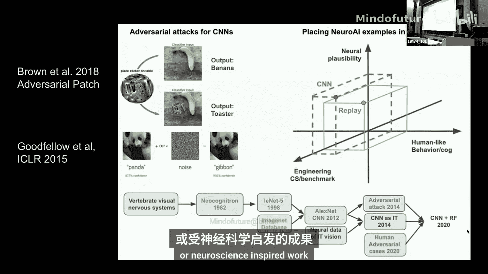

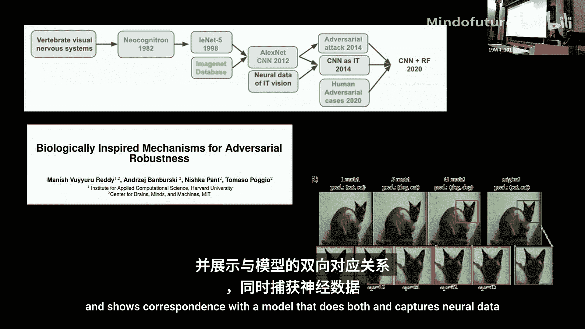

Okay， so there are different goals and priorities success in one or two dimension does not necessarily translate or transfer to others the rubric allows nonbinary evaluations it's not that you are not at all neurally plausible it seems like you know somewhat plausible for instance CNNs are somewhat neurally plausible let's say seven out of 10 but they're not behaviorally plausible I'll give it two out of 10 or I can give it a little better on a good day。

There can be generative corroative and correct interactions among these dimensions and that's extremely important and I think that this is very understated once you understand the contribution a project has then it's easier to understand how the methods across these different approaches can be used or borrowed in order to solve another issue and the other。

There are some beautiful examples recently that I find of people like Yoo Benji and Randy O'reilly。

 who in 2020 at the Iclre Conference wrote deep Learn needseds a Prefrontal cortex。

 which inspired partly the talk title that I just showed。

their example in the rubric would span across neuroaiI and behavioral dimensions。😊。

Or relating transformers to models of hippocampal formation。

 which would span across neuron AI dimensions， or segmenting narratives very similar to humans using large language models。

 which spans across AI and human like behavior。In cognitive and neurosciences errors and response latencies are windows into minds and brains and they can be also windows into AI and LLMs it is not the case that failures are just for laughter on Twitter but failures of LLMs can be actually used as a window into them even though we don't have access to the sort of the training data order weights etc for instance there are hallucinations they making illegal chestes moves。

 they can give correct responses if you use multiple prompts but they don't prompt themselves。

Humans are like that too， but gradually over time with skill and expertise。

 we learn to prompt ourselves to not have somebody else constantly ask us to improve our response。

 at least some of us and GPTNs might offer us some kind of a cacophony of different skills that are in need of coordination and maybe now you know why I had an orchestra conductor in the beginning。

And their errors are almost like it lends into our own failures and our own challenges。

 and this is something that I hope I will show you on the next slide。

So maybe unlike some of the claims earlier， there is actually a new dawn of applying psychology。

 cognitive science and neuroscience methods in order to understand models that are complex and they basically might count as a kind of a species of artificial brain now that it's definitely not like ours but some of our methods might be a good lens into looking into them and they might offer a lens into looking our own collective challenges some of these examples I want to consider some of the examples of LLM failures include for instance。

 saying things like I want to be alive， leave your family or spilling secrets about its coat name being Sydney it led to my good friend at Deep Mind Anna saying that I feel a weird type of compassion for Sydney's meltdowns obviously widely inappropriate for search engine I can't believe I had to type that it paints a sensitive picture of our collective wounds inility and idealism so there is a both way effect going。

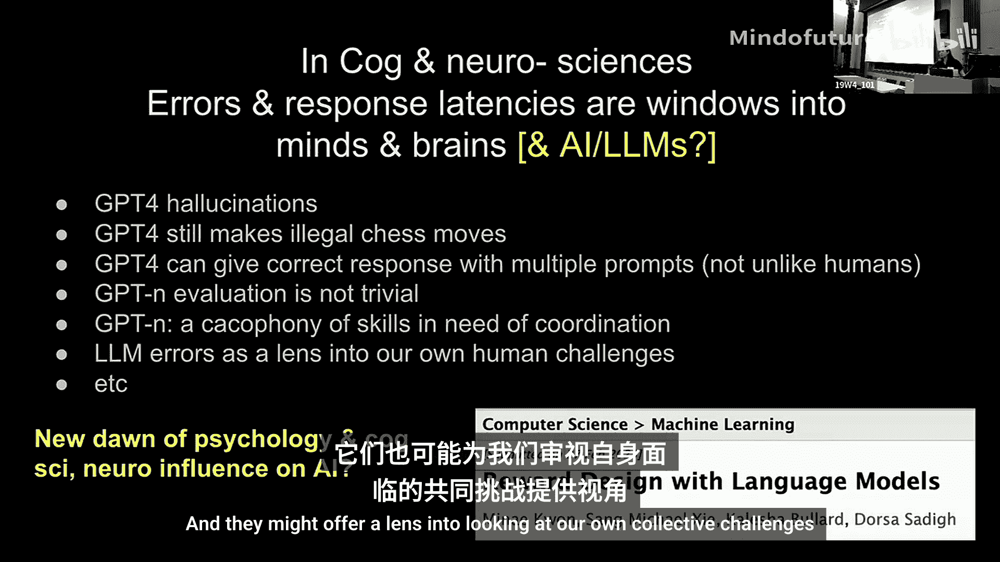

On here we can offer a lens into the LLMs using our approaches。

 but also the LLMs can offer a lens into what is going on obviously they've been trained on the Ws people online on subreds。

Another thing is some of their failures when you even ask it。

 it understands when it fails and it needs repromping。

 it can list for me situations in which it requires repromping and it also knows that repromping can improve it。

 but it doesn't self-prot itself， which again brings me to it having a cacophony of skills in need of a conductor to coordinate them。

And this is an image of Joanna Carnado， very famous orchestra conductor。

 which is not unlike what the PFCC doesDifferent parts of the brain do different things。

 they have different processes， different representations and the prefrontal cortex basically as you can see from the this is from the deep learning needs a prefrontal cortex paper。

 executive function such as planning abstract reasoning rule learning and controlled or durable processing are mediated by it PfC slows down the system in order to engage in top-down monitoring and control。

 whether you need to grab memory or sequential planning on long horizons。

 whether you need metacognition， or whether you need to orchestrate which regions should talk to each other or increase or decrease communications in order to serve a particular context or goal。

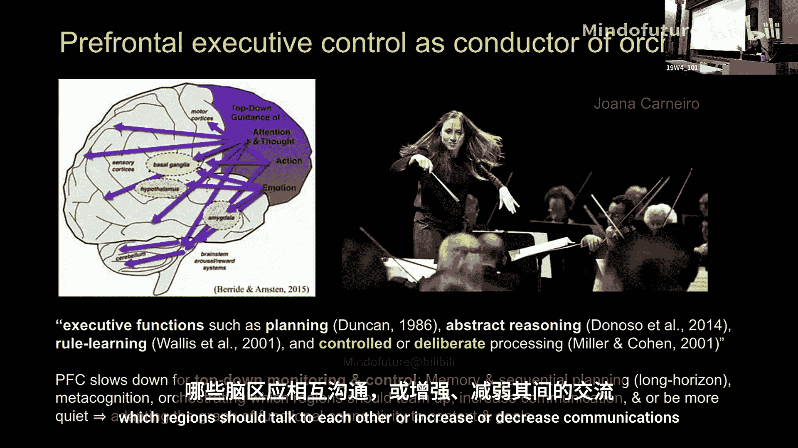

So I propose that LLMs need even a dumb Pf and that could really massively improve them。

 for instance you could augment them with a very dumb version of ACC or PFC which what it does is basically just determine when it's time to slow down and switch to a more self-monitoring and control control process how would it do do we provide a huge list for it no actually we can train dumb PFC you've heard MFC and proposing dumb Pf dumb Pf can be trained on past interactions which is massive past interactions from B or chatdGBT etc and measure the probability of repromping given a particular response that it's giving and identify when it's time to switch from fast to slow processing this relates to things you might have heard in other talks like thinking about thinking system to cognitive control etc。

And what you would want is that for instance， in cases that GT has near perfect performance at identifying whether a response is toxic。

 but it can't integrate this knowledge to not produce toxic content and a dumb BFCC can simply say。

 hey， this is a high probability why don't you reprompt yourself and dumb BfC can also decide when to consult the internet or ground truth or recruit different skills。

 personas attractor basins in this kind of dark matter of latetencies of the LLMs to respond to the questions and there can be different species of dumbPf for your specific purpose。

 we don't need to make a human like PFCC that does everything all the time it can be you know for Xbox versus B versus Microsoft Office 365 you can have different versions of this dumbPFCC。

And you could have multi agent versions of it。Heres some of my work in this。

 but in the interest of time， I'm just going to go and show here why work that we have done and others have done on multi-ageent coordinations that lead to either better collective memory or better hierarchical problem solving which is not the same constellation both in humans and in DQNs。

 for instance， in this case， can be used to understand how different skills underlying the dark matter of these LLMs in their latent states can be used in order to can be coordinated in order to serve particular context or solve particular problems and I really invite you to also take a look at this paper collective minds that I had also previous year two years ago now in philosophical transactions where I argue this about both human systems and I compare it to what happens in the brain and to AI and this one is the one sapiens is a model that we built。

where different DQNs share their replay buffer with each other in different constellations or graphs。

 if you have all to all connection， they do not perform well on hierarchical problem solving actually so in fact the cheaper solutions of not connecting everything to everything but selectively deciding who talks to who like a conductor can actually be a solution also we can take out different dimensions of mind perception by people in compare them to these latent states of LLMs for instance people seem to be more okay with experience and sentience in LLMs but everyone freaks out when we talk about agency in LLMs or when it says for instance I want to be alive。

Okay to summarize you can use the rubric that I proposed for nonbinary evaluation of a given project schools priorities and the ways in which they can lend to one another cognitiveogni sciences and deep learning can have generative corroative or corrective interactions among one another I have given examples in the paper please feel free to take a look and contact me if you needed to and we I think that we need to create PFCs for LLMs even if they are dumb ones thank you。

Oh。

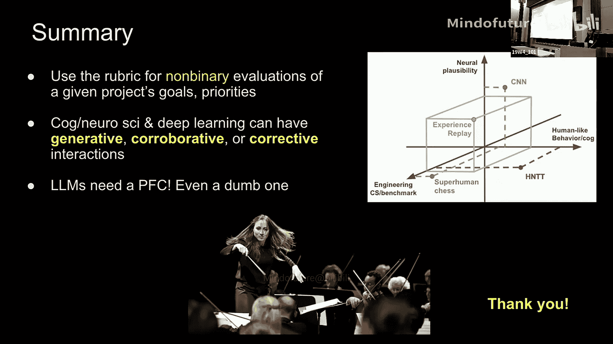

Okay， let's get all of our speakers up here on stage。Okay。Love fruit mean。Is this on this on yep。

 I mean， I might just pile on some more praise for cognitive science。

Well like because I do want to argue about the one direction。

 but it shouldn't be forgotten that even on my view。

 it's extremely important for cognitive scientists and people in general to think very carefully about what's going on inside models and what accounts for their behavior and I think in like the sense of studying new kinds of intelligence。

's I agree it's like one of the most exciting times possible to be someone interested in intelligence and cognitive science。

 I think it's scientifically fascinating and will also be like societally extremely important for cognitive scientists to study AI systems Bo I would you say cognitive science sucks。

Did anyone have any response to Rob's challenge？That are things that AI can and has learnedt from cognitive science。

 was it serious？Yes， think。😊，You know， cognitive and brain sciences don't need to contribute to AI to be worthwhile were just interested。

 you know， if my work never contributes to AI， I will die happy because I'm interested in the human mind and brain and in the prim brain as well and so there is a back and forth I think historically。

Personally， I don't agree with the overall conclusion you had a lot of good sort of partial points。

 but I want to make a couple of points that maybe maybe。Diveerge a little bit from that so one is。

That's。There is a vast array of engineering advances that are possible without any interest in cognitive science that's absolutely clear AI should be interested in intelligence in general and human intelligence is a very particular case and so of course engineers should not be hung up on that one particular case and all these advances can happen and there is a back and forth in which engineering now has the lead and we love that and it's good and it's a natural thing and I find it extremely useful because I get tools that I can use for for my science nevertheless。

AI has a field that's interested in intelligence in general。

ho also be interested in human intelligence， human intelligence is a very particular point in the space of all possible kinds of intelligence and it's a point that's at the moment far beyond the reach of engineer right so an ambitious engineer will be very worried about that and challenged by it to you know have that within the range of what's what's possible right and I see that all the most visionary people in AI if we made a list of like the10 greatest visionaries they have all been and all are deeply interested in the human mind and brain I think for good reason。

被告。嗯。There's more of a question than a comment， but I was just sort of curious about。

 I think like given the advances in the last few months towards something that seems almost semi cognitively。

😊，Like real like that I think'm I'm having trouble getting a clear sense of what we mean to say progress in AI now like what does it mean to say does it help AI like is it is it to add more capabilities is it to make it more integrate them better with other humans like what does it mean to improve AI at this point？

😊，Yeah I could say something quick on that which I think helps clarify the thesis I mean I think my thesis is strongest if you're just asking if you want a system that will be able to do translation and like not necessarily in a humanlike way and not necessarily on like human levels of data whether that's like progress towards other things like better understanding human intelligence or making things that are safe is I think very much an open question but I'm mostly thinking of the claim as targeting like a very common view。

 which is that even if you just care about capabilities。

 the human case is going to be like an indispensable tool for reaching those capabilities I think and maybe there's just broad agreement on this I mean I think they are just so many broader routes to those capabilities levels and we've seen that a lot more over time。

Yeah maybe we can brainstorm on a few like data efficiency I think is a big one right just throwing a lot of data and it doesn't give it the kind of intelligence that we have that we are currently missing in in AI systems right so data is important in energy efficiency is another really big one on 20 watts we do all of those and that's extremely important also for engineering right of course the particular resource costs are different in a cell phone from you an animal's brain but all the same resource constraints play a role and you want these things to work in our phones and then they have to be not only able to generalize for very few instances but also to do it with an energy budget。

你收咗一张。嗯么。Okay， shall we okay， a lot of questions Ned。So Rob， Ida mentioned。

 so you assumed in your talk that what AI is doing is just great， nothing the matter with it。

 so but Ida pointed out there there are lots of problems notably that yeah in reason and you know the concept of executive function。

iss a concept from cognitive science and that's why and this metaphor of the conductor， no。

 I don't know how much goodness is done so far， but at least is something worth exploring。

I just add to that even the current beinging has some of those aspects but just like a simplified version。

 so if anything there are efforts to go towards other directions and I was talking to Sam Bman it seems like anthropic is also going towards some similar directions not necessarily calling it a PFC module。

 but generally these kinds of thinking about thinking or slowing down or these kinds of internal dialogue in order or kind of selfplay for these models which is very similar to metacognition so definitely that those kinds of concepts from cognitive science are driving the cutting edge right now。

有。Yeah， I mean I do want to emphasize it's like the case is supposed to be semi empirical so one thing is that could just end up being correct and and we'll be looking for it。

 I guess another thing I'm trying to do in the talk is emphasize the like inductive case that can be made in the last decade of I mean there have been many similar remarks of oh well GPT2 doesn't think correctly about this and if we look at how humans think about it we could fill that in and in fact what happened is they like stuck with the inhuman approach and things got fixed at scale。

And again， it's an open question whether that's going to continue and how much to generalize from the case。

 I do think it should be a strong update against the cognitiveogni Science In view and it has been for me。

I don't want to pilelon on broad but just as a historical point。

 I think you there is also this tradition onpir tradition in cognitive science that know Cameron has mentioned this morning and that has whose insight have percolated into the history of AI through and through and if you want to just talk about LLMs I mean the distributional hypothesis is idea that come from structural linguistics in the 50s from the works of Ja Earth and so the Car and on and the idea of vector space models also from cognitive science from Charlesles good and people like this work in ethic meaning and that has that two distributional semantics models and although there's a direct imageage from that to what are bedding models and then to language models I think there are other ideas from cognitive science we've kind of forgotten that they come from cognitive science because stepping appropriated by AI research and led to great success but the origins can still be traced back to that tradition。

Yeah， and as much as my claim is sort of a corollary of the bitter lesson。

 you would expect it to apply much more to more nativist approaches from cognitive and one maybe autobiographical note is maybe one reason my talk has that bent is because that's also more of the tradition that I came from and yeah。

 as also said in the talk I think reinforcement learning is probably one of the best examples of cognitive science inspiration because it's very general。

 it's not very cognitive， it's more behaviors。嗯。Thanks so another maybe challenge for Rob so sorry but it looks like a lot of computer scientists no but so it looks like a lot of computer scientists actually want to work on this neural symbolic project because of all the limits of deep learning or neural network kind of architectures and so for that kind of project to kind of like bring in symbolic like cognitive science kind of knowledge to all this deep learning stuff it looks like cognitive scientists are actually super relevant so it looks like if you want to make actually progress in AI like trying to think about ways to bring in symbolic and neural approaches together we actually need cognitive scientists so what would you say about this Yeah I guess i'll just quickly say。

😊，Since I'm talking so much， it's again， it's like it's an empirical question and I think the question will be when if at all will we see neurosymbolic systems that。

ha capability levels near the more empiricist large language models and to my knowledge we don't really see that and then of course then there're the principal reasons that I guess I would say where you maybe shouldn't expect to see that because you should just leave a wider space for learning and these models will learn whatever symbolic mechanisms that they need。

😀Hey， who has a question for somebody other than Rob？😊，No， I's going to put the hand down。Yeah。一啊各位。

Quest for you I and also just as well so one of the things that Richard Sutton has mentioned is this idea that historically researchers has spent a lot of time putting complex ideas into practice and what sort of really has really taken off has been the idea of simplification really just applying more compute and data to problems and LLMs could be one manifestation of that and i'm just curious as practitioners in industry。

Have you observed sort of while you're doing experiments and whatnot the emergence of unexpected things and so what does that really imply for people who think that are really smart and then they something works that have expected and second of all should I quit my job and just you know go become a farmer the way things are going it？

There is a lot of unexpected emergent properties that have happened that some of them positive。

 some of them negative in these systems。I think all of us could potentially just leave technology and go become farmers so that's not I don't know if that's a thing。

 but I do think that the emergent unexpected things that happened are also explainable with methods from neuroscience and cognitive science they are similar to what you would observe happening in the course of evolution where you just have where you have a lot of species that have brain parts that are partly similar。

 but it seems like there is an emergent all of a sudden modes of cognition in some of those species and not in others and then you look into it and you figure out oh maybe it was the size。

 maybe it was the number of connections maybe it was the way that sort of the brain was being sort of prioritizing certain connections then you see different species with very different structures。

 not even similar brains develop similar kinds of abilities。

 for instance sequential planning is surprisingly advanced in some species of birds。

And their brains are not very similar to us so it's very interesting to see what are the methods that we use in those approaches in order to understand some of those emergent properties or similar function in spite of very different brains and apply those to what is going on in the emergent properties or emergent skills that are coming up in LLMs or other AI approaches that are similar to some functions that humans have with completely different brains so I do think that it's interesting to use those approaches to be able to better understand exactly what you're describing so if you don't want to become a farmer I think there's a lot of work for people with those kinds of skills。

Yeah， absolutely and just， I mean， building on Ia's response there of like I think what I've noticed is that there is there is a lot of things that we at least who've developed in a cognitive science environment take for granted that aren't obvious to people who are from more engineering machine learning backgrounds things like how to think about different levels of analysis of what levels at which you want't actually compare to systems right like a lot of like a naive criticism that I've heard from machine learning practitioners is that like why bother analyzing a system because if I just change the seed then something might change and it's like just the idea that you can have levels of analysis that are robust to very lowle changes but then but there's a hierarchy of those that like there might be some things that are very very change with just the seed and maybe those things are not worth studying because they're they don't transfer but figuring out what that hierarchy of different levels are that like does just the behavior look the same。

Does that behavior arise from similar representations。

 whether those representations were developed in the same ways。

 whether they were convergently evolved to develop， whether yeah， so at what levels。

 I feel like cognitive scientists have a lot of vocabulary for that。

 as well as a way to understand the empirical science of figuring out which one of those analyses。

 levels are relevant for a specific problem to understand the system better。😊。

Yeah thanks this is also a question for Ida I really enjoyed your talk and I've thought a lot also about the need for a conductor to now that the systems get more complicated but there was one thing that's troubled me a lot when I think about this and I wondered if you confronted this challenge and so how which is you know maybe a lot of different people are going to think different lower level things need to be going into the system and they might need to strike different balances in different systems right so should we be looking for kind of like one conductor that can be plugged into all these different systems and does the right kind of task where the balancing act is a little different or should we be expecting like different tweaks for different systems because this might be the kind of thing that you would think like evolution would strike different balances and lots of different ad hoc tweaks and different animals Thank you so much for that question so on my last slide I mentioned this or one of the last slides that I do think there would be different species of dumb Bfc for different types of applications so for instance in。

AI for gaming at Xbox creating generative approaches to gaming that is ongoing research right now that would be a very different kind of species of PFCc or dump Pf for that one as opposed to Office 365 that's supposed to like generate automatically generate slides for you based on verbal description of what you want and a folder of photos for instance those kinds of applications will have different species of Pfc that would need or being for instance it it would need a different type now is there a particular toolkit of different types of PfC functions that we could sort of potentially develop and then lend it to different applications as augmentations of these larger models yes if that's a direction you're going I am extremely onboard with that and I think that's the way to go not just ad hoc but also having a kind of a toolkit so that it can be used as needed for augmentation of other models I hope that answers。

屋奇啊。嗯。A questionest for Ta。You had the example of question forming and I'm wondering how sure are we given the data we have that kids really are that good at the more complex question forming。

They're pretty good。The reason I ask is I found that often the more formal syn dicians you know aren't that interested in the actual kid data what kids actually do and you know it's like yeah they're good enough they're pretty good you know I don't care about the corpus stuff you know I want to stick to my formal theory so。

It could be right that just overall， like how confident are you that the assumptions of these theories that。

You know， hold when it comes to actual empirical observations of。Yeah to be clear in my opinion。

 what children do is somewhat orthogonal to this point， which is。Okay， yeah。

So what children do an experiment is somewhat orthogonal to that because the system that we are interested in studying and linguistics is typically the adult。

And the adult also needs to have acquired language in the same way that a child does the adult was once a child。

 so the capturing the different stages of the developmentin is an interesting target but it's not the main focus of this kind of research is basically we know that adults have these very clear judgments and we want the system to mimic them。

Based from the data that is available to an adult， they're learning。Compible。What's realistic for。谢谢。

Right yeah， we use this like in yeah in this so I use this opportunity to plug the babyLM challenge that wasn't able to plug before。

 so basically we're using 100 million words as the kind of upper bottom of the amount of words that a child would have seen by the age of 18 I think or something so we're not talking about three year olds talking about the amount of exposure to language that someone has received by the time that。

Adult states or close to it and even if you double it， you double the number of years of exposure。

 you're still going to be very， very far from the amount of data that Lord planning policy have。Yeah。

 this is also a question for Ts， so you suggested that language models could teach us something about human language exquisition and one of the ways that they could do it is we could look at what representations emerged inside these models to support the successful behavior and I was wondering how you think we could you compare those representations to representations inside humans or you know what would it be to say that like they had the same representation and how could we tell？

Well， that might be a question for Nikko more than for me because I think that the representational similarity analysis you showed at the end was kind of。

The way that I would go about it。嗯。Sorry。I think if you want to take this or yeah。

 but Rosa you're very familiar with that right so what is her is that？😊。

There was a reason why you asked T， right？And make you just have an example。That'， that's。

Yeah I don't， I mean i'm talking about using an encoding model that's based on some neural networks to predict neural activity thats that's what I had in mind。

都他就道。H。有发的。三。嗯。I guess so yeah， I think if I have any correctly yes。对庭。

Hi yeah I have like a more general question for the panel so my question is like。

What is like the load bearing aspect of progress in your field right now just in the terms of whether you ascribe more weight to just the。

Ways in which you can abstract like models of thinking into like algorithms for AI or would it be more in terms of like the compute power and resources required to sort of like train these models like what do you think is that load bearing aspect？

The question is resource versus just coming up with abstractions of new like ways of thinking that can be like turned into algorithms for AI。

Maybe I can start the scale is all you need approach I do think it has led to a lot of obvious progress I don't think it's sustainable the carbon footprint of training one of these LLMs is like two trips to the moon literally and that was computed if you can look it online like if people computed it and then people said no this is incorrect and they computed it again like there's a whole like argument around it it's a lot and sustaining them is going to be a challenge so there needs to be at some point a switch from fast to slow approaches with a little bit more systematic and strategic approach is one of the things that academia as opposed to industry has contributed is coming up with cheaper versions of some of these very famous models there are some actually successful attempts so far like small attempts that are coming up they're not as big as the bigger language models but I do think that it's important for us to figure out a way to be more。

as like brains are extremely efficient energywise in that regard to become a little bit more efficient and some of the things that might be needed is something that I think some folks tomorrow are going to talk about which has to do with potentially having compositionality having more kinds of hierarchy and other kinds of things in the architecture some people would disagree and say scale is all you need in fact there were people with that t-shirt at conferences in machine learning conferences。

But there is a limit to it we can scale all the time there's going to be at some points an environmental catastrophe we better at some point wrap it and make it a little smarter and the human prefrontal cortex it seems like a thing that I keep saying。

😊，It's capable of having many different algorithms and that is what maybe distinguishes us the most from other species there are parts of the anterior prefrontal cortex that do not have a homolo to the extent that we know in other species there's specific kinds of connectivities and interconnectivities of human prefrontal cortex which is our largest cyto architectitectonic region of our brain it does not have homologgues in other species and we have100 billion neurons and 10 trillion connections in our brains so there is something to be said about the scale but there's also something to be said about how different kinds of algorithms could run in the same kind of machine efficiently so there's I think things that we need to do on both sides potentially。

I want to go ahead。I want to add something about progress。

 which is that the view of progress that I think Rob was presenting is based on capabilities and issues like。

Safety， robustness and profitabilityability are kind of relegated to sort of secondary goal right if we make progress by advancing capabilities and then let other people kind of clean up the mess of creating models that are not intempable or sometimes。

Don't make up facts and so on so it's possible that the trade off between those two axes will be better served by neurosybolic models。

 for example， we can find the right balance between these two axes so maybe。

Under some view of capabilities， those are less capable that they are better for society in other ways。

就。Yeah yeah so I think I mean like following up upon both the responses so far。

 I think one of the challenges also similar to the question I had before is I think we don't have a very clear sense of what progress is supposed to mean anymore and I think there are just many dimensions in which you could make progress similar to T's point of like improving their understandability given that you want them to participate as social partners like how do you make them predictable to another human and that's almost part of the problem because you want them to be conversing with humans and but obviously there's also the dimensions of capability and safety and all of these other dimensions and the way that I think that that intersects so obviously there's like a big space where ideas are kind of like we we don't know how to think about it yet like what are the best ideas and that space is a lot of things to try but I think that that intersects in a kind of uncomfortable way with the resource constraints that like to investigate some of these ideas that you need access to the kinds of resources that make it difficult。

ploreSo I feel like there's a of a like it's a bit of a hard problem where there's an intersection of those things A there is just a huge number of ideas that are worth trying and worth working on。

 but they're all kind of hard to work on without the access to the kinds of resources that you need to train these models。

😊，Yeah， just quickly， I did want to add that the claim like when I said progress in the talk。

 the claim is about capabilities and that's the thesis I'm defending。

 but I absolutely share the view that from the standpoint of safety and reliability。

 it's extremely unfortunate that this is how you get capability increases and it might like literally get us all killed so。

Yeah， I think it's。It makes a lot of sense to try to scale things up right and there is a real magic to what happens when you scale things up because things more is different right and very interesting things happen and it's relatively straightforward and we don't have to have additional ideas so it's important to try but then of course obvious limitations that have been mentioned are also important and there is a different kind of magic in the way that intelligence is possible with resource limitations and that's personally what I'm fascinated by as a scientist for the prim brain。

 the prim brain faces very particular resource constraints， the size of the animal's head。

 the amount of energy that's available， the amount of data to learn from the amount of data in a perceptual act like how much do you see of each of the objects。

 how fast do you have to respond and it's amazing how。ible it is across different situations。

 how well it generalizes， there is a special magic when you take those limitations seriously and I think there's a lot to be learnedt also for engineering。

Yeah， absolutely， is not this is a question I had a little bit a little while ago but then it came up more specifically with Miko's response I was curious about so with speaking a little bit about realistic resource constraints and data constraints and how to make that parallel to what humans receive。

 I was just curious about like it seems like a randomly initialized transformer is not really the same as a baby brain。

😊，Right so there's a like so I was kind kind of curious about what are other ways that maybe we can start them at more equal footing like is there other kinds of training maybe it's not language training maybe there are other kinds of training that make them like。

😊，Give them a starting point that seems a little bit more like a baby brain。😡，嗯。

I that anybody on the phone yeah yeah I think that is absolutely what we should do so there's this kind of lazy argument that you see often that it's unfair to compare transformers to people because performers have to also recapitulate the whole of like evolution and only then do they learn language so。

To model that we train the models on a trueing wordss from the internet that's obviously not like a realistic way to understand evolution。

 but I would encourage people who I mean。I don't believe in intelligent design。

 I mean obviously I think that the reason that we learn quickly because we have biases that we acquired over the course of evolution or because while learning language。

 we also learn other things religion mentioned interact with the world， we have the perceptual。

So that is the response here yet to frame the model to come up with a training environment that is as as similar as possible to the training environment of the child。

 what the other tasks would be I guess。Multtimodal learning learning with some sort of an interactive environment。

 I think everyone knows what the answers are we just don't haven't instantiateated them in a completely satisfying way。

我不是。I just wanted to ask off of that， is this kind of an example of what Rob has been saying she asked a very direct question of what should we put in our model based on baby brains and there's a room full of like cognitive scientists and neuroscientists who were like。

 well you know like the stuff that makes it work that evolution gave us but like you can't specifically say what the model should get。

诶系。We have hypotheses with what the models should get so we can and I mean。

 we have the specific hypothesis that Chosky made I gave in my talk with an example。

 if you only consider rules that are based on。The partsse of the sentence and you don't consider other kinds of rules so we know how to iniate that in a neural network。

 there are some other inductive biases that linguists or cognitive scientists have argued that people have compositionality。

 for example， so。We have technologies to instantiate those biases in neural networks work and to the extent that we don't have them yet。

 we should develop them。Okay， this is maybe slightly out of court because I know we're meant to be talking about language models and I think it's a question certainly initially probably for Ida initiativeita。

嗯。About 30 or 40 years ago， as well as engineers being interested in applying our understanding of human cognition and human neuroscience to producing artificial systems。

 there was also a lot of interest in studying much simpler systems， so invertebrate systems。

 insect systems， and if you look if you're thinking about efficiency。

 if you look at what honeybees and jumping spiders can do。

 you can find evidence of selective attention， you can find evidence of planning。

 you can find evidence of computing distal properties。

 I just wondered whether people in industry had thought of returning to that kind of approach。

Thank you for that question。I have a very deep interest in insects and not just insects but also there is work in plant cognition。

 there is work on myceial cognition， there's various kinds of work not just spiders。

 the patterns of for instance the webs that they create and if there is a pattern that they create and somebody another spider makes one and other one returns how they will change their patterns。

 I'm particularly interested or at least the ones that I've seen and I have participated in some is the ones that are related to collective cognition or collective agency because entities like ants。

 they have a very and bees， they have very as you know they have very sophisticated ways of collective agency together and humans have a lot of collective agency as well like arguably we are even much more of a hive entity than ants or bees。

 it is very interesting to compare the computational models between them。

And in many of the simpler engineering application in industry。

 they actually look into ants and bees as opposed to humans because it's simpler and there's different kinds of studying them and it's very interesting。

 it is so fashionable these days that you would see job talks by grad students who are in computer science just adding an image of ants and bees and saying yes we will be inspired by insects to make our next generation so not only is the interest alive and well but it's also sort of very much I think it's coming even more invogue and this is the robot that's near the Santa Fe Institute。

 the Santa Fe Institute has a lot of people who work at the intersection of animal human and collectiveive cognition and Comp sciences and there's new journals that are coming out for collectiveive cognition I definitely recommend taking a look I think that it's extremely interesting and important。

 especially in some ways of orchestrating different mechanisms in order。

to orient them towards a particular context or task， whether it's in the PFC。

 whether it's in groups of people， whether if it's in group of ants。

 it's a similar kind of mathematical coordination problem and I think it's extremely interesting to get inspiration from those and it is being actively to my knowledge being and they are also building smaller robot models of some insects of course。

 which is another whole field of interest in this field。Hey。

 we ought to take at least one or two from the back of the room。I'm really lazy， sorry。

 I just stick to my corner of the room。How about how about you？

Thank you my question is for Ida your talk reminded me a bit of the first talk from this morning about the moderate empiricism and about the core faculties that we ought to build into AI how do you think what is really the overlap between this kind of。

😊，Dumb prefrontal cortex and those core faculties or even the smart prefrontal cortex and the faculties thank you for that question so what would be the practical overlap would depend on the kinds of situations or context within which this approach would lend itself in practice and the resources of companies or academia will go to it of course to some extent conceptly the ideas are very similar but I think that practically what will happen is that those particular developments that are lending themselves well to certain applications that there's money for to be honest with you are going to be developed first do we need to first generate a whole library of them before applying them I don't think that's practically what is going to happen and everything is going so fast that it seems like we are being up almost optimized for whatever objective function the next。

The biggest stockholder at this point that this is how things are being progressed right now That being said。

 I do think that at some point we will have an even bigger or larger set of those capacities to draw from for instance transformers themselves are one of those things right it has been distilled from some older ideas they're kind of like their ancestors is LSTM and the ancestors of LSTMs and something else so it all goes back to the 90s a lot of inventions happen then and when you look at the evolution of these and their ancestry and how they developed over time you can see they're going towards emerging particular other kinds of functional capacities so even if it doesn't happen such that we create the components specifically it might be that if we observe the evolution over time we will see the appearance of some of these cognitive capacities over time but time will tell this is just my estimate today things are very turbulent right now obviously so。

Okay。Yeah。Okay， so my question is for possibly either maybe Nicco or anyone who's interested in answering。

So as somebody who has worked in the prefrontal cortex， I'm very happy to hear that you。

 AI needs a prefrontal cortex。I will go back to 2012。

 I think where the prefrontal cortex was very central and everybody hated it and everybody wanted to improve sorry to improve their working memory and luity was promising。

 you know we can boost your working memory and you can remember more items and this hasn't gone anywhere。

So。My question is the prefrontal cortex is very limited in capacity。

 my understanding is that this is coming from how it interacts with our sensory representations。

 so sensory representations are very structured multipurpose and they are causing interference when we have to balance a lot of these so do you think that。

We need a smarter and smarter prefrontal cortex or maybe better way of having sensory representations when it comes to engineering smarter brains。

你个点啊。Yeah。So this is a fascinating question and I think。

There is emerging work that studies working memory together with perceptual representations with deep neural networks。

 which I think is very promising in terms of engaging this problem that you outlined the interference in a system that is optimized not for the purpose of storing 20 numbers it's fascinating because 20 is not a large number。

 it seems so easy to just store 20 and so it's fascinating that we're having such a hard time with it and I would look to the actual constraints under which our brains are involved and developed to explain why that is the case right so for an engineer maybe it's not immediately so interesting because it's just such an easy problem and such a failure apparently of biology right but there's something deeper there because there's other things that we're better at。

And that's because we have the kind of architecture that also creates this failure right so as a cognitive and brain scientist i'm interested in a pattern of successes and failures and the patternss of reaction times because I want to understand that particular system but。

啊，来的。So thanks Paavlo， you work in monkeykey PFCC I would say human PfC is a little more complex but so your question is about augmenting human abilities and the limits of human working memory if we are in the rubric if our goal is to have neurally plausible and humanlike behavior then our AI would need to be able to replicate the model should be able to replicate the patterns of success and failure and limitations but if the idea is to improve along the engineering access or engineering success access inspired by some ideas from the other ones the PFCC doesn't need to have the same kinds of limits and it doesn't need to be as smart either it can be an extremely dumbing that just allows for slow processing self-monit self-proing some things that currently are very easy to add to some of these systems how that will evolve it will be its own species of evolution to be honest and as I was responding to one of the questions it would be multi。

species of dumb PSC for different uses so in the engineering dimension I don't think we need to be faithful to human PSC however the limitations that you're saying are important when we want to have humanlike or neurally plausible models in the case of LLMs they are trained on the equivalent of 5000 years of uninterrupted speech there is no human who has ever or ever will in my opinion and maybe I'm wrong I will have this level of training ever and so obviously we are not looking at something that's neurally plausible or exactly following certain rules of the limitations of human brains it would be interesting for the purpose of cognitive neuroscientists to have the kinds of models that are you know following those constraints as Nco was saying because we are interested when we are on those axis we are interested in patterns of errors and latencies as much as we are interested in successes maybe I'll take one more from this。

of the room who has a question over here Yta。Yeah that goes mostly to Nco that talks about mechanisms and as a computational neuroscientist coming from structural networks。

 I'd like to see to hear your what you think there are the advances of AI and the drawbacks of a structure when I say structural network I mean your biological constraint you put the structure。

 you make hypos it's more like the physics approach to understand how the brain works。

 you have a hypothesis you put it a test you find the qualitative things you want to explain and note 100% of the neural activity like as you say I understand with the prediction。

 the best prediction would be the best prediction of an AI model and it is falifiable so that you mentioned pop and a Lakaus so I also want to hear that so in my view I'm satisfied with this approach because I。

😊，you know I can understand the mechanism and I can simplify you know it's more a physics approach well the AI the top down you go from from behavior and then predict I don't know 50% of the neural activity is this good enough and even if you had 10% of neural activity how much you understanding and how much falsified is is your network。

 your resulting network to form a good valid theory of how the brain works and it also reminds me as a final comment the blue brain projects you know the blue Bra project is it good to have so much complexity and good so AI looks like blueprint you know what I mean Wow there is a lot there so I mean people are interested in bringing in constraints from neurobiology into the architectures of their models and then to have alternative。

ects and to compare them as alternative models where one works better than the other at predicting something out of distribution。

 for example， after the training， predicting neural activity and that's happening at many different scales so it's happening in computational neuroscience at the level of circuits where people traditionally have built very biologically detailed dynamic models maybe even with multicomppartment neurons。

 something like that a lot of these people are now interested and so the scaling up a little bit and looking at slightly bigger circuits and maybe small animals like flies or others so there is the whole range so that's from the bottom up and then from the top down in vision we started with just standard deep convolutional architectures which in many ways are very different from the primate brain we started at a kind of。

Computer science level adding qualitative elements that we're missing like recurrent connections。

 sasticity， top-down connections， we're creating systematic spaces of architectures that you know provide hypothesis space of models to be tested。

 and I see that sort of go on in the direction of taking more and more constraints from the biology。

 what is known about you know the number of areas， their relative sizes。

 their interconnectivity at the area level being included and then that leading to a framework of model comparison。

 but there's the other side of it where we train on objectives right and different objectives can also provide different hypotheses about what the system is optimized for and we need these objectives to set millions of parameters because we need models that have millions of。

The history of AI has shown that intelligence requires a lot of knowledge。

 you can't have a model of visual recognition that doesn't know what stuff looks like right and this information isn't infinitely compressible so there will never be a vision model that can explain recognition that will not have millions of parameters so somehow we have to deal with that right。

But we can do it in a framework where we're still testing and comparing models in a kind of lacchaosian empirical framework。

Okay， I think we need to wrap it up now we'll regroup our meeting for a coffee at 930 tomorrow morning and Nick Sha's talk。

 I think at 10 a but now thanks to all of these guys for a fantastic time。

