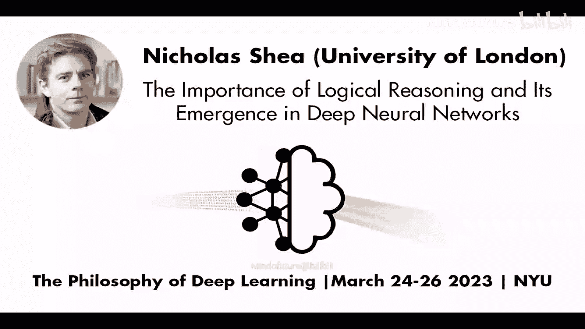
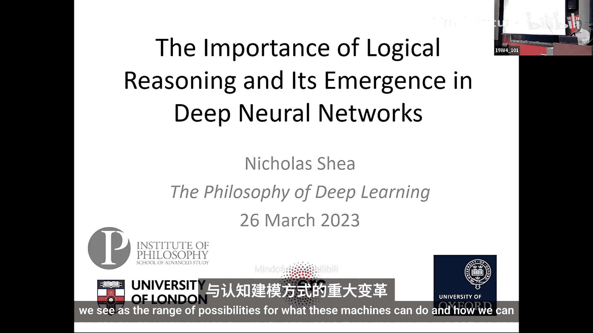
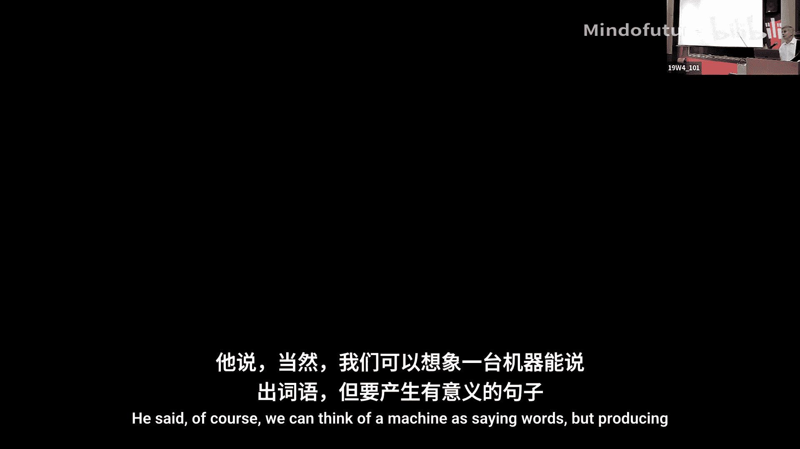
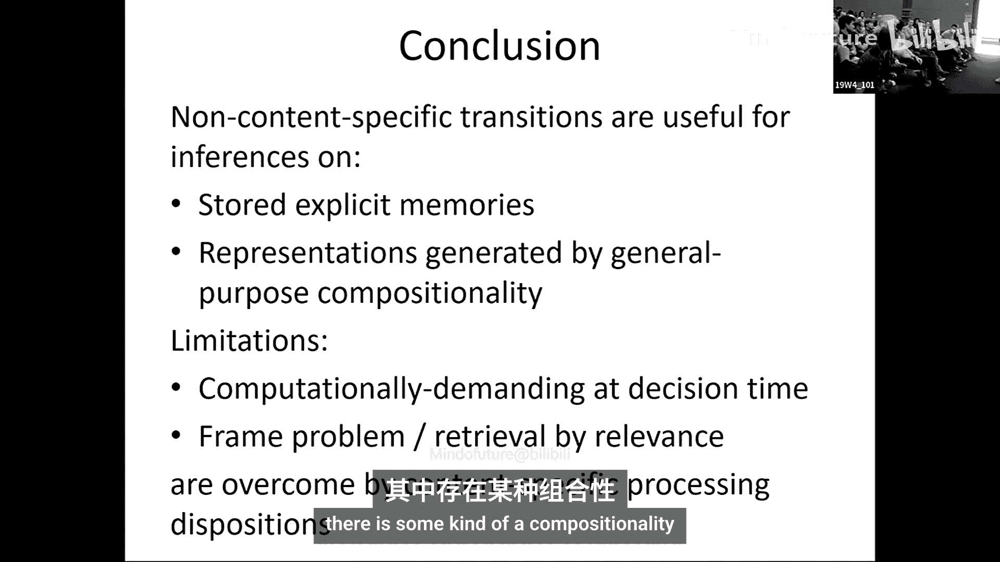
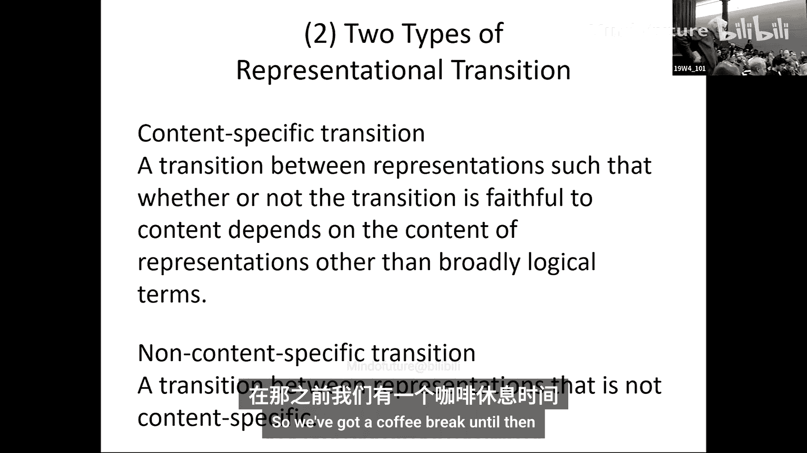

# 【纽约大学】深度学习的哲学 ｜ Philosophy Of Deep Learning 2024 p06 P06_Nick_Shea_逻辑推理的重要性及其在深度神经网络中的涌现 -BV1u7ZoBnEAb_p6-

Good。Thank you Ned so let me start by thanking Ned and Dave Chalmers and Raphael Millliere for organizing and for having me along it's been a real great treat being this as an interdisciplinary philosopher to have computer scientists and people from different bits of cognitive science。

 all one who's talked to philosophers it's been really fun already I also wanted to thank Raphael for organizing the deep learning reading group week in week out for the last two years it's been a real highlight。

 especially at the beginning of COVID when we couldn't travel to get together with people across the US and Europe talking about deep learning and with these developments coming out like weekly and monthly。

 a lot of what I've managed to learn about the new developments has come from talking people in that group Raphael often gets the speakers in the authors of papers in and then there's an awful lot of other experts。

 some of whom you've already heard from so that's been a real highlight for me thanks for that Raphael。

😊，So we've seen today we've seen over the course of this weekend already that one of the philosophical bits of interest about deep learning is what it can potentially tell us about how to model the human mind。

 that's what I'm going to be focusing on today。😡，And I've been long been an advocate of the claim that artificial neural networks are an interesting and interestingly different way of modeling some aspects of cognition in fact I worked on it right back on in my PhD。

 so it was a bit disappointing when for years and years and years。

 deep learning artificial neural networks weren't being used in any practical applications like maybe they although philosophically interesting they weren't going to actually work for anything so that it was a massive relief having worked on it when in 2012 they started actually doing something useful and that wasn't just a kind of I told you so moment I think what we're going through now is actually some kind of ge outout shift some kind of quite big transition in what we see as the range of possibilities for what these machines can do and how we can model cognition。

😡。

And I think it's a bit of a gspout shift a bit like the one that Renee Descartes faced nearly 500 years ago。

 so this is an automaton， a mechanical device that was set up to move in roughly biological ways。

 this one's created in the 1560s and now held in the Smithsonian it still works a bit。

And what you can see， although it's very crude is that it gives you。😡。

It might just give you a sense of biological motion。

 it might fire your capacity as we'd now say for detecting biological motion。😡，And for Descartes。

 that was a revelation， things like this， machines that could produce something that looked like a genttive motion were producing something that up till then had been thought to be special。

 something only animals can do， something that maybe came out of a special life force and this was part of the inspiration for him on seeing this new possibility of generating his whole mechanical philosophy。

😡。

But of course， famously， he thought that。😡，The mind was an exception to that most famously consciousness and the difficulty of conceiving how physical or mechanical processes could produce consciousness。

 creating a hard problem that we're still grappling with but for today even more relevant he thought the same thing applied to language he said of course we can think of a machine as saying words but producing meaningful sentences not only is that impossible that's inconceivable here he is writing that we can certainly conceive of a machine so constructed the Diattra's words。

😊。

But it's not conceivable that such a machine should produce different arrangements of words so as to give an appropriately meaningful answer to whatever is said in its presence。

 as the dullest of men can do。Well， of course now we can see that that's possible and we were making progress on that already in the 20th century with classical computers set up to make meaningful intelligent you might say transitions between representations using the principle of。

😊，Implementing broadly logical transitions。😡，So making the kind of inference there about Socrates being mortal is the kind of thing that until the 20th century only people could do only intelligent people would move between representations in that kind of way and we found that in the 20th century it was a big discovery that we could set up machines to do that and many different other kinds of logical inferences by setting them up to have a disposition to move between representations based on their form or their patterns so if you set up a machine so it's disposed to move between representations that fit this form。

😊，Then you'll end up with something。So right， this form。

Youll end up with something that can make transitions between representations so that it will move from representations。

If you input true representations， it's bound to get true representations and output。

That principle turned out to be at the heart of almost all the computers we're still using turned out to be incredibly useful practical practically。

 also useful for understanding quite a lot of what's going on in the mind。

 but yet didn't take us quite to the thing that Descartes found inconceivable。

 which was giving an appropriately meaningful answer to whatever has said。😊。

It's only really in the last three years that we've got machines that can do that as we've seen a lot of already this weekend。

😊，And I think adjusting to that is a ge out shift。It expands the space of realistic possibilities for modeling aspects of the mind。

 what it's shown us that is that training specific dispositions end to end， you might say。

 to respond to inputs with specific kinds of outputs is much much more powerful than we ever previously thought。

And I don't want to downplay the importance of that discovery in a way what I'm saying is a reaction to that discovery。

 but what I want to do today is to say that this isn't just a matter of a choice between the classical architecture and the connectionist architecture when the connectionist of one。

 actually there are complementary costs and benefits to both approaches and we shouldn't overlook the importance of what you might call broadlyological reasoning。

 if we want to characterize the aspects of human cognition as a whole。

 if we want to go beyond doing what the dulllist of people can do。😊。

And what I want to do today is to characterize that difference in a particular way。😡。

So as to show why there are characteristic benefits of what you might call broadenological reasoning that are complementary to the costs and benefits of processing representations in the characteristic way that deep neural networks do。

The package of the classical package is kind of familiar doing what I'll characterize more specifically。

 but that you've seen an example of already broadly logical reasoning。

 one way of doing that is through variable binding。😡。

Being able to do that on representation that are stored in the form of the explicit representations of memories or stored knowledge。

And you're doing it on representations that show a general purpose form of compositionality。

And that's。Contrasted with the deep neural network package。

 I want to drill down to a particular way of drawing the contrast that I think can help us see why there are complementary costs and benefits。

So the plan is to say a little bit about how I'm thinking of representation in deep neural networks quite quickly just to lay the foundations of where I am in terms of what representations are。

 then to draw this distinction between these two broad ways of being set up to make transitions between representations between what I'm calling the content specific way and the non-content specific way then I want to argue as the central argument really that when we're modeling human cognition。

 we need to see it as being able to access both styles of representation processing。

 both types of computation and to move flexibly back and forth between them。

 given their proper domain of operation， given their complementary costs and benefits and then at the end I'll say a little bit about whether something like this is going on in our AI systems too。

So to think quickly about what representation is in deep neural networks。

 I'm going to use the very most simple system to illustrate this and this is an old neural network with three layers train to categorize some stimuli which are objects you code properties of the objects at input and train it and output to sort them into the A's and the B state and the way that it hits on of doing that is to sort the objects into different individual objects at its intermediate layer。

 so it finds a pattern in the data which is also a pattern in the world。😊。

The intermediatet layer comes to carry information about that pattern and it uses that sort in order to perform the output task to classify the AC from the bes。

So there we've got the ingredients that I go， I would say go into there being representation here at the hidden layer。

 we've got carrying information by vehicles of content in the service of performing a function in this case the function comes from what the system's been trained to do。

😊，And it's important that we're being realist here about representation。

 we get extraplanary benefits for there being real vehicles of the representations in the ways that theyre being processed。

😊，So the vehicles might be clusters in the activation space， as you see on the left there。

 or they might be dynamic trajectories in an activation space。

 as you see on the right there in some monkey recording data。

 they could be polytopes or some other kinds of manifolds。

 but it's important that they the representation contents being carried by things that are real features of the way that activities being processed through the network。

That's to say if you were characterizing the dynamics of the processing being neutral about contents or representation or which way information is being carried。

 these are things that would still exist， they're not just existing relative to representation explanation。

 that's what makes it a realist form of a representation explanation。

And although most of the work in deep learning is about getting the outputs。

 getting technological solutions， there is quite a line of work as we've already seen yesterday looking at whether there are representations in inner layers or sometimes called inner representations this is work on autoaggressed language models including GPT2 and what they were doing men and colleagues in this study was trying to find if there are parts of the inner processing that are carrying representational content that's important for performing the task here the task is just predicting the next work so for example after training。

 it can complete the sentence， the space needle is in downtown something complete it correctly with Seattle and they want to know are there particular bits of the processing that are important for being able to perform that task。

So they。Pturrb the input， degrade the input， and then do a causal mediation analysis to find if there are particular bits of activation that are most important for getting the right output where if you fix them you get close to getting the right output and what they find is that there are some patterns of activation in early layers that are important and then also there's a late component and so they have hypothesis is that having seen the subject of the sentence。

The space needle。The system has learned to go into a bit of highdiional activation space that is representing Seattle and then that embedding sits there ready to be used when it becomes relevant later in the sentence and then the late activation is an attention head calling on that information so as to look up the correct word and output Seattle。

So if that hypothesis is right， then the systems learn something they call an association we can just think of it as a learnt specific connection between one bit of one activation space that I'm let's seeing yellow there on the left and another bit of another activation space in light green。

 it's connected space needle bit of the embedding space。😊，To the Seattle bit of the infeing space。

 that's how it's learned this piece of information that's important for getting the right answer for this particular sentence。

And that's a useful way of storing information， but it's got limitations because the information that the space needle is in Seattle is just stored in this disposition。

So it's not available to be used。😡，Generally for computation。

It's set up in this a representational disposition。

 contrast what we can do with the sentence say that the space needle is in Seattle。

 we can reuse that sentence， we can do all kinds of processing on it。

 we can reuse it in multiple contexts。The information that Meg and colleagues discovered in their network is represented implicitly in a specific sense。

It's implicit in that the content is stored in a disposition to move between current representations between patterns of activation。

 which means that the only influence that information can have on subsequent processing is via the representations between which that disposition exists。

So that's a limitation on what you can do with implicitly represented information。

of course these networks can also represent information explicitly and hears some other work looking at how another autograph progressiveive language model is representing information。

 this is one that's trainedd on lots of language and then fine tuneed on a particular range of tasks that are about adding and subtracting water from fluids from beakers so in the middle there you can see one of the sentences it might give the third beaker has four in it sees a lot more sentences for blue and then eventually you drain to from the third beaker so what you should expect that is you should now think that there are two items of fluid units of fluid in the third beaker。

And for all those kinds of possible intermediate states。

 they go into the network and see if there are patterns of activity that are。

Particularly carrying that information and important to perform the task。

Now this is really difficult to do methodologically and I've got some methodological concerns with this。

 but it's getting at the thing that I'm talking about。

 which is an in explicit representation of a piece of information and then having represented explicitly this temporary fact that the。

Third beaker has two blue units that can be used multiple places downstream。

 so it's explicit rather than implicit in the space needle case。But again。

 the way that it's used depends on its very specific content。

 so it's set up to interact with other representations of things about beakers and fluids and adding and subtracting in a way that depends on that specific subject matter。

It's a disposition to move from one bit of activation space to another bit of activation space that works for this particular subject matter on which it's been trained。

And I think that's often true or maybe very generally true of deep neural networks。

So here's some earlier work on a network convolutional neural network train to do image classification and again getting at what's actually going on internally is very difficult methodologically。

 but there's some data here that suggests at least a picture where in the early layers of processing it's doing something similar to what we think is' going on in the early layers of。

😊，processing in the human ventral stream， that's to say it goes from representing things like contrast and edges to representing textures and then parts of objects on the way to being able to classify objects。

So these are a good set of dispositions to have to move between representations。

 to move from a certain distribution of contrast to a representation that edges are in such and such places。

They work well in the statistics of the human visual environment。

 but they're not generally applicable， they're applicable to that subject matter。

 they're transitions that are faithful to content， they are kind of correctness preserving transitions。

 but that are trained on a specific subject matter and work for a specific subject matter。😊。

Contrast that with the Socrates inference we started with。

That was at the heart of classical computation where that pattern works more or less whatever subject matter right you can substitute other things for Socrates and mortal and human and you'll still get a necessarily truth preserving。

Transition and that's the contrast that I want to draw so let me give a couple of other examples other examples are logical and deductively valid like and elimination that'll work for any propositional size representations or using if then again works very generally for representations of particulars and properties。

But this doesn't just depend on deductive validity。

 we get this very general applicable ability to other kinds of transitions where the collusions not bound to be true given the premises。

 it's just very likely to be true。So you might set up a system we might be set up to move from estimating that something has very high probability to just representing it outright and that's not a bad disposition to have you won't go very wrong very often with that kind of disposition and it's very generally applicable a bit less generally applicable than the deductively valid ones but still very generally applicable and similarly for generallyizing from a sample to a population or a new instance。

😊，So we've got a bunch of examples there that contrast with like what I think is typically going on in an artificial neural network in that they're。

much more generally applicable and they are being faithful to content。

 roughly there being a useful way to be set up to transform representations doesn't depend on the specific contents that are being represented on。

 as you might call it the open class concepts。One way to do that is through having schema and using variable binding。

 but that's not the only way a system could be properly described as meeting one of these。

 maybe meeting the disposition to use if then if it if the generalization I've written down there just describes what it's doing so this might be true of the outputs of GPT4。

 it might be that it's properly described as meeting the conditions on using if then between its representations but without using variables at output。

嗯。So this is the contrast I want to draw these are the non contentent specific transitions contrast with the content specific content specific transitions that typically get trained into a deep neural network like I gave you with the space needle example or with the way that the representation of the amount of fluid in the third beaker is being processed。

So I'll just put that up， put a precise way of saying this up on the screen in case anyone wants to come back to it later。

 what this transition is turning on is whether the faithfulness to content of transitions between representations turns on anything other than the logical terms。

So for the ones that are like logical reasoning， they're faithful to content because of the content of terms like and or if then。

 but not the other representations being used， whereas the content specific ones。

They can be good ways to be set up to process representations。

 but'll that goodness will turn on the specific contents that are being processed。

And then when I talk about broadly logical reasoning or sometimes just in short reasoning。

 I'm talking about things that are set up to be able to do these non content specific transitions and are doing them。

😡，Okay， so that's the distinction and I think that's。

Probably not unfamiliar we saw in Ihiita's talk yesterday when she was talking about reasoning her spelling out something very similar to that。

 what I wanted to say is that this way of thinking about a special capacity for transitioning between representations shows us some of the reasons why it's got it's got particular benefits to be able to process representations in this way。

So。One reason is because it gives a system， a thinker a person。

Something to do with representations that lie far outside their trained experience。

So going to the history of science， we can think of Albert Einstein。

 who was doing lots of logical reasoning and mathematical reasoning about space and time。

 and then at some point formulated the thought of what would it be like for a person to be flying on a javelin as it got close to the speed of light。

So that might be entirely beyond the experience of any of his trained information processing dispositions。

 nevertheless he could do something with that representation， he can do logic on it。

 you can although it's new from the point of view of any of your built in ways of reacting to representations。

 you can go to new places by doing a bunch of logical operations on that another。😊，Um。

 on all their representations in a way that's not a matter of generalizing from experience。

So it's it's often remarked that compositionality as。😡。

feature of representational systems is useful because it allows people to think new thoughts or allows a system to generate representations of new possibilities。

But what's less remarked on is that you've got to be able to do something having represented a new possibility。

 you're going to be able to process that representation in some useful way and what the capacity for non-content specific computation gives a system is a way of processing those completely new possibilities。

 representations of completely new possibilities。So I think there's a useful package here between the capacity for very domain general compositionality。

or putting together existing representations in new ways that don't depend on their specific contents in the way that's characteristic of language and probably conceptual thought。

 that goes together naturally with the capacity for non-conent specific computation so that the system can do some bunch of useful things with those new representations。

So that's one benefit， and another one is related， which is the capacity to do something with stored explicit memories。

So deep neural networks have two different ways of dealing with the past， they engage in learning。

 they change weights， and that's a matter of changing dispositions to deal with future inputs。So。

You learn something from the past by changing the whole state of the processing system so that it's disposed to deal with inputs differently in the future。

And of course， there's another way that they deal with the past。

 which has turned out to be very powerful which is to change its activation state to make a transient change to the state that you're currently in and with transformers that can be very。

 very rich and branching so the context to which your the systems responding by going into different states can now be thousands of words long。

Combining that with clever prompt engineering has made that a much more practical way of dealing with the world than anyone。

 I think previously thought。But nevertheless， it's a matter of the system having a bunch of different。

 very， very detailed input output dispositions for different inputs。😊。

So think of like a kind of naturalistic scenario， I'm out foraging。

 I see a tree and it's about to come into fruit。😊，That piece of information might be good to affect what I choose to do the next day。

 whether when I get to a certain junction， I turn left or turn right。

 depend on whether this tree or to depend on whether this tree was fruiting or not。

Now we can treat those two different possibilities as long chains of input。

 those's one set of inputs where I see a nonfing tree。

 a bunch of things happen to me and then I make a choice the next day。

Output one and where I ought to do something different fruiting tree another same chain of different inputs。

 I ought to produce output two I can be set up to react differently to those。Two different inputs。

But the past could be more than a day ago， it could be a week ago a month ago it could be something that I saw last year and a point that Randy Galistll has been pressing for a very long time is that there's an in practice limitation on setting up a style of computation that deals with the past by。

Building in changes to the processor。By committing processing resources to dealing with all the different paths that you might encounter。

And calls it the infin of the possible， it's just that there are so many different chains of possibilities you might have to deal with that you end up committing an awful lot of processing capacity to dealing with the things that you might see。

So Galisttale was arguing that that's a practical limitation。

 we need to build our practical computers in a way that doesn't commit to this problem。

 he might be wrong about that， what we might be seeing just in this moment is that it's not a practical limitation that for the kind of engineering solutions we want。

 we can do it with this very long input disposition solution。

 but I think when we come to humans with different resource limitations there's pretty strong evidence that we use a different solution which is that we store explicit memories。

So we can encounter a situation， store a representation of it without yet changing our dispositions to deal with inputs。

 and then at decision time， make use of it if it's relevant to calculate what to do。

And that's something that we also see in some of the deep neural network models you saw an example of DQN yesterday。

 so there it's talked about is using episodic memories。

 but that's a matter of storing situations without changing weights yet and then using those situations to decide what to do at decision time and it gives you a kind of flexible one short learning because if you come across the same situation again。

 you can just do the same thing again to get a reward for example。

So then we see that there are these two broad solutions for dealing with the past。

 there's the deep neural network solution， which changes its input output disposition。

 which is very learning heavy and requires large amounts of data this is all familiar although I was quite struck yesterday that the amount of energy that it takes to train a transformer is going to the moon twice back so when I say it takes a lot of training that we're really talking about a lot of training。

 and then it's relatively computation light that is at decision time because what to do in a way is already prespecified。

 even if it might be dealing with a very long train of inputs。On the other hand。

 we've got computing with explicit memories， which is learning like， allows one shot learning。

 but then is computation heavy at decision time when you need to work out what to do or when you're carrying out some inference to draw on new conclusions work out what's the case。

嗯。And it also raises the problem of what to compute with if you stored all this rich bunch of memories。

 which memories should I draw on to work out what to do at a moment。

 and there we see the familiar if rather faded into the background frame problem。

 which I'll come back to。😡，Okay， so those are a couple of benefits with having the capacity for non content specific computation what I want to not argue now is that humans flexibly rely on both kinds of processing I'll just give you an everyday example。

 so suppose i'm。I'm out shopping thinking of buying furniture and one of the things I'm thinking about is buying this chair or which chair to buy so one thing I might do is do some logic I might see two chairs with just the same specification and one is cheaper than the other I'll rule out but I can also rely on information that's been trained into my special purpose systems but it's got these content specific dispositions or just to put it more in a more common sense way if I'm thinking about for example can I take the chair home today will it fit in the car I can rotate it in my mind's eye and see whether it looks like it was fit in the car if I buy it。

😡，And there what I'm doing is I'm relying on information that's being trained into my sensory motor capacities。

 probably in the human case with quite a lot of evolutionary endowment about how those things learn。

 but I've got a set of sensory motor dispositions that I use when I'm interacting in the world and I can run those offline in a simulation in order to rely on the information that's in them。

 so then I'm going back and forth or using both my capacity for logical reasoning on this question and also using the information that's trained into my domain specific systems。

😊，And I think planning typically does involve this kind of hybrid。

 so we saw Janan Lacoon on Friday night talking about planning and how you need to have a world model over which you can compute possibilities and I think it's important to remember that world model might not just be an explicitly represented set of situations over which you do reasoning。

 we can also use these trained content specific dispositions that neural networks model so well we can use those as a kind of world model by running them offlineing simulations。

😡，So I think humans go in for both and I think there's reasonable evidence that we're not just doing the content specific thing that we're doing logical reasoning now for my purposes it doesn't really matter whether we're doing it just with the outputs or whether we're doing it internally。

 I think there's pretty good evidence that we're doing we can do it with the outputs and it might be that we do that as in virtue of language and then recycle that internally in order to do logic。

And actually， there's quite a line of evidence that in non- linguistic tasks and in ways that don't draw on our linguistic capacities。

 we do use something like an internal logic engine to work out the answers to problems or to work out what to do in certain situations。

😊，So for example， there's a bunch of work coming out of Stannil Dhan's lab showing results that are very suggestive this and there's actually a nice summary of a bunch of results in this domain in a recent BBS target article by Jake Qty Dun and colleagues。

So I think there is reasonable evidence that humans are running a logic engine。

 but even if we're just using it an output， doing something logic like an output in the right context and reusing it I think we do go back and forth between these two styles and。

In part for the reasons that've given because it gives us a way of。

Thinking about entirely new bits of what you might call conceptual space because we can do logical processing on entirely new possibilities that we generate with our capacity for general purpose Compality and also because it gives us something sensible to do with all the stored memories that we've stored when we explicitly represent situations we've encountered。

Okay， so that's to。😊，Kind of emphasize limitations on what deep neural networks are doing while crediting the amazing results that they produced。

why is it that we weren't able to solve all these problems with the classical computational style then if it's so good you might ask。

 well， I think partly because of the limitations that I've already mentioned to using non content specific computation。

So on the one hand I just pointed out in passing that it's computational heavy it uses a lot of computational resources to work out what's the case or what to do so if you're operating in a domain where you have got access to lots and lots of experience。

 then it's probably a more efficient solution to train up a dedicated way of reacting to the world and to rely on that。

And then I just mentioned in passing the problem of what representations to compute with。

 so we've got this great capacity for doing broadly logic inference。😡。

Because we've got a way of transforming representations in a way that's neutral about their contents。

 but what are we going to do that on？We've got all the things that we represent。

 all the things that we know and remember of， only some of those are relevant。

 the primeing problem is the question of how do I work out which of those representations are relevant？

In order to start doing some logic with them in order to take it。

Decision and if in order to work out which are relevant， I need to check them all。

 then it looks like I've got something that's already computationally intractable and actually the hybrid systems in deep neural networks that make use of explicit memories at the moment。

 at least the ones that I know about do just check them all they have like a mechanism for checking them all for relevance and only recalling the relevant one。

😊，Well I think here this is another place where the hybrid works with the complementary costs and benefits of the two styles。

Computation could come into play because deep neural networks give us a set of options for recalling representations by relevance that are probably flexible enough to at least give us a way of coping to some extent with the problem of。

Recalling relevant representations。So we've seen this evidence。Yesterday。

 let me just remind you of what this study by Grlin colleagues was showing。

So they're studying the way that a bunch of concepts are arranged in a high dimensional semantic space。

 both in a neural network and then in humans。And you can see that this space would give you a way of recalling or retrieving representations based on。

Some kind of similarity， maybe the things that are most relevant to the current situation are the ones that are similar。

嗯。But the interesting thing that they show is that we can do recall in this space along different semantic dimensions so we could consider relevance。

or similarity along the size dimension and that will put some things close together and some things far apart but we could separately pick a different dimension like whether something whether things are dangerous or safe and consider similarity along that dimension and then you get a quite different ordering of the same items so just highlighting dolphin and tiger there they are far apart in dangerousness but they count as very similar in size。

So if we're relying on semantic spaces or representational similarity spaces trained in the deep neural networks。

 it doesn't just give us a way of。Recalling things based on relevance。

 it gives a very way of doing quite context， sensitive different kinds of recall by relevance。

By projecting relevance along different dimensions in those spaces and Gran and colleagues showed that the different projections you get out of the trained language model are very similar to the ones that humans would give you if you're asking them to give you judgments of similarity by along different dimensions so it's plausible that we can recall representations or for example memories in a variety of different ways。

 we can think of different kinds of relevance in order to come up with things that might be。

Might be relevant to reason with。Okay， so I I hope I've given you some sense that the。

Content specific noncont specific distinction shows us why there's like two different packages of styles of processing that have got complementary costs and benefits and at least when we come to modeling human cognition we need to think of something that has access to both has some sensitivity to their proper domain of operation and can move flexibly back and forth between them so finally I want to say something about the what's going on in AI models especially large language models。

So until this week， more or less until GPT4， I might have just blithely been able to say that large language models aren't very good at reasoning tasks。

 especially out of distribution。We saw from IDda yesterday that they have this very nice work showing that they've got humanlike content biases。

 but they're probably not doing reason reasoning in a humanlike way。

 we get reasoning out them by partly by doing training on lots and lots of lines of computer code and partly by very careful prompting。

 prompting them to output context specific outputs in a way that's kind of encouraged to be in the reasoning kind of style。

So although they are approximating reasoning in their outputs。

 it seems unlikely they're generating it by non-content specific transitions internally now of course everything here is very tentative because it's very hard to know what's going on inside and there's only a small amount of work looking at it but a couple of suggestive lines of evidence when we come to what's going on internally one is the patterns of errors you get at least before GPT4。

Especially when you give the systems out of distribution examples。And second。

 what happens when you specifically train a model on lots and lots of logic。

 it doesn't seem that they're very good to getting onto the logical operations that are responsible for the logical sentences if that's all you give it。

 and this is some work coming out of Ellie Paavli's lab with trailer and colleagues。

And they've actually got more recent work where you're not training them on logic。

 you're training them on physical situations where understanding the logic would be very helpful and there again it doesn't look like the model gets onto the underlying logic。

😊，So that's before last week now I really don't know what to say with GPT4 partly because I don't know enough about it。

 partly because we all don't know very much about it。

 but it does look like it does much better at reasoning tasks。

 and I think the safest thing is to say， well we need to wait and see but at least the some indication that it's probably also not using a logic engine internally both because of its similarities to the earlier models and also because it's still not very good at planning which is something that we might think it would be better at if it had internal access to non-compent specific computation。

😊，Now that may be not a very important limitation when we're talking about a technological solution。

 so if I'm right and that there are computational benefits to having access to non-contentspec computation that needn't be in the internal processing and I think I bet that if it's useful it's not going to be useful building it into internal processing in large language models I mean the kind of moral from recent years is probably that building in structure is something that the system will either learn to avoid or it'll make it perform worse but there's another set of ways of using it which is using the capacity for reasoning and output and I'll just want to mention finally two ways of doing that so one is to use the large language model to produce outputs that with the right prompting are approximating reasoning。

Let me start again。ItsTo use the large language model to produce outputs that are content specific that are making use of the rich knowledge it's got of its domain and then interacting with a reasoning engine with Python or some dedicated logic engine so as to be able to do constrain logic on those outputs and that's something that we see a bit of and another thing which I think is kind of fascinating which approximates the same thing which is to use the same model in two different modes using different kinds of prompting and this is worked by crwelling colleagues of Deep mindd。

What they show is that you can set up the model so that it's approximating logical inference in inference mode with the right kind of prompting。

 but you can also use what they call selection mode where it's doing much more like the content specific moving between sentences based on what people tend to say and what the statistics and the environment are。

 doing picking up on the kind of content biases that Ida was showing us yesterday。

And what they show is that you can do clever things by switching back and forth between the two times of prompting。

 so you get it to tell you what it knows richly about the world。

 and then you prompt it to do logical reasoning and then it can reason into some new things using logical reasoning and then you put that back in as an input to the same model but now back in selection mode and content specific mode。

😡，So these are just hints of possible engineering solutions and who knows where these things are going to go。

 but I think there are at least three empirical possibilities。

 it could turn out that GPT4 or one of its successors manage everything like end to end and the thing that I'm saying is an advantage in human systems isn't needed in systems that are not limited in the same way。

It could turn out that hybrids are useful。thing as a practical engineering solution。

 perhaps this Creswell and colleagues's approach， but it's a relatively shallow engineering problem to add this in and to get the complementary costs and benefits I'm talking about。

 but it could also be that there's some deep reason why it's difficult to set up a system that moves flexibly back and forth between the two styles of computation and integrates them in the right way so just empirically I think we don't know and it would be very interesting to see what possibilities the modeling comes up with in future years。

Okay， so let me just wrap up by coming back to my central point。

So I've been arguing at the heart of the difference between these two different types of computational models。

 the classical and the artificial neural network， is this deep difference between two different ways that they're set up to transition between representations。

😊，Both ways that fit the broader representationist insight。

 that it's useful to set up a system so that it will move from some correct inputs to correct outputs or manipulate representations in ways that are faithful to their content。

😊，But there's two quite different ways of doing that， the non contentent specific way。

 which we hit on first as an engineering solution and the content specific way。

 which has turned out to be much more powerful than people thought in deep neural networks。

And I think this way of drawing the distinction， which is related to lots of other ways that are drawn it。

 but it allows us to throw light on why those are。😊。

packackage of complementary costs and benefits to the two approaches and why at least in the human case we need to model it with a hybrid system。

So although the deep neural network approach of training in end to end。

 a bunch of content specific dispositions have turned out to be much more powerful than I think people expected。

 it still has some limitations for which non-content specific computation offers a complementary package and I particularly pointed to two。

 the ability to do something sensible with stored explicit memories which might lie outside the range of experiences on which the system's got to train content specific disposition。

And then relatedly， the capacity to do something on entirely novel possibilities that have been generated through the capacity for general purpose compositionality。

 so the system can think something entirely new and it can also do something in terms of processing with those thoughts because it can do logic on them。

 even though it's not none of the things that it's being trained to react or would be able to do any kind of sensible inference on them。

Nevertheless， this style of computation has familiar limitations。

 the computational cost of taking decisions and the frame problem， the problem of what to retrieve。😡。

And I've argued that having access to special purpose systems that have been trained on a domain and have content specific dispositions。

Its a useful way of navigating both of those kind of problems。So that's my Iic solution。

 the wars that were around between these two different styles of computation don't need to persist。

 I'm hoping that peace will break out on all sides。

 I don't really expect it though and I will look forward to your questions。😊，あ。I have two of these。嗯。

O。Thanks a that， that was fantastic。I just want to press you a little bit on this idea。

So I think you agree right that current large language models can do some forms of noncompvent specific computation but that's okay so that's what I wanted to ask you about so can you explain more specifically what you mean by that because you can do for example zeroshot reasoning with say before multihub reasoning that involves several steps without telling its things step that step and having some kind of prompt engineering and shut thought reasoning and you can you have many instances of this being being nonconventent specific you can switch the particular values of the reasoning pattern and will you will get performance so how do you account for that in what sense you could be reasoning with the output。

Okay， so。Holy yeah， okay， good so how to account for that is that。

It's not surprising that if the system's been trained on a bunch of problems that include problems that have got this pattern that it's able to generalize the pattern so the I was arguing that non-content specificific transitions don't depend on content but not they don't depend on content at all。

 they depend on they do depend on the content of say connects and that's something that a large language model can learn and then can generalize although we saw that there are limitations on that that if you try and。

Get them to exemplify the pattern with like new non words then they're less good at that than they are with familiar content words so but i'm not resisting the idea that。

Given that those are patterns in the training data。

 then the outputs can start exemplifying those patterns and then it might be right to characterize what they're doing in output using the schema。

 so they're not using variables but the schema， a particular reason schema might properly characterize the distribution they've got to move from so many inputs to some outputs and if that doesn't depend on which chain of prompting then alter is good that's fine。

So then we've got something that can do reasoning with its's outputs， but then。

We're not yet a system that can move back and forth between taking advantage of all the content specific knowledge it's got and then doing some reasoning on new things。

I mean， if you're right， we're not miles away from doing that， we just be a relatively small add on。

Why think that we're it's not producing that by having a logic engine internally？

My kind of reflective view is we really don't know enough to know。

 but I think the early hints are it probably isn't probably going in for a different style of computation that allows it to get on the pattern on the different。

Thank you so much it was great talk there's work by Robert Yang who's now at MIT and other folks at metata and Google showing that if you train a network on multiple tasks and then you analyze the underlying representations there is some kind of a compositionality emerging even in a random network in the representations and another thing is if you abllate or lesion selectively some parts you selectively impaired those particular capacity across the different tasks that are using that particular capacity going back to your last slide I wonder whether and I also so this is on the compositionality point that you have on the noncontent specific that is emerging out of a content specific multitask sort of random network another thing is diffusion stable diffusion models they try to get out of their weights the original image that they were trained on an episodic memory type fashion and they could actually get the original image out。

😊。

the weight if they kind of ask the right questions so it seems like maybe we are in a state where these kind of things are blurry that these kind of connection as approach seems to give emergence。

 maybe not unlike what happened at some point in evolution not exactly like but maybe similar in some ways gives rise to these kinds of compositionality and kind of non-content specific I wonder what you think of this blurry so that's very helpful so that allows me to talk about something that I didn't have time to talk about so I was talking about general purposepo compositionality so I think compositionality comes in lots of different varieties and so compositionality is just the idea that you can put elements of representation together to get a new representation that's meaningful I mean a strong form the meaning of the new one is a function of the meanings of the components but we didn't even commit to that and we can find that in various kinds of forms you can find that in maps you can find that in vectors in state spaces so I think you're right that as a kind of evolutionary hypothesis we probably get degrees of it of different kinds but I'm talking about some。

That's more like the kind of compositionality you have to have in natural language which where you have the capacity to a first approximation to put together any representation that's subsential with any other and get something meaningful and I think when I mean I don't know the particular things you're talking about I need to look at them but the examples I know of where you find these different components that are making meaningful contributions within the activity within a deep neural network you can put them together and you can recombine them in different ways but in constrained ways it's a bit like the way that you could move a point around on the map and it could represent different places but it can't represent anything at all so I think what youd see there is like a limited form of compositionality that contrast with the general purpose compositionality that we get with concepts or language and I was the pairing I was talking about was particularly with that general purpose form of compositionality。

Hi， thank you， Nick， so you know as you know in literature on inferences one distinguishes between material inferences and logical inferences and my question generally is you know where logical inferences would be。

😊，Relations between propositions that actually follow logical rules whereas material inferences could be you know something like if something is。

 if it's raining then the streets will be wet could be could qualify and you know for us humans it can be when we first learn logic it can be quite hard to distinguish between these two and my question is how would you teach an AI to you know that just operates some patterns。

To distinguish between these two very different kinds of transitions between inference。So。

I mean I don't know how you would teach it， but there are things in prompt engineering that suggest that you can encourage it to do something that's more like material inference and or encourage it to do something that's more like just inferring in virtual form and it's not entirely clear I mean I was advocating humans using a reasoning engine but it's not entirely clear that that's like a deductive reasoning engine so it's not entirely clear that the difference that we're quite right to make in the logic class is something that we would find psychologically so I'm not not sure that we。

I mean， as an engineering solution that there would be a particular motivation for teaching the systems to make that distinction。

Can Susanna come back？I mean， I really just said really， so I mean。

 it seems like it would be hugely important。just maybe can you just elaborate on the very last thing you said everything else I was completely on board with so you're thinking it's important because it's a kind of deep logical distinction i'm thinking from the point of view of setting up something that's transitioning between representations the thing that it cares about the thing that will be important is if you put correct information in are you going to get correct information out？

And。Respecting this logic class distinction might not be very important for being set up to be able to do that。

No the' thought wrong。So as Gr for your mill， you might have seen like Russell's lab has this way for amateur go players to beat the best go engines。

By just exploiting the fact that the go engine doesn't have a fully recursive definition of a group of stones。

 so if you just like。As I understand it， like if you just。

Take a deep enough recursive layers of what a group of stones is then it just freaks out and it'll lose to an amateur and so he's been pushing。

 I think a hybrid case as well and I think you both make a good case but I guess I just have a hard time imagining I mean it sounds like the architectures of hybrids that you're talking about are kind of like pipe the output of one into the input of another yeah I mean that's one way I just wanted to highlight some ways of doing it and that's one way of doing it yeah but I guess I have trouble conceiving of one that's not like that where in the processing in between the implicit and explicit representations are somehow jump back and forth is there any clue about how to do that so I think the second example is like that so you have the same system and it's just chaining a bunch of representations but you inject a prompt that says right for the next in this current context what you're going to be doing is logic like and then that might take you to entirely new bits of space you might be doing that on representations whose meaning you've got very little grasp of and then。

Inject a new problem that says right now given what you've been trained on what what sense can you make of this so it's the same engine going back and forth between them let me just say another thing about go So that as I understand the engine that。

😡，That Alphago uses it is doing some of this too because it's doing research across possibility space so it's in some sense it's already a hybrid because part of the way that it solved the problem involves this kind of non content specific reasoning on the logical structure of the problem space。

Okay。if we can assume that the world is more or less logical or at least the lunistic aspects of the world is logical and explainable so in theory。

If we train the large language models to formulate causal relationships hypothesis。

Then we could use logic to test these hyposes and derive causal relationships。

 how do you think that might work？Yeah I'm not sure I completely understood。

 but I mean you would think that if you train a system on something where there's a logical relationship like it's seeing like like you do with babies and infants。

 it's seeing objects moving behind the cs you're adding and subtracting them there's only one object。

 if it's not you see it's not here it must be there。

 you think that if there's a logic you know the world is logical if there's a logic behind the scenes that's been trained on。

 then the system would discover that and。😡，啊。This。诶。This same group。

 the trailer and colleagues have got a more recent。

Paper this year showing that that's false that it would be very very useful for this thing to have discovered the logicging that lies behind physical movement of objects and it doesn't discover it so I'm not sure we can go from thinking that the world's got aological structure to thinking that the models we train are going to discover that structure but I may have missed the core of the question。

😊，嗯。Yeah。I don't know， I mean， it's not the kind of thing that they've been set up to do， but。

In when you put them in a package with some other bits of interface。

 they can do all kinds of other things， so it might be that hypothesis testing is something that they could become a component of。

Thanks， sir my question is I'm working on works by Richard Nisbet。

 who talked about cultural differences in representation and cognition。

So how do you put that in here？For example， the words like individualism doesn't exist in Chinese。呃。

What he said was the most。Close word was selfishness。

But if you talk to somebody from the Western culture。

 individualism is about you know pride in doing things going on。

 so how do you incorporate that culture difference， cognition and representation here， thank you。

So I didn't mention this and it's really important so I think it's great and you brought it up so I'm thinking of our trained content specific dispositions depending on the kind of input we have to deal with and as humans an awful lot of our input is about social situations and awful the way that we have thinking about them comes from what we're getting from other people in our culture there's one hypothesis of that's very driven by language but we don't need that it might be driven by language it might be driven by other things that are culturally transmitted。

 but I think that will mean that the trained content specific dispositions we've got for dealing with one another are going to be very much influenced by what's going on our culture and probably our cultural inheritance and that's why you get those kind of differences and that is also reflected in the kind of biases you see in large language models that are trained on the corpo data they end up reflecting the biases both good and often pernicious is in that data and that's why there's so much work on trying to put guardrails on。

So they don't display that when we use them as tools。那。呃他就这。It three。

Those differences will come up right， Yeah， not that's right。Yeah。

 so this distinction content specific versus non content specific seems real useful and and important and I guess i'm inclined to think both kinds of computation seem like。

喂以。嗯。I think Hol's not control it， maybe but he can turn you up。

I said that both kinds of computation seem really important and it seems as really yeah really useful to have them in our models in terms of the application to a。

😊，To deep learning I'm just wondering to what extent this really requires an explicit hybrid model。

 I guess I'm inclined to think that if this you know insofar as non-content specific computations are useful。

 then a really good machine learning architecture is going to learn to make those inferences without us building them in I think you'd already see some evidence of that and in some domains with existing models。

 for example these GPT systems are super sensitive to contradictions they get P and not P and they know instantly they're in trouble and that just looks like an instance of certain kind of non-content specific computation that's been learned and do you have any reason to think that。

You know， these things in the long run won't be able to just。

Do all this by general machine when I was laying out the three empirical possibilities that's one that's very。

 very live that they can do everything including being able to mimic this where it's useful by being trained end to end I mean there are some hints that they don't get onto it as easily as you might think but well it might be that in the kind of context where there aren't。

Big resource constraints on training or on data that it doesn't turn out to be a real constrain I mean my central hypothesis is that when we're dealing with modeling humans where we've got very different resource constraints we should expect that it's been hit on as a separate capacity that we can move back and forth between。

So from that point of view， what might be most interesting in the modeling is the way that these systems can learn or otherwise get access to the capacity for nonconent specific computation when they're modeling in a much more resource constrained way so you know smaller models or smaller data sets or other kinds of constraints that might tell us more about what the right modeling human mind is。

I wanted to kind of probe your thoughts on the relationship between you showed kind of like words like perceptual and motor and stuff in part of in one of the slides on the difference between content specific and non and I guess。

The example you gave of the chair it's perceptual but it seemed like you could describe that as noncontent specific like you have general rules about rotation and objects can't intersect and you could slot in different objects you know it's just Teris which could be thought of as a logical problem so what is the relationship between something being more perceptual and interacting with the physical world and it being a content specific versus noncon now that's a great question so it's not automatic or built in that the way of interacting with the visual world should be content specific。

Someone was talking， I think on Friday about the summer project of doing vision using the tools of the of logic and of course we can get some way to doing like visual transformation say by explicitly encoding the mathematical principles of how objects change and then doing inference doing logical type inferences on those and it could have turned out that that was you know the way of doing。

Visual motor processing as a practical application。

 but I think what we've discovered that at least at the current state of the technology。

 if we want practical applications that can do visual processing or can do visual motor processing。

 it's more we're more likely to hit on those using end to end training and then kind of building in content specific disposition so I'm taking that as like one line of evidence that when I'm doing visual rotation with my trained visual motor system that's not because it's got explicit representations of the laws of physics but that it's been trained up with a huge amount of data about what happens to objects under the various things I can do about them and and it's been set up with a bunch of disposition to move between representation that implicitly encode that information and that's what I'm relying on but that's a substantive empirical question whether that's true or not about the visual system。

Thanks thanks Nick this is really interesting I wanted to ask you to speculate a little bit about human cognition so I was wondering if it turns out human cognition is like a hybrid system is the picture that like the stuff that happens in working memory is the content nonspec more or less and also do you have a speculation as to why would be so bad and like logic and probability theory is the view that's like oh those are not the nonconent specific inferences that we're good at and it's other system that is and if that's the picture that do you have a sense of what that system that we are really good at。

😊，I kind of agree with you but in another way we're not so bad at logic and probability because if you give us logical probability problems in domains that we know how to deal with。

 we're extremely sensitive and our visual systems can deal with probabilistic information in a way that does this very very rapid updating that looks probabilistic close to bays optimal so it's not that our computations can't deal with probability it's that there's a certain kind of explicit probability problems that we tend to get wrong and I think thats because then we're dealing with them with this learn capacity to do non-content specific computation so I think what humans are doing for that kind of computation is probably a culturally acquired special skill so it's not just that we're using working memory we're using working memory in a way that we've learned how to use it and that means that it's prone to all kinds of errors and then the first part of the question is to speculate so I'm already specd even more than I was in the talk but。

I guess the speculative picture is that at least when we're doing these novel things。

 so when we're thinking about generally novel possibilities by putting together thoughts in a novel way you know a person riding on a javelin towards the speed of light that we're doing that with something like labels in working memory so we're forming some sentence like structure over concepts and working memory and then that's the kind of thing that can drive these sensory imaginings and we can get information out of the sensory imaginings but that's also the kind of thing over which we can perform logical inference so that's one way of playing out the picture but yeah so it's nice to have a version of the picture but I'm not really sure empirically that that's the best way of playing that。

So I thought I understood everything until the answer to the last question。

 I thought I thought the standard take on the Wasson responses that you were good at was that was like content specific reasoning。

Because you were so familiar with what contingencies in the domain you were good at that。

 but then I thought in the answer you were just saying that's a case where you're doing noncontent specific reasoning but you can only do it in a limited domain you can't do it on the board abstract stimuli I'm just clarifying what the to us to make sure I was thinking that Veronica was asking when I'm doing the Socrates inference how am I doing that and then if I having done a bit of the Socrates inference I then imagine something how am I doing that but you're asking what if I'm asked to do the inference about cards and。

Cards and numbers and so on and people can get that right and there are various kind of prompts that will lead people to get that more right but now you're asking why is it much easier in the the wasting setting and I think that is for the reason that we're pointing out and Ida showed us that deep neural networks do too which is that if it's a。

spherere we're familiar with we can rely on our content specific dispositions for dealing with that kind of subject matter。

So is there a problem with thinking that the representations that you hold in working memory can be processed by these content specific trained dispositions and they can also be processed by our capacity for non content specific reasoning。

 that's what I'm assuming。对。Okay。So I have a question about kind of the same thing， I guess。

 to follow up on it。I'm not totally clear on the difference between content specific and noncontent specific because when I think about like like how do you know that a human is doing noncontentspecific reasoning。

 maybe you look at something like their ability to kind of follow through osyllogism right but the act of like sitting down and considering assyllogism is like a very specific context that like only very few people are used to engaging in and this is one reason why like people might perform very。

 very differently on these more abstract tests that are unfamiliar with them right and like the manipulation of symbols according to some predecided set of rules like this is actually a very contextual skill as the waste and problem like shows us right and so like then when we look at language models you say well it's doing stuff that's kind of content specific but actually what it's doing is manipulating tokens and words and symbols which is a kind of skill that。

It seems to me is associated with noncontent specific reasoning right so like it gives me thinking about like more of X paradox kind of things where like you might expect that a system is actually going to be more natural at manipulating abstract symbols than like deeply understanding in intuitive kind of situations visualizing space and that sort of thing like this would be the distinction that I expect and like how can we make the distinction between like noncontent specific reasoning that。

That is inside the representation versus context specific reasoning about symbols。

Yeah okay so I think this is difficult as an empirical question but part of what I want to do as a philosopher is like pin down what it turns on okay so as you say there's lots of ways in which even the very reasoning thing depends on context so this isn't just context sensitivity versus not it's a very specific thing so take neural network after it's trained take any other system when it's doing what it's supposed to be doing and look at some transition it makes from some representations to others so I go from thinking that all men are mortal thinking that Socrates is a man and I move from that to Socrates is mortal so that one question is how to characterize that disposition now if it's right given the counterfactuals and so on to characterize that disposition as。

The disposition to move from anything of the form of the first two to the form of the latter。

 I'd say that's an instance of a non contentent specific transition why because once you've like properly characterized what the disposition to move between transitions between representations is。

 you ask whether the goodness of that，So it's being faithful to content for these purposes。

 we can think of the correctness preservingness of that。

 whether that which representations did that turn on？And for the logical ones。

 it's correctness preserving because of the meaning of things like Anne and if then。

 but it's correctness preservingness。Doesn't depend on human and mort Socrates so that's what the it's that very specific thing that the distinctions got to turn on and then I want to build out from that these other properties so then it's I think completely fine to think that to do this noncontent specific thing it can only be done in certain contexts or with any certain kinds of training and so on because that's not what it's turning on it's turning on what backs the faithfulness to content of the disposition to transition。

Okay， let's thank Nick。Oh。The next talk is 1130， so we've got a coffee break until then。

