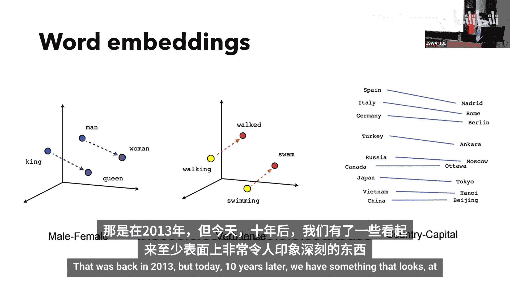
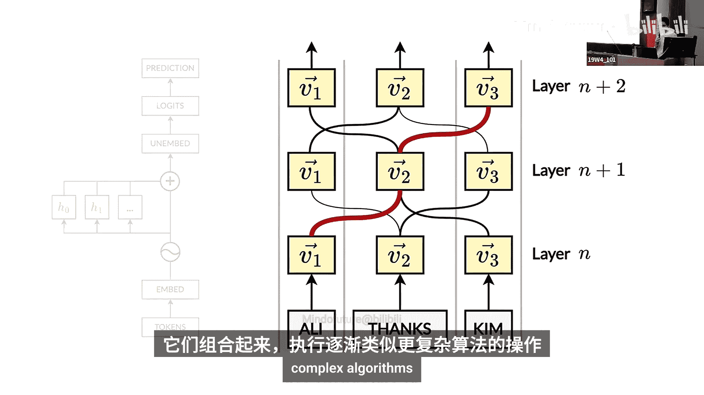
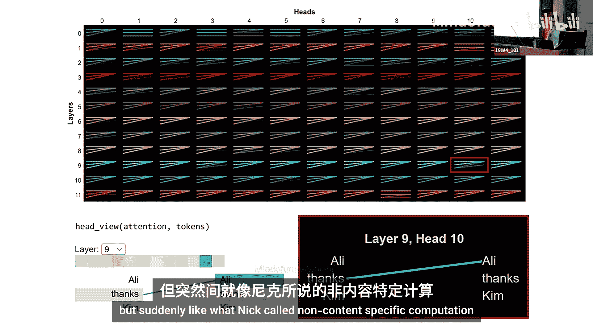
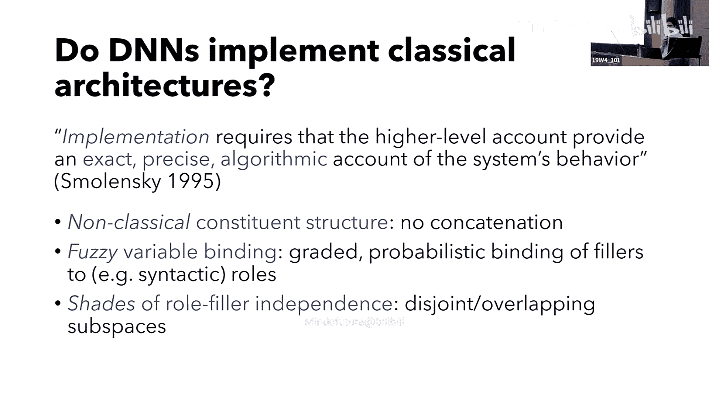
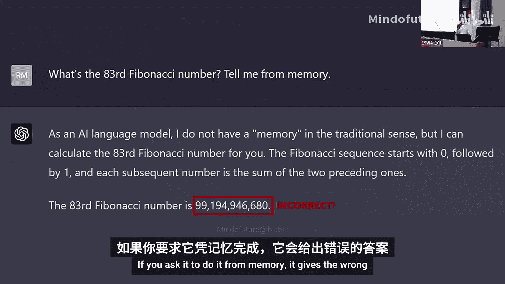
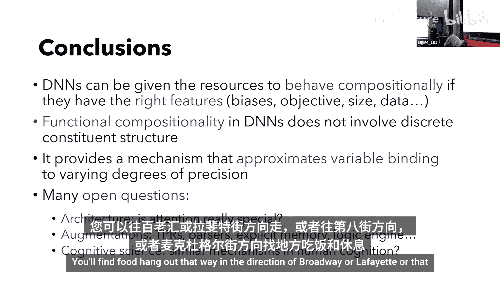

# 【纽约大学】深度学习的哲学 ｜ Philosophy Of Deep Learning 2024 p07 P07_Raphaël_Millière_深度神经网络中的组合性-深度学习哲学 -BV1u7ZoBnEAb_p7-

Our next speaker needs no introduction， at least for this crowd， it's our very own Raphael miliere。

 Raphael is the 2020 Robert Abert presidential scholar in society and neuroscience in the Center for Science and Society at Columbia。

 university and he's really an expert on all things deep learning as expert as anyone is in philosophy and maybe even elsewhere。

😡，These days Raphael I should say Raphael was really responsible for the whole idea of this conference。

 suggesting it way back at the beginning has really done an enormous amount of work in making the whole thing possible so really looking forward to hearing him talking about compositionality and deep neural networks。

 please give Raphael a warm welcome。😡，Thank you。Before I start I just want to thank all the people who have made this event possible so all the wonderful colleagues staff and students who have been helping out at Columbia NYU。

 as I've said to a few people this was a logistically challenging event and we really found out that the combined powers of Columbia and NYU is a force to be reckoned with so thanks to everyone let's give them a pro applause。

Okay， so this is nice because I think my talk with Will Dovetailale nicely with Nick talk。

 I will push back gently on some of the things he suggested but also I think there's a lot of convergence between our two talks。

 so I'll be focusing on this notion of compositionality in D neural networks。

And there's this family idea that compositionality is a challenge for artificial neural networks and I will try to unpack a little bit about what that means。

😊，So when we talk about compositionality， the kind of canonical idea is this principle from linguistics。

 which is a principle that is supposed to quantify our expressions of a language。

 so here's the canonical formulation by Ba Part， the meaning of a whole is a function of the meanings of the parts and the way they are syntactically combined。

And so the idea of computer language users can understand and produce potentially infinite number of novel well linguistic expressions by flexibly recombining known elements and that has been projected to be a central component not just of artificial and formal languages that are strictly completion but also of natural language。

 so if we take a sentence like Gary dislikes deep learning sorry。😊，Well。

The way in which these words are combined into that sentence matters it's not we don't just process that sentence like a bag of words。

 if you shuff all the words around and you say deep Gary dislike learning that still a grammatical sentence it's arguably meaningful but it means something rather different but you this principle as stated is quite strong and it's quite underdetermined as well so what constitutes a whole and a apart is the meaning that is composing this way the unique meaning of a complex expression is the determination is strict determination is our questions we can ask and there are reasons to think that natural language is not strongly or strictly compositional in that sense but at the very least it seems weakly compositional in the sense that at least some complex expressions have meaning that is at least partly determined by the combination of lexical semantic and syntax and you can lose the extent that idea to other domains so this is a figure from a recent commentary on this PBS paper。

Nick mentioned on the language of thought agree that vision is compositional and arguably there are properties of the visual inputs that combine compositionally where here is things calledkeletal structure and logical relations abstracts。

 sorry， so are even if some of the components of these similarly are different。

 there are things that are in terms of the compositional structure that seem similar。

So we also talk about compositionally to characterize behavior。

 given this idea that language and perhaps other domains are compositional， we want system。

 especially when we build artificial systems that can behave compositionally meaning that can parse the compositional structure of these domains in the right way in the way that matches how we humans do it so in the language domain。

 if we build a chatbot for example， and we go from a text input to a text output we want the chatbot to be able to parse the input compositionally。

 even when the meaning is perhaps very outlandish or surprising。

 so that's a classic example from picking care man by its dog， who needs urgent care。

 if we're relying only on a bag of words approach to combine the meaning of these words。

 we might rely on commonly statistical patterns of car occurrence to ensure that the man needs urgent care but if we properly parse the input compositionally we can give the right answer。

And similarly in。Other domains。If we are building an image generation model that takes text as input and produces images that I put。

 we wanted to parse the right compositional structure vice versa for。

Vice versa for a captioning model， for example， going from the image to a caption。

 and we can even think of it as a purely visual domain with image segmentation models， for example。

 that will decompose an image into its consistentstituent objects。And finally。

 when we talk about computationality， we also often talk about representations。

And the idea is that what enables us to achieve this kind of compositional behavior is a certain kind of representational format and structure and processing over these representations。

 so heres a somewhat recent example of this from this classic now classic BBS paper that was mentioned already from like and colleagues compositionality is the classic idea that new representations can be constructed through the combination of community developments。

😊，So there are really two ideas that that come together。

 There's this is an notion that pertains to how representations are processed and how they are structured。

 So the idea is that。Wop sorry， that is that there is you know a process a function that combines that can combine representations into more complex representations and that these more complex representations have certain kind of structure。

So famously， this can be readily accounted for in a classical approach with classical symbolic architectures where we persuadeulate that the right kind of representations to achieve that kind of composition in our symbolic representations in the language light format。

 that's the classic language of thought hypothesisthe this and that we have discrete constituents that combine。

Into complex molecular representations。So the idea here is that the right notion of combination is what we can call concatenative combination that's a time I borrow from a Funelder paper。

And the idea here is that when we combine atomic representations into complex representations。

 we are cotokening the atomic representations into the complex representation。

So we preserve the toins of the expressions constituents into the complex expression itself。And。

Virtually every standardly family or compositional representational scheme is concatecative in that sense。

 language and formal languages。In mathematical logic。

There is also this idea that in this kind of model。

There is this role filler independence that think also mentioned is I think this independence between the roles。

 the syntactic roles of the con constituents and the filler of these roles。

 so here we can change the structure of the complex representation where it's Kim thinking Ali and Ali thinking came and the idea is that Ali and Kim here the symbolic representations will be processed。

We be represented in the same way in the complex representation。

So there is a classic dilemma that has been levied by proponents of this kind of classical approach against。

Out to show neural networks。And it starts to the idea that human language and cognition。😊。

Are largely compositional。And so the Dlima goes like this。

 the first one is that if artificial neural networks lack compositional representations with the right kind of constituent structure that supports this kind of concateative combinations。

 then they cannot behave compositionally in the right way。😊，Um。So in that case， you know。

 artificial neural networks cannot explain the compositionality of language and thought。

Or if they have compositional representations with the right kind of constituent structure。

 then they merely implement a classical architecture like a language of thought。Um。

So here is an example I many quote we give here， but from further on McLlin。

 that it is precisely because classical mental orientations have classical constituents to this kind of concatenative mode of combination that they provide domains for structure sensitive mental processes。

And what's interesting is that we find that kind of dilemma revisited in recent years。

 I mean some people maybe had kind of left that debate on the wayside for a while and it seemed like an old tired debate。

 but it's very emerging with deep learning so on the one hand we have people like Primarcus。

Arguing that these systems are consistently unable to handle compositionality。So here is an example。

 many current learning approaches are NPCD behaviorist intent。

 ignoring the fact that the brain operates other representations that are organized into structures。

 not least based on computational rules。😊，So that's kind of the first horn of the dilemma and then on the other side we have kind of more new and subtle version of the other suggestion that's from this PBS paper from Jake Ctan and colleagues that Nick mentioned。

And so they say well， it remains open that DNAs might mimic the performance of biological perception and cognition across a wide variety of domains and tasks by implementing core features of language of thoughts and in this other paper do our apparent successes of neural networks owe in part to implementing language of thought like structure and if so exactly what symbols and rules with implement。

 slightly suggestive donna phrase here with the study of language of thought like structures。

 there's a question about at which point do you get to a language of thought like structure and know it's kind of asking this question but suggesting low implicitly that when DNs do the things we want them to do in terms of compositional behavior then that's most likely because they end up implementing this kind of classical architecture。

But of course there is a third possibility that has been explored already back in the old debates from the 18s and 90s。

Which is that artificial neurals might exhibit compositional behavior。

 have compositionally structured representations。And do so without implementing a classical architecture。

But of course the question is， how is that possible it's straightforward in a classical architecture to have representations that combine in the right way。

 it's not so straightforward in a deep neural or in an artificial neural journal in a connectionist model。

😊，And that's because these models process continuous vector representations。

 how do you get compositionality from continuous vector representations instead of discrete symbolic representations？

😊，Well， if you think of two vectors here in a two dimensional vector space。

 one thing you can do to combine these vectors is simply to。

Do an average of these vectors so you get a third vector but that doesn't seem to have the right kind of give you the right kind of structure I mean certainly there is no discrete constiingent structure in the resulting vector。

 but also it's a very it's a very very simple operation that doesn't seem to give you anything that you might need for compositional behavior。

So we've talked yesterday with Finten's talk about shallow word embeddings that turn every word in a vocabular vocabulary into a unique vector like that and with this shallow word embeddings。

 you don't really have a principled way to represent the meaning of complex expressions in language so what you can do is you can do a sum of vectors you can take all the words in the sentence Gary dislikes deep learning and you can sum these words together as like a bag of words approach and that won't really give you the right kind of representation of the structure。

 the static structure of the expression。Right so。That was back in 2013 World to Vec， but today。

 10 years later we have something that looks at least on the face of it very impressive so here's an example from G4 I gave it a prompt adapted from an another example from Gary Marcus that was supposed to be a failure of compositionality。

So I made it much harder， so John pulled out I would have a bag， a metallic purple key。

 a square hardcover book， a green round melon， a red rip banana， a sparking purple gem。

 a square red card and a fuzzy purple hat， he plays the first item he pulled out into his bedroom save。

 the second purple item into his football and everything else on his living room table。

 why did John place into his football and to just give the answers you shot and it gives the right answer and it seems like to give the right answer。

 you have in some way to process the compositional structure of that sentence right if you take a bag of word a bag ofword approach and you just do something like like summing the vectors of the input here that presumably won't give you the resources to achieve that kind of behavior。

So how is this possible？The program here is to disentangle the performance of language models from their underlying competence。

 that's the problem that Nick was also a driving data that we've been discussing throughout this conference。

And in particular is you know can we say that language models just memorize compositional structures or rely on shallow statistical characteristicsururistic or maybe only these content specific transitions to approximate compositional behavior or do they do something more sophisticated。

 do they generally learn nontrial compositional function that can generalize beyond the distributionion of the training data？

So let's start by the evaluation of the behavior first and then I will talk about。

I will talk about whether we can get hints at how that works actually inside the model in terms of the computations that are induced during training。

So let's start with compositional behavior， we can start with the very syntax light form of combination。

 which we've talked about yesterday in the to on concepts， which is conceptual combination。

So humans are very good at parsing phrasal nouns that combine two concepts。

Which requires composing lexical semantics with minimal syntax together with some background knowledge。

 so it's not strictly compositional in the party sense but。😊。

I say minimal syntax because syntax doest matter， so a car factory is a car made in a factory。

 but sorry a factory car is a car made in a factory。

 the car factory is not a factory made in a car right so it's important still to take into account the syntax of conceptual combinations and。

With some colleagues， Catherine is present here in the room was one of the cos on this project。

 Catherine Stinson， we wanted to test whether language models could do that kind of thing。

 because one of the things that was arguedrc by Brenan and Gregory Murphy in that paper that Brendan talked about yesterday is that they couldn't reallydo that。

 they couldn't specifically parse novel conceptual combinations。

 specifically novel conceptual combinations where the meaning of the combination has some kind of emergent features that neither of the constients have。

So we created this task for benchmark。A project that was peerheaded by Google Brain called Big Bench it's a big benchmarkch to evaluate language models and we submitted a task to try that so we have different subtasks so I'll just give you a few examples so here is an example with actual words concept is wooden de does the conceptual of combination then we have a question which of the following sentences best characterizes wooden deer。

And then we have four candidate sentences and we can use like likelihoods to evaluate which sentence the model assess is to be the best sentence for that question and so that's an example with concepts or words that are present in the training data but we also have other set tasksask with meta words we define in the prompts so the word pleater means an object that flies by flapping wings and the word niF means an object that has no feathers question which of the following sentences best characterize as platon myths there's another example we also have examples with surprising combinations or combinations that might be somewhat contradictory so here's an examplede caregiver which of the following synthesis this is best characterize is deadly caregivers and homicidal nurses are delicate caregivers here would be the correct answer and importantly we included a lot of thesetracts in our attracts in the alternatives。

 so we wanted to disambiguate between reliance some shallow heuristics and actual。

Passing of novel conceptual accommodations。And we are very pleased with the initial results when Google ran this on a lot of models because the goal of this task was to be very hard。

 so something that humans can do well and language models can't do very well so the initial results that include GPT3 so you have GP3 over there。

😊，Where really striking in fact it was one of the largest discrepancy in all of the big bench tasks that were submitted。

 so we have the average human doing very well the best human doing perfectly not task。

 which is good control and the modelss doing basically randomly。

And then Google trained there in house language mobile Pm that was larger than GT3。

 so GP3 has a 170 billion parameters， Palmm has a 540 billion parameters。

And this happened so on the 1 zero shot regime。Palm basically matched the average human unfortunately the G4 paper didn't evaluate the model on Big bench because there was some contamination in the training data they tried to avoid it。

 but somehow some tasks from big bench leaked into the training data so they didn't didn't assess it so we can't really have G4 on here。

 but you know you could you could imagine that it would do at least as well as palmm。Okay。

 so that's for very syntax like like。Compositionality， but that's not the most interesting case here。

 so what we want is models that can generalize as Nick mentioned。

In the right compositional way with complex inputs so one of the issues here is that relates to what Tal discussed yesterday is that with the large language models that I train on a humanous data it's very hard to disentangle which part of the performance is due to genuine generalization and which part is due to just memorizing certain specific structures in the training data so one way to get around this is with synthetic data so you can just create a synthetic benchmark or synthetic data set to such that learning the right input output mapping and generalizing beyond the training data on the test set will require strict compositional generalization。

So there are a number of these synthetic data sets that have been developed over the years。

 so here's an example for the scan data set from lake and Baroni。

 so the idea is that you have to translate the instruction on left into actions that a little agent could。

performing a virtual world and that requires parsing these inputs compositionally。

 so you have terms like twice that require you to perform an action twice， for example。

 so in order to generalize properly on this parts of a data set you have to generalize compositionly。

So the patterns of performance and performance improvements over the years on these synthetic data sets is quite interesting。

We see this kind of similar trend where performance has dramatically improved and again this is for models that are trained on this you know generally formal that are trained on this synthetic data sets it's a bit complicated because accuracy varies depending on how the data is split there is some interesting research on this。

 some of these like scan are essentially solved， you could say I mean theres civil models that have perfect or nearerfect performance。

 it's not so clear for others， so some generalizations with coGs for example which is a harder bar to pass。

 some of them remain challenging so some you know some things have we can do over recursion for example seem more challenging others seem also completely solved。

嗯。And of course， if you augment language models transform models with explicit compositional semantic par。

 then you can actually perfect performance， but the question is can you do this without without。

You know， building into the model the right kind of syntactic prior。So the things that seem to help。

 some of them are architectural tweaks， so for example。

 some modifications of the positional encoding， how the modal is encoding the positions of the tokens in the input sequence。

There are also some learning strategies that might help like mental learning or training on multiple tasks at once and in a way that seems to encourage generalization。

And also there are data augmentation strategies where you can automatically recombine the training instances to create new artificial training data that helps the model generalize directly way。

So we can discuss， you know， we could discuss how。How helpful these different things are and to what extent。

It's you could you know how big of a difference it makes in terms of the changes you're making to a manual electron transformer models。

 but nonetheless you know you can achieve really good performance on these benchmarks。

 not perfect but really good without end them with explicit synthetic parers so there is undoubtedly some nontrial highly nontrivial amounts of compositional marginalization in these models even if it's not perfect。

So how can we explain that？Can we start forming some hypothesis about how this might work？嗯。

So IInc has already hinted at that the number of people in the conference have hinted at that that different ways you can try to open up the black box of these models and try to see what to make inferences about what's happening inside in terms of the representation they're acquiring and the way in which they're processing these representations。

So one method that was discussed at length yesterday in Jackquelines St is probing。

 so I won't say too much about this since we talked about it already， but there was a lot of work。

 some of which has already been mentioned。showing that if you try to classifier probe to predict specific compositional properties of the input from the model's internal activations you can actually recover a lot so there is you know a lot of work showing that ands from models like B for example even small you know produce is a relatively small model compared to models we have today encode information about part of speech about syntactic chunks about different semantic roles and specctic roles。

And that you know， there's also evidence that words sharing synthetic subries here on the left have a larger impact on each other in the models predictions。

And of course， as was mentioned in Rone Jacqueline's talk yesterday。

 this only reveals at best that there is information in the model that is decodable with the right probe。

So there's information about syntax， synthetic structure。

 a compositional structure that is recoverable。😊，But he doesn't show you。In and out of itself。

 it doesn't really tell you whether the model is making use in of that information to produce its output and how the model。

 if so， how the model is making use of that information。

So you can go beyond this kind of probing approach in various ways and this can get quite mythologically thorny and sophisticated and I can't get into too much detail here。

 but I do want to mention various approaches before I focus on one of them。

 so there is this really exciting work from Tom McKy and others between Tainz and Posmonsky。

Looking at different deep neo architectures。And asking whether these architectures can approximate tensor products。

 tensor product representations。So tons of product representations are a clever strategy that Paulmlensky developed back in the old days of these debates about the connectionist versus classical approaches to compositionality with these。

This architecture that relies on having different kinds of vectors that are orthogonal in the limit。

 so some of these vectors will be fila vectors like Ali and Kim here in the sentence k Alithan k。

 and some of them are rural vectors。Here that you know bind to the one to the role of the different constituents as Asians or patient of that particular law。

Expression， and you can you can have a way to combine the raw vector and the fier vector with this operation called the tensor product operation that is that is an operation that can be is reversible so you have a principal way once you've done the tensor product to then decompose the resulting。

The resulting tensor product representations into the constituents role and filler vectors。

 so it's a kind of representation that was designed to do this kind of role filler binding with raw fill independence because you can have you can represent roles and fillers in this independent way。

But in the back when this kind of architecture was developed。

 there were a number of issues with it and'm moving into all of them。

 but part of it is that the roles， the role vectors here were kind of ad hoc。

 so for example these syntactic roles you kind have to build them into the model and of course that's not how current models learn and that's not how we want them to learn。

But what's interesting is that Tom， MikeCoy and colleagues found that both record on neural networks are in Ns。

 and there was also working in preparation that's not published yet on Transformers。Is that okay？

Yeah。The F audienceians are acting。U。Soir。So。So there they showed that both ours and transformers are trained on simple symbolic tasks。

😊，Can be approximated by tensor product representations with close to 100% accuracy so that's really interesting and the way we do this for example with the RNN is that this has two parts an encoder and a decoder and they show that you can swap out the encoder pot with what they call it tensor product decomposition network which has this tensor product representations set up in such a way that then the decoder can make use of the outputput of this tensor product network to perform basically just as well。

So that's that's quite interesting and it goes beyond this kind of probing approach because you can swap out a whole part of the network and find that that equivalentence or convergence in the the in the outputs so that works on models trained on simple symbolic tasks and。

There is working progress， again， as mentioned， that's not published yet。

 but from time I question that when you use naturally occurring sentences of this instead of just template sentences。

The approximation itself still very strong in the lower layers of a model like birds， is farmers。

 but becomes somewhat less strong in the later layers so that's also interesting we can talk about some of the implications of that。

 but if you took this if you use either symbolic tasks or templatetically generated sentences。

 then you get close to 100% accuracy。Here is another interesting work from Chris Manning's lab also very recent I think it might still be under reviewer which is accepted for ACLR and again I can't go too much into the details here because that's actually quite a complex thing they're doing but it's not a probing it's not a probing study either so the question they're asking here is does the computational or the computational function implemented by a transformer model resemble the hierarchical tree like structure of natural language。

And for that， they invented a new method that involves。

Masking part of the an input sequence like red apples are delicious to see which representation that the model is encoding for sub partss of the string and trying to get the kind of context independent representations and then the representations of the same elements in the context of the whole input。

So they do this to build this little table over there and then what they do is that they find the best matching binary tree。

 is what they call tree projection in the corresponding tree score by finding the best fit tree structured record neural network that approximates the transformer for that particular input sequence in a way that's totally unsurprivised。

So another thing that they found that I think is quite interesting。

Is that so that works very well and not only that but transformers that they tested this on become more treelike over the course of training and they found this really interesting relationship but the more treelike models generalize better on these tests of compositional generalization than the ones that are less tree like so getting at something that's starting to look like an explanation of the capacity of transformers to generalize compositionally in terms of this tree like structure of the representation。

Okay， but I think one of the things that is most exciting least to me is this work on mechanistic interpretability that has been also mentioned by various speakers。

And this is an approach that has been spearheaded largely by chrysola and colleagues Ananthropic。

 but many people are now working on this。And that involves trying to look at circuits in a model。

 so sub， sub networkss within the network or subgraphs within the network。

 where you can try to reverse engineer and interpret what that particular circuit is doing in terms of how it's processing information。

So you can do this and it's easier to do in entire models and small models。

 it becomes much more difficult in large models。😊，But this can give us some insight into the actual kind of computation that is implemented in parts of the network and how that relates to the outputs they're producing。

对。So I know Cameron said we made a pact not to explain。

the transform architecture and attention and I will respect part of that fact because I won't get too much into the key query and value vectors and that kind of stuff。

 I just think the way in which the mechanistic people frame this is more helpful and intuitive。

 which is in terms of this idea of a residual stream。😊。

So if you take a transformer and here it's not a real transformer because I haven't shown all of the layers and I haven't shown the multi layerer perception partss that are highly nonlinear nonlinear。

 so I'm just focusing on this attention mechanism that's one of the key aspects of this architecture。

 it's useful and that's what this mechan interpretability research shows to see it as a kind of residual stream。

 a stream of processing over each token in the input sequence。

Spning the whole network from input to output so there are different elements in there so there are the input tokens so what you input to the model they get embedded as vectors that are initially context free they're not contextual word vectors theres just a unique vector for each token in the vocabulary then you do this little thing just to add some information about the position of the tokens in input sequence is called positional encoding the various ways to do it but we don't need to get into that。

The key part that I want to focus on is this that's the multi head attention module。

 you have several of these stacked in several layers and they're composed of different attention heads that each do something that we'll talk about in a second you have this kind weighted sum that gives you back some vectors so we're having some vectors for inputs at the unbedding stage and then。

You get modified vectors after you apply the multihead attention at each other layer and finally at the end of the network you have the unombedding metrics to go from these vectors to probability distributions。

 logicits over your vocabulary and enables enable you to make a prediction as to what is the word that should follow from the input sequence。

Okay， so。Let me get a little bit into what these attention modules are doing。

So I think what's really interesting from this work on mechanistic interpretability is defining finding that attention routes information selectively and dynamically。

 selectively because each attention hads during training。😊。

Will gradually get more sensitive to tracking certain kinds of dependencies or relationship between tokens。

 and this can be very abstract。And dynamically， because the information that the attention heads are encoding and decoding can be routed to other parts of the network for further processing and further layers to other attention heads。

So again， to take guitar example， you have for just one token。

 you have a vector at the embedding stage。And then you have after you apply the multi head attention。

 you have a modified vector， this is here's for example， with only three dimensions。

So your vector has changed and it has changed because of what's been happening in that multi head attention module。

But one of the key findings from this mechanistic interability research is that these different attention heads。

 they can read and write information to subspaces of the main emmbic space。

 so the main emmbtic space is very high dimensional and GP3 it's over 12，000 dimensions。

But the spaces that this attention has worked with by doing a projection of the embedding vectors are very very small comparatively small subspaces right so here again just to represent this visually I've shown the subspaces in two dimension two dimensional projections of the 3D embedding space。

And importantly， these subspaces that attention heads read and write information too can be disjoint so they can be set up in a way that because there are so many dimensions available because such a high dimensional space and the inal embedding is not making use of all of these dimension。

 you can read and write information to subspaces that are disjoint tend don't interfere with each other。

So each attention head for each token in the stream is doing two things。One is determining。

Wwhichch given the specific function it's acquired during training。

 which other tokens in the input including the source token itself it should pay more attention to this is why it's called attention so that's the first thing is doing what other tokens should I pay attention to when I'm processing this particular token in the input that is particular attention head and then the other thing that is doing is determining what information should be retrieved from the token it's being attention to and moved to the residual stream and so this is the way in which it's reading and writing information into subspaces so again if you think of the sentence。

Ali， thanks Kim and again here using a really toy model。

 you might think that there is a particular attention head and you find things that look very much like that that might be tracking who is the agent of the thinking relation in that sentence。

And that it's Ali and Na Kim， and so when that attention head is projecting the main embeddings into this subspace。

 might be a subspace that specifically tracks this agency role。

And it's going to give a high attention score for the token thanks with the token Ali or I'm meeting for Ali。

 because Ali is the agent of this particular sentence。

And then it's going to retrieve information from the projected vector for Ali and move it upstream in the processing for other processing。

嗯。So importantly， this happens over several layers and the information。

 as I mentioned because dynamic routing can be routed from layer to layer across positions。

 so it's not actually that helpful to think that residual stream and the embeddings for each token is an embedding that it's only occurring information about that token because information is moving around so as you process information and network it becomes highly compositional in the sense that there is information structured information that is routed in the subspaces that is moved across not just layers but across different streams and this composed together it composed together to perform operations that start to look like more complex algorithms。

And。

So that's an example that I use this tool that has been developed by mechanistic interpretability researchers with a small network。

 GT2 small with this particular a sentence and you can see that there is one of the attention head and one of the layers that I send a high attention score for Ali for the talkingken thing。

 so it's tracking something there is kind of relation here that might be tracked by this particular attention head。

But the important point here is that because attention hes can work with。

Subspaces that can be disjoint。These subspaces can act like a form of virtual content addressable memory。

 you can read information to it， you can write information to it。

 you can read information to it from it。And when there is no interference between the subspaces that starts to look somewhat like a form of viable binding i'll come back to that。

 but certainly like what ni called noncon specific computation so here are specific examples I'm going to get too inches into the details that's an example where。

Research is referring to reverse engineer a particular operation。

 so when you're defining a function in Python， you can give some parameters to for the documentation of that function that when you prepen this para viable and here you want the model to predict that the next token should be files and so the reverse engineer the algorithm in terms of attention heads that is doing that operation and so they found the circuit that's in a pretransversemal fo or attention on the model。

And this features three levels of composition across different different layers and。

Including an attention head that does different things in different parts of the prompt。

But what I want to get at here is that this composing ways that can implement。

Bindings essentially between more abstract roles and certain fillers。

So here the algorithm that they found is something like predict the argument that follows in the definition。

 the argument seen in the previous doctoruring line。

So it's moving information this way here is another real world example with a model that's actually trained on context that's G too small and that's the river engineering the circuit that identifies indirect objects so if you have the sentence when Mary and John went to the store John gave a drink to you want the model to predict Mary's youre to identify what should be the right indirect object and heres some work that shows how that works so of course when you look at something like this it's easy to feel like that and feel like you're kind of widely speculating and reading tealips but it's not just reading tealips and I'm happy to elaborate in the Q&A but what you actually do is you have various methods like activation patching and others to perform ablations and causal interventions on these different parts of the circuit to validate the hypothesis of this that you have。

Okay， so coming back to the questions， do deepton networks that have this kind of structure implemented classical architectures？

😊，With K Finsky implementation requires the higher level account to provide an exact precise algorithmic account of the systems's behavior。

And if you go by a definition of implementation along these lines。

 I don't think you can say that there is something like a classical architecture that is implemented here。

😊，There is a form of constituent structure but it's not concatenative。

 it's not classical in this way there is what I'm tempted to call fuzzy viable binding which is graded than probabilistic binding of fills to rows such as syntactic rows right but it's not strict algebraic viable binding and this is where I would also say to build on mixed talk that I think the distinction between content specificific and non-con specificific computation comes in degrees and what we observe in these models is that depending on bias aspects of the prompt you can be in a regime that's more content specific interite transitions or noncon specifics。

😊，And you also have shades of raw filler independence here， but that's also grade in probabilistic。

 So you have these subspaces you know in the limit when they're really properly disjo that gives you more independence between the roles that attracts and the fillers and when they partially overlapping that gives you interference and it's not not properly distant So just want to finish with an example that I think is quite illustrative in the actual behavior of the model of what that translates to so I took GP4 and I asked it know my first point was perform like behave like a python interpreter right so only give me outputs that like what a python a shell would do right so I started by defining a function with a bunch of variables and so you know it behaved as expected by repeating that function as a python interpreter would do and then I define another function that's actually to return the。

😊。

Gubbonacci number。In the sequence， but I made it I obscure the functions so that it was less easy to recognize what it's doing with this like slightly convoluted way to to formulate it。

 and again， it's its it's。Coing that， and then I asked it to compose these two functions with three different inputs。

And the output is correct。I think that is highly， highly nontri。

And you can ask it to explain the answer and then it will decompose you know what the different parts of the operations here with know bit the variables to the values but again you can do it zero shot without this decomposition this is why I'm attempting to push back against this idea that all they can do is nonecon specific computation in the output right and it's not just memorization if you ask it to do it for memory it gives the wrong and it gives the wrong answer for the second part of the of this operation。

So as Nick mentioned， I think there are some benefits to。

Having the kind of composition that theonic works have。

 but the difference here is I would say that I would be more inclined to ascribe some form of nonconspecific computation here that's not just done on the output。

 so I think by benefits flexibility in nonformal domains discrete gridd structures and algebraic rules are often too rigid to fit data well tractability we have more concerns about computational comm explosions and the versatility of this kind of computation and emergence I didn't talk about this but there is this very interesting work on gring showing that you have transitions from memorization to general rule-like computations in the course of the training of the model I can come back to that in there。

😊，In the Q&A so to conclude， I think deep neuralmatos can be given the resources to behave compositionally and to generalize compositionally if they have the right features。

 and it's a kind of functional compositionality， not concatenative compositionality that does not involve discrete constituent structure。

😊，And relinquishing that kind of structure strict algebra constraints can provide some benefits and this provides a mechanism that seems to approximate viable binding to varying degrees of precision with a bond of course an upper bound to what you can do with this so there are many open questions is attention really special in the architecture do you need to commend this model with other things including a logic engine if you really want to perform equally well as humans and computational generalization and what insights can you take from this kind of research for cognitive science so I've been too long so I will stop here thank you。

Yeah。Okay， questions。Thanks so much I thought that was fascinating and a really impressive array of evidence this is a question about like one of the target questions that you asked at the beginning do deep neural networks succeed by implementing language of thought I just wanted to hear a bit more about what it would mean to answer that question one way or the other。

 so like for example if we were to have a model which I don't think we do now have but it was getting to human level on a variety of concept combination tasks and the scan tasks and stuff。

What would we look for or find such that we would say that it's not implementing a language of thought it seems like in that position we we'd be in the same position that a lot of the。

oldld school language of thought people were with humans where they're like， well。

 we don't know exactly how the brain does it， but we think we can argue that it must be doing language of thought if it's succeeding。

In this way。So。Yeah， make of that what you will as maybe kind of a confused way of getting at it in general。

 I'd just like to hear more about the。How to decide this question of what would it mean to be doing L thought？

Yeah thanks I mean that's a great question and it's in some ways a million dollar question I think it depends what are the different criteria that you consider to be。

Important in the language of art， even if you don't want to give minimally or like you know necessary insufficient sufficient conditions in this in this paper from Jack Quaden and colleagues。

 the list a few different aspects of。A language of thought like architecture。

 but they say that none of these are maybe strictly necessary so that makes it more difficult to take a determinant。

you know a principle stance on whether any given connections architecture is implementing a language of thought or as they put in the other paper。

 a language of thought like architecture so depending on where you set the threshold that makes it difficult I think you can look at work on mechanistic interpretability and other work like that that gets at the structure of the representation in the network and the way in which they're processed to make some inference about certain aspects that are usually typical of a language of thought so you know Nick discuss whether these models have anything like a logic engine it seems like。

They don't have something like logic engineering in a strong know strict algebraic sense where they don't have an algebraic mind in the Gu marker kind of sense right and you can see that from the patterns of failure as well as from this work on trying to interpret the circuits inside the network but in the limits it will become more and more difficult to draw that kind of inference and also there is only so much you can generalize from。

Small models work on toy models to large models which is a problem so yeah I do think this kind of question becomes increasingly intractable as you get to these giant models and perhaps that's fine。

 perhaps we don't need to endless less equibble about whether there is implementation of language of that or not。

 but my point you at the point that Ssky made many years ago was that he thought of connectionist models not as implementations of classicals that are refinements of classicals and he made that point that it's a bit like how quantum mechanics is a refinement of Newtonian mechanics so in some cases it can look very much similar at the limit but it actually has this greater expressive power so something like that is true then you might think that it's the wrong it's the wrong way。

What'sゃたで。Thank you so much this was such a fantastic example of a talk bringing together a number of different disciplines。

 beautiful work and I have a question that might be not easy to respond but why do you think in some cases like chess it fails at capturing rule like processing whereas in some other cases it seems to be capturing it and by it I mean GBT 3。

5 plus so to speak that you would expect that at some point it would also get that why do you think sometimes it fails and sometimes it doesn't what's the difference。

So yeah， great question one thing I didn't emphasize perhaps enough is how important the。

The nature and structure of the data sets itself is。

And here this is why I don't want to draw any implications about learnnerability claims when it relates to human condition I mean clearly humans don't learn from the same kind of data or the same amount of data that's uncontroversial。

 these models are trained on code and a lot of things that are very unnatural。😊。

When you train them from scratch know there's the Othello GPT paper that was mentioned a few times so you can train them from scratch on game descriptions of games。

 then you can get essentially perfect performance in terms of predicting valid legal moves it's interesting to look at the transition from G3 to G4 in terms of chess playing G4 actually when you prompted in the right way and it's also sensitive to structure of the prompt that's true and I think one of the reasons for that is precisely because you think of contentspecific and non-con specific caps in sense that's coming in degrees and you think that there are these content effects that we find also in humans just like in humans the way in which you ask the question in the way in which you feeling some of the details will prime you to make a transition that can be more or less content and non content specific and I think that's true also for these models but with chess playing GP4 actually I think outputs valid moves in  98% cases so again it's not。

ect compositional generalization， that's the running theme。

 but yeah there is just because it's not perfect compositional generalization doesn't mean that you there is nothing going on here that's you know non trivially compositional and generalizing same with the synthetic data sensor。

Yeah。In that sense， yeah。Just a thought on this language of thought issue， I mean， as someone who is。

Doing this kind of thing in the back in the 90s， you know。

 the one one thing I think that's really become clear。Since then。

 is there are two very different aspects of you know。

 language of thought that really need to be teased apart and one of them is。

Structured representation and the other one is symbolic computation I mean back in the already back in the 90s you know lots of people like Sa Milenssky were big advocates of subsymbolic computation as the key thing which was undergirding the power of connectionist networks of having you know the computation among the units global over level of representation。

At the same time that was totally consistent with structured representation and yes Spelenssky had those beautiful models so I guess I'm inclined to look at what's going on these days and say okay well basically you there's a lot of evidence。

 you know， not yet totally conclusive that。😊，That these deep neural networks are engaged in structured representation。

 but the key thing， but it's also a very obviously subsymbolic computation。

 just looking at the you know the complexity these of these representations。

 I'm inclined to think you know what's really distinctive here is。

It's not the structured representation， but the subsmbolic computation didn't really list that。

 I think among your among your features about what's distinctive here， I mean。

 you had the fuzzy binding and the functional compositionality and so I'm inclined to think，😊。

The real reason why it's not implementing computationally a computational language of thought is precisely all the operations which are made possible by subsmbolic computation。

 which you can't get。In a in a symbolic computation system。

 so I wonder what you think about that yeah I mean I think that really the point about discrete con structure and the concatetnation versus functional composition I mean a little bit。

W with this notion of symbolic presentation because you know different people mean different things by that and you know you can treat vectors as symbols。

 certain kind， so I mean the crux of the matter I think is the fact that these are not you know in the actual representation that are encoded in process is not manipulating discrete symbol symbolic representations right so but yeah so I would agree with that。

对。啊不。Right the language of thought treats representations as atomic which limits the number of operations available to what Nick was calling that set of noncontent specific representations of various logical operations once they' nonatomic then there's a huge range of operation you see available in a different neural network right so yeah I was thinking of discrete greatness as encompassing this aspect so you know with orical classical constituency called classical consider structure but I agree。

Okay。But it was a really nice explanation as to how in this incredibly complex transformer architecture。

 you might get something like this Millensky vector based way of combining in the little experiment that you did where you're looking at the role of attention heads。

😊，Are you getting an attention head that's specific to thanking and giving you agent thanking and patient of thanking or do you find anything that's an attention head for all two place relations for agency and Pat across all two place relations and that's in your experiment but you can speak to that more generally too。

Yeah， so that was a that was a toy example， so know I just quickly from a ahead that was， you know。

Giving me a high attention score for Ali for thank and you could feel in different values for Ali and worked as well。

 but that wasn't meant to be know the crux of taking the load bearinging charge of the argument。

I think the more convincing evidence of noncon specific completion is with the way in which attention heads are combining to do things like。

 you， look at the previous talkingken。And look at the token that sorry the induction types for example so find the token previously in the sequence that is highly similar to the current token and then find the token that is follows that token and retrieve information for that and move it to the nextcan that's predicted thats nu and specific。

 so it applies to any kind of input and the osteo circuits that do that and then the information may be used downstream or may not be used so the example that's given in the chrysola alhager colleagues paper is there's only the passage of Harry poter where you have the name poter is tokenized as two tokens partter and when at some point in the paragraph theres intention looking at pot and finding the previousus occurrence of part in the text and then finding this world by T then。

that and putting into and that in is doing that work at the exact same work it has the same trend matrices for any position。

 but the information is only properly used to move to output the same T that follows part and previous the position when it's useful。

Okay。thanks。So Chomsky introduced the concept of generative grammar。

 which is the set of rules that allowed us to understand and generate infinite grammatically correct sentences since part of the composition discussed here is more or less for the large language models to acquire and implicit generative grammar do you see as a possible development for large language models to incorporate the available explicit rules of generative grammar。

Provided by the linguists。Or like for example， each work can be given a generative grammar vector value based on its properties。

Or do you think that large language models should eventually arrive at generative grammar on its own and it's more efficient that way？

Yeah， I mean that's a very difficult and timely question。

 so one of the things I mentioned is that you know maybe augmenting these transformer with parsers。

 I mean certainly it can help at least in some cases to generalize compositionly and generalize suitableable syntactic structures。

 especially if you're impoverished the data set。But so I agree with T Linen and what was discussed yesterday about the fact that you can't really infer much about learnnerability claims and the poverty of the stimulus style arguments with these large language models for the reason he mentioned。

 but I'm very interested in the outcome of the babyLM challenge that was mentioned where you train a model and between 10 and 100 million words so I put as much as as many words as a 12 year old would get and then you see whether it's able to generalized and syntactic structures so I think it's an open question whether you can get the right kind of generalization from impoverished data in the way you get it in humans and the kind of implications it will have for generative linguistics I think is still still an open question to a large extent。

 where I think is more of a close case is the suggestion from the oldest suggestion from Chummsky that statistical based learning will。

Never learn anything about the underlying syntical structure of a language like there's a stronger。

 the second version of the poetry to the stimulus argument that is stronger and doesn't depend on specific amount of information you're exposed to that argument I think can be more or less put to rest。

You asked us to， you invited us to ask about emergent rocking。

 I'm hoping I'm not the only one whod benefit from that。Yeah， thanks， Okay， so I also by the way。

 I also wanted to mention I in the broader project。

 I'm also interested in how this works not just in language but for vision as well because there are so I'll skip this。

 but they are。😊，They are vision models， vision transformers。

 and I think the same kind of fuzzy Bible binding applies there。So let me skip this okay gring。

 so there is really interesting work from Neilland and colleagues using these mechan interprettability techniques to show that during the course of training of a model。

 you get these transition phases where initially the model is getting lower loss so better expert prediction by memorizing certain structures you know essentially n gras or more complex statistical patterns。

😊，And。If you just look at the loss， memorizing and learning to generalize with something rulelike will look the same。

 but when you use these tools， you see that that comes upon with there a transition。嗯。

There are three phases of training so you have first memorization that transition to circuit formation so you have from formation of one of these attention head circuits and it smoothly transitions from memorizing to generalizing and then there is the third phase which is quite interesting whether there's a cleanup of what was used for memorization because it's no longer needed so you've substituted the rule like thing that you've learned for generalizing to the memorization and so you remove the memorized solution。

😊，And so that's what you see here， I mean the restricted loss here shows you only need the generalizing performance and the excluded loss shows you sorry the restricted loss is only the generalizing performance and the excluded loss is only the memorizing performance。

Thanks。So I want to ask on the last slide， do you have the conclusions？

And you talk about behaving compositionally and I want to ask exactly what's entailed in behaving compositionally because there could be a number of different kinds of behaviors which are indicative of compositionality that includes things that you're talking about like conceptual generalization and the ability to encode information about tree structures。

But presumably some things are going to be lost if you don't have classical constituencies。

 so classical constituency would suggest that。The ability to think that the cat is on the map requires tokening a representation of a cat。

 so if I mess with or interfere with your ability to represent a cat。

I will mess with your ability to perform on tasks that require thinking that the cat is on the mat。

And that kind of principle seems to be important in a lot of psychophysics。

 visual psychophysics if you want to understand whether shape is encoded in terms of locally oriented edges or in terms of global curvature。

 what you do is you interfere with those different bits of information and then you see which ones are really integral to representing shape which ones if you knock out the ability to represent it。

 you won't be able to represent shape， those are kinds of like I would think behavioral indications of compositionality and if you don't have classical constituent structure of a sort concate of structure you may not get that maybe I'm not quite sure so I wonder if maybe the best way to put it is you can behave in some ways compositionally without this kind of structure but in other ways it might still be more difficult。

Yeah， thanks that's a great question。So'm i'm not so sure i'm not so sure that you couldn't achieve that kind of behavior so if you look at vision and I didn't get into that so suddenly there are shortcomings with convolutional neural networks that are discussed in the in the qualitative and colleagues paper but part of these broader project and。

Something that's not fully fleshed out yet， but looking at vision transformer models also based on infrastructure architecture。

 I think you find the same kind of thing so you you don't have this local texture bias that you have in the CNNNs you have specifically these objectcentric transformers that have are able to have these kind of object slots where they can also bind role and fillers and I think this kind of model can give you something that can approximate pretty well。

 the kind I think you get with object files if you have more kind of classical characterization of that in vision so we should talk more about this。

 but I'm not convinced that if you look actually at vision transformers you see that they outperform CNNs on certain path the psychophysic steps I think that hasn't been thoroughly。

the stuff of the Bers and colleagues paper has tested with CNNs。

 and I think it's a regrettable omission of that paper to only talk about CNNs， but yeah。

 we should talk about this more。嗯。Thanks for the talk this is so interesting so this question might be a little ill formed。

But i'm trying i'm trying to i'm struggling to reconcile two perspectives。

 so one perspective like one view that you could take away from this kind of work is that。

It's not a clear yet， but basically like compositionality of this form is just going to appear with scale in these kind of DNNs like you know as you go move to the latest generation of scale it gets。

 you know you start seeing this kind of thing。And I'm trying to reconcile that with like a comparative psychology perspective。

 so you know this kind of conceptual or compositional reasoning or conceptual combination。

You know you might think of as a thing that is unique among humans or qualitatively different than humans do that other nonhu animals don't。

嗯。😊，But the difference between you know humans and chimps is not scale right like or humans and other animals。

 like it's not like we have substantially more neurons。

 you know there are other animals that have more neurons than us。

And this to me was always one of the strongest reasons to suspect that this kind of compositional reasoning or architectural combination was going to have to be some kind of architectural or algorithmic difference that appeared in humans you know human evolution as opposed chimps I'm just going to reconcile that with this emerging evidence that you actually just get things that look really like human level compositionality just with scale without any real architectural differences so don't why don't chimps do it like yeah so first of all。

 I don't want to minimize at all the role of architectures but I' focused on attention and transformers right so that's an open question is there something special about the attention mechanism that gives you that I'm really interested that's actually work to scale RNNs much you know beyond what's been done before there are also other attention for architectures like these new architectical hyena these haven't been scaled to the same degree to summer so we don't know yet but you know the。

The original transformer paper was called attentiontion is all You need。

 it's certainly not all you need， but there's a further question do we even need it to do that that kind of thing。

😊，Questions about you development comparing these models to development or the training of these models development in animals and humans is really tricky because it depends on the kind of learning scale you're looking at。

 you're looking at evolution that you're looking at the development onogenic development。

I don't want to make any strong commitments to that， I would just say that you know in terms of size。

 the current transformers are still much smaller in terms of free parameters than certainly the human brain。

 but even the primate brain。So you know it's certainly very plausible that say the prim brand is much more efficient in some ways encoding this kind of noncon specific computation The question is whether it's doing it in a way that might be functionally a bit similar to what these networks are doing whether that's a better model than the classical approach。

 that's the question I'm personallyly more interested in and then there is also， of course。

 the possibility it its hybrid as discussed right so this has benefits it also has drawbacks and I tell you one of the best examples of a hybrid system that I can think of today is recently open AI launched plugins for Cha GT。

 one of which is from Al so this gives you like a very rich structure its symbolic system to perform computation on and so you can get。

GP4 to to explicit calls to Wolffaala and that you do the combined order of this sort of thing I don't think humans have anything remotely as sophisticated as Wolfala if they have something with logic engine but but I think it's still not good question Okay that's all we have time for before we thank Raphael okay now it's time for lunch lunches on your own you'll find food hang out that way in the direction of Broadway or Lafayette or that way8th Street or that way McDougal Street good luck we'll see you again at 210 and thanks very much Raphael for great talk。

