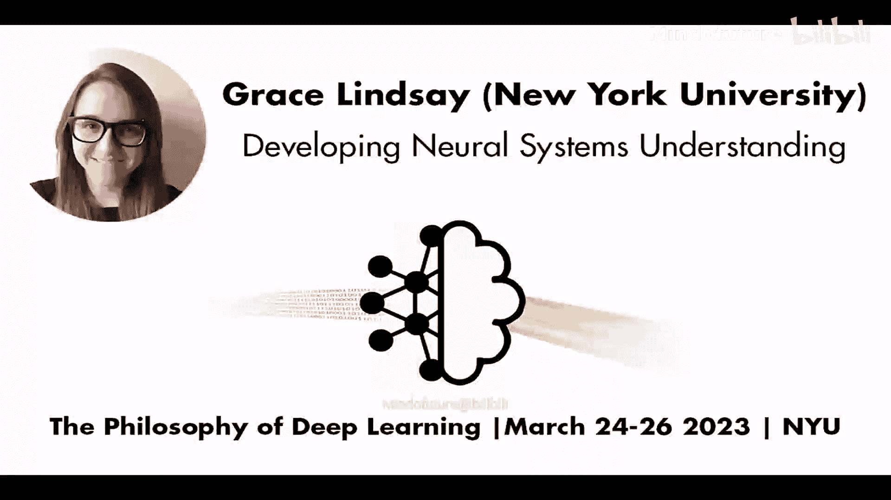
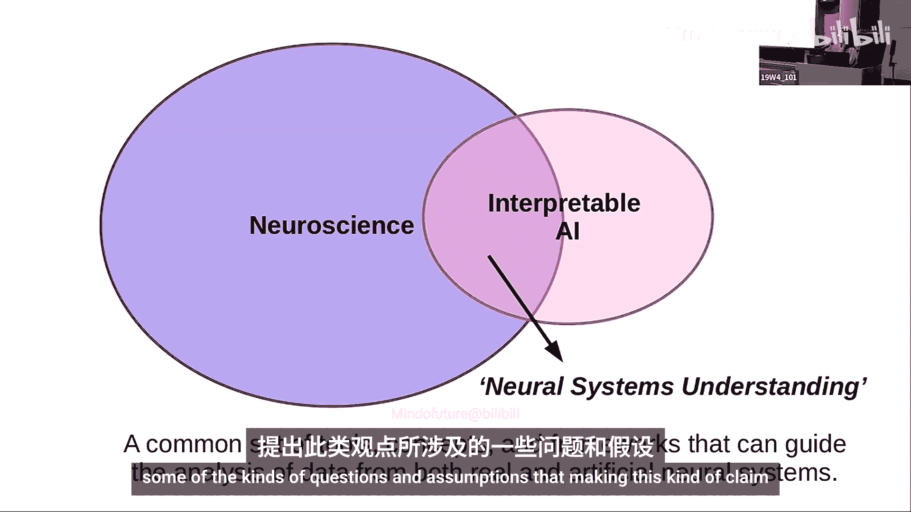
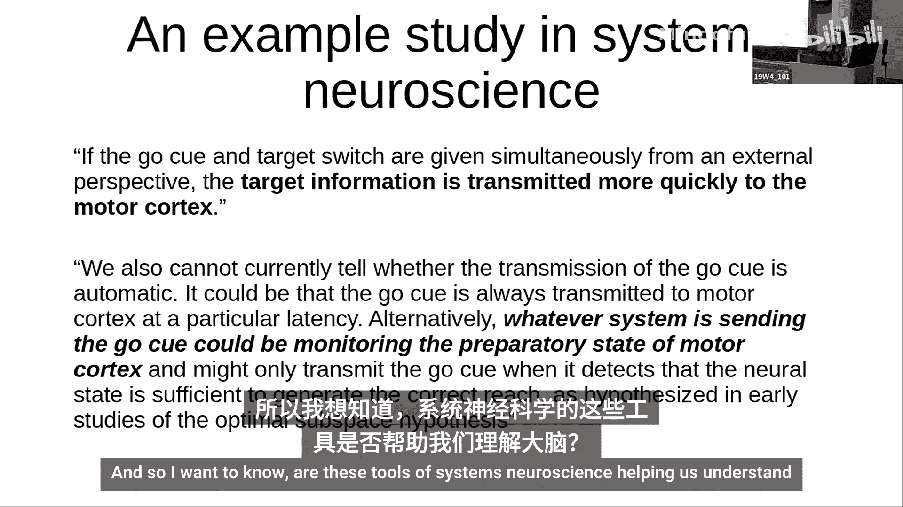
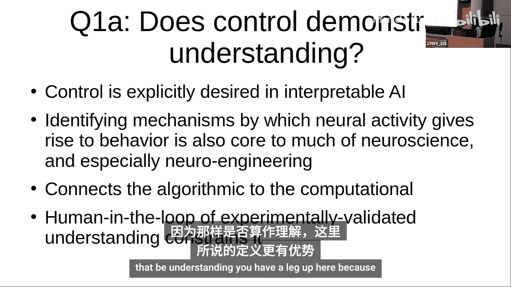
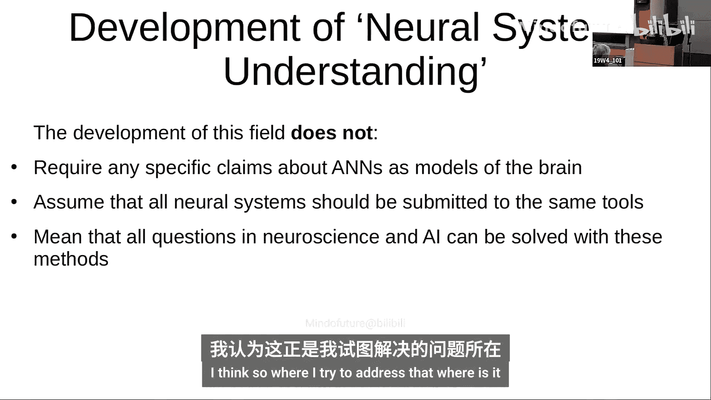
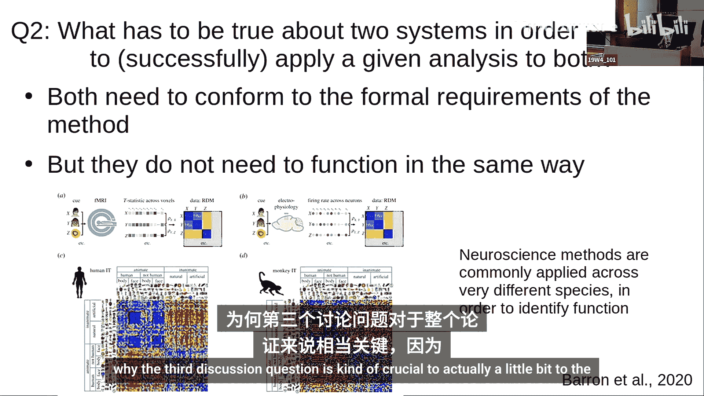
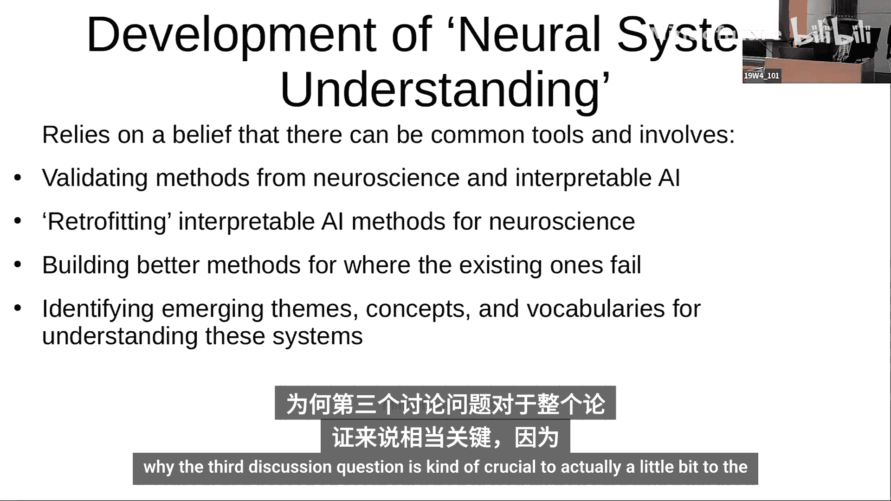
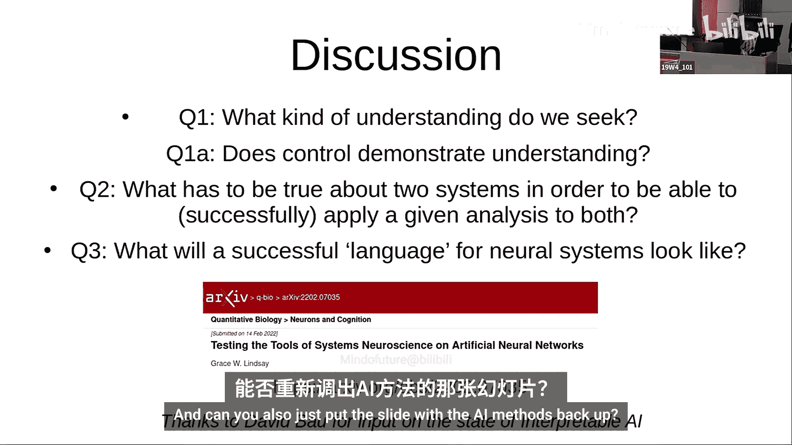
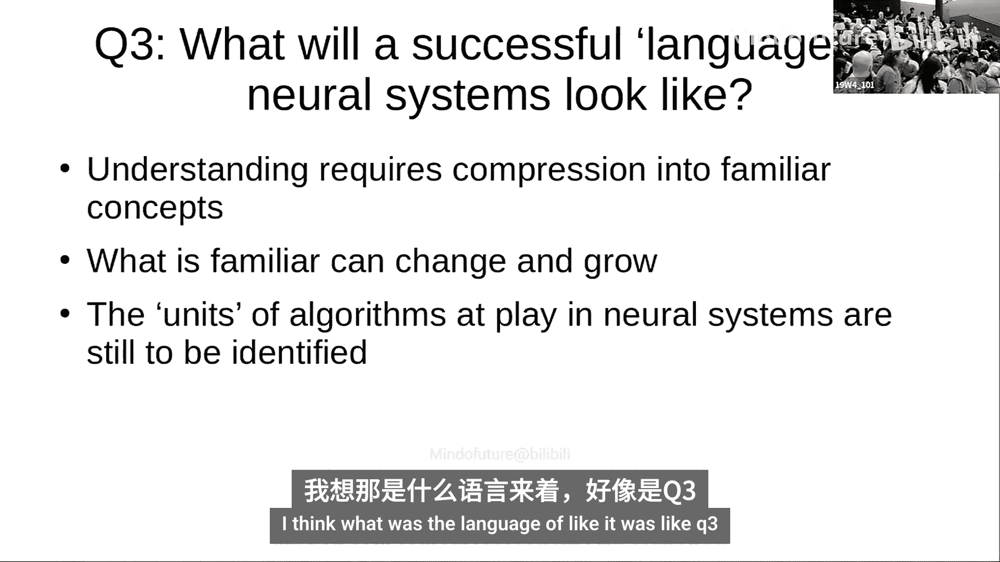
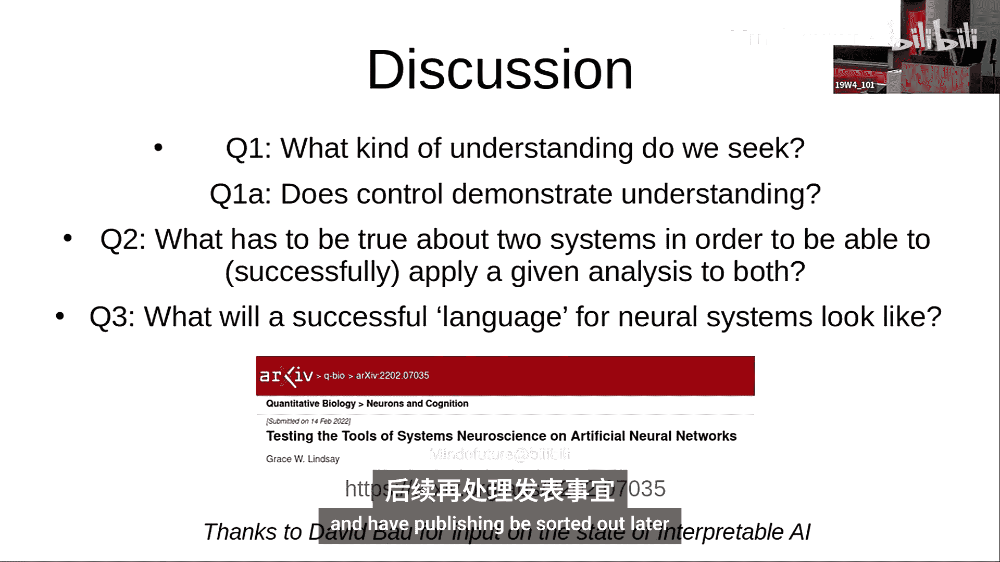

# 【纽约大学】深度学习的哲学 ｜ Philosophy Of Deep Learning 2024 p08 P08_Grace_Lindsay_发展神经系统理解-深度学习哲学 -BV1u7ZoBnEAb_p8-

We now have the final lecture before a final symposium of the conference。

 and it's my great pleasure to introduce Grace Lindsay from NYU who will talk about developing neural systems understanding。

 please join me in welcoming Grace。Yeah。Hello， okay， thanks。Yeah。

 so I want to start off by kind of very clearly situating the work that I'm going to talk about because I think it differs from what we've been seeing so far in that it's more maybe philosophy of science than philosophy of mind。

 or maybe it's not philosophy at all depending on how strict you are I am myself not a philosopher by training。

 I'm a neuroscientist and so I want to start off by thinking about the field of neuroscience。

 which has been around for like 100，200 years depending on how you define it。

 and it's been trying to understand brains and peripheral nervous systems and trying to understand how those nervous systems create behavior。

A more recent field is interpretable AI rapidly developing。

 but definitely not as old as neuroscience and not as big as neuroscience。

 but there is some interaction between these two fields already right so we've already seen some examples of some analysis of artificial neural networks that had a flavor of maybe things that have been done in neuroscience and there's certainly been the goal of trying to compare these systems and saying if they function the same way or what are their properties and that sort of thing and there's also the big spec of psychology and cognitive science which we've definitely seen a lot of which interacts with all of these fields and their intersection but I'm going to focus more on neuroscience in particular and the interaction between neuroscience and interpretable AI and basically the claim that I'm making is that these two fields should come even closer together and they should explicitly develop a unified field of neurosytems understand。

And so what that would be is a field of study that develops a common set of tools。

 concepts and frameworks that can guide the analysis of data from both real and artificial systems。

 and so in this talk I'm going to kind of you know give motivation for this。

 give support that this would be a good idea for everybody involved and talk a little bit about how to actually implement it and also talk about some of the kinds of questions and assumptions that making this kind of claim entails。

Okay so I wanted to start by actually walking through kind of what people in neuroscience do。

 you know what what are the analysis methods that neuroscientists use。

 how do they study neurosytems and so I chose this paper from 2014 the neurodynamics of reaching following incorrect or absent motor preparation because I think it's not anything super specific about this paper I just think it's representative of a set of analysis methods and a set of a style of interpretation that is common in many areas of neuroscience especially recently。

😡，So the goal of this study was to see how the activity in motor cortex changes in different conditions of reaching so there's a macaque who is trained to reach in different directions with their arm and the kind of trial structure here is that they hold their arm in the center of the field and then they are given a target location so the target comes on and that tells them where they will need to move their hand they're not supposed to move it yet。

 there's a delay and then they're given a goQe that tells them to actually go ahead and execute that movement and so that's kind of the basic trial second line on the bottom here is an alternative version of this trial which is that instead of being given the goQe after a delay they could actually be told no wait don't go to that location go to a different location so the target switches and then there can be another delay and then the goQ so in that case。

They would have prepared for one movement and then they would have need to make a different movement instead and in both of these delay periods you can vary them so that there's essentially no delay so the goQe and the target come on at the same time or there can be very long delays up to a second in between when the monkey is told where it will need to move and when it's actually supposed to make that movement so that's the structure of this experiment and the authors of this study recorded from neurons and motor cortex during this experiment and so when you do that you get these kinds of data which is the response of individual neurons over the course of these trials and so you can see they're aligning the neural activity according to these landmarks in the trial of the target is on and the goQ is on and the movement actually happens and they're representing what the neuron is doing in terms of firing rate which is very common you know the number of spikes that a neuron emits per second and neuroscientists have spent decades trying to under。

Stay on plots like these， basically looking at these plots of individual neural activity in response to different stimuli or as the animal produces different behavior。

 and there have been works that try to classify， you know that we have neurons that do this kind of thing。

 we have neurons that do that kind of thing and just generally trying to make sense of what the neurons are doing to try to understand how the brain processes inputs or produces outputs。

Somewhat recently u。The field of neuroscience has kind of realized that hey。

 this is pretty hard to do to look at a bunch of individual units and their activity over time and actually try to say something useful and interesting about them and so there has been a switch especially accompanied by increases in the technology available for recording neurons where now you know you can be recording thousands of neurons would make an individual neuron approach even less feasible so there's been a big shift to using dimensionality reduction for looking at neural activity and so in most cases in this case you just perform principal components analysis on your neural activity of the entire population and so instead of having to think about neural activity in you whatever 100 or 200 neuron space that you have you can reduce it down and plots like these where you can look at the activity of the entire population in about three dimensions and so in this particular study again what we're thinking about here is how the motor cortex prepares。

Exs movements and so you can see that there's a baseline sorry I don't know how to get my cursor to be on this screen we go so you can see that there is a baseline location in the neural activity space that the neural activity starts at at the beginning of a trial and we're going to first look at the gray line which is a normal trial where the monkey does not have to switch the location that it's going to and so in that case after the monkey is given the information about where it will need to move after the target goes on the neural activity moves to this location in space and this is called by people in the motorcorex literature a preparatory state because the neural activity that neural activity is specific to that movement direction so movie the monkey was told it needs to move right it would go to the preparatory state associated with that and you can see that there's kind of squiggles there meaning that it hangs out there for a while over time waiting。

For the goQ to come out so it goes to that location it hangs out for a while and then the goQ comes on and then you see this pattern of dynamics that the population executes that's associated with actually making that movement and you can see when the actual movement is occurring by the motion of the arm and so that's what happens in the normal trial and then what happens in a switch trial is that let's say in this case the monkey was told it will need to move its arm to the left so it goes to the preparatory state associated with left then instead of a goQ it gets another target that says oh no wait you actually have to move to the right so it goes to the preparatory state associated with the right and then a goQ comes on and it again executes that same movement so that's how you read these kinds of plots。

😊，And what this study was you know the main kind of finding from this paper was that actually you don't need to go to the preparatory state to make that movement and that was something that kind of previously had been put forth as you know you need to go to this preparatory state。

 it encodes the movement direction it's the initial conditions of a dynamical system you need to go there and then you execute the movement and by analyzing trials where there was no delay between the second target presentation and the GoQ they can see that you don't actually need to go to that preparatory state so in this case for the switch trial the monkey was told a first movement it was hanging out there it was then told a second movement direction but at the very same time it was given the GoQ so it actually go to this other place instead and do it right now and the neural activity completely skips the preparatory state associated with that second movement。

So that was the finding that was one of the main findings from this paper and I'm interested in the types of analyses that people do so this kind of dimensionality reduction the visualization and then also the claims that people make from it and so in this paper there's a whole section about how this offers an updated model of motor cortical dynamics and they even put like a couple little kind of cartoon you know diagrams explaining the type of model that they're thinking about and they say it's an enhancement and expansion of previous models and here model is kind of word model it's not a mathematical model they're just saying this is how we've been thinking about motor cortex and you know now we need to update our thinking about motor cortex as a result of these results and so specifically they talk about how you know we need to think about motor cortex is two different dynamical systems one that does preparatory work and one that does movement generation and you can kind of have movement generation even without the preparatory system so that's a kind of a takeaway of the paper it like we did this data analysis we had this high-dimensional data。

And now we've compressed it into this nice little story to update about how motor cortex works another important example from this paper is that in their analysis of what happens when you put the target and the GoQ on at the same time。

 they found out that if you look at the neural activity and motor cortex you can actually see information about the target in the neural activity before you get a that the GoQ has arrived and that the movement should happen so even though as the experimenter they gave this information to the monkey at the exact same time they can see in motor cortex that it doesn't show up at the same time there and so that was kind of a mystery to them and they posit that well maybe whatever system is sending the GoQ information to the motor cortex maybe it's monitoring it's looking at what the activity is in motor cortex and it waits for just the right time to tell motor cortex to go that's something that they offer as a possibility because in their data set they can't actually resolve this issue because they know that they gave it to the monkey at the same time and the neural activity is saying it's not showing up。

Same time， and so they have to come up with some possible explanation for this difference。Okay。

 so that as I said， you know this I think represents a lot of things that happen in neuroscience papers。

 you have highdisional dynamic data， you need to somehow grapple with it with something like dimensionality reduction。

 there's a lot of looking at the results and coming up with stories and updating previous stories based on those kinds of things and then there is also plenty of times where there's something about your data that you can't explain and you have to appeal to some unknown factor that isn't part of the experiment that you actually carried out。

And so I want to know are these tools of systems neuroscience helping us understand the brain was that you know example successful in helping us understand the brain and could these same tools help us understand artificial neural networks so that's kind of the basis of what i'm interested in and why i'm advocating for some kind of united attempt to address these questions so importantly if i'm asking if these can help us understand we probably need to give understanding some sort of definition or speak to what that would look like or what we mean by that。

😡。

And I'm sure you know there's plenty of background in philosophy about what that could mean and explanation and science and all of that again I'm coming from the neuroscience perspective。

 which means that we're going to talk about Mars levels。

 and so neuroscientists you know like to think about where their problem is situated in a Mar hierarchy where the first level is the computational level。

 meaning the goal of the system， so what is that brain area trying to do motor cortex is trying to produce breaches the algorithm is what the steps what steps need to be taken to execute that and then the implementation is physically you know what neurons。

 what parts of the brain are responsible for that。And so I actually like this diagram of it because this is labeling flight as the goal of I guess not the whole bird but part of the bird its goal is to fly。

 they're saying the algorithm is flapping of the wings and the implementation as feathers and I actually disagree with the way that this is broken down which I think is incredibly indicative of the kind of squishy nature of Mars levels so I would probably say that the algorithmic level is something like you know the control of the dynamics of the airflow and all of that and then the implementation is wings and feathers but if you define the algorithmic level at that more abstract in that more abstract way。

 then you can do things like say well airplanes use the same algorithm。

 they don't need to flap their wings to do it but it's the same principle that's causing flight as birds and so that's one of the benefits of kind of separating the algorithm from the implementation level is that then you can compare across systems that have different physical implementations。

But yeah， I would say that much of at least systems neuroscience is aiming for an algorithmic understanding。

 right？And I want to know be clear sometimes the word algorithm means a super precise set of steps and that's not really how it's used in this case。

 it's more of a simplified story that should offer some predictive ability。

 it needs to give you something but it's going to be lossy it is not the exact set of steps and the exact weights or anything like that but I would argue it should be a productive and accurate model。

 meaning you should be able to do something with it if you have that model that's simplified story you should be able to do something with it and really these things are tied together productive and accurate because if it's an inaccurate model you're not going to be able to do much with it but I think that that is important to keep in mind and that's going to drive how I'm operationalizing understanding。

😡，And so the specific way that I'm doing that is what I'm calling experimentally validated understanding it has a lot of overlap with what we've seen in terms of representations and how to prove that something is a true representation and so basically the idea is that you have some complex neural system and you want to understand how it works in some way and presumably on some sort of algorithmic level so you apply some sort of analysis to that neural system and that gives you this kind of simplified understanding you know you start with this big messy high- dimensionmensional thing and then you can pull out of it like okay I think this is the series of steps that are happening roughly that's what's going on and a lot of neuroscience paper stop there in the example that we just saw you apply the analysis to the neuros system you get this simplified story and you say great I made progress but to actually show that this analysis gave you an accurate and productive model of your system you need to follow up with some。

That show that you can predict and control the neural network as on the basis of the simplified understanding that you have on it。

So what I'm arguing is that basically to prove that an analysis method has provided the kind of understanding that we should be seeking is that you need to be able to devise an experiment based on the understanding that you got from that analysis method and that that experiment should be able to the outcome of that should verify your understanding and specifically I'm interested in a type of understanding that allows you to control the behavior of the system so for example you know modulating the activity in motor cortex and actually controlling the reach dynamics not just modulating activity in motor cortex and nothing changes in the output because I think the goal is to understand how these neural dynamics are related to behavior and so the test of if we have that understanding should be can we control behavior。

But that raises a reasonable question of does control demonstrate understanding I know there's a lot of you know debate about that and you know if you can train a giant neural network to control a system does that mean that you understand the system most people would say no but I have reasons to argue that this particular type of control that I'm advocating for does demonstrate understanding so to start I mean just to argue for this I guess is to just say that control is desired even if it's not understanding it is desired so especially an interpretable AI you know if especially if you're talking about applications and industry the whole point is we need to understand the system so that we can make sure that they're safe and they're reliable and all of these things and so you want to be able to control the system that is key to interpretable AI and also I would say neuroscience is pretty focused on understanding how neurons produce behavior produce intelligent behavior and so that connection is what you want to。

Get at and you have to be able to demonstrate that connection by controlling behavior by modulating the neural system and also it's especially important for something like neuroengineering。

 which is sometimes explicitly about controlling behavior based on on neuroscience principles I would also say that this is a desire you know a good definition of understanding because it does connect the algorithmic level to the computational again the computational level is defining the goal of the system what it's trying to do and the algorithm is supposed to implement the steps to achieve that goal so you should be able to fiddle with those steps and change what happens with the behavior of the system that's trying to achieve that goal and then specifically this definition that i'm arguing for I think it has a leg up on just kind of like you know if you trained a big neural network to control the system know would that be understanding you have a leg up here because。

Oops。Because you have this step where you have to kind of have a human in the loop that's coming up with a simplified story and coming up with an experiment。

 so there's a compression bottleneck there that it has to pass through a human in some way now this could still be like we saw you know somewhat complex nonlinear decoders that humans apply and then they modulate the neural activity based on that but there's still some way in which a human is coming in and saying these are the features that seem important and this is how I think the network needs to be modified。

😡，Okay， so in practice， experimentally validated understanding is very difficult in neuroscience you know in the motor cortex example。

 they're claiming that this you know location and the population activity space means something about the preparation of the movement and certain circumstances and all of that and to verify that you would need to be able to modulate kind of the full population of neural activity in motor cortex in very specific ways on you know pretty fast timescale because there's also the dynamics involved and just generally it's not feasible to perform really precise well-controlled experiments in neuroscience because of the technical limitations in modulating the brain。

So that means that it's not practical to evaluate our tools using brains we're not going to be able to know if our tools are giving this this kind of valid understanding by just relying on kind of observationalish studies of the brain that don't have that next step of validating the simple model that you got。

And so I think that we should do a very large scale test of tools of neuroscience on artificial neural networks okay so basically the plan would be you pick a method from neuroscience you get a bunch of different artificial neural networks or different architectures trained on different task trained in different ways apply that method to those networks you'll get some sort of simplified understanding from the application of those methods possibly and then you close the loop by following up with an experiment that should allow you to control the artificial neural network right and then if you do this across many different types of networks you can get a broad understanding of if this tool reliably provides what we want out of these tools essentially so this is it's like a metascience question it's not really about the systems themselves it's about the tools I'm asking a question of is this tool useful and this is how I want to answer that question by testing it on a bunch of different artificial neural networks。

And the reasons that artificial neural networks are great for this you know as I kind of alluded to in opposition to the brain。

 they are fully perturbable which is great， you can do almost any experiment you want you can change neuro activity。

 you can change connections you can change things about how the network was trained or what data it's to see you can do any kind of experiment of showing it things it wasn't trained on all of these kinds of things it's a dream as a neuroscientist it's a perfect it's an ideal environment for doing neuroscience experiments because you have none of the technical limitations that you do on actual animals and so that is really important for getting this verification that the understanding that you have is correct and then also they're fully observable so that influences the analysis that you would apply because you know as I said in like the motorcortex example I think that paper has like 200 neurons there's a lot more neurons than that motor cortex and there's a lot more neurons than that in the brain and so as that paper showed you know they had something they could。

Understand and they had to appeal to this unseen third factor you don't get that out in artificial neural networks if you can't understand what's happening it's because you missed it you have all the data it's there it's in the network if you can't get it that's on you and that's on the analysis method it's not due to any limitations of the data and I think that's really important too that you don't have those those prepar to say this is why I can't explain what's happening everything you need is in that model and you can get it。

😡，And then the other element of artificial neural networks that I think makes them a good test you know in opposition to something like simulated data。

 you know sometimes when people build a method， they simulate some data where they know the kind of correct answer that their method is supposed to recover and then they apply their method and they say。

 hey， looked it recovered look it recovered the correct answer and that's great that means my method works。

That has you know its uses， but I think the fact that we don't understand artificial neural networks on the algorithmic level that well is actually great for testing the tools we want to apply to the brain which we also don't understand because if you already know the answer it's hard to say for certain that this method got you there you can be a little kind of tainted by already knowing the answer and also just even knowing the shape of the answer is going to influence your search when you don't know the answer at all you have to define what success looks like and I think that's really important and something that neuroscientists don't speak super explicitly about of what are you actually trying to get out of this and is succeeding so I think that that ignorance is actually good in artificial neural networks。

So to make it a little bit more concrete this is just a list of some of the methods that could be tested from neuroscience on artificial neural networks we've seen some of them again like dimensionality reduction latent factor modeling。

 lots of different things related to representations representational similarity representational geometry there's also like network neuroscience which is more about connections and I don't know that we've been thinking about that so much but more about activity and yeah there's also a ton of a whole zoo of very specific models that were sorry specific methods that were developed for like a single paper that wanted to apply them and so there's really just a lot out there that you can pull from and see if it helps you understand artificial neural networks。

😊，Okay so so you know to summarize this part i'm claiming we should take the tools from neuroscience and test them on artificial neural networks now technically that answers the second question。

 not the first right that would tell us that these tools help us understand artificial neural networks does that tell us that they help us understand the brain and this is where things get a little bit more subjective maybe a little bit fuzzier and so really the question is what has to be true about two systems in order to be able to successfully apply an analysis method to both and this is something that I don't think you know is spoken of explicitly very much you know what is this relationship here I don't think that we really have a word for anything like this you know it's kind of like how in some cultures there's a word for the parents of two people who are married like they get their own special relationship in English we don't have that word you know we don't have anything that really tells us what is true about these two systems if it's the case that a given analysis method works on both of them。

And you know you can say like this is maybe a bit of a bland problem to have like you know does this question matter or is it media in any way and you I think when I frame it like this。

 it doesn't seem maybe that interesting but to adapt a quote that Rosa used yesterday。

 if it were hurricanes and pandemics， people would be fine。

 but you replace it with artificial neural networks in the brains and everyone loses their mind because at least coming from the neuroscience perspective。

 people who are fully neuroscientists， if you ask them this question of what is the relationship between artificial neural networks in the brain。

 they have a lot of thoughts， some people are you know really gung ho about that。

 some people are like get this out of my field， this isn't helping anything and so this question。

 this particular question has a lot of weight on it that can influence in my experience people's willingness to accept that this program of testing the tools could actually be helpful。

So what does need to be true of these two systems in order to claim that we can apply the same tools to them？

So obviously they both need to conform to the formal requirements of the method so if you're using some statistical tool that says this tool is only well behaveved。

 if your data is normally distributed then fine they both need to follow those formal requirements but I would say that the formal requirements of a method are a very small minority of the kind of unspoken things that people assume need to be true about a system to apply an analysis method and that by doing this exploration of testing these tools we might actually make some of these implicit beliefs more explicit kind of argue why do they think a method can work on the brain and not an artificial neural networks or in the opposite direction so I think there's the answer to this question you what needs to be true。

 there's the very simple answer of simply you need to follow the rules of the method and if it strictly meets all the requirements then you're fine and that's the only thing that you know these two kinds of systems have in common but I think there is a lot more going on there that。

Not talking about。And to prove that I would point to the fact that neuroscientists will apply the same method to vastly different species and be totally fine with it so things like dimensionality reduction these kinds of you know somewhat hypothesis neutral methods in particular people you can see them applied to sea eiggans to mice to monkeys to humans and there isn't a sense of like oh those systems work differently so we can't apply the same method to them so it doesn't need to be the case that artificial neural networks work like the brain in order to apply the same analysis method to both of them but when you bring up the relationship between artificial neural networks in the brain people immediately go to well do they work the same are they are they the same is an artificial neural network a good model of the brain and I want to point out that that's not what has to happen here so if you know a mouse is a good model of the human brain we can ask that question too but we usually don't ask that question。

And we see the same analysis method applied to both and people also sometimes say。

 you know oh they don't need to be implemented the same way but they need to function the same way。

 they need to be performing the same algorithms essentially。

 so sometimes people point to the fact that you know some people are okay with convolutional neural networks as models of the visual system even though they're not physical neurons and all that but they are not okay with them as models because convolutional neural networks have a texture bias instead of a shape bias。

 but the way that you know that a convolutional neural network has a texture bias instead of a shape bias is by applying the same analysis methods that you did to the brain。

 so even if they're implementing different algorithms。

 the whole point of the analysis methods is to recover those algorithms and so it shouldn't be a problem that they're implementing different algorithms。

Okay so yeah so we have this kind of pool of things that can all be subjected to the same analysis and I think it's a little vague as to what needs to be true about all these systems to claim that they can all be subjected to the same analysis but i'm going to point to some features of both artificial neural networks in the brain that I think are relevant so both high dimensionmensional have hierarchy recurrence in them they're nonlinearar they can be distributed or modular or somewhere in between they are both task optimized using different processes but they both are trying to achieve some sort of goal or behavior and they're both information processing systems and I think all of these features make them hard to study I think that's what that's why we struggle is because there's this network is achieving some kind of goal but it's doing it in this weird complicated distributed way but I think that these features because they're in common we should certainly expect to be able to find analysis methods that can be applied to both systems。

Okay， so to actually execute this development of this field。

 as I said we need to validate methods from neuroscience。

 but we should also be validating methods from interpretable AI。

 so some methods from interpretable AI are directly kind of aligned with this experimentally validated approach and that they try to control the behavior of the network but not all methods from interpretable AI do so even those methods would need to be validated by the same procedure and then to truly make the field kind of unified and productive across these boundaries。

 we would probably need to kind of retrofit some of the interpretable AI methods so that they could be applied to neural data which has way more constraints and difficulties associated with it so that would be another step and then hopefully you could identify the ways in which these current methods fail or don't work so well and use that to build better methods。

And then as a kind of overarching goal， if you do this for long enough， this kind of joint procedure。

 you should be able to identify some themes and concepts and a vocabulary for describing these systems that I think that we're missing at this point。

Okay so what just to be super clear what what does this not mean to do this kind of work it doesn't require any specific claims about artificial neural networks as models of the brain separately。

 I love artificial neural networks as models of the brain but you don't have to agree with me on that at all for this it does not assume that all neuralsyems should be submitted to the same tools it's about identifying which tools are good in which circumstances maybe the architecture of the network you know influences the types of tools you need to understand it that's fine and it doesn't mean that all questions in neuroscience and AI will be answered by these tools there are people in neuroscience who want to know about ion flows and individual neurons and all of that kind of thing and that's not really the level that we're targeting here but I assume there are enough questions in both of these fields that people do want answered that it's worth it to have them come together and try to do this。

Okay and so you know as I showed in the beginning these fields are already a little overlapping there's a little bit of the methods from you know neuroscience in AI I would argue that neuroscience is paying less attention to interpretable AI but there's a little bit of interaction so why do we really need to go through the effort of like making this a unified field where like people could say I study neuralsys and there be conferences where people are studying the brain and artificial neural networks is there a reason to more explicitly unite these fields so I would say that there's a benefit from crossing disciplinary boundaries I wrote a book essentially about the history of computational neuroscience that's filled with examples of what can happen if people with a totally different background put their eyes on an old problem in a different field you get really new ideas coming out so I think that's definitely a reason to encourage more explicit interaction and also it just widens the zoo of neuralsy that you can study and hopefully identify kind of common patterns and abstractions in or provide。

certaintain proofs of concept， that kind of thing I know you there are things that people assume about the brain that artificial neural networks have shown don't have to be true about a neuralination processing system and then you specifically how will the two sides each benefit so neuroscience will benefit from the rapid prototyping as I've talked about you can do all of these experiments super quickly super completely and you can do that in artificial neural networks AI I think will benefit from the fact that the types of systems that exist in biology are still pretty different from what exists in AI so we've talked a lot about language models we haven't talked much at all about bodies and the fact that people exist in a body or organisms exist in the physical world and need to control bodies and what constraints is that put on a system and how does that help you understand it and also the fact that that biological systems are evolved you know sometimes the way that the networks are trained is considered perhaps a liability or influences how you understand them so just giving us that broader set of neuralsys to study。

could be beneficial for both sides。But honestly， it's neuroscience that would benefit the most。

 I think。And so I feel some kinship with Rob because the field that I come from in my opinion is not delivering you know as I said neuroscience has been around for over 100 years。

 I really thought that when people developed artificial neuralsys they could come to us and be like we got to figure out how these work and as neuroscientists we'd be like okay you want to know that about your neurosy here's the tool that you should use and we've have a nice little recipe book for how you understand your neurals system and we don't we're not we're not really hitting that goal despite all the time that we've had with it so from my perspective neuroscience stands to benefit a lot from getting more people and more techniques involved in trying to understand neuralsyems especially you know the artificial neural networks you have the benefit of being able to do like truly impossible things in the brain you can take gradients and all that kind of stuff there's not any analog to that in the brain and so。

Interable AI they have a wider tool set available to them i've already been impressed by what people are doing there they're really like off and running and so yeah I want to believe that neuroscientists should be able to help there but if I'm being totally honest this I think neuroscience is going to benefit more from this relationship。

Okay so I've been claiming you know that this synergy and this effort should kind of lead us to new ways of thinking about neuralsys。

 which implies you know that what we have is inefficient or insufficient and I think that's definitely true it's what I hear from neuroscientists is that they feel like they don't have the right vocabulary to talk about high-dimensional neuralsys and how to study them and so I think we need to ask what would a successful language for neuralsyems look like so I think you know there's a lot of trends in looking at what understanding means that talk about compression and you know you need to be able to explain this new thing in terms of already existing concepts and familiar ideas and so that makes sense but I think it's important to remember that what's familiar can change you know if you think about the history of education in mathematics like concepts that used to only be comprehendible to the most advanced people in universities are now taught in high school。

And we can all use them as the basis for even more complex things just look at also the diagrams of artificial neural networks and machine learning papers you just have like a little block that says transformer and we're like okay but like that itself is like a crazy complex thing and yet we're able to build understanding by abstracting in a way things that weren't familiar but become familiar so I think we will need new kind of units to discuss the algorithms of neural systems in and I don't think that we have a good vocabulary for that at this time and I think that that's holding things back a lot。

We also have to note that some people would argue that this isn't possible that achieving this algorithmic level of kind of looking at the representations and an activity in a neural network。

 you're not going to be able to say anything productive about that and particularly you know the argument is that the way you understand a neural network is that you know its architecture its objective function and its training algorithm and the data that it was trained on and that's how you understand it and you don't try to do anything more than that hopefully you know in an optimistic way disagree with that。

 I am a co-author on that second paper but I don't necessarily think that the goal is completely out of reach。

 as I just said on the previous slide I think it requires a reframing and you know this idea that you're going to understand what a neural system is doing in terms of like concepts that we all learned about as like five yearear olds。

An edge and square and stuff like that I don't think that that's going to hold but I think we can still develop concepts that can form the basis of an algorithmic understanding in neuroscience because really what this you claim is saying is that there's simply no way to compress a neural network it simply is what it is and there's nothing that you can say about it that isn't just describing the entire system and that doesn't seem right kind of theoretically but it also doesn't seem right empirically because we have know algorithms that try to take a trained neural network and make them smaller so they can run more efficiently so there's compression that's done there or you know trying to extract the rules that generated weight even if you don't have to train the whole neural network there are efforts in machine learning to show that you can represent a trained neural network in a more simplified way and those could even be inspiration for how we choose to understand them。

Okay， so I just want to summarize， I am claiming that neuroscience and AAA interpretable AI。

 they both aim to make sense of how neurosystems create behavior and so we should unite them in a way that is hopefully synergistic。

 I think synergistic and the focus should be on testing out tools on artificial neural networks so that we can rapidly determine if they have this kind of experimentally verified understanding。

 but it will be hard because we kind of need to develop completely new concepts for these distributed nonlinear recurrent hierarchical systems that it's not intuitive for us to grasp。

Okay， so I just wanted to kind of summarize the questions that I've been posing throughout here。

 some of what I've been talking about is available on this archive paper。

 and also thanks to David Baau who works in Interable AI for helping me learn about the state of the field。

Yeah。Thank you。For once， I just want to start with questions from the backup audience。

So we have one here。嗯。Hello， thank you so much for your talk。 Yeah。

 I think the main question that I have was。😊，Yeah， a lot of these sorry it seems like there's a lot of these like hand wavy similarities like oh being high dimensionmenional and it being like non nonlinear and I'm curious if these actually translate in practice。

 I assume that there are or have already been many neuroscience inspireds interpretability to ask things that have been tried on artificial neural networks and historical literature looking into this and I'm just curious what you found in your literature review and looking at previous attempts what has failed or succeeded。

So yeah， people you know are definitely using methods that I don't know if they are directly inspired by neuroscience but are common to neuroscience applied to artificial neural networks。

 so the reason that I am so focused on this being like a test of the tools that you want to empirically validate the tools is because even if you see examples of you know this method was applied to this network。

 if you don't have a unified way of measuring success。

 you can't really make a claim about how well it worked and if you don't also show the examples where someone tried to apply that analysis and it failed and they didn't publish it。

 you can't really say anything about that method， so you can find the examples of somewhat success。

 like people apply the method to an artificial neural network。

 they found the results interesting and useful enough to publish a paper on it。

 but that's not going to give you like the actual empirical sense of how good it was。Yeah。

 so I think actually the stuff that we saw so some of the papers that people have been showing David B is a coauthor on a lot of them。

 so for example like the othello example and changing the representation of like Seattle and the space needle like there's an example where you can say the space needle is in Paris and show that the network goes on to believe that like that kind of thing so I think those examples they usually involve like some complex nonlinear probe and then using that probe to change the representation in some way but those are really good because they build in this know sense of validating your understanding by actually being able to control the model so those I would think are the most successful and again I don't know if these probes are directly influenced by neuroscience but certainly neuroscientists try to read out information in different brain areas and make claims about how the brain works by doing that now interestingly neuroscience does usually focus more on linear probes essentially because if you do。

You know as has been discussed， if you do enough nonlinear computations。

 you're simply replicating like the rest of the brain， you know。

 if you there's a way to do a nonlinear analysis on the retina that gives you IT cortex that gives you object recognition because that's what the system is it's a nonlinear system so neuroscience then tends to focus on linear systems which maybe is restricting their ability to actually control these systems whereas these nonlinear probes seem to be working better so maybe neuroscience needs to grapple with that。

Yeah thank you Grace， you said that we can note the that's experimentally a model。

 but in my mind as I know from computation neuro I again and I'm sorry I bring it all the time you can have predictions that you can go and look in in the brains you can have predictions like oh if you disrupt the neural feedback you will have this result and you can go and do it in the brain or if you block the receptors of adaptation spec of adaptation you can have another effect or many exampless from from the physical realistic neural network models so I was wondering why why what do you think。

😊，Shouldn't we focus more into making the AI more about physically realistic than trying to apply the tools and why you think or I suppose you maybe you think both are valuable。

 I was wondering whether you think the other ways more difficult or something and in the end。

 you also do all the tools can apply in many many systems。

 physical systems that have nothing to do with the brain。

 so trying to get a connection after you have the same tools in different systems between the systems。

 it will maybe create a problem that you have systems like I don't know， molecules， take Algo。

 doest mean that if you apply the system， the tools to them， what you find it will be like the brain。

 you know you do climate science version。Yeah so so the first part about you know you can make a prediction and then you can go in and test that prediction that's like the you know ideal description of what you can do in practice though the ability to modulate neural activity in a real brain is very difficult and you can do an approximation of what you would exactly want to do but then if it comes back that you know you weren't able to predict the outcome of your experiment。

 you could say oh well it's because this method wasn't doing the exact test that I needed it to do you know it's too coarse or something like that and so when you have those unknown factors you can always appeal to those is an explanation for why you can't understand your system and so that's why I think you need a system that you can fully observe in order to truly explore these methods I think your second two points are related because the idea of putting biological details into to neural networks love it great I like it for modeling the brain but for this project I like it because it would expand the types of system。

That you can test these methods on so you can try like a more vanilla neural network。

 you can try a neural network that has a bunch of biological constraints and you can see if a method helps you in one system or the other。

 because the thing that neuroscientists sometimes say if they can get past just the sheer like artificial neural networks aren't the brain if they can get past that for a second they seem to have an intuition that the brain is easier to understand than an artificial neural network and that feels bold and if that's the case I would love to know why I would love to be told the details about the brain that make it easier to understand than an artificial neural network and then I want to put that in an artificial neural network and see if it's easier to understand so I think that goes hand in hand if there's something about the brain that makes it easier to understand that would help interpretable AI a lot we could train real neural networks that we use in the field with that easier interpretability and then it would also help us study the tools that we use to study the brain。

嗯。Oh hi well thank you that's quite interesting and I was very interested in your explanation regarding question two about like comparing two systems and I'm curious about a point that you mentioned towards the beginning when you could choose different types of ANNs and architectures and then aggregating results from them I would imagine one challenge that would emerge has to do with choosing the types and architectures of ANNs and also aggregating results among them because in practice there will be noise and they might not be the same so how did you choose the models and how did you aggregate the results。

Yeah so I think you know you would for any given method there will be you know the method will be designed in some way to be more applicable to certain questions or types of systems than others so you'd want to pick the models that represent you know how the method is normally used in neuroscience if you're pulling from neuroscience so so that's how starting place for deciding the methods given those constraints though I think you should be as diverse as possible to get like a full sampling and then you can maybe see some trends in that that help you understand when that tool is most useful and in terms of kind of aggregating across networks in this paper I have like it's still pretty handwaavy but like an approach to that which is basically like you can apply the method and you know first step is it doesn't even give you interpretable results let's say you do PCA on your neural activity and there's not even any pretty lines to look at and talk about like it's just a big jumble mess so that ends there you know there's nothing you can get from that the second stage would be you get a nice interpretable。

Result and it gives you an intuition for how the system works you feel like you've gained understanding then you actually test that understanding one outcome is yes you gained understanding you can control your network now great or you felt like you understood it but it actually didn't help you to control the network and I'll say in my experience analyzing neural networks that's the most common path I feel like I gained something I try to actually verify it and it's like oh no that's not how it was working so I think that kind of way of dissecting you the success of the method is at least a starting point for this now there's a lot of subjectivity because it'sre basically just doing science like you have to come up with a hypothesis and implement a test of it and all of that but you know it's at least something。

Hello thank you Grace it was a great talk I just had a question about maybe I guess when you started you one of the motivations of the work is to be able to validate the tools that we have in neuroscience itself right so we are trying to find out what is the relationship between neuralactivity and behavior we have all these tools we don't know we don't have how to actually validate the model itself because of all the complexities can you suggested that we go to the artificial models to the artificial neural networks and we use the neuroscience tools。

And let's say that you used then you see they work I was just wondering how would you go back to brain and say that it's a good model to brains unless you already accept the relationship between brains and the artificial neural networks is well of singularity because at the conclusion you say like oh we can do this with how assuming what the relationship is but then I just don't see how could you go from the to the brain with how the relationship so so yes this is a common concern that the way that they perform on artificial neural networks will not tell you whether or not they're good on brains I think so where try to address that where is it I would say that they share these features is something because at least from my perspective and I think most of systems neuroscience these are like the facts of the brain that you're grappling with and so if you're studying a system that has all of these then you can believe that possibly。

That an analysis method that helps you tame all of this will work if it's artificial or if it's not the claim that I'm trying to make that they don't need to be similar is a little bit more specific like they need to share these features but you don't have to prove to me that this convolutional neural network is the best predictor of visual neuron activity in the Macque in order for me to want to test a tool on it because again you know neuroscientists use their tools on systems that they don't believe are that similar at all and they still accept that as valid and you still see inspiration like a method that was developed in larval zebrafish could still be applied to fMRI data and people wouldn't you know throw up their hands and say this isn't going help us so so I think it's not perfectly defined level of similarity it's a vaguer sense of there's something in common here that the analysis methods are trying to get at but I think it at least doesn't mean that they have to be exactly identical。

Hi Grace thank you for the extremely thoughtful provoking talk。

 I guess I have a twouppart question so I guess the first one is in your literature search was there a interpretpreable AI method that you really liked and think this provides a level of understanding of artificial neural networks and then the second part is if you've came across this notion of mechanistic interoptability which is like I guess championed by Crisola and kind of studies ANNs in terms of things like semantic neurons。

 circuitottifs and whatnot what are your thoughts on this way of understanding ANNs。

Yeah so for the first question I'm going to go back to what I said before which is that I think a lot of David Bau's work of actually manipulating representations that change behavior is like you know I see that and I'm like that's what we need for sure you know I've also been influenced by kind of earlier methods of interpretability like visualization of features and all of that but those you know because they're not demonstrating control there's a lot of you know concerns that people have about what does this really mean what does it showing us how arbitrary is it and all of that and so by demonstrating control you're just getting rid of a lot of concerns and then so the mechanistic interpretability stuff yeah I think so I might not be like remembering it all perfectly so maybe ask me later after I check by getting with it but I mean I love like the work that Chrisryola has been doing I think maybe compared to what I'm talking about that's a little bit more kind of prescribed in terms of what。

You're looking for like what level you're saying you want the explanation to happen on。

 and I may be a little bit more you know open to all different kinds of concepts and ways of understanding as long as they can demonstrate control。

Thank you so much I absolutely love the talk first I wanted to say in the case of industry AI many of them are actually able to either imitate。

 interact with humans or serve human goals so in that way comparative applications of methods quite common in fact and that's why a lot of people with these kinds of trainings get hired in industry AI some examples include neuroinspired manifold acrobatics like similar to the stuff that you're showing to analyze Xbox human game data and then use that manifold as an objective function to train AI instead of giving it reward for or defining objectives another example is building behavioral test for deep MBRl like planet like dreamer and showing that for instance。

 they don't show they don't pass simple modelb behavior that humans pass so I've seen both successful applications in deep learning in papers that are nerves and ICML and everything that direct inspiration is used and cited from。

and cognitive science What I did want to ask you is whether you think ANNs could be used as an intermediate step to understand larger neuralsys。

 whether it's human brains or whether it's a large language models because that algorithmic level of abstraction that you were talking about we could actually not compare ANNs and humans only but having validated that ANNs can be used to understand some things about human brains maybe can use this as an intermediate to both larger language models and brains that are just much less understandable or mal than ANNs are so what do you think of this particular case。

 which is ANNs as an intermediate for all of these larger neuralss so you're saying like like kind of a toy ANN model like you wouldn't study you know ChadGT3 directly you would study some smaller in order to study Chad GPT we use ANNs the same way we use ANs to study brains in terms of like I guess people use ANs a few different ways to study brains do you mean like build a model。

the manifold and then try to understand how some process could be happening for some higher level of abstract representations。

 for instance， as we do in humans， but apply the same thing to larger language models。

 but using smaller anNNs as an intermediate。Yeah it certainly seems like something you could do yeah yeah I definitely see why that would be an approach。

 I guess in my like personal experience trying to use like smaller less constrained models in a way they can be harder to like make sense of and relate to things because you know like if you use a model trained on MNIS like you can solve MNIS with basically random projections almost and so the model isn't constrained enough to learn something useful versus like a giant artificial neural network so I just if the model you're using to be the stand in like the small NN is too small or not representing the full complexity of the problem。

 then I just think you know that it might fall apart there。

Represent the exact level of abstraction you're trying to explain not just for it to solve the task。

 but very hypothesis driven approach that you're you just using the N let's say to understand the different kinds of personas that emerge out of LLms or different modes of operation that emerge Okay yeah so but then do you view that as kind of。

Understanding， I mean， maybe this isn't a separable thing。

 but do you view that as understanding the way that the full system works or do you view that as understanding like the space that the full system learned？

If that makes sense in case of large language models we want both right so I would say for both it can be used depending on but I'm just saying the same way that we are using these models to understand better what's inside human brains 100 billion neurons the same way we can use these models as a proxy and they're not used the same way in all of the experimental approaches in neuroscience。

😊，Yeah。😊，Yeah I just wanted to follow up on the earlier question about whether you can say both these things at once like one they don't have to be models of each other in order for the same tools to work。

 but also that there will be systems that are different enough that you can't apply the same tools to both of them so it seems like one thing you might say is that the right relationship between the。

bewe systems where you can use the same tools is that they can both be helpfully described at the same level of abstraction and namely the level of abstraction that's whatever it is that the tool that you're using is sensitive to right but it seems like there could easily be cases where there is some kind of structure and one kind of system that isn't there at all in the other structure so you have the tool that just takes that up I guess it's not totally clear to me that we shouldn't think that that's true in brains and I assume that that's what you hear from neuroscientists all time yeah so as you can see that this talk is inspired by criticism from neuroscientists a bit so that's why I point to like the fact that neuroscientists do this kind of thing comparing or using the same tool across different systems without really explicitly saying what's similar in those systems that make it possible but yeah I think that's why you know like the third discussion question is kind of crucial to actually a little bit。

The argument in total because basically yeah like what is the level that we're trying to get at I think that's openended I think we don't know what exactly we're trying to to say about the system except I would argue that you want to be able to control behavior in a somewhat straightforward way if you have that kind of understanding so yeah we need to both define the level that we're trying to study and develop the tools that can study it and those go hand in hand and we're a little I mean from my perspective a little adrift in that I guess you just want to push a little bit because it seems like you know if there is helpful structure in both systems at the same level of description then it seems like in that respect they are models of each other and like okay yeah so but yeah I would again point to the fact that like you know you could have a study where you have a bunch of humans performing a task and you know you get fMRri or whatever and you use the same analysis method to say this group of humans does it this way and that group of humans does it the other way and then you would say well they're not the same they're different。

But it's the same analysis method that tells you that so some people say well artificial neural networks are you know processing images according to texture。

 not shape and therefore their' poor models and okay， maybe they're poor models。

 but I can still use the same analysis method on both of them。

And can you also just put the slide with the AI methods back up？

That that box came from David Ba， I want to be explicit about that credit。

We have them for few more questions。嗯。So I wanted to ask you about a different kind of analysis。

 the one that Nikco Cres quarterter was laying out yesterday where the deep neural network is part of the analysis of the brain so that you train it on the tasks say and then you validate different models by seeing how well they fit brain data and he showed a nice use of controversial examples to try and pull models apart that looks like a neural network analysis method。

 I can't quite see exactly how it fits in your like taxonomy but I'm interested to know what you think about it as a method。

😊，Yeah so so the basic idea of you know training networks on the same tasks that the brain can do and looking at the representations and comparing that to representation in the brain like I'm definitely in support of that that's the basis of a lot of my own work on vision and attention so that would be an example of trying to make the claim that they are good models right like you train them and they learn the same representations and so they're good models and so that I mean I support that in its own right on that side and then this particular method of then now using that to create these controversial stimuli to you know kind of determine which stimulus best aligns with humans and all of that yeah that's a method of understanding in that case the goal is to understand the human brain to see what aligns with humans but you could apply that to understand networks amongst themselves like see how similar the controversial examples are you know if you have two networks and then you look at a third or something like that so that would just fall into I guess like a tool that could be。

In this way， that one's， you know。It's a little bit tricky because you know the definition of what you're trying to understand and how that would relate to being able to control the network I think is maybe a little bit bigger there making that connection so in some ways it would be hard to validate the utility of that method in the way that I'm suggesting but you know maybe one could think of a way。

 so yeah so that's it would kind of in my mind that would slot into one of the methods that could be tested。

No， I don't。So。I have them for one more question。That's。Okay。嗯。Thank you thanks for the talk Grace。

 can you show the last light about it I think what was the language of like it was like Q3。

 what is the language of okay so I wondered maybe taking a question in another approach what do you think as someone who as well as in two fields should be even the publication model for a neuralsystems approach because on one end you know in neuroscience it's like there's no deadline it's it's classic journals you have to pay to publish and I could even argue it's the culprit for why neuroscience has been moving relatively slow maybe being biased as a neuroscience and training on the flip side I don't submit why neuroscience because Ns you know there's stuff like archive Ns and VPR and they kind of have their deadline and everything is just this moving machine right so what things would you think we should change if we want this kind of biological and artificial neurosyems type of research community in terms of br from。

Both fields together to get like this， I guess venue or publication model where we get the best of both worlds。

Yeah so I think yeah you know being at this intersection I hear people complain from both sides you know yeah like neuroscience traditionally you sit to submit to journals and it is hard to get people to be motivated to get it out the door I mean neuroscience has made progress in terms of you know bioarch being totally acceptable now you know I got a professorship job with like three preprints that were never published so clearly something is changing but so I think that that that is good you know just being able to share the work quicker without the conference deadline system you know people aren maybe aren't doing the work quicker but the flip side of the conference system is that people are super rushed their short papers you know maybe they're not that well written or you know explaining their concept that well and also the review process is pretty rushed I would say on the ML conference side so I don't think that just moving in that direction is the solution there are you know at least progress in terms of。

More open reviewing that also neuroscience and biology are embracing a bit more so I think being able to see the reviewer back and forth is super great for any field but yeaht I can't solve the problem that you need people to you get their work out the door that's tricky but yeah so like at least in this case the kind of style of publication I would imagine wouldn't fit well in a machine learning conference because it would be too long because I think like the ideal way to fully demonstrate you know the ability of like a tool from neuroscience would be to first review all the use cases in neuroscience。

 how do people normally use it what do they normally say from it then you know show all these neural networks that you feel relevant for the tool show the results of testing all of them and like kind of like summarize and I think that's just like too broad and long for a machine learning conference kind of situation but also super non-standard from a neuroscience perspective so yeah I didn't really think about it I figured I would just post this kind of work on a preprint server and。

Have publishing be sorted out later。What time we have time for， so let's thank Grace。

