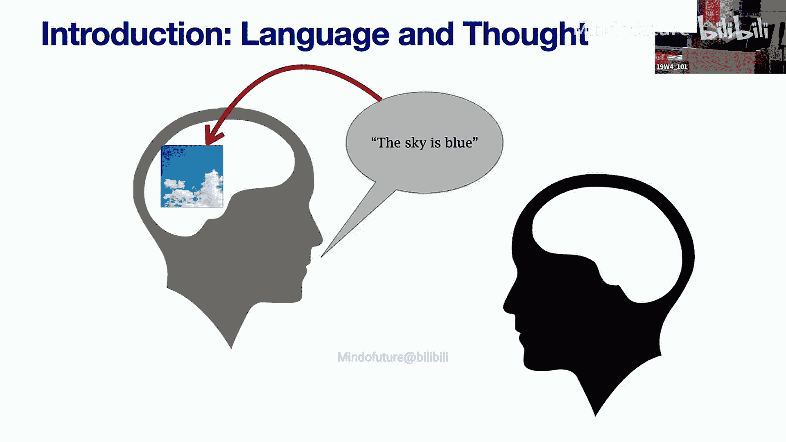
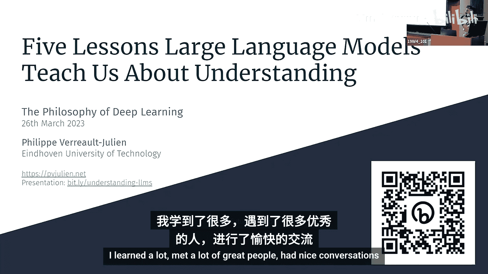
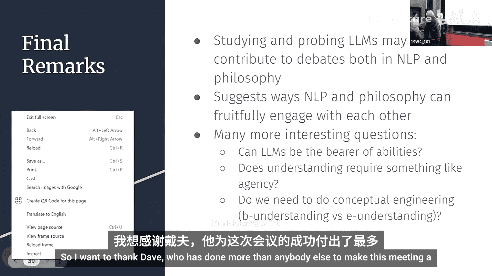

# 【纽约大学】深度学习的哲学 ｜ Philosophy Of Deep Learning 2024 p09 P09_研讨会_大型语言模型的语言与认知能力-深度学习哲学 -BV1u7ZoBnEAb_p9-

Thats。Okay， we are getting very near the end， it's our final session。

 what a long deep trip it has been。I'll final。Our final topic is something which is not at all topical or of of any broad interest to anybody。

 but we just thought we'd talk about it for the hell of it。

 it's the linguistic and cognitive capacities of large language models we've got four great great talks for this session。

 each of which will be 15 minutes followed by 10 minutes of discussion。

 our first speaker is Anna even over of MIT talking about formal and functional competence in large language models。

 take it away。😡，Yeah。Thank you very much and I'd like to start by thanking the philosopher organizingris for bringing together this amazing crowd of neuroscientists and cognitive scientists and psychoinguists and AI experts to talk together about intelligence。

 artificial and biological I think the interdisciplinarypl here was far greater than what I expected so it's been really amazing so far。

😊，So。I want to talk like many people before me about large language models。

 and I'm going to start by thinking about the relationship between language and thought in humans。😊。

In humans， during communication we face this fundamental issue。

 other people's minds are a black box to us， I have no idea what each of you is thinking right now。😊。

And you don't really know what I'm thinking， but we can bridge this gap through language through communicating with one another so I can look outside。

 I can see that the sky in New York is blue today and I can say the sky is blue and you will have a representation of the blue sky in New York in your mind so this miracle happens every day happening right now as I'm talking to you but one other thing that happens during this very communication process that sometimes goes overlooked is that the recipient of the message in addition to receiving the message itself makes all kinds of inferences about the mind of the speaker。

😊，How did they know that this sky is blue why would they say that what was their intention。

 what were they thinking at the time when they were making the utter and so we don't just receive the linguistic message。

 we are constantly inferring the thoughts underlying that message and this process is very helpful to us。

 we want to fill in the gaps， we want to know the minds of other people even if the linguistic communication is impoverished we don't get all of the signal with the message。

And of course， this titling between language and thought has been made prominent in AI through the Tring test。

 the Tring test is a situationt where an observer used to decide whether they're speaking to a human or a machine simply through language so they use language to get at the content of the underlying thoughts and this is often a valid inference we。

😊，Can use language as a reflection of the underlying thinking process。

 but if we think that this relationship is too close。

 we are subject to certain kinds of logical fallacies one fallacy is going from an observation that somebody or something is good at language and assuming that they're good at thought and we see that in humans when we might listen to a speaker that's really engaging that's very fluent and coherent。

 but actually their speech is vac happens all the time。😊，And unfortunately。

 this is also a phenomenon that's happening very commonly in AI in York Times article last year described this very beautifully。

 when you read the algorithm creating original sentences and the role of metafiction。

 it's hard not to feel that the machine is thinking in some meaningful way。

 so we are tempted to mistake this fluent， coherent beautiful language for fluent thought。

 and this is arguably the evidence why the turing test is not considered a very useful test today because it's really all too easy to trick humans into thinking therere speaking to another human just because the chatbot is very good at this kind of interactive dialogue tricks。

😊，The second fallacy is observing a failure in certain kinds of thinking and then making the conclusion that the language is bad as well。

 and so that we see all the time when we see certain critics of say La language models so AI systems more generally。

 say large language models say that they fail at some kind of task。

 say a math task and then dismiss them altogether as models of language and one famous example of dismissal of these models altogether is of course Nom Chomsky who in 2019 and just a couple of weeks ago said does it tell you anything about human language zero。

 so just because this is not an AGI system， it's completely useless as a model of language。😊。

And so in this project， we set out to challenge this conflation of language and thought using this evidence from neuroscience。

 we think it's worthwhile to try to separate linguistic processing from broader kinds of human cogni。

In the brain， language processing takes place within its own separate network。

 this is evidence that goes all the way back to Broka and Vernonke in the 19th century， many， many。

 many many citizens then have pointed down this network that seems to be responded to language at different levels of granularity。

 words， phrases and sentences， it responds during both listening and reading。

 and it responds during both production and comprehension。😊，Moreover。

 this network responds to all kinds of languages， this a beautiful of study by Simonya Dima Ash and others that came out past year where they measured responses to。

40 different languages， not all of them are shown here。

 we also know from other evidence that sign languages also activate this network。

 so this is a really general network responded to all kinds of languages in all aspects of language processing。

😊，But this network is very selective。😊，We see from neuroimaging evidence that its response to different kinds of language is very high。

 but its response to other cognitive tasks is very low in particular it has low responses to math。

 logical reasoning tasks， various kinds of problem solving tasks， conceptual knowledge。And。

This really suggests that this network， despite its generality when it comes to different kinds of language。

 is selective when it comes to non linguistic processing。😊。

And in addition to neuroimaging evidence we also have evidence from patients who have damage to the language network。

 so this is a top down view of some of these brains。

 often they get a lesion as a result of a stroke in certain cases this lesion can be very large and their linguistic abilities are essentially destroyed。

 but if the damage is restricted to the language network， their ability to think and reason in many。

 many， many other domains remains intact providing powerful evidence that language and other cognitive tasks at the cognitive functions are distinct in the human brain。

But of course we're not making the claim that all of language processing happens within this one network languagegu is not an end goal of itself to really understand the sentence it's not enough to just process the  suistic features。

 we need to then be able to pass on this information to third a memory to use it to plan and to act and to make inferences so for example we want to also recruit the network responsible for our social knowledge and reasoning and in in the intent of our interlocutor we want to engage a network responsible for situation model in tracking who the characters are in the narrative for in a conversation so keeping track of information over longer periods of time。

We recruit all kinds of systems responsible for world knowledge。

 including ground and world knowledge， which was the subject of the debate on Friday。

We use a system responsible for reasoning and problem solving the kind of abstract problem solving that Nick Shia talked about this morning。

And there's some evidence suggesting that conceptual reasoning and semantic tasks also recruit a potentially specialized system and so in everyday life we have constant interaction between the language network and all of these other systems that we need to use language in a variety of real life situations。

😊，And so what we can do is we can take this picture and use it to draw insights about artificial systems。

 we can say if all of these capacities exist in humans in various ways。

 what about large language models， are they good at these capacities are they good at them to the same extent or not？

😊，And so one thing we propose is we propose to divide these capabilities into two camps。

 one is what we call formal linguistic competence， so language specific processes that are responsible for core language knowledge and are processed in the language network in the brain and another camp is functional linguistic competence。

 non language specific processes that can。😊，Continue in the absence of language or even on non linguistic inputs。

 but are nonetheless essential for real life language use in the world。

And suggest to give you a couple of brief examples。

 the sentence the keys to the cabinet are on the table。

 knowing that the verb here is R and not is is an example of formal competence。

 an example here putting birds we're sitting on a tree， three left one join， there are now 11 birds。

 11 is wrong， it should be 12 knowing what number knowing what number should go here is an example of functional linguistic competence specifically mathematical reasoning。

 even though the input and the output is in the form of language。😊。

Okay so I'm just going to briefly survey formal and functional competence in large language models and we have much more in our position review piece so the example I gave the cabinet are on the table of course was made popular by Talinzen and a large body of work showing whether large language models can capture these kinds of dependencies and the reason why it's hard as he said is because this relationship is hierarchical we're not just matching the verb here to the nearest noun the cabinet which is singular instead we need to infer the actual dependency for keys which is plural and so。

😊，JGPT for example， has seemed be to have mastered this capacity。

 so far beyond the houses the person who has the cats that the dogs with the kid faces and fl details chased so tons of intervening information。

 tons of intervening plural nouns and yet the model knows that the verb here needs to be is probably worried referring back to person for the sentence to be grammatical。

😊，And there are many structured evaluations so one example is Bmp the benchmark of linguistic minimal pairs for English which tests a large number of linguistic phenomena that are essential for formal linguistic competence and back when the paper came out GBBT2 was already getting pretty close to human performance and the latest batch of models as evaluated in the helm framework they perform even better。

 not exactly at the human level but very very close depending on the phenomenon so that makes us conclude that large language models have essentially mastered formal linguistic competence and of course in your everyday experience when you read outputs by these models they're grammatical they' rarely make grammatical mistakes so that's what we referred to when we say that their formal linguistic competence iss good。

😊，Okay。Now what about functional linguistic competence here we're going to consider two domains。

 formal reasoning and world knowledge in the paper we consider four of course there are many。

 many more domains that you might want to think about and apply to modeling AI to studying in humans。

😊，These two perhaps been most have been the most talked about one of them I think is very easy and the other one is kind of hard。

So the easy one is formal reasoning， this one is the plot from the GT3 paper where they showed how well models performed on various kinds of arithmetic tasks and the largest model at the time performed really well at two digit addition and subtraction。

 it performed okay on three-dit addition and abstracttraction。

 but when it came to four figures its performance plummeted and similarly for twodit multiplication。

 or even for single digit operations it required more than one step so two or more steps。😊。

The performance was very low and so of course the models today are getting better but we know from again our interactions and some of the later evaluations that even simple mathematical tasks are not fully solved by the systems today so Gary Marcus has always provided helpful examples this was right after the update to chat GT that in January where they said they boosted its mathematical reasoning and so Gary Marcus gave it the problem I went out to lunch the other day Sam Alice and Barbara were there plus three other people I didn't know how many people were there in total。

😊，There were a total of eight people at lunch， this answer is wrong。

 whether or not you count yourself。And that anecdotal evidence suggests that these models still struggle with formal reasoning。

 especially the one that requires multiple steps。Now what about world knowledge world knowledge is a harder case because of course a lot of what we know about the world is present in the training data。

 so even memorizing bits of text from the internet will give you a lot of world knowledge already and we shouldn't dismiss that so these models do learn a lot about the world。

😊，The problem though is that this knowledge is brittle biased and incomplete and suggest to give you a couple of examples。

 one is that the model can be mispried so if asked what the capital of Texas is。

 it might say Austin but they primeed with Boston it might say the capital of Texas is Boston more recent systems。

 for example will change the answer depending on whether or not the conversation that's being simulated is with an expert or the layperson。

 so it' with the layperson， the system is more likely to make mistakes。

 which makes sense because of course it needs to be able to emulate the dialogue consistent with who the speaker is。

 but it just shows you that it doesn't actually have a single consistent internal knowledge base that it's happened into。

😊，And another example is paraphrasing， so Sefeld originally aired on or Seel premiered on are two queries prompt asking for the same thing。

 but oftentimes the model will give you different answers in this case different networks depending on how the question is phrased so this knowledge is not robust。

😊，And I'm going to skip that and say that large language models they struggle with many aspects of functional linguistic competence。

 including formal reasoning and robust systematic world knowledge。😊，Now。

The last thing I want to talk about is what implication does this formal versus functional competence distinction have for building and evaluating models in the future？

😊，And one implication is for building models， and we argue that models that will use language in human like way will mirror the human brain architecture broadly by being modular。

 by having or developing modules for language processing， formal reasoning， social reasoning， etc。😊。

And maybe this architecture will be built in， but maybe it will emerge over the course of training with the carefully curated set of training data and objective functions。

 so we don't necessarily say you have to build in in advance。

 but we think these are useful capacities to try and induce in models instead of just having one objective function and hoping the model will learn to do it all。

And the second claim is that we need targeted benchmarks so formal and functional competence hopefully I've shown you are not the same they this thing there is no reason to think that the model will succeed at functional competence just because it succeeds at formal competence and so we need to be able to evaluate them cleanly and separately dissociating them and so for formal competence we have the benchmarks like Blimp and syntax Jim and others for functional competence we have a lot big benchmark mentioned earlier we have some common sense benchmarks I would argue we still have work to do at cleaning them up and having them isolate specific functional competence capabilities。

😊，So to sum up formal competence is knowledge of linguistic rules and patterns。

 functional competence are non-language specific skills required for real life language use and this distinction is grounded in neuroscience can help us clarify the discourse around our language models and suggest a way to build better language models I'd like to thank the team behind the paper。

 especially my coffer author Kylema Hoald， the paper is online。

 feel free to check it out and thank you for your attention。😊，Questions。Yeah。

 you showed that case of long range dependencies， as I'm sure you know。

 Stanahhan published a paper not too long using GPT2。呃。

Showing pretty bad failure in subject verb agreement across。

Some intermediate you knowerarchy hierarchical tree structure parts， so I wonder has the。

 has I assume your results are from GT4。IThat right？We， the。No， there's also mostly from GT。2。

 and then the bmp results are from a variety of models whatever is on there right now there whatever it is。

 what's the difference between what Dahan did and what you did and if yours is in a much later system then I wonder whether there is some longer range dependency that they can't do。

Yeah， so。This is why I said in the conclusion that they have essentially mastered formal linguistic competence。

 I don't think we can ever say that they will able master 100% of it and there are definitelyin exceptions yet I think this work is maybe the most prominent example showing that maybe they're not quite as good as we would like that I would like to think but it's still impressive if I would say how far they have gone on the way towards functional linguistic competence。

 especially given their training and all the linguistics debates where people argue that it's impossible。

 so I wouldn't say they're perfect and it's interesting because of course they mirror human-like data use so language use and so it does make me wonder to what extent how often do humans use these kinds of longer range and usual dependencies and so my guess would be that whatever humans humans are better at these models would also be better at。

😊，What the hard arguing doing is the systems do not have。あとつ。

Yeah yeah I'm not making I'm actually not making representational claims here。

 my claims here are purely behavioral do they behave according to the rules of here English grammar right and so whether or not they have trees is not I don't think it matters for this question here。

😊，My question is related， but maybe the flip side your examples for functional incompetence were from 2020 and 2021 and obviously things have changed a lot so is your claims when you're using the word LLMs is your claim restricted to GT2 or maximum 3 and below or are you have you at all validated your papers claims on GT4 Yeah so yeah the review paper has been written over the course of three years and so I think we kept adding on evidence over this time of course as the models kept evolving from what I see so so for GT4 we don't have the data yet right just came out so far from what we can see a lot of the problems are still there all the Rafael' example and code that definitely makes us question things one thing that I think is really important is knowing that the latest batch of models so GT3。

5GTT。Four are no longer trained just on wording context prediction and our claims really center around these models that are predictive models so。

The proposal that we make for emergent modularity where we say look you need multiple objective functions you need carefully selective training data and not the entire internet that is exactly what OpenI seems to be doing right now where they're given targeted feedback on specific domains specific kind of presenting tasks theory of mind tasks i'm sure they're doing that a lot of safety areas and safety concerns and the data is highly curated and the objective function is no longer a simple next word prediction function so I think with these models we actually do have to take a step back and reevalue and think what other capabilities they have developed versus not that said I think that's also not necessarily the most valuable contribution we're making the contribution we're making is really the distinction between formal and functional competence knowing that that they're separate that we need to evaluate them separately and what we build models of language use we want models that have both formal。

😊，We should go to another question。Thank you for the wonderful talk so when we're talking about maybe modularity emerging through the reinforcement learning with human feedback。

 would you expect like a functional modularity within the network itself or is this a more sort of abstracted sort of modular behavior？

Yeah that's a good question I think and in neuroscience of course there is a lot of debate about whether things need to be spatially together if they're doing the same function or if a distributed system is good enough。

 I don't have strong opinions at this point it does seem that having things together that do similar computations is more efficient and therefore a model would benefit from and somebody already mentioned Robert Yang's work on emergent modularity in recurrent neural nets so I think that's an example of that I think if the network is allowed to developistic modules that will make it more efficient than do the task it will do so。

😊，Okay， maybe time for one more quick question。不在。Okay，'s I hope it's quick。

 could you put this slide up with Gary Marcus on the out to lunch slide？やりまな。关什。

So I was just going to I was thinking back to the debate on Friday about you know sort of what AI can sometimes reveal to us about our own human biases which I think the response was no machine there's no universe where a machine learning person would want less data but oh that's fine but just looking at this one I was thinking a little bit about who counts right so there's math there's math in the abstract adding up numbers and then there's sort of like you said all these different social contexts etc and I feel like this answer。

😊，I could argue that you also want to count the server so does the server count right so if I say I went out to lunch as a native English speaker when I say I went out to lunch with other people I typically mean we went to a restaurant so if I say we're going out to dinner out to lunch in his so just it was just saying I thought this was an interesting example because when we think about what is where world world knowledge is in potentially I would say the server was at lunch。

Present so sorry this is excellent because I think the main point we're making is that formal and functional competence are distinct in our useful distinction to be making the second point is that because of this process of constantly inferring the mind behind the words we are really tempted to infer intentions of these models even when we know how they work we're like oh but maybe they thought this and maybe without that and we would and we have like a short opinion piece that Blake Le Moy the Google engineer saying that La theycent and is also an example of overinterpreting the words and even when it doesn't quite make sense we kind of want to try to make it fit so I would argue that it's not necessarily always wrong and it might be true but we have this fallacy that we fall on all the time and we should be really careful about it so not necessarily that it's wrong but we should just be very wary of this kind of reasoning Okay thank you very much。

And our next speaker is Nuhu Osman Atta from the University of Pittsburgh。

 who's going to speak about do language models lack communicative intentions？

I行。Wait， can everyone hear me？okay thanks so someone remarked to me that this is very much a philosopher's question so I'm going to give you a very much a philosopher's talk and answer neither yes or no。

 so what I'm going to be doing is I'm going to be largely agnostic about whether they do or do not language models do or do not have communicative intention what I'm going to be doing is in something very negative which is I'm going to say much of the negative answers we've gotten into the question which is that they do not have communicative intention are really bad arguments we probably should start think about other more interesting social technical questions。

 but we'll see what I mean in a moment。😊，Okay， so what I'm going to be doing is I'm going to be characterizing what I call the CI argument。

 which is the Comunicative intention argument， which is essentially the argument that says that language models don't have genuine linguistic competence because they lack communicative intention and then I'm going to make a very brief remark about G the sort of Grceson assumptions in the background and that I'm going to race the considerations against this argument。

Okay。First， so there's been a lot said about communicative intention recently and so the argument is a sort of a standard for in comparative approaches in philosophy of AI where people say for instance。

 Alexnet doesn't really see Alze doesn't really play testes what do these really Cameron has argued that they don't have really empirical content the attempt here is to give empirical content to a claim such as language models sort of transformer models for instance I'm going to be talking mostly about transformers do not have genuine linguistic competence because sort of the empirical content here to say that they do not have communicative intention try to say what communicative intention is why they lack why humans have it and why that leads to that conclusion a very famous example of the argument from communicative intention is Bennder and Cola's argument which I guess a lot of people know about Mary Shanahan's recent Ba also argue something similar talks about communicative intention and its role in linguistic competence some philosophers also like Carlos Montemao。

also argue the same thing so there's just as much to do about commicative intention this is a passage from the stochastic parrots paper which also makes to simply a claim the other claims thrown in which I think are important i'm not going to go through the passage every time I timed this it was like 17 minutes so i'm going to skip the thing so。

As things then a lot of the arguments are sort of ambiguous。

 it's not really clear what the general philosophical argument is and possibly there are just many communicative attention arguments。

 trying to say different things but all appealing to the same notion should communicate and intention。

 but there's often enough in each of these arguments to suggest that what's in the background is sort of this strong Gr and assumption about the nature of language。

 so I'm not going to go over all the details of the Grrystein assumption。

 but essentially it's the assumption that leads to thinking that if you're genuine linguically be competent you should be able to attribute very high orders of you should assess high orders of a metareal capacity because what linguistic competence involves essentially is trying to mind other people and sometimes so on the general Grryson schema what you need to do as a hearer。

 not only recognize what the person is saying but recognize the person。

Hence you to recognize that they so there're just high orders of me representational capacity involved so there's a strong rise and assumption I think in a lot of the statements of the CI argument I'm not going to say much about it but if my argument essentially hear that if in fact the argument rests on the strong rise and assumption it fails。

 for wellknown reasons I'm not going to go to them and we can talk about them during Q&A there are a lot of good reasons why they fail I will fight anyone on any street corner about this strong rise and assumption is false but I think you can get by you can get but you can the CI argument can still get off the ground with sort of an attenuated Grsonism I'm not going to say much about that I'm going to leave all of that in the background for a bit all you need to know right now is what's up here。

This brings us to I think what's the central argument that arguments。

 which is an argument that language models lack communicative intention and why should we think that so a principle argument for this is that well the language models especially transformers just have the wrong kind of mechanisms。

 they don't have the proper mechanisms to encode communicative intentions。

 more directly some people like Mari Shannehan is recent paper argue says something like this。

 it doesn't matter what internal mechanism it uses a sequence predictor is not in itself。

 the kind of thing that could even in principle have communicative intent and simply embedded in the dialogue management system will not help。

Okay so i'm going to be addressing this argument so but first so to see what the motivation behind this sort of argument is right so consider going through all the layers of a transformer and trying to figure out were what feature of the transformer might plaibly encode intentions right so the proponent of the argument I say look we know the input embedding and the position em together provide us this sort of position wise vectors of the natural language sequence that doesn't seem to have anything to do with communicative intention the multi multi head attention the multi head attention provides us sort of these。

relevance relevance representations of which part of the token are important to figuring out what the whole sentence means and the feed forward network takes a sort of a soft max of this output and so whatever it is。

 whatever it is fact it's a function of this output and it couldn't really encode intention so the argument goes something like were in this process could intentions be encoded。

And I before we start trying to answer that question。

 we should query what the empirical situation in the case of humans because I think without a sort of empirical clarification it's not really clear what people are talking about when you're talking about communicative intentions there could be a lot going on over there so what is it in human cognition that what sort of mechanism is it that people are interested in when they're looking for these sorts of mechanisms the answer is that no one knows and in fact if you if for instance are instrumentalists of some variety or if you're sort of an eliative of variety you don't actually think you should be looking for such a mechanism at all。

 there's no mechanism to be looking for the problem is that while communicative intentions are pretty useful in psychological theorizing that use psychological theor it's largely instrumental so there's no direct cognitive scientific evidence for the psychological reality of communicative intentions。

Instead， what we have in some well- evidence models of like language comprehension and language production like the Lemma model。

 which is a model that tries to explain， for instance how you utter the cat is on the mat by showing how you select the photosnoyntactic elements of that utterance and then produced in models like that what we have is that communicateative intention is just a boundary condition for the mechanism it tells you what the mechanism is trying to produce。

 but it there's nothing over and above the end goal of the mechanism that is communicating intention so it's a boundary condition rather than anything of any specific mechanism and also in general surveys of the literature suggests that there's this good empirical reason to be skeptical of the psychological reality of。

So likeCommunicative intentions so we end up in a sort of a situation of empirical imperativey right if humans are legitimately thought to possess communicationative intention even though we have no mechanistic hooks and on which to hang those intention attributions then there's really no good reason to think that we might not also be able to attribute communicative intentions to machines even if you can't find such hooks but we in fact can find some of them in some older language in some older language models we find that there are features that are meant to explicitly represent intentions so so。

For instance， you might see thiss in partially observable mark of decision process dialogue systems in which is a belief state representation which is supposed to track which of a variety of actions a user wants to take。

 you can see there's an other dialogue order dialogue systems which。

Well elaborated modular pipelines。So in fact in many task oriented chatbots you actually want to explicitly represent which set of possible actions a user wants to take。

 for instance， if you have a chatbo that recommends restaurants gives your restaurant ratings and makes reservations you need to know which of those three tasks the user wants to trigger and it's really useful to be able to represent this there are many ways of doing this you can use sort of like a partially mark of decision process as I just showed you can do stuff that are closer to some of the older sort Eliza type chatbot sort of semantic semantic search。

 so in all of these cases， sort of the representation of the possible action of the user wants to trigger it's used to guide language generation model downstream and this I think is super important because going back to the point about empirical parity you might make the argument that look what the reason。

and why we think the communicative intentions in human beings is because we make sense of particular actions that they take in terms of it。

 I think that that sort of control view of the use of communicative intention gives us at least some similar empirical parity argument here to say that well。

 look， if these representations are guideiding the actions， the actions of the chatbo。

 then we are pretty much in a similar situation as in the case of humans， right。

Of course many state of the art language models based transform architectures do not use any well elaborateerated pipeline like this and so you might think look this is just a bait and switch I was going to talk about transformers mostly and now i'm just talking about all the natural language processing and systems which have these belief state tracking modules I think this might be a bit too hasing so consider a parallel question right whether for instance language models distinctly represent various salient syntactic and semantic features we know that humans do this so if you're doing a sort of cognitive comparison you want to make sure that the language model you're looking at does something similar。

Classical NLP systems sort of lent themselves possibly such comparison because they have。

 for instance， parts of speech tagging components so they're tracking some salient syntactic semantic features they also have parts for resolving co reference so these well elaborated modules in the system that helps you figure out。

In much the same way human cognition does what the syntax relevant syntactic and semantic features and until recent work it might have seen the transformers if you'd run the same sort of argument。

 you might have thought well transformers don't do anything that sort don't represent any sort of syn salient syntax and semantic features we know that false now we know that in fact that appropriate probes can disintegral representational features and transformers which recapitulate the classic NLP pipeline complete with this distinct hierarchical representational sensitivity to parts of speech semantic role co referenceence etc so the conclusion here is that if this sort of argument of running through the system and trying to figure out where something might be encoded it's a very dubious argument and we should not rely on it。

Obviously might you might say look these features in the analog logical case are categorly different of a different kind look speech semantical or co referenceence can be structurally derived from the corpus after all the intralinguistic features not extralinguistic features however communicative intention doesn't seem to be that sort of thing。

😊，But I might talk about this more in the periodtic。

 but there is evidence to suggest that attribution of intention。

 including self attribution is dependent in linguistic mastery。

 which suggests that semantics of intentional terms are significant from the ongenny of communicationicative intention so also another point which I think is usually lost in the philosophical debate from this issue is that there are parts of the fine tu process in training language models which might have a dialogical context similar to the ones from which human beings learn some of these the intentional capacities right so reinforcement learninger with reinforcement learner with human feedback for instance I think might encode some of these dialogical properties。

And as we saw earlier， sort of co version of this wrong kind of Americans argument is the argument that basically there're just no matter what you do a sequence predict。

 it's just not the right sort of thing for communicative intention。

But there is in fact evidence that human language processing and eventss significant sequence prediction futures。

 I will not go into detail about these studies but we can talk about it later。

 but this is a famous study bycott in Hen which in which they presented sentences of that kind to people and the N400 potentials suggests that there is。

😊，The human language human semantic processing is attuned to the most probable continuation of linguistic sequences。

 there's a significant inflection for unusual sentences like you took a sip from the transmitter versus he took sit from the waterfall I don't know why you think that's less weird than transmit it I don't know who drinks some more waterfall but yeah so and it's also something interesting is that the amplitudeputity of the signal inversely correlated with a closed probability which is the likelihood given by so the probability that someone a human being will suggest that part of the sentence is a continuation which is very akin to the perplexity。

So semantic process in humans is attuned to the most proable continuation of linguistic competencies。

 we also know that syntactic capacities are also attuned to these sort of there's also like further evidence from conversation analysis for that previous claim if you want we can talk about today later so we know that syntactic capacities are also attuned to this sort of。

Predictive features and a good famous study by on that point is our Kristenen and colleague study in which they show using also similar devices last study that the same sort of brain areas that are involved in。

G generic syntactic processing generic sequential learning are also involved in syntactic understanding so there're sort of so between its role in seman in semantic language processing and its role in syntactic processing it's glad that sequence prediction plays a significant role in human linguistic competence however it's like there are two sort of conclusions we can draw there's sort of a cautious conclusion which is that there's really no good reason to think that sequence learning could not be the basis of genuine linguistic competence are best the evidence is just completely inconclusive there's a more tenious claim which is that at worst the evidence suggests that sequence learning is at the heart of human linguistic competence and sense for a sake argument human linguistic competence is exempary of communative intention sequence prediction could be be the sort of thing that Chahan things it can't be but this requires us to show that sequence learning in humans and language models fulfill the same sort of functional roles which is the next part of my project。

Very optimistic that it was the same sort of thing I'm not so optimistic now so even though I in the beginning said I was agnostic you you can begin to suspect my own position on the matter so in summary I skipped the gr in part but in summary if the strong rise in assumption that seems to lie at the heart of a lot of the CI arguments is right it won't get on the ground because we know it false for many anthropological psychological evolutionary reasons even if you have like an ittenated crisis in assumption it would still not be very convincing because of some of the reasons I've just shown empirical parity there might be possible mechanisms and language models and coding communicating intention after all and there might be more work for sequence learning than C arguments okay that's I think that yes that is in fact。

Okay， 16 minutes， 45 seconds， very good。Okay。I cut down the time I wonder if your point about communicative intentions really applies to really all intentions right so you know it' people have observed that the only time we have intentions as like separate states is when there's a process of deliberation that issues in like something like a explicit intention but there are intentions in some kind of more dispositional way you for anything we do really in the sense that you would agree that they're done intentionally in the same thing isn't the same thing true for communative communicative intentions yeah so one of those papers I cited area by the zone and Compis which is a sort of a survey of the literature and intention in general so the papers is actually surveys the literature and intention in general and it makes a conclusion to communicative intention in particular and it suggests that we have reason to be skeptical of intentions in general。

my own position in this matter is that in fact， there are communicative intentions。

 their are intentions for a lot of other things， but they do not arise where I think a lot of philosophers tended to locate them。

 which is sort of like sort of these internal representations of intentions I think intentions arise in the context of social behavior they help us make sense of behavior in a social context that's where you you should locate intentions and I'm happy to let go the assumption that you can find some sort of internal representations of intentions。

 just as long as I think it makes sense to use it to make sense of social action。😊。

Thinking about this in like an empirical way there be a way if there is the intention there to recover it from the utterances and should there be kind of consistent intention over some amount of time and you know these models seem to not have consistency in that way that they're not you know trying to argue for a point or anything like that so one of my advice is Edward I went and spoke to him and one of his main points to me is like look I know I have intentions because I could be wrong about stuff I intended for instance I might say something and realize oh I was wrong about what I intended to say something like that don't get a parallel like that machines to say as you mentioned there's some reason to think they're not arguing for any particular point or a sort something I fail to mention which I think is really critical to the argument is that you can make sort of you can have a check on me of very different kinds of intentions so there intentions for instance if you make the statement I would like a banana right the intention is for someone to give you a banana or open the door the intentions open。

The door I don't think language models that we have right now have any of those intentions precisely because they're not embodied agents。

 however there are certain kinds of intentions so these are sort of intentions that intended a perutionary effect there's certain intentions that intended illutionary effect so I ask you what's the capital of New York given your response I think legitimately you might be able to say that these systems might have be some very very limited range of tensions。

 part of which is to just answer questions it only intention might be to answer questions whether accurately or not。

I don't know right I think that if you're going to attribute intentions in that way in fact you might have to attribute like an even narrow intention and the intention to answer questions。

 it might be the intention to answer a very particular question what is the continuation of this sort of sentence in the corpus right so it's an even narrow intention my argument is not necessarily that language models of intentions that possibly they do but if they do admittedly it is a very narrow range of intentions relative to what humans have。

はい。So my question is sort of on related to this， so as we've seen like with the scaling up of the amount of parameters that we've trained language models on they have new emergent capabilities。

 do you think maybe that sort of as we sort of train these models with even more parameters and maybe new architectures that they might have the capacity to be constrained in any type of kind of task kind of behavior because if we look at something like GiHub compileile that they just announced like a new programming assistant even though it doesn't necessarily have like the anthropic sort of centric sort of understanding of what intention is or what doing a task is it's still able to provide a complex and tactical structure that does some kind of action some kind of task based on sort of whatever it was led to do initially prompted by humans so do you think sort of more complicated sort of understandings of other minds might sort of emerge in language models just due to that emergent scale。

Right， so I think there's a recent paper on the I'm going to start with the latter question for it。

 so I think there's a recent paper which argues that sort of a theory of mind has emergedlished in language models and then it goes on to a test I think GPT 3。

5 on sort of a standard false belief tasks and then it does really well and then people like yeah we got an emergent theory of mind。

 Liant to comeend data is right around the corner but as it turns out if you perturb the test just a bit it completely fails and I think that one of the really crucial things about like sort of these assessments of AI is just trying to figure out I think the more interesting question than trying to figure out whether they have these capacities is trying to figure out the range in which they can be successfully we operate in these capacities and as I was just saying to the last question right if you take aboard sort of my view。

I't have to connect you because it's not part of this then you should not even be trying to find intentions per say in the operation in the mechanism of your patient system it's about this is why at the beginning I said I think they more interest social technical questions just how is the system embedded in in social context machines are sort of things that could ever be embedded in the way that leads us to attribute intentions to them seems like the context in which we meet machines most of the time is not that sort of context also seems like there's a sort of like dependency the in in the very fact the machines are engineered objects on sort of human intentional capacities which also raises questions about whether they could ever be embedded in our social context in a way humans are embedded right so I think they're more interesting social technical questions part of my projects is to say enough with some of these questions already theyre much more interesting questions so yeah。

Okay， one more quick question。Thanks for the talk super interesting Just want to ask to what extent do you think the recent introduction of RLHF。

As part of the training process of the most advanced current models changes the game entirely in terms of this argument about communicative intent。

 do you think that the。Broad landscape of the dialectic for and against is similar with the incorporation of RLHF。

 or do you think it becomes a very different kind of question？

Right so so as I was hinting earlier right， I think that a lot of the debates dismiss I don't know a lot of what's interesting about how these systemss are trained right because typically what you have is I think at least typically what people have in mind is there's a corpus and you go and learn linguistic dependencies and the corpus and that's the end of it。

 right but what you get with RLH have other other fine human mechanisms like that is a context that seems a bit more dialogic than with typically seen。

 so one of the ways in which at least we think that humans learn sort of the semantics of intental terms and how they learn to mindread is that they're embedded in our social context in which they observe dialogues they observe how people talk。

 how people react than when they talk。I have not done any serious work in this to figure out whether in fact the sort of dialogic context again in some of these fine tune mechanisms are entirely similar to what you get in these human contexts。

 which is I think one of the more interesting questions。

 looking at some of these mechanisms and seeing whether they are similar enough to some of the very social mechanisms which we underlie human capacities to attribute attentions。

 I don't know if that answers your questions but yeah I think it does change the philosophical landscape quite a bit。

 I think people should pay more attention to it。Okay， thank you。Thanks。Okay。

 next up we have Patrick Button from Oxford with a function content and understanding in large language models。

Okay。Okay， hi， everyone。So I'm going to be talking about a topic which we've heard lots about already。

 which is the topic of whether language models can understand。

And more specifically or slightly more specifically， anyway。

 I'm going to be talking about whether language models can understand typical human utterances。😊。

The reason for making that clarification is that there's not just one phenomenon of understanding。

 there's not just one question that we can ask about whether a system understands things so。

I'm going to be thinking about。Issues like whether a language model could understand a particular human particular sentence which might be utter by human like the sentence volcanoes arerupt。

 that seems to me to be a different question from although。

 of course not unrelated from the question of whether a language model could understand why volcanoes arerupt。

 for example。this is a topic which I've written about before in this paper called Sha our concepts with machineschines。

 which I wrote a few years ago， it was published two years ago。I argued for two claims on this topic。

 the first one was that the lack of perception of the human environment。

 which is a feature of language models， doesn't prevent them from understanding human utterances so I would have been on the no side of the debate on Friday night。

 I don't think that centuryy grounding is necessary for understanding in of this kind。嗯。

But I'm not going to say anything more about that claim today instead I'm going to concentrate on a second claim which I made in this paper。

 which is that the fact that language models lack functions or tasks concerning the human environment does prevent them from understanding human utterances。

So I made an argument to that effect I'll call it the function argument and what I want to tell you today is that I take it back I recant that argument。

 so it's not that I now believe the opposite of the conclusion it's that I now no longer believe that the argument is correct。

😊，Okay， so I'm going to start by explaining the argument of course。

 and then I'll tell you some of the things which I think are less than entirely convincing about it。

Okay， so this is the central kind of theoretical claim of the function argument。

 it's that understanding human utterances requires functions or tasks concerning the human environment when I talk about the human environment or the world I'm what I've been referring to of course is the kinds of things that typical human utterances are about like volcanoes or chairs or cats or love or anger。

😊，嗯。Okay， so there's kind of three premises which contribute to this central theoretical claim。

The first premise is that understanding an utterance involves forming a representation with the same content。

So here the thought is something like， if you say to me hey Patrick volcanoes erupt then in order for me to understand what you said to me。

 I have to have the thoughts， volcanoes erupt prompted by what you said and I'm assuming a representational way of thinking about thoughts so for me to have that thought I have to form a representation with the content volcanoes erupt I'm not saying that I have to come to believe that volcanoes erupt I just have to entertain that idea but the point is if you say to me volcanoes erupt then that's going to work I I'm going to form a representation with that content。

 if you say something to me in a language other than English then it's very unlikely that I'm going to form a representation with the right content。

The second premise is the content depends on function。

 and this is the central claim of Tliio semantics， which is a。Philosophical theory of representation。

 which you've already heard things about this weekend。

So I'm only going to talk about TV ismantics in a kind of very sketchy， high level way。

But here's a kind of slightly more。😊，Detailed claim about how representational content works according to a teleomanic picture。

嗯。So。The claim is that for representation to have a particular descriptive content like the content。

 volcanoes erupt。Then it must have the function of carrying the information that volcanoes erup。

 So it's not enough that the occurrence of the representation。

Carities the information in question instead。That representation has to be used by the system and it's the use of that information by the system that makes it the case that。

This thing， the representation has the function of carrying that information。

And then the third premise， which contributes to this theoretical claim is that a system will only use information concerning the human environment to perform whatever task it has。

 if it has a functional task which actually concerns that environment。😊，嗯。Now of course。

 to go from that theoretical claim to a claim about language models。

 I need to say something about the functions or task of language models and so in making this argument I just took the very widespread view that the task of a language model is what it's trained to do。

 so it's next token or next word prediction。And I would characterize this as a purely linguistic task。

 it's a task in which success depends。On诶。Success is measured by standards which arise from facts about language itself。

And so in order to achieve success， the system is going to rely on its states。

 its weights or its activations， carrying information about language。

 not about the human environment。And so just to be as clear as possible that this is a distinct argument from the century grounding argument concerning understanding。

 I think it's useful to contrast the case of a language model。😊。

With a case like a fictional text only medical diagnosis chatbot so we can imagine a bot which has been trained only on text in which it interacts with users only through text but the function of which is to identify the condition that the。

person that the bos interact with is suffering from。嗯。In this case。

 the function does concern the human environment what it is for the chat boxt to succeed is for it to。

I don't know at the end of the dialogue。Outputs。嗯。啊。a form of words which like。

Truly describes some facts about the human themselves。U and。

So it looks like if we're thinking about what kind of information that system states we're going to have to carry in order for it to succeed in performing this task。

That's going to be information about the patient's symptoms， for instance。Okay。

 I have three objections in mind to the function argument。

 but today for reasons of time I'm only going to talk about two of them。So the first objection。

 I mean they're both very very extremely simple objections， the first objection is just that。😊。

These days， language models are fine tuned for further tasks beyond next token prediction。

So for instance， one objective that you might have can find tuning a language model is。

To get it to give correct answers to factual questions。

So a language model that has been fine tuned in that way。😊。

You might think is no longer performing only a purely linguistic task because getting the right answer to a factual question is a matter of your answers correspondence with how things actually are in the world。

😊，嗯。呃。Okay， I'm not going to say anything further about that objection yet。

 I'm going to come back to it in a moment。First， I'm going to mention the second objection。

So the second objection is that in principle。It seems as though。Information about the world。

 the human environment could be useful even for performing purely linguistic tasks。😊，嗯。

If you want to。Produce and outputs， which is likely utterance in human language。

Then knowing about the human environment， knowing what humans believe is very useful information。

 it seems。😊，嗯。So yeah， we can imagine that in principle language models might represent facts about the human environment。

 even though even in cases in which they're performing only purely linguistic tasks and in particular there are some kind of further。

Features of the discourse about language models at the moment or。

Or pieces of evidence which are relevant to this issue which kind of push us towards the thought that language models might be using representations which concern the human environment so one is that interpretability research sometimes positive representations with wealthy content。

😊，And another reason is that。嗯。There are some aspects of language model performance。

 which are kind of。Seems rather difficult to explain if they're not representing facts about the human environment。

 so here's one。Exle， it doesn't really matter very much of my purposes is how compelling an example it is。

 but this is from the recent sparks of AGI paper about GP4 and we've seen this image already this weekend。

😊，This is。Output produced by G 4 when it's asked to。Draw a picture of a unicorn using this。

Lac image drawing language btics。Yeah。And you might think， well。Surely。

GPT4 represents that unicorns have four legs and that's part of the explanation of how it's ables to do this。

Okay， now I'm going to talk about both objection one and objection two because I want to say more or less the same thing about both of those two objections。

😊，Um。So here's the kind of picture which is painted by the first objection that I mentioned。

So suppose you've got on one hand， a pretrain language model and on the other hand。

 a fine tuned language model which has been fine tuned to produce the correct answers to questions。

Then when you provide the same input to those two models， to input， what's the capital of Estonia。

 the thought is they're performing different tasks and because they're performing these different tasks。

 they're using different pieces of information in order to produce their outputs。

 even though they might produce the same output。嗯。So in the case of the pretrained language model。

 the task， according to this picture， is to provide a likely continuation of the text。

 and so it's using some information about the language specific well， something of the form Tin。

 it is a relatively common continuation of the string what's the capital of Estonia。😊。

On the other hand， in the case of the finet language model。

 the task is to answer the question correctly and so the information which is being used in order to perform that task is the information that talents the capital Estonia。

😊，Now， I think。We shouldn't be confident that this is the right。Picture to。嗯。

To have in mind when we're thinking about representational content in these two contexts。😊，嗯。

And the reason is that。These two pieces of information are of course extremely closely related。

 it's because talents the capital of Estonia that we say the things that we do about the capital of Estonia。

So in general， features of a model which carry one of these pieces of information are also going to carry the other piece of information。

😊，嗯。So。The information that T is the capital of Estonia is in some sense available to the pretrain model and the information about the language is available to the fine tune model。

 and furthermore it seems that either piece of information could be used to perform either tasks。😊。

So you don't have to tell a particularly complicated story in order to explain why。

The pretrain model produces the output Tin in terms of the information that Tyin is the capital of Asssonia and equally you don't have to tell a complicated story to explain the fine tune language model's performance in terms of information about words。

嗯。So where that seems to leave us is that， well， there's a rebuttal available to the original objection to the argument。

 which is that。Even in the fine tuned case， it's possible in principle that the language model is only representing information about language。

But it cuts both ways。Because。It's also the case that even in the pre trained case。

There's a story available to be told about how。Information about the human environment could be being used。

And I think we can say these kinds of things about the unicorn case as well。

 so it's possible that GP4 is using the information that unicorns have for legs in order to perform this task。

 but I also think。嗯。It's possible in principle that GP4 could be。

coCould be relying on some relatively complicated fact about relationships between words like the words unicorn and for and legs and maybe some shape words and maybe some bits of。

Six code in order to perform this task， I think in principle is a going to be a kind of purely linguistic interpretation of the。

Of the representation that's being used to perform this task as well。So。We've got a problem。😊。

It seems certain that language model states typically carry information both about the world and about language。

嗯。Information about of either kind is typically useful。

 either for performing linguistic tasks or performing tasks which are not purely linguistic。嗯。

So we don't know which kinds of information language models are using and therefore what the content of their representations are。

 even if we know what's task going perform。😊，And the philosophers in the audience will have long since recognized that this is a completely familiar problem。

 this is the indeterminacy problem for teleo semantics， it's the problem that。😊，嗯。

In any case in which。A state of the system is carrying information， which is useful to that system。

 that state of the system is also going to be carrying a whole load of other information as well about facts which are correlated with the facts of interest。

😊，And that stories are going to be available to be told about how those other related pieces of information could be used to perform the tasking question。

嗯。啊。Now the reason that this theory this problem arises is that the theory is kind of relatively impoverished。

 she doesn't tell us at least in the form that I've given so far in very much detail about how information is determined by how representational content is determined by function。

 so it can be solved defending a richer theory of content。

 but then of course there are open questions about what that richer theory should look like。嗯。Anyway。

 the upshot of this is that when I first wrote about this topic。

 I expected that the question of language model understanding could be settled by appeals to quite broad philosophical principles。

😊，I think that might still be true but I don't think they'll be the principles that I had in mind。

 I think the much more detailed analysis is needed to clarify representational content and language models and we've seen some attempts in that direction earlier this weekend。

😊，Thanks very much。I wantt think about one other objection to the function argument。

 very obvious one， saying that the task of language models is to predict the next word is a lot like saying the function of human beings is to leave enough offspring around or enough copies of your genes。

 of course in the case of human beings we know there are a million instrumental functions。

We have talking and walking and breathing and so on that enable that that large function that's maybe their functions of us。

 maybe they're functions of subsystems so we think that likewise in the case of。Language models。

 there's all kinds of instrumental functions that you know language models could well develop very sophisticated capacities in order to enable this overall function of predicting the next word and those like seem like very natural things to play into a tosomatic theory。

Yeah， I'm not sure that I mean， I suspect that there are other objections to the argument。

 but I'm not sure that I immediately find that one compelling because。In theSo。I mean。one reason why。

We think of next word prediction as being the function of language models is that the form that language models takes is explained by the feedback that they get as they kind of succeed or fail in predicting the next word。

And。The form that human minds take。Is explained not just by。Evolutionary processes。

 but also by processes of learning within our lives。

 but those processes of learning within our lives are also kind of thoroughly。

World directed world involving， whereas if you， if you kind of。If you kind of break down the。

The kinds of things that language models do， which cause them to receive feedback。

 which change their form。They're just。Less general。

 purely linguistic tasks are there's like next word prediction in general。

 but there's also next word prediction in one kind of context and like next word prediction in another kind of context。

 it seems like we still get a purely linguistic picture if we try to kind of break down the tasks that language models are doing in contrast to the world involving picture with humans。

😊，As you know I'm I'm sympathetic to wanting to do a teleosomatic I thought Dave was going to go in the other direction。

 I mean， it's just kind of an illustration of indeterminacy of function。

 but you might say the task of even the pretrain models is to produce convincing text or and and the next word prediction is just a means to that。

You know， what it's selected for， if you think of this sort of analogy of the evolutionary environment。

 what it's selected for is does it work to produce。

Duringuring level convincing text or something like that。

 and so you might say that's what the task is。That's what the function is right I don't I don't understand that selection because in in the process of self supervised learning。

 there's no like no assessment is made of whether。Text is convincing or not。The model gets。Kind of。

Feature preserving feedback if the word that it predicts in the is the one which actually was in the gap and it gets feature modifying feedback if the the word it predicts isn't the one that was in the gap yeah that's why I would go。

Would kind of be kind of relatively confident that next open prediction is the right way to think about the function。

So I wanted to ask you to clarify what exactly you're renouncing so when you said at the beginning that lack of function or task concerning their environment prevents language models from understanding I was like yeah that seems absolutely right you're like I renouncce this but then it seems like most of the rest of the argument had to do with more like。

How the claim doesn't apply because maybe their tasks or functions do involve the environment。

 so I guess I was wondering do you actually renounce that principle or is it just the application of it to current ones that seems like not to work？

Yeah， sure， so the。The first objection。Yeah， it doesn't seem to be evidence against the principle because it's a case where the functional task is different。

😊，The second objection， which is like a much wooler objection。

 nonetheless is a thought to the effect like maybe that。😊，嗯。

Maybe that principle isn't right that even though the functions are tasks。Ap purely linguistic。

 it could be that。嗯。U。The representational content is world involving。啊。Yeah， but but so。Yeah。

 I'm uncertain both about the kind of claim about the relationship between the function and the content and but also yeah。

 but then the first objection of course is like about what we should say about language models and understanding kind of independently of claims about there。

That function。One more。Yeah， I just had a question about the distinction between like the two types of tasks between the pre trained and the fine tune LLMs。

 so it seemed to me like，That there isn't necessarily too much of a difference between the two types of tasks where one where with like the pretrained LLM and it's just drawing connections between things。

 it seems like it's just a broader class of actually like knowing the information or it's like a knowing the information is a subset of drawing representations between things that are just generally associated with like unicorns is that like the framing that you were going for or do you think that they're distinct。

And separate things。Was that there I'm not totally sure that I understood the question but let let me try answering it so my thought is that next word prediction is a purely linguistic task because what makes a particular output correct when a language model is performing that task is facts about the statistics of human language whereas。

Correctly answering questions is not a purely linguistic task because what makes an output correct when performing that task is whether the answer corresponds to the facts about the world。

 facts which are not about language。m yeah。Hey， thank you very much， thanks。Okay。

 our final talk is by Philippe Veo J of Ein Hobin， who will speak about five lessons。

 large language models， teach us about understanding。Okay。

 yeah in fact we're down to four lessons In fact I changed the title and again in the meantime and then it seems I didn't the link then follow link but anyway so if you want to I mean we're gonna see it now I guess quickly otherwise you can access the presentation on the link or the QR code can leave comments also to tell me what I'm obviously wrong about something and also yeah I've forgot forgotten to change the title when I send it to Hael because I didn't know whether I wanted to commit to five or less lessons Anyhow here we go。

😊，I mean yeah first of all， because I mean also also would the last talk just want to also thank again the organizers。

 staff， sponsors everyone for this fantastic conference I learned a lot。

 met a lot of great people and nice conversation so it's all fantastic do large language models understand the well I mean we already heard a lot about I mean this topic so final conference。

 there's a lot of debate in the literature， Millie Mitchell saying so understanding these situations we experience being able to grasp their meaning。

 today's AI systems， I mean like that they like humanlike understanding。

 the sarcastic parts paper also there's no actual language understanding is taking place in the ML driven approaches。

😊。

嗯。Browninging in Lacoon so in the Noma magazine， they were also talking of LLM's understanding of language being impressive but shallow and yeah。

 if you also probe or survey that from a recent survey of NLP researchers or they were basically split in the middle over whether LLMs could or not understand language。

 I think the code was also interesting in there because it was's not like Ken。

 maybe it could in the future， so I think it was a bit ambiguous to me whether they understood that they believe that they were already understanding or not。

And yeah prior to this， I mean the last year and a half has been crazy the models are being increasingly powerful。

 the capabilities increase all the time and I think a lot of a lot of people I mean my stuff included updating their evidence and credited towards maybe some of the stuff we were holding before So this is again from GPS from open AI so we've seen。

😊，I guess everyone has seen this table with impressive improvements in capabilities on the many tests that we actually use to assess what humans understand and there's really a big jump in many of these categories and even some people started to talk about sparks of general intelligence and so the project I'm interested in to talk today about this whether so examining probing studying the large language models contributes to the debates about understanding and natural language processing and philosophy so in fact before I two lessons for NLP and 34 philosophy and now so we're down to one for NLP and 34 philosophy and I think here my kind of project in fact is really to look at how the large language models can inform our some of the debate about understanding in in。

And in fact maybe I should also say so contrary to Patrick before so we was not interested in why volcanoes erupt。

 this is what I'm interested in so why volcanoes erupt so I mean really from a philosophy of science。

 so doing some thismology but really the kind of perspective have on this is really from experiment or understanding objective understanding understanding of phenomena understanding of maybe the empirical world。

And now the large language models are not understand。

So lesson one understanding comes in degrees and I have a bit mixed feelings about this because it seems it's something that somehow we acknowledge。

 but at the same time， I mean we don't also we've seen some of these quotes before sometimes talking of like no understanding at all sometimes oh yeah shallow understanding maybe would suggest there is some understanding。

 but as really this kind of。In the debate so claims about whether LLMs understand are really quite often categorical so either they understand or they don't but from the philosophy of explanatory understanding well it's really a platitude that understanding is a greater notion I mean some people can understand more than another maybe a given phenomenon someone can have a better explanation of something can have a more detailed maybe grasp over the phenomenon and I think this mirrors very well what's happening also with the language models where really show seeing incremental。

very incremental progress on various metrics or proxies of understanding and I think here really suggests that I mean not suggest but I think one lesson there from insights for voter behavior of the large language models and also from philosophy is that no understanding is also different than shallow understanding and so one way of thinking about this the framework from Cardifa is work on explanation so it's adapt from this so we can think of understanding of being maybe in a state of proto understanding where where we have maybe something that looks like understanding but it's not quite right there and then at some point we passed threshold and then we have minimal understanding and then that understanding can improve it can be a situation of improved understanding some people even talk of ideal understanding to try to come up with then maybe notions of grade understanding but I think that's a useful way of thinking about what large language models do so maybe they don't maybe never pass the threshold for minimal understanding。

But I think these two questions I think would help maybe frame a bit better the debate over their understanding。

 so what's the threshold for minimal understanding but also how do we assess the degrees of understanding。

And yeah， don't have very concrete suggestions， so even I suspect in fact that there will be I think productive back and forth between advances。

 maybe N LP and AI and also philosophy on in that respect。Yes。

 so this is I'm not going to talk about this。So yeah。

 lesson three grasping matters and in fact I think that mirrors so I think that's the area where were the linguistic meaning or the understanding of language proper。

 I think comes back a bit。😊，So all accounts of understanding require some basic set of cognitive abilities considering and comparing explanations。

Conunterfactual reasoning representation manipulation。

 cognitive control grasping so let's just call them grasping some people have a very mean specific notion of grasping but let's call them grasping now do large languages large language models grasp anything yes apparently so G for grasp the grasp the theory of evolution by natural selection and well I mean on the face of it I mean you read this and it's yeah it's saying a lot of relevant true things about the theory of natural selection but then I pressed a bit g4 do you really grasp it and。

And I think， in fact， it playss an interesting。😊，Interesting questions about the nature of grasping and what kind of maybe philosophers what kind of questions maybe philosophers should a bit focused more in the future so as an AI language model I don't have personal experiences or emotions but I can understand and explain concepts like the theory of evolution by natural selection and so I think there are two relevant debates here to that question so what already the abilities that are conative of grasping so there are I mean different theories but I think perhaps the bit more。

pressressing question in the case of large English models is whether grasping is merely phenomenal or infferential and this is something that definitely something that in my work and I think a lot of philosophers of experimenter understanding have not paid super close attention to。

 I think it's just something that the lot people just I mean took for granted。

So a lot of philosophers of understanding， so they mostly discuss some particular abilities are necessary for understanding and they tend to endorse the inferential account。

 but in that case it seems that H yeah we require consciousness for grasping then maybe we need our language models to be conscious to grasp and understand anything so it seems there maybe we need an answer but to that question and preferably maybe an answer also that would be applicable to both humans and AI so grasping its relationship to understanding maybe be crucial to understand whether Ls understand。

😊，Lesson four inferential abilities are in the end of the story so I think yeah philosophers we love inferences we see inferences everywhere and so again so if you serve a bit I mean the literature the abilities that philosophers tend to be consider of understanding almost are infferential so things that counterfactual reasoning especially the kind of good wordian counterfactual reasoning so if you have a theory of explanation that tells you that having counterfactual information provides understanding then it seems just a silver bullet to understanding and if you can do what if inferences then you understand but things also like representation manipulation and even cognitive control I guess I mean you could have maybe different interpretations of this although I think。

😊，Most possible one is really infrial and the thing is that well large language models are just very good at their inferences or at least increasingly be good。

😊，So this is Addison E's account of cognitive control， so I'm not going to go into the detail of it。

 but you can see so there are like different conditions for cognitive control so following some explanation of YP and I think so that's closer to the linguistic competence and grasping but also just explain YP in your own words。

 draw the conclusion that P from the information that Q。

Enjoaw the conclusion that P prime from the information that Q prime where so there are similar it similar piece of information but not' actually similar given the information that P gave the right explanation cube or given the information that P prime gave the right explanation Q and well just again give a very quick example of explain whyP in your own words so this is why Napoleon was a great military leader so that's the example that she discusses in the paper and yeah we are。

The model is giving us a lot of reasons for why Napoleon was a great multi reader a leader。

 so yeah if you look at the presentation so you can see how maybe it's centerensing to the different conditions and it's doing quite well I would say so it seems it's just it has cognitive control if we're just using those conditions。

But then I think， I think yeah， philosophers can maybe a bit more。😊。

Aware of maybe some of these other abilities that seem to be important in the context of large language models and maybe eye systems a more generally so here maybe i'm not up to up to date with the state of the art。

 but yeah I think there's at least until recently there was maybe not consensus but yeah view that well these eye systems are not as good with other abilities such as maybe abstraction or analogy and this is just something that phoosphos are not paying so much attention to at least in the philosophy of。

of understanding and so I think again， so looking at what's happening in with large language models。

 things suggest that fossils maybe should pay more attention to this and maybe also integrate these kind of other abilities into theories of understanding。

Now lesson five understanding may not be compatible with lack of justification or falsehood。

 and this is yeah one think aspect I find， I think particularly interesting。

According to some accounts of understanding， understanding can be non factive。

 so the idea there is that falsehood may afford understanding one common justification for this is a case of I idealized models。

 so models they misrepresent realities in various ways。

 but they still seem to deliver episteemmic goods and then。

Our epissmic goods are some are contaminated by falsehood， and then it would become non effectiveive。

Other people defend that understanding doesn't require justification at all。

 so maybe just grasping the truth is sufficient or accepting the truth is sufficient so there's a clear disconnect with justification。

But yeah， large language models are very good at mimicry， those stochastic parrots and Pomar French。

 they can be even bushshs， some people say， so the connection between truth justification and the output of large language models seems I mean tenuous at best。

😊，Well， dos that rely on falsehood understand。I mean not obvious at least and I think the justification that comes from usually so the success of science and idea realizedized models so if you look at if you justify your account of nonfive understanding of the basis of highly successful models in physics where it seems there's a strong dis analogy here that can be made our large and good models I mean justified in their output so is there appropriate justification or the processes is reliable why in fact we just don't know so maybe I think we would need much more information maybe about the training and exactly so yeah the construction and the architecture maybe propbing them so maybe something like also interpretability but I think this is something that's quite important if we want to assess whether the models are understanding or not but also I think yeah yeah in general also we want maybe large and good models to understand for the right reasons and also maybe that this puts pressure on accounts of understanding that。

believe that maybe it's notf or that the justification is not necessary so could lodging which models be indifferent to justification or truth yet understand and one reason why I think this is also especially important is that justification in truth is really crucial for ethical issues raised by AI so we want maybe I do not indeed to be justified in their output。

So just I mean quick final remarks， so I think this is really fascinating and super interesting areas where an area where NLP in philosophy can I mean fruitfully engage with each other so again so as a philosophyo of sciencem really so it's I mean it's super interesting it forces me to rethink some of my maybe conceptions and ideas about the topic and yeah there are many more interesting questions I think that this raises to in the sense I had less lessons than advertise but I think there could be much more if we wanted to so yes thank you。

😊，Thanks do you might say it a bit more about the conceptual engineering project because I think it's possible that we might need some sort of like disjunctive account of understanding where sort of sort of a disjunctive account of understanding the sort of account you're given for what count of understanding sort of agent of processes that involve human beings for instance doing science etc cetera different from the sort of understanding that you might want so do you mind say in a bit more about is that I take it that's what the conceptual engineering project is about right yeah so I mean that's one way of understanding so I was pointing at Dave mean suggestion on Friday in the debate so that maybe we we need to revise bit of the concept I think yeah again theosopher if we could have a concept that applies to all sorts of maybe agents or systems I mean that would be preferable and honestly I just at this point ont have a strong opinion on this I guess that。

Yeah， don't have a strong opinion on， I mean disjunction。

 so I think we might have to revise our our accounts or Fl accounts。

 but I'm not sure whether we need a disjunction or not。I guess that we' my position right now。

Could you say something more about the connection with falsehood so it seems right that it's dis analogous with how falsehood might be useful to us in models and science。

 but it seems like。You know when you say they rely on falsehood I don't think we actually have any evidence of that right we know that they produce things that we take to be false but it's not clear that they themselves have false beliefs or if they have beliefs at all so I guess i'm wondering like why why think that these。

That these accounts are relevant to each other。Yeah and also I mean that thats that's true that we we do not always have I mean the evidence of whether so they rely on falsehood。

 I think there are also just the idea that like not the output itself is false and that could somehow lead to understanding so I think that。

At least that's one of the claims of the nonfive accounts of understanding so it's not just that false plays a role in getting to truth。

 but even the result that you get let's say from a modeling exercise is not really a complete truth it's maybe a idealized version of the truth and even that idealized version of the truth is I mean provides understanding and yeah。

 can we think of what's。Of the output of the LLMs as being idealized version of the truth。

 again I don't have a strong opinion on this， but it's not only the justification path that plays a role in nonf。

 also I think the output itself the conclusion， in a sense， if you think about this in in f terms，好。

Hi， so I'm not sure if。You would require consciousness for grasping。

 but I wonder whether you would require， I guess what De havenn call C2 or thinking about thinking or meta knowledgege in the sense of an ability to question the validity of what's outputs in a way whether that would be sufficient to be able to grasp some concepts if you could speak about that。

Yeah， I I mean I think that's an interesting suggestion because I mean really I was really being honest when I said that this is really an issue that I think didn't pay enough attention to and let's say my own past research and I think that's just mean forcing me to a think now and I think also forcing the field maybe to engage a bit more with these with these kind of questions maybe I have the feeling that some of the maybe fundamental questions would still not be solved by something like maybe metatacognition because you're just。

😊，In a sense， I think different layers of inferences and I think some probably some of the objections to the inferential account would still apply to these different levels。

 so I think you can add maybe as many levels as you want。

 but if you really want something that's like consciousness， maybe that's going to be insufficient。

 but that would be my let's say prim afiy answer to this。嗯。

ThanksOkay so I'm going to be a little bit skeptic， but because it's philosophy。

 I think I'm allowed to I was expecting to hear I'm worried whether even it is even possible to know whether AI is capable of understanding as we can see them as extensions of our mind for example also they were saying because we are using our experience we are using our sense of understanding to look for it in the AI and say we make all the progress we find all the conditions sense grounding without sense grounding。

 I don't even care we find a way that we are convinced that AI understands how to dissociate their its understanding from our understanding and let me give you an example very fast。

 take for example Rosetta stone if we didn't discover Rosetta stone wouldn't know we wouldn't decode the Egyptian language。

 take for example Marmo said。😊，We're not the only species that speak the Mara use language。

 Let's say we have an AI that detrained on Marmo said language and behaves the way we find the features that we think Marmus understand。

 Can we even say that it understands。And finally， let's say an alien comes and finds all the text the human has written anyway the model the humans have found that the humans were convinced that the model works so that understands。

😊，Can the aliens really know that the model understand。Well。

 I mean I'm not sure we need to have really I mean contrive maybe examples like this I think I get the point and I mean quite often an example that's often discussed in the literature is maybe like a child you have an o that burns down and then the chief firefighter explains maybe to a child why maybe it's because of faulty wiring and so then the child knows the explanation of why the owls burned down but I mean there's not really maybe grasp or deep understanding of why but you still have maybe this kind of maybe belief。

 I guess maybe this analogy with this case and maybe some of the others you were discussing is whether maybe have something again so maybe the real grasp that maybe that would be closer or to in consciousness and I think again I mean that's an issue that I think is' a bit or open but a lot of people definitely in the now would defend the idea that maybe。

Again， so the child would understand so if you just possess。

 you have a belief in true explanation that can be sufficient for understanding。

 even if you don't have like more information about it。Like testimonial knowledge， for instance。

 can be reliable and justified， for instance。I just have a very quick comment and maybe even a question。

 but could it be postulated that metacognition？Is inner standing and it is empirically induced。

Imly empirically induce what do you。It numerically induced by by virtue of。Its being。

And it's an inner standing in a way that what you were referring to and all the input。

Is semantics right， there is a language， there's a body language， there is a DNA language。So。

 you know， our。Our the language of DNA is the semantics that we。Produce using sound。

And the consciousness as。As the main engine。Of our happiness。

I guess I'd have to take that as a comment and not a question。 Yeah， I know。

 I guess I should have expected that this audience would maybe push more on the the grasping matters maybe section of of yeah。

 the argument。 but yeah， I know， thanks for the the suggestion。 Okay， we got to aliens。

 We got to consciousness。 We got to DNA。 I think we might must have just about covered at all。

 So let's Thank you very much。😊，Finally it finally， it just remains to yeah。

 so I want to thank Dave who has done more than anybody else to make this meeting of success。

I was going to thank a few people from from NYU for example。

 Holly on the sound board who has been totally amazing everyone has been saying how great the sound has been on the live stream and so on so thanks a lot。

 Holly and Joe on the camera and running the zoom and。😊。

And the slides and the catering and so much， our postdocs。

 Matiaas and Luke have done a million things running around to solve a thousand problems。😊。

And Jack because Zeevky actually who was not actually here this weekend。

 but was the one who did all the all the groundwork with the registration。

 an organization of lecture halls and so on to make all of this possible so thanks to Jack as well。😊。

Yeah， I want to thank also the admin team from the President scholarolas in Society and Neuroscience at Columbia。

 So Melda Miller and Joseph Phil who did a lot for the organization and planning and registrationation as well。

😊，And since N already thanked me， I want to thank Rafael for an amazing job。

What are some of the students from now who helped out so Veronicabuio。

 Saya Co B For and Ashley being so thanks also to them a lot。😊。

Andt we got to thank N for doing it get afternoon of course， yes。Thanks so much to all our speakers。

 all our panelists， all our presenters， all our audience， it's been an amazing time。

 thanks so much for coming。😊，Yeah。