# 【英伟达GTC人工智能大会 • 中英】NVIDIA GTC 2024 p03 P03 CUDA - New Features and Beyond -BV1yHAeeqECP_p3-

Now let's get started with our session this morning I am proud to introduce Steven Jones。

An NviDdia distinguished softwareer architect presenting the latest and greatest on our Kuda parallel computing platform。

He's been with NviIDA for over 14 years， starting as a softwareer engineer。

 senior software engineer on Kuta in 2008， he had a brief stint and he may share a little bit about that while he was at SpaceX and meeting Elon。

 but in between that was a good。Diveert。Diveversion， as today， he's going to talk about。

His aeronautical and aerospace engineering experience from the University of Cambridge as his master's degree。

 and with that， I'm going to introduce Stephen to talk about Kuta。

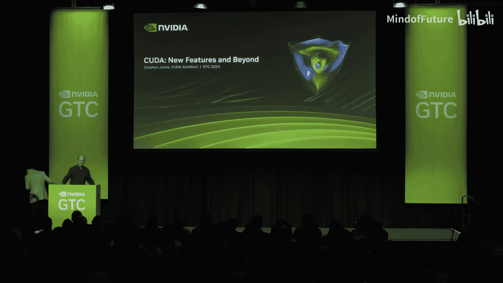

Thanks very much all for coming。 It's， it's amazing。 I'm sure everyone says this。

 but I haven't been to a talk yet。 It's' amazing to actually talk to people instead of to a camera above your screen when you're recording a talk。

 So it's， it's really not。 thank you all for coming here。 I'm， I'm one of the architects of Kuda。

 So I spend my time thinking about Kuda， the platform， the， the language。

 all the systems and stuff that goes with it。😊，And also， you know， I。

 I work closely with the hardware teams， right， I， I spend probably half my time。

 even though I'm a software guy working with the hardware teams working on what our next generation and the one after that GPU is going to be because you know。

 one of the magical things we get to do is we get to combine the hardware and the software so that we build the programming model we want and that we can program the hardware that we build。

😊，Now。I'm going to start today with。Something which I've learned working with the hardware teams a lot。

 And， and I I think it really drives a lot of the way of the things thinking about the things which I'm talking about today and also just a lot of the way I think about how hardware is driven by the laws of physics and by by the way the constraints that we all are living under in terms of the hardware that we design。

 as well as the software that the programs it。 right So this is possibly a contentious thing to said in video that accelerated computing is not all about performance。

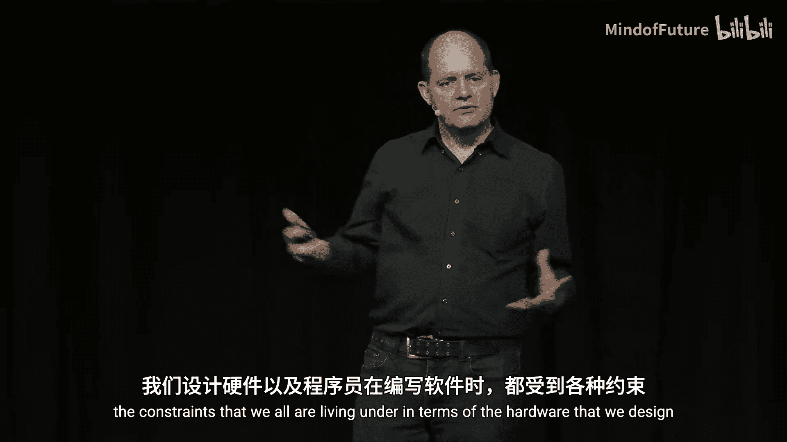

But if you're in the keynote， if you watch the keynote yesterday with with Densen。

 he was really talking about how it's all about energy。

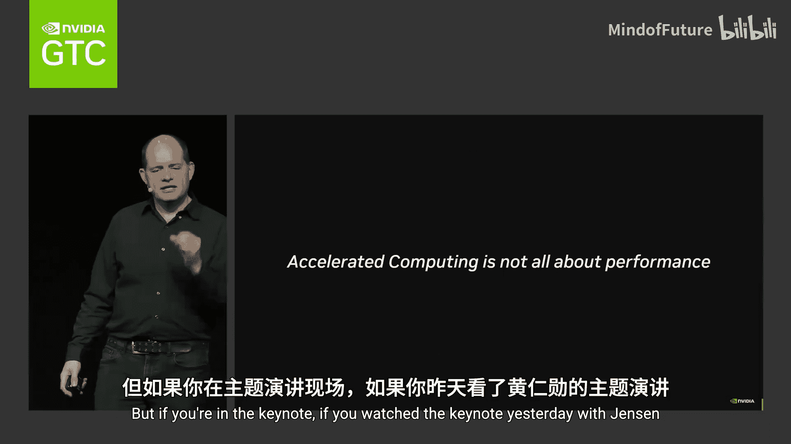

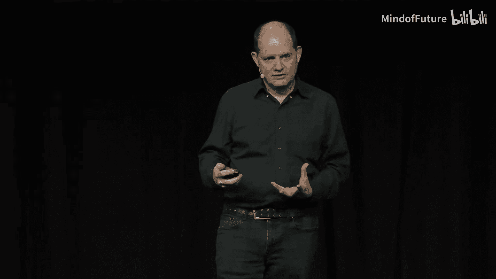

Right， it's not just the performance。 It's about the performance per watt。Because ultimately。

 you've got to power these things。 You've got to provide the energy into the machine。

 And so the efficiency is really the key metric that you have to care about。 Yes。

 you want to be scaling performance， but you've got to scale it with efficiency as well。

And the obvious place I went to look for this。 I I just just doing a bit of research for the。

 for the introduction of the talk。 You know， I went round looking at data centers， right。

 They're building data centers at an enormous rate in the world。 Theyre building。

 They're standing up something like 6 or 7 data centers a day。

 But I went looking for the number of how many data centers they build。 And they don't。

 They don't Nobody lists data centers by number， right， They list data centers by megawatt。

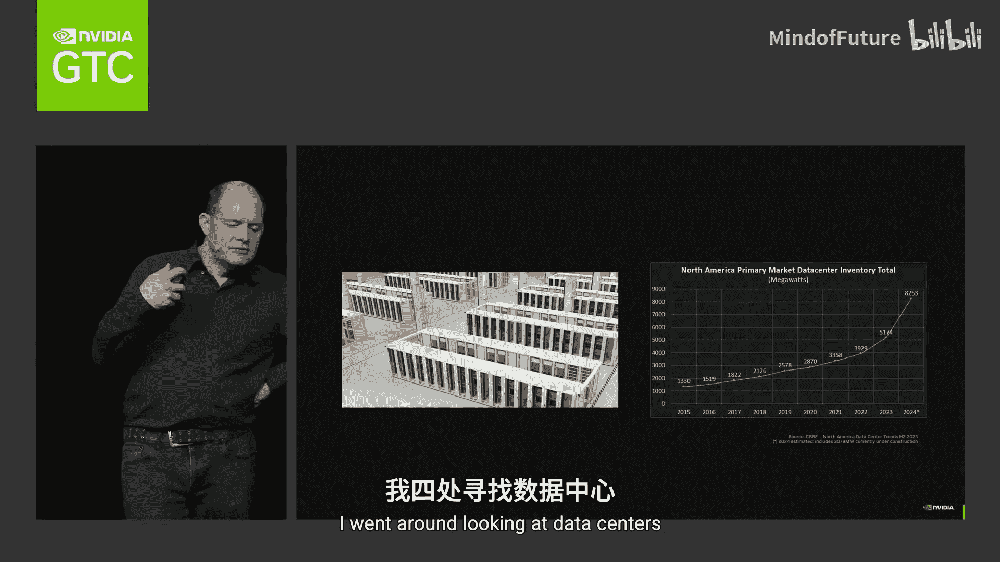

Because power is the thing that is important in a data center， right。

 There's 5 GW worth of data centers in North America right now。

 There's going to be another 3 GW standing up in the next year。 And when you go and you。

 you buy time on a data center。 You rent them and they're charged by kiloW per month。

 Nobody cares how many servers you're buying。 Nobody cares how much。

 how many data centers you' are renting， you are renting power per month。

 because power is the metric that really matters for computing。

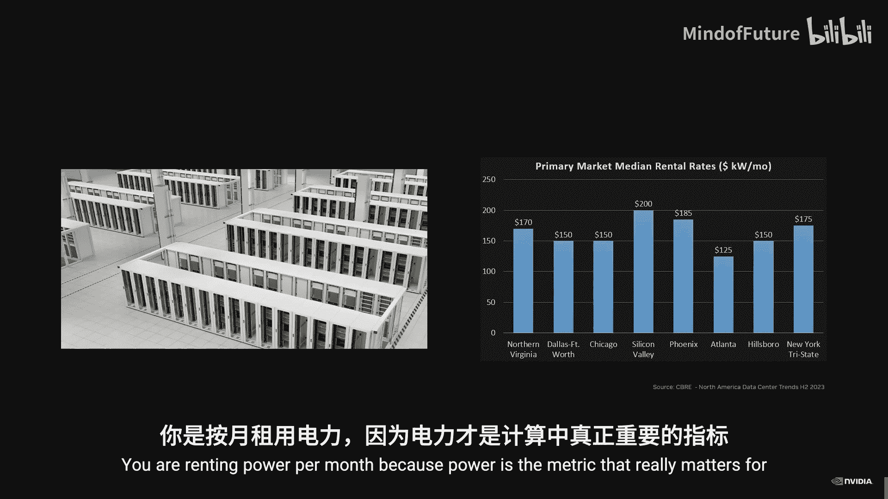

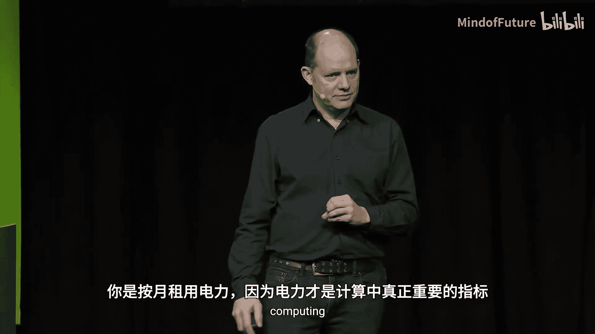

Right， and if you look at what a data center typically， is a medium sized data center runs。

 you maybe be 20 MW。 And that's because I've got this big building with a giant power connector coming in。

 and that power provides 20 MW of power。So if I build a brand new chip that goes twice as fast。

But it runs at twice the power。 I， I can't magically put more put more power into this room， right。

 Ive， I end up with half that number of chips。 I've got 20 MW。 The question is。

 what can I do with my 20 MW。 And again， if you， if you were watching what。

 what what Jensen was saying about Blackwell the keynote， he talked a lot about the energy。

 the power efficiency。 And that is a really big focus。 And on the hardware side。

 That's something that they're all thinking about Every transistor really counts。😊。

But it's not just in the data centers。 It's also。In my own home， right， my。

 my desktop machine gets power from the wall。 I can't put 10 Gs in it。 I can't。

 I can't run that out of my one and a half kW if I'm in America，3 kW if I'm in in in the UK。

 my maximum system power， my laptop， even smaller， right。

 so that everybody is constrained by power more than anything else。

 So it it is really all about energy。

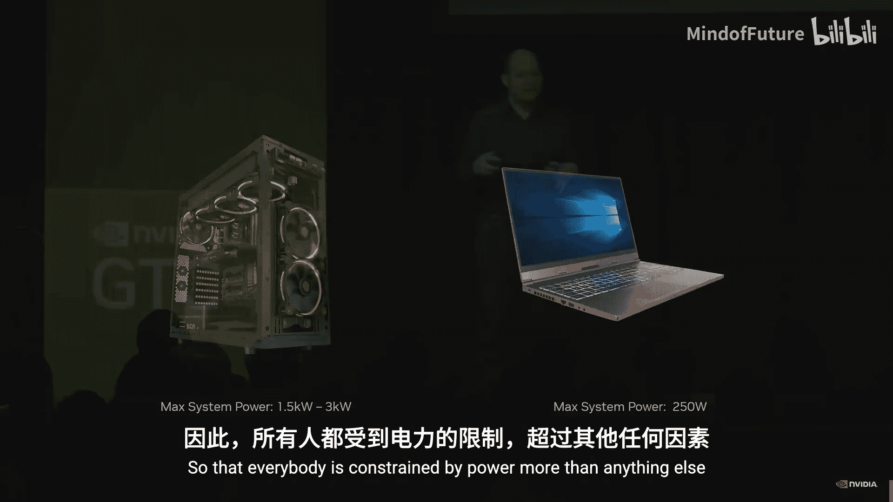

And the challenge we have is that the energy equation， the energy balance is getting worse。

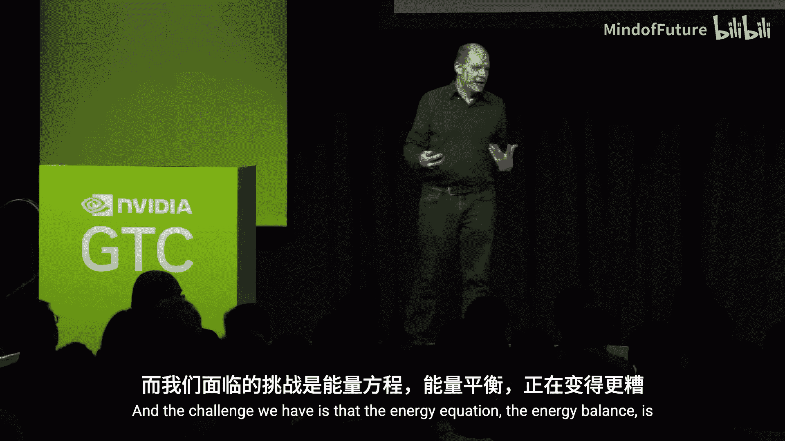

Right on the left hand side here， the very wellknown chart， if you like of Moore's law。

 That's a bunch of numbers which looks at the transistor density from when Moore stated his law back in about 1970。

 And it's pretty much been going exponentially。 It's a log plot on the left hand side。

 And on the right hand side， I went to T SMC's website。

 And I just pulled all the information about their different ships。

 And their transistor density that red line， that orange line has been， of course。

 increasing exponentially as well。 But something else you see。

When you look through that that data is that if you look at the power efficiency scaling。

 as I shrink my transistors， I need fewer electrons to turn them on。 And so they take less power。

 but the power is not scaling as fast as the transistor count。

 And that is a problem in a world which is energy constrained because when I keep adding transistors。

 I've got to do something about the power。And so。😊，Well， obviously。

 we look very closely at the hardware and the efficiencies of the hardware。

 It's critically important。 I mean， obviously， I say this I'm a software guy。

 but it is critically important to look at this in terms of the efficiency of the software as well。

 And so I'm going to be talking about a couple of really key pieces where power comes from。

 One is data movement。 And the other is the computation。

 The two obvious users of electricity and power in one of these machines。

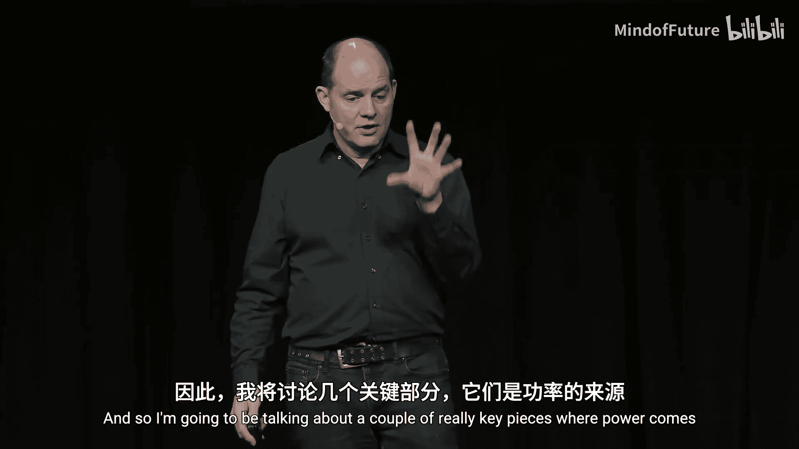

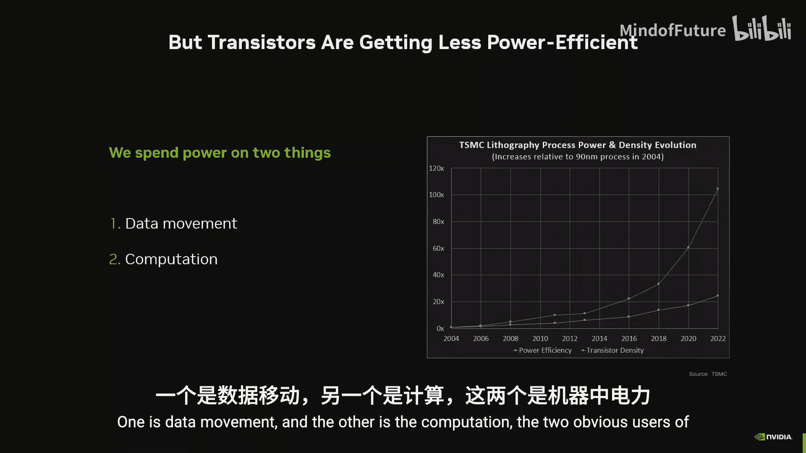

Right。Starting with computation， let's talk for a moment about floating point arithmetic because that's really the core of computation that is being done。

 right， In fact， most of these data centers running GP P is probably overwhelmingly a lot of a lot of the flops and of the a lot of the wts are being spent on things like matrix multiplication。

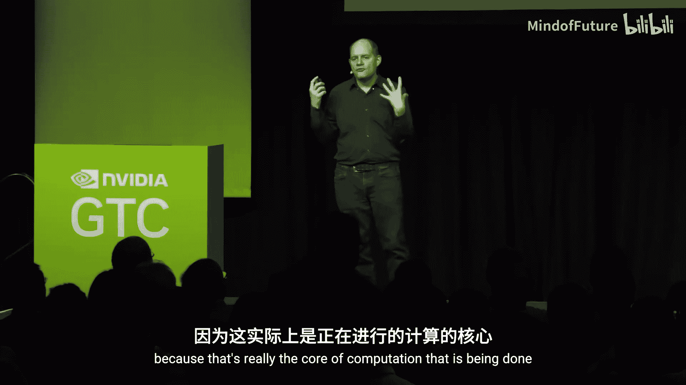

And so I went and I dug up a little table here。

You know， on the left hand side， we've got all these different precisions that Nvi offers。

 And there's lots of reasons for that。 But I'm going get into into a particular one focused on power right now。

 And on the right hand side。I can break this down into the energy that doing different precision of multiplications。

 And the FMA is a huge multiply ad。 It's sort of the fundamental unit of arimetic operation in the computer。

 And if you look at the top， you see that the standard flop。

 the 32 B single precision flop for which I've normalized everything to about one x。

 double precision about2 and a half times the power and half precision about half the power。

 And so it's not the key here is that the higher precision don't just scale linearly floating point multiplication。

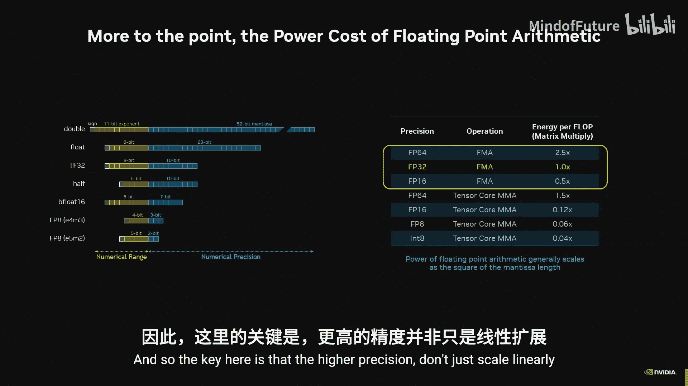

Scals as the， as the square of the mantis length。 That's that blue， excuse me。

 that's that's the blue section on the on the left hand side。 right， So the longer my number is。

 the more power it takes to compute that number because I've got more deimmal places。 I've got more。

 more bits to move around。

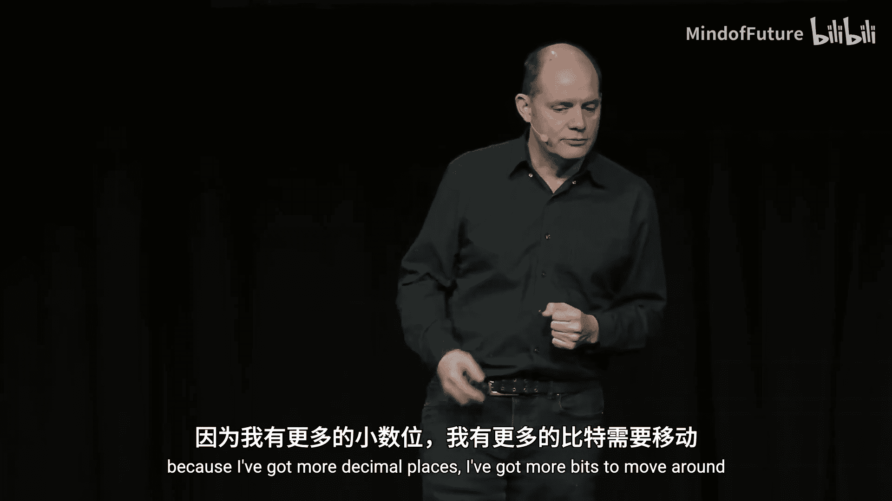

And then you look at the tensorors， right， The tensor core completely different。

 That takes these single operations。 and they can group them together。 And with an economy of scale。

 you see dramatic changes and improvements in energy per flb。😊，Right。

 so this is one of the reasons you see these investments in these tensor cores in these。

 these dense processing units is because I've got 20 MWs in my data center。

 I want to cram all the flops in that I can get。 And this is where this is the kind of place it's coming from。

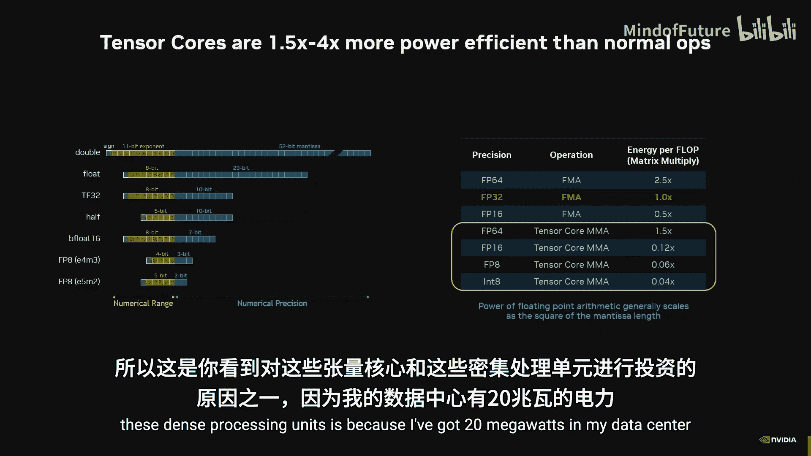

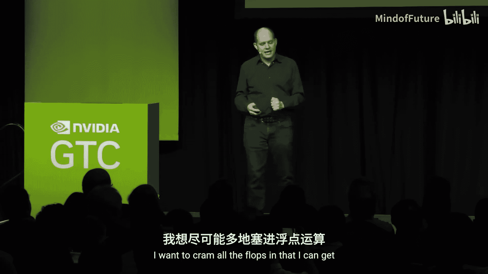

And so you can look at these interesting balances， right， the tensorore at F P 64。

 the double precision Tensor core。 and this is， this is this is looking at Hopper H 100 numbers is more efficient than individual multiplies and ads And that's the economy of scale I was talking about。

 But if you look at the difference between， say，16 bit。 right。

 instead of being one and a half times more。 it's four times more efficient because again。

 it's that square of the antic bits， which is getting winning me the power。

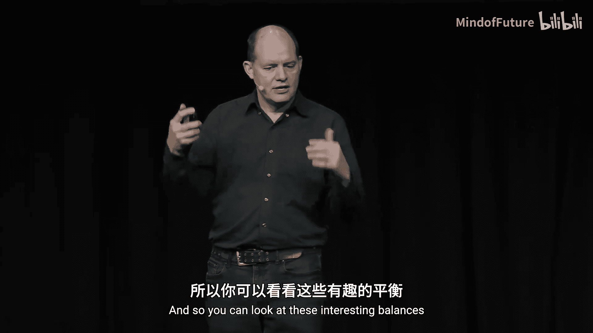

But I'm going to look at something， which I think is a more interesting thing to look at。

 which is the difference between these 64 B operations。

 which is two and a half times the power of of single precision and these tensor core at reduced precision。

 which is a tiny fraction a factor of about 20 in power efficiency， which is sitting there。 But。

 of course， there's a very big difference between a 64 B precision and a 16 B precision number。😊。

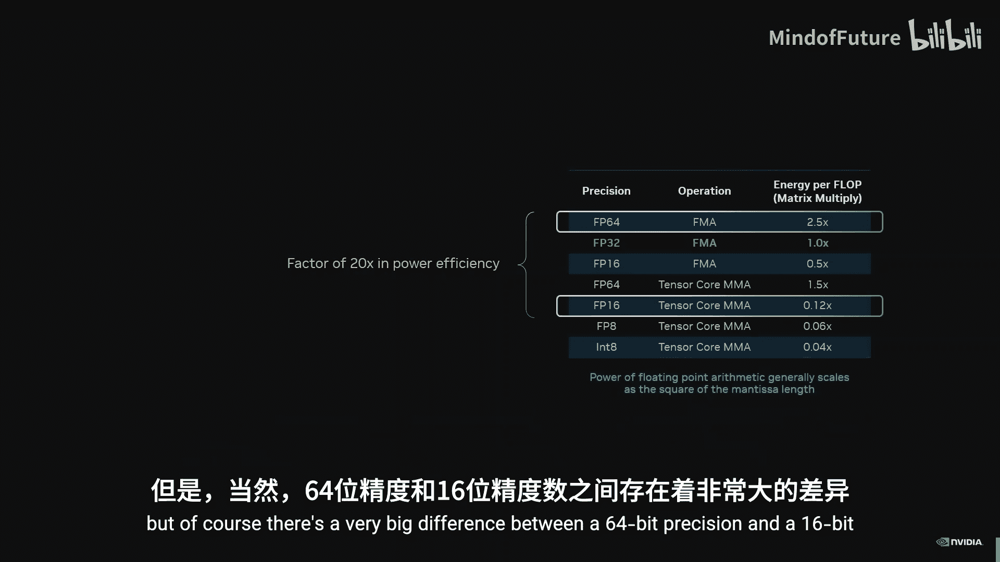

So it turns out there's not as much of a difference as you would think。 And this is。

 this is not new work， but there's a lot that's been going on about it recently。

 And I really wanted to tell you about this because I think this this， to me。

 is a really exciting way that we are attacking the power war。

 the power problem that I that I see from those， from those， those curves from， from。

 from the silicon processes， right。😊，A couple of years ago。

 I was telling about some work that that my colleague。

 Asm Haar and there's a reference to the to the paper down below was was using tensor course to do an L factorization matrix solve where you would do the heavy lifting in 16 B。

 And then you'd have this， this iterative process， this。

 this V Ms process to take your 16 B and progressively improve the the accuracy back up to 64 B values right。

 And so in in the paper， they look at this。Excuse me。

 and this graph shows on the bottom here the number of iterations。 I take a 60。

 I take the 16 B tensor course。 They output actually a 32 B result。

 And then I iterate progressively 34 times。 And there's。

 there's that line in the middle of what the FP 64 is accuracy is。

 And I can get closer and closer to the final result。 And finally。

 I exceed the perfect accuracy of a true native 64 B number。

 So this is not in any way compromised on the results。

 This is exactly accurate to the bit of what you would get。

 except I've done the heavy lifting using those much more power efficientic tensor course。

 And that's a really big deal， right， because here's a chart of actually。

 as I kindly ran this for me this weekend。😊，Of of running in this case， an L decomposition solve。

 the thing that was in that flow chart before。 and the green line is the gray top of the G H 200 theyre both 200 the green line is the 16 B plus 64 bit。

 The middle column on this on this chart。 The blue line is the pure native double precision values。

 And so you can see what you're getting you're not only getting the power benefit on the bottom。

 which is huge， almost the fact 6 improvement in flops per watt。 which is unbelievable。

 I can now do six times more flops in that power limited data center using this technique than I could if I had natively got the exact same result using double precision numbers。

 And at the same time， I'm going almost four times as fast。Right。

 so I'm faster and I'm more efficient。 This is amazing。 This is huge。 We this。

 this algorithm is actually implemented in the Kusolva library。 But I just， I see this。😊。

Reaching out into everything， right， If I can do work faster and more efficiently。

 this is one way we can attack this power wall that I see coming。

It's not just Asm's work as well。 as other people， my friend， my longtime friend Rio Yocottta。

 at the University of Tokyo， he and some colleagues wrote a paper looking at a completely different approach。

 But again， using low precision in his case， Integer tensor cores to produce matrix multiplication。

 And some of our genius guys in a video implemented it。 But what they did here。

 instead of just taking one of the G H200 like megapower chips， they took the L 40 or the L 40 S。

 And that's sort of the lower power data center apart。

 which does not have a native double precision tensor core in the first place。

And using the 16 B tensor cores that are in the L 40 S。They were able to run matrix multiplications。

 running at 6，7 times the performance。😊，Ply without even having a a proper， like， well。

 there is a double precision unit， but it's not the high power of high performance double precision unit that you would normally find in。

 in an H 100。 They compared it， in fact， and I I， it was too busy。 I didn't put it on the chart。

 They compared it to an A 100。And it's half the performance of an A 100 using no double precision tensor cause at all。

Which is absolutely incredible， right， This is opening the door to parts with much lower power。

 being able to achieve， you know， 50%。 the performance is incredible， right， And not only that。

 but the power savings。 right in the same way the same time as you're getting a factor 6 or 7 in performance。

 you're getting a factor of 7 or 8 in power in performance in power efficiency。 Sorry。

 performance per what。 So this is huge。 And so this fascinates me like I'm very lucky with this talk。

 I get to just find all these cool things that are going on around the company and tell you about them because they I find them interesting。

 And this is one of the things I think is really fascinating because there's so much so many things we can do with this type of technique。

😊。

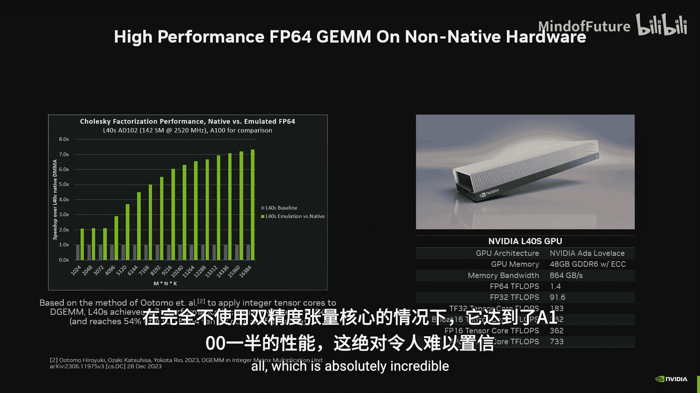

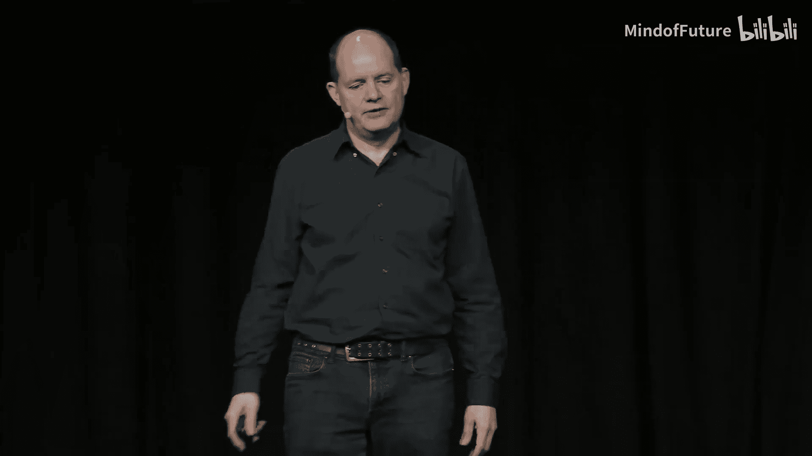

Now， tensor cores themselves， A lot of people come and ask me， how do I program Tensor cores。

Tenssorores are a complex system right there they have all these different precisions。

 They have these different ways of using them。 But the three main flavors of ways you get access to the Tensor courses is first through the kubla math library。

 That is your basic workhor that has existed since the very beginning of couda。

 it's linear algebra As， And you call a matrix multiply and that naturally automatically pipes through onto the tensor Kubla actually calls that one in the middle called Kubla Lt。

 Kubla L， which you can also access yourself。 it's a public library。 It gives these advanced API。

 where you can really control a lot more aspects of what the tensors are doing。

 The Tensor cores have a lot of different configurations。 a lot of different modes。

 you can really get access to them。 And on the right hand side， we have something called cutlas。

 which if youve seen give this talk before。 I talk about it probably every year because it really is the programmer's way of getting at the tensors。

 it lets you write Tensorore code inside your own kernel and get access to all of the different knobs and configurations。

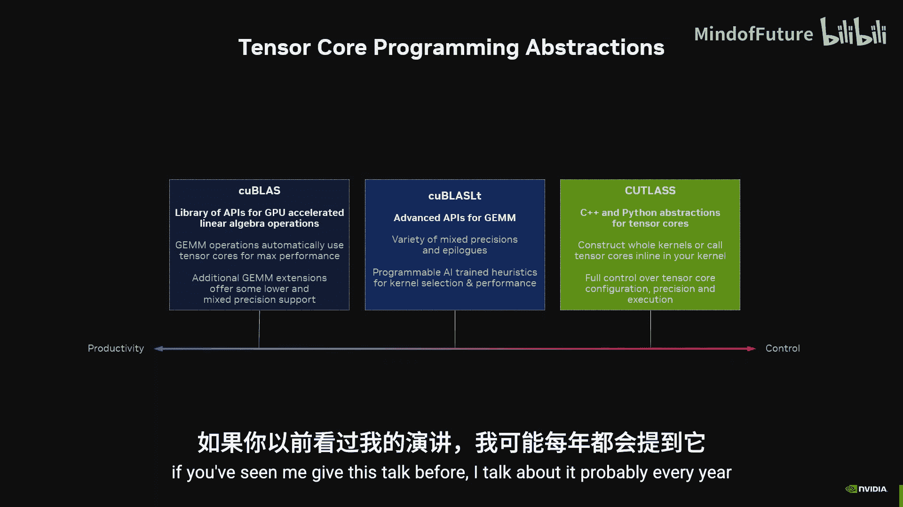

Tor court have。So I drew this out for myself in a different way， because really。

 there's a couple of different dimensions。 There's the productivity dimension of Kubla on the left。

 where I call one API。 and I get， I get the peak acceleration。

 And then there's a control on the right hand side。

 If I really want to start tweaking it and merging it and meshing it with my with my data。😊。

And so one of the things that the math libraries have done is they've， they've they' work。

 they've been been working on， on device extension libraries。

 that's called So the Kubla device extensionten library。

 This brings the Kublas on the left hand side， the productivity path。Into your device kernel。

So while cutts is a sequence of a hierarchy of C plus plus classes。

 which give you incredibly fine grain control。😊，There's a completely different approach on the kublast D X side。

 where the idea is that you can get your tensor cores activated in your kernel。

 just with a single gem core， just like you would do with kubblast from the CPU。And so。

Why do you want to do this， Why you want to do this。

 Because sometimes you don't just want a matrix multiplication。

 You want to then do something with the result。 That's what we call a fusion。 You take。

 take some data， you manipulate it in some way。 you do a few big matrix operations。

 And then you use the result in some way。 And by fusing all of these together。

 And this is a chart of having taken a preprocessing step。

 fusing two matrix multiplies together andprocesing step all in one kernel。

 The difference between doing that in one kernel and sequencing it with a series of calls using thrust in this case with Kubla is a factor of three in performance。

 So being able to take the the same simplified API， put it inside your kernel。

 customize it in the way that you want， also comes out with performance。 And again。

 I'm not showing per what in these cases， but all of these cases are reaching peak performance。

 but typically at lower energies。😊。

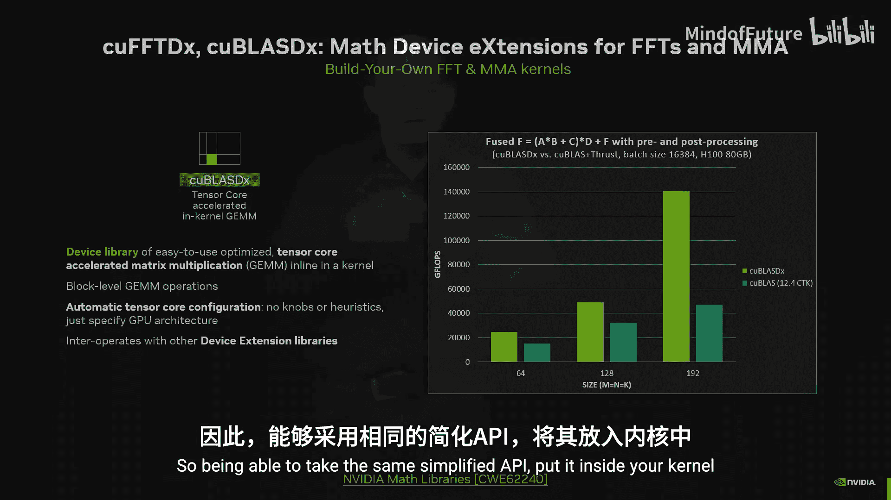

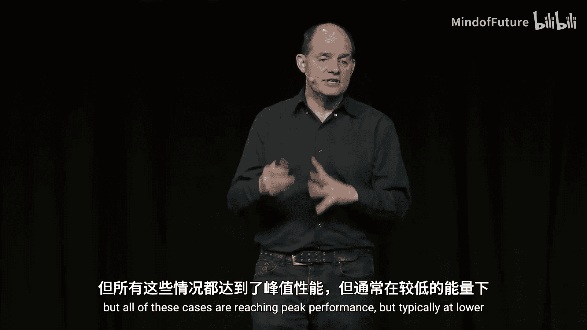

sameme is true for FFT。 I actually showed this this last year because they've been working on on device extension libraries for FFT for some time。

 FFT。 also， again， fusions of FF Ts with the rest of your with the rest of your operations In this case。

 I'm fusing three kernels into one。 And again， you see these speed ups。

 And so a lot of this comes from this fusion thing where I've really customized my kernels in ways that that give me the ability to string lots of work together。

 I load data once。 If you remember， I said there were two reasons for power cost。

 One is data movement and the other is compute。 This is solving the data movement so that my compute densely applies to it without the data movement going on between。

 And so how does that work， well。

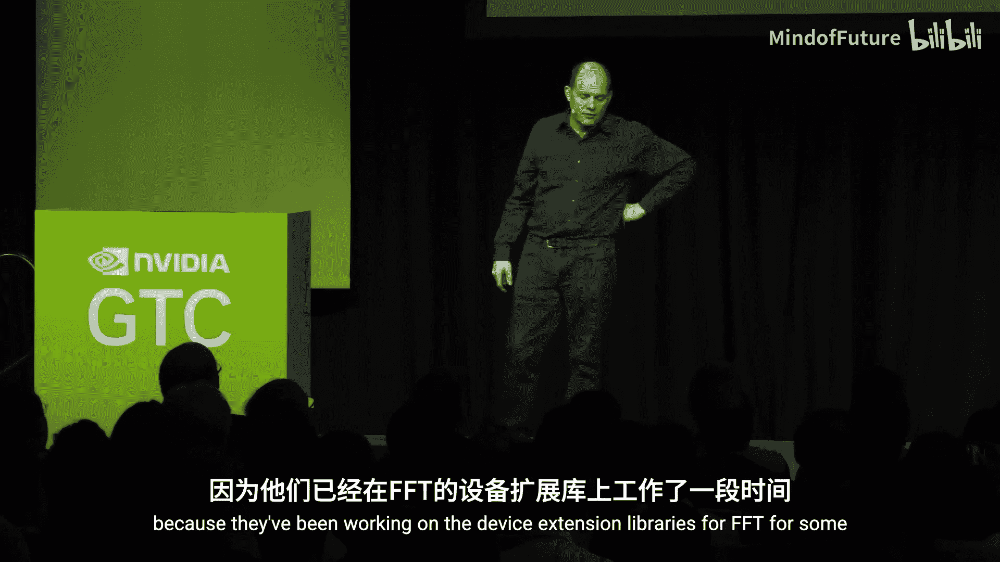

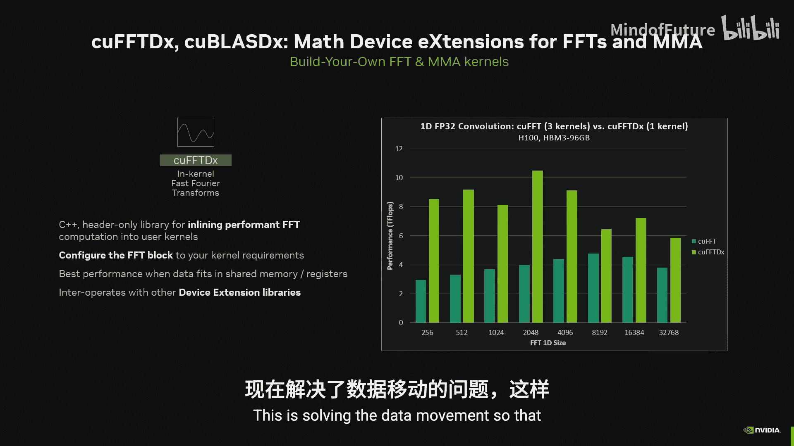

With the basic kernel of fusion。 And probably many of you are aware of this in the room right now。

 there's。

If I typically I'll have a sequence of operations， Maybe I'll do some precision conversion。

 I'll multiply things in a matrix multiplication， and then I'll run an activation function a value or something like that on it。

 some very standard sequence of operations。 And this is what those charts were showing just a moment ago。

 by fusing them together， you load your data once you operate on it many times And then you store your data at the other end。

 And you end up with these single fused kernels。 And this is a great idea。

 and everybody should do it if they can。 The challenge is that I don't just have one thing to do。

 I might have 100 different types of things to do。 And so I've drawn four on this slide because that's all I could fit。

 But even with four， I've got 64 possibleun combinations。

 And I can't build every single one of them all ahead of time。 know， if I had 100 on every row。

 I have a million different combinations。 That's just not feasible。 So what Im seeing is as people。😊。

Build these codes， which fuse things。 People are also moving。

Very often towards just in time compilation， run time compilation。

 where you say my program needs this fat and the other units configure them precisely for what I need and then compile it on the spot and run it。

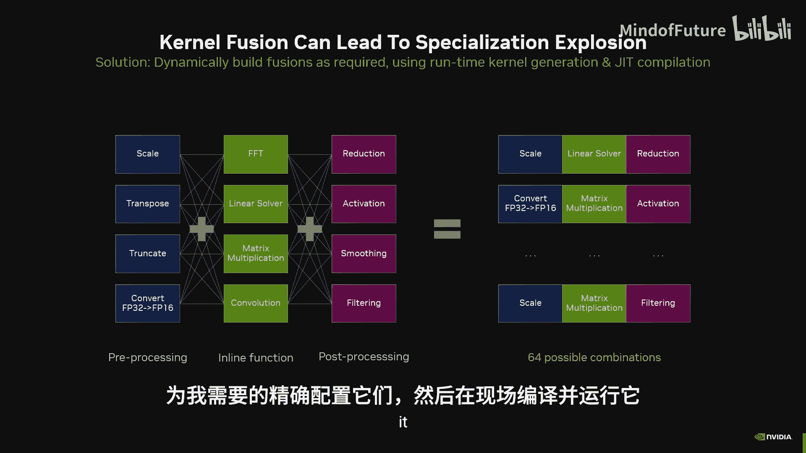

And so I seejiit compilation being more and more important in people's workflows inside Kuda。 and so。

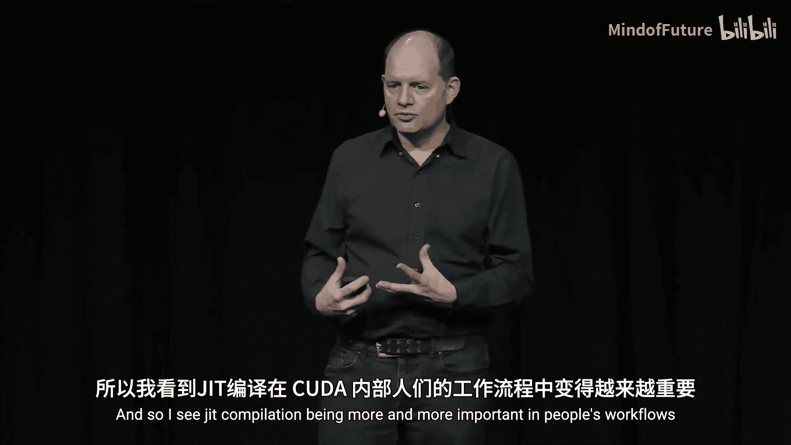

Our compiler team has spent。 This chart covers what 18 months， I think， from Ker 11。8。

And their work consistently reducing the cost of this g performance， because very often。

 as I'm showing down there on the bottom left， you've got this iterative loop， right， you build some。

 you build a aused kernel， you run it， you get some data， You look at what you're doing next。

 You build the next one， and you've got this iterative thing。

 The compile time becomes part of your main program loop。And so they've worked really hard。

 and they'veve got this is， this is just， this is showing the the time Comp time for hello world。

 So it's basically just overhead。 Hello world is the simplest program you can possibly write。 And so。

The overheads of compartment compilation have come down by a factor of 6 over the last 18 months。

 And so really， there's this big focus on how， how fast can I operate。

 How fast can I compile cause Gi compilation is showing up everywhere。

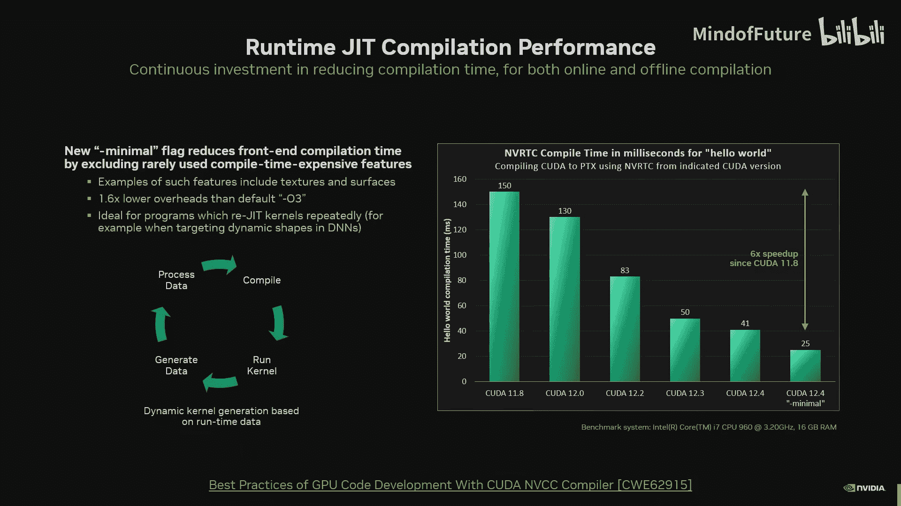

Right， now， Jit compilation。these compilation tools I talk often if。

 if you see me talk about this about when I think of Kudar。

 I'm always thinking of the entire platform， I my job as as one of the architects of Kudr is to think about how all of these things fit together。

 But nothing exists in isolation。 And there's kind of an inverted pyramid here。 Very。

 very few people are writing in programming compilers。 There's a few of you。 and we love you。

 and we absolutely support you， and we have L VM and all these other things that you can target。

 But fundamentally speaking， you can probably count on both hands。

 the number of people who really get sit down and start writing compilers A above that。

 there's kernels libraries host called libraries。 And then this massive universe of frameworks and SDKs at the top。

😊。

Right。Now， one of the things which I'm thinking a lot about these days and that I pay a lot of attention to certainly over the last several years is Python。

 right， Because when I look at the world of Python developers。

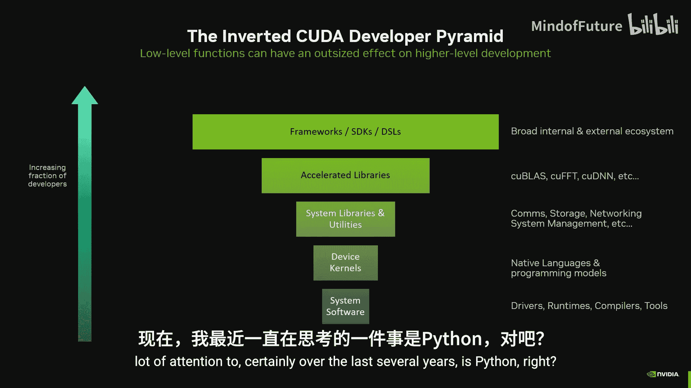

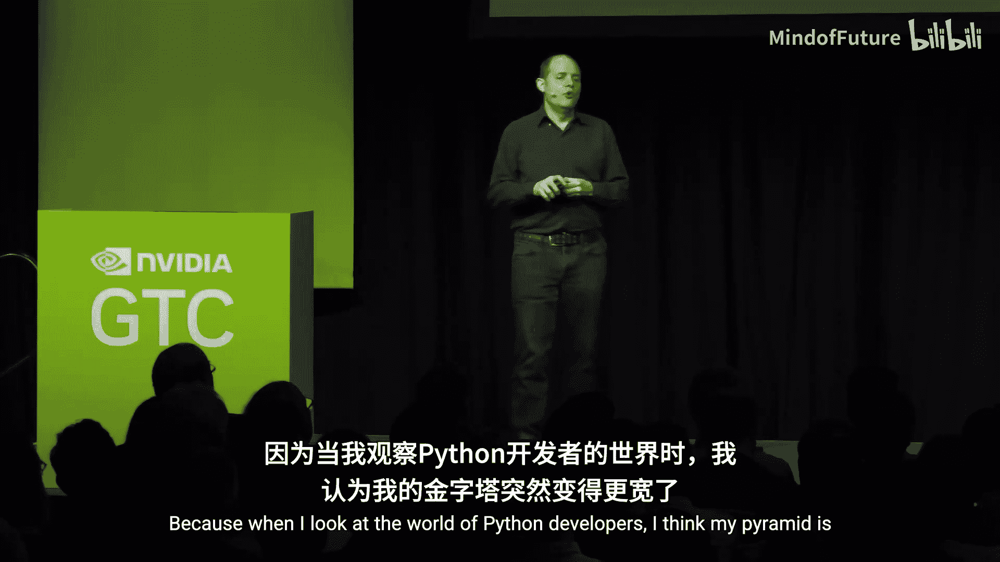

I think my pyramid is suddenly much， much wider。Instead of having， you know。

 a million users at the top， I've got 10 million users at the top。

 And so it's much the the gap between something that you can build at the bottom。

And the impact that it has at the top is even more broad， right。

 So making a change to compilers like Giit compilation。

 Jit compilation is incredibly important in Python because Python is this very runtime interpreted language。

 And you're constantly generating data dynamically。

 And so a compiler in the loop is completely normal。 In fact。

 the Python interpreter basically is one of those。 And so these changes we make at the very bottom affect enormous ranges of people。

 And so。😊。

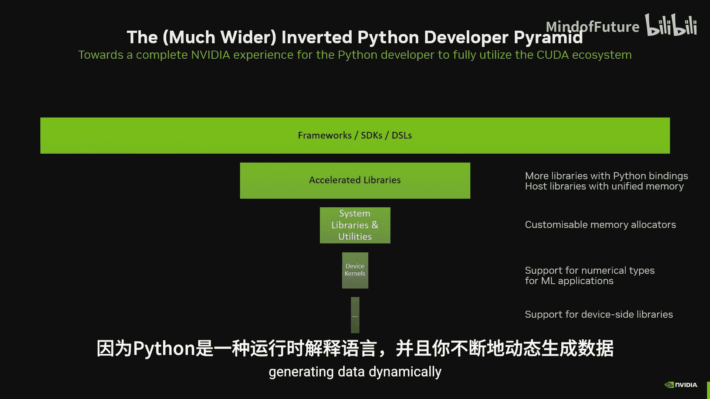

Looking at the Python stack， you have to invest everywhere all the way across it。 And so I've。

 I've listed a few things here in terms of places that we are really looking at。 But really our goal。

 And I put that as the subtitle of this slide。 But really it's kind of it's the vision that we have in terms of what where I think Python needs to be。

 where we， all of us in Ka do， which is as I say， towards a complete and video experience for the Python developer。

 the whole Kudar ecosystem available and accessible to Python programming。😊。

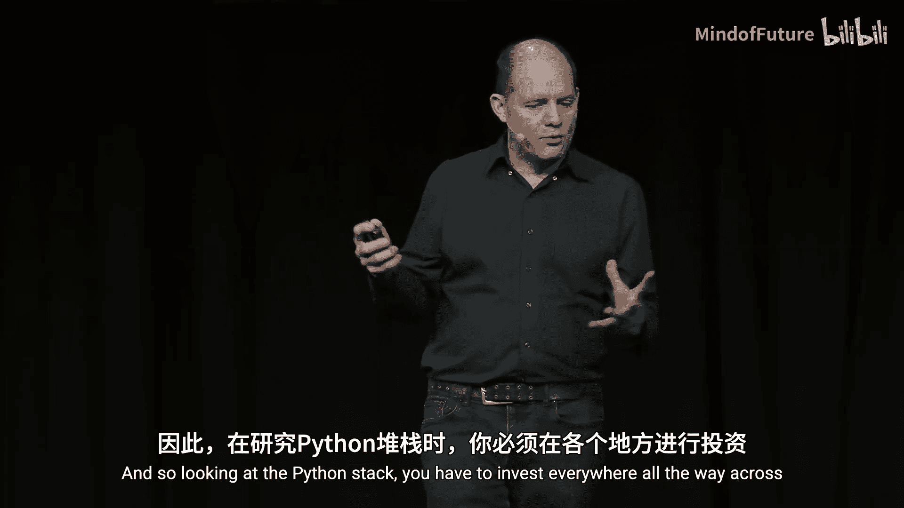

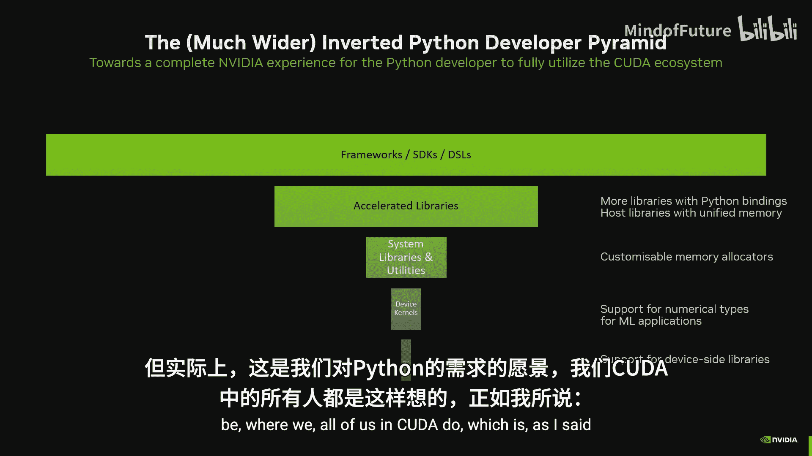

One of the aspects of that is that you're seeing our libraries and and our tools start supporting Python more and more。

 And so the， the， the， the math。

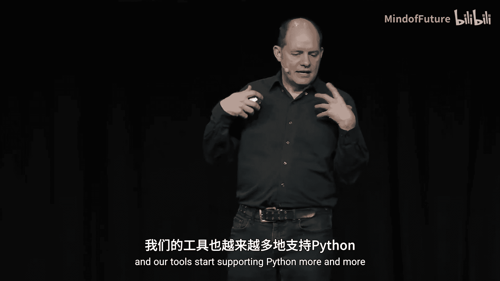

I mean the the math the the math library teams have put a ton of work into producing a pythonic interface。

 which natively and naturally connects Python applications to these accelerated libraries。

 which I think fundamentally， that the the libraries are the most common way that people access G P acceleration。

 And at the bottom here， by the way， through many of these slides。

 I've got links to other people's talks。And this is。

 this is a link to to my friend Artie and Harin's talk where they're talking very much about all to do everything to do with the libraries。

 and this is a big piece of it。 And so if you ever want to know more that there as an index list at the end of this is where you can just go and follow up and see what all the different talks are。

 which I've drawn from for the material in this presentation。 But the Python libraries。

 it's a full stack which goes all the way from your application through Jit compilation through the different APIs both CPU side and GP side all the way down onto underlying libraries。

 the GP accelerated ones， the NVPL and video performance libraries。

 which target the arm processor M Kl， anything else。

 So sort a universal frontend for the accelerated libraries。

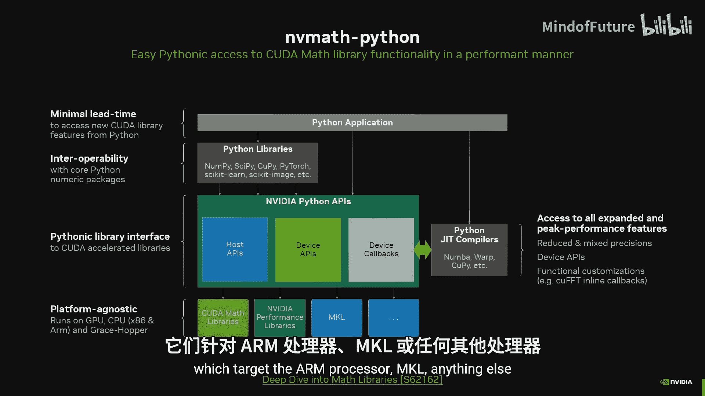

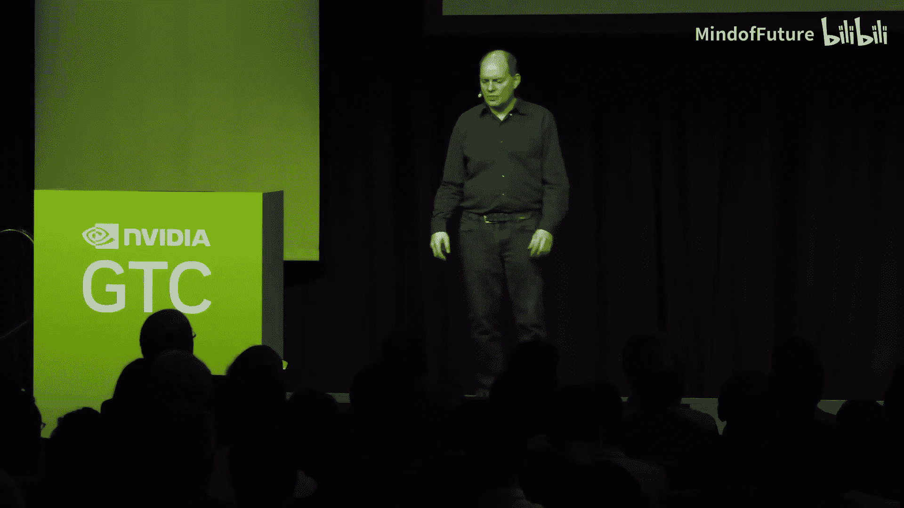

The other aspect of Tensor cores that I was talking about before was cutlas。

 which gives you detailed configuration control over the Tensor core。

 and Culas as well has a python interface。 And on the left hand side here。

 I've got just a couple of boxes one showing what the C plus plus interface looks like in the equivalent Python interface below。

 And there's you can go install it， You can find documentation for it and so on。

 on the right hand side， they've integrated this with Python with Pytorrch Pytorrch extension。

 And so you can you can emit Pytorrch from cutlas。 And you can automatically bring cutla extension Tensorore custom kernels in Python into Pytorrch。

 there's a cutlas was on the previous slide， the link for it。 go and have a look at the cutla。

 which is going to tell you a lot more about how this type of thing works。😊。

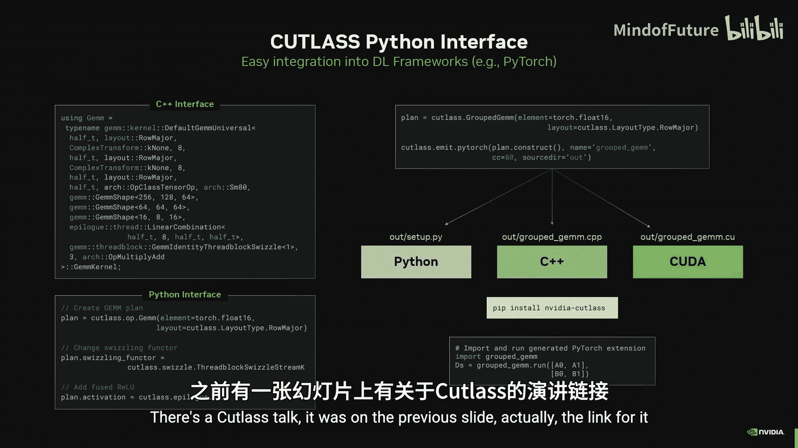

And as I said， we're not just investing in libraries and we're also investing in tools。

 And so the developer tools team for the coer platform。

 the Insight guys have been putting a lot of effort into into being able to combine their output for both CPU code。

 So I see C plus plus code and for Python code all at the same time in the same timeline。

 And so here on the right， I've got an example of doing exactly that。 Likewise。

 the code annotations what we call NVTx， which allows you to identify code regions by annotating it。

 And so you can have a green region of blue region。

 So it's much easier for you to find regions that you want in complicated profile and traces。

 This is all configurable for Json files and it works all works nicely with Python programs。

 There's all of these different pieces that pyramid that I were showing。

 you've got you've got to start putting the building blocks in all these different places so that ultimately you end up with an ecosystem that works up and down across the board。

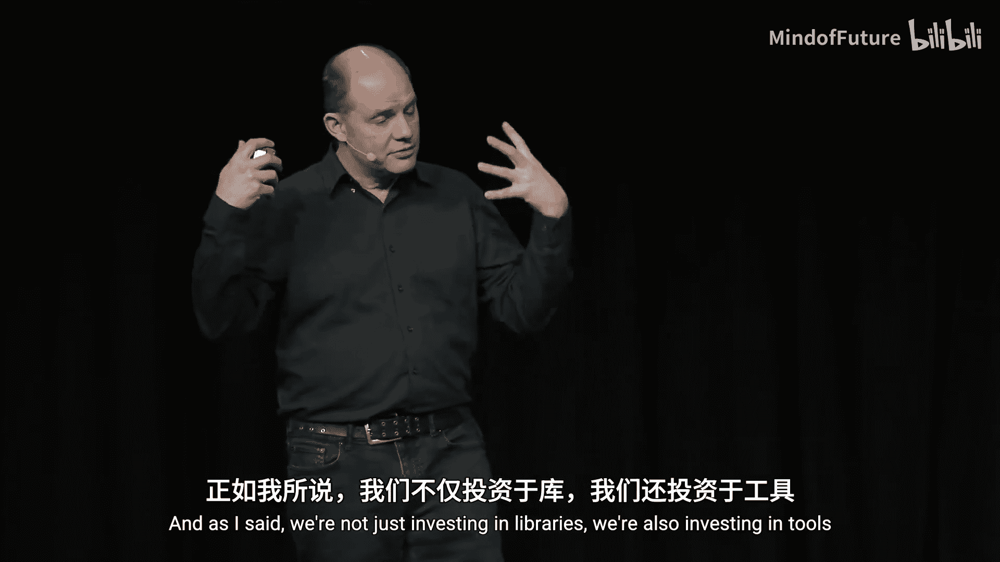

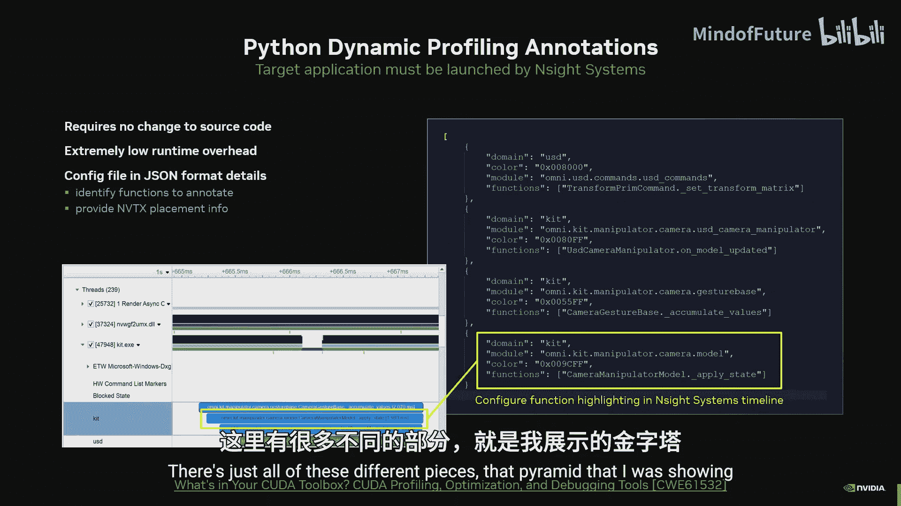

As I said， I look around and find these amazing things that people are doing。

 And one of the things that's really caught my eye inside the video is warp。😊。

My friend Miles Mclin， who is， who is normally in in New Zealand。

 But he's up here to give a talk about， about warp this week。嗯。He runs a team。

s built this thing called Warp， which is it's it's a very special thing。 It， it's a Python。

 It lets you write GP P kernels in Python， but they are differentiable kernels。

 and it naturally and automatically takes the kernels that you have written。😊。

And with Giit compilation again。 remember， as I said， Jit compation showing up everywhere。

 he can automatically produce the reverse mode， differential。

 differential version of your of your flow。 So you can have a forwardd pass。 It records it。

 and you can replay it as a backward。 And so you can。Construct simulation code， physics code。

 computational code。In the kernel， GP PU accelerator that compiles straight down onto the GPU and runs that full compiled GP performance。

 But with this。With this back differentiable pipeline available as well。

 And the things you can do with are incredible right So there's a whole compiler chain inside of here。

 which takes in the python and and turns it into P T X and and runs it on the GPU。

 But it lets you do these things。 these amazing simulation things。

 His talk is down here go and check it out because first， it's incredible technology Second。

 he's doing it in the realm of computer graphics。 So he's got beautiful videos and visuals as well。

 And you know but this isn this is an example where modeling something incredibly complicated like this plastic system of tearing bread apart。

 And you know the big one is the simulation and the ground truth looks almost exactly the same。

 And being able to do this and teach a neural model to follow how something like this。

 Some plastic defamation functions and works correctly。😊，Through auto differentiation。

 you can just run the simulation。The backwards differential pass is used to train the used to train the model。

 And then the model can very， very quickly start producing just just amazing computer graphics like this and raising simulation results like this。

 Go and check out his talk。😊。

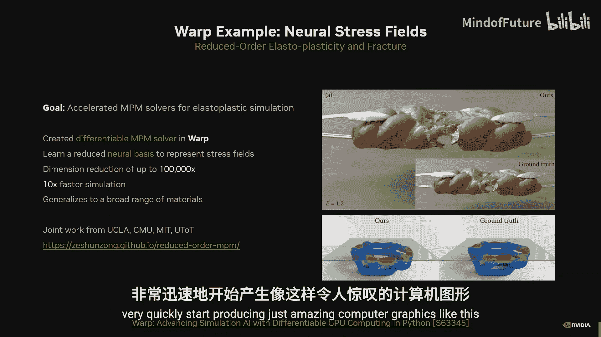

So。Last year， and I very rarely reuse slides， but this， this slide nicely summarizes。

 I told I told you， I told you about something called Leate。

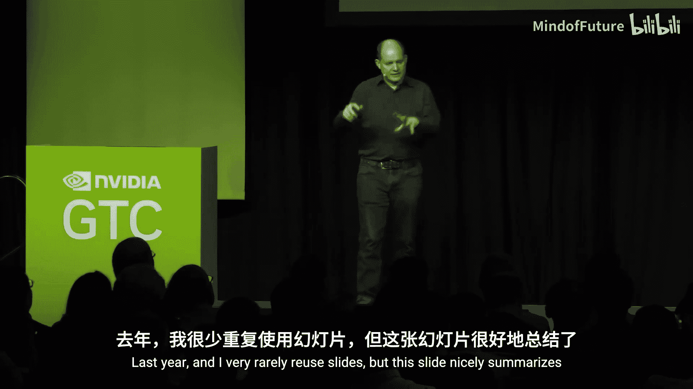

And I want to tell you a bit more again， because again。

 it it fits into a lot of the the stuff that I've been talking about again。

Leate is a framework which takes your basic single threaded code and distributes it very widely across a large number of machines。

 these machines are getting bigger and bigger。' processing more and more data to program these things gets increasingly hard。

 and this is what something like Leate is for。 It's a layer。

 It's a stack where you have libraries on top a runtime in the middle and it runs across the accelerated libraries across your whole machine。

 And lastly I showed you that a basic stenil benchmark using nuy nuy can talk to this thing we have called cunumeric。

 which is a nuy implementation based on Legate。 and it automatically scales your nuy program in this case across 1000 GPpus。

 It's a pretty straightforward to s computation。 But it's a very powerful tool。

 And so what they've done with this is they've taken Leate and they've applied it to the jackX framework。

 Another framework for differentialiable computing。 many of you have probably heard of it。

 and the jackX framework's heavily used， of course， in machine learning。In AI。

 but it actually is a framework that can run more or less arbitrary simulation。

 another differentiable computing thing similar to the war in Python that I was showing you a moment ago。

And Jaxs is based on the X L A compiler， which takes in all all the different layers of jacks and compiles it down to a particular target。

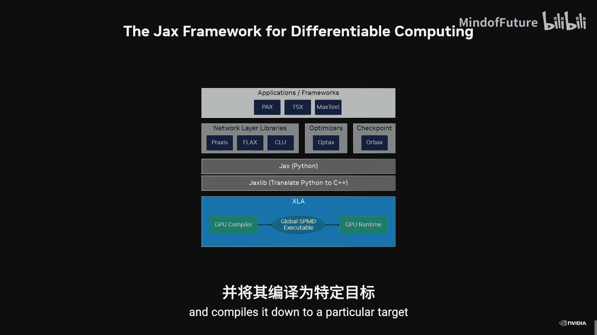

So what the what the guys have done is they've integrated， Leate into Js at that compiler level。

 at the X L A level。 So your Js program。

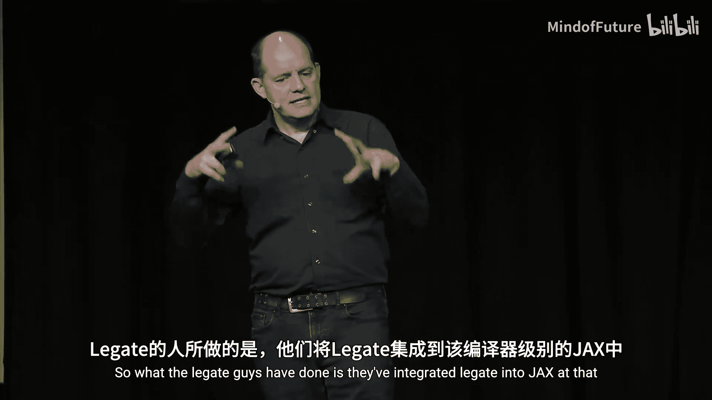

Does not change。 The structure of yourx program is the same。 You you mark up a few things。

 and you you indicate with decoration decorations and configurations about what the pipeline stages are of your program。

 which I think they'll be able to turn put in the compiler in in the future。

 And then this plug in to X， L A， the compiler for for Js。Then take， take through your code。

 match it across all the leggate runtime and allows it to scale。And so what they've done with that。

 they've and my my friend Wan Chan has has a talk on this where he goes into way more detail because。

 you know， I only get to give you two or three slides on every single topic and just running it。

 comparing it against Pam L and Al， which are common distribution frameworks inside of jacks。

 the scaling in the ease of use is is very impressive。

 So go and check that go and check his talk out if if you're a jackxs programmer。

 because scaling is really such a powerful thing to be able to do。😊。

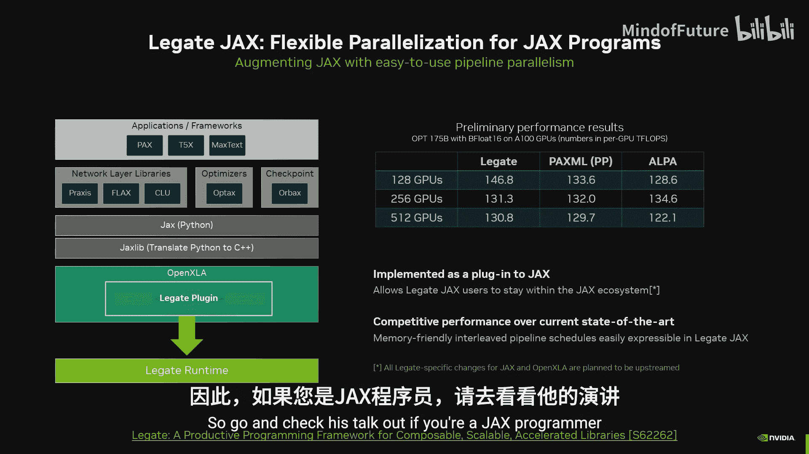

At the same time， the scaling across these big systems。

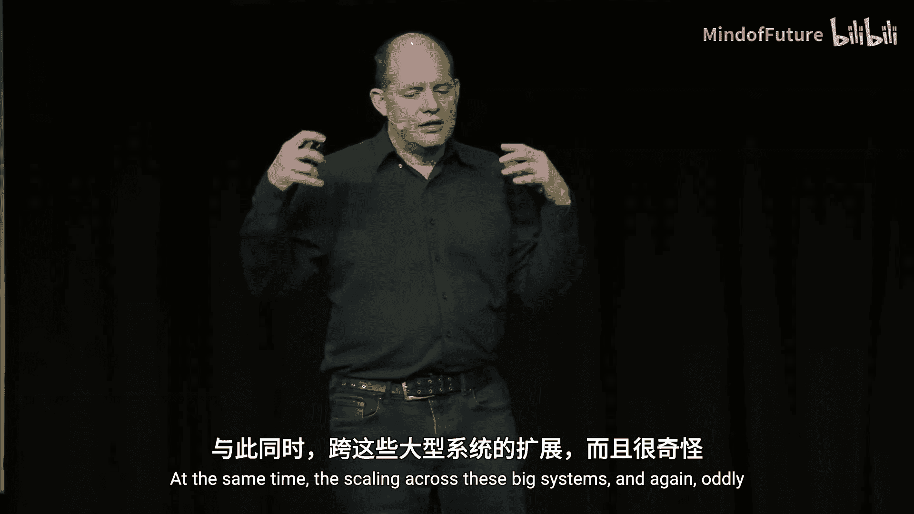

And again。Odly reusing another slide from last year， just because it's， it's a good description。

 Ensight systems have spent an enormous amount of effort working on their distributed system analysis。

 right， Putting a break point on a GPU is hard enough with a quarter of a million threads。😊。

And figuring out how to make a tool break a quarter of a million threads and tell me useful information is incredibly difficult。

 And now I scale this up to thousands of machines。 There's just no possible way。

 So you need new tools， and they've really invested on these new tools。

 And I showed you some of those before。 And I'll show you I've， I've got a quick picture again。

 But a key piece that they've done with this is they've taken these， these large。Distributed tools。

 these multi node tools that they've got， and they can now embed it not just in the inside system's main view。

 but in your Jupyter notebook as well。 And so your tools are available at the place that you're writing this code。

 And again， it's all about those building blocks across up and down the stack， right。

And it's amazing。 like they take vast amounts of data and they can boil it down to a picture。

 In this case。 I've got a heat map showing how the deeputilization and the communication are or are not overlapping so I can find computer only zones where I have opportunities for asynchronous communication。

 And again， all about energy， right， I my communication and my computer working together。

 Everything moves faster than if I'm doing them one after another。

 And then I've got high power running running for twice as long。😊。

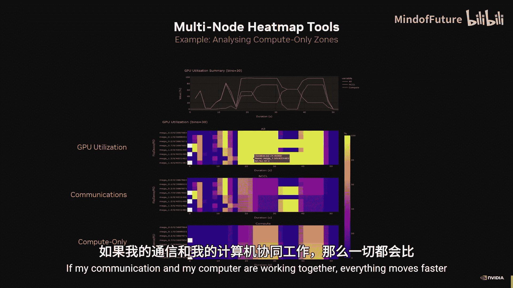

So at the other end of the scale from Leate， but still a very large system scale is something called N Vm。

 And this is something we've had for quite some time。

 N V Sm' has been around for several years it evolves and has has had a lot of different a lot of new things come into it all the time。

 There's there's a whole talk by my friend Jerry， who talks about all things， multi GPPU programming。

 And he is one of the best speaker I know and his talk is absolutely worth going and seeing。

 But what M V Schm does is it gives you low latency。

 fine grain control over the overlap of computer and communication。

 It's one of those things that sits underneath a lot of the stuff that you use without you really knowing you're using it。

😊。

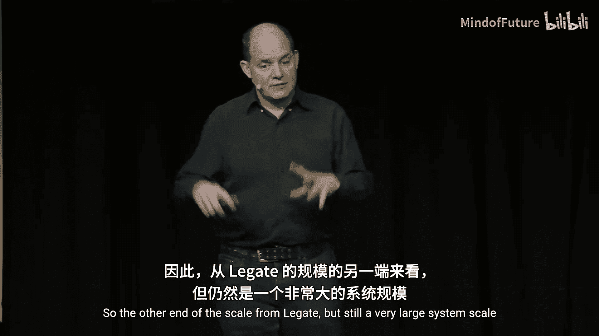

But what I'm going to be telling you about is actually the thing that sits underneath that。

Because it's really interesting。 You know， these things， these en me things on my pyramid。

 they fit down at the bottom level。 right， This is something that maybe100 people use。

 but which affects a million people through these different layers。And one of the technologies。

 which is deep， deep down inside of this， is something called GP P Direct。

 And I've told you about GPp direct before。 And I'll just go through a quick sequence explaining what it is。

 because when I've got data being produced by a GPU and I've got to get to the network。

 and the network has historically been a peripheral attached to the CPU。In in the past。

 when before I had GPp direct， my GPp would generate data。

 and I'd have to go through four different steps to get that data out onto my network。

 I'd have to synchronize copy a couple of different times， trigger some things。

 So those four hops to go through in order to be able to get my data out of my GP and onto my network。

 And so GPU direct came along and said， this is ridiculous。

 especially for the amount of data that I'm moving。

 Let's just move my data directly to the network device。 And so I eliminated my fourth hop。

 And now the direct single past copy GP direct allowed me to generate my data and then send it directly from GPU to network card。

 And that's very powerful。 But it still keeps the CPU in the loop。

 So they came up with a thing called GP direct asy。

 And this is these evolutions that happen over the years as they work and improve these technologies。

 And so now I've kind of got a two and a half step process。

 What the GPp direct async does is the CPU can do the setup。 but it lets the GPU trigger it。

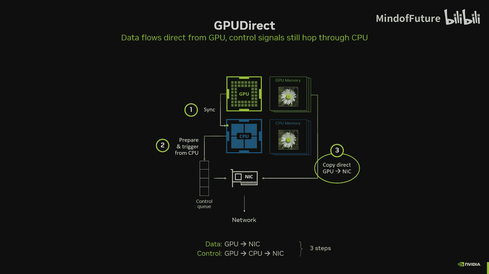

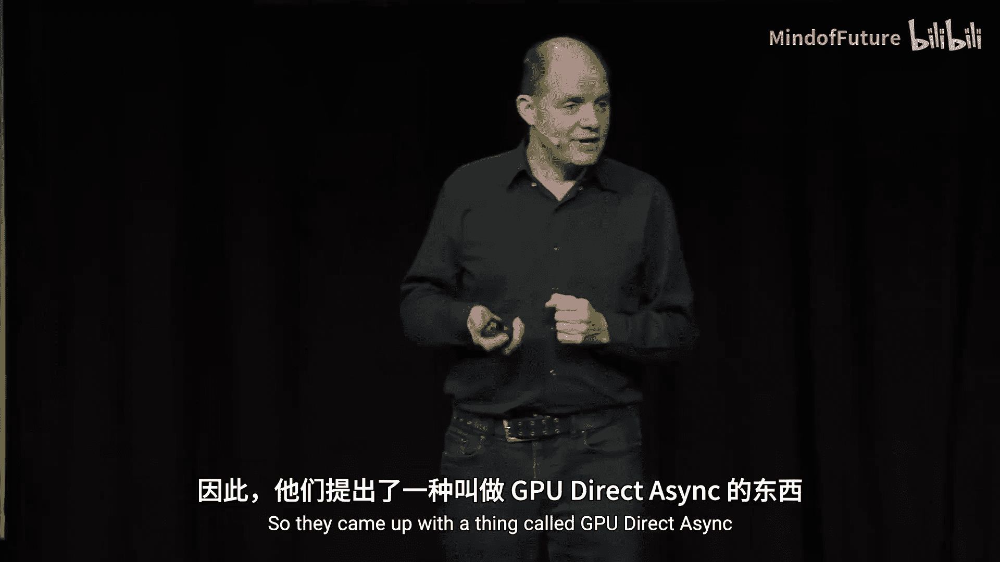

And so the data moves automatically and directly。 And there's some CPU proxy that handles the triggering。

 But it's now fully controlled by the GP。 So the GP program doesn't have to stop so that data can be sent。

 It can keep on going and just signal， now send it。 now send it。 Now send the next one。And now。

 finally， they've got this thing called GPpdirect kernel initiated。

 And this is where you take the CPU out of the picture entirely。 This is a truly two hops process。

 You can never get fewer than two hops。 You've got to first prepare the network that it's coming。

 And the second thing is to stream all the data off and onto the network。

 the two is the lowest number that you can get here。 So we've gone from 4 to3 to 2 and a half to2。

 And this embeds everything entirely in the kernel。 And the result is incredible right。

 This is is a run of training on a graph neural network。 I'll explain more about that later。

 actually， where that middle line is that two and a half step process。

 So the two and a half step process is still 20% faster the vanilla normal non GP direct process。

 But once you put everything on the GP and you cut the CPU out of the picture。

 I no longer have CPU threads waiting and polling and trying to orchestrate everything it's all coming straight out of the GP that is producing the data and sending the data。

😊，On this particular training run， you were talking at a factor of two speed up end to end。

 And in terms of the transfer， the feature transfer。

 the movement of the data that you're carryinging about。

 you're looking in order of magnitude speed up more right。

 So the power of being able to make the communication more streamlined more autonomous。

 I don't mean the power and what's in this case。 But the potential of that is so enormous。

 And these things sit there and they quietly and silently plug into something like N Vmm。

 They plug into something like nickol。 And you end up nickel。 This rests on top of this。

And for nickel on the left hand side you know， Nila。

 Nickla is the thing that moves all your data between GPU is when you're。

 when you're doing any kind of， of， communicating multi GPU job。Small messages are the hardest。

 right， One bite messages are extremely difficult because they。

 you're sending a lot of overhead for a small amount of data。 And here。

 you're taught what this does is cuts your latency considerably。 And on the right hand side。

 you've got much more bandwidth and potential because， again。

 you're cutting out the overhead and you can really communicate much more efficiently。

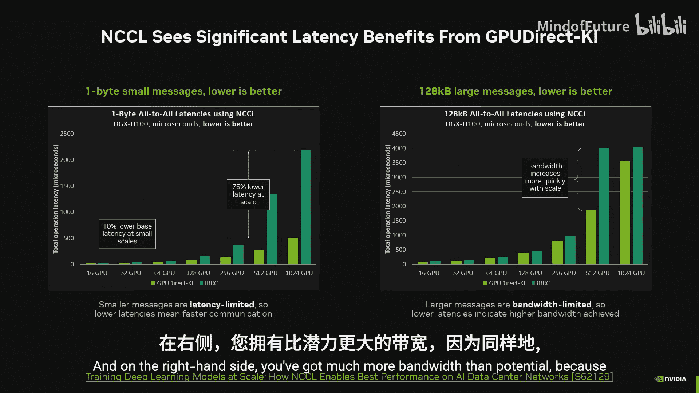

And again， tools integration everywhere。 It's so important to be able to see what's going on。

 We've got envisish mam and nickel traces built into the tools。

So。I want to talk about。The thing that I think I've had the most questions about over the last year。

 which is。

The Grace Hopper and the programming model and the way you program those machines。Right。

 and the philosophy of Kuda has always been that we have a single program constructed of effectively a GP function annotated by global and a CPU function。

 And it's all in one program。 It's a heterogeneous program， right， It's not two separate things。

 It's one program with functions running in two different places。

Right， and this is， this relates to something that Jensen was saying to me the other a few weeks ago。

 You know that it it's， it's not that you're replacing serial work with parallel work。

 It's that it extends it。 You need both， and you want to do both。Right。

 and so the idea is that CPU code runs on the CPU and GP code runs on the GP。Right， and between them。

 historically， we've had this PCI bus。 And so even though you've got these very high speed memories going on going on。

 the PCI bus has historically been a bottleneck。 And so the obvious thing to do。

 which we did with the Grace Hopper chip。 and we talked about this last year。

 is that you can combine them together with this thing called the Nvy links C to C connection。

 which is many， many， many times faster than PCI。 And so my data transfer goes through much better。

 right， And this is called Grace Hopper。 This is what what the machine is。 But。😊，It's not just。

A device with a very fast interconnect， in fact。It can be that。

 But I think that's really just missing the point of what this is all about。

 The reason that I love this thing。 It's， it's that you've got really one processor with two characteristics。

 to， to like natively， two different things。Right， I've got。

2 memory systems optimized for their own processor， but。1 is optimized for a latency system， right。

 My CPU is a latency processor。 It has deep caches。 It cares about linear operations very fast。

 My GPU is a throughput machine。 It has these very high bandwidth memories。

 and it has very high bandwidth caches。 And the way that you treat these things is different because the way these things run code is different。

 And so on one of these greyhopper machines。 It it's a single unified memory system on two different ways of executing。

 And if I got something like a linked list， run it on the CPU， It's much better。

 if Ive got something like a parallel reduction， run it on the GPU。 That's what it's for。

 And I can take I can pick and choose just like my program with a hybrid of two things。

 I can literally run whatever I want at the right place for it。

 because these two systems are unified with one address base。 So it's more than just the fast link。

 It's the fact the GP can see and modify and touch the CPU memory in doing so we can detect it。

 And we can move that over to the GP。 So the GP can get the benefit of its very high bandwidth caches。

 that could be as much as a factor of 10 improvement of performance。😊。

If you're touching that data all the time。 And so the ability to both。Comine the single address base。

 but also intelligently move things around while while we're working on it Its unbelievably powerful。

 That lets me put the compute and the data where it needs to be。 And at the same time， of course。

 the migration doesn't affect the CPU。 right， It can still access and touch and see that data。

 It's a little bit of extra latency。 of course， it's going over the bus。 But but really， my。

 it's it'， it's really one machine。 And that's kind of the point I'm trying to get to。😊，And。

This is some results from I， and very generously， I'm able to show some results from from Thomas Schultter's talk。

 He is the director of C C S， which runs the， the， the icon code on the， on the。

 on the newly brought up Alps machine， a Grace Hopper machine in in Switzerland。😊。

And this is just a fantastic example of exactly what I was talking about。

 There's a simulation here where you've got an ocean simulation running purely on CPU code。

 And you've got an atmosphere simulation on the GPU in green。 and the coupling is extremely tight。

 And so you're moving data around a lot。 And so historically。

 it's been you're more or less been limited to the performance of the CPU code。

 But when you move to something like the GP， you're really able to run both of these things at the same time。

 The CPU code on the CPU， the GP code on the GP， the very close coupling and exchange of data automatic。

😊，And the result is， you know， this is a factor of three speed up。 This is unbelievable。

 And this is at the scale of 64 GPus。 And you know。

 this is the kind of thing that is going to affect the number of days like I can forecast in my weather forecast and really important things like that。

 which impact everybody。

At the same time， other great examples， my colleague Matttes has to talk about this。

 just looking at fine tuning of of language models。 You know。

 a language model is a series of transformer layers。

 And when you go through your transformer layers as as you're processing these and you afford past training it。

 You generate these intermediate tensesors。 and there can be a large number of layers。 and therefore。

 a large amount of data。 So typically what we do is we throw away the data。 And then on the way back。

 we recalculate it also。 So we double our computation。😊。

In exchange for， for saving some memory。 But with the Grace Hopper device。

 I can actually cash some of that。 instead of throwing it away。

 I'll keep some of it around on the GPU， the small things are not worth， not worth throwing away。

 The blue things。 Instead， I will cache them and save them on the grace memory。 because remember。

 memory is just one giant memory one giant memory system。 And then on my way back。

 I can recall it back in from the GPU。😊，And so I don't have to do that recomputation。And the result。

Is a 20% speed up in this， in this particular example。

 This is taking a 10 billion mixture of 10 million parametermeter mixture of expert model。

 And you can see on the left the light green is offload and and the dark green is recomp。

 The recompute time is， of course， the same for both。 But if I'm doing on grace Hopper， if I。

 if I do the offload of data instead of the recompute， I am gaining in time。

 because I've got this very tightly coupled memory system that lets me do it。Another example。

 which I see a lot of these days is graph neural networks。

Graph neural networks are the kind of things， which。

Financial institutions go and analyze if your credit card has been used fraudulently things like that massive。

 massive massive interconnections of information。 And the graph sage model is primary model for going and using neural networks to solve graphs。

 And so this is a trivial a simple walkthrough of how it works。

 And my friend Joe Eaton is has a whole talk on this。 So again， he is the expert。

 I'm just the messenger。 But basically sample sample your neighborhood。

 You got these batch convolutional networks that run at all these different types of nodes。

 the challenge of the graph network is that it's not just one single collection of data that I'm operating on My entire universe could be touched on any edge between any two nodes in a graph。

 So I have a massive pile of data， which is completely randomly accessed。

 I might access only 10% of it at any one time。 I don't know which 10% and it's going be different on every iteration。

 So what I need is it's just a big pool of very fast。😊。

Memory so I can randomly access and touch it as I go through this as I go through the flow of the graph stage model and putting this on Grace Hopper has just been an incredible performance improvement where previously。

 I spent a lot of my time fetching data and moving things in and out and on and off the GPU。

 Now with this unified pool of memory。 You're looking at a factor。 again， a factor of two speed up。

 These are huge like a factor of two speed up is like a generational speed up in most codes。

 you will spend ages a whole PhD getting a 20% speed up in something。 This is a factor of two。

 because now you have a new architecture that can do new things。😊，So finally。

 from one form of graphs to another。 And this is， I must admit。A little bit of just。

It it's as an engineer， you know， you plan something， you design it。

 and Cs is something I started designing several years ago。 And you have all these ideas。

 and it takes a lot longer than you think to get where you're going to go。

And so the idea of crygraphs， which I've talked about a few times and hopefully know。

 the idea is you define your workflow upfront。 And then I can issue a single launch operation to launch an arbitrary amount of work。

 So it can be a very fast way of putting work onto the GPU。

 And I can see really good improvements in speedup to launch。

 But it's a lot more than just a fast way to launch work。 And so I actually went back。

 And I found my slide deck from 2018。 And this was for GTC for conversations with developers just saying。

 could this be useful to you。 And I just thought I'd grab some of my slides from then。

 because it's so interesting to see what I was thinking at the time。 And where it's finally going。😊。

And so， you know， a quick description of task graphs where you had these nodes and they could be different things。

 And this this is largely what we built。 And I had this sequence where you say， you know。

 the task graph properties。 They're reusable。 I can launch them over and over again。

 I had to define it once。 and I run it many times。But then cyclic。

 I wanted a graph not to just be a straightforward flow of dependencies。

 Why not be able to jump back to the beginning， Why not be able to have a dynamic graph。

 something where node B could decide it wanted to go to C or D based on some data that it was that it came up with。

 right， data dependent dynamic control flow。And then finally， hierarchy。

 which is a key part of any graph system。 But this， these are literally my。

 my very first slide deck of graphs saying， here is what I wanted。 And finally。

 we've built itt six years or seven years later， how， how long it's been。😊。

And so let me tell you about this thing that we built， because its it really， its。

 it is everything that I had in my mind about how these things would be used。

 And it's it opens the door to a lot of potential。 I think。

 So what I've got on the left here is an incredibly trivialized version of something called conjugate gradient。

 It's， it's like a gradient descent type of thing。 It's， it's a very。

 very standard way of solving a system of linear equations。

 And it's just pseudocode on the left hand side。 But the key part about it is there's an iterative loop。

 right， There's a main loop where I do something。😊。

And I run that main loop over and over and over again until I have my solution。 And the loop body。

 typically， traditionally with kgraphs， The idea with my loop body is that I'm going take that body。

 and I'm going turn it into a graph。And then I'm gonna run that graph many times。

 So my program starts looking very simple。 instead of having all of these different things that I have to do。

 I have one launch call。 And this is great。 This is how people use graphs today。

 And it speeds things up very efficiently。 But the challenge is。😊，This， they did depend execution。

 very common。 Iterate until converged， right， It's almost universal pattern。

 The iteration requires reading the result back and deciding if I'm going to do my while loop again。

 So I keep having to stop my program， copypy the data back in order to evaluate my while residual is greater than epsilon。

 And then I can go back and do another launch。And so， now。

We're moving data dependent execution to the GP， right， So I take the main loop。

 and now I create a graph with these new nodes。 We created two new node types。

 And I'll tell you about them just a moment。 An if node in a wild node。😊。

And now I can put the while on the GP。 So the convergence check。

 the while check is done without having to come back to the CPU。

 And my program no longer has a main loop at all。 The main loop is now completely moved dynamically to the GP。

 And I can just launch a conditional graph。 if you want to call it that。

 And my program is much simpler。 So now my CPU is out of the picture。

 I can run 10 of these independently all at the same time。

 because I no longer need CPU threads to manage them。😊。

And the way it works is we've taken one of these conditional nodes。

 It's just another type of graph node， but it's a graph node that's either an if or a while。

 And inside the if node of the graph。I can it， it evaluates the condition。

 It either runs a subgraph or it doesn't。 Remember graphs are hierarchical。

 That was one of the things on my very， very early slides。

 And so I've got these conditional nodes which encapsulate what to do if the condition is true。Now。

Because graphs are hierarchical， you can nest these。

 I can have a conditional node inside a conditional node。 So any depth that I want。

And so I can have a while node。 And so I can have an if node that if if something happens go and run this and this contains a while。

 which iterates continuously。 and all of this can just run0 percent be described inside my task graph。

 A lot of people ask me， why did you make graphs control dependencies instead of data dependencies。

 And this is the reason This is why we built it with control flow dependencies。

 Because you want to be able to say things like while， which and if。

 which data flow does not allow you to do。😊。

And there's other constructs。 you can do this thing on the rid is like a switch。

 like It's like multiple lifts。 If X if Y F LED， that's like a switch with cases all of these types of things。

 if and while are the key fundamental building blocks。

 And maybe we'll optimize switch ourselves later get get to make it more efficient。 But you know。

 fundamentally， you can now describe a fully dynamic control like workflow on the GPU。😊。

Without having to return to the CPU P to be the control， the hand holding control。

And that's very much a theme for the kind of way we're moving things to reduce the amount of communication to keep the GP busy。

 to keep to keep the power as efficient and the computation as efficient as we possibly can get it。

 And this finally， after six years was out a few weeks ago with2。4。 So it's really。

 it's so nice to be able to stand up and show you this thing that's been in my head forever。

 And we've never we've just not been able to get to it until now。

 It turns out you have to build a lot of things before this can work。😊。

And so that's it。 That's what I've got。 Here's the list of all the references of everything that I've told you about。

 because I am just the messenger。 All I do is tell you about amazing work that everybody else around the company is doing。

 And I just， I get to stand up here and tell you about it。

 And so here is a list of all the fascinating stuff that。😊，I， I， I've dug up to find have。

 have this is said， this is said in the P D F of the slides。

 And so if you want to go back and stream some talks or even attend them in person。

 these people are really worth listening to。 Thank you very much。

👏As。👏That's。That's pretty awesome， Stephen， we have a few minutes to take some Q&A。

 We have microphones up at the front here。 If if you have any questions。

 feel free to ask we have a couple online questions for you。So I'm going to start with the first one。

 are there coUa APIs available for us to measure power consumption？

As our programs run on GPs and break down， how much is due to compute memory access or networking。

 That's a hard question。 The power consumption is a system level thing。

 So you need different system As。 And so we we have a monitoring system called DCGM。

 which allows you to monitor your data center and all these nodes in real time and see what the utilization is。

 the power is these different things。 But you have to you have to use that to collect the data across your system and extrapolate a single coa function。

 There's no way to identify just the power purely from that。

 because power is it's an external factor that depends on not just compute。

 but memories and buses and all sorts of things like that。 Great， we have questions here。 Go ahead。😊。

I have a question about effectiveness in in， in case of company， for example， if we。

Combine all workstations in one server them。How much energy we can save。That's if you combine。

 what I could do what if， if you combine。 Now， for example， if we have a multiple workstations。

CPU GP， right， and we are everything put in one server CPU GPU， how much we can energy can save。

 So the energy saving is going to be very algorithm dependent， Of course。

 but typically the most expensive thing in any system is communication。 It's moving electrons around。

 And so if the more you combine into a single localized space。

 This is why you see density increasing in data center racks。

 because takes much less energy to move electrons a few inches instead of meters So sorry just combined different units there。

 But so in general， you will be saving energy， but it really depends on your algorithm。

 exactly how much I think it' it's hard to predict that。

 You would you would need a model of your system。

