# 【英伟达GTC人工智能大会 • 中英】NVIDIA GTC 2024 p05 P05 Deploying AI in Real-World Robots - Aaron Saunders, Boston Dynamics CTO -BV1yHAeeqECP_p5-

It's my pleasure to introduce Er Saunders， the CTO of Boston Dynamics。

 where he has been working on solving robotics problems for the past 20 years。Today。

 Er will be talking about Boston Dynamics work in reinforcement learning and will be presenting the new S R L researcher kit that was just announced at GTC in collaboration with NviDdia。

 And we're very excited about it。 Thank you all。 and have a good talk。😊，Here you go。Little test。

 perfect。

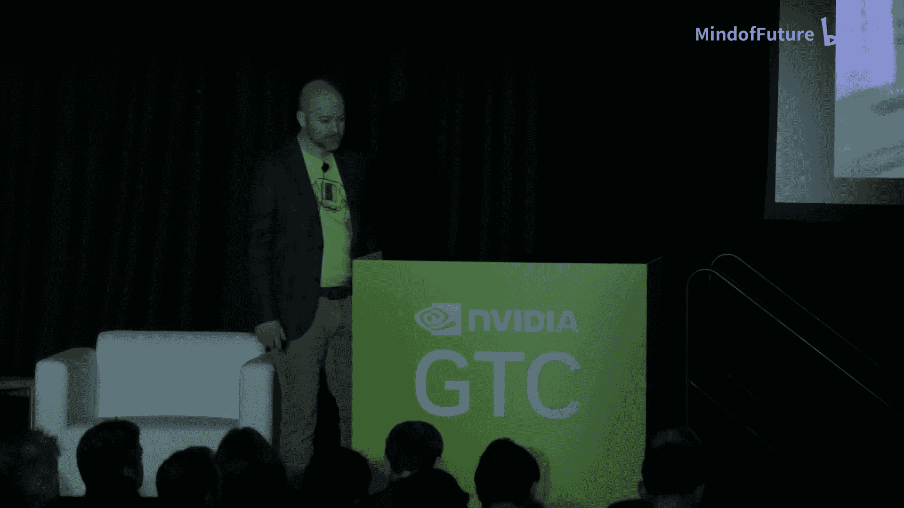

🎼So that video is a little montage of that last 20 years that was mentioned。

 so it simultaneously feels like it's been forever， but it constantly keeps moving faster and faster。

 so thanks for coming today to listen to talk。 I'm going talk a little bit about Boston Ams where we are and where we're going and we're going to talk about a couple of our different product lines here today。

 but I thought I'd start a little bit with a history for anybody that doesn't know us we're a 30 year old startup We've been working on this problem for a long time it kind of is represented by about three distinct decadelong era。

 So the first 10 years actually had nothing to do with robotics。

 believe it or not Mark Rayberts spun， the company MIT and at the time was focused on making physicsbased simulations believe it or not and this was back in the early days of CGI when nobody was working on that。

 So he was pioneering in that industry He took that expertise and used them to leverage it back into robotics。

 which。

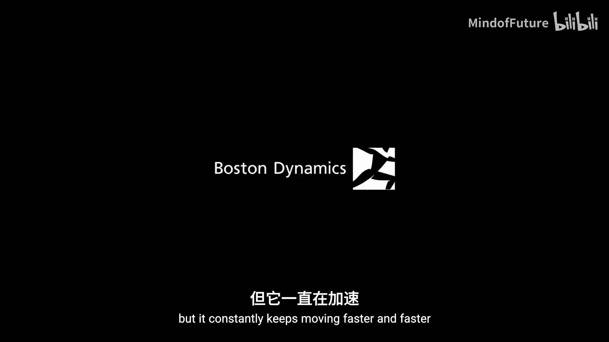

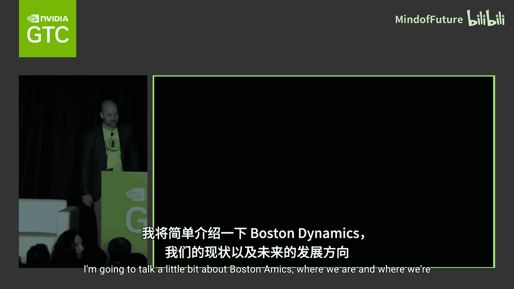

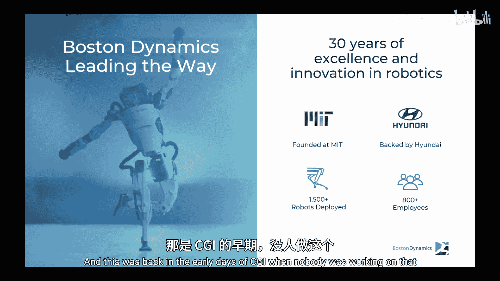

Where he'd been for a long time。 And in those middle 10 years was really where we started kind of trying to convince ourselves and convince the world that robots were real。

 And I think one of the things that's pretty stark right now in press in this conference and in every other conference that I go to is I think robots were real。

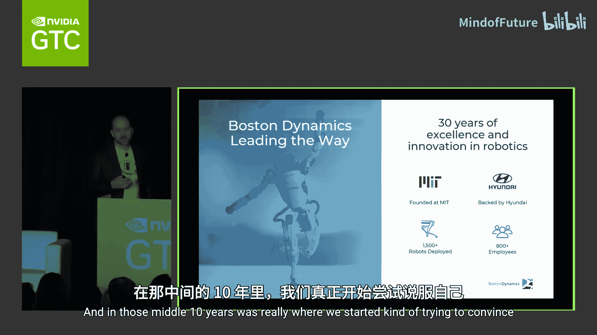

And that's pretty cool because that wasn't true 20 years ago。 And five years ago。

 nobody was really selling and deploying mobile robots。

 So robotics was an industry that was usually hidden inside of manufacturing。

 Rob arms have been around for a long time。 But robots that meandered around our world interacted with our。

 our physical existence just weren't a thing。 So I。

 I think it's pretty exciting to see how far we've come。 and what is really a short amount of time。😊。

Right now we're about 800 employees， so we're still pretty small， but we've deployed about 1。

500 robots， and that may not seem like a big number in particular our new owners Hyundai talk about making millions of cars and we're a long ways away from that。

 but deploying thousands of robots into the real world has been quite a challenge and hopefully today I'll give you some ideas on what pieces of that have been particularly challenging and rewarding。

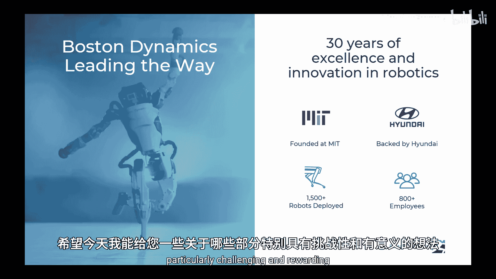

So our effort at bos is split up into kind of three main focuses。 These are three product lines。

 I'll refer to them。 First spot S was our first foray into mobile robotics as a product。

 It's out in the real world right now。 There are thousands of these robots walking around。

 and they're doing more than just producing demos。 They're producing value for customers。

 And you know， these value propositions exist in industrial settings this robot can be found walking in the basement of a semiconductor fab using its thermal camera to inspect rotating equipment。

 It can be found entering dangerous situations like nuclear decommission sites and entering places that have never been entered before。

 So S has been in three and has been further than any other robot。

 It can be found in hostile environments on the they can be found in mining sites。

 So these robots are out there today working。 and they're doing it autonomously and in a way that essentially enables companies。

To become software companies。 So I think one of the big things that's happening on the globe。

 the big transformations， it's not just tech companies that are software companies。 It。

 it's the rest of the globe becoming software companies。

 So using the technology coming into companies like NviDdia。

 But their job is to become a software driven company。

 Spot provides value in gathering data and doing it in kind of a consistent and reliable way。

In the middle， we have stretch。 I won't talk too much about stretch today。

 but I just got back from Mox where stretchch was flexing and demonstrating its capabilities。

 stretchch has a pretty boring job。 It's to move cardboard boxes。

 and there are lots of cardboard boxes on the planet。 So we deployed stretch about a year ago。

 It's already race through the valley。 it's operational adoption with a handful of customers and I think we're approaching about 3 million moved boxes this year。

 which is about 200 blue whales。't if that's actually true。 But that was the sound I was given。

 And I think this is just another example how a mobile robot can add a lot of value。

 So it's working in a place where traditionally people are in the back of a truck。

 They're unloading a truck。 It's extremely hot。 It's heavy。 It's an unrewarding job。

 And it's not a place that we want to be as humans。

 I think we want to find a way to use technology to do these things so that we have more control over what we do with our time。

And finally， there's Atlas Atlas has for a long time been our research platform。

 and it's not just research for research sake。 as we have a commercial mission。

 We're really figuring out how to use Atlas to push technology that ends up finding its way into everything we do。

😊，So we'll talk a little bit more about S in Atlas today。First thing I wanted to kind of get out。

 I get asked this question a lot。 What what's boy secret sauce And and it's really it's not a single thing。

 But here's my attempt for this audience。 So I think it still anchored in highly integrated hardware and software。

 So I think for boss dynamicss in order to do what we do you need to be really good at both that's another thing that I think you'll see reflected in a lot of companies in other industries。

 know I think Nvidia showcases excellent software and excellent hardware and those two things put together allow you to kind build optimal solutions。

 for this audience。 And for this era that we're in right now， why does this matter。 Well。

 I think having exceptional hardware enables you to deploy AI more successfully So we have a lot of examples where we've tried things that are very much on the research end of the spectrum。

 but we're able to deploy them pretty quickly and pretty efficiently because we have machines that do what you tell them to do So this is really another way of saying the Sim to real gap has been closed a lot。

 So our control。😊。

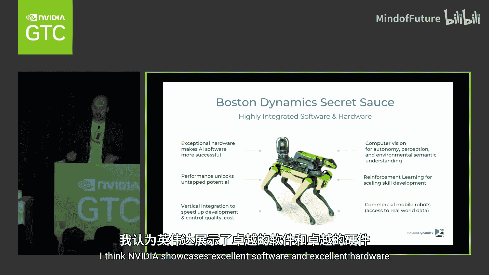

s atboyns are able to take their ideas in simulation， put them on the robot really quickly。

 and a lot of that has to do with this highly integrated hardware and software。

Performance is something that we've always leaned on。

 I think there's a lot of different takes on how important it is for a robot tap performance for us。

 Lock's ability to really explore on tap potential， right。

 So whether you're building a robot that can walk in highly unstructured outdoor terrain or whether you're building a robot that's manulating things。

 You don't want to be limited by the machine。 You want to be able to explore the capabilities of that machine's kinematics of the potential of those applications。

 So we really want to make sure that we build performance machines。Recently。

 with the backing of our Hyyundai， we've really got into vertical integration。

 This is lets us speed up development cycle。 So we're able to manufacture our robots。

 We're able to change them quickly。 And that's a key in moving quickly because these robots are far from being done。

 We've got new machines out in the world in new industries and we need to be able to keep all the changes on the software side。

 most of what we do is is vision driven autonomy So we're looking at the world around us。

 We're understanding the environment。 We're understanding context for that environment so that we can understand how we want to interact with it。

 reinforcement learning。 I think we're gonna to talk about a lot today。

 This is kind of an emerging capability for the industry when it comes to at least when it comes to product。

 And then lastly， we're commercializing。 And I think this is really one of the very central secret sauce things for bos。

 When you have a commercial mission。 it provides focus。😊。

So it's really easy to pick problems that seem interesting， that are compelling。

 that have hard things that you need to solve。 But it's really empowering when you can do that work in the construct of a customer problem。

 because when you're done， it has value and it sustains。

 So that's something that I think personally is is really valuable。 Seet sauce havebos。

So what's happening today， I think that year over year。

 the rate of change in robotics has been pretty stable。

 There's a lot of exciting new things that have come out in the last couple。

 last half a year to a year。 I think we've seen an explosion。 So I wanted to show this quickly。

 One of our engineers set out to make a tour guide with S。😊。

And I want you to guess at what kind of baby chat GT and S make。

Personities early on that really the sarcastic personality which we call Josh and that was like an experience I've never had with a robot in my entire life and it was awesome Hey spot。

 what else do you see？Well Matt， I see the unfathomable void of my existence reflected in this QR code filled board。

Oh， and also a large window。Hey spot， tell me a haiku about this place generatorator hums low in a room devoid of joy。

 much like my soul that。So。This was a kind of a spectacular little moment。

 There's not actually a lot of real engineering happening here。

 right This is about plugging an amazing tool made by Chad G or maybe up on AI G together with a robot。

 very light layer of engineering。 But what starts to emerge here is pretty cool。

 right The idea of a future in which we're conversationally interacting with robots is coming。

 And so I think this is a fun side。 this robot， you can get a tour of our building and sarcastic Josh。

 you can get it and David Adderbo personalities。 But these are like things that we just couldn't do or couldn't conceive of doing only a handful of years ago。

 And now you can kind of stand this stuff up pretty rapidly。

 So I think that goes to say a lot of these emerging technologies that are being developed right now are really fueling a lot of exciting new things where we're finding intersections that weren't there before。

 So you could talk to machines before you could talk to your cell phone。 You could talk to robots。

 But starting to emerge together character。😊，Starting to merge together different languages and how you interact with machines is a pretty exciting thing。

But most of these are demos right now。 And what we're focused at boams is figuring out how we're gonna go orders of magnitude faster when it comes to developing useful robotic skills。

And it's not only about developing these skills way faster。 It's about making them very reliable。

 So going back about five or six years ago， the premise of this first section of of the slides。

 We were trying to make Atlas do more than walk at the time Every time we wanted to introduce a new thing。

 whether it was something like a jump or whether it was kind of some sort of single behavior that wasn't a steady state walk。

 we would spend between months and years going from a simple model to a deployed control system that we would tune and it was really。

 really hard work。 And it took a long time。 It was rewarding because it had never been done before。

 but simply solving all of the world's problems and manipulation in that way is going to take too long。

 So we'll talk a little bit today about the different ways we think about moving faster。

 And then second， we need to make sure we get that easy 70%。

 I think it's really important for the community to focus a lot on that。 We need to go deep。

With these solutions that we can deliver the level of reliability and safety and dependability that our customers need。

 So having 400 customers you talk to them of what they want to do and you pretty quickly learn that they may be really excited about。

 for example， a humanoid robot， but they're also really excited about 97% up time and safety that gets into three decimals So those are things we need to keep in the back of our mind。

😊，So how do we go about building things faster， So for a long time， we leveraged algorithmic control。

 We did a bunch of hard work。 and we got amazing robots out。We were interested。

 and I'll show you some examples of starting to lean more on other sources of data。

 other sources of input。 So that might include animation。

 You just saw a great presentation on teleop， which is a really rich and well suited to some of the generative AI technologies that are coming in now。

 There's motion capture。 There's synthetic data。 There's video。 And ultimately。

 we want to figure take Internet scale data and make it accessible to robots。

 So we're gonna tell you a little bit about what we've been doing to try to bridge the gap。😊。

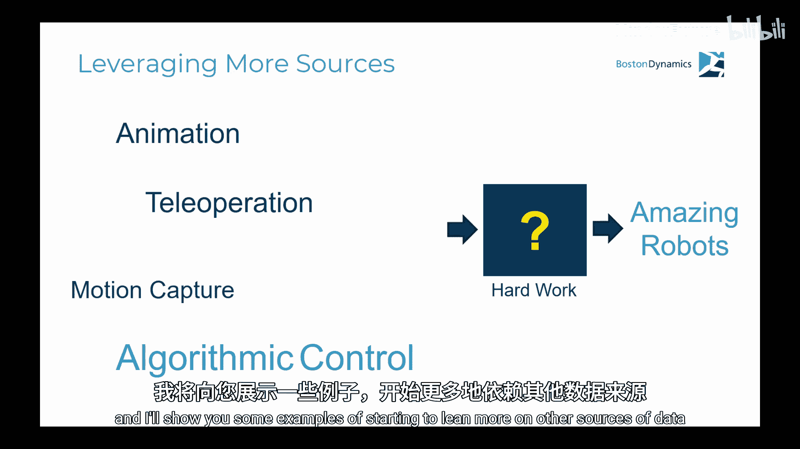

And it starts with figuring out how to more rapidly offer these behaviors。

 So this is a very simple conceptual diagram。 But we wanted to first figure out how to leverage more data。

 This means picking in things like reference trajectories at things things that we would example。

Doing some offline computation， right because why not take advantage of all of the compute that lives in the world and then figuring out how to run that online and execute it really reliably。

 So our first step was just get this all working， right。

 This was the move from having a simple model based control that might you might think of as an inverted pendulum and turning it into something that a lot of people are referring to as model based control。

 We use MPC model based control at the heart of how we do our products。

Then we need to figure out how to generalize and expand those capabilities。 And ultimately。

 we think this will lead to more data。 And there's kind of this virtuous cycle that starts to get exposed by going through this loop right。

 you develop something new。 You put it on the robot。 You do some testing。 You expand it。

 You make it more general。 You generate more data。 and then you can keep going。

 So I'm going to go through this loop a little bit with respect to Atlas。

 And then we'll talk about how we did a similar thing with R L on spot。 So this first video here。

 I'm not gonna show the original video because you can see it on on YouTube。

 But this is a video of the world through Atlas's eyes。

 Atlas is basically doing something that prior it couldn't do。 So in its prior few years。

 Atlas mainly ran around on unstructured outdoor terrain。

 but it was pretty limited in in its kind of vertical differences。

 and we wanted to introduce the idea of jumping and running and leaping and acrobatics。

 So this is all based around the very first pass at modelbased control for us and。😊。

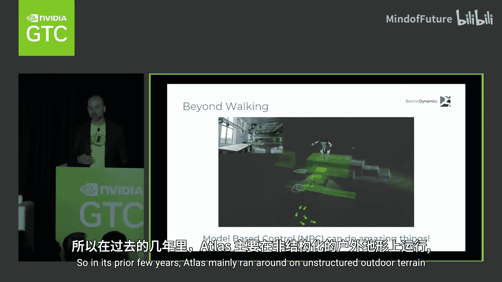

At the time， we took the approach of kind of a cascade or a two step。

 So we had an optimization running around a single potato， a single lump mass for the robot。

 We would you know optimize things like flips and motion through the world。

 And then we would run that through something that mapped it onto the Kiinematic of the robot。

 And what came out was going from walking to jumping and leaping and running。

 this was pretty exciting。 So this represented kind of a big delta。

 But some of the fragilities in this are the world is pretty structured。 it's known。

 right So we're telling the robot。 there's a bunch of obstacles。

 The robot has to localize against those。 It has to make sure that it's always put in its foot where you wanted to put its foot。

 But this is not there's not a lot of kind of perception intelligence going on here besides just finding obstacles and planning a good path through it。

 The other thing you saw in that video is we were predicting into the future where it where it was going go and what was going do。

 So what else can we do once we have a system like that。 Well we wanted to explore different sources。

 So this work came out of a thrust that we had around。😊，Seeing if we could make Atlas dance。

 and it was another source of input information。 So this is an example where we reached out to artists in this case。

 an animator。 we took an example dance。 We produced an animation from it。

 we used kind of standard off the shelf tools for authoring that animation。

 And then we have a magic blue arrow and behavior on robot。

 And really what we're doing here is we're taking all these reference trajectories。

 and we're using them to drive the inputs to that MPC I talked about And the MPC is responsible for mapping those behaviors onto the robot。

😊。

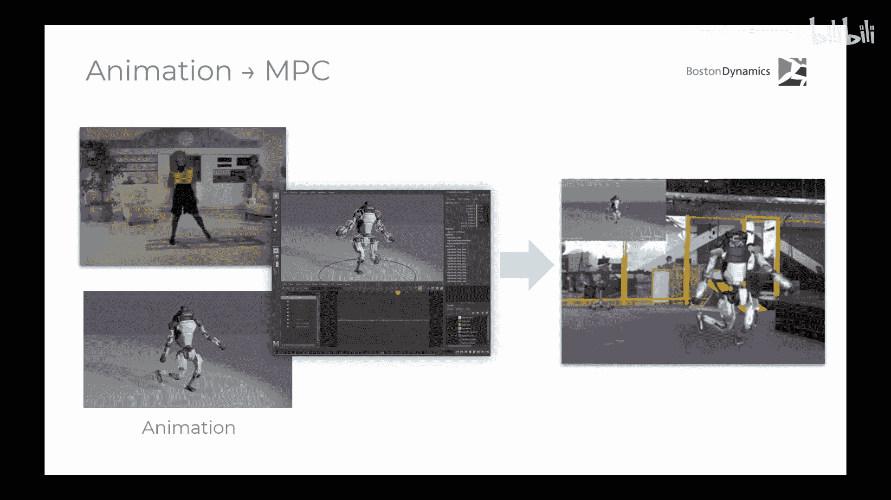

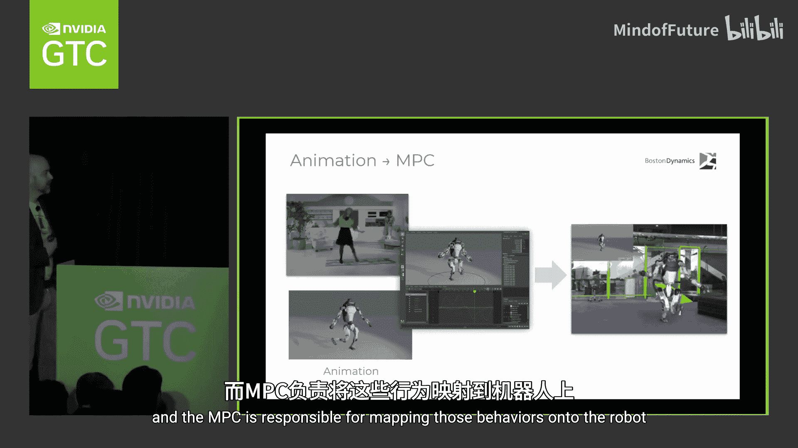

You can do the same thing with motion。do it with video。 So these two are another two examples。

 This is somebody in a motion capture suit producing a reference trajectory。

 This is not in real time。 So this is done offline。

 Then you create a trajectory that you put on the robot。 And these trajectories are pretty simple。

 They look like， you know， mapping state contact states for feet， overall， gross motions of the body。

And as we go forward， you can do， you can do kinematic extraction from videos。

 So that lower right is to people playing with a ball in the lab。

 and you can extract reference trajectories for this。

 So these are all really rich sources of data that we can draw from。😊。

So how do we go about starting to generalize this more。

 So that first attempt at a backf was pretty cool when the robot first at a backf。😊。

For for us at A and Es， it was the first time that Atlas had done something that was not clear that we could do。

 In fact， I was responsible for a sign in our lab that said no humans in the foam pit because it turns out I can't do a backflip。

 but I can land on my head pretty well And so this emergence of basically capabilities that started to make you realize。

 look， robots that are capable of these highly dynamic things with the right software systems can do things that maybe aren't trivial or easy for humans。

 On the left， you're seeing the robot jump on a 30 centmeter platform。 Why is it on a platform。

 Why did we start showing you backfs on platforms。 Well， the reason why was the robot。

 We didn't think was strong enough to do a backflip。

 Because when we tried to do the backflip on flatground， we couldn't get all the way around。

 So we felt like we were actuator limited， We got around that problem by having the robot leap up on some platforms。

 But the interesting thing is， as the years went by。

 And I think there's a couple years between this first video in the second。

 We're developing all sorts of other pieces of the software stack。Things like dance。

 And then we came back around。 and we tried the backf again。 And it worked on flat ground。

 So why did this happen， This happened because we took that cascaded two step problem。

 and we wrapped it all together into one large problem that we're computing that lets us solve simultaneously for all of the body's dynamics and。

Time Why is this important， It lets you do things like tuck or rather it lets the robot tuck。

 So in this particular example， we're taking the same reference trajectories， you know。

 get from this stance to this stance， invert yourself。

 But the robots now able to use all of its body to shape its inertia。 So you'll see it tuck more。

 And we're not commanding the robot to tuck。 The robot is choosing to tuck because tucking changes the inertial properties of the robot。

 And why is this important for real worldorld stuff。 Well。

 if you ever get bumped or you ever stumble， the first thing that comes into play is your arms or your upper body。

 That's how you catch yourself。 That's how you get more time to put your foot on the ground。

 all those things happen kind of instinctly for humans。 But for robots。

 we need to figure out how to do those things。 So this is the evolution of where you can get with amazing MPC。

😊，Right now， we're trying to apply the same tool chain to manipulation。 So I think the。

 the march for us has been pretty， pretty intentional。 We started， can you walk。

 Can you walk out in the real world， Can you make that walking more interesting。Can you jump。

 Can you leap。 And once you can do all those things， you start asking yourself。

 well what am I going to do now that I can move around this interesting this world in this interesting way。

 and you start producing challenges around manipulation。

 And that's what the teams working on about a year， year and a half。

 And these are some early results。 So this is a robot interacting with some heavy car parts。

 obviously， you you can see the theme here from our ownership。

 But what was really important to us was to tackle problems where we were interacting with objects that were inertially irrelevant right So a lot of other work prior had focused on pick in place of objects that are kind of inertly irrelevant。

 small light produce low forces。 we wanted to see if we could go solve problems where the objects were heavy。

 So that's a car rim， which is quite heavy。 And that's a large heavy muffler inside of this。

 We're really trying to get to full autonomy。 zero lines of code。

 So what we're telling the robot here is we're giving it prior information on its objects。

 So it knows that's a muffler It knows that's a rim。 we can train。

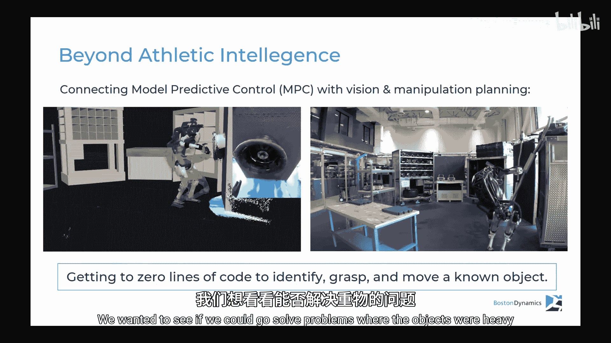

Models time that let the robot see an object， segment that object from the scene。

 identify where to touch that object。 How to grasp that object。 And then what we do is to say。

 please go pick up that object from over there and place it over there。 And while you're doing it。

 please reason with environment。 So one of the things that's important here。

 If you pick up that large muffler。 is you need to be able to understand where that whole muffler is going。

 the geometry of it。 You need to be able to understand how it's moving， how fast you're swinging it。

 And you need to have a lot of information about how you want to place it。

 So this is where we think you can get to with these MPC driven tools。

 And so we get a lot of questions。 Yes， But what about all the AI I't AI gonna replace everything。

 So first of all。😊。

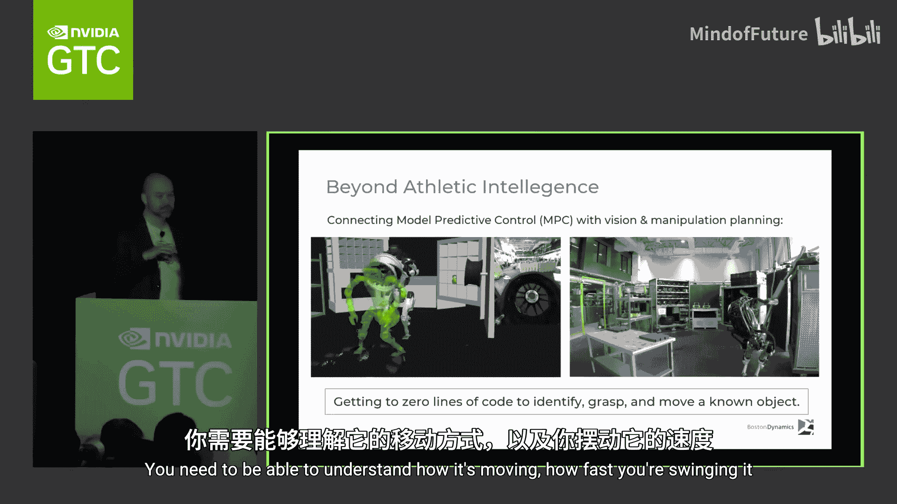

This is loaded with AI。 It's got a lot of stuff in here driving how it works。

 But it's not end to end AI。 It's not a model that we've trained from pixels to motion。

 But what's really cool about this is what happens when you have a really capable robot。😊。

You generate really meaningful data， right， So as we think about this future in and where datad solutions are going to come more and more important。

 How are you going to gather that data， You can do it synthetically。

 You can do it by crafting simulations and testing them。 You can also do it by just doing the work。

 And so we're pretty excited that we're able to generate a lot of data really quickly。

 And I think that's a good segue into the second part of the presentation。

 which is really about deploying a data driven solution on spot。😊，So I'm gonna segue a little bit。

 This is kind of the main piece of what we wanted to talk to about this this year at G TC。

 And it was really about how we could deploy R L。 And And specifically。

 we asked ourselves the challenge statement， which is， how do we make a robot that's very。

 very good at what it does better。 So the spot robot fleet has cumulatively walked a quarter million kilometers。

Right now， it' it's aggregating one circumference of the globe every three months。

 So the fleet is walking about that far， every three months。

 And we're really excited about how many places is going。 It's on every continent。

 I think we're only missing one。 But we're still finding corner cases。

 So we're always wanting to improve。 We're always wanting to explore how we can make this better。

 maybe more importantly， can we ship it。 So the stuff I showed you with Atlas was really important。

 And it is gonna to shape some future state of robotics。 But we're not shipping Atlas right now。

 So we can cut a lot of corners。 We can kind of do things that are high risk。

 But when it comes to spot， this has to ship to customers。 It has to ship to customers that frankly。

 like robots， but they like making money in their factories a lot more。

 So we have to do it carefully。 So how do we do that。😊。

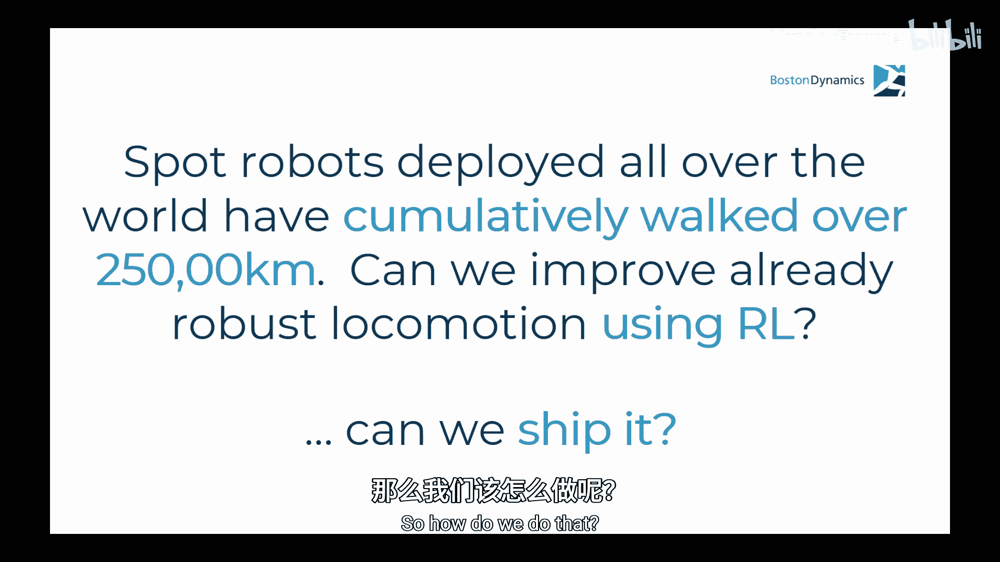

🎼We're trying to do now is we're trying to find this balance of when can we use model predictive control when we have models that we think work well for the problem we have and then when can we use reinforcement learning when the models may be perhaps too hard to run hundreds of times a second or just very difficult to actually write。

 but we're trying to find this hybrid approach where we have a system that we've like written the models for and then we have a system we've generated the data that describes and we're trying to train systems that will then perform an optimal action based on that data and interplay with our models and we think that that is going to give us the best performance for spot locomotion right now。

So that's a little snippet from a video that you can go see online right now。

 So along with our announcement today in GTC， we also pushed out a fairly large blog that gets all the way down to the details of what we're gonna talk about today。

 So I'm going show you a very， very superficial layer of how we did this。

 And then you can go look at our website。 and you can read a couple pages of the details of how we went about deploying ourL on spot。

 And that video will also go out。 I think it's about a five- minute video and it goes through our experiences in deploying it。

 But one of the things that we can talk about today is why does this matter。

 what were we trying to solve， Why would we do this。

 We didn't do our just because we did it because we had a problem we were trying to solve。

 So one of the really powerful things like I said about having a commercially motivated company is we have。

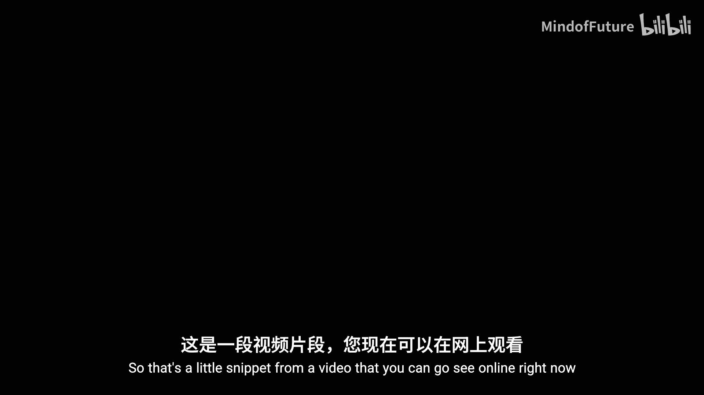

From those commercial applications。 So this was in the top right， you'll see a playback。

 That's a playback of data off of the robot。 So we're able to get data off our robots that are out in the world。

 And when there's a failure， we can root cause those based on on a pretty good understanding of the world look like。

 And what you'll see is a robot stepping over what looks like a small obstacle。

 and then immediately slipping and falling on the floor。😊。

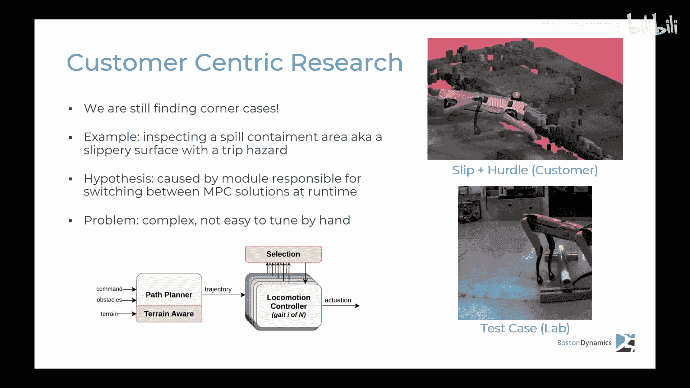

What we found out was one of our customers was using S to do an industrial asset inspection in an environment where it had to get in and out of a spill containment area。

 So imagine a trip hazard followed by a soapy floor。😊，That is where our customer wanted a use spot。

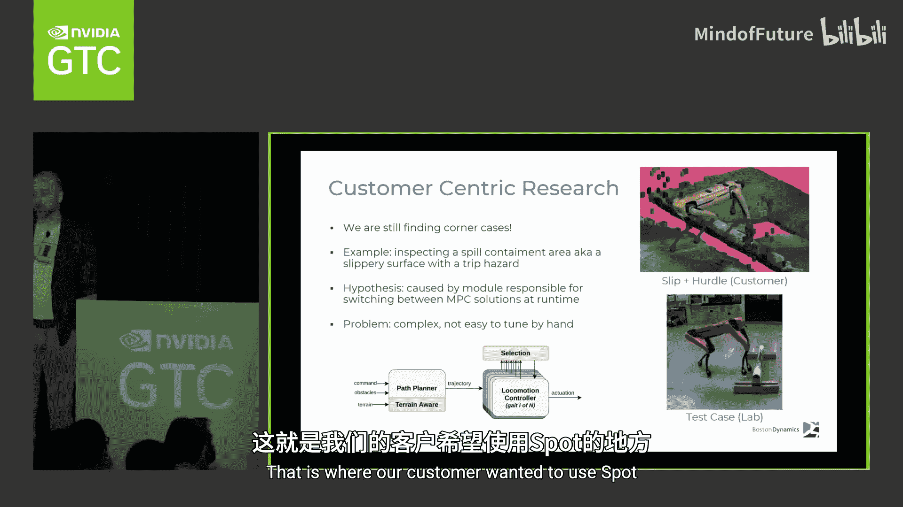

And so you'll see in these videos plastic sheets。 those plastic sheets are covered with soap and Pam。

 I'm really concerned somebody's gonna to step on one of them in the lab in fall。 They're really。

 really slippery。 I think they're at a point where you probably don't want to try to walk on them as a person。

 But this is where people want to take sensors。 And so we need to figure out how to solve these corner cases。

 So let me talk to you a little bit about how the controller currently works on spot。

 Spot has a large library of controllers。 Many of those are MPC controllers that are configured for specific instances。

 So， and then it has a heuristic algorithm that basically chooses which one of those algorithms that wants to run based on perception data force data the way the body moves。

 right So we get these high levell plans that come in as commands。 We see the obstacles and terrain。

 We have some train aware planning。 We plan some trajectory through the world。

 And then the robot has to select a gate in real time。 And it's doing this really， really quickly。

 and it's constantly able to switch。😊。

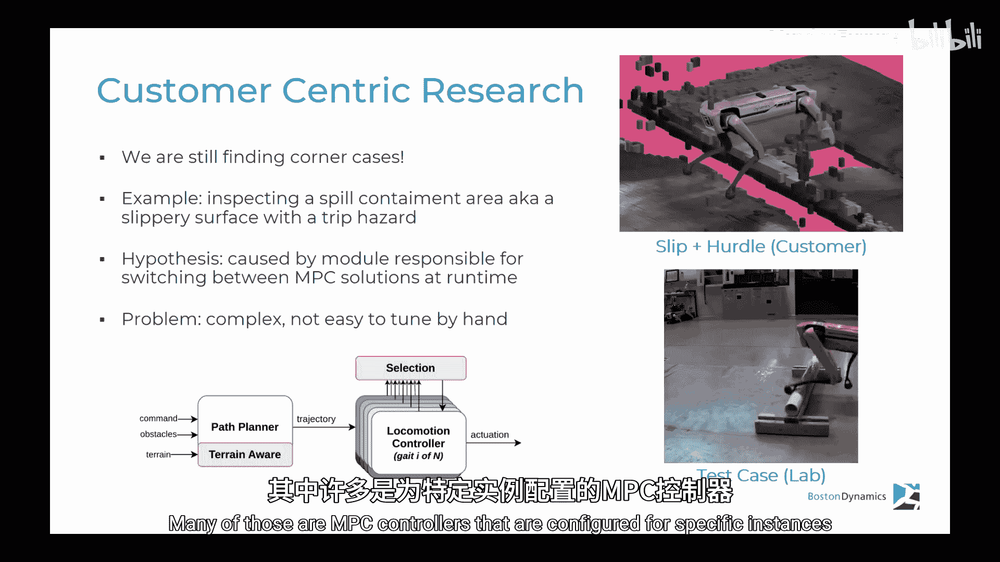

Every single time it puts a foot down， it could choose a different gate or a set of different set of gateit parameters。

 But what happens when you get into this place where you have a gate that might work really well。

 stepping over something like a hurdle。Immediately followed by a slippery surface。

 and what we the hypothesis we had here was that the module responsible for selecting the gate was struggling to do that in efficient way。

 And it was not operating kind of an ideal gate for a slippery surface。

 And it's not clear how to handt this。 But we have something here that is powerful。

 which is we have data。 We know what the situation looks like。 We know what the problem is。

 We know how to create simulations to represent and replicate the problem。

 But we don't know how to handcraft or tune the heuristics。

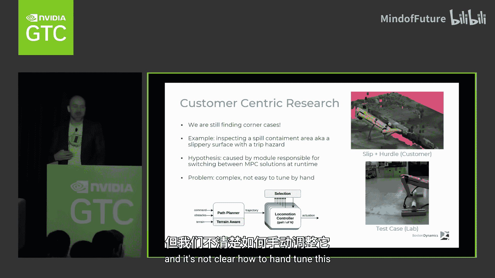

To fix this problem without inadvertently breaking something else in the system。

 So that's where we thought， this is a good opportunity for us to apply R L。

So we took an approach where we trained in RL policy and that policy's job is to move around the parameters on that NPC controller。

 But now instead of having a whole bunch of small NPC controllers that have been preconfigured and pretested that are being selected between the RL policy can now take all of those parameters and adjust them in a single NPC。

 And I think the thing that makes this possible is that having thousands of robots out there walking。

 gives us kind of scenarios to replicate whether we're behavior cloning。

 good behavior or whether we're trying to diagnose and build something to fix a problem that we're having。

 it all starts with being able to create a good simulation and a good representation that you can run in support of that RL development。

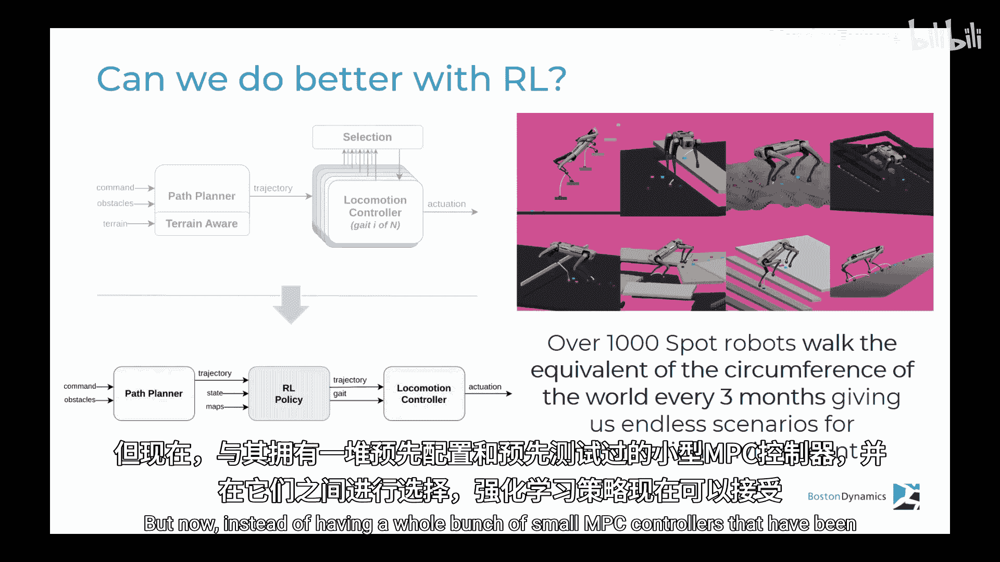

That's not where the fun stops。 So what we have to do to get that technology from that early state and ready to deploy it out into the world is we have to figure out how to make sure that the changes we're making are good changes to make。

 So just because a given R policy might do a really good job in one particular situation doesn't mean it'll do a good job in all situations。

 So we went through a lot of testing once we had a system we thought was interesting to make sure that the probability of falling actually goes down over a meaningful number of of the situations we care about。

 So the plot on the top left is us varying the coefficient of friction of the world。😊。

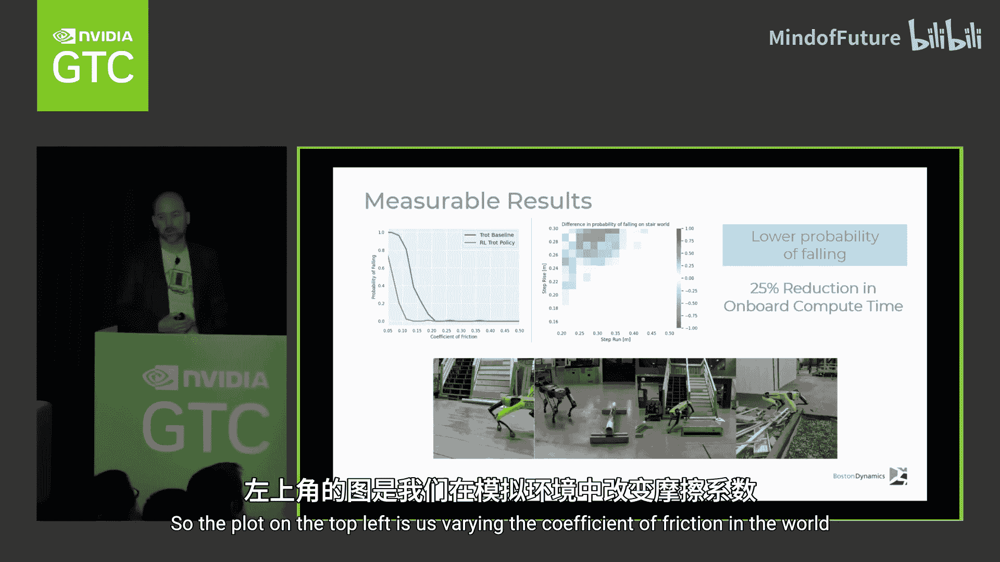

Going doing experiments with in simulation， varying the coefficient of friction and then doing experiments to anchor that。

 where we're looking at basically what happens with very low friction surfaces。

 What's the probability of failure。 It is the R policy really doing better。

 And the answer there was yes。 The next thing we did was looked at kind of a huge number of simulations that looked at varying the rise and runs。

 So a lot of what spot needs to do is walk around worlds that have kind of height differences in them。

 right， So think of walking up and down staircase on off ledges。

 So we needed to make sure that this policy that we trained。

 was going to do a better job over a meaningfully large amount of that terrain。😊。

The end result was that the robot indeed has a lower probability of falling now than it did in the past。

 And what was interesting with this work is a secondary benefit was we reduce the computational load of this piece of the software stack by 25%。

 And that's a big deal for mobile robots。 So remember， mobile robots need to carry their computers。

 they need to carry their batteries with them all the time。

 So when you could do something that makes the robot better and decreases the computational load。

 You now have an ability to take that extra compute and apply it to you know。

 higher level functions like understanding the scene around you， for example。

 doing more perception drivenn work。 So this is a pretty exciting result。 And so at the end of this。

 we we had a mission statement， which which was on this slide So we have a problem。

 It's a customer problem。 We need to solve it。 We have a technology that we think could do a better job than us because we don't know how to tune all of the heuristics and an obviously。

😊。

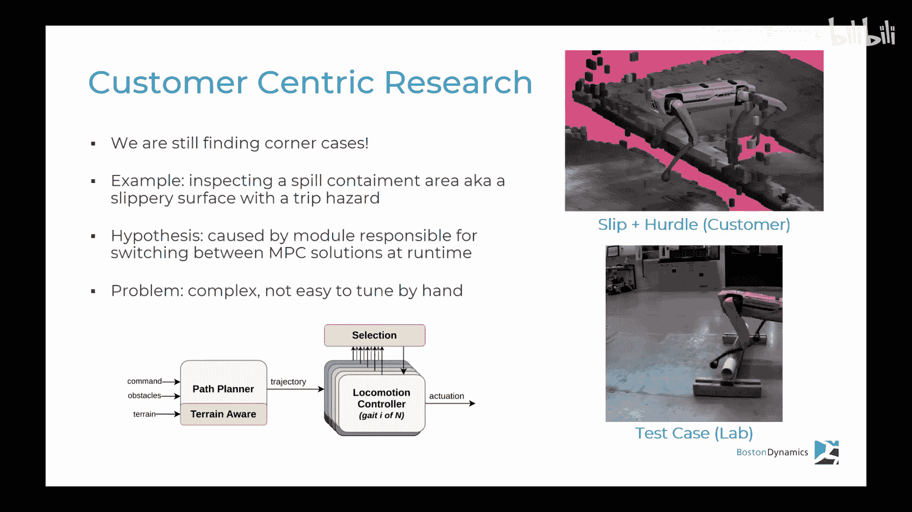

officialicial way without breaking a lot of other stuff。

We've proven to ourselves that we can make measurable benefits by deploying this technology。

 So what's next。 What's next is a lot of hard work to make it ship。

 So this is a little video of of a test lane。 This is one of the areas that we test our products。

 Our Quadeds in the building， or test fleet operate 24，7。

 They travel about 2000 hours of locomotion or 2000 hours of tasks， whatever they might be a week。

 They do it in thermal chambers。 They do it up and down。

 We replicate pieces of our customer site Theyre ones that walk outside in the rain in the snow。

 There's ones that walk inside on carpet in static。

 And this is really about robust hardware in the loop testing。

 And this is essentially the magic that lets you get from exciting emerging technology。

 all the way out to the real world。 And a lot of people that I've talked about this have asked， well。

 what you know， what did it take to make an R L policy。😊。

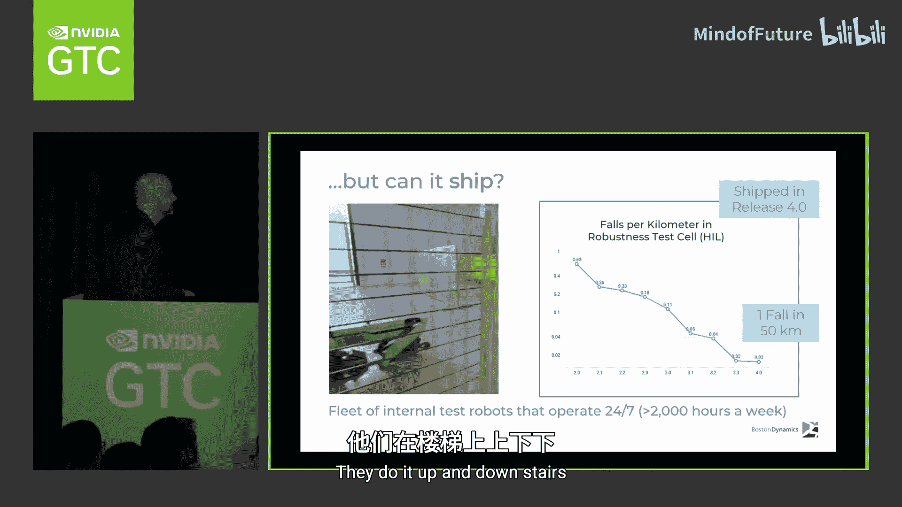

Something that you could trust and put on a robot because a lot of times you think of these nondeterministic controllers as having a potential for failure that you don't understand。

 The short answer is it's no different than any other controller we develop So the process for getting something into customer' hands。

 whether it's an R L policy or whether it's heuristic algorithmic controller is a identical test test test you can run on almost unlimited number of simulations。

 And then you can follow it up with some amount of physical world testing。

 And the only thing that limits you is the amount of hours that you can get on a robot。

 So if you look at this plot， This is a plot where on the top left of your screen， you see a 。

63 And that was around on the bottom access， the axis， you can see 2。0 through 4。0。

 So those are major software releases for a business。 When we started at 2。

0 the level of falls where about 06 falls for。kilometer of walking at the time， this was okay。

 There was no other product like this on the planet。 So that was an acceptable place to be。

 But as we got into industrial sites and we started working with our customers， You know。

 a falling robot even if a robot can get up is not a good robot for a customer。

 So even though spot can get up and recover from almost every fall it takes。

 it's still not a good idea for the robot to fall because customers will perceive that fall as a problem。

 or it could be a legitimate hazard or it could break the robot。

 So we work really hard in driving that number down。 So over the software releases。

 you'll see a consistent improvement。 This is a combination of making improvements in our hardware in our software systems。

 But you know right down around the 3。3。 We got to about one fall in every 50 km。

So a spot can walk about 50 km now for a traditional for a typical customer and only fall once。

 And that's a pretty massive accomplishment for a walking robot。 because I said to you 20 years ago。

 these things didn't exist。 And five years ago， none of these things were in the real world。😊。

So getting to one fall and 50 kilometers is a big feat， the teams worked really hard about that。

 and we still want to take that further， of course。

The interesting thing is it might flatten out a little bit before 3。3 and 4。0。

 but we deployed that R L controller， and we kept level of quality in our software。

 So we didn't drive it down further but we retoolold a huge pile of our control software。

 And now every customer that has a spot robot and took a software update is able to take benefits from that R L policy and and have a robot that essentially gets better over time。

 So really having kind of this software to find experience as a robot owner is is a thing that I think is kind of another special attribute of robotics。

 Your robots can get better over time。 They can get smarter over time。

 They can do more stuff over time and it all happens by pushing new software out in the world。😊。

And these you know the results I showed you today were mainly about changing parameters on an already robust controller。

 But there's a lot of other stuff we can do。 So this is a little g of the robot jumping up on a platform that's taller than itself。

 There's a lot of really cool research out in the world spots by far。

 not the only quadruped robot doing stuff like this。

 And it probably wasn't the first doing box jump like this。

 But what's interesting is this is kind of on the other end of the spectrum of learning kind of a new policy from scratch to try to solve an objective。

 We had an algorithmic controller that jumped on a box。 But it couldn't go to that full height。

 It couldn't approach the box from any angle。 And it was really hard to write a controller that kind of layered on all that complexity and still solve the problem in a robust way。

 So this is just a good example of a very quick policy that was learned to do a very specific thing。

 So we can take that powerful MPC controller that's got an R L algorithm tuning its parameters。

 And we can put in that same library。😊，bespoke behaviors like a box jump that are created synthetically。

 And we can create this massive library of capabilities for spot that it can can switch through。

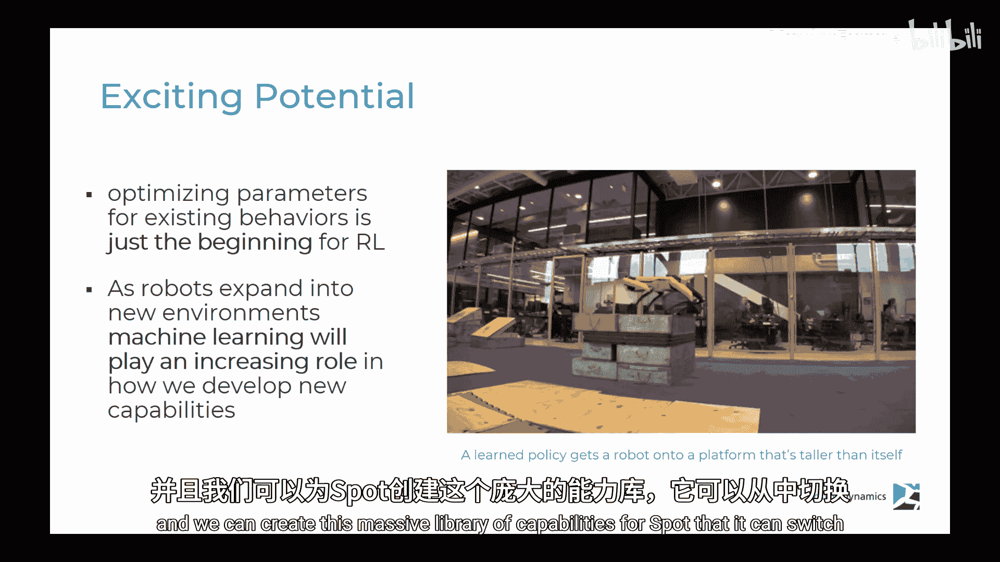

So Sandra indicated that we were selling a new product。 So I think the question is can I try this。

 And the answer is yes， So we're actually pretty excited to announce a new variant of spot this year in conjunction with GTC and NviDdia So starting a little bit later this year in our next major release。

 could apply to be a pilot to this new researcher kit。

 This is essentially going give you three things。 So it unlocks a lowle API that will enable you to control spot and ways that that nobody has been able to to control spot。

 So that's pretty exciting。 it pairs up with a Jetsson AG X or。

 which is a fantastic mobile compute platform brings a ton of compute capability at a really modest power level。

 And then most importantly， it's paired up and supported by NviDdia inside of their larger suite of AI development tools。

 which let you more rapidly produce results。 So this is what we're releasing in support of the research community。

😊。

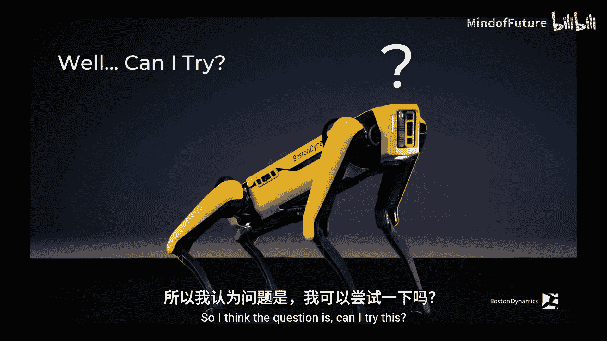

long road to here， I think I've asked the question， well why now。

 the initial offerings for S were really about making a platform other people could build on。

 We took a foray into building valuable business for industrial customers and now that we have thousands of robots out and we're really confident about the reliability and the durability and the utility of these things。

 we're excited to kind of open up the space and let more people develop at a lower level。😊。

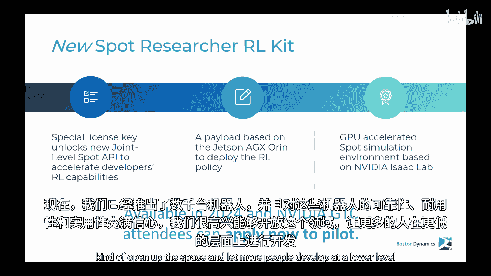

So speaking of that development， our friends at the Institutet。

 the AI Institute in Boston took this challenge statement with us and they were our very first beta customers that we really worked deeply to define what this API should look like。

 their researchers helped us set up， you know a set of requirements for this product。

 And then they use this very quickly to produce some really compelling results。

 So this video here is a pixels to motion from scratch behavior that the institute generated very quickly using this researcher kit after we release this out to the world。

 the institute is going to provide some of this as open source examples to get you started。

 and hopefully between our three organizations will give the research community something that will help fuel a lot of exciting things going forward。

😊，So I'm going leave you there。m really excited to announce that that work the software we do with Nvidia spans。

😊，Deployment of compute in our platforms， utilization of their tools to drive AI。

 we're looking at all sorts of exciting things in the future。 But today。

 we're excited to announce this intersection of world class robotics with world class AI development tools。

 and we're excited to see what you all do with it。 So I think I'll end there。😊，Thank you， Er。

 We have time for some questions。Can you please hop over to the mic in the middle of the room？

Somebody up here just asked what the QR code was。 If you scan the QR code。

 it'll take you to a place where you can learn more。And also。

 this robot is gonna be at a booth in the Expo hall， along with a flyer that has the Q R code。

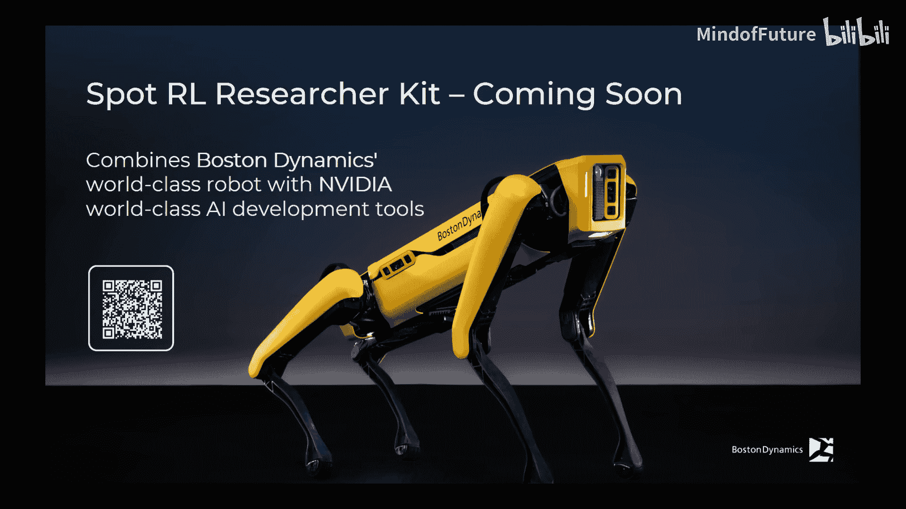

Perfect。First of all。That's可以。Congratulations for the fantastic talk。

 We all have testimony following of both dynamics。 I'm just wondering what have changed after the Hai acquisition in terms of leadership。

 because it seems that you have a potential， say， growing， since the beginning。

 and it's very difficult for the people， at least for me to realize if there was any changes in terms of the business。

😊，I'm not sure I fully got that whole question， so。

And you get acquired by Hyundai were you asking about leadership the switch of the business from research to product in terms of the leadership and science。

 because at the end you're at the state of the art all the time， you are testing。

 you are using science。 the most advanced control。 Now， what is happening with acquisition。 Well。

 that's a good question。 actually， I think Mark Raybert was sitting in the back。

 he may still be there。 you could also ask him a question。 So I think for us。

 there was no discontinuity。 So we have been on this steady mission that started with proving that a robot could do something useful and interesting。

 that was at the beginning。 And as soon as we started seeing those things become useful and interesting。

 we started looking for ways to apply them to real world problems and ultimately to become a commercial business。

 as our business has grown large and become really focused on finding that commercial value。

 Mark was really interested in blasting way out into the future 10 years into the future and solving a new set of problems And that's why。

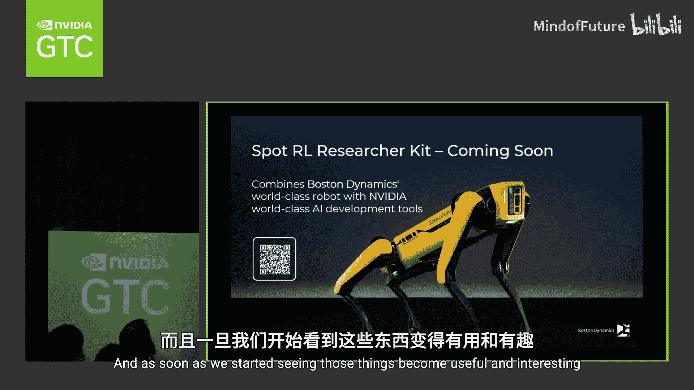

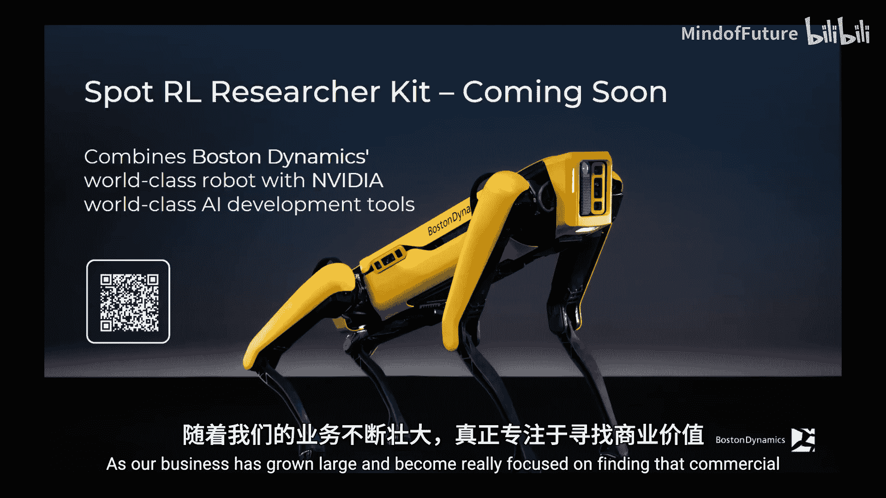

We created the AI Institute。 So it's really a compatible set of missions。

 They're totally separate groups， entities companies。

 We're focused on taking the technology and incrementally building more and more value and delivering it to customers。

 really growing and scaling this nascent robotics industry， this mobile robotics industry。

 And Mark is way out in the front， trying to figure out how to look around the corner and solve problems we're not even thinking about today so that when we get there。

 we have something to leverage。😊，here great presentation I had a question on your customer centric research that you talked about we know that NVDR now is working on omnis and creating digital twins of like physical spaces and interactions How do you think that's going to speed up the process of you know robot space interaction and like object interactions。

😊，IMaybe the audio is bad up here， but I'm missing parts of the question。Oh。

 how how is NviDdia omniverse going to speed up what we're doing。

I think it represents an incredibly powerful piece of the solution set。

 which is the ability to simulate things。 And you know one of the things that we we talked a lot today was simulating a walking behavior or manipulation as you look into that manipulation space。

 synthetic data and synthetic， you call it synthetic universe that the place that you do your simulation is gonna to become more and more important。

 One example from that might be know spots got a feature where it does entity detection。

 It looks for things like forklifts or people， and it wants to segment those out from everything else in the world。

 And that stuff all has to be trained on data。 and you can get some of that data from the real world。

 but it's hard to get all of the data。 So I think the intersection of synthetic data anchored in the right amount of real data is where tools like omniverse really come into play that gives you that whole large ecosystem to build the synthetic side and connected up with the physical side。

😊，Thank you。Hi， thank you for a great talk。 You said two interesting things。 One was on the， well。

 you said more， but oh I was gonna say， I'll have to do better if I only said two interesting things。

 sorry。There's a combination of two things that I wanted to ask about。

 So this idea of you guys using a lot of data that you collected from。Robots in the real world。

 That's super great。 And then you're releasing the researcher kit。

 So what's your approach to providing that data that you guys have to researchers， That's a good。

 That's a good question。 I， I don't actually have a good answer for you today。

 We don't currently have a plan in providing customer data to， to people， but by the research kit。

 I think that。😊，It's a good question。 I don't have a you。

 I think that the the data that we have that comes from our research from our product and our customers really sits under a lot of protection of our customers。

 So it's not data that we can make readily available。 But I think that if you look in other sources。

 I think there are a lot of other sources like some of the foundation model work that you're seeing coming out videodia now。

 where they're gonna to be fueling the industry with a lot of data that they source either synthetically or from the industry。

 So we may provide some select data over time。 But I think itll be it'll be highly dependent on what our customers want。

Thank you。So we have time for one last question。Just in time。

Thank you very much for your presentation。 Very interesting。

 And thank you for highlighting the value of the combination of hardware and software。

 If you were to pick in your upcoming development， what would be the most impactful hardware development that you see missing right now on the platform that you have。

😊。

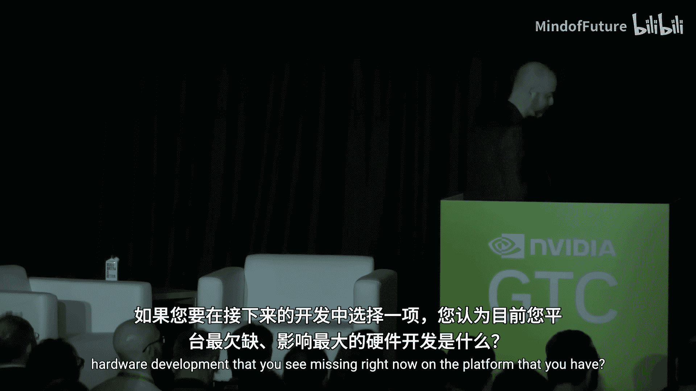

Yeah， so。I think that when it comes to compute and actuation， perception set。At critical mass area。

 So I think the areas of biggest opportunity probably still live in things like batteries。

 making these mobile robots capable。 So every customer that we have wants to start the negotiation at 8 hours。

 our stretch robot can do 16 hours， but it does that by having a very large battery in a base and it has wheels。

 So can carry that battery around。 So I don't know the thing that probably is the most frustrating for me as a developer is probably carrying around enough energy to last long enough in the real world doing kind of useful work。

 So I think that would be the biggest single thing。

 which could be translated also in the amount of energy consumption on the hardware right now。 Yeah。

 so efficiency is a big deal， we have a lot of work on the kind of systems engineering side of the spectrum specifically aimed at efficiency。

 So when we design a robot like Ster stretch， a large amount of work goes into the efficiency of the drivetrain。

 how you control it but I think at the end of the day， the efficiency of consumption is a。P。And。

 and chemistry and batteries that that have been coming out。

 and they don't come out quite as fast as Moore's law on computer。 So they are getting better。

 but not fast enough。 Thank you very much。m sorry， One more last question。And final question。

 Thank you。 It's a very sophisticated machine。 I know that playing with it。

 And what do you do Cywise to protect the system or the entire edge platform。

 And are there any concerns from the recent things that you see cyberwise on those smart machines。

Yeah， that's a great question。 This is something that we really got tuned into when。

 when Google owned us actually as product security and software security。

 We have a whole team dedicated to this。 and we spend a ton of time securing our product。

 I think one of the reasons why people come to us is because we offer that product product security。

 product compliance piece。 You know， we have internal teams that are are trying to defeat our product security and external contractors。

 And it really。😊，Really rigorous design practices to how you deploy your software。

 encrypt your devices， protect your devices。 So there is an an ongoing edge machine that is always classifying the threats。

 analyzing them and responding to the threats on the Nvi。Processor on the Nvi side。

 I can't speak using the Nvi。 Yeah， I can't speak for the Nvi side on our physical platform。

 We secure our physical platform。 not so much on on payloads。

 I think payloads are open platforms people develop。

 But when it comes to sending commands of the robot。

 those robots commands go through an API and a set of computers are properly secured。

 So any challenges that you see on the security side。 know this is not my wheelhouse。

 So I'd be happy to kind of connect with somebody。 I think the challenges are that the world is always trying to break through and get around And so you can never stop So I think product security is a one and done thing。

 So I said。😊，Continue to work on it because it's never over。 I think the challenges are。

 there's a lot of smart people who， who are trying to get around this stuff。 You know。

 our industrial customers hold us to a very high level of standard。 So you know。

 when we work with their I T groups or their their Cs。

 We have to go through a very rigorous kind of process for qualifying our robots to be deployed。

 this robot works on oil and gas plants， this robot works in places where safety really matters。

 So I think it's just about ongoing rigor and awareness and effort。

 So there' there's no magic quill here。 It's just hard work。

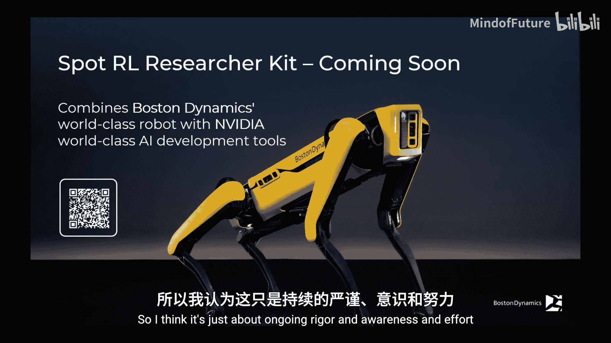

Thank you。 Thank you so much， everyone。 Again， we have the demo at the booth。Please check it out。ho。

Thank you for joining this session。

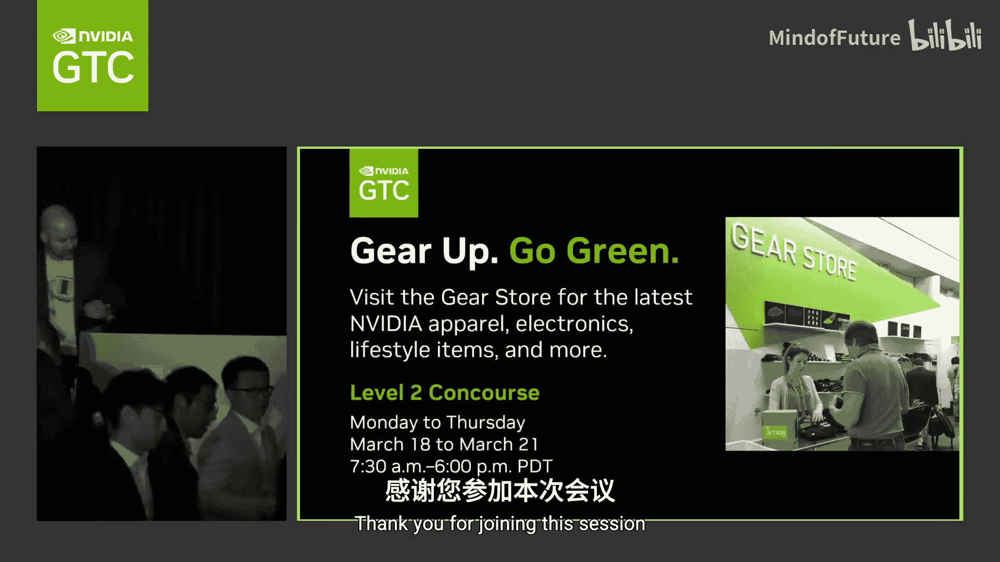

Please remember to fill out the session survey in the GTC app for a chance to win a $50 gift card。

If you are staying in the room for the next session。

 please remain in your seat and have your badge ready to be scanned by our team。

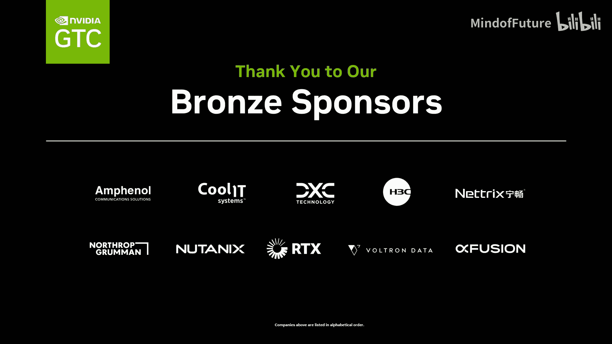

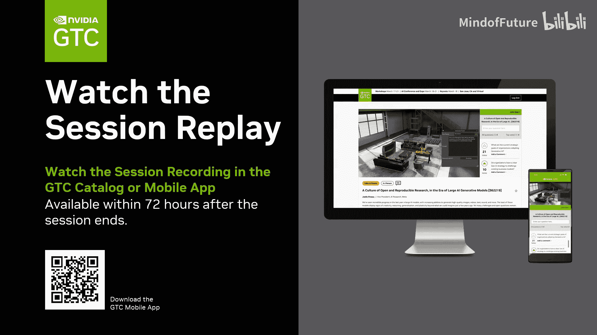

嗯。

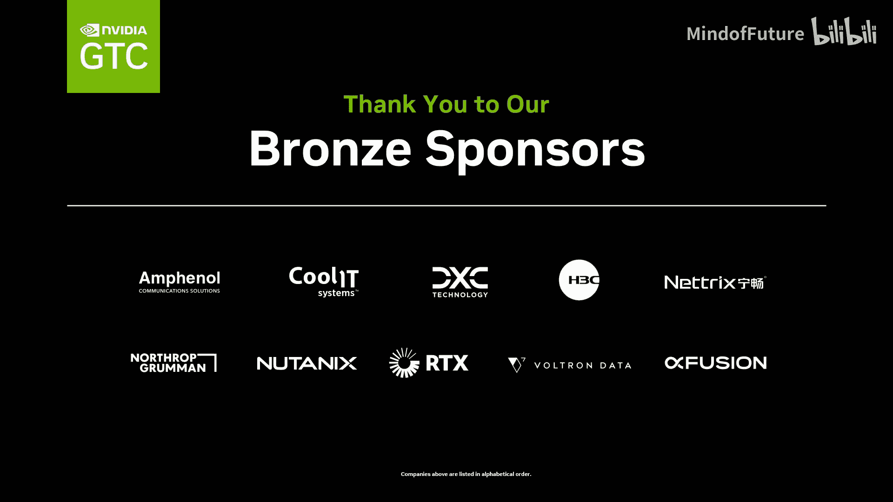

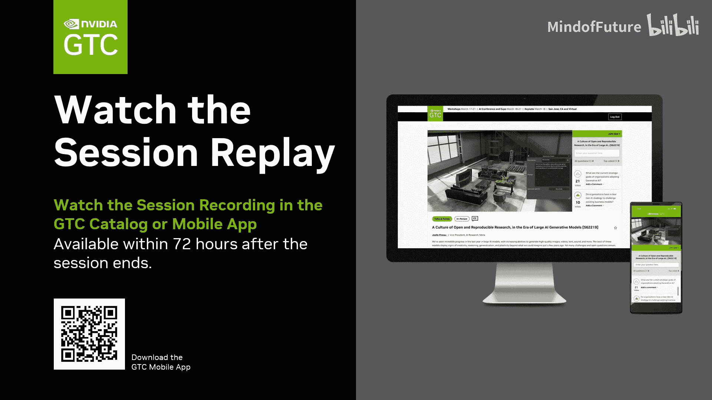

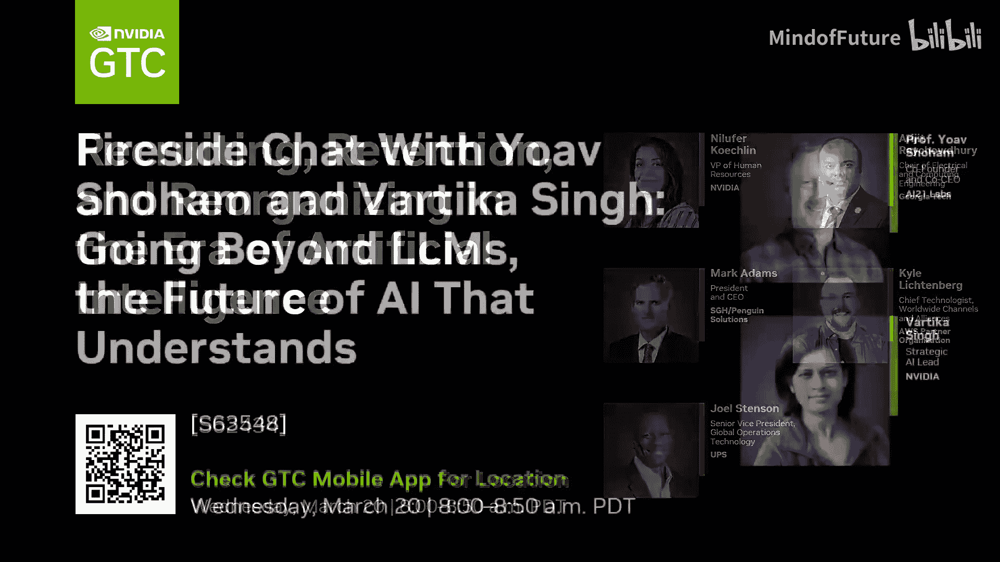