# 【英伟达GTC人工智能大会 • 中英】NVIDIA GTC 2024 p06 P06 The Future of AI and the Path to AGI - David Luan & Bryan Catanzaro -BV1yHAeeqECP_p6-

So welcome to the talk， Fu of AI and part 2 artificial general intelligence。😊。

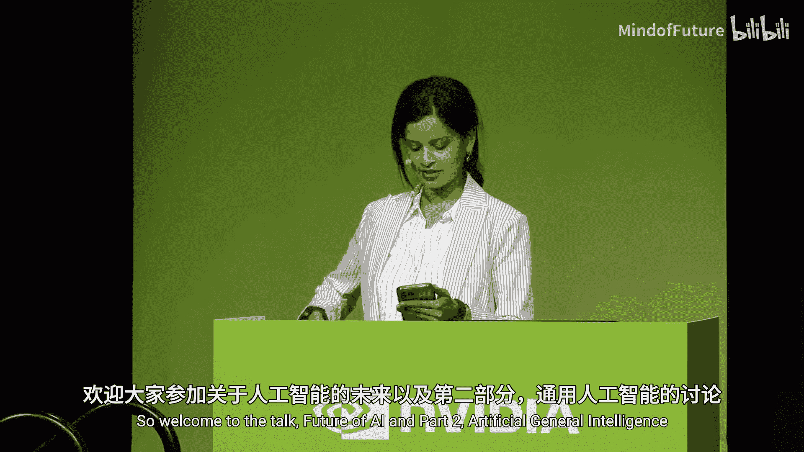

By two of my most favorite people， Brian Katanzaro and David Luan， I welcome you on the stage。

 Ill introduce you。😊，So David， CEO and co foundunder at Adpt。

 and their company is building AI agents for knowledge。Previous。

 he was VP of engineering and at Open AI。And he saw the research on language， supercomp。

 reinforcement， learning， safety and policy。 And before that。

 he calleded a team at Google Brain where they shipped。GPT clip and Dali。 welcomee， David， thanks。

And Brian is the V P of Applied deep learning Research team at Nvidia。

They work on multimodal language modeling， chip design， audio， speech， graphics and vision。

 and continue to find practical new ways to use AI for Nvidia's products and workflows。Violet Nvidia。

 Brian has helped create Ps to pick H D， D L S S， megatron， Q D N N， Pascalline。

 wave glow and deep speech。Wecome。I little you guys do different。Well。

 it's so great to see everyone here。 Welcome to GTC。😊，It's been a while since we had one in person。

 and it feels incredible to see you all here。 So thank you for coming。

 And I hope we're gonna have an interesting discussion today。 David and I are friends。

 and we're just gonna be chatting about the work that that we're doing and。

 and where we think it's going。😊。

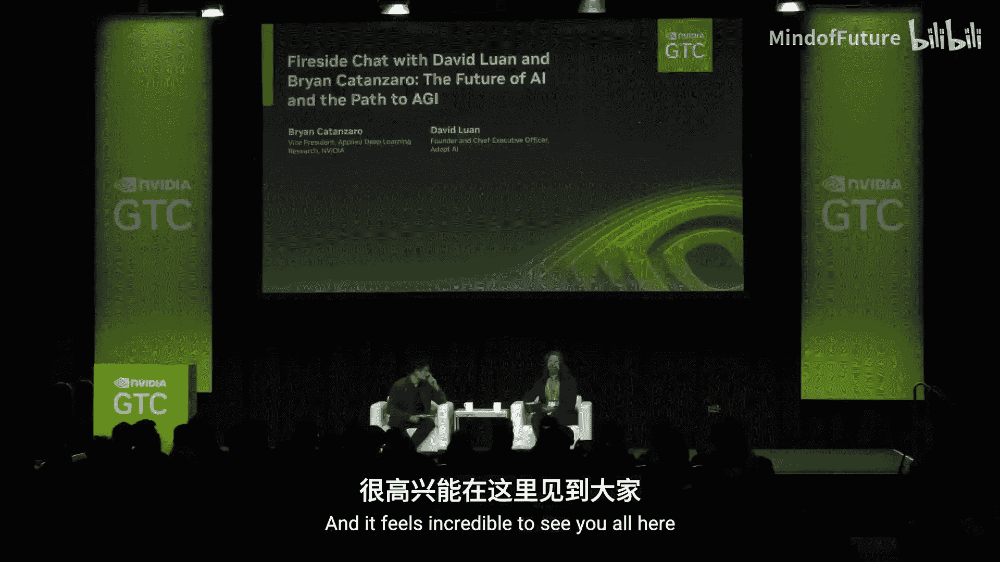

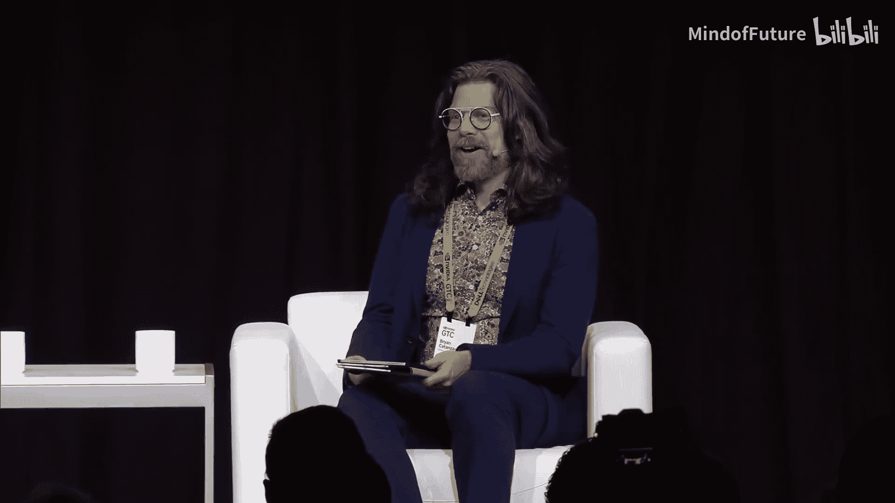

And hopefully we'll have some time for questions at the end。Yeah。

 super great to super great to be here with you， Brian。

 I feel like you've done so many anchor contributions to the field。

 So I think this is gonna be a lot of fun to get to grill you a little bit about some of the things you you believe over the next 45 minutes or so。

 Well don't really me too hard， alright。😊。

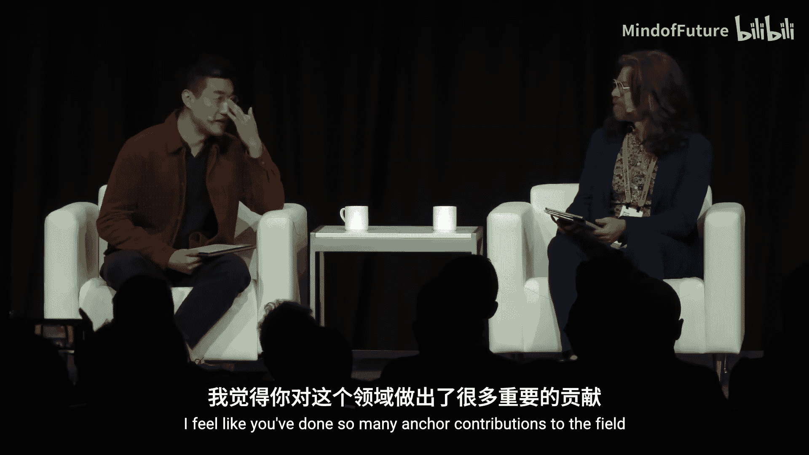

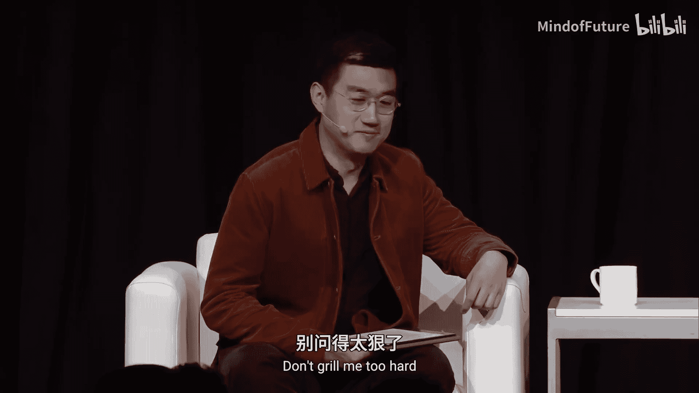

So I guess just to start off， I think， you know， NviDdia。

 like you have driven NviD's AI efforts for quite some time I'm curious， like。

 how would you describe the goals of NviD like AI training and and research programs that you've been overseeing。

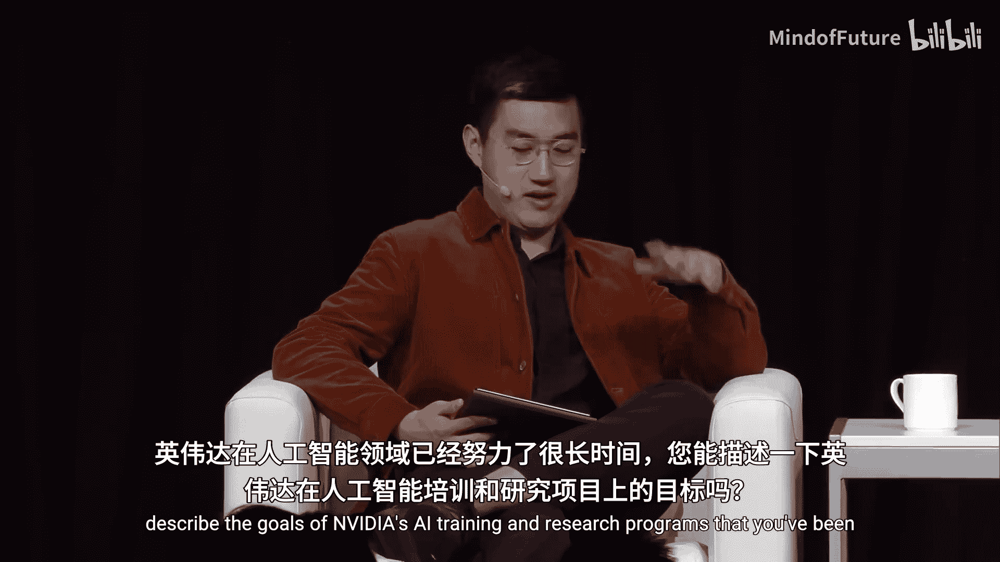

Yeah， it， it turns out that NviDdia is working on our own AI efforts and is something that I'm very excited about and something that I'm hoping is going continue to develop。

 And I think there's two really strategic reasons why NviDdia is building its own AI。

 The first has to do with the nature of accelerated computing。 So the。

 the value that NviDdia provides when we sell systems for AI is in speed。😊，And。

Having that delivered to the engineers and researchers around the world that are creating AI requires us to understand the process of creating pretty deeply。

 There's a lot of things about the structure of networks。 How do we use low precision arithmetic。

 sparsity， how do we deal with networking and all of the various software Ss， compilers， libraries。

 frameworks， communication。In the network， systems like Gracehopper。

 where we have Cs that are coupled to GPs in new ways。 and all of these things。

 there's so many choices。 And the soul of NviDdia's work as an accelerated computing company is to make those choices。

 but that requires us to actually understand what is being accelerated really deeply。

 I always like to joke that accelerated computing actually means decele computing for almost everything。

 And the reason for that is that if you just say， hey。

 I'm going to make a computer and it's going to be fast。That's not really saying much。

 all computers try to be fast， right So the thing that makes accelerated computing different is that it's specialized。

 but then that question of what do we specialize for becomes essential and you the only way that we can build the systems of the future is to be building AI ourselves so that we understand what's build。

 So that's the first reason the second reason I think has to do with the opportunities as AI develops around the world。

 know I believe that AI is going to impact the world economy in every sector in every company。

 But how is it going to do that， because there's a lot of specialized skills that need to be developed and also an enormous amount of compute and data and resources that get put into building AI。

 not every company is going to be able to invest in that。

 And when I think about NviDdia and our business of supporting the world。 you know。

 NviDdia is able to partner with every company old and young， large and small in finance。

or in consumer product goods or in technology， we were able to help every company incorporate technology into the beating heart of their business in a way that preserves their identity and allows them to take advantage of their own unique ideas and market position to change the world。

 And I think in an era where AI is changing everything。

 It makes sense for AI to be part of NviIdia's platform。

 And so that's the second reason why we're developing AI。

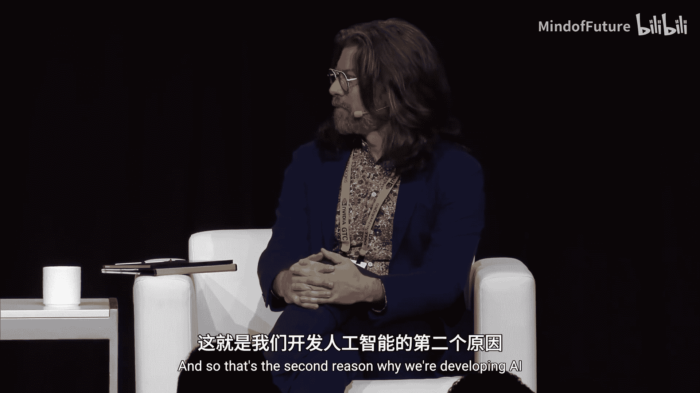

So you have had a front row seat basically to the enormous gains just due to things like model scale over the last couple years。

 I'm curious， you know， I just zooming way out for the audience。

 I think a lot of people may be familiar。 But you know， how do you think about scaling laws， Like。

 what do they mean for， what do they mean for， for AI。

 And do you think that like that's gonna continue to hold， yeah。

嗯。Well。I've been betting on scaling AI now for 20 years， and it's been a good bet。

 We're one of the original GPU programmers way back in the day。 yeah。

 it's a long time ago back when I was a grad student at Berkeley I was doing machine learning on GPs and published a paper at I Cl back in 2008 on using GPus to train models so that we could scale them and I actually got this response from a bunch of people at ICl。

 machine learning conference。 they were like， what are you doing here。

 Like everything that we're doing here is new mathematical formulations of machine learning that allow experiments to be run。

 you know， new kinds of experiments to be run by a grad student on a laptop。

 And the data sets that at the time people were using might have like a few hundred data points in it。

 And they might be like a few dimensions big。 So it was it was an era of small scale machine learning。

 And there was still lots of interesting things happening。 But you know， I believe that。😊。

Scale in data and compute was going to change the world。 And now looking back。

 I think that's been clear。 But it's also kind of disappointing feeling for many many people working in AI。

 this idea that data and compute is all you need all you need because like we want to believe actually what we need is more PhDs in probability theory because that's really fun。

 it's really fun for on probability theory。 But the idea that actually we just need enormous computers and enormous data sets that doesn't feel as great。

 But I think we need both obviously I love PhD in probability theory。

 But I feel like the foundation that has been moving AI forward for the last several decades has been scale。

 And I don't think that we're seeing the end of that yet。 I feel totally the same way， by the way。

 it's like this is talk I oftentimes give that basically outlines a different areas of deep learning like everything before 2012。

 I loosely just lump it a prehistory。 And then like 2012 to 2。😊。

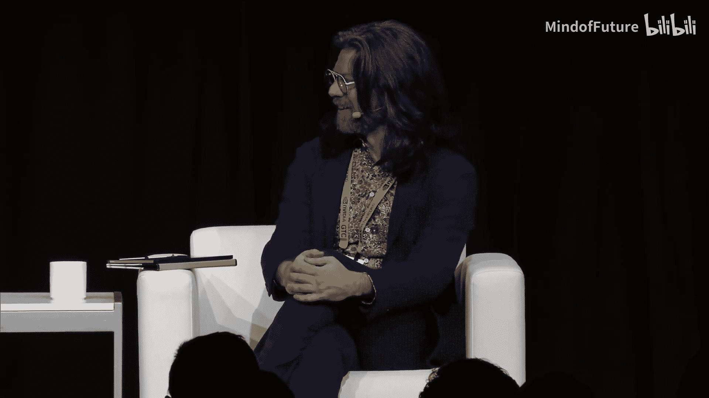

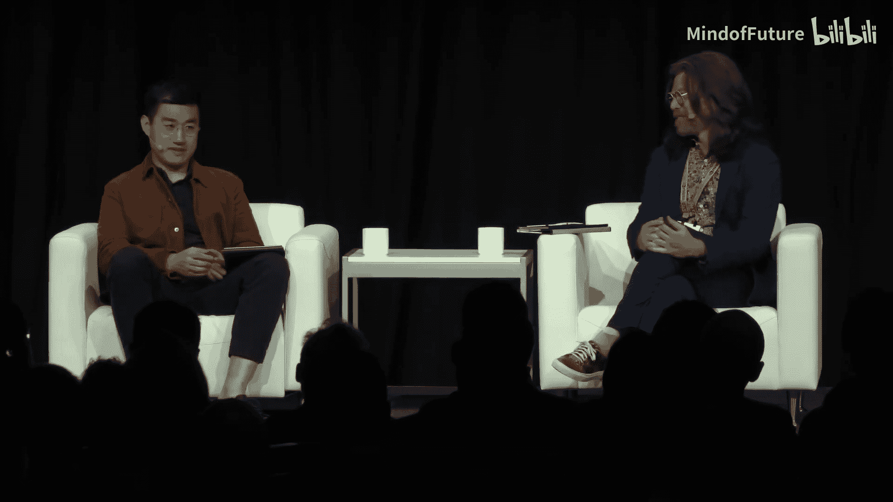

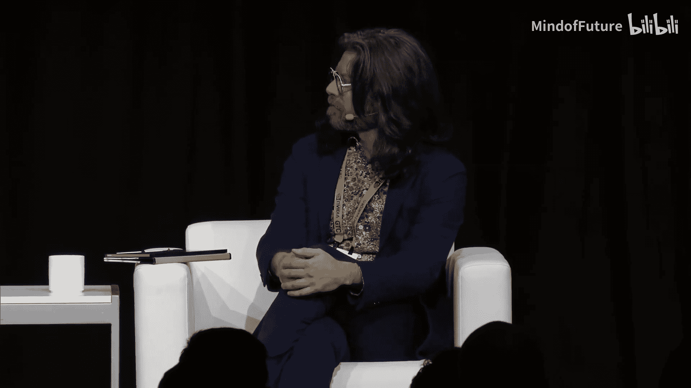

17 was like you and your three best friends write a research paper that changes the world。

 And after 2017， though like after a transformer， after learning how we map these architectures really efficiently at a hardware。

 then it group just really become a data and scale game And sometimes people ask me， you know。

 should I go should I go leave and get a P Should I go think about like how I can make new algorithmic advancements。

 I definitely think some people should continue to consider that kind of stuff。

 But but on net like even if you go back to look at the initial Alex net paper like people thought that that was really an idea shift。

 but it was really like like Alex Kevsky sitting in a corner figuring out how to map like convolutional neural networks efficiently to the 580 two of them。

 actually， two of them， he was very pioneering in the sense that he like built a neural network specifically for the system that he had。

 which had two Gps。 We had to like partition it in this very strange way。

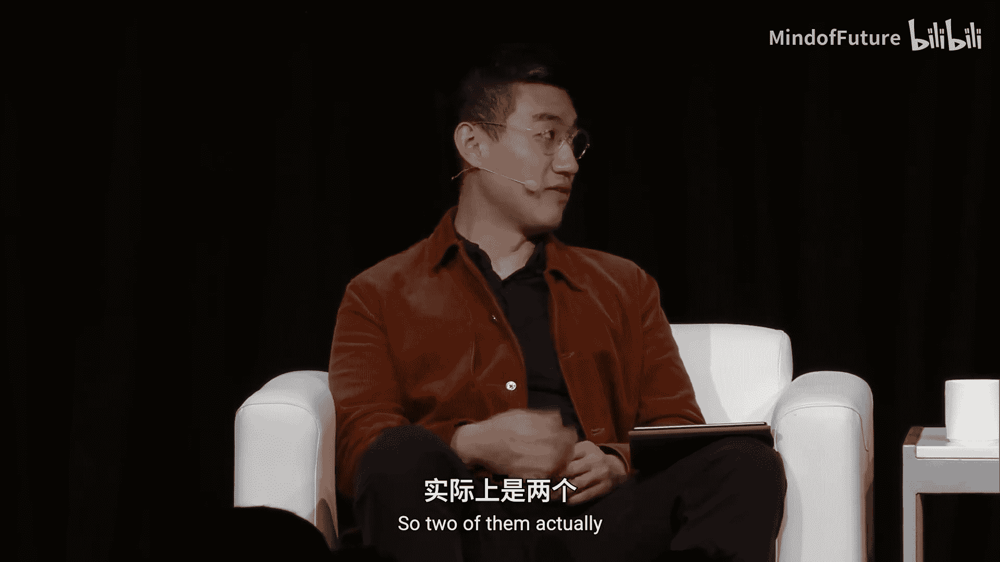

The systems work under underlay the result that he got。

 And that's I think it's been true for so many big， big results。

 like back when I was at Open AI when we did G2 when Alec Raford and I were writing the paper for that。

 we had long sections about all the evaluations and and a short section about how we unified all these tasks and to just predict the next token But the modeling section was like a paragraph long。

 like we use the vanilla decoder only transformer like these couple of configurations and we're just sitting there being like the academic community is going to roast us because they'll say this is no novelty they did and they did。

 did And I just like keep on seeing this happen over and over again that like the new megame that people need to play to actually get advancements in AI is like po poed by the current incumbents。

 I think we're seeing that again in this era， I mean is a little different from from some of the more broad platforms work that you all do。

 But like for us， at least one of the things that we really believe in net adept is that。

This next era of AI is actually going to be about getting product right and doing the correct codesign of product and the research objective and having a lot of new ideas and research actually flow from what doesn't work for customers。

 and I feel like that's actually another change from the way that like， for example。

 like my old team at Open AI or my old team at Google research would think about the problem。 Yeah。

 hey， can we back up a second and you explain like what is a and what is a doing Yeah。

 so apt is kind of is an interesting company We're configured a little differently from the from the other sort of startup labs that you all know about like open AI and anthropic and and Mistral and stuff like that。

 we do with a is we actually have a we have a broader Northstar that's both a product and research Norstar。

 And's can we train an AI agent that can do anything a human can do on a computer So how can we build models that don't just read and write text or understand images but use them to be able to give it a natural language instruction。

Do whatever end steps on your on your machine with the software that you already use at work to go achieve that goal。

 So like simple things like you know， take this invoice I showed up in my email and put it into QuickBooks or find six different ways that I might be able to to plan out this particular trip that my team needs to go on and have the model actually just actuate your machine like a human to go get that stuff done。

 I think what we see a lot is that is that like know as enterprises have adopted these LLMs in particular people always use them for summarization text generation。

 those things seem to work。 And the moment those things start working in a company they're like okay great。

 how can I actually hand off whole workflows from my team to a model such that they could be augmented and that's basically the problem that we've been trying to solve in order to solve workflows。

 you need to be able to solve things that look much more like agents which I'm really excited about because if you start working on agents all of a sudden you get to bring all the richness of the like like broader RL literature。

 all the work。Happened at Deep Min in the mid 2010s around like beating humans at go and all that stuff。

 You get to bring those to bear in the LL M era， which is really cool。😊，Wow。

I feel like what you're articulating is a future where humans are being augmented by these models where like the goal of these models is to help people get things done。

 I don't know how do you think about the way that humans and agents are going to coexist。

 Yeah this is like a really strong part of what I really believe in from a mission perspective is that like you could frame work in this space is being。

 hey， how do I just outperform people and then replace them at tasks。

 but I believe really strongly that the much more interesting and correct path for us to focus on is exactly as Brian said。

 it's like how do you build AI systems that are actually here to augment people And I think the line there becomes like the way that we make that happen is we work on tasks that are like 80% doable by these models on purpose because that way you get this 20% of human supervision where they oversee what the models do Like for example。

 like one of our customers。is is a logistics company that uses apt basically to handle the lifecycle of containers。

 know people on their team log onto their platform and there's like dozens or hundreds of shipping containers that need to be tracked and to figure out heavily clear customs。

 all that stuff that's like entirely done by hand now but the way that they now use a is apt in the background basically now goes and visits all the places all the different software tools required to understand where those containers are and then gives the human team a really easy way to supervise whether or not apt did a great job on this whole mass of shipping containers。

 And so by doing this we've basically change the role where humans are able to solve the harder problems like okay this thing didn't clear customs we have to go fix it and then also gives our model feedback about how it can do better next time。

 And so I think like building these data flywheels。

 these data loops by combining the product side with the actual AI R andD side just helps your models get way better because。

Just working in a pure replacement world。 By definition， it's a lights off automation process。

 You're not getting feedback and your models never get smarter。

 So I think this is also a better way to get stronger capabilities as well。

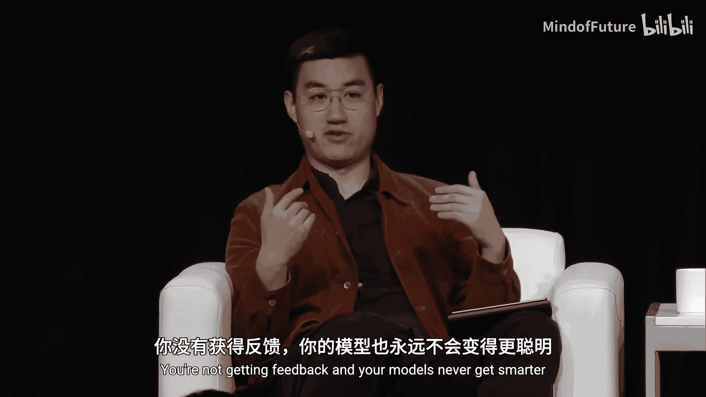

Yeah。

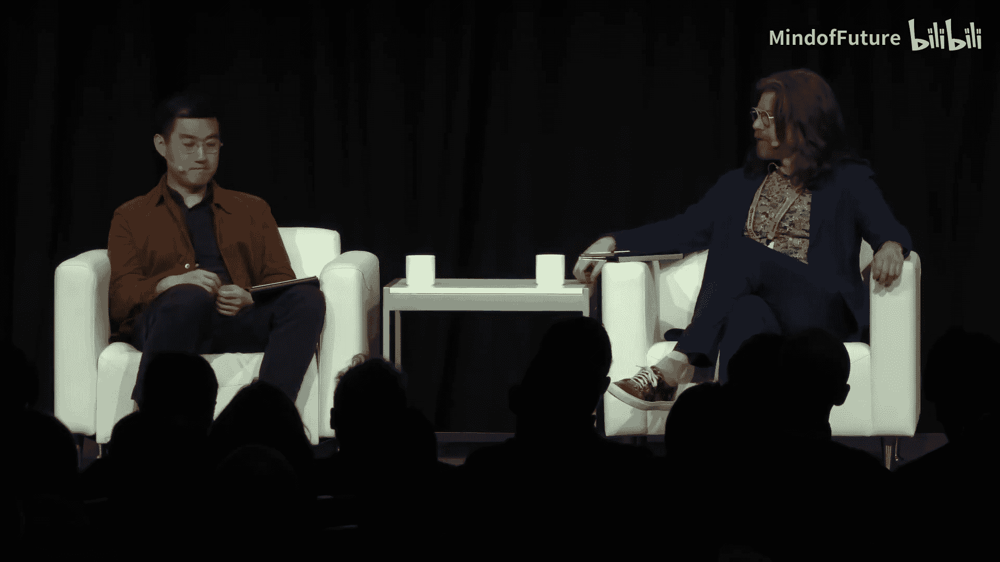

Absolutely。But I think， you know， on that note， one of the big challenges always is like， is like。

 I think everyone aspires to build data loops， right。

 because over time these days as you continue to scale these big models。

 people pour huge amounts of compute into these base LLM and they get smarter。

 There's still this giant missing piece of what's specific to you and your company and your and your customers。

 And so like we've been talking a lot about how do you actually be able to。

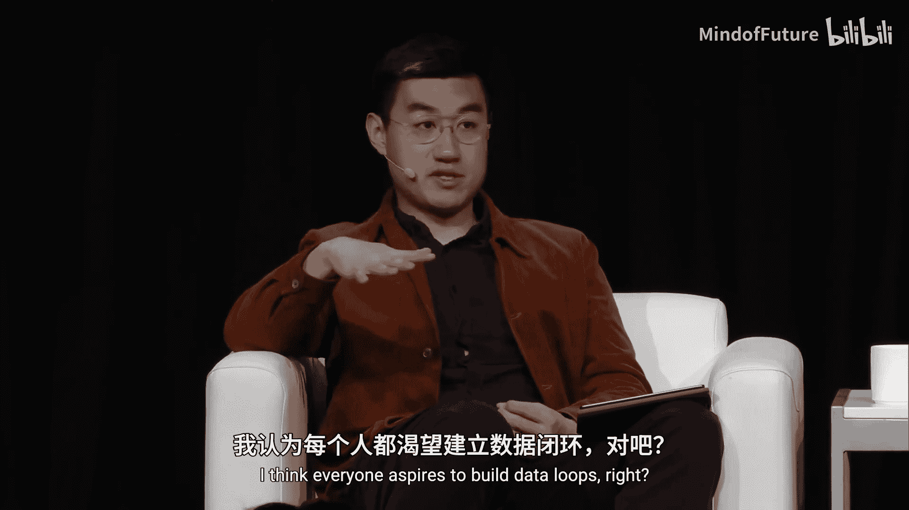

Like， what is the role of like privacy and private data and all that stuff。

 And I know you've been thinking a lot about that。 I'm curious。

 I'm curious how you think that's going to play out over the next couple of years。Yeah， well。

 I think we are reaching the end of an era right now with large language models。

 which is the end of sort of easily accessible tokens， you know。

 to train one of these large language models takes on the order of tens of trillions of tokens of text And it turns out that that's about the number of tokens that humanity has written。

 at least that's available that we can get to on the Internet， in every language， you know。

 all all put together， including programming languages and。

And so this is an absolutely astonishing amount of data， right， So we're。

 we're training these models basically to read the entire recorded output of humanity's intellectual work。

And then we're hoping that the model after reading all of that is gonna remember some of it is gonna be able to use it to reason to solve problems。

 And the fact that that actually works in some ways is kind of surprising。 It's。

 it's really exciting。 You know， and it's one of the things that you know。

 sometimes I wake up in the morning。 I'm just like pinching myself like， wow。

 I can't believe that this like crazy thing that we as a computer scientist tried to do of like find all text that humans ever wrote and then turning a model on it。

 that that actually leads to a thing that can help people solve problems if's。

 if it's fine tuneund and supervised in the right way。😊，So， so we've， we've， we've been pushing this。

 you know， for the past few years， really since， I guess G2。

 I think is G 2 really kicked off that search for， for larger and larger data sets and models and。

You know， the progress has been really incredible， as you know。

 But there just isn't more text to read， right Like there's， there's just not， there's just not more。

 And so but yeah， we know that our models are not actually done， right。

 There are many problems that our models right now just have no hope of solving。

 And I love that you brought up the customs example。

 So like getting something through customs that doesn't seem intellectually very difficult。

 But actually， its there's a lot of sophistication that you have to understand how these different different systems work。

 And the rules are written down in kind of vague ways。

 And like there's negotiation that's happening and different companies of different rules。

 So it's like there's no one size fits all。

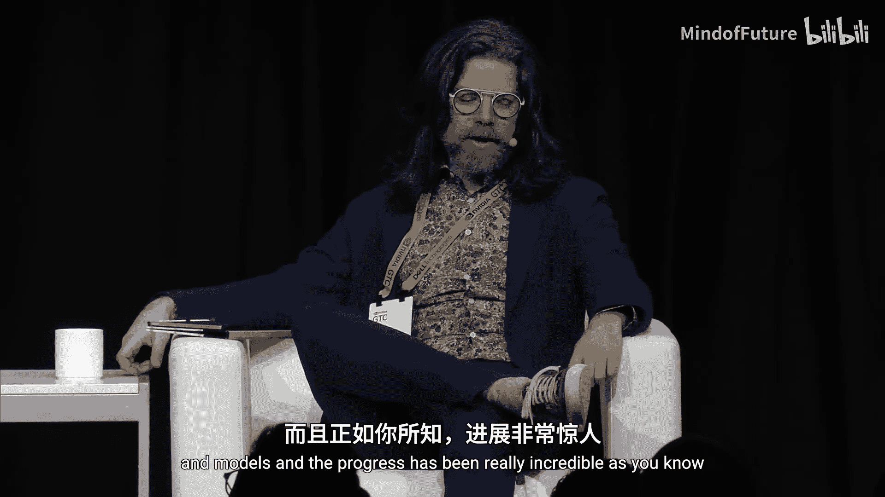

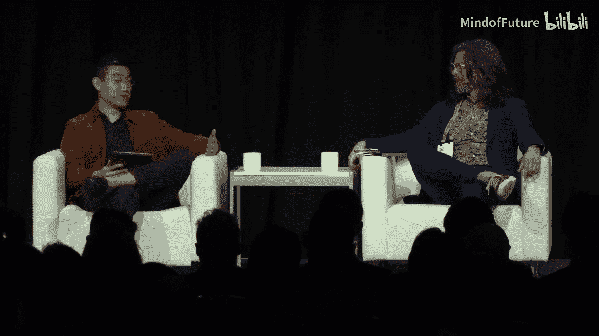

Procedure if for're getting that done。 That's right。

 And so it's clear to me that the future of these models has a lot more to do with the kinds of data that you're using to train the model or to supervise it to fine tune it right So we're going to need to teach the models very very specific things rather than the general thing of read the entire internet。

 And then And then we're gonna we're gonna do RHF with or supervise fine tuning with a little bit of human feedback about like some pretty basic kinds of problem solving。

 that is going need to shift towards something more specialize something more in depth。

 And I think it's pretty clear that data quality and data sort of the purpose of the data is going to matter much more in the future than it has。

And。You know， today， I think it's true that the world's most valuable data is also the world's most protected data。

 For example， like if you think about my own personal valuable data， you know。

 like we all have things that that we protect like maybe my text messages。

 I wouldn't like those to be public or my medical records or my calls you know to my family members and friends。

 And yet if there was a model that saw my life in that detail。

 it probably would be a really great assistant for me right And so the most valuable tokens to me are also the most heavily guarded tokens。

 And I think that's true for businesses as well。 So I think you know。

 my personal belief is that every business is founded on a secret。

 it's usually the kind of secret that you know， Jensen Huang can shout from the rooftops for 30 years like hey。

 accelerated computing is's a thing。 but the world doesn't understand it right that's the thing about a good secret is that even when you explain it。

Something about it that， you know， is unique， like you have a unique way of thinking about the world。

 you can explain it， but it's still yours。 And other people think you're crazy。

 usually they often think you're crazy。 They don't understand like how this would matter。

 but you know I believe every company not not just tech companies。

 but every company has something unique about it some secret。

 know that is kind of the core of the purpose of the company。

 its mission or its market position or the way that it goes about problem solving or maybe culturally know how is the company held together these are enormously valuable And yet they could never be public。

 right， So like the act of like exporting all of your most secret data。

 basically exposing the beating heart of your business to an agent actually is it requires a lot of of sort of data provenance and also safeguarding because these models as as they learned。

From this very valuable data， they're gonna become very powerful。 But then， you know。

 the question is， how are they gonna， how are we gonna use them to augment the the work that we're doing？

 And so to me， what that says is that we're going to be entering in an era of increased specialization where entities。

 companies， people are going to be able to use their own data that's very， very valuable。

 but very protected and and， and combine that with these models to make agents that that are actually super useful。

 Yeah， I think that's that's gotta be the way it's， it's it's gonna play out just a layer on。

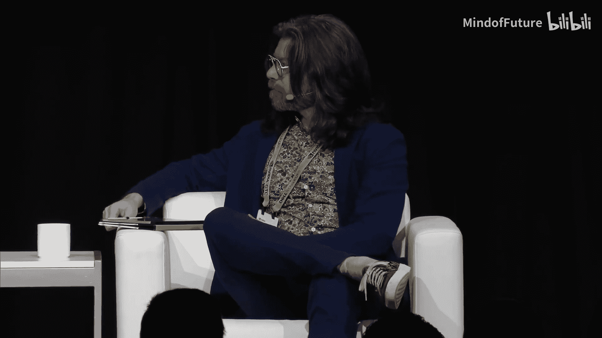

Layer on my own perception of how last couple years have played out in that particular space。

 Like I remember I think back in maybe 2018 ish I was at I was at a bar in Noe Valley of this guys Di Kingma who invented the variation auto encodecor。

 Really cool dude。 And we're just catching up on the state of research。

 He had just left open AI to go to Google research And he was just like， you know。

 David like I feel like this whole behavioral cloning thing。 has has a long way to run。

 And I might just end up working really well。 And I was like， what do you mean， He's like well。

 maybe the critical path to general intelligence isn't actually that you need to go solve this whole crazy R problem and learn every possible behavior from scratch。

 including language from running simulated agents running around in virtual environments。

 Maybe the right answer is you just clone everything that people have ever done in their lives and throw all the weights of that into one model。

 And that's exactly what we're doing now with LLm were just doing that for text with multimodal models were doing that for images in text or audio。

😊，In text or all of YouTube and text we were just training these models that like simply just predict。

 given the context so far， like what is actually going to be the most plausible thing a human and a similar situation would have done。

 And so it's really cool that that works at all。 But I think there's a couple corollaries that is these models are one only as smart as the smartest data in its training set like it has some generalization capabilities。

 but like but like anything that is true new knowledge discovery under the training objectives we have right now are actually going be penalized by the model because it doesn't match anything in the training distribution that you put in and also these are these models end up basically learning how to compress all the text or images or whatever that you put in to go train it on。

 So you have a bunch of crappy data the models just wasting so many parameters that kind of thing So I the combination of those two things really point。

 I have a joke about that。 which is like we were training a model。 This is probably。5 years ago。

 And like our model was diverging。 and we couldn't figure out why。

 And it turned out that we had downloaded some web pages where people were drawing pictures with like ASI art and emojis。

 And so we were like feeding those tokens into our model as if they were English tokens。

 And our model wasn't big enough to kind of understand that this was a different language。

 a language of like AskI art。 And so it just exploded。

 So it's just like P of like Poun side was like extremely high。The model just couldn't at the time。

 you know， five years ago， It could not learn how to draw ASi art and learn the English language at the same stuff。

 Yeah， it's so funny。 I think I think we we we've all sort of built up these battle scars of like stupid like quantities of data thrown of these things。

 I remember for one of the G's ever got which one was just like turned out part of the corpus was just like pages and pages and pages of canon printer serial numbers。

 we hadn't done a good job of filtering out。 It just it really does not end And so that's actually why like like I feel like you know。

 going back to the the private data thing， right like。😊。

Part of the goal for adaptpt is like know we're training these agents to do work on your computer。

 We need to learn from the we need to learn from the smartest humans possible doing the hardest tasks because if you don't have that kind of data。

 which is not public data， it's not sitting around on the Internet then it's really hard to push the increased capabilities of your base models And so I think like know there's lots of interesting work that you can now bring a bear on this particular domain in the agent space of controlling your computer that help you sidestep a little bit because in the usual text LLM domain。

 you don't really have a simulator and because you don't really have a simulator。

 you can't do as much interesting work like like for example。

 one of the things that we've been spending a lot of time thinking about self-play so how can you train a model that can use your computer that can also scrutinize its its own decisions and let you spend computer this sort of posttraining time to collect new experiences about how you might do things on your machine and take the ones that are success。

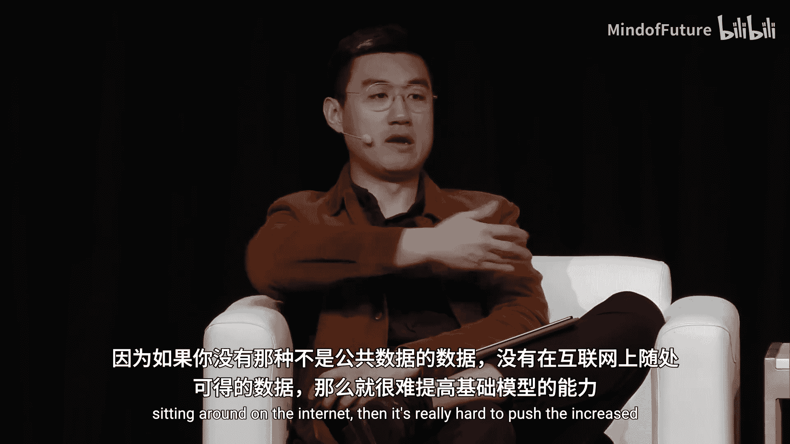

and train on those and build loops like that。 And and like in addition to like you know solving these specialized models with private data problems。

 the other set of problems I'm really excited about is that I think in the next year or two。

 we're just gonna see tremendous gains to AI capability in the posttraining step not just in the pretraining step that people know and love today。

 Yeah yeah well and I mean I do think that the posttraining step has already shown to be enormously important like if we just take a raw language model without doing SFT RHF trying to align it to human preferences and give it some problem solving capability。

 turns out that the language model isn't actually nearly as helpful And so I think we're seeing a lot of progress happening when we we figure out how to make something that's generally smart。

 but then we specialize it。To try to do a thing that's helpful right And then the question is。

 you know how is that going continue going forward。 So so I have kind of a spicy question for you。

 And I don' I don't know the answer to this question。 I have an opinion。

 but so do you think that the way that these problems are gonna be solved is mostly gonna be through general intelligence or do you think it's mostly gonna be through specialization or is that a stupid dichotomy and shouldn't we shouldn't ask that question No。

 I think it's a good， I think it's a good question。

 I feel like so my experience is at least and I love to flip it on you after I give my answer on it。

 My experiences at least is that the quality of your raw pretrain model sort of sets sets the ceiling for behaviors and intelligence you might see regardless of what you do after the fact like you kind of want to make sure during pretraining stage that you have support for in the training distribution for most la you're gonna care about downstream and then I think about everything that happens after。

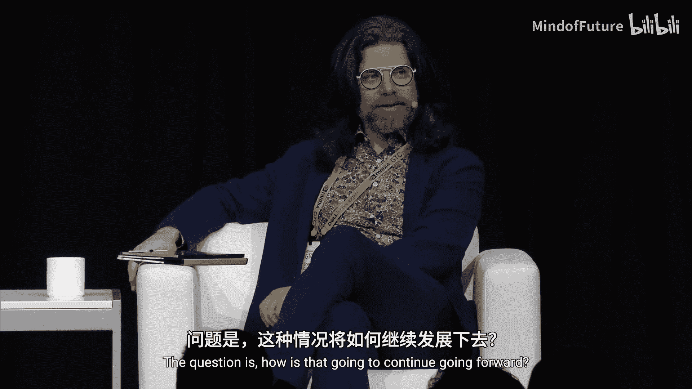

That is really like like teaching specialized rules， teaching specialized knowledge， teaching like。

 hey in this like collapsing the waveform of like， you know time in time step X。

 I could do one of end things because like in my training step。

 people did it in different ways to like， hey， at my company， I do this one particular way。

 So push up the likelihood of just like the next step according to that particular way。

 I feel like that's really the role of everything that happens during during the posttraining phase So I think what's gonna happen is like in the next couple years。

 to get state of the art capabilities， not like necessarily like fast local capabilities。

 but to get state of the art capabilities every organization is going need a combination of access to one of the few like true frontier models that has like just the highest level intelligence possible with the private data that's like teaching that model。

 the particular things that are special to you in your task。 so probably a combo I mean。

 I think I'm generally。

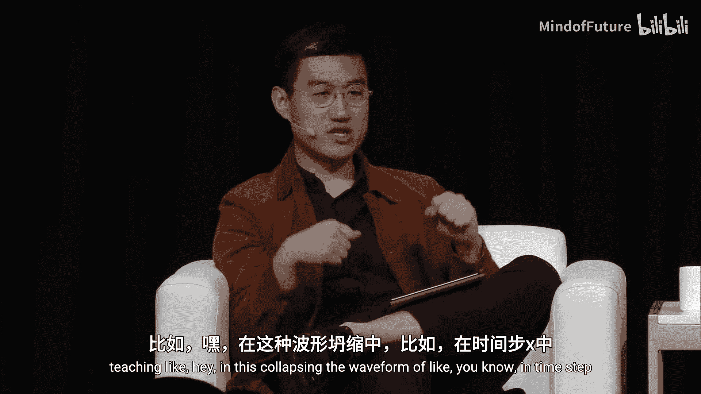

And one of the things that I really like thinking about is how multidimensional intelligence is。

 for example， I don't know how many of you love， let's say Beyonce right obviously iconic artists I believe that she has a special kind of intelligence。

 It's a really rare kind of intelligence the way that she's able to understand other people and sort of cultural trends and then her own life experience and then synthesize that into a thing that captivates the attention of hundreds of millions of people around the world and thereby makes large amounts of money this kind of intelligence is pretty rare。

 pretty useful， at least us humans， we resonate with this。

 like a lot of our culture is driven by super unique forms of intelligence。

 I would almost say like not to say that these are aliens among us。

 but there's certainly icons among us of people that just really have special skills。 And you know。

 I don't know what Beyonce's SAT score was。I don't know。

 I'm not actually very interested in that question， right， It's not。

 it's not directly relevant to the reason why she's so interesting and her work is so valuable。 Now。

 I， I do think that。

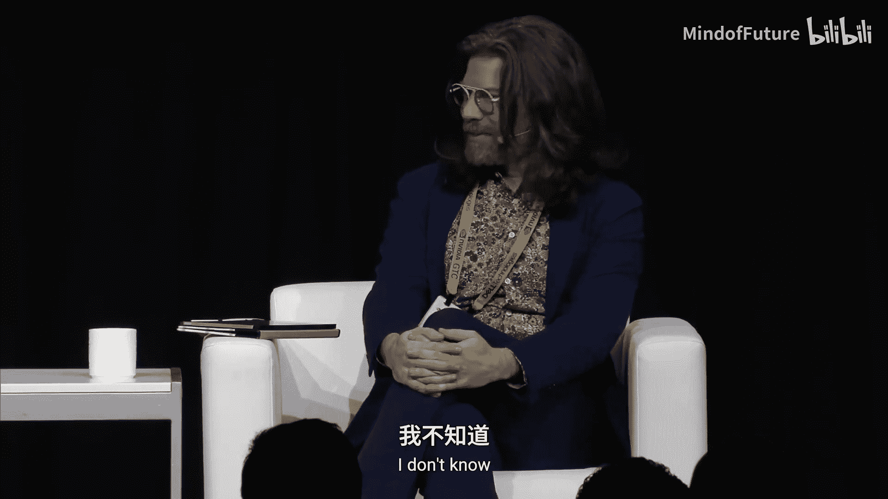

Like you said， having a more general， a smarter， more general intelligence。

 it does place kind of a ceiling on the capabilities。

 like if you if your model just isn't very general and just doesn't know very much it's hard to get it to be really amazing at anything right。

 And so so I do believe that general intelligence is useful and and we're going to continue pushing that frontier。

 But but my belief is that because intelligence is so multidimensional。

I think there's probably 8 billion different dimensions of intelligence because there's 8 billion humans on the planet。

 You know， and I believe that， you know， there's something that I could learn from pretty much all of them。

 And I think that we're going to find out as we deploy AI to solve problems around the world that there are so many different forms of intelligence that we're going to build in order to solve these problems。

 And I think that's that's going to be pretty exciting But one of the one of sort of the implications of that。

 which I think goes along with the work that you're doing at apt is that I think replacing people isn't actually very interesting。

 right， because there's， there's just。If you have this thing that's like so multidimensional and so complicated making something general that that just all of a sudden does everything。

 I just don't see that that's that's where we're gonna go because I think the problem is much more complex than that。

 I think it' way more complex I mean one of my coworkers actually has a really good analogy for this。

 which is that the best way to build AI that is really good at augmenting people is to think about it kind of more like a cognitive tool and cognitive technology than a robot。

 like in the same way that you know like our brains changed when we evolve like writing and we involved when when we invented mathematics I and like like our brains changed when we were able to offload the majority of facts to like our phones to learn how to use calculators I think the same thing is gonna happen is we build these increasingly sophisticated AI agents because then you have like another set of things that you don't really need to do。

 So you can spend your own limited representation capacity learning how to do something else。

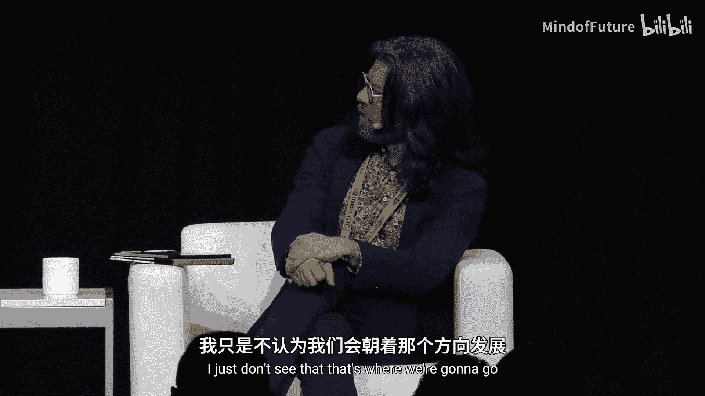

to co co evolvevolve this like a joint way of thinking with these new models as they get smarter and smarter。

 And I think like， that's probably how this is gonna play out。

 And I think most people don't think that that yet and are spending all their time figuring out how do I take like in the same skeamorphic way we saw would like with like early like touch devices。

 right， like people are still in the mode of like figuring out how the current analogies we have today could could apply to this world when you have smarter and smarter AI agents。

 when what you really need to do is you actually need to go revisit those interaction principles from scratch。

 Yeah， I， I totally agree with that。

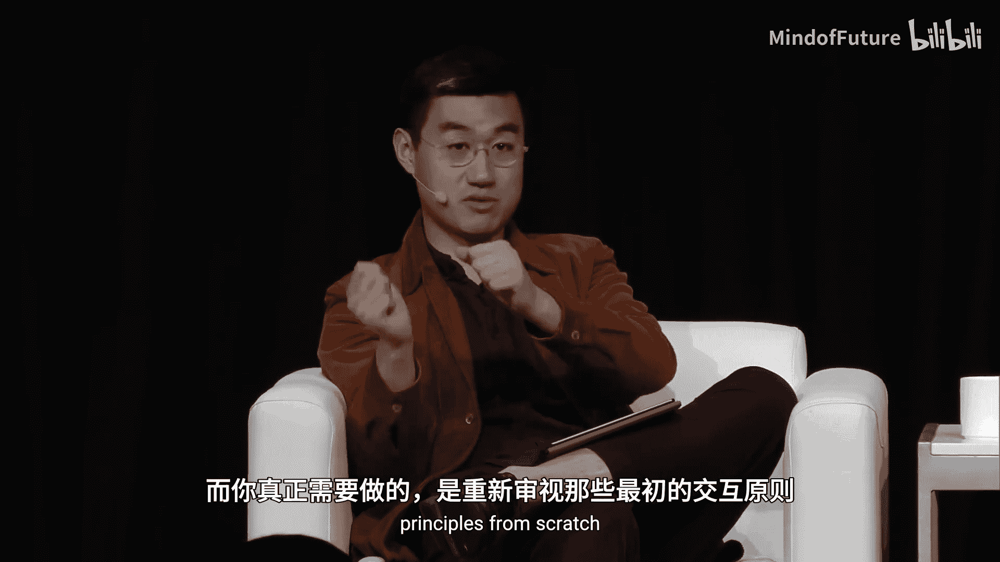

This is one of the reasons actually why I continue to be excited about the omniverse。

 as we call it it NviDdia or virtual worlds in general。

 is that I think a lot of the most interesting ways that people are going to be solving problems with AI are going to happen in a virtual world as opposed to the ske amorphic。

 like， how do I you know interact with my phone today or you know how do I work today So like how do how do we build agents that are able to kind of bridge that gap。

 I think is is really interesting， 100%。

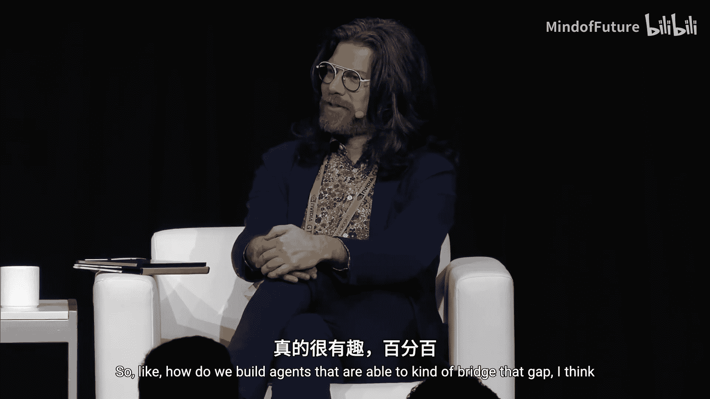

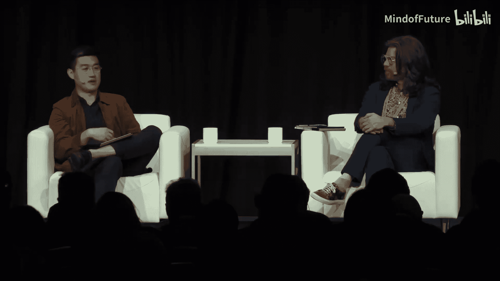

Taking it down maybe a different direction。 I'm really curious， Brian， what you think about。

 you know， if you go look at this broader nor star of either generalized AI agents or or if we wna if we want to call it AGI。

 AGI， What do you think is what do you think are the remaining big open research problems。

 like the stuff that isn't just， you know， scale these things more， put more data in them。 Yeah。

 do you think there's anything that's left。I I do。 I think fundamentally the way that we're doing inference today doesn't really allow for the kind of problem solving that we need to be able to do because because it's fairly linear。

 So， you know， most of the time when these models are actually being deployed。

 you asked them a question， they provide an answer。 but I don't know。

 maybe I'm answerpomorphizing it a little bit。 but back when I was in school and I was taking a test。

 you know， the answers to some questions Sure， you just write down， the answers to other questions。

 they could take a thousand times more thought and right now。

 it's really difficult at inference time for our models to be able to allocate compute。

 even like adaptive compute during it。 Yeah， yeah， it seems like we need。

 we need like the ability for these models to。

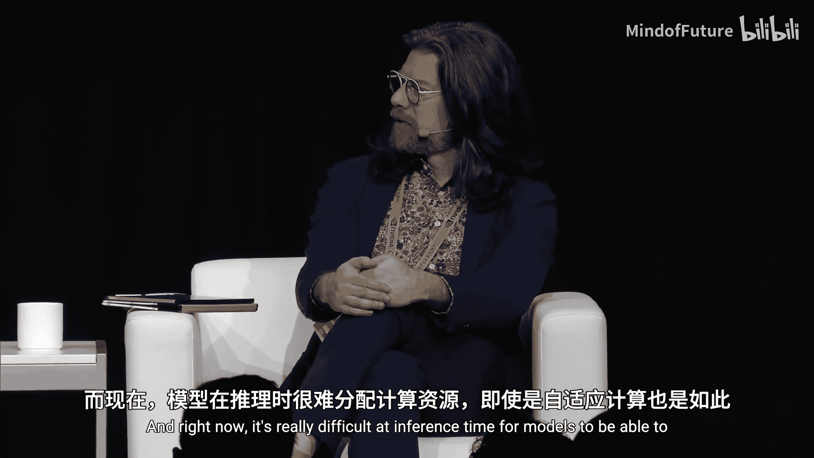

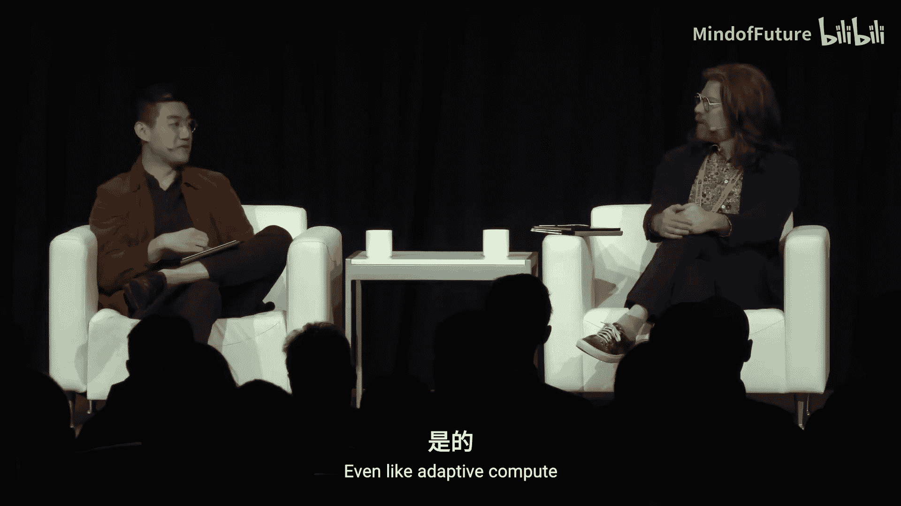

Be much more introspective about the outputs they're generating。

 And that involves allocating compute in different ways。

 And like if you need to spend 1000 or a million times more compute to generate one token than the others。

 then we should figure out how to do that。 do you feel like things like all of the chain of thought prompting related tricks and stuff like that or are a way to approximate that I think it's a start。

 I think it's a start。 But you know， those aren't widely deployed right now。

 I think one reason is because they're so expensive。

 And so I kind of you know going back to the bitter lesson that we spoke about at the beginning。

 I think we haven't really seen how the bitter lesson applies to inference as much as to training。

 You know， most the time when we talk about the bitter lesson we're talking about how do we build frontier models and you know。

 just dump insane amounts of of training into them。

 But I think actually there's gonna be some an analog of that to the deployment phase。

And the research for that， I think， is pretty nascent。

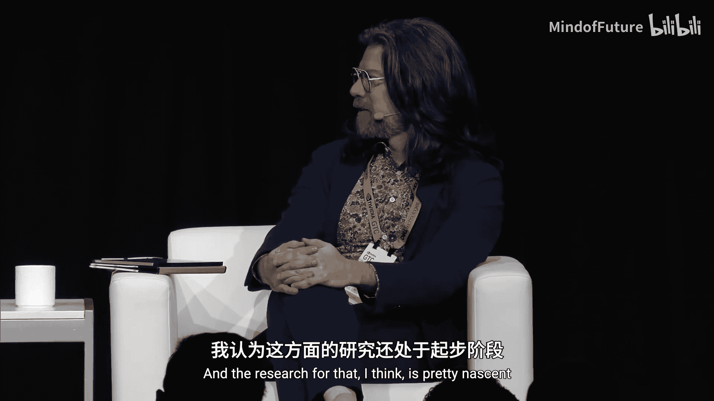

Wterest interesting。 So when you say better lesson for deployment phase， it'll be like。

 like getting rid of handcrafted tricks during inference time to get the base model to have already learned sort of the right things to do during inference or something else。

 Yeah， I， I mean， Im， I'm thinking something about， there's gonna be。

 there's gonna be some connection to the amount of compute that we can spend on inference and the smartness of the models that we produce。

 And I， I think that that's the underlying thing that I'm that I'm getting at the way of you know。

 how we actually implement that。 I think that's where the research。

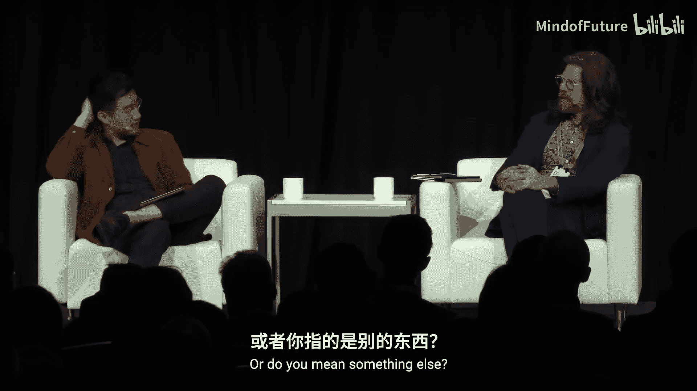

Is gonna have to go。 I mean， there's， there's a lot of papers about this kind of topic right now。

 but I don't think anybody's fully cracked it yet。 And I think we're gonna see some pretty amazing things that come out from much more compute。

 intensive inference。 I completely agree with that。 I feel like when I think about post training。

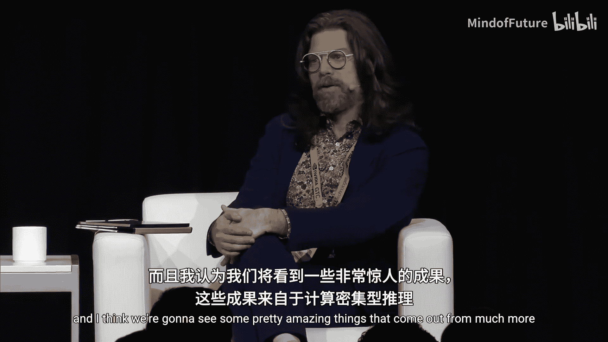

You know， there's there's straight up， you know， how do you get the models to be smarter during inference time。

 But then there's also just after you're done pretraining thing。

 how do you use the artifact you just created to go actually improve the model itself before you even deploy it。

 And I think like that second bucket is gonna be huge。 I feel like this doesn't have to be R。

 but this combination of like these base models that have a lot of instincts that have been honed into them through the pretraining phase with you know like trying to get these things that actually understand the reward signal of the task you're actually trying to solve and then be able to spend compute to push up numbers on that particular reward signal we see the early signs of this with things like RHF But like that's like we're at the very。

 very surface of the full scope of research and what's possible down that particular path。

 And I think over the next like year or two we're gonna see're already seeing in the papers。

 But like we're gonna see like true like discontinuous gains that happen when're when you're able to to like。

To like like hook up RL and or search in all sorts of different environments with with these space models。

 I mean， just even thinking about like within the agent domain on your computer is one example。

 but also like all this excitement around around like universal foundation models for robotics。

 like that's another great example of how you know。

 right now we're doing the pretraining phase for that。

 But then there's a very obvious second step that happens after you've done the pretraining to make those models like amazing controllers and amazing planners for all sorts of robotics tasks。

 I think it' would be so cool。 Yeah， I totally agree。

 And and I feel like theres there's a bootstrapping that's happening， which you know。

 this is a classic technology development cycle that we're going through where you know。😊。

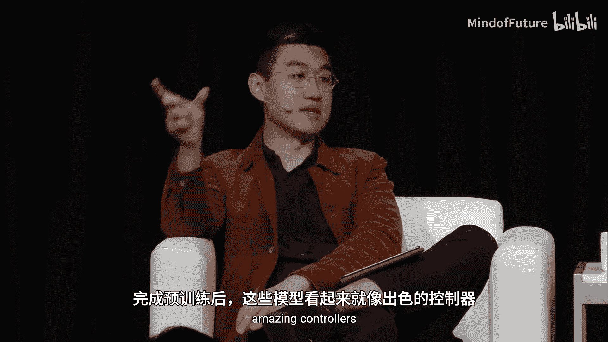

You know， like Moore's law for many years was powered by semiconductors， right。

 So like you needed to have better semiconductors in order to build the machines to build the next generation of semiconductor。

 And I think that we're seeing that with AI， right， that the you know。

 one of the most interesting things that I'm excited about doing with our foundation models is。

 is using them to。Understand our data， synthesize new data sets。

 train much smarter next gen foundation models， because I do think there's a。

 there's a loop that's happening。

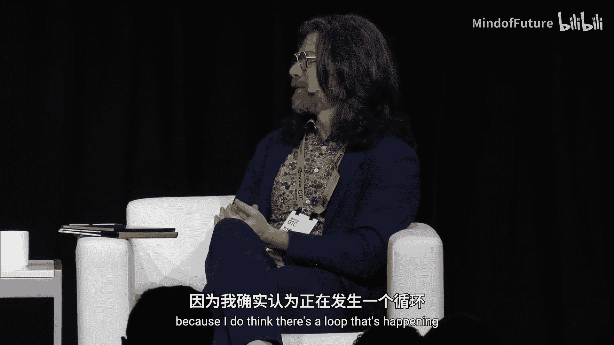

Yeah， yeah， for sure。 And I think we maybe see the early stages of that by using the models as like data filters or yes。

 that's our augmenters and stuff like that， yeah。Very cool。 Alright， Well， we're running out of time。

 So I， I think maybe just one more question。 Like， what's something that you're excited about that you think everybody else is not excited about yet。

Oh， that's a good one。 That's a， that's a good， good。So let's see。 Well。

 I think I mentioned a little bit about， I mentioned a little bit about， you know， how。

I think right now， so much energy and so much effort is going into multimodal foundation modeling as it should。

 right， Because， you know， it's clear multimodal models have sort of。

 have sort of taken over as the default model family， right， Like， I think in some time。

 people will just。Always be buning all the stuff in。 And soon we're gonna add audio in that。 soon。

 we're gonna add video soon， like any other， like all the tokens， all the tokens。 Yeah。

 just all the tokens in， in one particular model， I think actions like just like。😊。

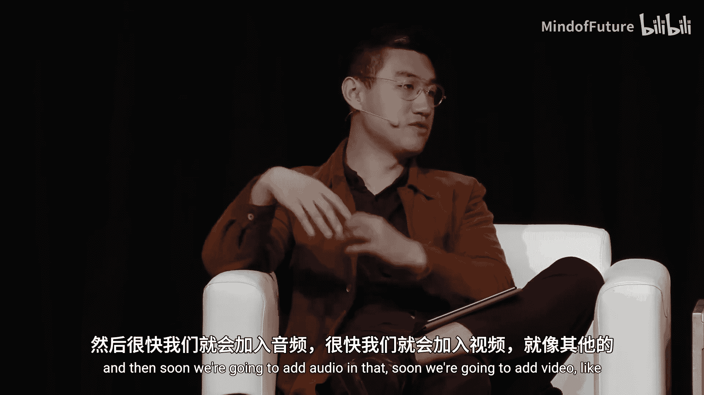

Trajectories of behavior are going also be added into that。

 And now you just have this base thing that can itself decide how it wants to allocate its capacity to learn how to model all those things。

 So that's all great。 I'm really， really excited about that But I think that's actually gonna be the majority of of like new advancements over the next couple years。

 But there's these like domain specific things that I am also very excited about。

 even though I don't work on them like we just talked about robotics。

 one of the ones one of the projects that that I helped fund at Google was by a friend No who in this team up in Amsterdam in Europe。

 what they did was they trained a model basically to outperform the best scientific simulators at weather prediction。

 And all they did was they just turned the whole planet into these like small cells。

 each of which is represented by a couple of numbers that's like the current precipitation level and humidity and temperature and all these different things。

 And then and they just treated it as like like okay， I now have this like tensor。

 And I just need to predict the tensor。😊，The next time step， tenor the next time step。

 And let's forget about any physical modeling。 And it turns out if you just do this。

 you now have this sort of like universal， like， like earth model of these。

 of these variables that actually outperforms the physics simulator up until some amount of time。

 Like， that's just so cool。 There's so many other domains where you could just literally say， hey。

 I have this infinitely flexible input output engine。 Let me just model it and see what happens。

 But I'm curious you think fantastic。😊，Well， I， I wanted to put in a plug again for virtual worlds and and omniverse。

 I think that。We're gonna find that some of the most interesting experiences are going come through people interacting with AI。

 I think one of the most curious questions I'm curious about is like how is AI going change our culture。

 And I think that it's going create a new form of media。 know。

 in the way that video games were different from movies。 AI is going be different from video games。

 It's gonna be much more useful and much more profound and much more interesting and engaging and helpful。

 And I think that that's gonna happen in virtual worlds。

 And I think that virtual worlds are gonna make AI smarter。

 They're gonna make AI more grounded and understanding the problems that we face And then we're gonna work together to solve problems with AI in virtual worlds。

 And And you know for me， this is kind of you know the synthesis of a lot of research that's been happening that I've been watching and Nvidia and elsewhere for the past 20 years。

 And I'm really excited to where that's going next。

 I just love this framing of like how will AI impact culture。

 Because I think to me that is also like by far one of the most important things about like I feel like。

😊。

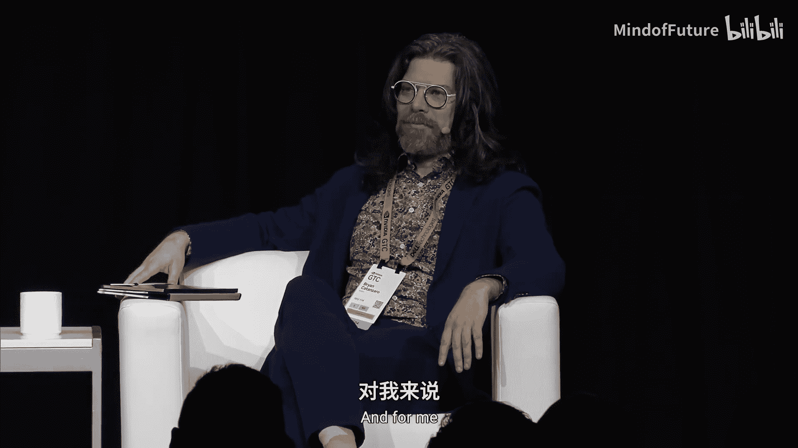

Th you're working on hasn't really hit true utility until it starts impacting culture。

 And we're already starting to see the early days of that。 But it's。

 it's one of the things I love about Brian is like you're like a super like well rounded person。

 Like we， like we talk about AI on stage。 But like， like when we're not doing this。

 It's like all sorts of all manners of different things about And that's sort of like liberal arts event you're taking this is really cool。

 thank you。 I mean， I feel like it's good to be human。😊，Yeah。Awesome， well， we。

 we have a few minutes for questions。 I think there's microphones in both aisles。Yeah， go ahead。

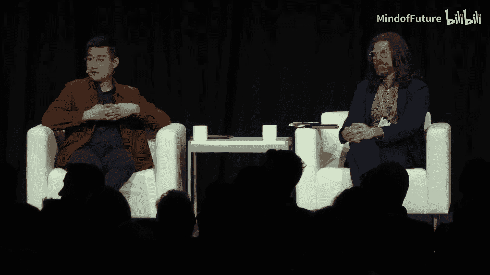

Software partner for N。 Let， let's thinking about some kind of wind。Do， do you play do， you know。

 I think two，2 dominate player is still better than one。 So I won't get。

Brians take on who will be the。Best a software partner for Nvidia。 Okay。

 so I think NviDdia partners with every software entity around the world。 You know， we， we work with。

 with all of them。 And so the answer is all of them are gonna be successful。

 We're gonna support all of them。 to that Well， I mean， I'm also selfinterested。 I mean， I it's。

 it's one of the great joys about the work Invidia does that we do support many。

 many different companies with many different perspectives。 And， and you know， in that way。

 as AI prospers， we get， we get to， to kind of ride along。

 and so I don't think that Nvidia would want to choose any。

 anyone as like the most important of our software partners。 But， but we do。

 we do love working with them。😊。

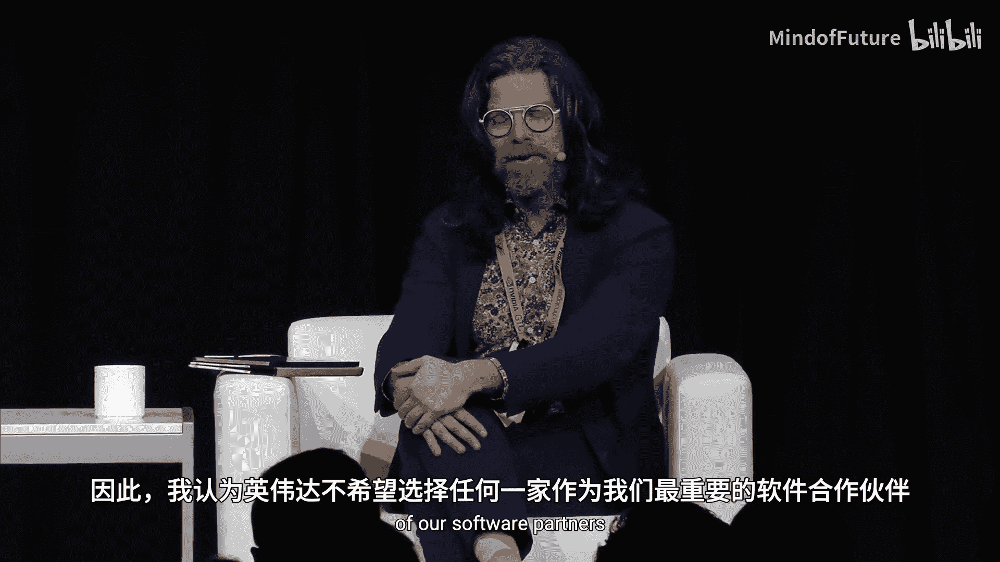

Hi my name is Vija I'm from Dian Capital from New York I have a question on scaling loss you said this that you have bet on scaling loss in every successful manner for the last couple of decades human brain is estimated to have about hundreds of trillions of synapses given your conviction and scaling loss in the last two decades。

 how do you view these scaling loss working for the next decade。

Is the hundreds of trillions of synapses sort of。啊。High watermark。

 like where these models could eventually go and what's the risk of overfitting these models。

 Thank you。I mean， on this one， I feel like the whole parameter count thing is a little bit of a megapixel war thing。

 Yeah for the cameras it's likey I have 15 megapixels， but I have a shitty lens。

 I still a bad camera。 I feel like it's really ultimately I think a better proxy is actually just the number of flops you've pushed through the model。

 I think that's like in the near term， I a better measure。

 but I think that in the same way that you know every scaling law is ultimately S curve。

 It's like where are we the S curve。 but I think that like not only is there mortar run the pretraining S curve。

 we have not even started what we were loosely earlier talking about like the posttraining S curve that much yet。

 And it's like waiting in the weights to take over for another huge amount of progress over the next over the next while。

 So I personally am quite bullish that we're gonna continue to see predictable improvements in progress due to compute and new ideas over the next 10 years。

 Yeah， and and I would also want to say that we still don't understand a lot about how the human。😊。

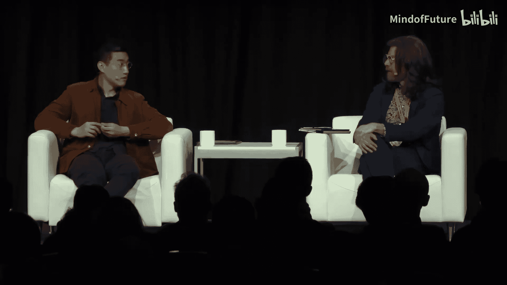

Brain works。 It's really complicated and reducing it to a number is probably oversimplifying it quite a bit。

 I think there's a lot of baked in specialization into the structure of the human brain that means that we don't have to learn in the same way that our models do where our models are literally started from random numbers but the human like each of us we start with a lot。

 a lot more knowledge that's baked in to the structure of our brains。

 And I think that that's hard to quantify and understand as well。

 what we're building with AI is quite different。 so I don't like comparing these numbers because I don't think ultimately it tells us very much。

Hi， wonderful wonderful chat。 I'm glad I was able to attend。 you guys mentioned， you know， your。

 big bet before was like， you know， speed and everything else and updates in terms of not system level。

 but like architectures。What is maybe your next big bet that you would do for the next 10 years。

 For example， I've been interested lately in neural symbolmic architectures world models。 Yeah。

 so things like that that are more that maybe give some some different form to do know algorithms for the future。

 So what can I buy a lot of ticket for for the next。 Well， I I love world models。 I mean。

 I think we're gonna we are seeing just amazing progress。

 And I was talking about virtual worlds earlier because because of that。

 I also I want to put in a big plug for sparsity of different kinds。

 So I think that we are about done playing out low precision arithmetic。 we've crunched it down know。

 quite a bit。 we're running out of bits。 know， So the way to have less bits than one is to go sparse。

And so I think we're going to find that we do want to go the sparse。 We want more structure。

 Like I was saying earlier to the human brain，'s I think there's a lot of knowledge that's baked into the structure。

 It's not an all to all network， right， And so how。

 how do we learn how to build sparsity into our into our network so that they can be dramatically more compute efficient so like the intelligence per flop can be increased。

 I think that's that's going be a big frontier for us。

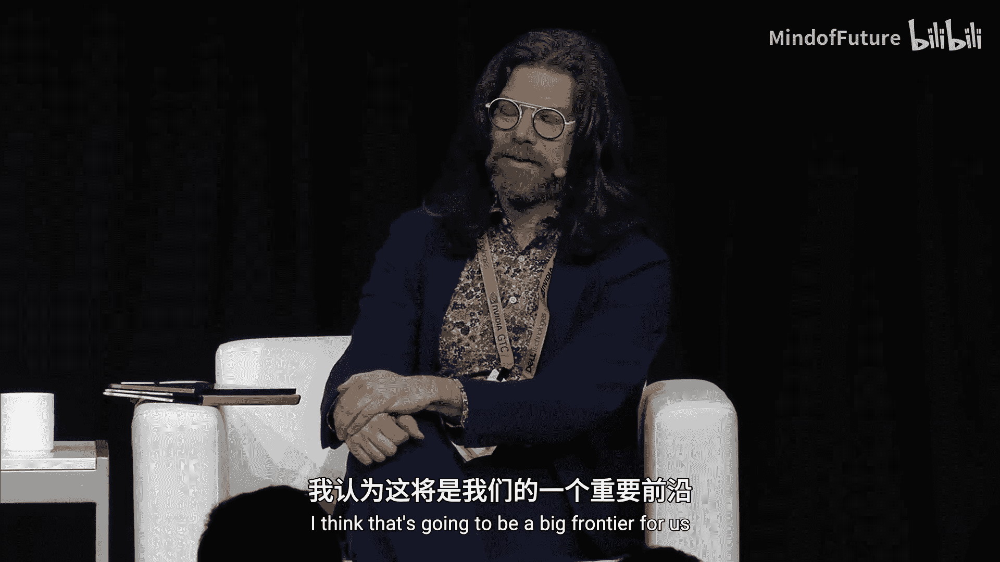

Plus one to world models， I think if you frame pretraining correctly， world models super hand waving。

 but world models kind of pop out for free。 And then the other one is the other one is on the architecture side。

 it's just whatever maps better to hardware。 I think so much of this is driven by hardware hardware cycles。

 Like you could have such a clever architecture and just have it not run efficiently。

 And you'll never be able to scale the thing as well as someone doing something more of vanilla that does map the hardware。

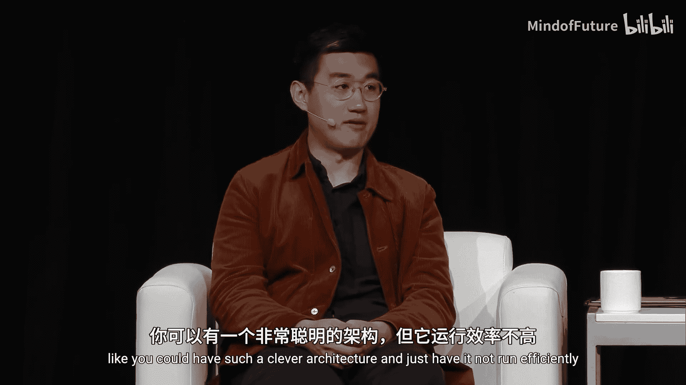

The bitter lesson again， yeah。Allright， so I have a question about the pretraining dataset set and quality。

 So you were talking about how quality for pretraining dataset sets is so important for knowledge。

 And if you have a bunch of noise， it can really divrgge the entire model。

 But our current methods are already super noisy we have stuff like at the next stop， take a left。

 right or go straight and if the model with our current next token prediction predicts left。

 but it's right， it's penalized as much as if it predicts left or as if it predicts say banana。

 something totally random So do you think with our current next token prediction that will be able to achieve the kind of next levels of AG or whatever。

 or do you think we'll have to go with a different kind of optimization there。 And if so， what kind。

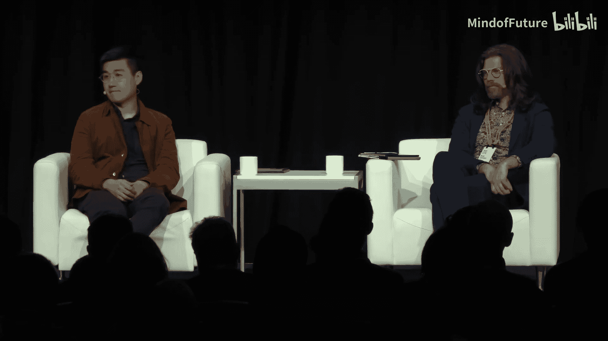

A are you again， it's kind of like what should I get a lot ticket for this one here。 What。

 what kind of like。Beyond next token prediction， optimizations， do you think。Well， I first of all。

 like David was just talking about how the thing that wins is the thing that's easy and scalable and you can dump compute into。

 and next word prediction has that property， which is why I think it's been so successful。

 So anything that comes along after next word prediction。 I think is gonna share that property。

 But the second thing that I wanted to say is it's hard to know what we should do beyond next word prediction because you know these more intelligent。

 let's say more symbolic approaches like penalizing the models specifically in specific cases。

 they tend to run into the same problems that other approaches to AI have over the past 70 years where the number of cases is just too enormous and we can't enumerate them。

 And when we try， we end up messing it up。 So the models don't actually learn the right thing。

 And so that's one of the strengths of next word prediction is that we can't mess it up with our cleverness。

 but then the third thing I wanted to say about next word prediction is that it is tempting to reduce artificial intelligence to fl。

And and loss functions and so forth。 But we can do that biologically as well and just be like。

 does it make sense that intelligence would come from like amino acids and lipids And like。

 you know the elements can be simple。 and the implication。

 the elaboration of those elements can be quite complex。

 And so so I don't really feel like the simplicity of next word production disqualifies it any more than the simplicity of biochemistry disqualifies it。

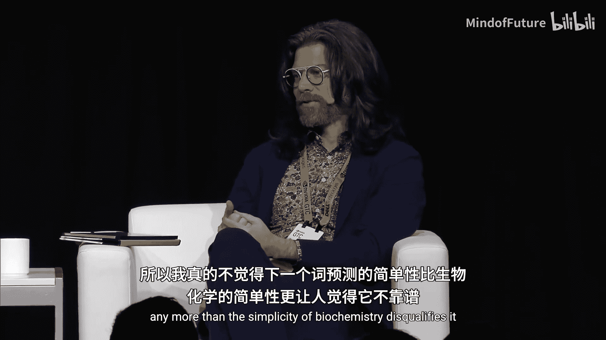

That's pretty good analogy。 I would also just say， like， sometimes I hear。嗯。

Thinking about how architectures work as， you know， will this thing just will it。

 will architecture X be able to do Y， will like training decision X be able to do y kind of things。

 And the answer is always。Well， as long as long as you haven't screwed it up。

 the answer is always yes， it's just how much compute， right？

 And so like when we go evaluate whether or not any idea is good。

 we look at does the new idea change either the slope or the intercept of the scaling laws。

 And and usually the answer is never like， is never like， okay。

 there's some like straight up discontinuity that only happens if you try some particular architectural idea。

 So I think as a result of that， it's like， I think many of these things have room for innovation。

 But I don't think that they're like strictly necessary。 actually。

 even for us to get to that next level of intelligence。

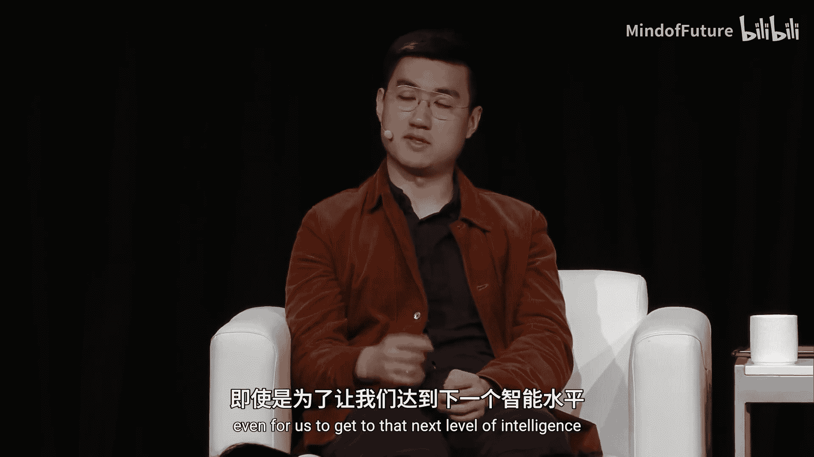

Thank you very much。Hi， I。Really enjoying this。 And I wanted to bring up a concern I have that dovetails off of your talking about exhausting the available tokens and the multidimensionalality of intelligence。

 I come from education and psychometrics and and neuroscience background。

 also did a little AGI back in 2005 long before it was cool。

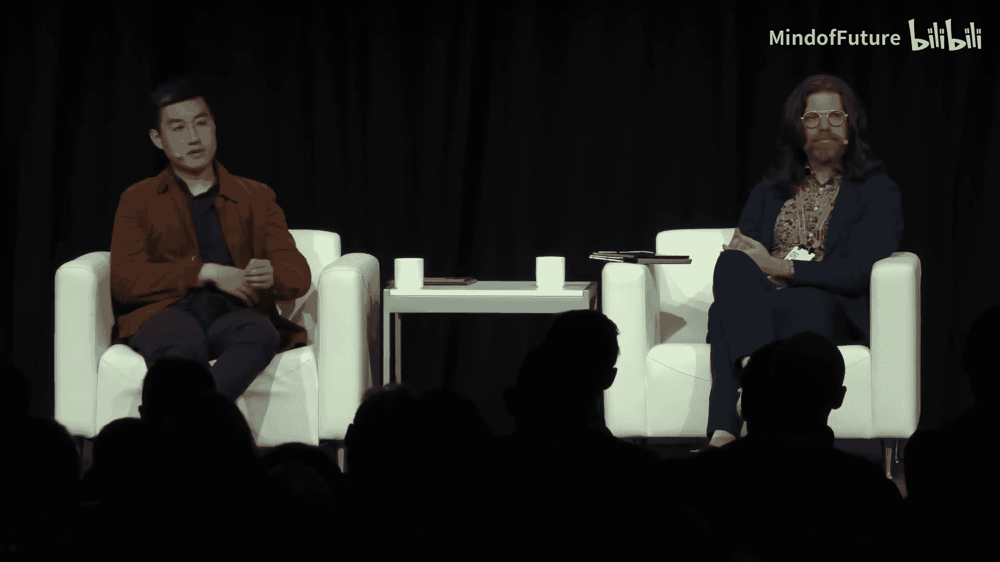

But anyway， as we've kind of run out of the text based stuff。

 a lot of people are jumping on hot buzzword is， is synthetic data。 And I see that as both。

An opportunity and a potential real trap where where I know from my work in education and human testing and other things like that that you can get yourself into this sosistic loop where where you' you're creating very artificial ungrounded systems that where you're getting great results。

 but they don't actually mean anything as far as as far as intelligence and problem solving goes。

 And I wanted you guys to to talk about opportunities and dangers there。

 I just feel like synthetic data is super useful as an augmentation。

 but it's a crutch because at the end of the day， the underlying complexity of the generator for synthetic data is usually at least in my experience。

 and maybe there's things I don't know about it is usually capped。

 some degree of model of model capacity。 you kind of end up modeling the generator and you're kind of done。

 So the crutch is over。 So I'm curious what you thinking oh absolutely。It's interesting， you know。

 in graphics， we've been doing bottom up like let's model every single blade of grass and every light source and every photon and like bounce it all around。

 And and we've kind of run into the limits there right Like I think the future for graphics has to be a world model because we've run out of ways of enumerating everything else。

 And I think synthetic data is kind of a similar thing that you know the way just like you were saying modeling the generator ends up becoming the same problem。

 And so so I'm a big believer in synthetic data， but don't and we use it。 And it is important。

 And yet I don't think that it I mean， to the extent that it's a trap。

 I think we're all aware of it and trying to make sure we don't fall in it。

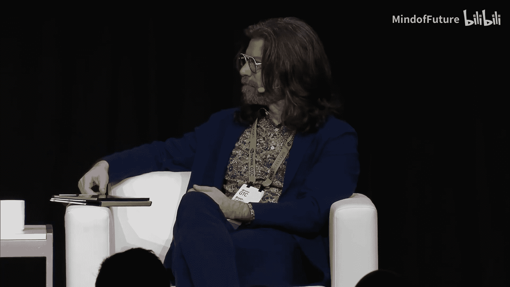