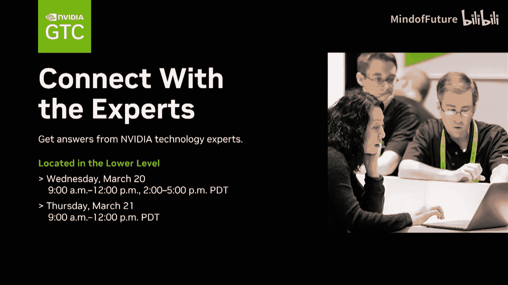
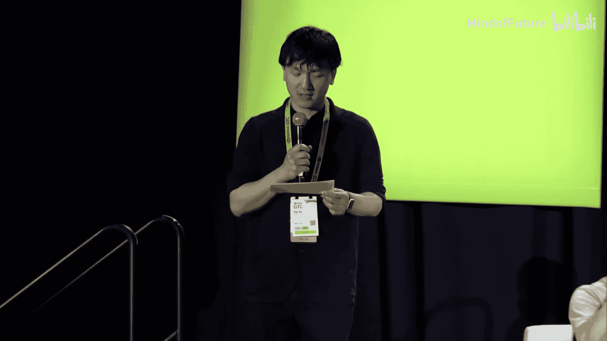
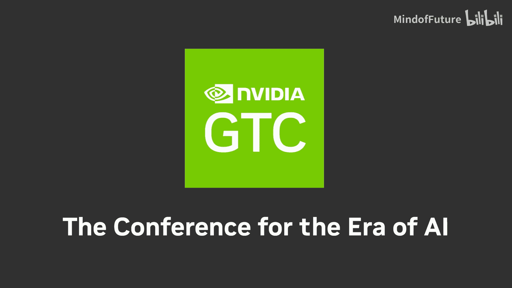

# 【英伟达GTC人工智能大会 • 中英】NVIDIA GTC 2024 p07 P07 Insights from Kaggle Grandmasters and Experts on Competitive AI and LLM Fron -BV1yHAeeqECP_p7-

Hi everyone。 My name is Fae。 I'll be your host today。

 So today this session is insights from Cago Masters and experts on comparative AI and L M frontiers。

 So make sure that you're in the right session。 So we'll have time for questions at the end of a session。

 So you're welcome to submit your questions on the MV app and or ask questions in one of the aisle microphones。

So， yeah， without further ado， I'll give you forward to the speakers。 Thank you。

Great thanks Fae， hi everybody， my name is David Austin。

 I'm a Calgo Grand Master and work at NviIDdia， fortunate enough to spend some of my time at NVDdia。

 working on AI competitions and learning a lot of new。Techniques， methods。

 and we're here to share a lot of those with you today a big thing that we like to do is apply what we learn to whether it's competitions or taking something out of research and putting it in application domain so we're going talk about a lot of different topics around LLMs vision。

 generative AI competitive AI but the real slant today is going to be around how do we take all these cool things that are happening in the world today and apply them to real problems we will leave time at the end for questions so if you came with a question that we didn't address。

Please feel free to ask it there's also meet the expert session at  two o'clock where you can come talk to us one on one。

 so one way or another you can get your questions answered at some point today but first I'd like to introduce my panel of colleagues here and let's go ahead and start with GA。

Hello， everyone。 My name is Du A Liu。 I'm a data scientist and software developer from the large language model technology team。

 I'm working on cogen， retrieval augmented generation。 I'm also Kago Gmaster。

 I used to work a lot on the competitions。 before all the L M stuff。 I'm working on rapids。

 which is a GPU accelerated data science framework。 Nice to meet you all。😊，And。And Chris。Hi。

 I'm Chris Diat。 I'm a senior data scientist at NviDdia。

 I have a PhD in mathematics with a specialization in computational science。

 I love doing data science competitions， and I'm currently a quadruple kle Grandmaster。😊。

AndNext we have Laura， yeah， hello I'm Laura Eltehe。

 I'm a research manager and NviDdia before I was a professor at the technicalical University in Munich in Germany and my research group is interested in perception。

 dynamics in understanding and so today I will talk a lot about LLMs and their interaction with vision systems。

And lastly， we have Kaazuki。Hi， I'm Kaukira， and I'm also Ka Grandmaster。

 and I joined this team four years ago。 And my expertise is recommended system。 Thank you。Thankszefi。

 and thanks for coming in from Japan for this talk。So let's go ahead and get started。

 you know probably the hottest topic that we've heard at the conference and that we're seeing evolve in the competition space is around LLMs and specifically the large generative models。

 so Geway， maybe you could start us talking about a little bit about these generative models。

 how they work， how they're trained， how we use them。Yeah， of course。

 So training a large language model or AI I like IGB T is a very compute intensive task。

 and it is a multis stage process。 So the first stage is pretraining a foundation language model。

 So basically， we collect massive text data from Internet and train the model to imitate the human language to learn how to complete documents。

The second step is what we call supervised fine tuning。 So basically。

 we want to create a smaller but high quality data。

 you know by human labelers for specific use cases like chatbots Q A creative or professional writing or coding。

 So when we have these smaller high quality data。 we apply the same language modeling to continuously trained model。

 The third step is called R LHF reinforcement learning from human feedback or you know。

 DPO like direct preference optimization。 So the goal is basically the same as the second step。

 But it is from a more， I mean， a cheaper and easier data like use user feedback in terms of preferences。

 So it's usually a binary binary signal to tell us like the chatbot generates two to answers for the same questions。

Which one is more helpful， useful or better。 So this preference give us a feedback and we con train a model。

 So lastly， we could apply a guardrail to the model to prevent it from generating any toxic or harmful information。

 So yeah， that's how we train O T。 So a lot going on there。 lot we could do with them。

 We see them used a lot in competition today。 But it was not long ago that there was another family models that was probably the most prevalently used。

 And I don't know if anybody that uses more than Chris in competitions。

 And that's really more the Bt silo models where you， we need additional context。 So Chris。

 you you talk to us a little bit about Bt and how that compares to some of the LLMs that we're using today。

Yeah， certainly。 So there's a lot of language models out there even more so than than the chat boxts。

 And it gets really confusing。 They basically fall into。3 families。 There's models like GT。

 which stands for a generative pre trained transformer。There's models like Bert。

 which is a bidirectional encoding representative transformer。

 And there's models that are full architecture transformers like T 5。

And the difference between the groups， the first major difference is how they're pretrained， right。

 So before you fine tune a model on your specific task。

 it's pretrained on billions of texts to get a general understanding of language and Bt。

It's pretrained by showing a lots of text。 And then randomly words are hidden。

 And then Bert needs to use thet models like like Bt need to use the words before and after the hidden words to try to guess what the。

 what the hidden word is。 This is an auto encoding task。 And as such。

 Bt understands vocabulary very well structure， semantics。 Now， GT like models。

When during their pre traininging， they see a lot of text， and they need to predict the next word。

 So as such， theyre very good at flow and what comes next。

And then in addition to the differences in pre training。

 There is also differences in the architecture。 So a full transformer has an encoder and a decoder。

 And this is group 3， models like T 5。 Now， Bt， it's just an encoder， so。You input text。

 and it goes through a series of self attention letters and out comes a mathematical vector called an embedding。

 And that embedding represents the text。Now， GT， is just the decoder。

 So you put in an embedding and then。After a series of layers， outcomes text。

So you can see there's lots of different L Ms。 There's a lot of different differences。 And as such。

 they're all， they all excel at different tasks。Right。

 so there's constantly going to be the different need for encoder decor types of models just depending on the application。

 Kaazuki， could you maybe talk a little bit about what are some of those applications when you would use the encoder versus decoder type of models？

Sure speaking of BRT there are some cargo competition where B was used and one of the competitions goal is to evaluate student summary and other competitions goal is to evaluate complexity of passages so so both tasks required to evaluate and classify the sentences I think these are the good example of use case of B because B is very good at classifying that unlike BRT GPT is used for generating sentences。

So， so it's like a chatbot。I think for me， I'm using GT for generating simple code。 When I say。

 can you show me the example of the Pyto D P and GPT return the example。 So I。

 I often hear the people say。They don't want to any coding without G， so。

So I think those the Bt and GPT is very different。Yeah yeah certainly there's applications for both the cool thing is it's not just limited to the LLM and NLP space right I mean we can actually apply these LLMs in other areas my background is in vision and I'm seeing some really cool stuff happen in the vision space as we're using language model or maybe you can talk a little bit about that what are you seeing in terms of that Yeah so definitely LLMs have had a huge impact in vision and in particular in the way that we interact with our vision systems right so before LLMs made this you know big splash we were not even thinking about interacting with our vision systems using natural language right so this was kind of made possible by clip which was the first or one of the first algorithms that said oh how about we align the text modality with the image modality right so Chris explained before like how to obtain this embedding from text and now the idea。

Of clip would be to obtain an embedding from an image and kind of put these two together in the same embedding space if they represent the same object。

 for example， you know， you have the text dog and you have an image of a dog。

 you want to put these two embeddings closer together。And well， how， how do you train such a system。

 right？ So you need a bunch of images where there's corresponding captions。

 So a caption that actually explains the content of the image。

 And then you train the system to align the embeddings。

So what is cool now is that you can go from one modality to the other and you can do really nice things。

 you can talk to your vision system using natural language。

 which has really you know allowed us to think bigger how to apply our vision systems to much more for example。

 categories you know think beyond the cars and pedestrians that we're detecting that we're segmenting and really thinking big in terms of natural language。

 So I think the perspective has really changed with LLMs。Yeah。

 this idea of bringing embeddings from different modalities into a common embedding space just opens up so many possibilities and very powerful。

 I mean what capabilities are you seeing that's opening up？

So for us we're interested in perception as I said before and LLMs allowed us to do what we now call open world seen understanding for example。

 so you take the task of semantic segmentation right before what we used to do is grab you know a certain number of classes that we were interested in if you're interested in autonomous vehicles you want to detect and segment pedestrians。

 cars， road etc， so there were this fixed set of classes and we were training our systems to segment you know once you get an image segment and assign a label but there were this fixed set of labels right nowadays with LLMs the perspective has changed right I mean before it was okay how do I scale up such a system to you know the infinite number of objects that we can find in the world it was not a clear path forward now with LLMs we actually see a path forward right I mean the idea。

Is that you actually use proms， you use your natural language。

To express what you want to find in the image and the vision system needs to segment anything that you pro。

 right， like fire hydrants， dogs， cows， whatever， not only a set of pre fine classes。

So I think this was a way of doing actually this open world semantic segmentation or scene understanding。

 So completely different game to what we were doing before。And then， of course。

 like L L Ms have also changed the way we do， for example， generative AI， right？

 So we have now things like Dally or mid journey。That leverage these alignment capabilities of clip that I was that I was telling about before。

And so， for example， you have Dli that takes now these text embedding。And using a diffusion model。

 it generates an image that represents what you describe in the text right So you have probably seen these demos where you kind of write。

 you know there's a polar bear on a skateboard in Time Square and you get this nicely generated image of exactly what you have described。

 So I think this open up endless possibilities for designers。

 for artists and in general for the public to interact with this vision systems because now everything is through natural language。

 So I think this opens up tons of possibilities。Yeah。

 for those of us working on competitions we're always looking for know what is that next thing and what is the next edge that we can get and some of those capabilities you're talking about are really exciting I mean what do you think next like what are the next frontiers that we're talking about here with vision and LLMs Well we've only started exploring text and image right so but there's tons of other modalities without going too much further away we have videos we have seen now things like Zora for example that is generating videos from text but there's still tons to explore right so there's a question of you know how temporal coherent those videos are or for example the captions that are used to train these models because it's the same idea as with clip right you want to align a video with a caption explaining the content of the video but the question is if these caption actually explains only what is in the video in terms of objects or also describes motion describes actions。

Right。So I think there's a whole new like research field to explore what kind of captions we use to train these systems and how temporally coherent our videos are going to be。

 There's a lot of work that is going to appear now in this area I think and then there's also the whole 3D world right I mean we have other senses we have。

 for example， lighter and we also want to align geometric features with language with images right so I think there's really tons to explore in different modalities。

 we have been working for example， on lighter and trying to prompt objects in the lightar space using geometrical features using shaped features So I think it's going to be super exciting because now we're going to be able to generate。

 for example， full objects in 3D using text pros so there's tons and tons that is going to to appear I think in the upcoming years。

Yeah， yeah， really exciting stuff， you know you know。

 starting to bring it into the competition space a little bit。

 it wasn't that long ago where you know the things that wowed us a little bit were things like retrieveeverrs where you can just retrieve images or retrieve text and get commonalities but now with Gene AI that's become we've been able to move far beyond that and actually we can combine the two concepts and so there's this thing now called RaG。

 everybody's talking about RaG this， ragg that Chris， why don't you demystify RaG a little bit。

 tell us what is RaG and how's it used。Okay， so RAG is a really cool technique that extends the capabilities of LOM and it stands for Retrieval。

 augmented generation。😊，So， if you ask。A basic chat bought a question。

 Then it's going to answer that question from its memory。 What it what it already knows。

When you use RAG， you have an LLM and a set of documents。So then you ask a question。

 And the first step is。We search all the documents for chunks of text that relate to the question。

 and then we give both the question and all those helping chunks of text to the LOM looks at it all。

 and then it gives an answer。And this happens all without without even knowing。 But as such。

 the answer comes back and it's so much more accurate。

 And I had a chance to experience this in a recent Caggle competition called the L O M Science exam。

😊，And we were challenged to build a system that could answer multiple choice science exam questions and we were limited because limited in how big the language model can be and there was also time constraints and resource constraints So as such。

 we couldn't submit a model say as big as chat GT which may already have a lot of the knowledge in its memory but we had to sort submit smaller models。

 so the solutions that won this competition were RaG and specifically people were submitting models and at the same time they'd submit a set of documents specifically they submit all of all six million Wikipedia articles。

 they submitted all together and then what their code would do is when it was about to answer a science exam question。

 it would first scan all  six million articles and the blink of an eye and find any text that relate to the question and then it would feed that help that help full information plus the question to。

And then it would give back an answer。And I witnessed this firsthand， because on my computer。

 I would just make I would just make challenging questions， right。

 I would make a question about quantum physics about a specific detail or a number and think no way would it find it。

 But sure enough， you know， in the blink of an eye， it would come back with the answer。

 And it was something like， I forget，97，98% correct。

 So it's truly incredible what these rag systems can do。

 And the most impressive thing is all this is just happening behind the scenes。

 You're just asking a question and answers are coming back。

 And it's doing the retrieval and all that kind of stuff。 And it's just all in the blink of an eye。

 It's really amazing。😊，Yeah， yeah， for those of you who might be interested in finding out more about that or seeing this in action。

 Chris published were some really great notebooks that were some of the highest voted ones in Kago a few months back during during this competition so you can go and check those out and see how he trained RaG。

 how he did inference with RaG but really really good stuff Kaazuki you know so Chris talked about a couple things there。

 he talked about retrieval he talked about LLMs doing some generation how do you balance those I mean is one more important than the other how do you view the tradeoff between retrieval and the LLMs。

Yeah， let me talk about this topic for for the rag and fine tune。

 There are some papers that comparing about that rug and fine tune， so。

And both almost of old papers shows the rug is better than punching， because。

The fine tune is very difficult method to apply due to the catastrophic forgetting。

 That means when you want to train new things， something like latest news， of course。

 you can do that。 But the model often forget all the things。

 So more than that rug is very cost effective， comparing to fine tune。

 because fine tune needs a lot of computing resource。 So。Yeah。So， but I think it's worth to try the。

 that fine June when you want specialized understanding。 and also， I think。Yeah， I。

 I think we should find the sweet spot between saving money and meeting requirements。Yeah。

 so basically RaG is something that can make LLMs even better than the LLM itself and based on what you're saying。

 know， it can be cheaper as well， not having to find two models and get additional data and it can be more efficient。

 So so' that's obviously very powerful but something of course we're interested in as the applications of that。

 So G what are you seeing in terms of different applications for RaG right now。 Yeah。

 so I think there are two kinds of interesting applications using RaG。

 So the first is to protect privacy So we all have a lot of private data。

 either personal or enterprise。 So which we don't want to share online and what we can do is to bring the LM to a local controlled environment like we deploy open sourced LM and we create vector database like an embedding model and。

Yeah， so specifically like a rack system connecting our local our private data to this local deployed。

 So this is the talk to your data experience。 So it leverage the capability of well protecting know the privacy of the data。

 we actually have two demos you can interact with on the second floor the demo booth。

 we have the chat with Rtx So basically it's just deploy on the Windows laptop。

 So you could could talk to some p files， some other kinds of files using large language models。

 Another demo is talk to your data with Nemo agent。 So whenever you have a question。

 So there's an agent which can route the question to a unstructured text agent or to a structured sQ retrieve。

 and since it size answer and get back to you。 So I think these are quite interesting privacy protecting kind of demos the second。

Aplications， I think， is to enhance like the recency of you know， of the use cases， for example。

 like a news or a finance agent or a search empowered search and also copilos so which you know it process like realtime streaming data and you know and help us accomplish tasks like replying a email helping me writing a sure summary of the conference or you know writing code。

 So yeah， I think those are the interesting applications。 Yeah， yeah， yeah。

 the applications are just limitless so we've talking about applications for just LMs and rags and you embedding space between vision LM and some hot areas know interested I know we all are how can you take these things and actually apply them and the competition space So know as such with these new technologies。

 It seems like competitions are starting to change a little bit like for example， we're seeing。

Competitions where there's no data provided or one data point。 you've got to generate your own data。

 We're starting to see changes there。 what other changes are you seeing in the competition space Yeah so just like you mentioned。

 so I think a very interesting trend in the CAgo competitions is there are more and more computations which don't provide any training data at all or provide very little training data which is not enough to train a powerful like predictive model So what the challenge here is it asks all the participants to come up with novel ideas and solutions to collect your own data。

 curate your own training data this is actually a very critical step for any machine learning tasks but you know previously on CAgo at least so the training data is fixed and it's very hard or impossible to expand the training data but now we are seeing more and more use cases where。

you know， participants leverage LLM to generate training data and which creates actually a great computational edge advantage to win a computation。

 So yeah， so I actually I it's also very cost effective。

 So comparing comparing to like handle labeling。 So I expect more such computations。

 And I think this skill is actually quite useful for other tasks outside computations。

 Yeah yeah totally agree。 another area where we're seeing the application some of these things that we weren't seeing before in the common space is maybe in Rexs and Chris I know you've done a lot of work in Rexus before。

 have you had a chance to use LLM with Rexs problems。Yeah we have so as LLMs are being developed。

 we're actually seeing them improve all other areas of AI and Laura had spoke how it's helping with vision。

 but another example is recommender systems right so recommender systems or you go on to an online shopping site and it'll suggest something you might like or a streaming video website and it suggest movies。

So the way recommend systems work is there's users and items。

And it attempts to recommend an item the user is going to like。 And typical ways of solving this are。

You could look at the items that a user previously engaged with。

 and then you could find items that are similar to those items。

 or you could look at a user and find other users that are similar to that user and then see what items they like。

 or lastly， you could find patterns between users and the items they engage with。 the way L Ms help。

As if you remember， we had mentioned how a model like Bert。Can encode a block of text。

 So items can be represented by their text description， and we could take that description。

 and then we can encode it into an embedding。 And embedding is like a point in space， a little dot。

 And when you encode all the items， you have all these dots。

 And then we can find which items are similar by just finding which dots are the closest。Right。

 so it now gives us a new way to find similar items。 Likewise， we can apply that to users。

 And lastly， by using these embeddings， these dots。

 we can actually find patterns between users and embeddings in this sorry。

 patterns between users and items in this embedding space。

 So using LMs is really helping us make more accurate recommender systems。 right。

 And I think actually you were able to use this in a recent KDD cup competition right。

 Maybe you could tell us about that。 Yeah， so we did。 So。😊，Recently。

 I teamed up with a bunch of coworkers and we entered the prestigious annual Kd E Cup。

 which was in 2023 and the task it was hosted by Amazon and the task was to build three recommender systems。

 So when you visit you could visit the Amazon website in different countries the websites in different languages and what the tasks were is we had to build a recommender system for languages where we have lots of data then we had to build a recommender system for underrepresented languages。

 not a lot of data。 And then lastly， we had to build a recommender system which would recommend products that do not exist yet。

So。Yeah， interesting sound。 So our so our solution used large language models。 and specifically。

 we used embeddings to find similar items。 And then furthermore。

 embeddings allowed us to do something else which is when we found patterns in the languages which had lots of data via transfer learning or translation because we're working in an embedding language space where we're able to transfer those patterns to apply them to the recommender system for the underrepresented languages。

 And that gave us a huge edge there。 And then in the third task。😊。

And you kind of use models like Bert， which is the encoder for that。

 And then for the third task where we had to generate potential items that don't even exist yet。

 We use models like GT， which would you know based you start with an embedding of items that users like。

 and then it'll generate text descriptions of products that don't even exist。

So using language models allowed us， and then we also combined that with classical techniques and it allowed us to make very accurate models and we actually the NVIDdia team actually won first place and it was like three many competitions and we won first place in every single competition I was like get ready to cloud cloud。

😊，😀Yeah。So we were super excited about that， and it was a great demonstration of just the power of LLMs helping out with other forms of AI。

Yeah， so that's a great example of how some of these new technologies are coming in can be applied not only in the real world。

 like some of the applications we talked about， but also in the competition。

 so clearly seeing changes in that space so Kaazzuki， I mean。

 where is this headed what do you see in the future of competitions。

 how might they look different in the future。Yeah， I think L M。

 it would be more powerful tool for human annotators。

 They can speed up their annotation process by taking over augmentation and suggesting rebels In other words。

 they can more focusing they They can focus on more essential tasks。

Which is exactly what the organizer are looking for。So， yeah， I think as I。I think in more than that。

 the machine learning models。It be more accurate and robust using that high quality data。Also。

 I think it makes C and AOV more reliable Yeah， yeah。

 which goes back to what Gwe was talking about about you know the problem with data and now we can use LLMs to do more with data and annotation and with the generation。

 so certainly that should be a change that we should be looking out for。So great。

 so we covered a lot of topics today， you know some of some of the latest technologies。

 how we're using them， how we apply them， how they could be used in competitions。

 but we'd love to hear from you any questions that you have for us about any of these topics or anything beyond。

 we'd be happy to take questions。Is it working cool first of all。

 thank you for the awesome panel the question is I have about the future of machine learning competitions in the past if you participated in machine learning competition there was a chance you would contribute to the state of the art research AlexNe would be perfect example and to do that the barrier to entry was pretty low you just need the computer with a GPU and basically had to be smart that's it。

Now cutting age research state of the art research requires you to train large models。

 which is at least a few million dollars and the cluster of computers and not everyone in this room has access to that kind of resources so do you think that in the future。

The machine learning competitions will still provide the venue for discovering cutting age breakthroughs and state of the art developments。

 or it will become kind of marginalized and mostly the venue for recruitment and kind of place for people to enjoy their hobbies。

Sure， yeah， I'll start with that and maybe somebody else wants to contribute。

 so there's a selfregulating factor involved there。

 which is the amount of compute that you have for inference okay so you can go off and train these advanced models but the way competitions are working today is they're mostly code competition so you have to commit your code to an inference server that has a limited compute envelope So what we're seeing is a lot of neat innovations on how you can know compress these models。

 how you can quantize them how you can get them to run in this limited envelope and I think that's the factor that normalizes the playing field a little bit and not make it just about who's got the most compute because if it was about that and you just had to submit a static CSV file with your。

With your solution， then I think the premise of your question would be exactly right is that this would just go to who has the most compute shall win。

 but that's not the case and we're seeing some actually I think some really innovative things even beyond necessarily the scope or the intent of the actual competition that's going into this efficiency problem because everybody's trying to take advantage of the latest and greatest and state of the art。

 but how you can compress that into a limited compute envelope that everybody has access to。

 that becomes almost the challenge in and of itself。嗯。Yeah， I can add。 So I think I think even now。

 So all the machine learning computations can still contribute to the state of the art research。

 I think two examples are first mixture of experts。 So if。

 if you take a look at the hug face open L leader world。

 many of the top entries are actually created by mixing several language models。

 So in an innovative way。 So it's actually pretty it's not that computer intensive as one assumes。

 So it can be done on the on the laptop or even on the single GPU is's possible。 And you know。

 it's like an ensemble of Ls。 a second example is so there are approaches like the Q Lauraura。

 So the quantized lower rank adapters。 So you know。

 it's also like you just train a very small adapter。

 So even though the L M are have billions of parameters。

 The adapter is actually it's just megabits in terms of megabits。So in some cases。

 it can greatly enhance the capability of the L M。 So in a low cost way。Thank you。

 We have the next question。Yeah， great talk， by the way。

 so I have a question about the third part of the competition that you guys were mentioning that you guys won。

I felt like you kind of skipped a step， you're talking about you take the embeddings and then use embeddings to make recommendations。

On new products， and I didn't really understand the jump between the embeddings。

And the recommendations， could you expand on that？So let's say a user previously browsed a bunch of black shirts。

 So basically as a good assumption of what they would like in the future is maybe more shirts that are obviously interested in shirts and maybe they like the color black。

 So you basically pick items that are similar to their history of items。

 So the process of an embedding， we can take the text description。 you know。

 a colored made of this materialt So you take the text description。

 and an embedding is essentially a mathematical vector it's dot。

 And then we can take all every other item on the website。 we embed them into dots。

 and whatll happen is in this embedding space， all the dots that are close to the black shirt will most likely be other other shirts and also things of similar color。

 So all the dots will like cluster。 So that's the thing we look at we look at the previous items。

 which are a bunch of dots。 and then we pick and then what we recommend。😊。

We recommend dots that are close by。But Bno， I'm sorry， I didn't describe myself very well。

 So how do you come up with new ideas for new products based on that。Oh， you mean the third task。

 the generative AI one， sorry， Oh， okay， well， so the gener AI one is。

Once you have an embedding of products they have， just that one example is you can maybe take five of their previous products。

 you could maybe average that and get sort of an average embedding and then you run a decoder so you put that embedding in and then it'll basically try attempt to convert that embedding into which product it was but since you essentially generated sort of a new embedding then basically it'll write a description。

 but it's not a description that actually exists okay sorry I'm so many questions I apologize for ignore。

How do you when you average the embedding？So what do you do next to get the description I that's the step I'm not really sure about。

 How do you go from combatdding to description。I see。 well basically is。

 So the model will be So you have to fine tune the model。

 So basically you have to have a lot of data where you have embeddings and you have the text description。

 and then you will find you'll basically train train the model to do the conversion for you to convert an embedding to text and you train on all that。

 And then the way a model generalizes， you can give it a new embedding that has never seen before and ask it。

 Con this to text and it'll attempt to but this time。

 it'll come up with some text that has not seen So you create a particular model for that。 Yeah。

 Yeah， right there's not a preexisting Amazon recommender model from log。😊。

So we have one more question in the middle， and then we'll go to online questions。

 And we also have if we have time， you can ask the experts as well。

So my question is more about representation and generation， so specifically to Laura。

 you mentioned about like clip right and there is clip clap， image bind。

Do you see these kind of representation models learned separately with some grounding and then those embeddings like are fixed and used in whatever generative model to generate images like maybe so like image tokens or like language models like text tokens etc。

 or do you see the future as。Everything together， both representation and the generation happens in the same model。

Like kind of like Gemani， which where you feed everything in has it token and then you generate。

Yeah that's actually a great question。 So right now for research。

 it's much much easier to treat the problem separately right so we usually take pretrained models。

 we don't even touch them。 They are frozen and we just try to extract the knowledge from there right and this relates also to the first question right this is something that you can do with much less resources。

 So I think this makes sense。 but also there there's another reason for doing that。

 And that is because the training data that you use for clip is not the same one that you're going to use to train。

 for example， a stable diffusion model that generates the images right So I think it's much easier if each system is just optimized for the task that it has to do and then you just plug them together right so I think clip is already perfect for its purpose right and then you can just extract the information and your generation your perception task separately and you don't need to retrain both models together。

This would be a huge overload。Okay， so let's go to some of the online questions。 So the first one is。

How can we get the community more involved in AI for open source technologies？

And what are the most exciting parts and how can we offer this to the community even more。So do。

 I know you do a lot of work in the open source community。 Do do you want to tackle that one。 Yeah。

 so yeah， one thing I can think of is to lower the hardware requirements of the LMs So actually one of the open source project we' are working on so unfortunately it's not available right now。

 but it will be soon we are trying to create you know to reproduce the use case Chris just mentioned。

 So the cargo science exam using RaG and we want to reproduce that solution on the single GPU specifically like taking 20 or 30 something gigabytes of GPU memory so that it can be run on a single GPU So in the process we made several you know improvements so like FPA quantization of the language model and that we use likeVFPQ algorithm to create the vector database so that you know。

ion so we have 65 million text documents。 So that translates to something like 110 GB。 So with IVFPQ。

 So our vector database is just 6 GB。 So yeah， so we apply we apply these optimizations hopefully so we could create a demo that user could experience with entry level GPU and can reproduce the exact the same solution on you know like cargo kernels or on the Google Colab。

 So I think that would you know make it easier for people to start with large language models。

Thank you， so we have one more questions from the online audience。

 so what are the most important data science challenges related to LOMs that are still unsolved and which ones do you think will be able to solve。

There's still problems with I wasn't aware well yeah。

 so I'll share my thoughts and maybe some of the other panelists have theirs and it goes a little bit to what you is just talking about around accessibility I mean the models are big they're heavy they take a long time to infer and there's been a lot of innovations over the past six months and my gosh they're coming out every week it seems like now on how we can compress them make them run faster make them easier to train cool training techniques but we've got to improve the accessibility problem for to get wider adoption and application and as you can tell from the tenor of the talk。

 we're really interested in application and applying these things and so to me that's the biggest macro challenge but we're seeing a lot of micro solutions to that but still a long way to go。

I'll add。 So one of the things I'm， I'm looking forward to seeing is so currently one of the weaknesses of LM is sort of mathematical reasoning in logic。

 They really excel at all all humanity and social sciences that。 So I'm， I'm looking forward to。

 and then they're constantly doing research in this area。 I think a new model was released recently。

 which actually maybe outperformed chat GT on some mathematical some mathematical tasks。

 So I'm looking forward to development there。😊，I think we have time for。Questions from the audience。

Hi， you comment earlier that for currently the competition is very important to come up with a creative way to prepare the data。

 Could you share some experience what， what worked well so far and what。

 what didn't work well for you from experience。Sorry around generating data for I think， yeah。

 J Wei mentioned right now the Calgo competition prongne to not providing training data。

 and it's very critical for competitors to come up create a way to prepare the data。

 could you share some experience on that？Yeah， sure。 So I think there was a recent computation。

 It's the L M essay detection。 So basically， the task is to detect which essays are written by students in high school and which other essays are written by large language models。

So in this computation， I think most， most of the training data provided are。Okay， yeah。

 so are from are the from the real students generated data。 So no language。

 no LM generated data are provided three points。 Yeah， only three examples。

 So participants have to So they have to experiment with different flavors， I mean。

 different L M families like the Lama two families， the Mis and you know。

 and other open source generated essays。 And they somehow have to figure out。

 So which one has the closest like distribution to the test data。

 So there's a lot a lot of analysis going on。 like study the subtleties of you know the L generated text and trying to figure out oh。

 maybe maybe which I should use Miral。 Maybe that's the test data。 So Kago is used to evaluate。

 I think that's actually a big factor in the final winning solution。 Yeah， I think Yeah。

 and whatever I would add。That is in this case， divities King。

 you the more models you can generate with， the more parameter tuning or parameter changes you can make。

 you very， varying temperature， basically you cannot throw enough data generated data at the problem because to some degree you're guessing what the hidden test set or the application set would look like and you don't know and so when you don't know the only way to combat it is just flood it with as much diverse data as you possibly can。

I thank you for the talk。Been very insightful。 I am really interested in what you guys were speaking about in terms of multi modality。

😊，As what we've seen today， text seems to be sort of the gold standard where you're either taking an image and you're creating text from that and then using that as some sort of embedding or you're doing it separately。

Every time you go from video to image or image to text， you're losing a lot of information。Now。

It is text really the gold standard because we have that as an interface。 People type on keyboards。

 And do you guys see a future in which the standard might be。

 I'm asking a question by submitting a video and getting a better response or。

Is it really only going to be text for the foreseeable future。Yeah。

 maybe we can take that So I mean I don't know。 there's so ways that we can discuss here but I think like there are systems right that like for example。

 you can imagine in res that work on you know getting not only the text but also like a bunch of documents to look into you can also look into a bunch of images that are retrieve。

 for example， right so it's not that your system is just limited to text it's just that the first step of interacting with a human is so much easier with text that that's how you start with right but for example。

 like we have been working on aligning brain signals with images and with text and the alignment with images is just much easier right so text doesn't really describe everything that is represented in the brain maybe because you're actually looking at a movie right you're recording the brain signal and so the brain signal is just much more correlated with an image right so I think you know your systems dont。

necessarily need to go through text， but it's the human input that is so much easier with text。

 I think I think that is kind of here to stay， but it doesn't mean that in the middle。

 we cannot have other types of connections between images and other modalities。

 It will not necessarily go through text。And just sorry， as a quick follow up。

 is there a way that you guys have seen effective to go from a low information environment into a high information modality。

 such as like from。Text to voice， as opposed to the other way around。 So sorry to interrupt。

 I think that's all the time we have。 And just a reminder we have you have the opportunity to meet the experts in this afternoon session as well。

 So if you have more questions， please feel free to ask the panels。 So let's thank the panel。

 And thank you all for coming。

Thank you for joining this session。 Please remember to fill out the session survey in the GTC app for a chance to win a $50 gift card。

😊，If you are staying in the room for the next session。

 please remain in your seat and have your badge ready to be scanned by our team。

