# 【英伟达GTC人工智能大会 • 中英】NVIDIA GTC 2024 p08 P08 Whats Next in Generative AI - Brad Lightcap, OpenAI COO and Manuvir Das, NVI -BV1yHAeeqECP_p8-

Good morning， everyone。

Hi， I'm Wallace Mills， I'm the Se strategist for executivecut Though leadershipad here at NVIDdia and welcome a few things before we get started。

 just want you to know this session recording will be available online within 72 hours and then within a month it will be available on NVDdia on demand。

Also want to remind you to download the Nvidia GTC app if you haven't already。

And that's where you'll find the latest updates， session catalog and surveys for your sessions。Also。

 we invite you to explore the exhibit hall here on level 2。And that will be open today at 12。

 So you don't want to miss that。That being said。I am particularly thrilled to introduce this session。

 I have had the pleasure of putting together the business insights track。😊。

In partnership with many leaders across Nvidia。 And so we get to kick it off with this conversation。

 this much anticipated conversation。 And while many people are just beginning to or。

Just starting to ride that wave of generative AI and true andvi fashion。

 we are already here to talk about what's next。So if you would。

 please welcome our Vi president of Enterprise computinguting Manerr Doss。Here at NviIDdia。

 he leads the teams working to democratize AI by bringing full stack。

 accelerated computing to every enterprise customer。

Mnieverr has over 30 years of experience in the technology industry。

 and prior to joining us here at Nvidia。In 2019， he held a range of senior roles at Dell in Microsoft where he helped create the Azure Cloud computing platform and was an affiliate professor at the University of Washington。

 Wecome Maner。 Thank you。 that is so embarrassing。 This session is not about me at all。

 thank you all for being here this morning， it's a real pleasure to see you。

 hope you enjoyed the keynote yesterday， all the announcements from Jensen， you know。

 one of the things he mentioned in the keynote was our first Dgx system， the Dgx1。

 and he talked about delivering it personally to this startup called OpenaiI and what this group of people has done over the last few years is just absolutely incredible right isn't it So we're very fortunate today to kick this off in a session where I'm joined by Brad Lightcap he's the chief operating officer of Open AI。

 He's also a Duke blue Devil and I was just giving him a hard time because I'm a badger。😊。

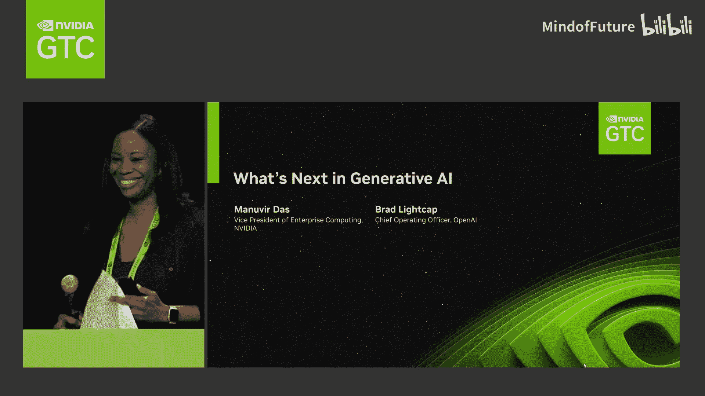

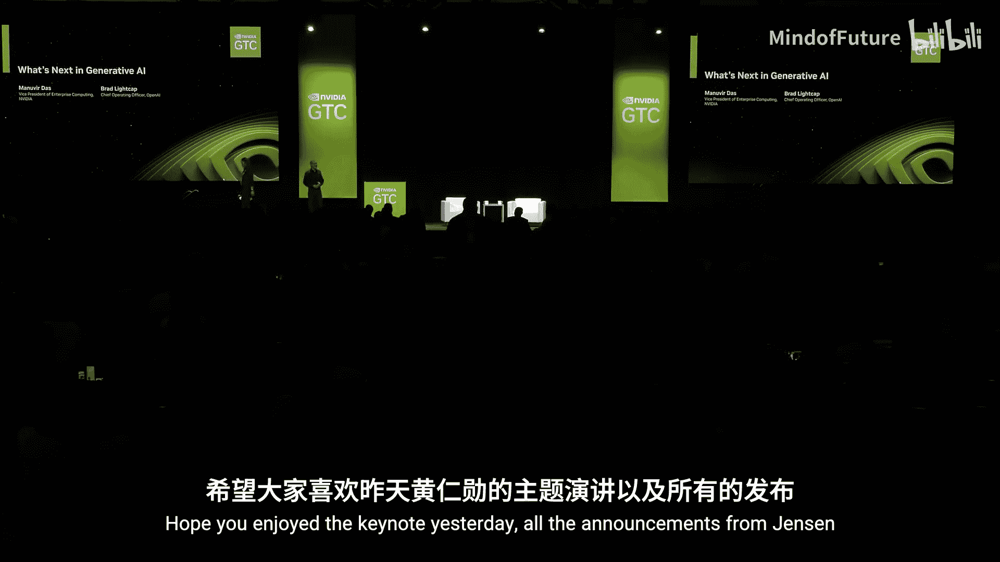

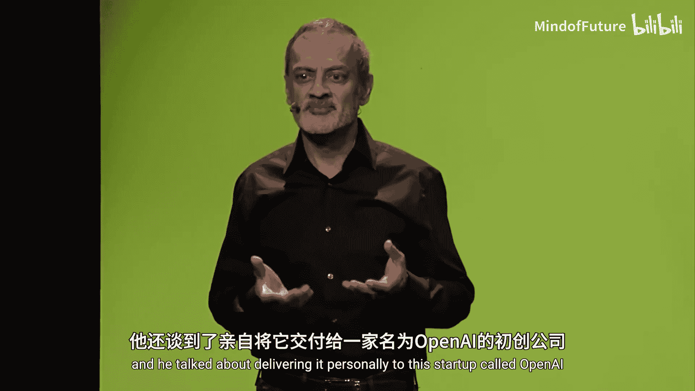

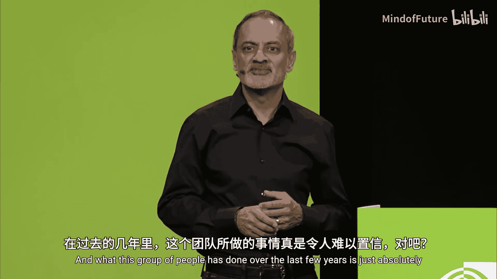

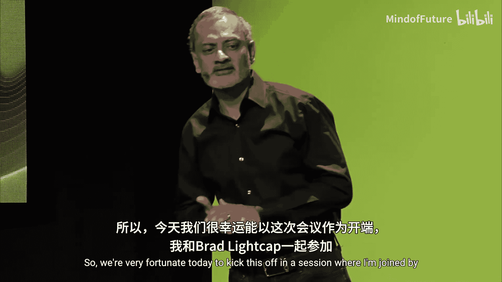

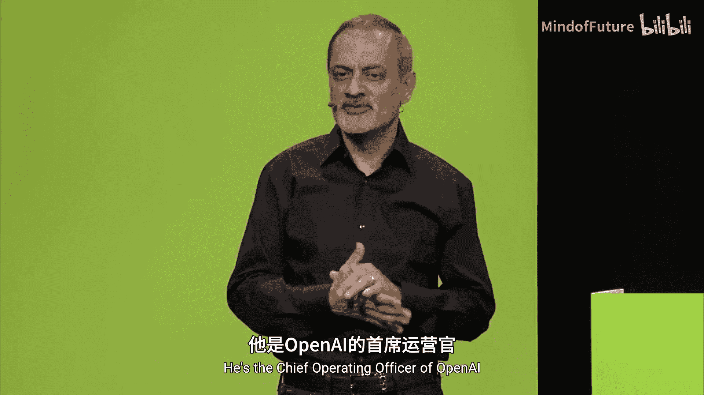

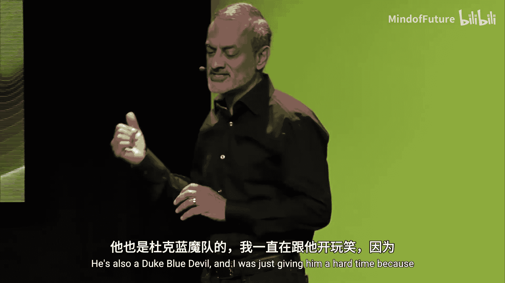

And it turns out the bracket just came out for the tournament and the badges and the blue blue Devs will probably meet up in the second round。

 So I'm not gonna be a friend of his then， but I am today。 So， you know。

 the interesting thing about Brad is he's obviously got a great role at Open AI。

 He's also been called like Sam Altman's secret weapon。 you know， the person he really relies upon。

 So， so I'm sure he'll have a lot of interesting things to share with us。 So Brad。

 why don't you come on out。😊。

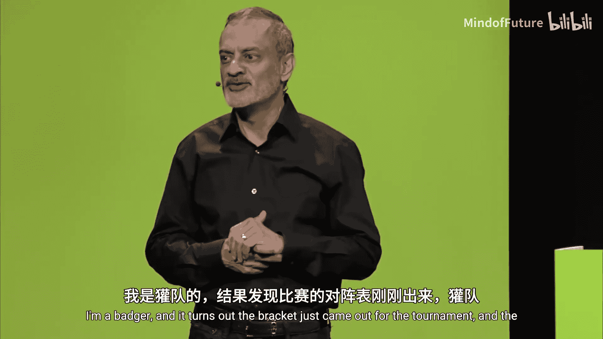

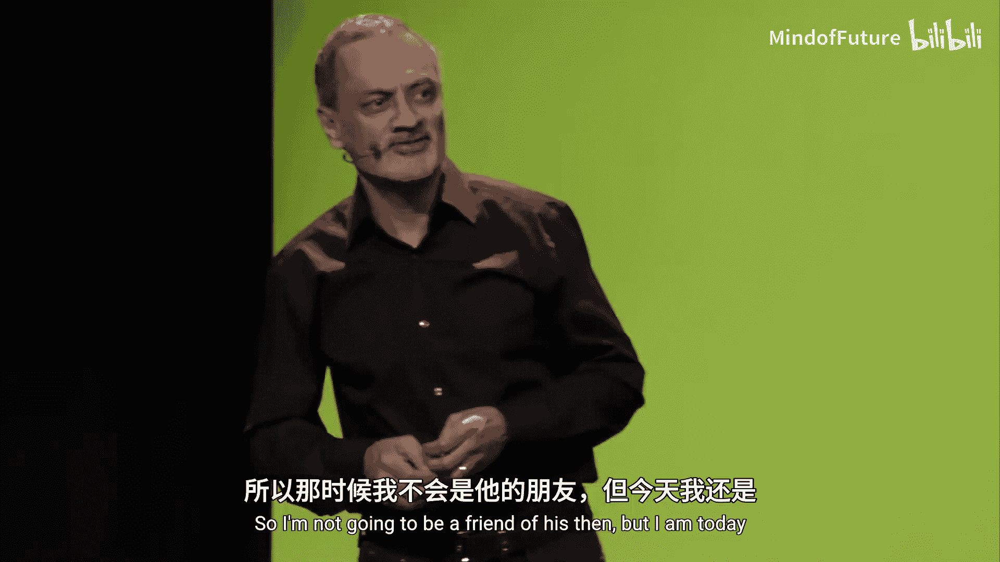

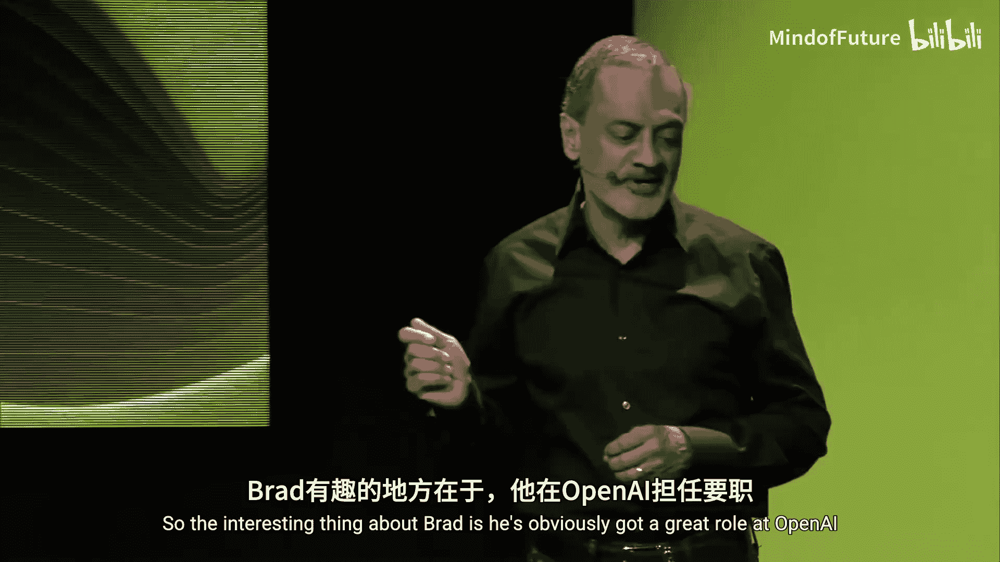

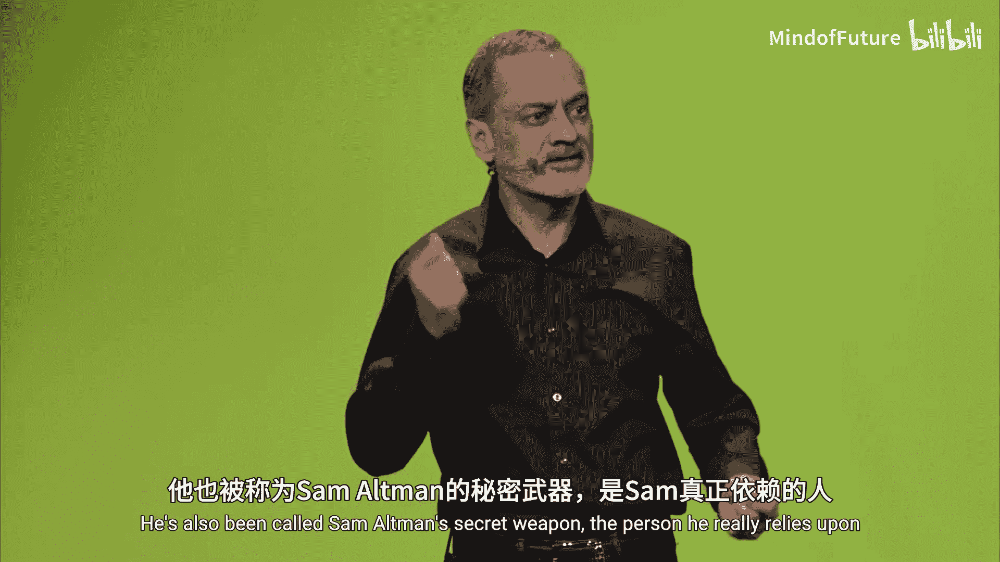

Everybody gets to see us walk up here。 It's gonna thanks for making Brad。 Okay， let's have a seat。

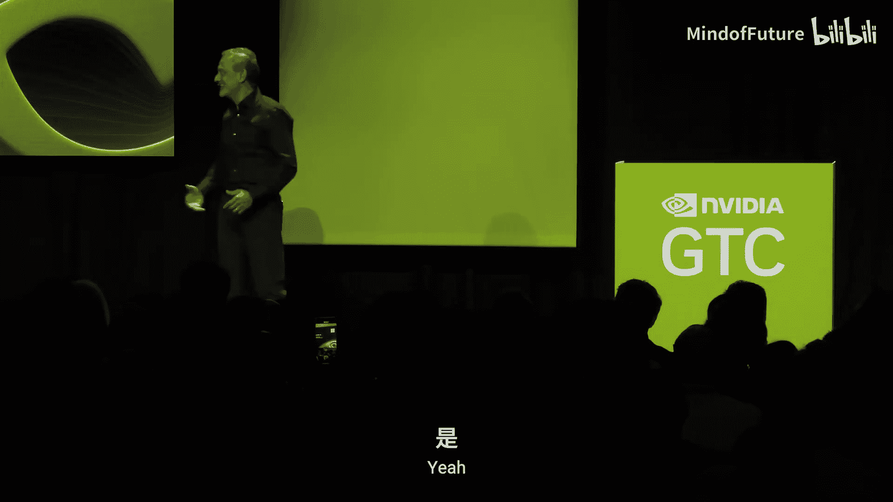

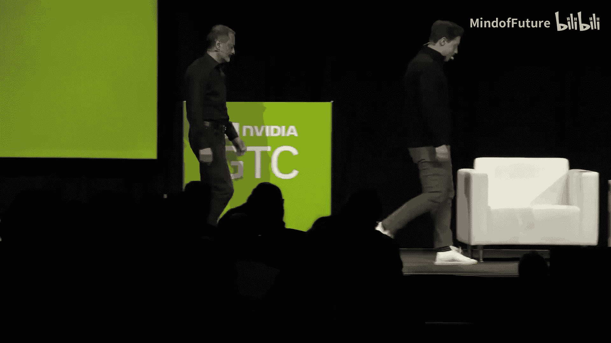

Look at the fancy mugs and。All of that。Okay， so， Brad。

 why don't you tell us a little bit about your role at Open AI， what you do so on a daily basis。

 And maybe a little bit about what keeps you up at night。Sure， well， thank you for having me。

 It's great to be here。 This is my first GTC。 so we'll see if we're back next year and what that will bring。

 But yeah， so I am RCOO at OpenaiI， I spend a lot of time thinking about how do we bring what we build in our research lab to life for customers and users and partners。

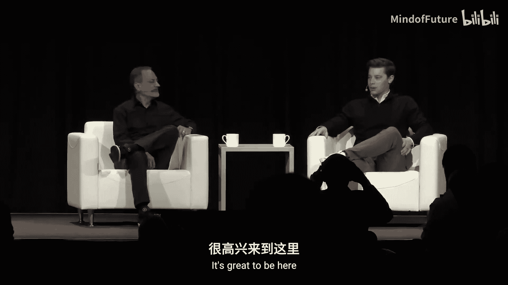

And usually people say， well， what does that entail？

 And I kinda say it entails everything other than actually doing the research。

 they don't let me touch the computers。 I just pay for them。

 And but I spend most of my time with with our customers and trying to figure out how this technology is gonna get integrated into the world and。

What keeps me up at night。 you know， there's not much。

 I would say right now that keeps me up at night other than slack。 But it's。

 I think that there's the next few years are really gonna be quite interesting。

 I think we are still on the flat part of the curve， and。We。

 the way we see it is this is like the edge of the first inning。

 And so as this technology gets built and developed and as we scale these systems up。

 we think the capabilities are gonna be really amazing。 Yeah。

 you know what's interesting is I think a lot of people think of open AI as G。

And think of it as the average consumer going in and experiencing the technology。 But， of course。

 you worked a lot now with enterprise companies， right。

 And most customers that we talk to as in videodia。

 they've built rags of one kind or another in their company by now。 And how does everybody do that。

 They call into open AI to do that。 So I think both myself and the audience are very curious to hear from you a little bit about what has that experience been like。

 And I think you're actually quite involved yourself in， in working with enterprise customers， right。

 So tell us a little bit about how that's all being going。 Yeah。😊。

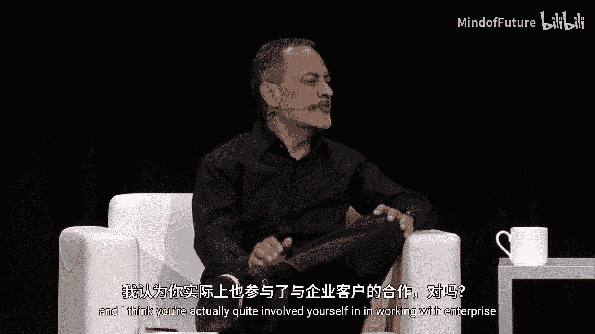

Well， it's funny when we launched Cha ET， use obviously took off and it was a product that wasn't launched for the enterprise and we spent about six months just trying to figure out what the hell was going on and trying to make sure we hadt enough GPUs。

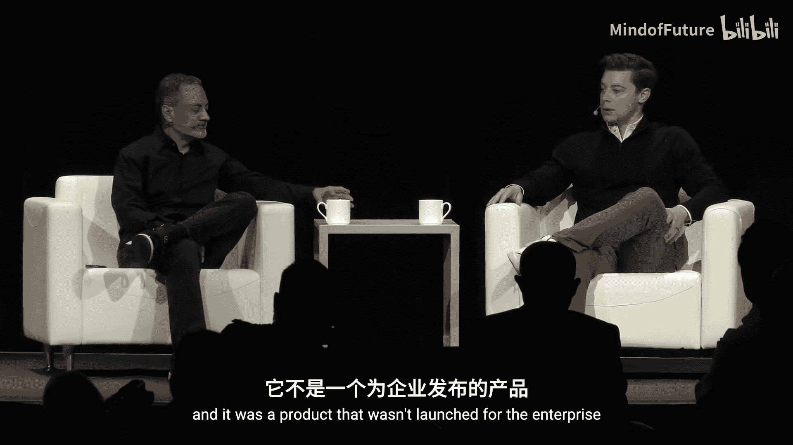

Thank you。To accommodate our growth， but we spent really the last kind of six months of last year actually starting to realize that there was a legitimate and growing set of applications in the enterprise that people were bringing Chat EBT in for and it's why we ended up launching Chat EBT En and ultimately our team product。

 which was kind of a smaller teams product but there was a real pull that we felt from not just you know SBs and mid market。

 but even the Fortune 500， we currently have over 90% of the Fortune 500 using Chat EBT in some form we're trying to bring them all along on the capital E En version of the product but it has real pull and it has real fit there and the amazing thing about it is it's very horizontal and so every function at the company has to our knowledge found some way to make。

The technology useful for them。 And what's amazing is we didn't have to build a lot of really kind of。

 you know， vertical。Use cases or applications， it just kind of works。

 And so if you're on the finance team and you're analyzing a lot of data and you're trying to do reconciliations and you know all of your tax analysis。

 you can drop big spreadsheets in the chat and just ask it questions and ask it to do the reconciliation and it'll kind of just do it it'll turn your HR people into data scientists if they need to be and so you've got applications like this people just kind of found fit with and we're trying to go and build even better version the tools for them It is amazing know because and you're right I think it's been surprising to people just how good the technology is Now what we see Brad when we talk to enterprise customers the use case that we see the most traction with is just assistance know like you've got your free intern and no matter what job function you're in you build a chat bot that does the work that you do and you get like 80% on。

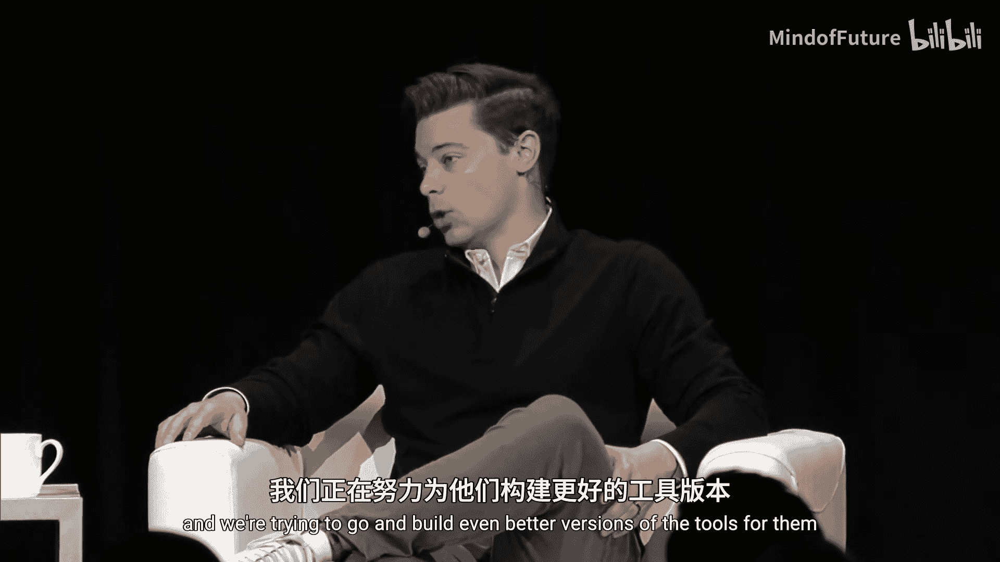

So to get going with and then you finish it up， is that sort of what you guys are saying too。Yeah。

 there in some cute use cases， there's a little bit of kind of that last mile engineering。

 And we have a team that can help customers with that。

 And so we try and do that work in a very hands on way。

 I think some of that will start to fade as the models just get better。

 And so there's kind of two things we see。 partly as。

Solving for where the model still has deficiencies in its capability。

 and then partly is just trying to rig up all the kind of the context of the model needs to be able to do a job。

 I don't know that the second part will go away there's the world is very large and messy。

 but I think the first part will people will really feel accelerated as the models get better。

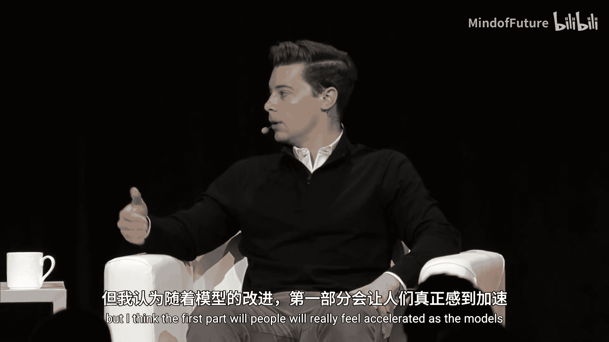

Okay， so obviously， Brad， you guys have， you know， have these great models。

 the various flavors of G that power chat G。 There's a whole tools ecosystem that has sprung up around open AI。

 you know， helping people use this stuff。 I'm curious as。😊。

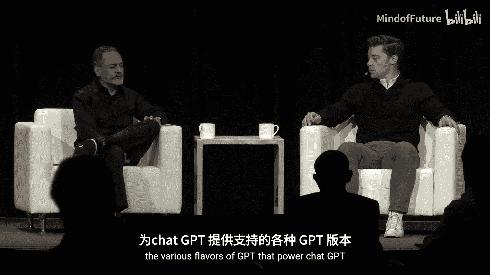

For your company， do you see part of your mission and your role to be a full platform for application developers who use this kind of technology now。

 or do you just want to be the provider of the core model service。

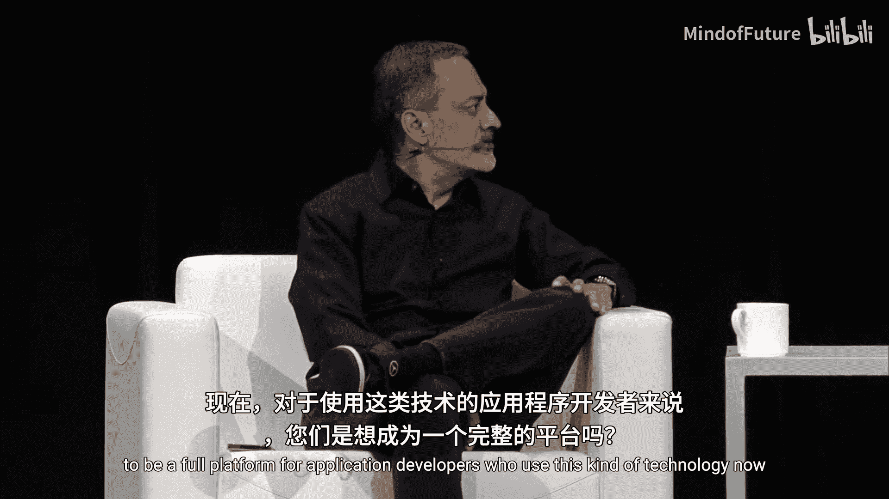

I think both， if that makes sense。

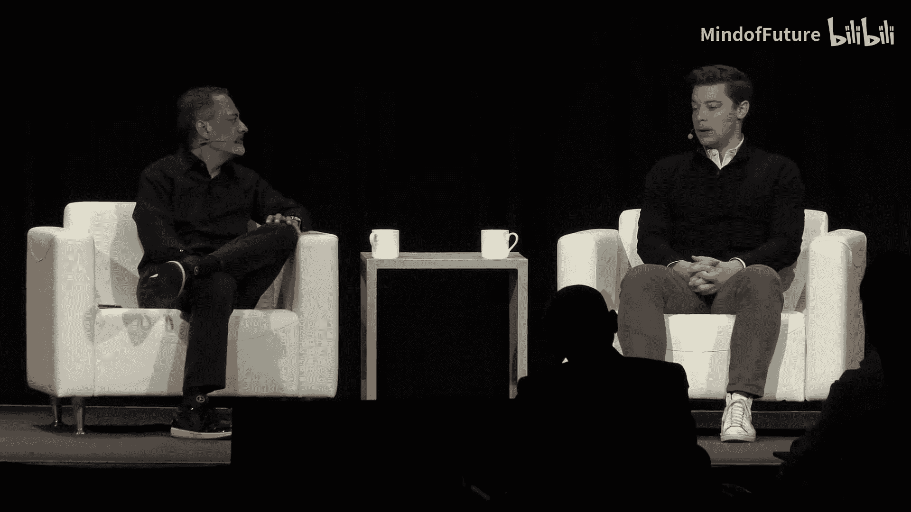

The way that we look at it is everything is just an abstraction on the intelligence。

 and I think it's just how many layers of abstraction do we want to go build。

 but we'll build anything that I think accelerates the world's ability to start to kind of pull the technology and pull intelligence into all the nooks and crannies where we think it should be1 I would say fairly humbling part of my role is you start to realize how big the world is。

 and how many places there are that we could apply this technology and for every ounce of energy I would spend thinking about should we go build something specific as a first-part application I kind of remind myself that there's someone out there who cares a lot more about a specific problem than we ever will。

 and that that's true 99% of the time。 And so how do you build a tool set that allows for them to go build the technologies and the tools and applications that they want to build and then what are the things that we focus on as the kind of primitive pieces。

Right the foundational layers that will enable them and also create great user experiences。 You know。

 it's interesting because in a way， you're going through the same journey that Nvidia went through in its history in the last few years。

 which you know we have a moderate invi that we like to spend our time doing the things that nobody else can do and the things that the others can do。

 we let them do because you feel this sort of responsibility that you have an instrument in your hands and your job is to make that instrument as good as possible and with as much reach as possible and let other people build around it and you've got this amazing instrument And I'm sure you feel the sense of responsibility that like you said you can impact the whole world with this instrument。

 so I think it' it's a very powerful thing。 And the other thing I was thinking about you know Jenen said in a yesterday when you was talking about the world's industries know in100 trillion dollars。

Industries just obviously， with your background， I'm sure you think about that because in the tech world。

 you know， for a long time， the tech world has been about cost， right。

 every company has to have an I T department。 There's a budget for that。

 And it's all about how do I reduce cost， You know。

 every new technology is disruptive because it's like， I'll make something cheaper to do。

 But I think in the domain that you're in。 and， and we believe that we're in。 It's really about。

New opportunities， new value for companies， right， I mean， nobody ever said GDP has to remain flat。

 right， It's， it's allowed for， for things to grow。 So do you guys see it the same way。Yeah， we do。

 I think， you know， if you kind of look fundamentally at like what the technology really is。

 it's kind of just this phase scale up of the ability to offload certain tasks to models that can learn that have a general learning capability and can get better predictably better both with scale but also with more information。

 more context and more capability and I think that's the exciting part for us is from an enterprise perspective。

 you think about how complex large businesses really are and how much low-han fruit there is to be able to say。

 you know what for this specific thing， we actually can offload parts of this workflow to an AI that can not only do it at a baseline level but actually can start to do it better over time and increasingly kind of own parts of that entire entire value chain and it just allows people to focus on other things other things and that's what we see in practice is you know instead of spending two hours。

Sitting there， tearing your hair out， trying to get the the revenue reconciliation to work。

 an AI can kind of explore it and figure it out for you。

 and you just kind of throw a compute at the problem。 And all of a sudden it's solved。

 And that same person that would have otherwise spent that time can just go spend their time thinking about something more important。

 Yeah， I say this because I also manage finance。 And Yeah。

 notice all all these examples go by it's on the brain。

 I'm sure your team is using Cha as must I think we all now on our phones we've got Chay。 mean。

 that' that's where I go。 you know， there's a lot of people here， Brad。

 who come from an enterprise background and this conference and in this room。 know。

 and I think the question that's on a lot of people's minds is there's all the you know。

 the knowledge of the world in the Internet etc that obviously models have done a great job absorbing。

 And then every company has its own sort of repository of knowledge in lots of different places。

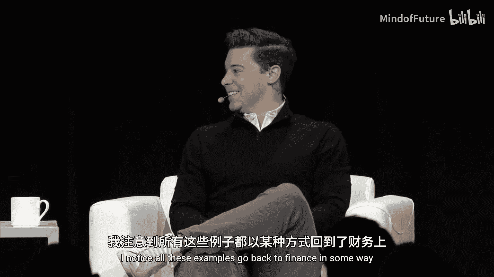

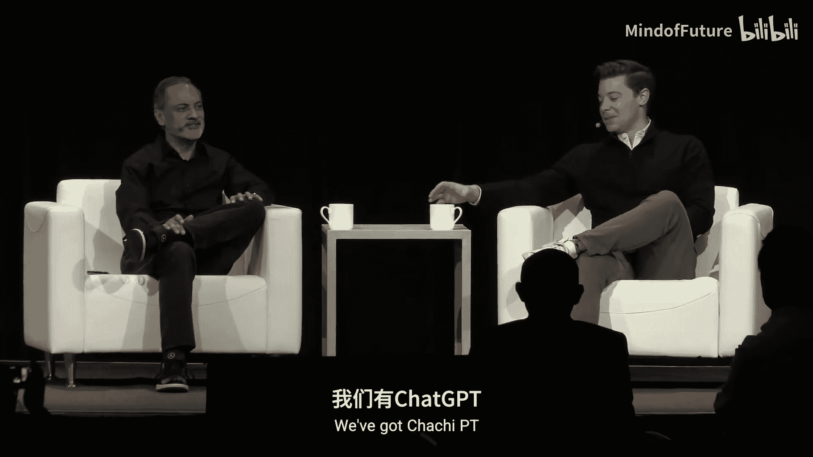

And， you know， various people have different angles and how to approach that。 Obviously。

 there's rags。 You know， within video， we do a lot of fine tuning。 I'm curious as to for open AI。

 right， What is your， what is your vision of how enterprise companies should really incorporate all of the data that they have into the AI process。

 yeah。This is one is the question we get the most and this is probably the thing right now that I think is kind of the least solved problem。

 which is to be expected， I think we're really early in this phase shift and you've got this kind of core technology that people are able to poke out and use but the kind of pipeing and the rigging of all the infrastructure and systems will take some time but I think that that's where what we're starting to see right now is people are able to marry really interesting repositories of data with identification of clear use cases with understanding of how the model can be applied to both of those things and you kind of tied those three things together and you can get some really good outcomes。

 So an example of this recently that we worked on is we worked with Kna to work on a customer support use case and Kna is a very forwardthink company on AI so they've been kind of doing this for a while but they took I think the right approach which was they really started with a very specific。

Implementation of the technology where they constrained the problem so it was it was a you know they looked you know at a very small part of the workflow with a very specific data set and a very specific implementation of the model they kind of got that piece to work and then they kind of just built from there and you now it's handling a large swath of the work and saving them many。

 many hours and I think that's kind of the approach we guide toward is don't try and overshoot so don't try and swallow the ocean you from day one don't undershoot meaning don't beat you know don't lack ambition but start with something that you can constrain the problem on get it to work and then scale it up。

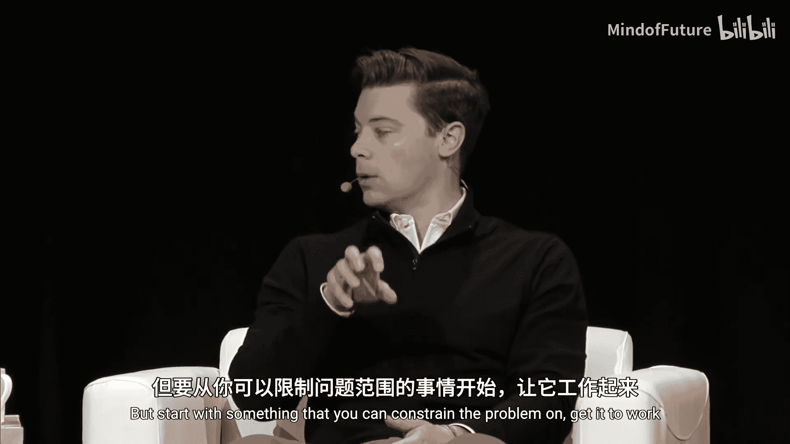

Yeah， you know， that point you， you just made。 I've， I've seen a few interviews you've done， Brad。

 where you， you've talked about this more than once that you， you have these meetings with。

 with companies where they， they think that somehow。

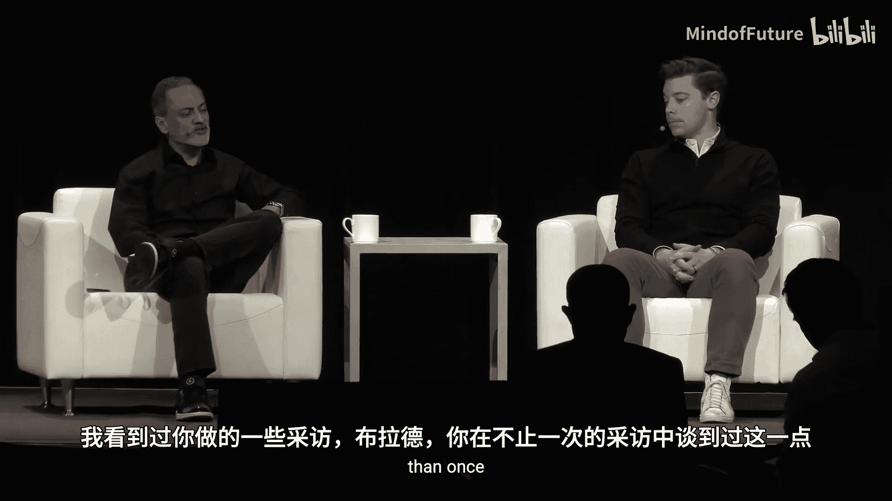

Jenia is going to magically make them a better company， and change their position in the market。

 whereas it's better to just start with specific use cases。

 get some value or those and then go from there So do So as a piece of advice to people in companies who are sort of just getting going for example。

 if I look at Nvidia Brad， we have now you know， depending on how you count a couple hundred of these rags chatbots that we're running know inside invidia for different kind of purposes we kind of got there organically。

 for somebody who's starting off now， would you how would you recommend that they begin Because there's a lot of interest in the companies So you're not gonna see just one or two。

 they're gonna sprout around the company， Do you think they should spend some time first sort of thinking through how it's all done and picking sort of one way to go。

 or do you think it's better for them to just sprout organically and see what happens to your earlier point。

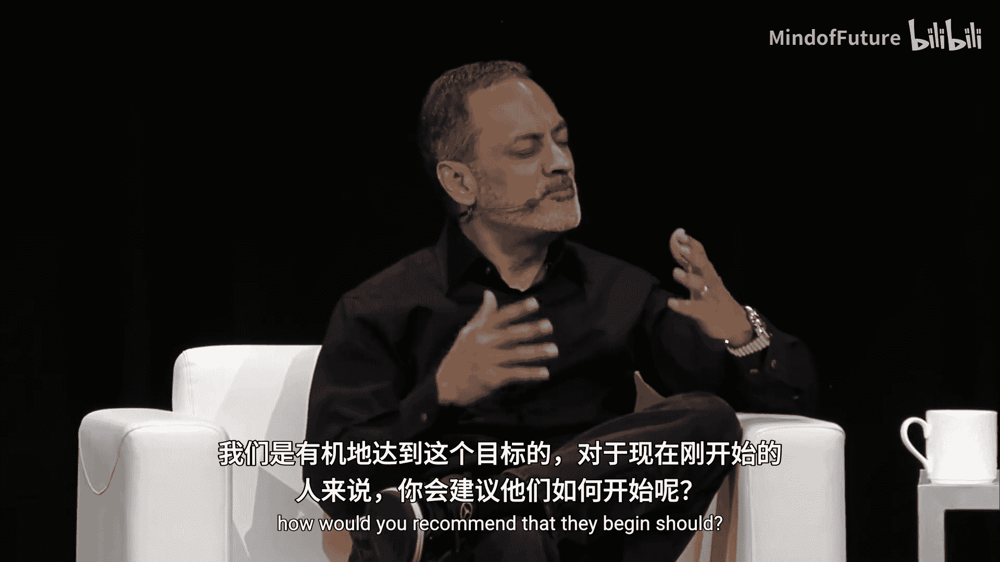

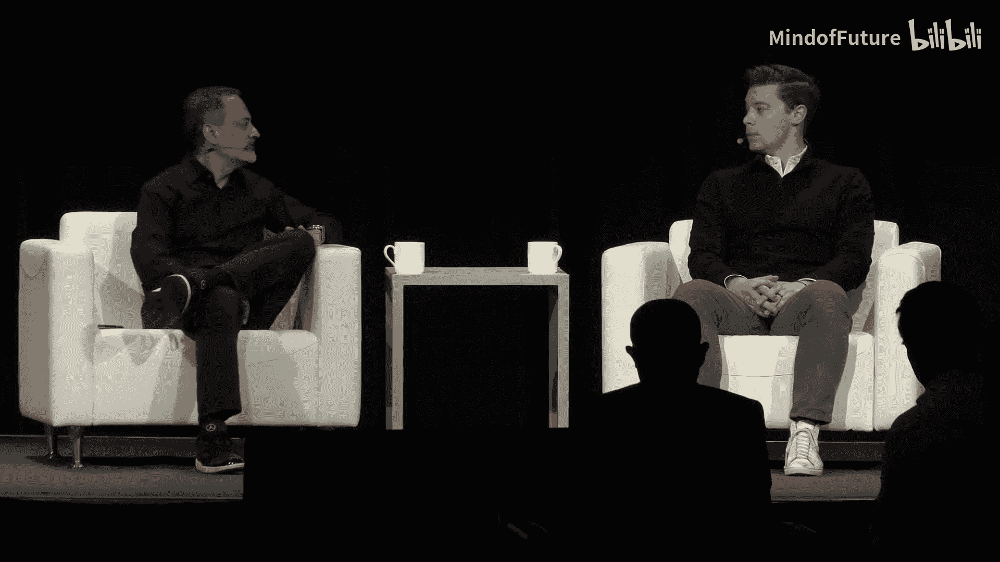

Most of 2023 I used to tell our team we don't really do sales we' do therapy。

 we would have like companies come in and it would be like you know usually a sea level person that was sitting in our conference room and about five minutes into the meeting they would be kind of like professing all of their problems and things that they're worried about and they're like I fix all these things for me and my board wants me to ship something next quarter and usually we'd have to talk them off the ledge a little bit and like get them some water and have them come down。

Yeah once you charge for the session， we not enough。

 but once we once we get to a real part of the conversation， Yeah， you know， our。

 our perspective on this is。To kind of do what we what I just mentioned is really think about you know where are there places in your business where you feel operationally like there's an opportunity to improve how you how you run for a lot of people that happens to be customer support。

 That's the thing that we hear probably the most frequently no one likes quality of their customer support experience。

 they spend a lot of money on it。 it never quite works。

's the thing they hear the most customer complaints about and so it happens to be a place that that's pretty horizontal because that to lots of but we tend to recommend kind of a multiprong approach So identify two or three areas where you have you know a real gnarly problem but again you can kind of constrain the problem。

 So support is this workflow that is this it's multiple tasks strung together with varying levels of kind of human involvement in human engagement and a lot of data and more context helps right you can。

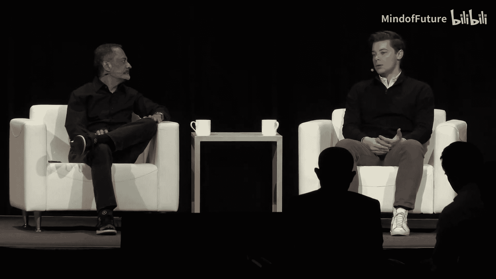

Look for these core ingredients of having again going back to the kind of the pyramid of data of process and of model capability and you can figure out what's that first implementation look like and then how do you scale it up from there and so picking a few of those types of projects is these kind of more bespoke platformbased projects and then the other thing we recommend really is going back to Chat EBT itself as a product is giving starting to give your teams access to the technology this was not something we really were actively thoughtful about middle of last year but。

As we've deployed chat EptT， as we've had a chance to talk to companies that are using it。

 democratizing access to the tool and just giving people an opportunity to use it。

 it does not have to be in a particularly complex form or develop form。

 but just giving people a chance to say I know what work I have to do I can poke around with this thing enough to be able to kind of explore what it's capable of doing。

 and Ill figure out kind of how to find value in its capability helping me do my work better。

 and that happens very organically and it happens all the time。

 And you know I think companies kind of forget that they want to have this like very you know manicured AI strategy and there's this big company rollout and they want these proprietary chat bots。

 And I think 90% of the value just comes from right now at least is coming from just giving people access to the tools and not thinking too much about it。

 I think that's a fair point because the value when you tried the fullist time is so obvious。That。

 you know， you're willing to， to work through it， right， I think that's， that's a big thing。So， so。

 Brad， on， on that front， working with these enterprise companies in different use cases。

 you've also rolled out the， the your， your custom model with the GPSs now， right。

 that its very easy for people to build。 So can you tell the audience a little bit about what that is and why you went down that road and how that's going yeah。

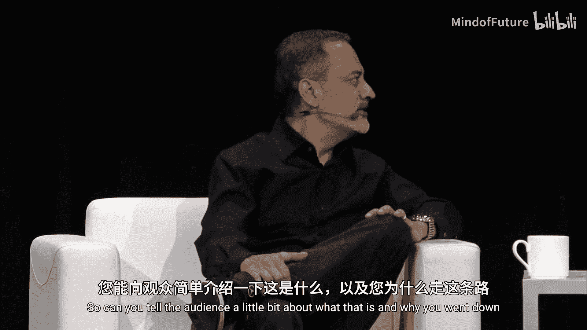

I'll try and contextualize it maybe in kind of a broader picture of our strategy。

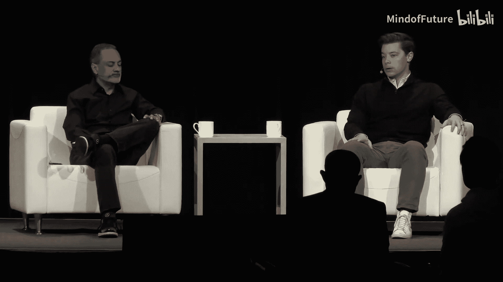

We have this very core intelligence in G4 and whatever comes next and a lot of where we're spending our time is starting to think about how can people make that technology or that those models feel more personal to what they're doing more task specific improve their performance on any given thing and so a lot of the work we've done in the last few months Gs custom models has been in that direction。

 So you can think of actually Gs and custom models as opposite ends of the kind of customization spectrum GTs are like the dead simpleim。

 easy way to take chat GT and just basically kind of create a like slice of chat GT use that is specific to a given task So if you want to have chatGT kind of remember certain information。

 be able to call on certain outside data， be able to kind of access a PDF or a spreadsheet。

 have a certain personality， be able to use certain tools in a predictable repeatable way you just kind of ask for it。

 you actually can configure a G。Without even having to build it。

 you just describe what you want and it'll go off and do it and we see that huge pull for that in the enterprise actually and it's not surprising because people start to figure out that this these are the workflows for which I can use the technology so I'm just going to encode each of these energy key and just call it。

The custom model side is like the full Monty other end of the spectrum that is basically us taking G4 or any other model and fully trying to figure out how to customize it for a specific use case and maximize its performance in that use case。

 we do that on a more limited basis， obviously it's time and resource intensive for us。

 but we've had tremendous success early on。 We're still kind of experimenting with this。

 but success early on improving the models capability in any number of domains。

 Yeah you know it is it is is fascinating because obviously you guys really started this whole journey with very large capable model that is just so surprisingly good at so many things and it just gets better。

 And then at the same time， if I look at the last year。

 there's this ecosystem of models that have sprung up and you know。

 they're not as capable as the models that you have inside your services at open AI。

 But know in different ways they're getting better and they're specialized at certain things。

 And so how do how do you see。

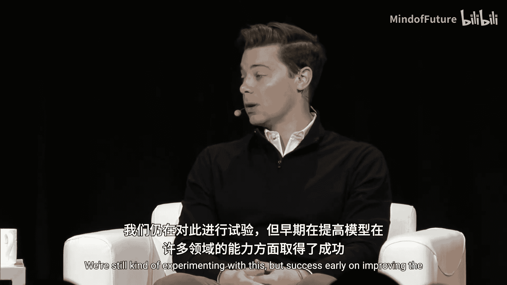

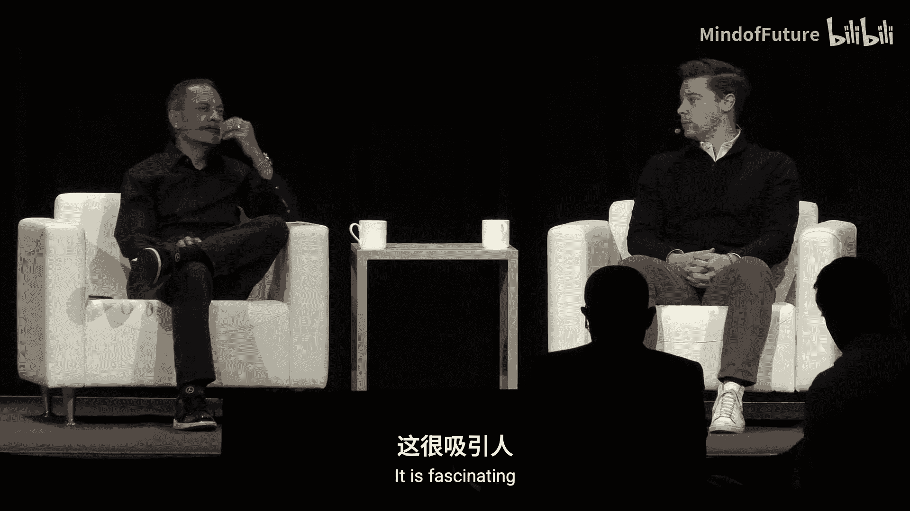

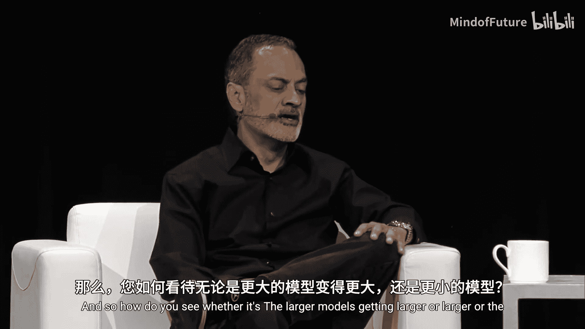

You know， whether it's the larger models getting larger or larger or the the smaller models。

 do you see a role for both within an enterprise or。

 or do you think just the one large model used in lots of different ways yeah。

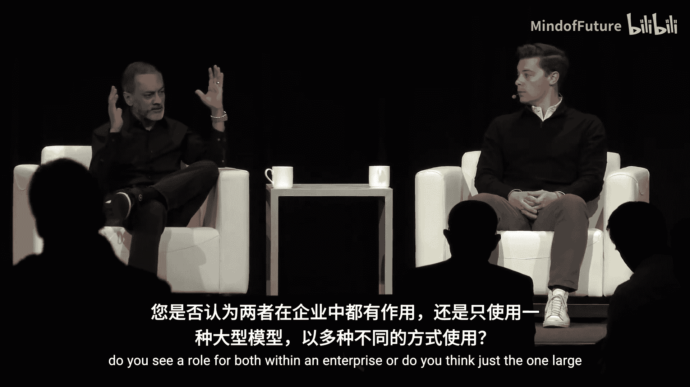

We do see roles for all， I think you know the same way my mental model by the way on how to think about kind of enterprise AI deployment is to try and map it as closely as I can to how kind of the modern enterprise is constructed from a human capital perspective so the same way that you wouldn't want to hire you 25000 PhDs to run your company because it would be overkill for what it is that you do。

 you may only need five or 10 or whatever you may need。

 you wouldn't want to take GX or whatever the kind of latest model is to every single problem you may want a diversity of models that have specializations and different things that have kind of fine- tuneuned for different use cases I suspect over time the models will just get generally better so the need to kind of like。

Iterate on them and fine tune them and try and make them really good at any specific thing that will dissipate a little bit。

 But you definitely don't need a like four class model to solve some of the things that you would need。

 and so one of the things we're actually working on is trying to figure out ways to allow people to kind of more dynamically pull models in for any given use case so that they can kind of like distribute that distribute the intelligence a little more。

 but but yeah， know I think you know， you kind of have your intern level model。

 you have your you know mid-level manager model。 you have your senior executive model。

 you have your subject matter expert model。 And there's a place for each and it'll be a diversity of things。

 but it actually raises an interesting question you know， I'm sure the audience。

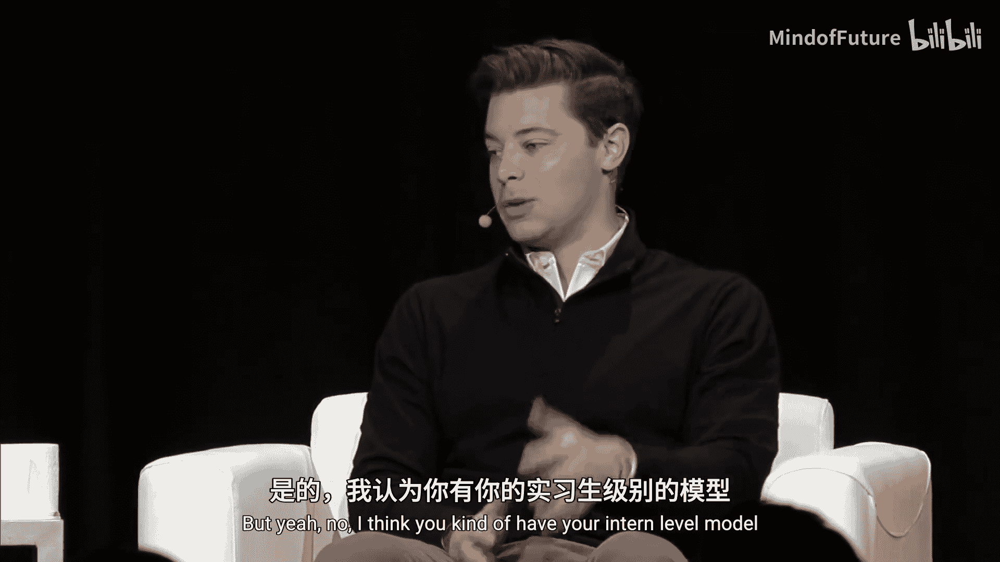

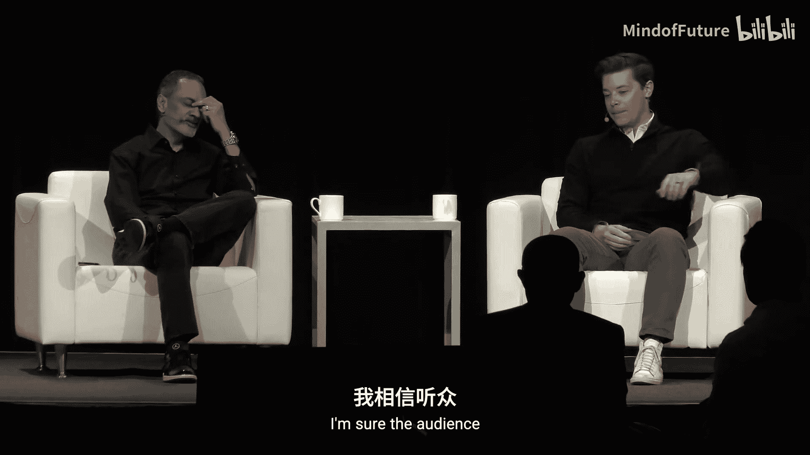

Is， is thinking about asking you this question， too， given， given who you are and what you do。

 You know， if I were to say on a spectrum of， you know，1 to 10。Caappabilities of models。

 Where do you think we are today， Are we like one out of 10， Are we 7 out of 10。 What do you think。

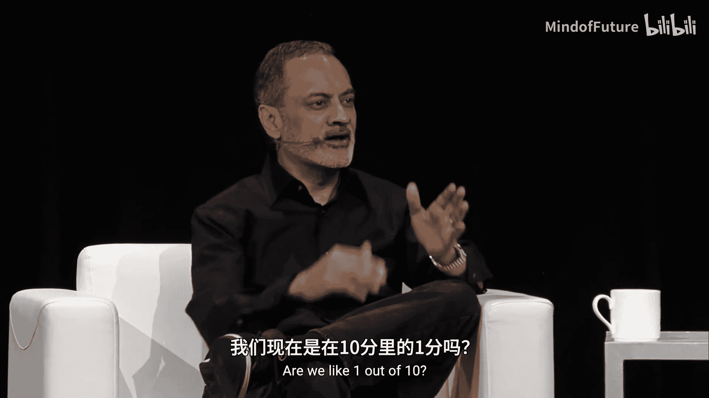

Yeah， you know， I was gonna make one more point on the last comment I just made。

 which is the the interesting thing about what we do and the challenge from where I sit in how we deploy the technology in the enterprise or anywhere is。

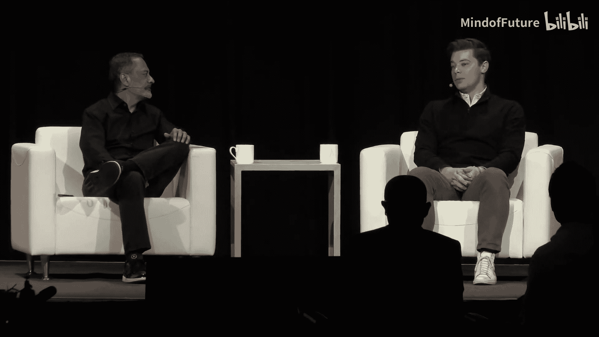

You have that kind of map of human capital and trying to kind of map the human capital to the model capability。

 basically。 But the thing that's changing constantly is the model capability。

 that kind of window is moving every six months。 And so all， you know。

 the model that was your intern model。Six months later started to look a little bit like your。

 you know， mid level VP models and that mid mid level VP model is starting to look a little bit like your you know your senior director model。

 Can you just dis a whole bunch of VP that any V。

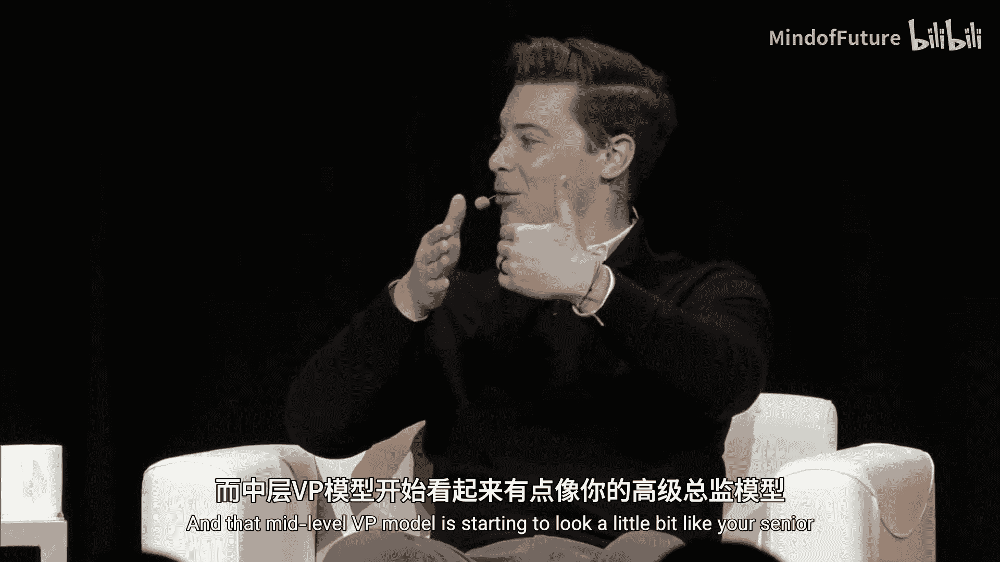

These are recruit analogies， but。

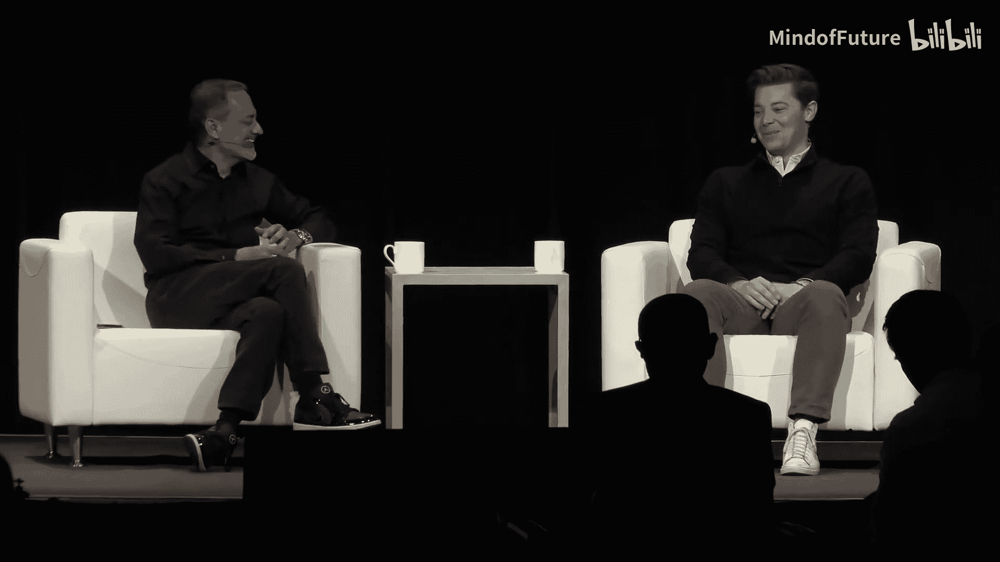

So that but that's， and that's an interesting phenomenon。

 Yeah And something that companies have to manage dynamically is， and I think it a net。

 it's a net good thing。 It's it's surplus。 And so， but we spend a lot of time with companies thinking about。

What are we bringing a bear on any given problem and should we be rethinking that combination of things as our model capabilities Yeah。

 and you'd imagine that， you know， it's sort of the new form of it， right， because in every company。

 some humans have to figure all this stuff out and think through。

 you know what's being used you know， earlier Brad， when you were talking about you know。

 the initial adoption and and dealing with some things。

 it just reminds me of you know when the iPhone came out and there was this general belief that oh。

 it's cool for consumers but companies are gonna have a hard time adopting iPhone because it doesn't have this control and that control and how will I and the standard and't that sound silly now。

 So I think let's transition a little bit then to what's next。

 So one of the things that that I see Brad in talking to。

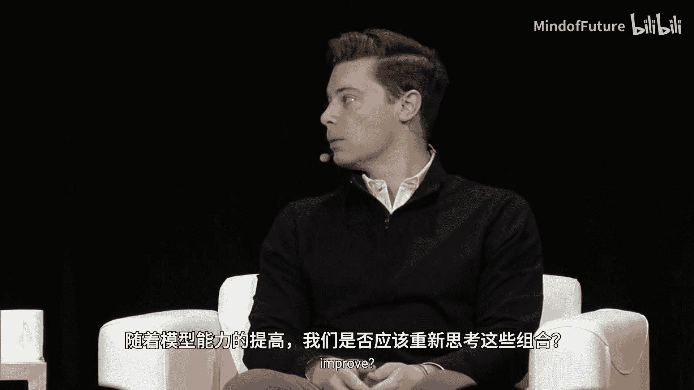

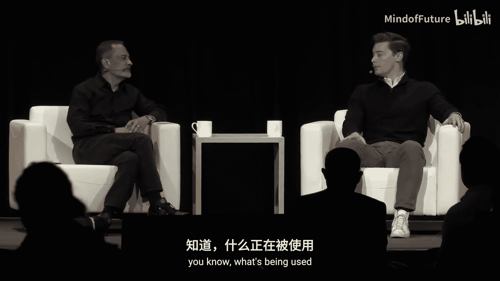

Sort of the more advanced customers or the customers are further along in the in their journey is that they're kind of starting to move this。

 this transition from a lot of this has been about some form of information retrieval At the end of the day。

 what I'm doing is I've got some information， and I'm trying to， you know。

 search through it in some fashion？ And now， the question is。

 can I use this technology more as an agent where I try to do things in my company。

 I try to run process that try to call into things， make actions happen。

Do you see that in your interactions with people and how do you where do you think the technology is Because if I've got an assistant and I'm looking at the output。

 you know， there's a human in the loop。 But if I'm making the think take actions for me I have to trust it a little further how do you see that Yeah。

 this is what I'm excited about this is in many ways of how we think at open AI about what this technology is useful for and how it should be used and in some ways like we laugh a little bit at like the way that AI implementations work today in many cases is like it is kind information retrievalbased things and like they're like the world's like worst databases in some ways。

 they're really slow， they're really expensive They're not 100% accurate know。

 they're getting better。 But and so why would you use them as a database or why would you use them for some sort of kind of like high precision recall。

 it feels like a strange way to use these things。😊，You know， no judgment。

 but the way that we're really excited to see these systems evolve is as reasoning agents。

 So how do you actually basically take the model's core capability to extract information from something。

Think about that information and then basically take some sort you know be able to kind of like synthesize some sort of insight and take action based on that insight So there's two things that have to happen there。

 One is the model's reasoning capability has to improve and two is you have to give it some ability to have auators to basically take action out in the world。

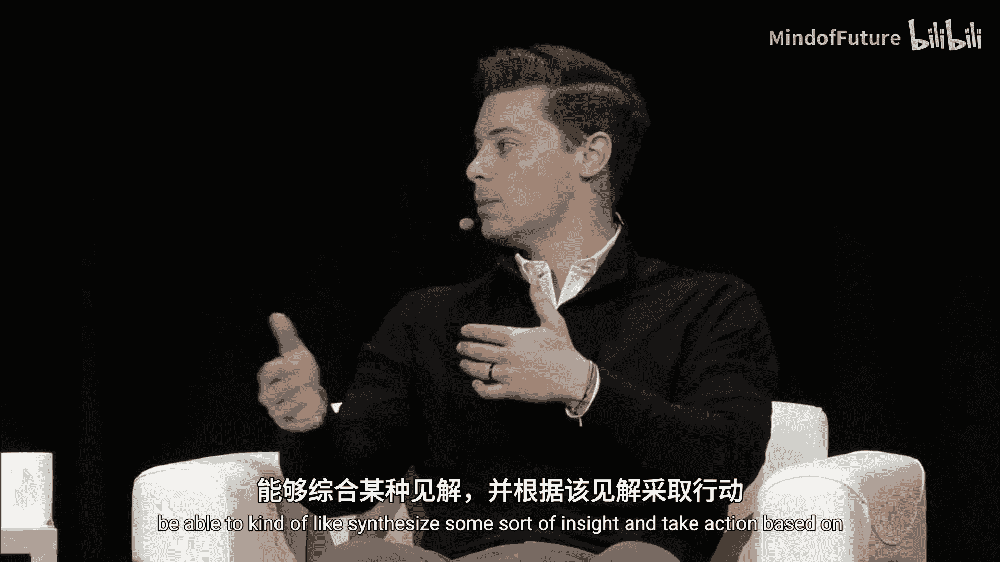

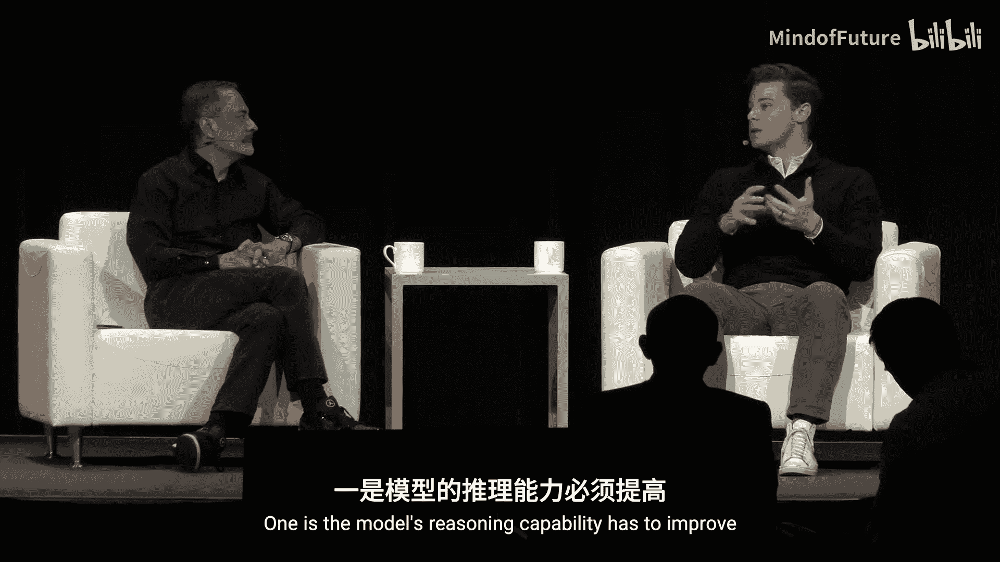

And I think those are kind of the next two waves that we're gonna start to see merge is we suspect that reasoning is kind of the next area that we。

 we will start to see the model， you know， come kind of axis of improvement really accelerate on。

And then also being able to think about how do you actually be able to give models the ability to work through multistep problems so I'll give you an example in like healthcare。

 for example， if you can point a model at a medical record and say okay。

 it can extract the information from this medical record today it could do very basic operations it could maybe summarize that information and it could you know it could update that information based on some sort of input but can you get it to think about that information and if it can think about that information。

 can it actually draw some insights about that information in a way that might inform some second step or some third step after that it could help with follow up with the patient。

 it could help with diagnosis of a disease it could help with placing an order for a prescription it could then complete the loop and actually talk to the patient about the prescription when to pick it up from where and how it's dosed and when they should take it and then also remind them。

Later on that they should be taking it weeks later。

 So that's the the the way that we think about these systems on a multiyear basis。

 and I do you think that do you think that that's going to happen because the core model is going to become better at that or do you see an approach where there's a separate model or a separate system that is more built for reasoning that complements the existing models。

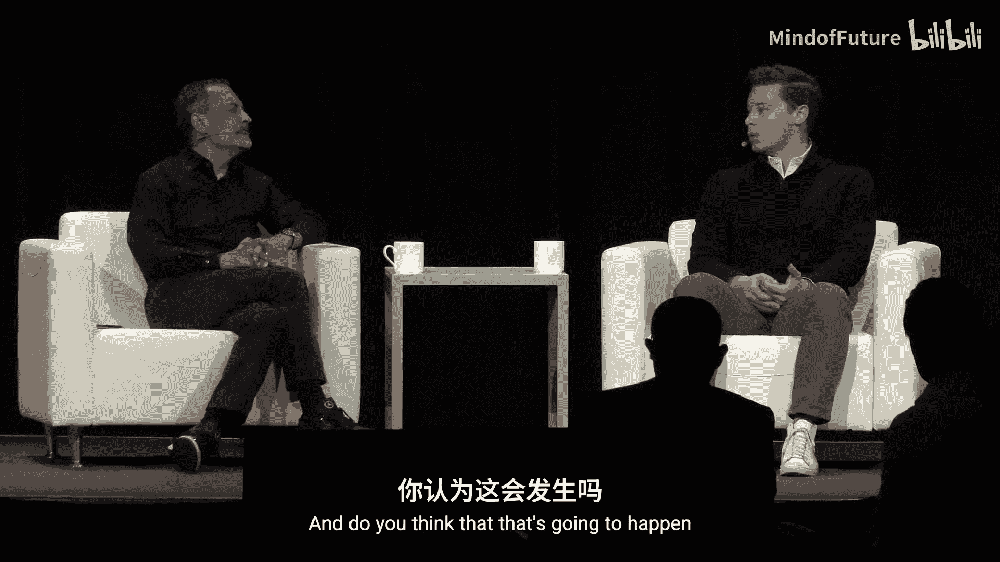

I think today's systems is are actually already pretty good and if you you know if you go to G4 and ask it to reason about that hypothetical situation and explain its thinking kind of step by step。

 it will explain it to you that way And so the action path is known to the model now it's just a question of can it take each step in that action path and identify the actual specific thing it should go off and do and does it have access to what it needs to go do that。

Yeah， that's， that'， that's， it's great to hear you say that because we definitely see that beginning to happen。

 and obviously。😊，The more you all are working on the island and Open A eye。

 the better it is for everyone， right， So， so， Brad， I mean， what from your point of view now。

 obviously， we talked about agents a little bit， but。From your point of view。

 if you had to step back as， as your company， what do you think if you think of the next， say。

Let's pick one year， three years and five years。 Okay， maybe in those sort of time frames。

 what do you think is the big thing， the big shifts that you're working on that。

 that can really change the landscape for how people use this technology。

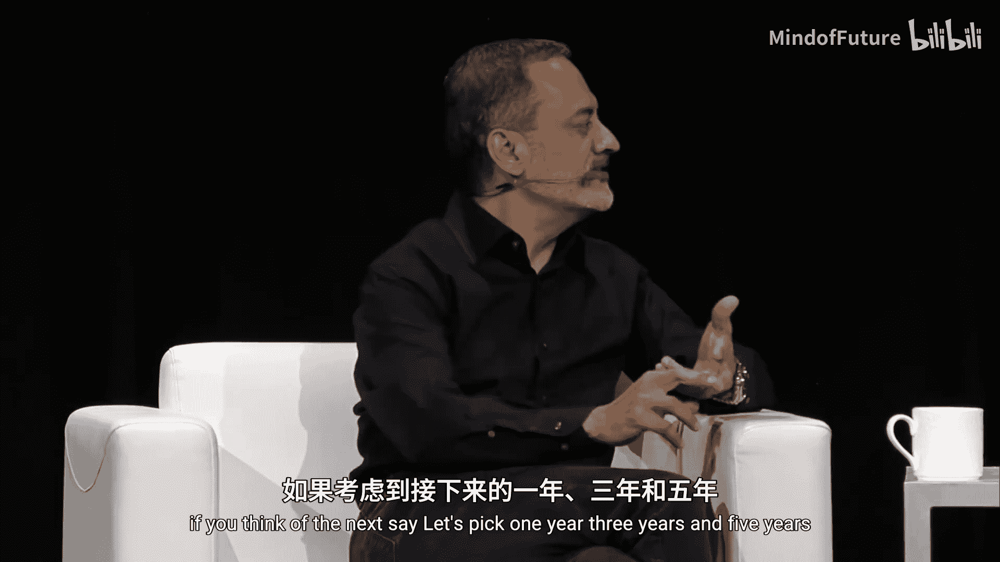

I can't that。

Yeah， no， I think。Well， I， there are some things I， I can't say， but。Yeah。The things I can't say。

 So you know， I expect。We don't think that there's any we're anywhere near a ceilinging on Cap just core capability improvement in the models。

 We think there's a lot of room in future scale ups。 And so we're very excited about that。 I think。

We're trying to understand how to move the models along axes that are not just kind of like raw IQ and I think we feel really good about where that work is going And then I think from where I sit。

 there's that question that we kind of addressed earlier of what are the going to be the standards and frameworks and you know。

Tools through which the world starts to kind of like rig up the information required for these systems to be useful in production and you know in a deployed setting and so part of it is just building the thing and then part of it is making sure that we've got a place in a way to deploy the technology that can actually make it useful in production。

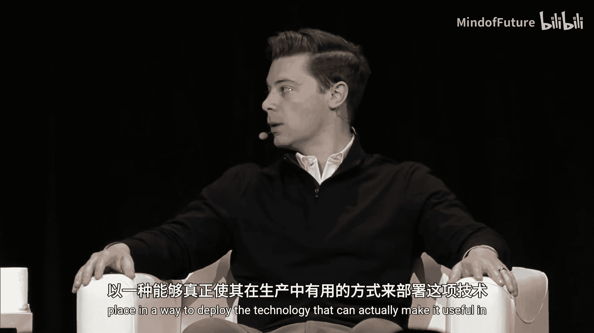

So yeah and it was definitely an unfair question。 And I think you did a very good job handling it。

 So let me don't let me ask you the question in a different way， right。

 So obviously as a company you can have a focus on just improving the technology as a whole as you're doing you can have a focus on okay。

 enterprise customers you know， the industries of the world。

 the commerce of the world there's a lot of opportunity So what is your。

 your mindset and focus do you feel it's your mission to democratize this across all the enterprise companies in the world to help help them all get to a better point Are you more just focus on you know。

 the individual consumer use cases， because obviously that's of big benefit to the world too。

 so yeah。😊。

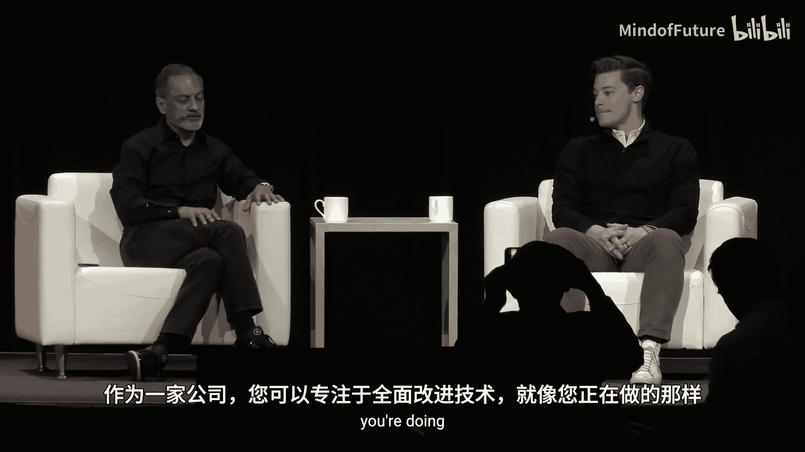

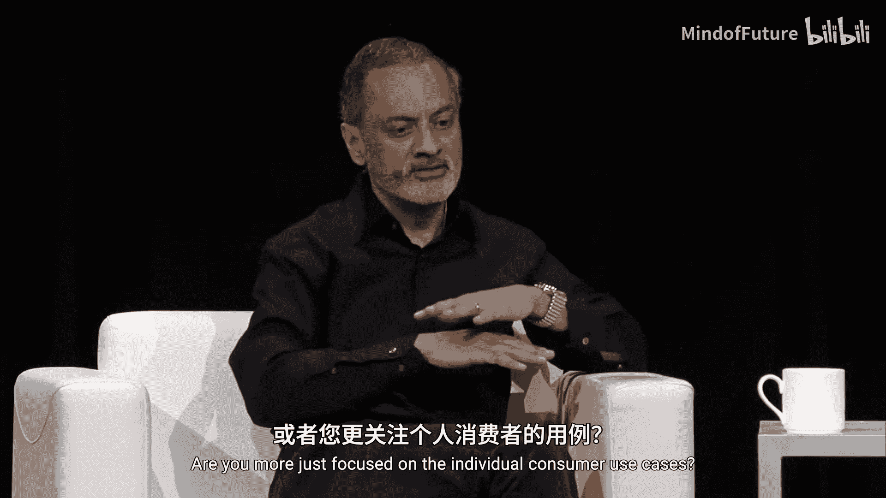

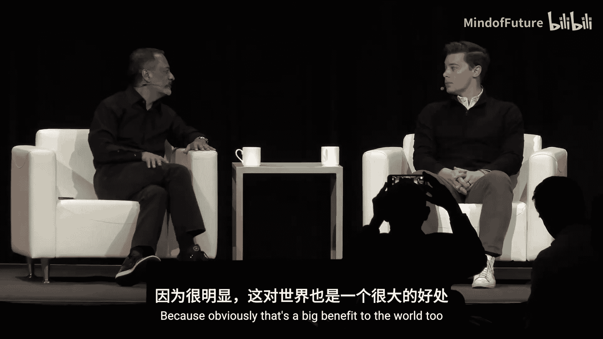

Yeah our mission is literally to ensure that the benefits of the technology are broadly distributed and so how do we think about enacting that Well one is making sure that people are able to build on top of it and for the reasons I mentioned earlier about how big and messy the world is we're going to need to do that anyway I think the surfaces will change。

 the abstraction layers will change， but the core of it is we will just try and build ways for people to use the tools effectively successfully wherever they want to use them Greg Brockman our co-founder has a nice phrase of this is how do you think about a world where you have AI like baked into the economy and the baked in part is when you kind of decompose what that means and probably reading a little too much into his analogy is like you've got all these ingredients and you've kind of got to like mix them up and then kind of like let it sit and it starts to work and we think about it a lot that way too is you know how do we actually go give put the technology in place and。

These other ingredients to bear in a way that kind of once they're mixed up。

 things just start to work differently。 And so you know that's that's how we spend a lot of our time trying to enact our mission。

 And then obviously from a consumer perspective we look at it know similarly chat UPT is just an abstraction on our own API So we just took a model that make it better at talking to people and we served it and you know it worked and but it's just a way for people to access it that is not through an API。

So， Brad， I think it was what was it in November 30 or so，22 when， when you released Cha GT。

 it's got to have surprised even you， what's happened， right， just the level of interest， the uptake。

 I mean， it's a new thing。 and it's just it just people just got it right away。

 Because it was so easy to see what its impact us， right？

 So So I'm just wondering if if you do a little bit of retrospective for us， you know。

 it's been a little more than a year， what's， what's your， what's your take， hass it。

 has it surprised you in every way， Are there any， you know， if you could look back。

 Are there any things that could have gone differently any， any， you know。

 choices you would have made differently。

What about more GPUs probably？No， I think it it did surprise us。 I'll speak。

Kind of on my own behalf here， a little more than on company's behalf， but。We。Yeah， you know。

 we actually thought we did not think that GB3 as a model class was the model that had kind of crossed the chasm in terms of its usefulness in for you know。

 whether consumer applications or enterprise applications。

Thought actually GP4 would be kind of the first model that had crossed that chasm。 And so we。

 a lot of our planning processes had aligned around the launch of G 4， which was in March of 2023。

 so year。ago， but we had， and we had finished training G4 months before that。

 And so we started training G4 in middle of 22。 Yeah。

 And so we're now kind of two years from that date and。

So yeah we kind of thought for would be the moment we had to scramble a little bit to accommodate everyone wanted a little earlier than planned。

 but it's been amazing to see and I think it speaks to something that I think will be true in any capacity regardless of whether you're an enterprise。

 a developer an individual which is a that technology has this very innately human characteristic to it is you can kind of hand it to someone who's like five years old or 95 years old。

 and they can both find a way to use the technology。

 It's very natural and I think that's really important And so how do we push the systems to continue to improve on that access to and then two is is being able to kind of lower the barrier access and so making sure that。

It is accessible to people around the world。 That was kind of a thing that we thought we really got right with Cha ET was making it free。

 And the stories we hear from people in farfs of the world use it for things that we could only dream you cannot imagine imagine exactly know the point you said about it's so human know that's something that's quite close to invidia to Brad because you we yes。

 we do AI。 but we're also sort of the graphics company a little bit and so we really see a lot of opportunity where that firstly。

 the text interface is so much more human than writing code but you know the audio interface。

 the visual interface we call these avatars you basically feel like you're talking to another another entity。

 And of course at the end of the day there's other Ais that are converting that into text that is then going into a regular chatboard what have you do you think that is an opportunity for this technology。

Really expand its reach， you know， on a planetary scale because it makes it much easier for humans to。

 to interact with， you think that should be a good area of。

Of research and progress。Yeah， I， I think that someone born today。

The relationship they have with computers will be kind of unrecognizable to anyone sitting in this room。

 They won't know a world where you have to navigate like this kind of graphical user interface and these hamburger menus and these click down things and there's a field text field。

 you have to fill something in and you have to hit submit and then that sends you an email and you have to go over to your inbox and check if the confirmation email was sent and like whatever these like miserable situations are that we' found ourselves in and I appreciate that make do with the tools we have I just think we be completely foreign into someone born born today and 10 years。

20 years。 You know it reminds me of I have kids of a few different ages and they sort of span the advent of the iPad era and my elder boys I remember this moment where they were young and for each of them they were sitting on my lap and I'm working as we all do and they pressing the keys。

 you know， and they kind of press the keys and the keyboard to participate with that and then my daughter when she。

That stage。 And she was two years old。 what she was trying to do was she took her hand and she tried to move it across my screen on my laptop because that's the interface she knew。

 right， She didn't know what the keys were all about。

 So I think those interfaces are gonna be quite different as we， as we go forward and in 10 years。

 hand your kid a like a laptop from， you know，200。

20 or whatever。 And watch them talk at it and wait for a response and knock get one that was exactly be。

 it'll be something like that。 And the amazing thing is that your company and hopefully。

 our company will have。😊，Being able to feel like we had something to do with that， right？ So yeah。

 it's， it's quite amazing。 Brad， I think you， you know。

 I think I speak for everyone in the audience when we say， you know， very。

 very appreciative of everything that Open Air has done。

 can't wait to see what you all do next for the world and we'll be here watching。

 So all the best to you and， and the company。 and of course。

 in in video we're here to help you in any way。 And I'。

 I'll text my boss and see if we can find you some more GP。 Okay， thank you for the time。

 Brad App it。😊。

是谁？

