# 【英伟达GTC人工智能大会 • 中英】NVIDIA GTC 2024 p10 P10 Enabling Digital Twins for Science - A Perspective from CERN openlab -BV1yHAeeqECP_p10-

Wee to GTC。 today's talk is on digital twins， which is a new concept in scientific computing。

It originated at an SME conference in 2002 with a talk by Michael Geaves and since has evolved into science in a transformative way to take us through how digital twins are being used at CEN is Maria Gerronone。

 Thank you for joining us Maria， she is currently the director of the Open labb at Cern。

 previously she was CTO。 there she led transformative projects and HPC AI and technical architectures With that Maria。

 please take it away。Thank you。

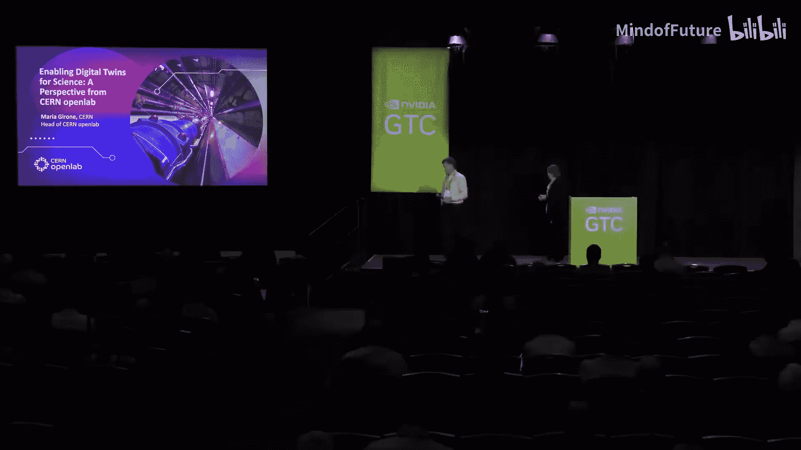

And good morning， everyone。 Many thanks for this invitation。 Many thanks to Tom in particular。

 and many thanks to all of you guys for being here to hear about the progress that we are making at Cern and in particular。

 Cernnaab on Digital twins for science。😊。

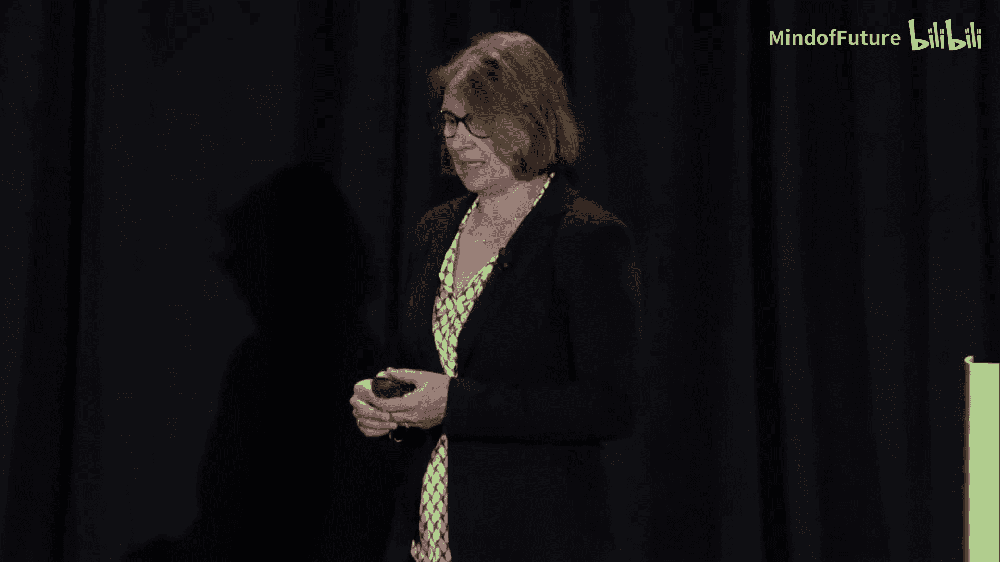

So I will be introducing very briefly Cern， but in particular， it's computing challenges ahead。

 the way in which we collaborate with the science and industry through Cernno La。

 And then I will talk about in particular， the area that we is the topic of the day。

 digital twins with a few words about the importance of diversity in technology at the very angle。

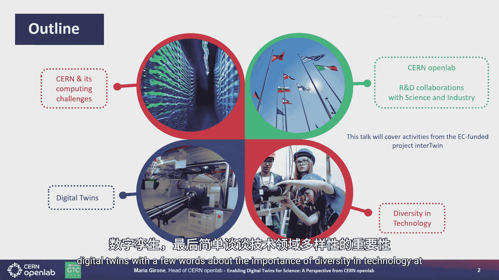

So for those who don't know， Sen is a very special and unique place where to work is the European Laboratory for particle physicsic。

 And also of the world today， the world's large biggest laboratory What you see here is the the aerial view of the C installations。

 is a it has a unique set of accelerators。😊，And the goal that we have is fundamental physics。

 So is out understand the fundamental particles and the laws of the universe。

And we do this to answer fundamental questions that we all have， what the universe is made of。

 How did life begin And we do this by studying the elementary building blocks of matter and the forces that govern their behavior。

 We have a set of accelerators that allow us to reproduce the conditions from a fraction second after the big bang。

 And like this， we gain insights into the structure of a matter starting the infinitely small to get insights on the infinitely big。

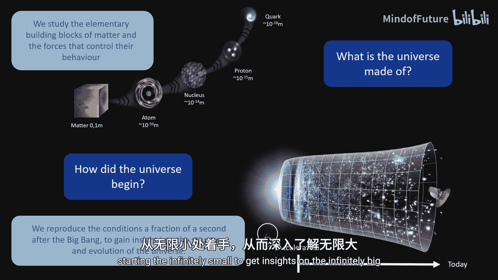

Doing fundamental physics requires developing technologies in many areas， but mainly in three areas。

 accelerators， were definitely a leader there。But also detectors that are these giant cameras that allow us to understand what we see from collisions。

And these are typically largest cathedrals size of equipment。

 They are built by consortia from scientists and engineers all over the world。

And they produce a lot of data。 So high energy physics is really a leader in， in in data。

In data mining。 And we are today already an X scale science。

So to process and analyze and select all these data， actually， computing is really key。

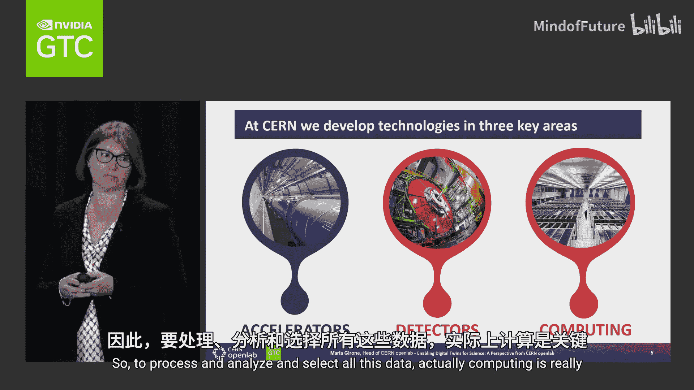

The flagshipper project that today we have as Cern is definitely the larger Hadron collider。

For the people who have ever been underground， this is a magnificent piece of equipment is0 me under the me underground。

27 km of in circumference。 you saw their view earlier compared to the runway of Geneva。

 So it's a really very large set of infrastructures。

 supercomp but magnets steer the particles and they are kept at almost the absolute0。

 at-273 Celsius and the particles are accelerated very close to the speed of a light。😊。

 there are four gigantic detectors that I already mentioned earlier on that act basically like cameras in order to see the results of the particle collisions。

 There are two general purpose experiments， are very big art in。

And they are basically designed in order to do precision measurements of the exp。

 but also be sensitive to a new physics beyond the standard model。There are two other experiments。

 Aliceis and theHB that respectively are dedicated to a certain kind of physics。

 Hols for the quark grew and plasma searches a state of matter that may have existed just after the big bang and LH B that is studying the asymmetry between matter and antimatter that is observed in nature by studying properties of particles containing the B quark。

Data mining a is an extremely challenging。A set of tasks。

We start from the Colllided space where we have collisions for 40 million times per second。

We read out millions of electronic signals from these giant cameras。

And we have a number of selections and filtering in order to record the data that is most interesting。

 And we record something like thousands of events per second that then need to be analyzed。

 reconstructed and then analyzed。 And the reconstruction is this calculation of the physics objects from the detector heats and the energy depositions into the detectors。

And the analysis step， then we compare the data to hypothesis with simulated events。Now。

 what really is peculiar nowadays is that artificial intelligence is really used at every step of this data processing chain from its adoption on with edge devices in the very low latency environments that allow us to perform the data acquisition and the first filtering of the data up down to simulation。

 reconstruction and to the analysis。And Sen is really being a leader in this adopting deep learning technologies very long ago on analysis。

 But today， I would say that they are really used everywhere。

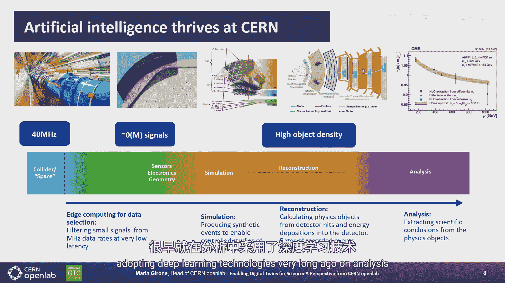

We， this is very important because， of course， there's a lot for that we can develop together with the industries just as an example in the area of low lat environment and artificial intelligence。

So it's quite interesting to see how we actually collaborate also for those endeavors that are outside the fundamental physics itself。

😊，The LHC has been。

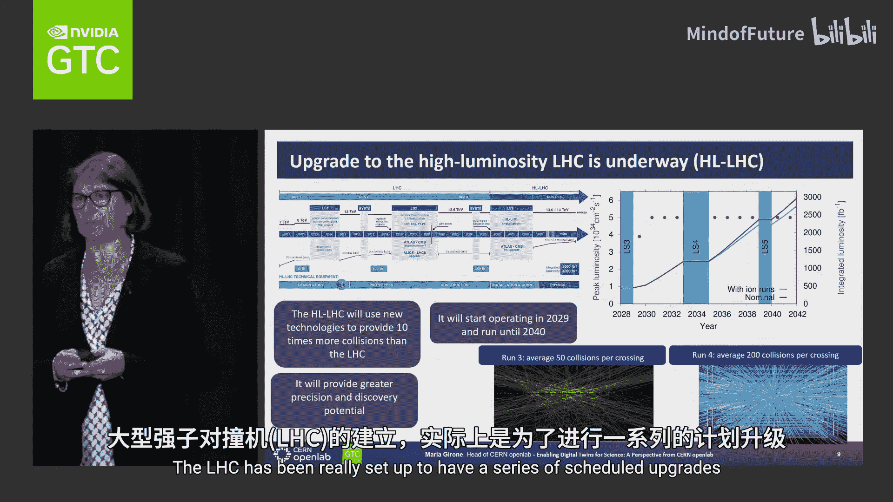

Really set up to have a series of scheduled upper grades。We are today in this so called the round3。

 This， we have just started the second year of the data taking of the rank3。And until now。

 we have collected just 10% of the entire data set that is。Though to be delivered by the LHC。

 So we are really at the very early stages of the exploitation of this machine。And actually。

 what is also very important to， to keep in mind is that by 2030，2029，2030。

 this machine will be operated at a different regime。 This are called Iluminosity LHC。

 in order to gather the 90% that is missing in the data。

 And this is very important on the physics side because a this。

 we can actually provide the scientists with much bigger data sets to analyze So for greater precision studies and for increase in the discovery potentials towards new physics。

😊，But going at the Island University L H C also means actually to have the capability of disentangling even more complex events that we have so far studied。

 And you can see here a comparison between what we have。In for instance， in。In round tree。

 with an average of 5 collisions， a pair crossing that we have to disentangle understand compared to the average2 that we are expecting to have at the islandlumity LHC。

So。I think that you can all gather that to be able to disentangle such complex events。

 we actually need to really change the way in which we are。

 we have been doing until now data processing and data analysis。

So the upgrade of this machine towards the Ilumminosity DHC is very important because it's also in involving a series of new challenges that。

How ahead of us， the machine， the accelerator， theHC itself will be upgraded。 There will be。

 there will be a long shutdown to upgrade this machine towards the Ilumous DHC。

 The detectors will have to be changed at least in some parts of them because there will be much more occupancy of the data。

 as you saw in the previous picture and the detectors need to be much more granular in order to disentangle desired occupancy in the detectors。

😊。

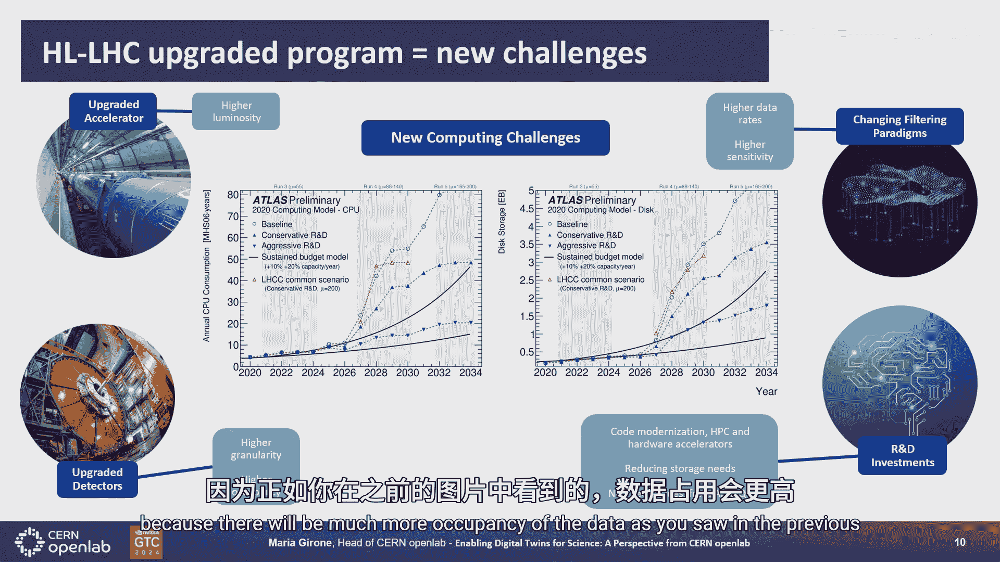

The experiments are also going to up to open up their selections in order to accept more data。

 So they are changing the filtering paradigms。 And the I is crucial。 Also in these aspects。

 There's a lot of people doing guarantee now in the area of applying theI in edge computing in low latetnt environments。

And in general， in order to be into the resource envelope that you can see these central plots that is into these black lines。

 we will actually have to do a lot of R And D in order to be between what we have as a resource project projection。

 given our flat budget。So there's a lot of R And D that is happening in the code modernization in the adoption of high performanceformance computing。

 We are a niceput computing science so far。Use of hardware accelerators like those that we discussed at conferences like this。

 also reducing the storage needs and definitely the use of artificial intelligence and further down the even quantum computing。

 possibly。Now， the Ilumity LHC that I'm so proudly talking about is not the only future endeavor that Cna has been taking on。

 We have already launched a technical and feasibility a financial feasibility study to develop the future colider。

😊，Now， this is going to be a very large machine of a much larger could compared to the LHC that you also see in the picture。

 The LHC would be an in， the injector to it。 is going to be a tunnel of about 1 kilometers situated between the two mountain chains in the area of Geneva。

 the jura and the Salleb going even underneath the Leman Lake So it's a very challenging project ahead of us。

 And what we're doing today is also setting this scene of what we will have to do in the future。

 at least for what concerns the challenges in terms of computing。So with all this in mind。

 collaborating a CN with other sciences and industry is definitely in very important and key。

And this is why I'm proud leader of this endeavoreav that is sent up a lab that is fostered in collaboration with the science and industry。

😊，Now， C has been working for more than 20 years。 now， really in this area of collaboration。

 we have four primary missions The first， very important。

 establishing strategic industry collaborations Second， fuel in technological innovation。

 So talking today about digital twins is definitely important。 Exosing technologies to scientists。

 And this is what we really do when we have projects together with industry。

 and also very importantly nurturing knowledge and growth in young stem researchers having a lot of projects and。

😊。

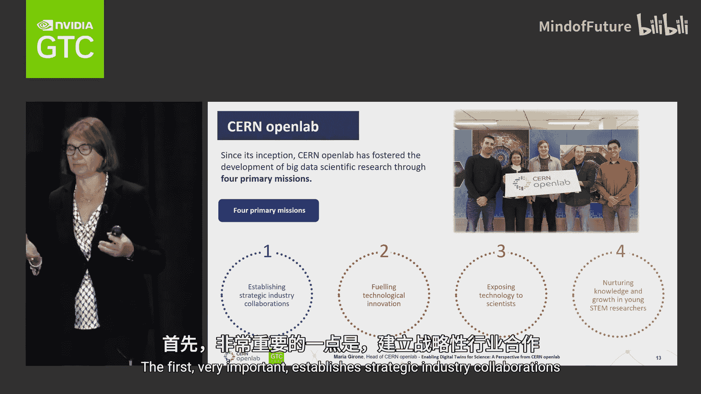

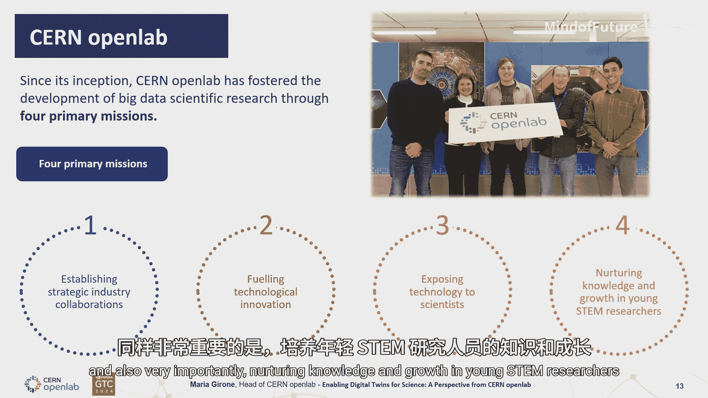

Data and activities that allow us really to have also young students as， in particular in summer。

 every summer。The throughout this more than 20 years of collaboration。

 we have been going in phases of three years。 This is why because we really review the major goals that we have in the collaborations with the industry。

 And today， we have just kicked off the phase 8。 where we have these main objectives。

 pioneering sustainable and emerging computing storage solutions for the future of certain challenges harnessing heterogeneous computing and the eye for greener future。

 and， of course， fostering synergies and technology exchanges between science and industry。

 We do this through two main R And D directions。 One is the sustainable infrastructures and the other one is emerging technologies。

 I can't go into the So all the projects that we have in each of these individual activities。

 But I'm going to cover the one on digital twins。Which is really emerging。

 And we believe that is really key for us ascer in order to。Have a way to。

Understand and support the complex infrastructures and installations that we have。

 You saw earlier on the pictures from the experiments， the LHC。

 So but we have a lot of installations and adopting digital twin seems to have agree of a great innovation potential in order to really do more efficiently and understand better our installations and our complex processes in science that we tackle lesson。

An example of work that we are doing in the area of Digital Twin comes from the support of the Wikian Commission。

 It is called Intertwin is a project that we are we have been investing a lot from CEN has got to three main goals。

 the co designign and implementation of a prototype for unified interdisciplinary digital Twin engine using an open source platform and using open standards and。

I being available to a very large spectrum of diverse use cases from physics and from arttop observationserv。

You can see here a glance all the use cases that we are supporting。 I will cover them in a moment。

 We have about 30 participants in this consortium。 all of course， from Europe。

 because it is funded by European Commission。 and we have leaders in sciences。

 technology and resource providers So it very well set project is making a lot of progress in the area of the digital training engine for science So we have developers for the core engine itself We have experts from infrastructures from which includes people from and experts from HBC centers in Europe and clouds。

Data is served via the modern concept of data lake architectures。

 and that the science researchers access the engine through a user friendly platform。

All is rotating around the main concept of a unified。

Core engine that supports all the digital twin use cases from the different sciences with access to resources。

 provisioning in the same group of experts and， of course。

 codesign of a unified engine that will be available to all other sciences。

The serno participates in with its own。Expertise in key areas such as a deco engine for the large scale AI workflows。

 the federated data lake infrastructure where we are leading。

As we are an by science with a lot of experience in the data handling data distribution。嗯。

And the a use case specific from IH physics that is coming from a particle。

 a digital clean of a particle detector。 the model simulates detector response from interacting particles。

Using generative at ver networks for fast simulation to be compared with the state of our tools like J M 4。

And this is this digital twin integrates operation conditions for the setups and is meant also to give a response in real time at the level of detector data acquisition。

 configuration with respect to different run conditions。

This digital twin that we are building in particular for this detector simulation is not the only use case from in intertwin on on physics of fundamental physics。

 We have a very strong collaboration that involves sciences from the right astronomy。

The gravitational Waver experiment vehicle and the D latests Q CD。Experts。嗯。And we also have。

 actually。A number of leading institutions that are contributing to the intertwined use cases with on the climate and environmental sciences side。

That will allow us to make digital twins for future predictions of extreme events like fires， storms。

 but also floods and droughts。And this is really something that we are very proud of because of the societal impact that we have and engagement that we have in environmental science。

😊，We are also collaborating with the ECMW F， the European Center for Medi Ra weatherer forecast and the Jewish supercomputer Center on a a project that is called E M T 2 and is meant to。

Build a large foundation model for atmospheric modeling。

 It is train trained on a large preprocessed data set called erara5 and is serving downstream a number of use cases from weather prediction and scaling bias corrections。

 and now working on the special temporal interpolations。

This project is an open source project that is offered to scientists。

 and will be also integrated as a use case into the digital twin engine of the intertwin project。

 So to provide easy access to the HC resources that are needed for this modeling predictions。

So with the the experience that we， we are gaining in this intertwin project this started almost a year and a half ago。

 we believe that we have really understood we are understanding in more important detail。

 what really are the fundamental requirements for unified the digital twins in science。

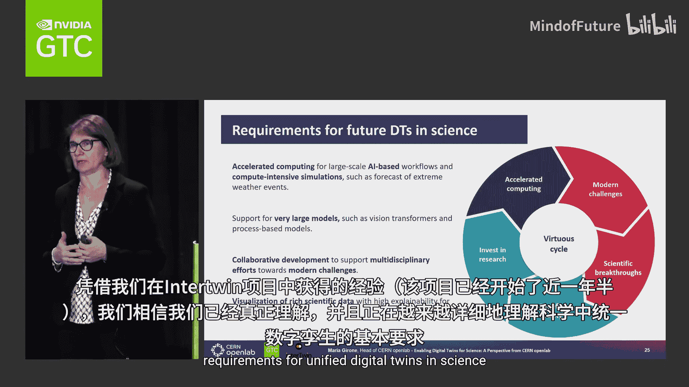

And these are definitely what is important is a computing for large scale AI based workflows and support of compute intensive simulation。

 So you've seen all the use cases that we have support a very large models， foundation models。

 but also requirements are coming from having collaborative developments to support multidisciplinary efforts and the visualization is another very important requirement in order to to provide really policy makers with highexability。

 So is's a sort of way in which I like to say is a sort of a viruous cycle。

 where modern where accelerated computing serves modern challenges for scientific breakthrough benefit to society investment research and the circle goes on。

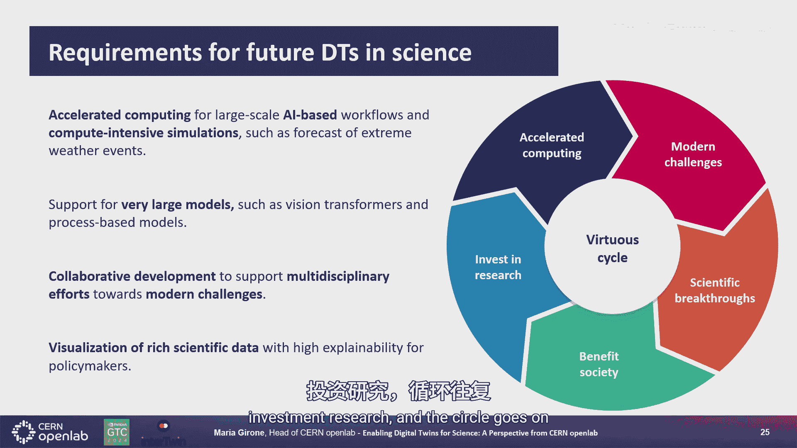

Now， there last part a few minutes， I want to spend on a proof a concept that's been really ongoing very recently with Nvidia for the integration of Nvidia omniverse。

 We have seen that we have very large infrastructures and we use extensively cad models in Kaier format。

 Some of them have been imported in the USD format。

 you can see here some of the cad model models that we have But what is very important is that in this proof concept we have demonstrated that we can actually use Nvidia omniverse and navigate through installations like this is beam line with a very nice visualization using Nvidia omniverse and this is proof concept that we have been doing in the last few weeks。

 but we would really like to work a bit more on it and also expanded to。Many other use cases。

 we believe that this is really quite powerful tool that we could also not only use for collaborative visualization of the accelerator and experiment complex。

 as we have done in this proof concept。 but also use it， for instance。

 for the detector and accelerator assembly simulation and integration testing， really trying to and。

 and this is quite very big potential interest for what we want also to build in the future。😊。

Planning could be used。 We have a very small spaces and hazardardous environments as N。

 where we could also be using digital twins and also for those activities that have to deal with the robotic applications in in confined spaces we also would like to to further do investigations of Nvi overse as a visualization tool for our J for simulated events。

😊。

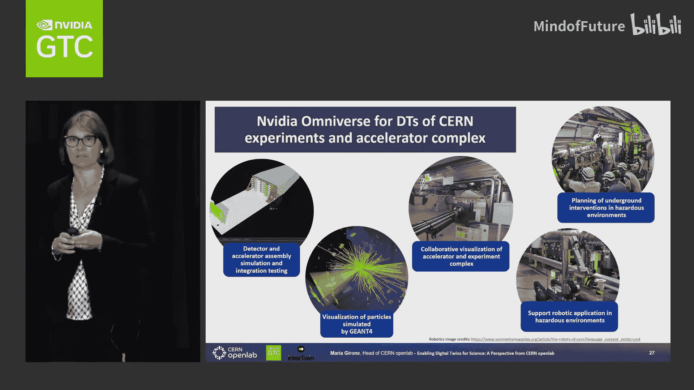

So there's quite a lot that can be done。 And this is actually bringing me to the last slide。

 That is our conclusion， but's really a few words looking forward。

 we would what we want to do in the future。 So collaboorrate with India via serop lab to scale up the current efforts will be very important。

 consider overse also for its integration in intertweed as a visualization tool of all the scientific use cases that I showed before。

 in particular in the part of environmental science and a rich overse use cases towards the future endeavors that we have a that are the IluminosityHC and the future colider。

😊，So one talk about diversity。 it is important。 And I would like to thank all of the people that are engaged in technology and diversity here in。

😊，Places like this conference and definitely thank the colleagues from Women in H PCC and ideas for HPC。

 That is the Swiss chapter。 Thank you very much。😊，Thank you very much。

 I think we've got time for some questions。 I don't think there's a。

 I don't think there's a talk after this one in this room。There is not， so I think we're okay。

Trust me， we're okay。You question。There you go thank you very much。

 So you mentioned I think it was ESP， which was a full earth environmental model。

I can imagine two challenges that you face with something like that。

 One is that it's hard to explain a neural net recommendations to policymakers。

 And then another one is that you have to figure out a way to emerge， you know， I guess your。

 your transformer architecture with data。 Can you comment on how you approach those two problems。

I think we are at the very early stages of this adoption。 So I can't comment on that。

 but I didn't get the beginning of your question。 Was it on the MP。2。the question was。

 how do you explain the results because the AI， with basically uncertainty quantification to policymakers that don't understand the details？

Yeah。How do we explain the results？ Yeah， if the results of the， the digital twin have implications。

 the policymakers， how do you explain them because AI is。

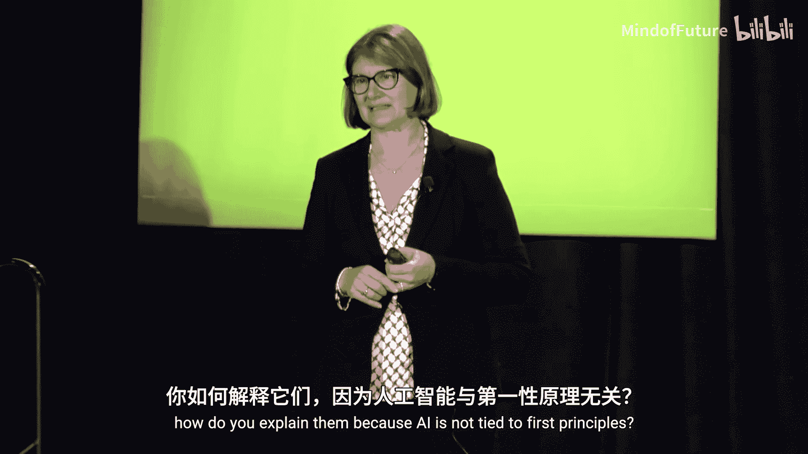

Not tied the first principles。 So an easy question to answer。 It is really dependent on， on the。

 the kind of。嗯。Activity that we are doing in some cases。 now， in the case of digital twins。

 we are really at the very early stages， so。But this is more a。

 a wish for the future work that we have ahead of us rather than concretely what we can do now。

And I think we're out of time now， But Maria will be here for a few minutes before she has to go catch her flight back to Geneva。

Thanks again， thanks。

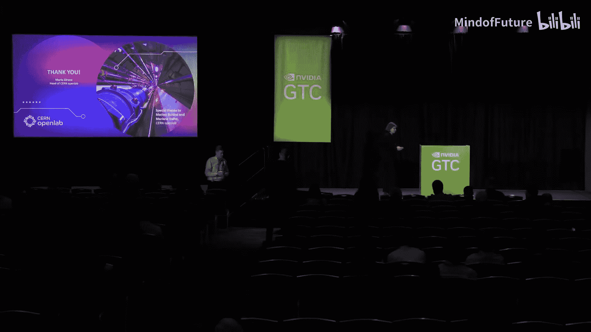

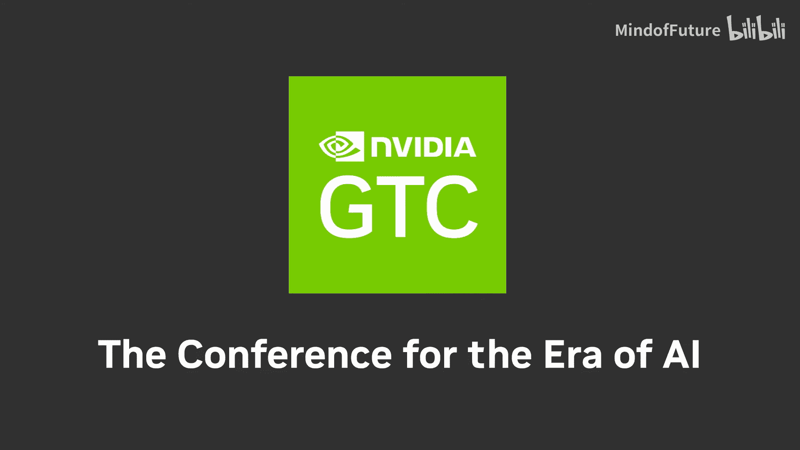