# 【英伟达GTC人工智能大会 • 中英】NVIDIA GTC 2024 p11 P11 Augmented Marketing in Beauty with Generative AI - Asmita Dubey, L’Oréal -BV1yHAeeqECP_p11-

Now， let's please welcome Emira Dube， who has over 25 years of experience。😊。

In consumer businesses and who currently serves as chief digital and marketing officer at Loreal。

 she leads the company's digital transformation， focusing on evolving marketing and models。

 adopting data driven solutions and accelerating emerging business models。 In today's session。

 she will discuss how Looreel is embracing generative AI as an opportunity to unleash human potential for creativity。

Thank you very much。Hello。That's good。Hi， everyone。 Good morning。

I'm I'm so happy and so glad to be part of this NviDR GTC conference today to share with you our journey on how we are augmenting marketing through generative AI。

😊，Now， beauty is an essential human need。And we at Loural Group， We are global leaders in beauty。

We are a hundred and 15 year old company， and our sense of purpose is to create the beauty that moves the world。

To start with， I'd like to introduce Lo'real group to you with a short video。 Okay。

 please have a look。

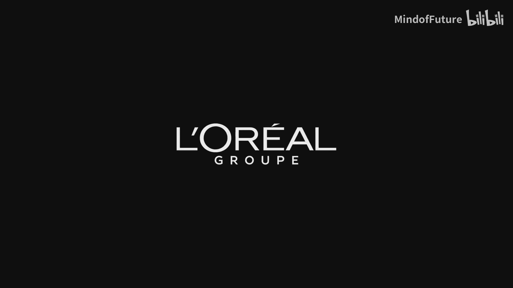

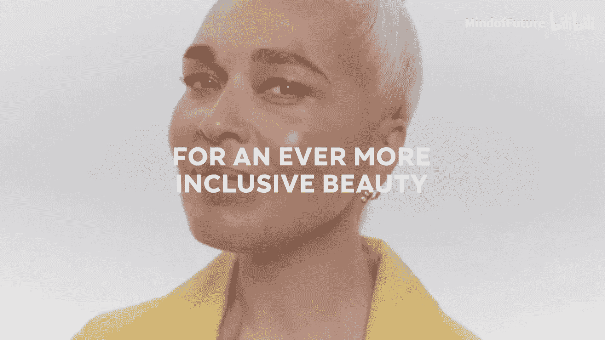

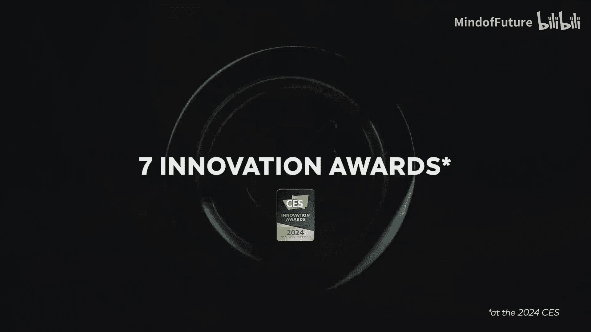

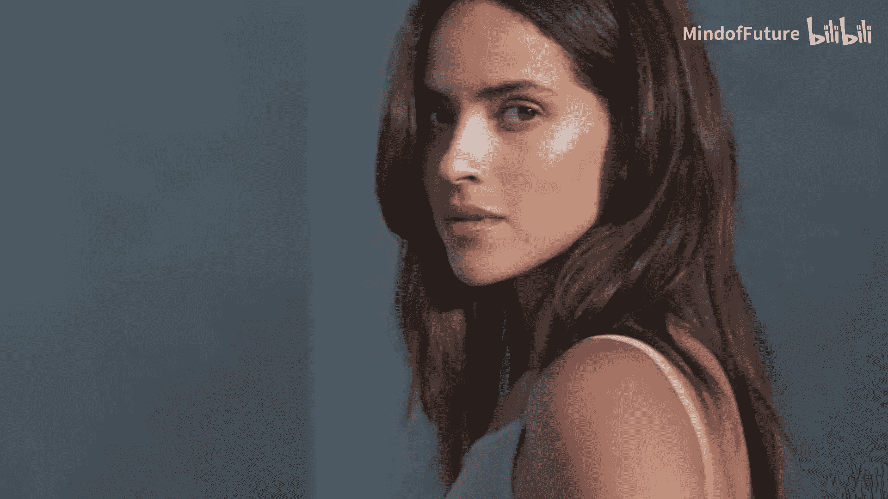

Thank you very much。

We have a unique business model， you know， with six pillars and keys to our success to start with research and innovation as a focus。

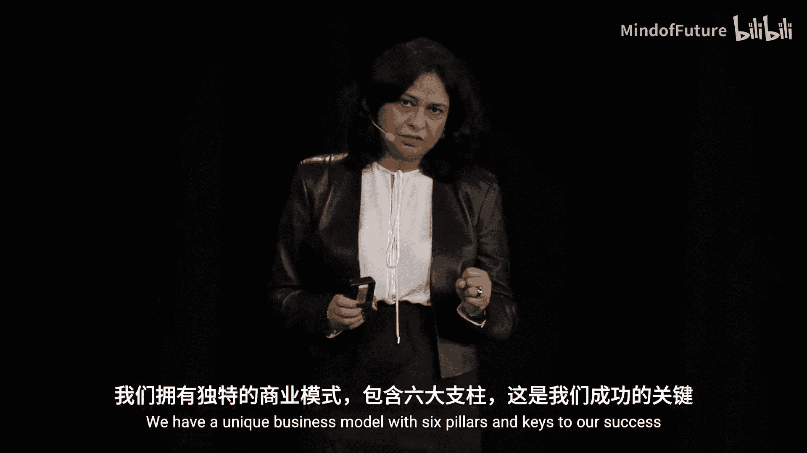

The power of our 37 global brands， digital and tech leadership。

We are championing beauty tech to build a new kind of relationship with our consumers。

 One that is based on technology， data and AI。 And with that。

 we are delivering beauty for each powered by beauty tech。 And I'm going to speak a bit on that。Then。

 our manufacturing capabilities。Our virtuous circle。

 where we invest in ANP advertising and promotion to drive consumer engagement and our unique culture and values。

😊，It is in our DNA to innovate。 We love to seize what is starting。And we con。

 we are continuously reinventing beauty experiences in the physical。

 digital and virtual worlds to shape the future of beauty。 We have three innovation pillars， science。

 technology and creativity。😊，Today， with Generative AI， we are at a new frontier of technology。

 And Stefan was talking to you just before。 Today， we are at a point where creativity and technology are coming closer together。

 like never before。😊，At Loreal Group， you know， we are also building our group's approach with this technology generative AI。

 Therefore， we have created and built a generative AI task force。

 and the role of the task force is to create a responsible framework。

 to build our guardras our dos and don'ts as we use the technology。

 to define potential and frame use cases to upskill our organization。

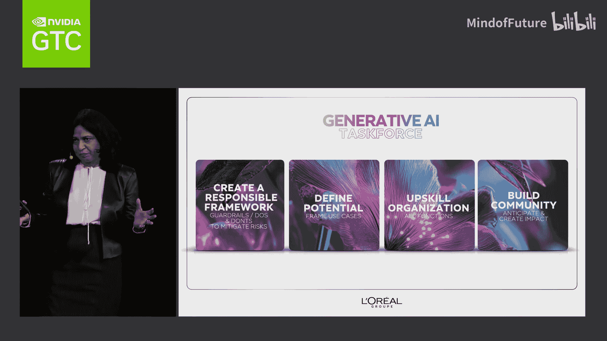

And to build a community that anticipates and creates a larger impact of the technology on the broader organization。

To lead this task force， we have a very capable executive Isabel Gorney and Isabel is in this room with us today。

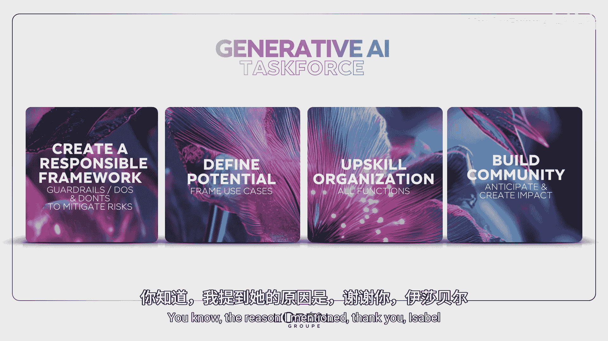

You know， the reason I mentioned， thank you， Isabel， thank you everybody。

And Isabel has a unique role because Isabel is working closely with human resources， with R And I。

 with technology， with digital and with marketing， because we are convinced that the impact that the technology will have is multifunctional and touches all parts of the organization。

On my side， I'm going to pivot to marketing。 You， beauty marketing has been getting augmented。

 It has been getting augmented by purpose， inclusive and sustainable by design。

 It has been getting augmented by multi sensorial experiences in the physical。

 digital and virtual worlds over the last few years。

 Beauty marketing is also getting augmented by data use across business levers。 And now。

 beauty marketing is getting augmented by generative AI。

 augmented marketing is the future of marketing。And what we are doing is we are exploring augmented marketing with the generative II technology across different parts of marketing。

 across content creation。 And this is going to be my focus today over the last 20 to3。

 over the next 20 to 30 minutes。😊。

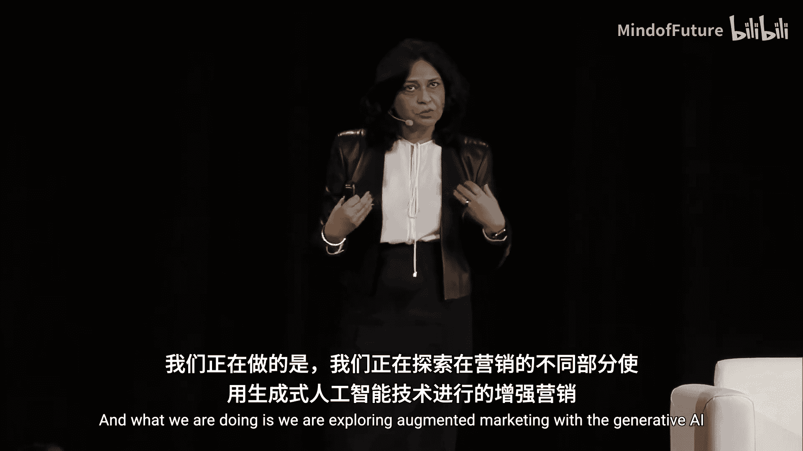

On services。 So we are bringing a new generation of beauty services。

 both offline and online to our beauty consumers。😊，Consumer care。

 consumerer care is going through rapid changes。 What is happening is we are able to now augment our care agents with very good intent detection and the right information。

 And that is driving consumer satisfaction。 We are piloting a lot here with our partners like Salesforce who are already working on consumer care。

😊。

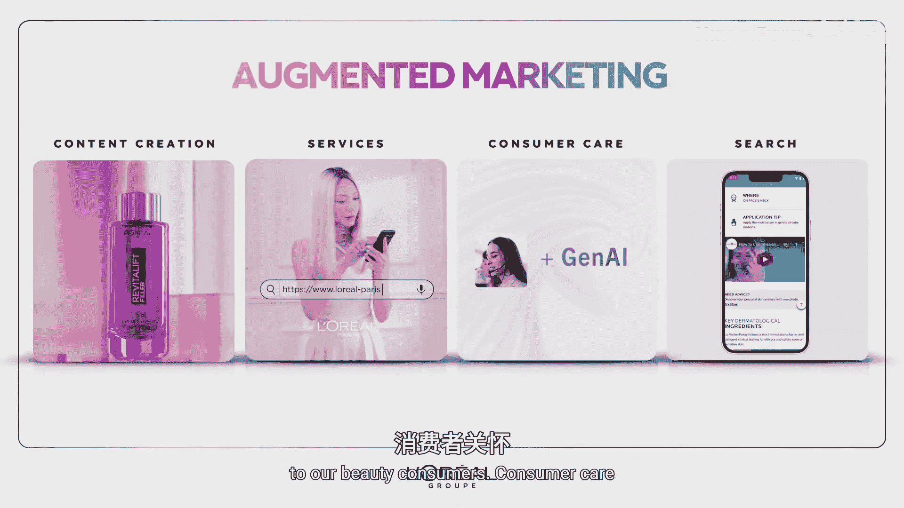

And then on search， there is a new search experience that is taking shape and beauty searches are getting a makeover as well。

😊，Now。When it comes to augmenting creativity。We decided to build。A generative AI beauty content lab。

And we call it Cre tech。Because as Nvidia talks about it， technology is sparking creativity。

 and it is sparking creativity amongst copywriters。 You know。

 against Stean was speaking about it just before。 It is sparking creativity amongst 3D artists。

 It's sparking creativity amongst all of our marketers。 And therefore。

 we are trying to shape the future of beauty with C。😊，Creatote is our safe space for experimentation。

 Yeah， at Creotote， what we do is build guardras for content creation。Build our do's and don's。

 our principles。We are also bringing together an ecosystem of partners。

 both technology and creative partners for our content creators。

 And then we are assessing service models。 We are assessing that。

How should we augment creativity so that there is adoption at scale。Now。I。

 I shared with you that beauty is a human need， yeah now。It is deeply personal。 You know。

 beautyut is about self identity and self expression。It is something that that gives us confidence。

 It makes us feel good our about ourselves。 At the same time， beyond being a very personal need。

 beautyut is also deeply social。😊，We can show。Where we belong with the choices we make on beauty。

 You know， on which cultures and subcultures we are part of。 at the same time。

 we can disrupt them by choosing something else。 We can choose a counterculture。

 So beauty represents all of that。 And therefore， at Loreal group。

 we have decided that we will not use AI generated face， skin。

 body or hair to enhance our beauty products in our external representation of beauty。Yes。

 we will use AI generated face， hair， skin and body when it comes to。

 to inspiration on new codes of beauty， when it comes to， to imagination， you know。

 sparking imagination， when it comes to internal storyboarding。

 but we will not use it to enhance our product benefit for external representation of beauty。Now。

 over the last six months， you know， we have been working together with a lot of partners。

 We have been working with NviDdia with W P， P Open and several large language models。

 and we have created more than 800 beauty images。

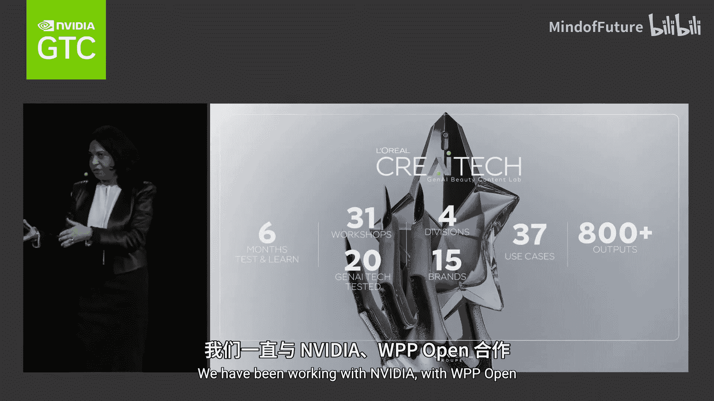

You know， these images have been created with dozens and dozens of workshops with our brands。

 They have been created。 We have used about 20 different Geni tech， and we are exploring。

 We are learning from all of this。 What I'm going to do is start sharing with you some of these beauty images。

 Yeah， and then share our journey along the way。😊，Now。

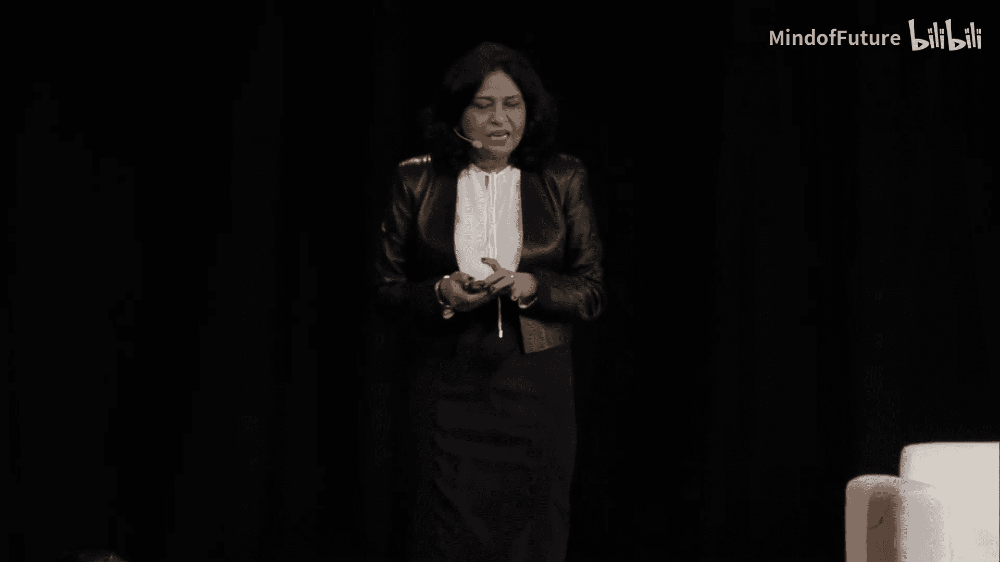

We are assessing and envisioning new codes of beauty with the generative AI technology。

What you see on the screen here is a connected， mirror experience。Now。

 to create this connected mirror experience， I'm going to prompt。 Okay， I'm going to try to ask you。

 what are some of the prompts that were made to come to this image。

 The prompts were a futuristic bathroom， a connected mirror， an AI interface。

 some data labels and data sets。 And then you get an image like that。

I'm going to move to the next image。This beauty image。Is a beauty tech image。

The prompts that go with this beauty tech image。You can start to think。Skincare。Yeah。A grid pattern。

LED light。And fashionable beauty。Here's another one。

The image here is the vision of a futuristic salon。

So the prompts that we gave to come to this futuristic salon were。哇。

Going to let you think about it for a second and then share with you。 First of all。

 it was a retro futuristic design of a salon。A holographic display。

 some smart screens and robotic hands who are going to help around in the future of Con that is going to be there。

 So here we are sparking imagination， understanding new codes of beauty。Here is another image。

And this image is the vision of an AI spokesperson。In the red nebula。In the space， you know。

 as you can see from the output here。Once again， we are looking at a beauty tech image and a beauty tech image that is offering services and dermatological care。

And the prompt here is skin diagnosis， facial recognition， image analysis。

I'm going to take one more in terms of new codes of beauty。

This one is about creating accessible beauty， during mobility。😊，It is about virtual tris。

 and instant makeup rendering。And the prompts that were given here were。Digital makeup， you know。

 autonomous vehicles。And one more， we just put in the word ear 2050。So with year 2050。

 we could start imagining what else gonna happen。So these are some of the new codes of beauty images。

 Then what we are also doing is we are creating hundreds of product shots， you know。

 product shots across our brands。 And I shared with you。

 the video said that that we are one of the reasons of our success is our focus on brand building and we have the power of 37 global brands with us。

So here is our brand careas。And the prompts for the background were。

An elegant Parisian sunset with the background of an Eiffel tower。Cinematic lighting。And， of course。

 our brand in all of that。If I start taking you through some of the other product shots and Stean spoke a lot about brand data sets are brand lanc Com。

 This is about rethinking brand lanc Com's symbolic rose agogora。

 So the prompts we gave here was soft LED lighting， pink blush。 the rose， you know。

 and it starts to shape some soft shadows as well。 I think was one of the prompts here。

I'm going to show you another product shot。 Here is the product shot。 It is。

 it is in a Mother's Day universe for our brand biotherm。😊。

So what is the universe of our brand biotherm， The prompts here were ocean blue tones。

 because biothem has that ocean blue tone within it。The other point。

 the other prompt was reflective water， reflective ocean。 There was a prompt on beauty with skinca。

 because biothem is a deeply skincare brand， you know， amongst other things。 and a scattered ribbon。

 So what we see is this output on the screen here。 I'm going to take a couple of more examples。

 And then share with you what we are learning from all of them。Now， this is a kind of a vision of。

 of creating a gift。Through our very luxurious brand， if Silloron beauty。

And the prompts that we gave here were a abstract golden structure。

 So there was gold in there metallic， silver and beige tones。

 clean lines and a very elegant and luxurious atmosphere。😊。

So the result kind of delivers to that prompt。Here is another one。 Our brand set away。

 It's a skincare brand， and it's a brand which is quite simply fresh， pure， clear。

 So the prompt that we started giving while generating this product shot was shades of gray that highlight freshness。

 pureness， clarity and has a soft lighting。😊，And the result comes out to be something like that。

I take one or two more examples。 This is a very interesting one。 Here。 we see a kind of。

An active ingredient， an active ingredient called meocil in our dermatological product La and。

 you know， the brand La Roche Pose。 So a prompt for something like this was。Purple and blue colors。

 purple and blue lighting， a kind of a kind of abstract liquid， you know， formation。

And then a black background to show it all。Not only that we start moving。

 when we say how to show ingredients， we don't just show ingredients。

 We can see this mixing of an active ingredient， a molecule and our product universe in this shot。

 which is about loreal professional hair serum。 So the prompts for this one was。

Metalic liquid sphere。Dark brown colors， gold and silver。

 and a very elegant and luxurious atmosphere。😊，And another one。

The reason I share all of these images with you is because we learn through them。

 We have learned that yes， we， we are using these 20 different generative AI tech with their pros and cons。

 But at the same time， what it requires is strong， creative direction。

It needs prompts that have imagination and that have very strong brand cues for the images to start becoming relevant for us and for us to use it to augment marketing。

We are also learning with the work that we are doing that。

We can definitely scale product shot and background production with the technology that is here with us today。

 And you see， you know， a bit of that symbolism of how we are thinking of scaling it。

We also started to experiment and learn on image to video generation。

 So these same product shots can be a bit more visual and， and with video alongside it。

 Sometimes we also experimented with translation and voice there。And moreover。

 what we did over the last six months was we worked with Nvidia omnivos。And W P。

 P open and started creating custom 3D models for our products。

 And this provides a massive advantage， because once you have a a product shot from all the different angles。

 then we can start changing the backgrounds。 and all of this means that we are saving days of shooting and so much time and resources overall。

😊，Now， I spoke to you that beauty is an essential human need。

 We also spoke about the fact that beauty is deeply personal， but also deeply social。

 and that is why we have taken this philosophy of no AI generated images， no lifelike images。

 you know， to enhance our product benefit。

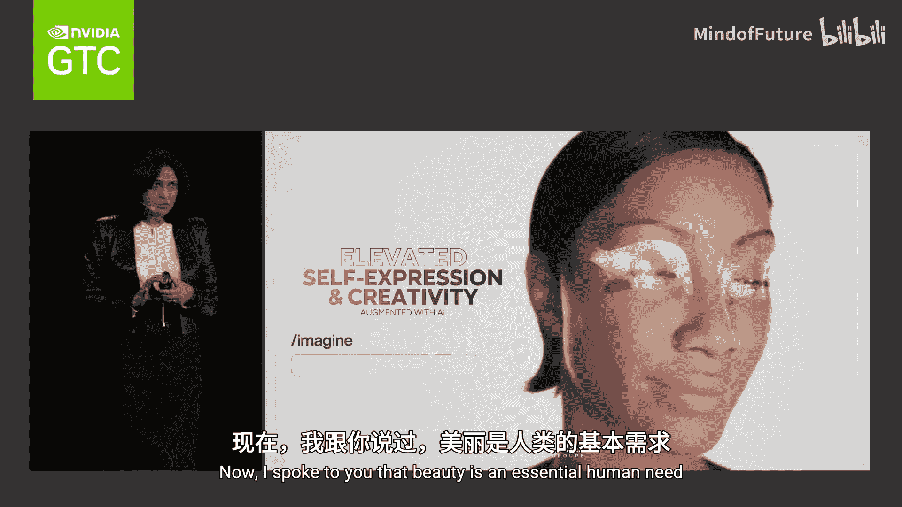

At the same time。啊。🤢，Beauty is about self identity and self expression。

And the Gen Z consumers that we have， they are very comfortable with elevated self expression for themselves。

 all for their avatars in the gaming world。😊，So what we are doing。Is creating hair looks。

 A brand laal professional is co creating hairtyles and hair looks for the gaming and virtual worlds。

😊。

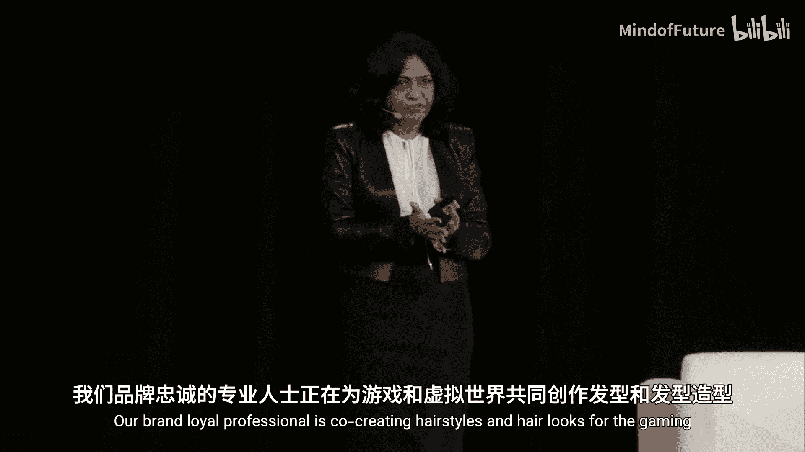

And here， the use of Gen AI is at an early stage。 At the same time， we see that the Gen AI tools。

 they help us in adapting master 3D hair looks from a platform like Ready playerer Mi to another platform like Robloox or Zipetto。

😊，And therefore， we can start envisioning how we would scale this across different platforms and across makeup and hair and compelling images out there。

There's also a rising creator economy all around us。 Yeah， and we at Loreal Group。

 we partner with more than 50000 influencers and creators。

 and we are preparing ourselves for this next generation of creator economy。 therefore。

 we started partnering with this new generation of C tech artists。 you know。

 artists and creators who are redefining beauty images and beauty experiences with the AR。

 we are spatial computing， AI3D tools。 And you see some of very。

 very successful imaging and videos that are there。 We are doing this partnerships。

 and we are forming this partnerships across platforms， you know， across meta， Tiktk， Snapchat。

 and also across geographies， because this includes some of the images and 3D creation that we are doing in a market like China。

😊，We are convinced that creativity and technology are coming closer together like never before。

 you know。

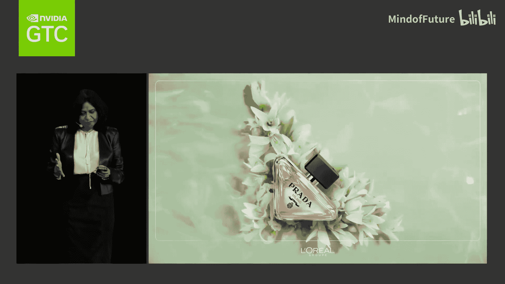

We believe that， that technology can push the boundaries of what is possible， and we are able to。

 to improve our consumers lives with it。 We are able to cater to the infinite diversity of beauty needs and aspirations。

😊，To， you know， we call it beauty for each， beauty for each powered by beauty tech。And therefore。

 we are also empowering our consumers with elevated beauty services。 I mentioned it briefly。

 We know that 70% of our consumers are overwhelmed by the amount of beauty choices that they see around them。

And therefore， we are bringing them beauty services which can help them， you know， through this。

We just launched Loreal Paris Beauty Genius。 Now， Loreal Paris Beauty genius can act like a personal beauty advisor。

 you know， and it will be in your pocket，24，7。What Loural Paris beauty genius is capable of three things。

 First of personalized diagnosis， personalized diagnosis of your skin or virtual tris on makeup。

And the source for this is Loreal Modiface。You know， AR and AI， it's an AR and AI provider。

 and we have a lot of skin diagnosis and virtual trions internally because we acquired Moface since 2018 and thereon became AR and VR and AI leaders in beauty。

 So we have a lot of personalized skin diagnosis， which we plug onto the Loreal Paris Beauty geniusius。

 Then what Loreal Paris Beauty geniusius does is does a personalized recommendation。

 a personalized recommendation， which today at the starting point is on more than 750 skinca makeup and hair care products from our brand。

 Lourreal Paris。 And of course， that is gonna expand over time。

What this beauty advisor does is also personalized education。

 because we are able to curate all the content from our brand websites and our social media pages and put it on to this personal adviser。

 So all in all， we are able to get。😊，Services， a kind of a suite of services on beauty。

 personalized product recommendations。And consumer care all in one when we launch Loural Paris Beauty Genius。

 It's a huge service to our consumers。So through this journey of augmented marketing。

 we we have been learning over the last 12 months across the cases we have done on content creation I just shared with your own services for Laurreal Paris Be geniusus on consumer care or on search and our learnings are across you know。

 we are trying to assess， we are trying to assess efficiency。

 do we reduce or save time and resources。

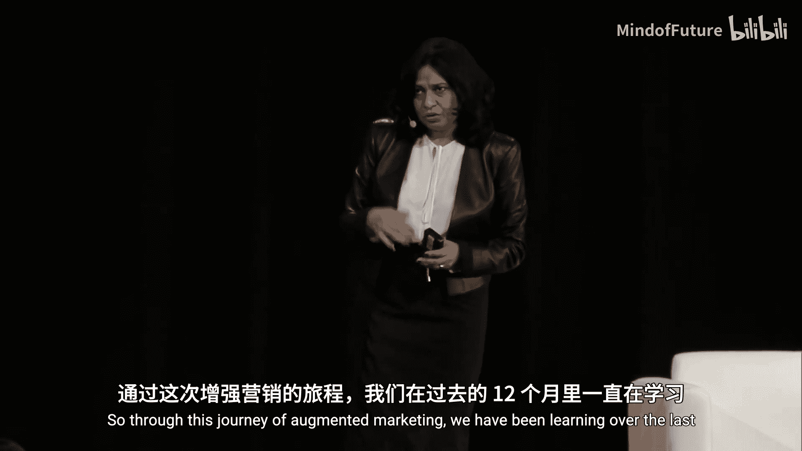

On effectiveness， do we improve time to market， Do we improve volume of production。

 Do we improve performance and quality of production overall， Our assessment is also on。

 are we creating value， Are we increasing consumer engagement， You know， conversion。

 consumer satisfaction or overall R I。

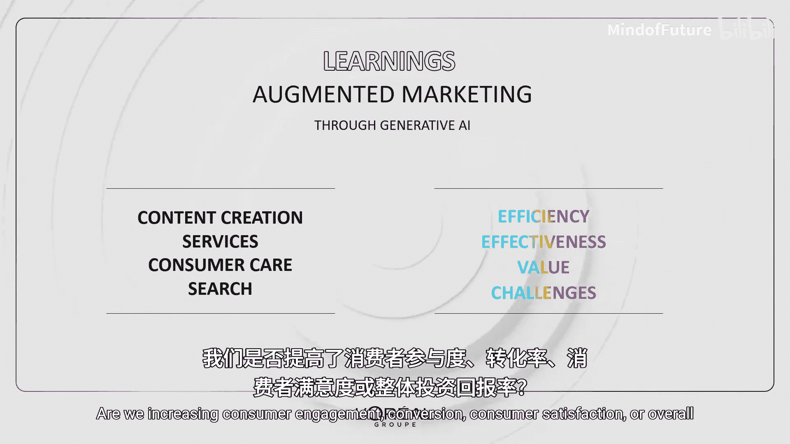

At the same time， we are asking ourselves a lot of questions。

 We are asking ourselves questions on IP rights。 We are asking ourselves that what are the challenges that are ahead for us ahead of us when we have to scale the technology for day to day use cases。

And therefore， I'm coming back。 I'm pivoting back to content creation and augmented creativity here over the last 12 months。

 I will share with you our journey。 Yeah we started our augmented creativity journey back in April 2023。

 So it's almost exactly an ear。 And at that point， we we kind of made a Geni summit。

 you know in the lareal group internally， but with a great support from all our technical and creative partners from there on。

 what we saw with the WppP Open， as well as Nvidia omnivos， we found it very interesting。

 So we started initiating a partnership with them。 and that was in June。 in July， we built Creatote。

 our generative AI Bea content lab。 and then we started to test and learn。

 and we have these 800 beauty images output some of which I have just shared with you today。😊，Now。

 we are thinking about building on our shared vision and building on our shared vision indeed means custom brand models。

 you know， and on custom brand models or on what to do next。

 I think we are taking kind of three insights and learnings in three different buckets。

 The first one on tech readiness。 The second one on tech modularity。 and the third one on data value。

 So in terms of tech readiness。 and here is a group of like experts on the subject。 Of course。

 we also experience that there is an uneven tech readiness。 in terms of outputs。

 but also in terms of the input capabilities， because they keep emerging and there are new capabilities coming all the time。

In terms of tech modularity， we feel today that that you know to have a diverse and modular GenI tech stack could be helpful for a large corporate like ourselves because there is so much innovation happening in this space that we'd like to keep it modular。

 and in terms of data value， I think we need an effective management of our brand data sets of our training data because once we have effective management of the brand data sets。

 we can be more assured in terms of the quality of the output we can also be more assured in terms of compliance that what we are doing is on IP rights for us。

So all in all， if， if I were to sum up， and I think what you' have seen through this whole Ctic journey is we are definitely using a combination of man and machine to create the beauty that moves the world with generative AI。

Technology is sparking creativity like never before。 And at Loreal Group， we are just ready。

 We are ready to embrace creative augmentation on one side and content automation on the other side。

😊，We are a leading beauty tech player。 We believe that that beauty tech is something that is gonna help us to bring beauty to each。

 you know， and I'm going to finish by a video so that you discover how we are championing beauty tech。

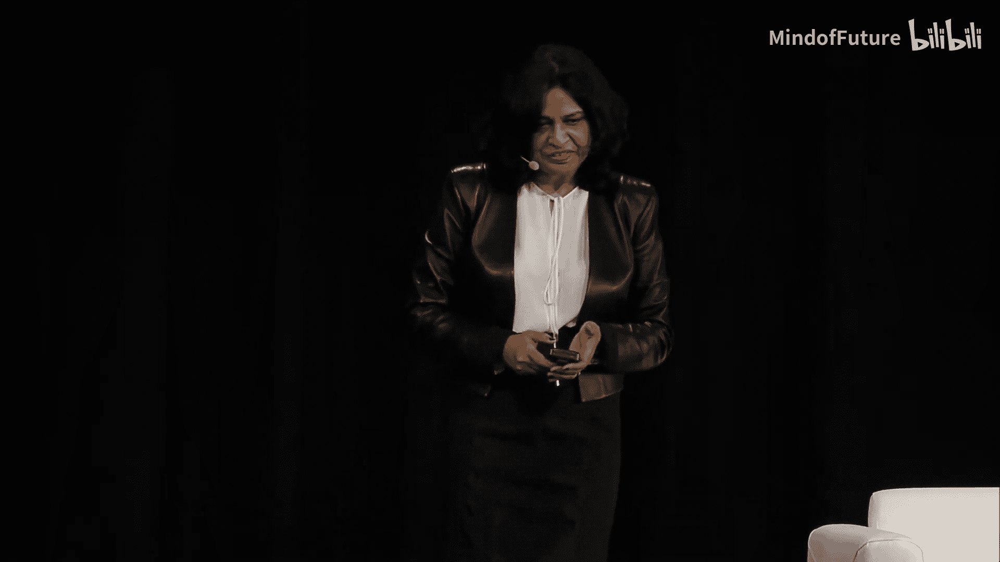

Beauty is an essential human need， and for more than a century， our sole dedication。At Lo'ural。

 we have always seen technology as a driving force to embrace beauty's infinite diversity。

 we are entering a new era where ultrapersonization is the new aspiration where beauty for each is powered by beauty Tech。

Beauty tech is essential to no consumers intimately by connecting 115 years of unique expertise and data。

 we understand consumers' needs like never before Beauty tech is essential to astonish consumers with trailblazing innovations by combining advanced science with gamechan technologies we open new possibilities for unequaled beauty innovations。

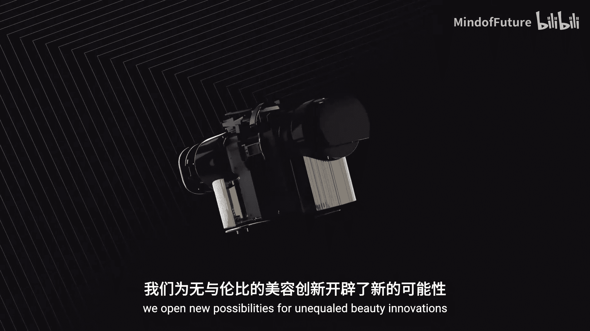

Beauty Tech is essential to empower consumers with elevated beauty experiences。

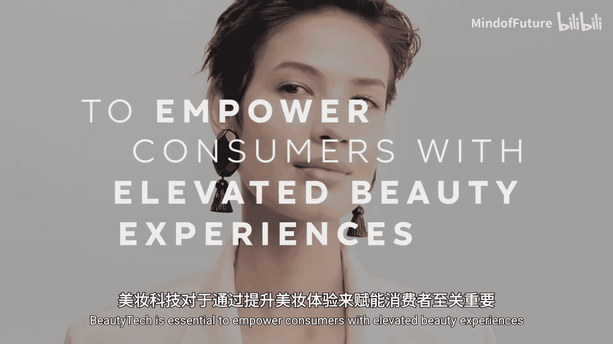

By imagining services that guide， diagnose， predict， treat， and coach。

 we build lifelong value for consumers。Beauty Tech is essential to augment beauty consumers' journeys。

By harnessing the power of tech， data， AI， and generative AI。

 we create new codes of beauty and new relationships between our brands and consumers。

Beauty for each。Powed by beautyuty Tech。Thank you very much。Ami。

 thank you so much for such an inspirational presentation。 Our if you don't mind。

 let's take a seat and。😊，You know， I thought what was absolutely amazing about what you shared with our audience is the 3D images of your products that you guys are creating and being able to use that across marketing and advertising and in partnership with your ad agency and creative agencies。

 right， so maybe you can elaborate a little bit more around that。😊，Yeah。

 it's true that we have 37 brands， global brands are 37， and we are innovation driven company。

 So there is a lot of offers that we give into the market with our products。

 So each of our brands have hundreds of SkuUs， which means that both in terms of communication and advertising。

 but also in social media and for our ecommerce-commerce activations。

 we need thousands of images all the time。 and we spent a lot of time shooting those images or reshooting them。

 What we experimented with the omnividia with the NviDdia omniverse was we we took the shot of the product once from all different angles。

And thenvoa， it was there。We could start changing the background。

 or we could start putting it in a different context。

 which was either more social or more ecommerce-comce friendly。

 And it would happen just with like one prompt or one type And that is saving so much time for us。

 I mean， we are at a very early stage。 But it's， it's like saving 200 to 300% time。

 And a bit of resources and money as well。 So it is definitely going to help us to scale production and meet the needs because there is so much content production need in marketing today that we are very excited。

 We are using a lot of different products into the omniverse for the the custom 3D models。😊。

And actually omniverse is I don't know how many of you were here at the 8 AM session。

 but so many different ways of using omniverse in the 3D world。

 right we talked this morning at 8 AM about digital twins of the store and we have customers that are using it for design collaboration across global design teams and of course you guys are creating this stunning 3D representation。

 really physically accurate digital representation of your products and being able to use it even in the metaverse which is even in the metaverse very。

 very early on， but it's an area that especially for the younger generation is a very important part of reaching your consumers。

 absolutely I mean I showed you some of the gaming visuals and we are very excited about creating makeup looks。

 hair looks for those avatars in the gaming world because Gen Z。Is very comfortable using it。

 And we are creating the visuals that you saw because our sense of purpose is to create the beauty that proves the world。

Wonderful， so I wanted to open up if there's any questions for anyone to， to ask。 I mean。

 I think what you saw， please come ahead。 There's two， two microphones here。 So go ahead。

So my question is like as the leader in the beauty industry， right。

 So will Louro come out come up with like an ethic standard for AI usage in the industry。Yeah。

 you saying have we come out with our AI usage standard。Yeah， so I I touched upon it briefly。

 we have been thinking about this subject a lot。 Yeah， and therefore。

 what we said was that that beauty is something that we use on ourselves。 you know。

 and it is something that enhances us as people， men and women。 And that's why with our CEO。

 we took the decision that we are not going use AI generated lifelike faces or lifelike hair or skin or body to。

 to enhance the product benefits。 So you， you won't put an AI image of a man or a woman and say。

 look， your skin is so much better。That would mean that you're enhancing a product benefit on something that is not real。

 whereas we would want to show that no your product benefit is on someone and that someone who is real and lifelike and you can identify with。

 So that is the position that we have taken as a leader in beauty。

 what we are very excited about is all the product shots that we showed to you。

 But we are also interested to towards im to imagine the new codes of beauty for tomorrow。

 And one of the examples I took was the year 2050 and beauty during mobility。 What does it mean。

 So we clearly know that there is no product usage there， And you are not enhancing any benefit。

 but youre simply imagining。 Even the imaginary AI spokesperson in the red Nebula。

 I thought that was very inspiring because it's a vision of beauty that you think about。

 and you use technology to spark it to imagine it。😊，Absolutely。Thanks。对。Now， she's just watching us。

 Yes， I have a question on your product visualization shots that you're doing with generative AI。

 So are you training your own generative AI models with the imagery that you're creating of the product shots。

 or are you doing generative AI backgrounds and then compositing 3D imagery into those both Okay。

 we are doing both yeah so so I mean， today， and you will see some of the images when you do the 3D custom model。

 you have shot the product and you have all angles of the product。

 And therefore you can use that product basis and use a background。

 Sometimes when we are doing internal storyboarding， it doesn't matter。

 we can simply use the product shot through generative AI。

 And then most of these images that I showed would be that theres a background and theres a product shot that we have given to the model and trained it and we are using from there。

 But we are thinking about how this would evolve。 And one of the。

It could evolve through the omnivo actually yeah， so actually just to help you better understand。

 we have a model called Edfi from Nvidia that Getty images has trained with over 200 million of their license images and so a lot of our customers are subscribing to that in using Picasso It's called Picasso and it's a subscription through Getty that that basically is the background images right so you can basically show a bottle of perfume and say show me the bottle of perfume with the background of the Eiffel Tower an Italian cafe and all of that。

 And it can create that in less than 10 seconds。 So it's basically I think what as mediada talked about is some of it is automation And some of it is enhancing creative creativity。

Yeah， absolutely。 and the third thing。 And I'm kind of repeating myself。

 But the third thing is when you are using， you have to understand that the marketing processes today are very complex。

 You know， so we are constantly the marketers are talking to their to their managers or they are talking to the agencies and there's a lot of back and forth happening。

 And that back and forth and visualization used to take a lot of time。 So today。

 when you do storyboarding， which means it's not an image for external use。

 But it's simply an image for internal creative process。

 there we can absolutely say use the rev lift bottle in a rainy weather and put it out there。

 And once we are doing the final shot of production， we can design that， you know。

 is with the background and where is the product shot。

 But the time and effort is saved in that internal。Thank you so much。I have an online question。

 and the question goes， how is Lareel ensuring the mitigation of inherent biases within AI models。

 particularly in the creation of diverse and inclusive beauty standards。Yeah。

So we have been working on AI per se， not just generative AI for a few years now。 you know。

 we have created skin diagnosis and a lot of devices on beauty and through all of this it is true that we have a responsible AI framework So I'm starting with that。

 and that responsible AI framework has seven principles and those principles include things like that we will never。

 ever use an algorithm unless there is a human oversight on it。

 we will make sure that whatever data we are inputting into it like our skin diagnosis tool uses more than 15000 images from all over the world。

 So it is trained on a level of inclusivity and diversity that is there。 So we publish it。

 It is on our website。 It's a very public document。

 our responsible AI framework and that's I mean we want to we want to make sure that any steps we take on this is using a sense。

Of responsible framework towards the whole thing。 And which is why also， Isabel Gni is our， you know。

 kind of lead on generative AI globally。 She is also working with a lot of industry corporate players to come together and say。

 how should we start thinking about this subject and how should we build this together， You know， So。

 so we are just working with everybody。Hi， thanks。 I had a question about the efficiencies you're realizing in content creation and。

In your creative department，1，1 product I hadn't heard mentioned was。Adobe。

 and I'm sure that you use that quite a bit。I'm curious how efficiencies。Have arisen with。So we。

 we are working with the 20 different Geni tech， and we are meeting Adobe tomorrow for half a day。

 You know， so I think I have a better answer with Adobe tomorrow， but we are working with Adobe。

 I think in terms of efficiency， again， the the journey is a 12 month old。 Yeah。

 so before we kind of。Claim things， you know， which are true in general for a very large corporate of 85 to 90000 people。

 We are in a test and learn phase。 We are in a controlled experimentation phase today。

 And in that controlled experimentation phase。 we do realize that we are saving time。

 we are saving almost 200 to 300% time in generating these product images。

 And then you can assume that time is money。 So， you know， we。

 but we have to think about service models and scalable models of adoption for our company overall in the coming six months to say。

 how are we scaling everything。Thank you。Go ahead so my。

 my question was actually a follow up to that， which is this controlled experiment you're running right now with generative AI。

You know， what percentage of your content roughly are you。Enabling through AI or generative AI。Soあ。

I mentioned that that in the Cat tech lab， we have， you know。

 generated 800 plus images over the last six months。 We have， of course， in our countries and zones。

 some product detail pages on e-commerce that we are working on with our partners。

 So there would be thousands of images there， let's say。

 but still the number is today in a few thousand， whereas if you look at our assets。

We have hundreds of thousands of us set every year， you know， because we， we。

 we produce a lot of content。 So the percentage is in therefore in a controlled experimentation phase today。

And we are very optimistic。 That's again， it's it's at the cost of repeating。

 I'm saying that we have to think about what is the model of scaled adoption， You know。

 and that model of scaled adoption will need brand data sets， We need tech modularity。

 Well need technology architecture， and which is why we are here at the Nvidia GTC conference。

 because we want to learn and say， what do we do next， So hopefully next three days。

 and we will know exactly where we are going。Thank you。 We'll take one last question， sure。

For this inspiring presentation， mostly you talked about marketing and content generations。

 Have you experimented with AI Gen AI and product， new products。

 So have you thought about like new chemicals， new packages， that sort of stuff。So again。

 I'm looking at Isabel， who is our head of generative AI for Lareal Group。

 and it is true that we are beginning to think of the subject for research and innovation。

AI can AI in general， helps in e formulation。You know， in。

 in understanding different hair types and it understands it much faster。 Yeah。

 so there are different use cases there。 One use case is simply to understand diverse hair types or diverse skin types。

 which a person， a human scientist， will take a certain amount of time to do it。

 but the AI can do it much faster。And then it helps on e formulation。

 And I think our RI teams are working on those use cases。 I invite you to talk to Isabel right after。

So just to correct， it's not about a new products。 It's about maybe the personalized products。No。

 it's about new products as well。Take one last one。

I'm curious with the this first year and the control experiment side of it。

 What is maybe the biggest surprise。With positive， negative， he might have come across。I you know。

 a lot of us， you know， of course， Lo'real is a strong creative company。

 They are very good marketers in our company。 And what I find fascinating is how creativity in technologies coming closer together。

 how we need a new generation of marketers who will be as apt in using the left brain and the right brain as apt in doing data sets for their brands versus thinking creatively about their what their brand values and brand proposition should be。

 So I feel this opens a great opportunity in in in kind of training and creating and having a new generation of marketers for tomorrow。

😊，Well， asmi， thank you so much。 It's been such a wonderful session and very， very inspirational。

 So thank you for your time and look forward to having further discussions throughout the conference。

 Look forward to the next three days。 Thank you， everybody。 Thank you。😊。

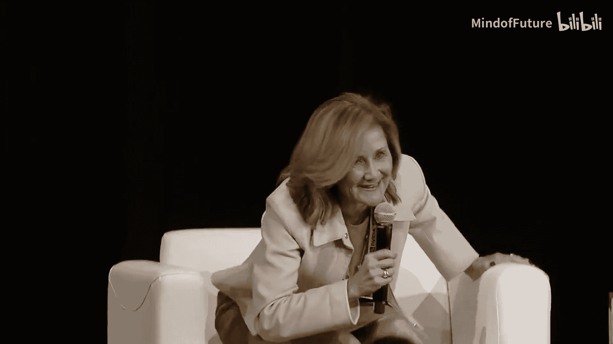

