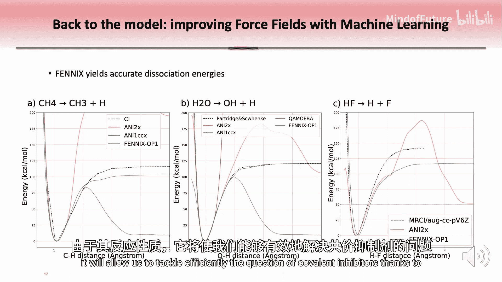
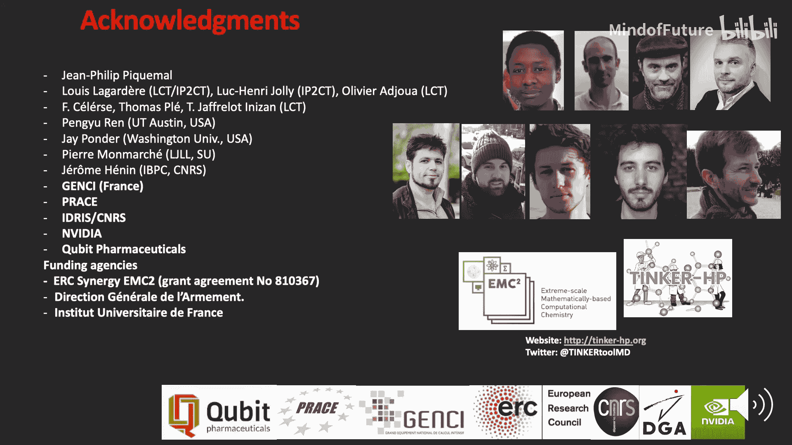

# 【英伟达GTC人工智能大会 • 中英】NVIDIA GTC 2024 p12 P12 Accelerating Drug Discovery by Combining Quantum-Based Models w  Machine Lea -BV1yHAeeqECP_p12-

Hello， I am Willa Gar from So University， and I will be showing you today how quantum based models in the context of molecular simulations can accelerate drug discovery and how machine learning approaches can be used in that framework to further accelerate this intrinsicly complex problem First。

 somewhere words about molecular simulations and about the world in a drug discovery context in molecular simulations we make systems of atoms move through an interaction potential and the application of Newton's laws。

 What that means in practice is that this interaction potential。

 the model that we use to represent the interaction between atoms is crucial and the quality of the results of any simulation will depend on the accuracy of this model in the context of drug discovery we want to find small molecules that binds to a macromolecular target of interest This can be a protein or RNA for example。

 and we need this binding to happen in such a way that。

They inhibit their function in practice。 We need to find a zone of interest in the target。

 a druggable pocket where such a small molecule could bind。

 and then to model this binding process to do so because of the complexity and the dynamical nature of these systems。

 We need to resort to highly accurate models to be able to be predictive。

 We can draw a parallel between what I just described and the landing of a space probe to the irregular surface of an asteroid as represented in this slide。

 Finally， a highly accurate model is not enough by itself。😊。

Because we also needed to extensively sample conforms of the target alone to find targetable pockets and the relative movements of the target and the smaller molecule to gain significant insight about the binding。

 That means that we need highper implementations of these models to be able to use them in a practical drug discovery framework。

 Now， some informations about the new generation molecular models that we have been working on。

 We know that the ground truth would require a quantum description of all the atoms and electrons of the molecules we are dealing with。

 but for meaningful systems， it is way too expensive computationally。

 So we need to make some approximations。 Traly， for the last decades。

 people have used tube body pairwise models to represent all the interactions and especially the orthosttic ones。

 but in practice， we need to include anotroppy。 and also some kind of response to a change in the environment。

Which is typically what quantum mechanics would yield to do so。

 We include a multipolar description of the density of charge of our molecules。

 This gives us anotroppy， and we include many body polarization to represent the electronic mobility of our system when it changes of conform。

 So what would these more accurate models Give us in terms of properties of interest。

 Here are a list of things that would become。Possible in this context， First， we can deal with small。

 subtle， energeticical difference of the complex biosystems because of our accurate description of all and potentially weak interactions。

 Then this gives us access to the computation of free energies of binding useful for drug design。

 And I will come back to that a little bit later。 Also， it means that we can model metals。

 including having ones， and also ionic liquids that play a pivotal role in modern batteries because of the inclusion of mini body polarization effects。

 Also， and I won't develop that too much。 but just note that when coupled to a purely QM description of a subversionion of the system。

 this new generation of models yield accurate liquid phase speccoscopy and high of complex spec。

 Remember that in practice， we need massive sampling and not only high resolution。

 This is where highper computing comes into play。 and this has been our focus for the past years。😊。

To give you some historical context，10 years ago， no real high performance implementation of palizable models existed。

 And the most popular code handling this tininker was only accelerated through a shared memory Paralyism through open MP P directives。

 which was not enough to tackle real life problems。

 Then we spent a lot of time and energy to start from this popular and well designed code。 Tinker。

 to develop a high performance version of it that we called tininker H P。😊。

But because of the complexity of the algorithms involved in the resolution of these more complex equations。

 we had to rethink fundamental aspects of the code in its structure。

 and we had to design specific approaches to be able to reach scalable simulations。

These are described in this chemical science paper from 2018。In practice。

 we started with an MP based CPU implementation in Fortran in double precision。

 being able to scale on tens of thousands， of course on large enough systems。

 but also being able to scale on smaller clusters， such as the ones typically present in academic labs。

 So we were betterscale ready。 But with the advent of modern GPus， especially the ones from Nvidia。

 we knew that we could gain considerable performance by leveraging these platforms。

This is why we developed a specific version of our Tinker HP code dedicated to the use of potentially multiple NviDdia GPUs。

This work was mainly done by Oliv Ajuis， who also works at Soburn。Here also。

 specific algorithmic developments and adjustments had to be made in order to fit the specificities of GPUus with with the special care given to precision。

 all the more， since we need to solve the many body polarization equations through an it procedure that is really sensitive to precision。

😊，We published a paper describing all of these specifics in the Journal of Cheical theory and Comput in 2021。

Okay， just a few words about the GPU implementation itself。We have two different GPU implementations。

The first and the one we started with completely relies on an open ACC portage。

Open ACC directives are used to both transfer the data between the CPU host and the GP device。

 and also to run the computationally intensive channelss and NviDdia GPus。

We use this implementation to run double precision simulations。

 taking advantage of both V100 and A100 HPC cards。 The second one still results to open ACC directives to handle data transfer between the GP and the host。

 but uses heavily optimized coa kernels to further gain performance。

 this implementation is used in what is called in the context of molecular dynamics。

 mixed precision mode that is to say that the energy and the false kernels that are the most computational intensive use single precision but that the data is then accumulated in double precision。

 thus yield an optimal balance between performance and precision。

 a key feature of both this implementation is that almost all operations are uploaded on the GPus。

 thus limiting synchronization between the CPU and the GP。 Furthermore。

 the multiple GPU implementation follows the same 3D domain decomposition logic of the。

And we make sure that the data transfer happen directly between GPUus through Quda Aware and P library。

 Now， some practical benchmarks with systems of representative sizes from the well-known DHFR benchmark that is made of a little bit more than 20000 atoms to larger pot systems such as the main potase of Saskovv 2 in solution which contains around 100000 atoms and up to much larger multimillion atom systems such as what we have called the C system that contains more than 7 million atoms。

 All these benchmarks have been run on the Gen supercomputer Gen C in France and on the Cline supercomputer of Nvidia。

The Cin superior computer of Nvidia is made of DGx a100 linked together In practice。

 within each of these Dgx A1008 a100 cars are efficiently linked together through the N switch technology to further improve memory distribution and minimize that exchange between the GPus。

 will resort to the NvSH ma library。 All in all， we observe the best performance ever obtained both on GPus and CPUus on all of these systems for this kind of models。

 that is to say that we have more than 14 nanoseconds per day of production for the DHF system。

 more than 4 nanoseconds per day on the well-known STMV system that is made of more than 1 million atoms and almost1 nanoseconds per day for the C system that I mentioned little bit before。

 What we see is that for the smaller systems， there is no real gain of using more than one GPU which is expected given the amount of computer of computer power。

That one GP alone already contains。 But by growing the system size。

 we see that starting from systems of around 200000 atoms。

 there is an interest of using several GPus， and then there is a significant gain for the larger systems。

 This gain depending on the system size， is more clearly illustrated in this figure that shows in a loggaithmic scale。

 the performance gain from  one to 8 GPus on the c supercomp for all of these systems。

To sum things up about tininker HPp and insufficient multi GPpU implementation。

 we see that for the STMV system that is represented here and that is made， as I mentioned before。

 of around 1 million atoms。 We reached an acceleration of a factor around 6000 from the original tinker openmp implementation on8PU curve to the multiple GPU coai implementation。

 It means that it has dramatically opened the field of potential applications of the new generation polariz models and this is what I'm going to talk about in the rest of this presentation。

 One of the main application that I want to focus on now。

 is the prediction of binding affinity of small molecules to a macromole target in a drug discovery project a welldefined target。

 for example， protein is chosen， and then the goal is to find a small molecule that binds to it in such a manner that it alters its function。

 typically pharmaceuticals companies rely on high throughput screening of。

known compounds to get initial hits molecules。 and then on a large number of synthesis to optimize such hits。

 This is why being able to reliably predict the actual binding affinity of small molecules to targets is extremely appealing in the context of drug discovery because numerical simulations could drastically reduce the number of this synthesis of drugards candidates to be made and thus reduce the time and money spent on such projects。

 But what does that mean in practice in practice， we want to compute the free energy difference between the bound state where the lid or small molecule lies in the binding pocket of the host as presented here in this slide and the unbound state where both the small molecule and the host are in the bulk in solution without interacting between each other rather than sampling explicitly this binding and unbin process。

 what is routinely used nowadays are the so-called alchemical methods where。😊。

The small molecule is first gradually decoupled from the host by scaling down progressively its interactions with it。

 and then separately， we compute the free energy of decoupling the ligon from the bulk in a similar fashion。

 And finally， because free energy is a state function。

 we can then recover on the free energy of interest from the thermodynamical cycle as are here in this slide without going into the details of how simulations are run to recover these quantities in practice。

 let's just say that it requires numerous and long molecular dynamics traject is。

 hence the key importance of a high performance code。 In practice。

 many benchmarks of representative host gas systems have been run in the past few years through the blind sample challenges where academic groups try to reproduce blindly experimental binding affinities of small molecules to larger host the polarizable and multiple amibba model has repeatedly performed really well on these challenges。

 as you can see on the slide here。That represents the results of the sample challenge of last year。

 It concerns the binding of several small molecules to the host system that is shown here on the left On the right。

 you can see the correlation between the computed binding affinities with this highly accurate model and the experimental ones and you can also see that they are in agreement within one kilocal per for almost all of them which constitutes state of the art performance。

 So this shows how the highper implementation of new generation models can help in a practice in in a drug discovery project Now let's go back to the model itself as we saw that it drives the quality of all the molecular simulations。

 What we know is that even with the advanced polarizable models。

 we still lack some key quantum effects that happen at chart range Another limitation of the models that are presented before is that they are by nature non-reactive。

 We also know that they are now welldes and well curated data sets of quantum mechanical data that enable the development of machine learning。

Interction potentials in which all the interacting interactions are described with machine learning methods without going into the details。

 Let me just mention that in general， such models leverage a short range descriptor of the local environment of each atom。

 which is then given to another network to predict the energies。 What that means in practice。

 is that these models are in general slower than polarizable forces。

 but as they are intrinsically short range， they are scalable， as you can see here on this slide。

 These models are implemented in Tkerhp through the deepH platform that is described in a chemical science paper that we published last year。

 so these models perform well in many cases， but by design。

 they like in general long range effects for which the physics is well known， for example。

 we know that electrostatics at long range follows k low。

 This led us to looking at ways to combine machine learning approaches at short range and physicsbased ones at long range。

 and for that we follow two different routes。 The first idea is to use a nonbedding schemechema。

Similar as what is done in mixed quantum mechanical molecular mechanics methods。

 where the interactions within the system of interest are treated with the machine learning potential and the rest of the interactions are treated with the polarizable pho field。

 The second idea is more complex。 we use machine learning models to predict atomic properties such as the charges volumes and so on that will thus deepen on the environment and that we use within a classical functional form with current potential v interactions and so on。

 This is what we have called the Phoenix equivalent approach。

 Phoenix stands for fossilph enhanced neural network interactions。

 and we published this recently in chemical science。

 One of what really nice feature of Phoenix is that it is reactive。 Now。

 let's look at practical results that we obtain with both approaches on this slide you can see bending affinity results obtained with both the ammiba polarizable pho alone in yellow and by combining the any machine learning model and either wellknown machine learning model with ammiba through the onbeing。

I just described。 we see that by including the machine learning model at chart rangech。

 we managed to improve the overall results， especially for some systems。

 We go in practice from a woodbin square error of 1。

81 kilocal per to one of a little bit less than one kilocal polymer。

 So we reduce the error by around the factor of2。 And finally。

 one results that illustrate the reactive nature of the Phoenix approach。

 you can see here several dissociation curves where we make one atom of molecule leaves in equilibrium position here we have three molecules we have C4 water and H we can see that the state of the Earth any2 x model by itself gives and physical results。

 whereas the Phoenix ones are much closer to reference values that are shown in the dotted curves。

 We are currently actively working on enriching the Phoenix models by incorporating additional energy terms to it such as explicit polarization and charge transfer。

 the Phoenix approach is really promising as it naturally leverages the strength of machine learning methods to handle the complex interactions at chart Rach and。

😊，Proousness of the physicsbased long range actions。 All in all。

 I am convinced that with the ever increasing compute power and the always richer data sets of QM data。

 Fix will bring critical additional insight in drug discoverover。 For example。

 it will allow us to tackle efficiently， the question of covenant inhibitors thanks to its active nature to conclude。

 I want to thank all the people and institutions that have contributed to the results that I have been showing today。

 There are people， of course， from Southern University today。

 but also from the US and from a company that I have confounded with people from France and the United States。

 which is calledqubit pharmaceuticalaces， and that leverage routinely all of these tools to find new drugs。

 I thank you all for your attention。😊。

