# 【英伟达GTC人工智能大会 • 中英】NVIDIA GTC 2024 p13 P13 Mistral AI - Frontier AI in Your Hands -BV1yHAeeqECP_p13-

Now let's get started with our session。 We'll have time at the end of the session for a few questions。

 You're welcome to submit questions via the mobile app。

The session catalog or you'll be able to ask at one of the microphones in the aisle at the end。

Please welcome Arthur Minch。 Arthur is CEO of Mistrral AI。

 which trains state of the art generative models with a strong emphasis on customization and control。

 He'll be speaking to us today about lessons learned while training their first models。

 Mistrel and Miel and give us a glimpse of the year ahead as well。 welcome Arthur。It it walking。

 So yeah， good in the afternoon， everyone。 So I' CEO you of Miss Taai。

 and I'll effectively give you a bit of the overview of what we've built so far and also where we're coming from。

😊，嗯。If that goes， but before I actually present like the company and where we are differentiating and the kind of models that we intend to build and that we have already built。

 I wanted to give like a couple of。Like our vision of what happened in the last two years in four language models and how that evolved in between。

 I guess GT3 20202019 to where we're standing today with。

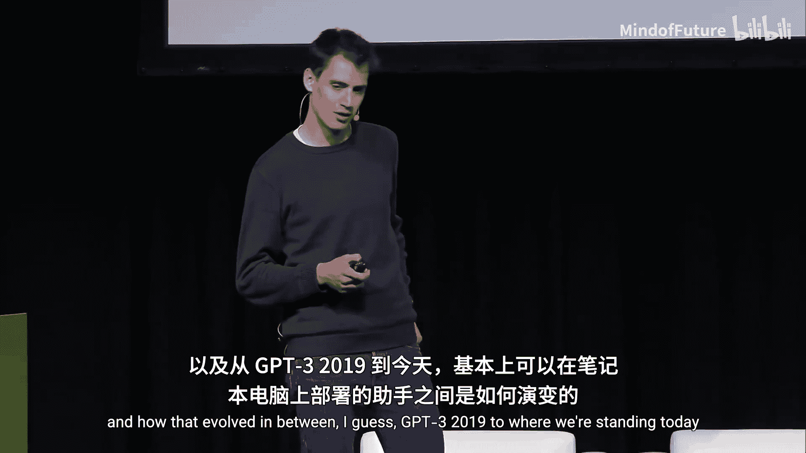

Basically， assistance that can be deployed on laptops。 And so。I will try to， yeah。

 explain how I saw it unfold and because I think it's， it's a pretty interesting story。

So if you look at。Basically， what kind of LLM you could tame into a useful assistant， which is。

If you， as a scientist， you can say that it needs to be higher than 60% on MMMLU。

 that's typically be below that。 it's， it's not useful enough。

 and it's a bit frustrating  beyond that， you start to be interacting with like an assistant or a companion。

 which is good enough and clever enough。

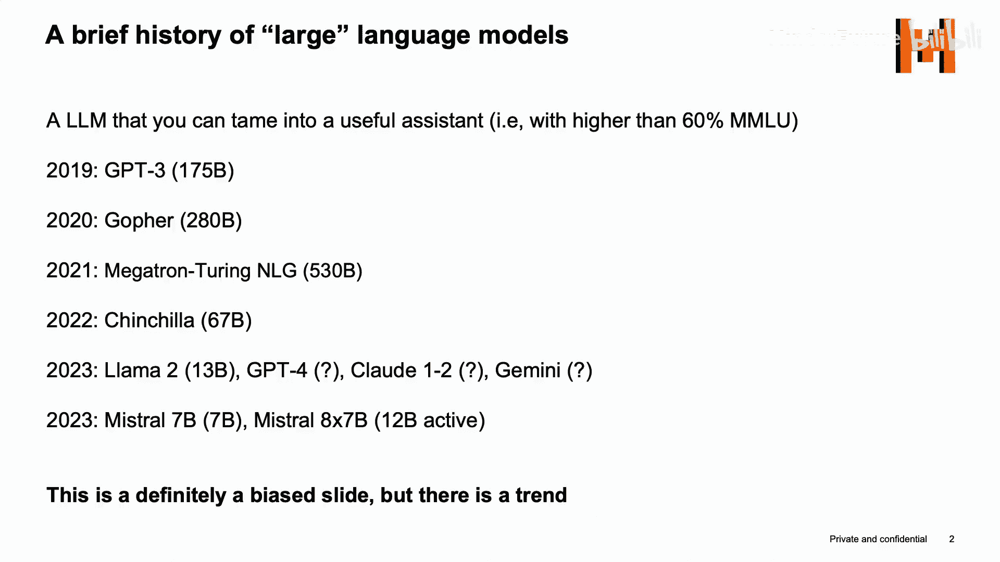

Well， if you try and look at the， the sizes of the model that。

That we saw matching this kind of performance。 Well， in 2019， actually， G3 wasn't。

 wasn't that 60% MM M U， but it was good enough， not far away。

 I was at the time in 2020 at deep Min where we did a paper called gopher。

 which was actually bigger and that actually reached the 60% M U threshold。

 And then then NviDdia was at the time in 2020 there was somehow raised making bigger and bigger models with all of the infrastructure challenges that was that were associated to it。

 you had to dofin， you had to do tens of parallel parallel parallelism in basically every directions。

 And we went to a point where I think that was NviD that released this 530 billion model。

 And then suddenly in 2022。 we like the same kind of performance was achieved by a model which was much。

 much smaller。 And and I'll explain how we actually get got to that。

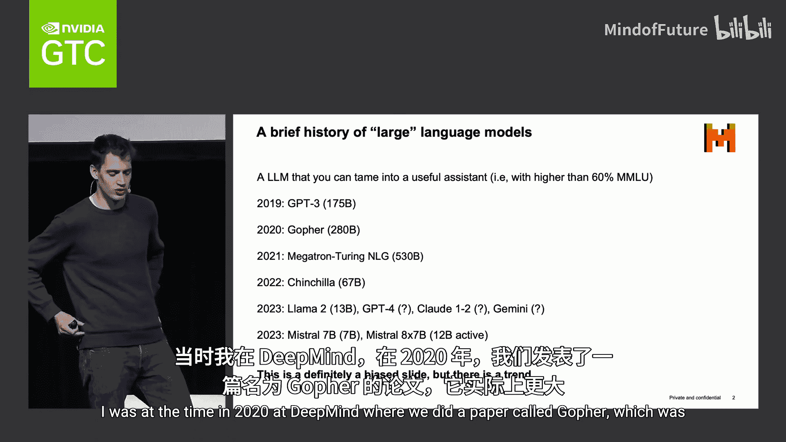

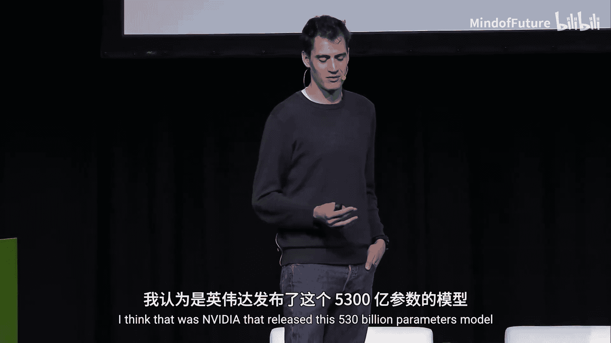

So that was a deep mind。 And so at that point in time。

 I think there was a realisation that we didn't need to go to have very big models and that it was probably not such a great idea。

 And if you look at what happened so in 2022， you hadG that happened。 very close， very linked。

 I guess， to the fact that。

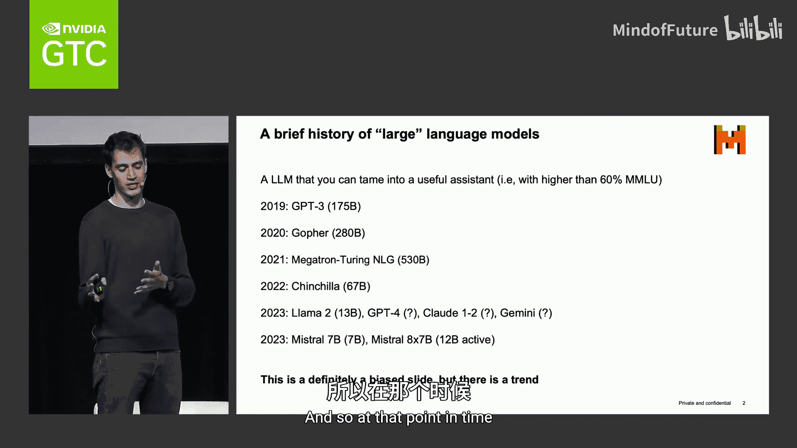

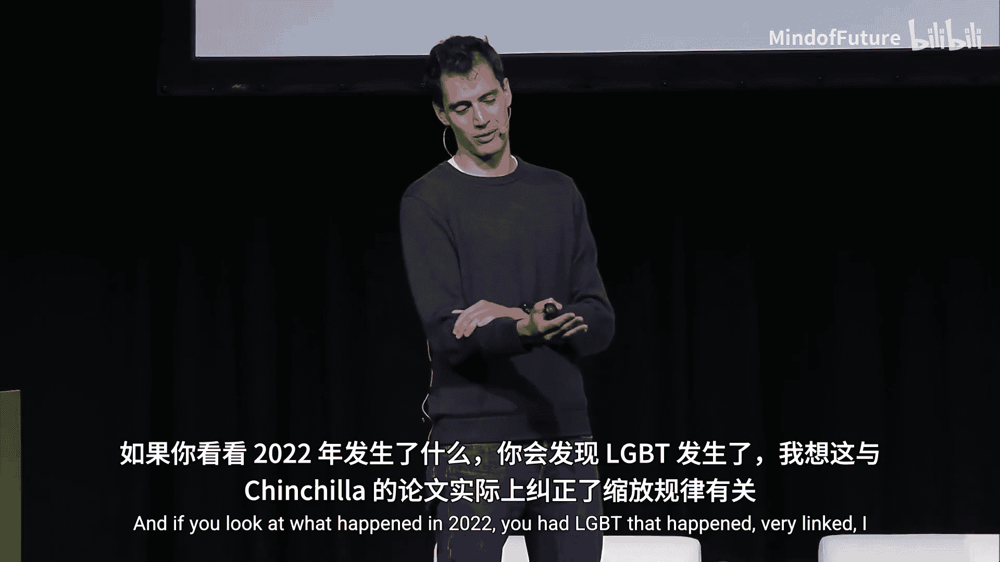

Chincha paper actually corrected the scaling those。

And then we kind of continued in that direction in 2023 with Lama Lama2 from Guom Timma coers。

 many people at Miss T today。 at that point， you see like this interrogation marks that basically says that the field entered into some form of opacity and the technology at use by well。

 in the technology used by the different providers。

 And this is something that kind of kickstarted Miss T and， the reason why we created it。

 And what we focused on is to try like the goal of Miss T at the beginning when we started the company was to get to 60% in M with with a model that could run on a laptop。

 And that's how we got to Miss T 7 B。 And so what's interesting there is that there's basically a factor of 40 in between like Gopher。

 which was the first model that achieved that performance and Miss T 7 B so。

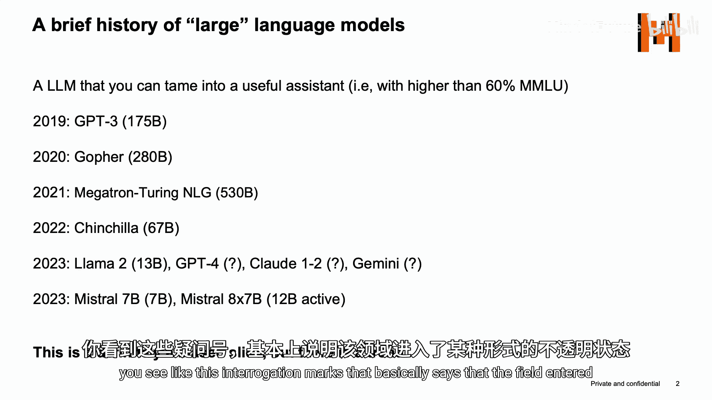

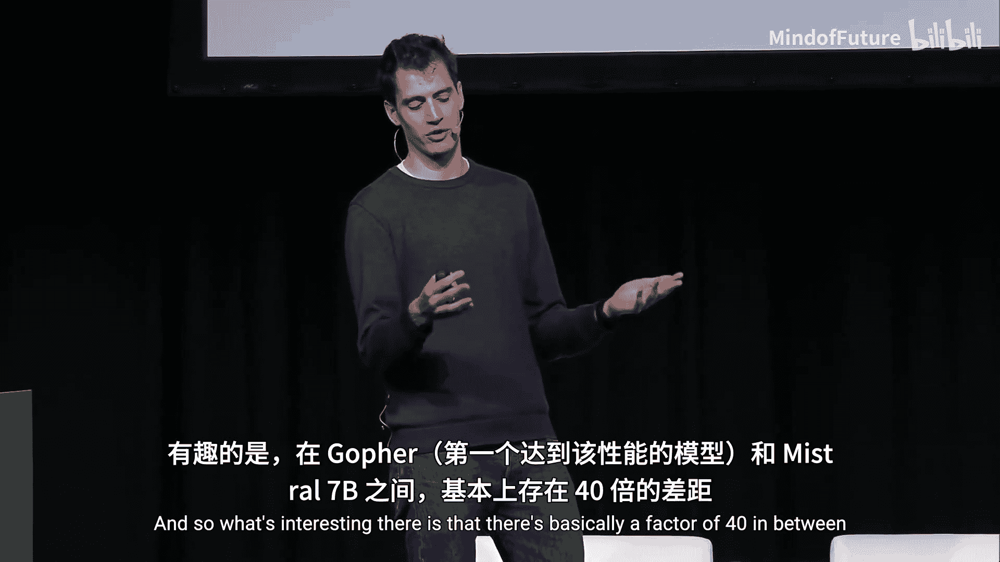

That that that's the that was the premise of how we started。

 And I think that I'll explain how that I believe this is opening a lot of avenues for like interesting applications。

 So it's kind of a bias slide because it ends with my T 7 B and this T 7 87 B。

 But there is a trend there。 And I'll try to explain exactly how。

 how that happened from a scientific perspective。

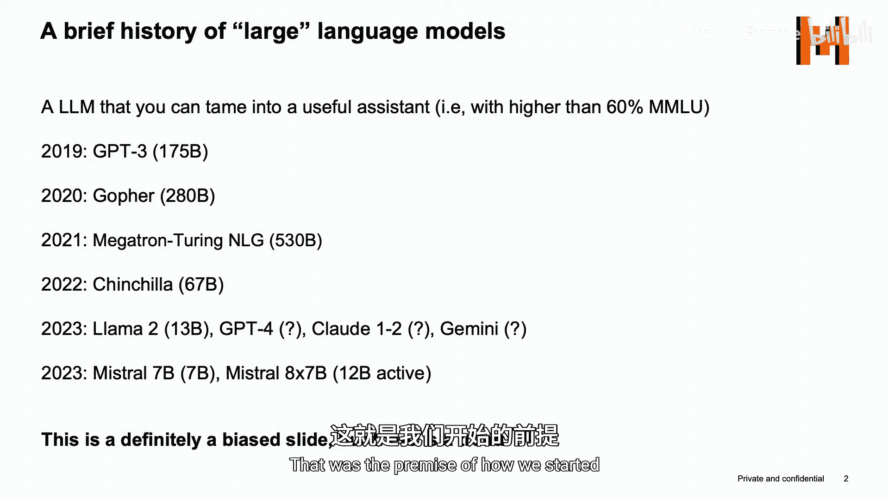

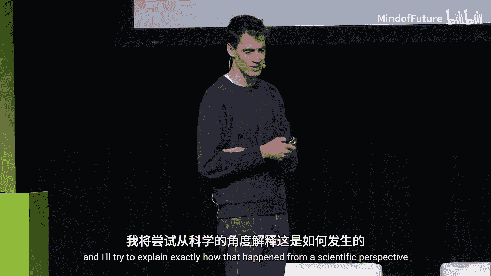

So in 2020， the trend was to make those models infinitefinly big。 And I guess the。

 the starting point for that was a paper from Kaplan and and L from 2020 that came with this conclusion that if you had。

 if you were doing like a 10 times training， if you had a 10 times training budget。

 So if you were to go from like one week to 10 weeks training of a a cluster， well。

 you should locate that to five times the model size and two times the data。 And as it turns out。

 the compute that you spend on。Is， is basically the multiplication of two factors。

 So the size of the model and the size of the data。 And the the conclusion of Kaplan was to say。

 well， if you go to infin， if you go to infinity， you need to have an infinity big model that is trained on an amount of data。

 which is much more。 So that this premise pushed like basically the entire field to train models that were bigger and bigger on the same amount of token which happened to be 300 billion tokens。

 So for two years everybody where we training models on 300 billion tokens。

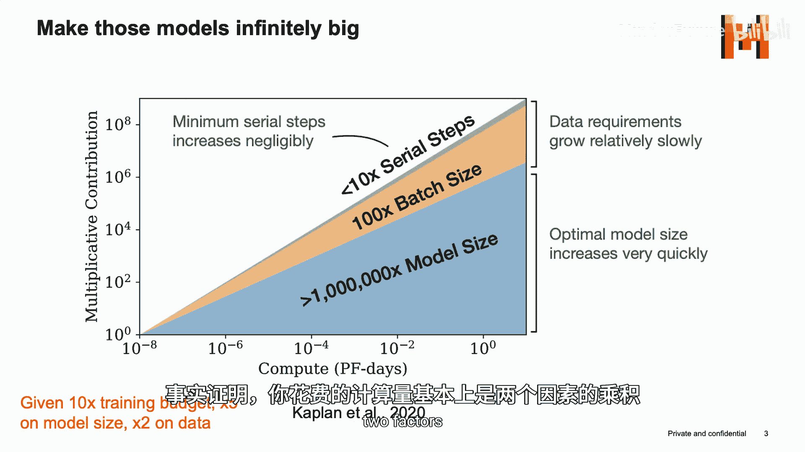

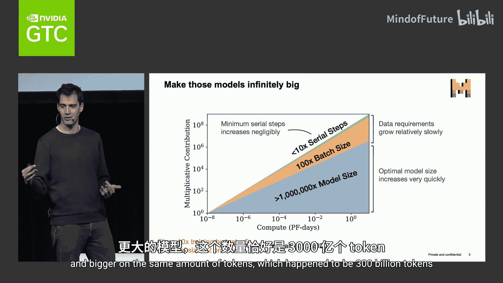

And the kind of， yeah， slow down the field a bit。 because at some point。

 if you train your model on 300 B to B token， you， you start saturating'cause you don't see enough token。

 start over， yeah， over。Overfitting your data set。 And so that was， that was a problem that we。

 we started to observe back in 20， at the end of 2021。And so we， we noticed this problem。

 And I guess the， the answer to this problem was you needed to train on more than 300 billion tokens。

 the， the way we approached the problem at the time was to say， okay， you have a certain compute。

 you have a certain compute budget。

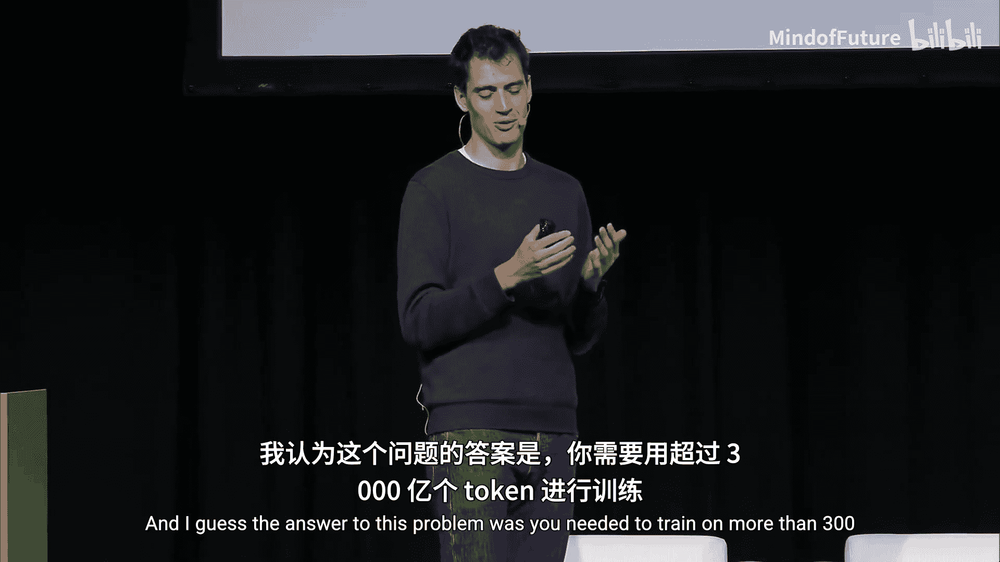

The compute budget is the number of parameters times the number of data points。

 And so how do you actually make the appropriate trade off in between scaling your compute。

 scaling the your model size and scaling the amount of data。And as it turns out， and it's。

 it's kind of obvious in insight， but it wasn't at the time。

 is that if you do have like a 10 time training budget。

 you should basically multitply by square root of 10 the model size and square root of 10 the data。

 And that's actually the only that's the only setting in which which doesn't explode when you go to infinity。

 So you， which that basically tells you that if you have an infinite amount of compute you should scale at the same speed size of the model。

 So the capacity of your representation and the amount of data points on which you train on。

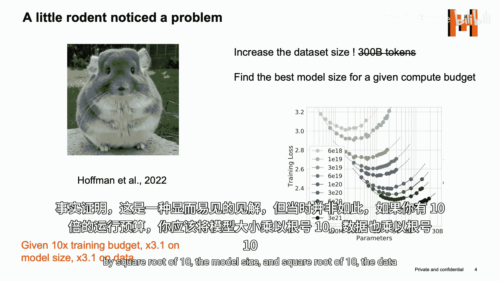

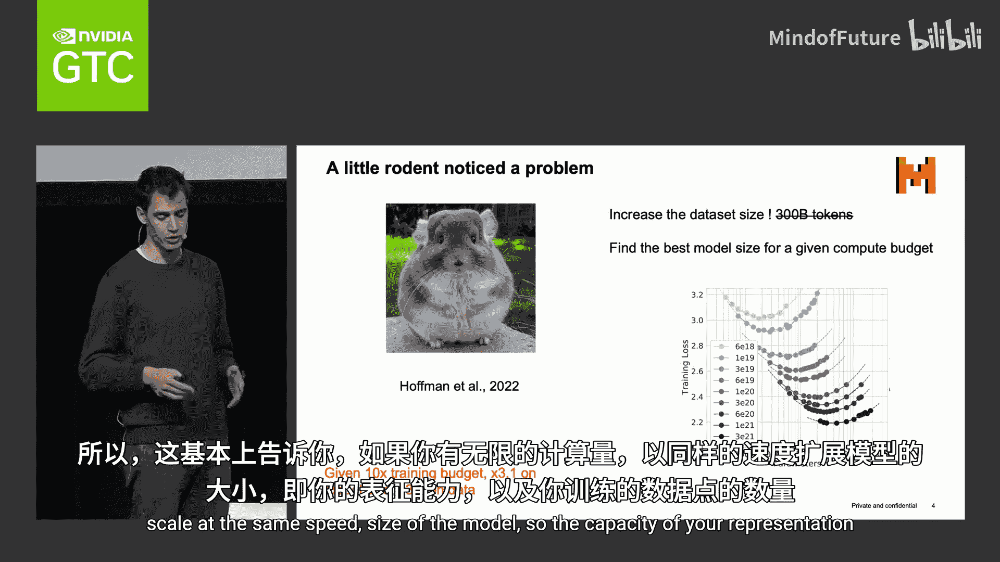

that means that your compression factor should somehow stay relatively constant。 And as it turns out。

 it's approximately like the optimal compression factor is around 30 w，30 tokens per parameter。

 So if you have a7 compute budget， whatever you do。

 and it kind of depends also on the quality of the data。 But your。

 you need to run at 30 tokens per parameter。 So that， that was a a good insight。

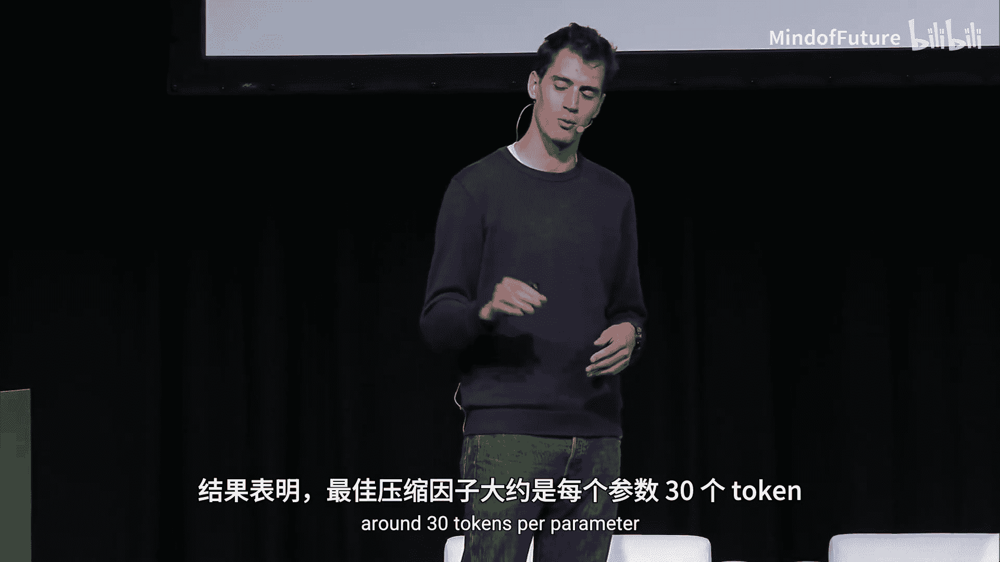

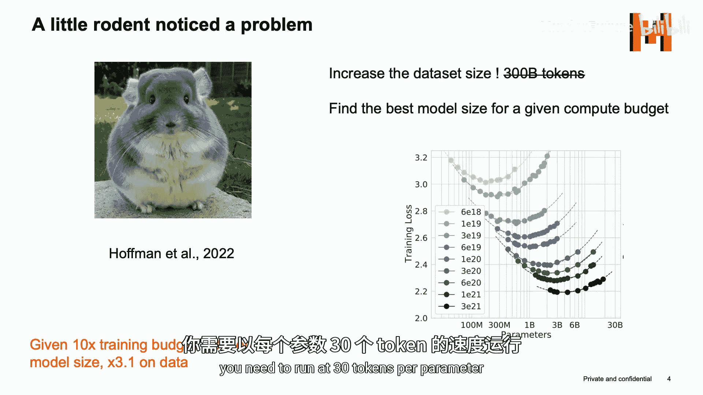

And， but somehow， it also like directed the field where like a bad bad representation where everybody started to think that models should be Chin of TL。

 That was a term coin， I guess， on Twitter。 And except that if you。

 if you're chininil Tl with a 7 B model parameter model you。

 you're basically training on 200 billion tokens。 And you。

 the model that you end up with is like a Chancellorve on MMOU。 and it doesn't work at all。 So like。

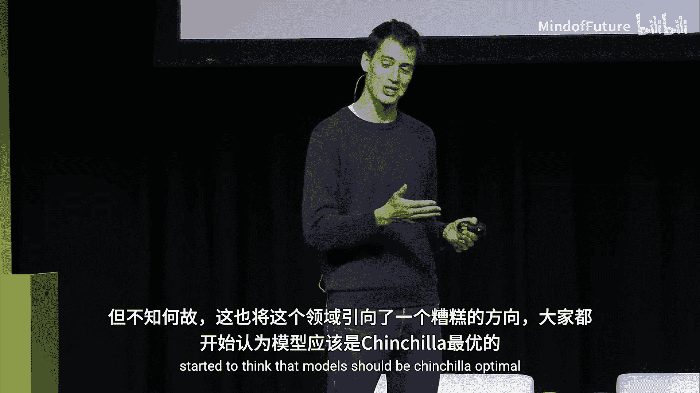

This is compute optimality is is not great。 Training compute optimality is not great if you wanna make models that are that can run on laptops。

 And so I think something that then like like approximately  eight months later， there was the。

 the Lamma paper， the Lamma format metata that actually showed， I guess。😊，Some people knew it before。

 but that showed to the world that you should actually train your model probably more if if the model was was small。

 So Lama 7 B was probably the first 7b model to be decent and to have a good performance And the reason why it was is that it was trained like three times more than the compute of regime that Chinilla was advocating for。

 And so I guess what it was saying is that if you have a 10 times training budget。

 you should consider your inference budget。 when you make your choices in terms of architecture。

 So if you only consider your training budget， then you should be training something well。

 that gives you like 3032ken。 But if you， if you take into account the fact that you're going to deploy your model many GP well you should try and make your model smaller。

 So you the more your train moreken you see during training。

 the smaller the model can be for the same kind of performance。

 So you you invest some compute training time to。

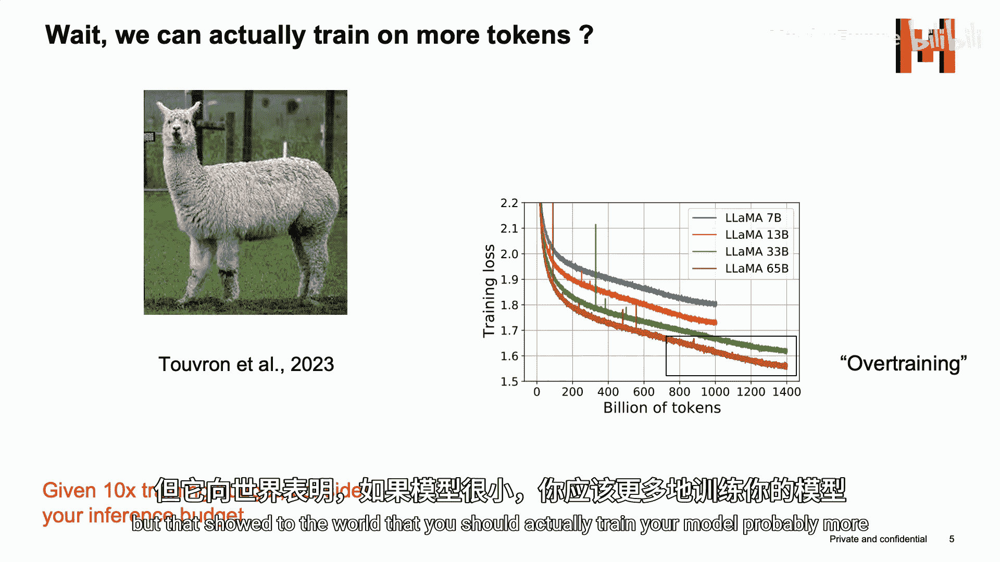

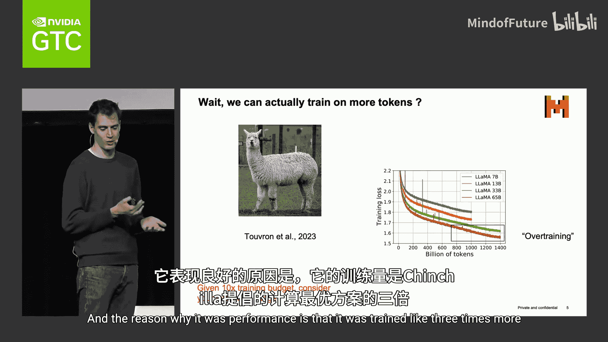

your model more。 And that's， I guess one part of the recipe that we apply to get to to Miss 7 B。

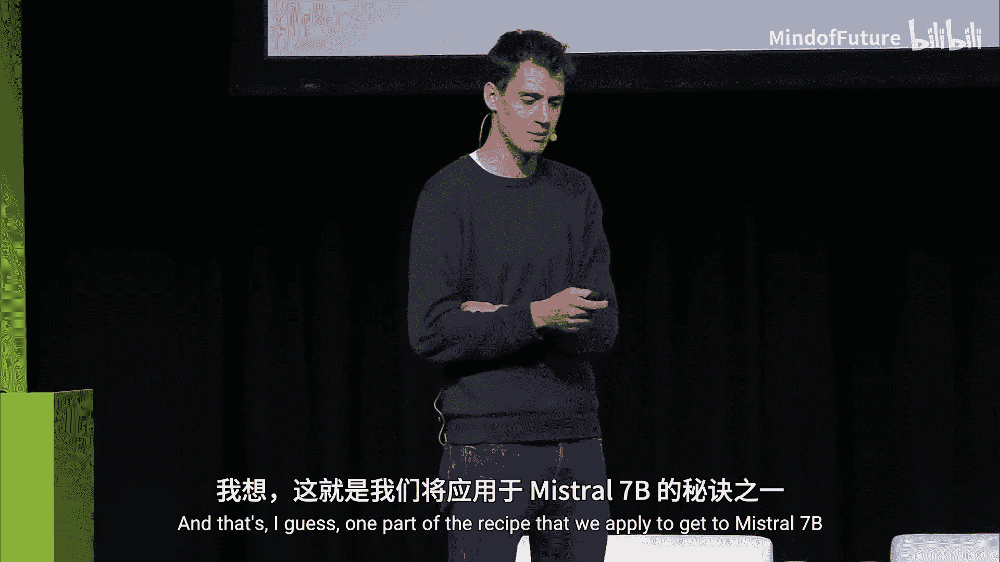

And so in that sense， I think it's， it's useful to consider this kind of graph where you compare the model size to the amount of training flos that you should be applying。

 And here what you see， the line con。The like a single line is basically points that have the same loss。

 and the loss is indicative of the performance。And what we call Chincha Timmal at the time is。

 is the basically the， the point where you have a noise on tell。Well， you have the， sorry。

 the point where you have a horizontal on tangent。 and these were like the chinchi optimal。Models。

 and then if you， if you say that， okay， I have this model， but I would like to make it smallerer。

 And so I want my model to be。The same loss as the red point。 But I want to be smaller。

 I'm going to pay more and more compute。 as you move from on the way axis there。

 you're paying more compute。 you're paying more dollar to your cloud provider or or you're buying more GPus。

 And at the end of the day here you can make like a very strong improvement。

 You can move from something which is100 billion parameter to something that is approximately 10 billion parameter。

 So this， that's a cost of compression there。 And I think that's。

 that's a very interesting phenomenon。 And it's very predictable in the sense。 you can measure it。

 You can， you can measure it empirically。 And that's I think that's a very important graph because that sets the economics of this period basically you need to invest a certain amount of compute to get to certain size a certain compression level。

 And that's that's what you should be optimizing for when you're when you're running a financial mobile company。

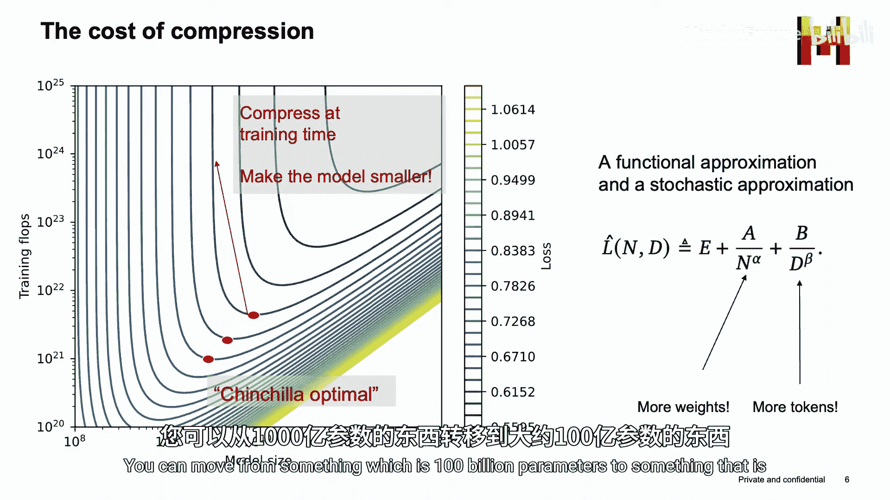

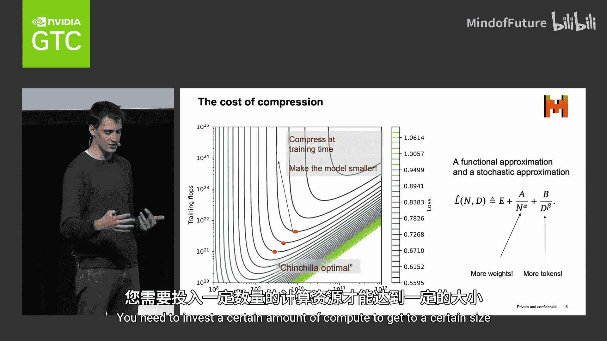

And so I think the， the， the， like for the mathematician in the room。

 the last here is basically defined by like a certain term that you can't get Oh under。

 which is called the natural entropy of the text。 And then you have two terms。

 You have a term that depends on the。

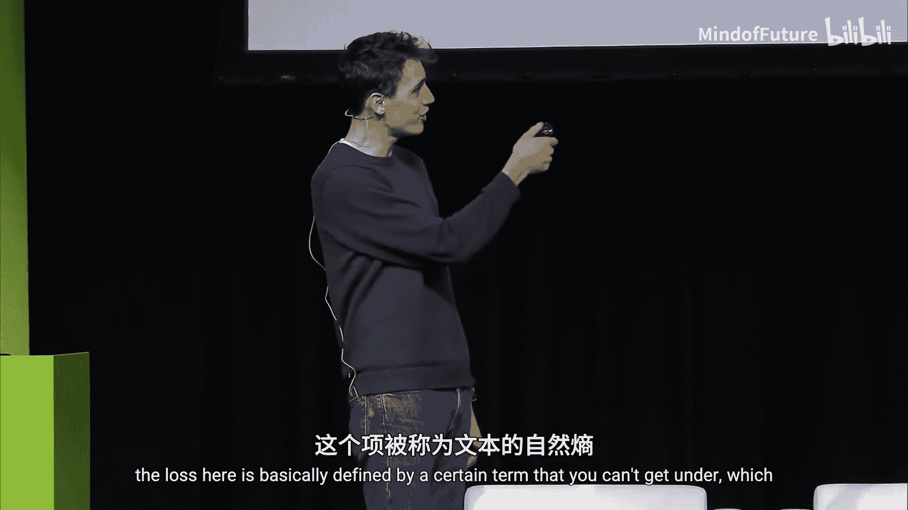

On the sides of the model。 So the larger the model， the more representation capacity you have。

 so you can lower the loss by make by increasing your representation capacity。

 But then you you pay something that is linked to the fact that you're doing stochastic gradient descent。

 and which is basically a stochastic noiset that is dependent on the number of tokens。

 And you have these two things。 that tells you that to lower the loss。

 you can either increase the weights or you can increase the number of tokens。

 And that's by just plotting this kind of yeah， this kind of loss。

 you end up with such a graph And that's the one that that sets the choices you should be making during training。

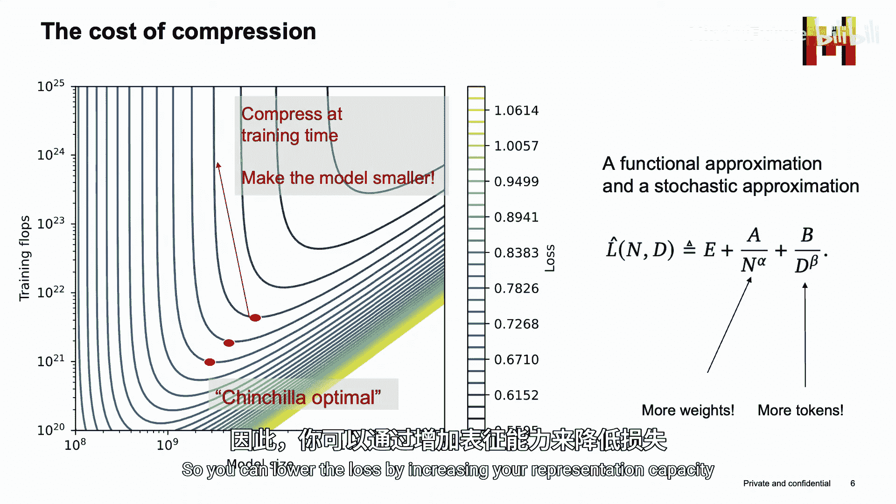

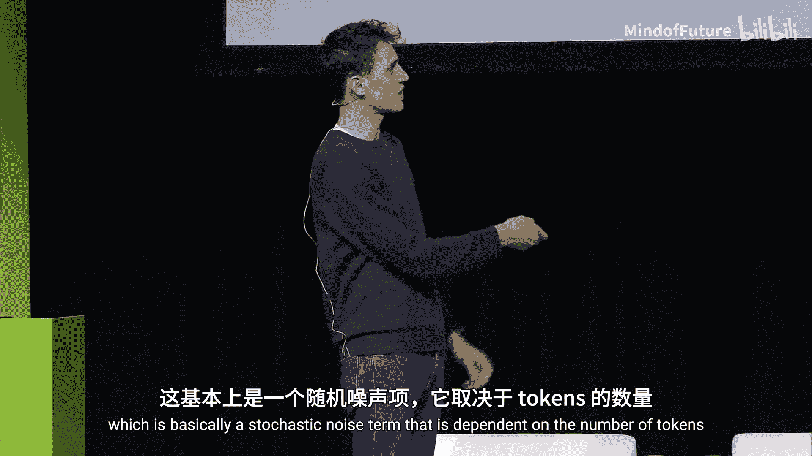

So if you put that into practice， then that's really what we did when we started the company in June。

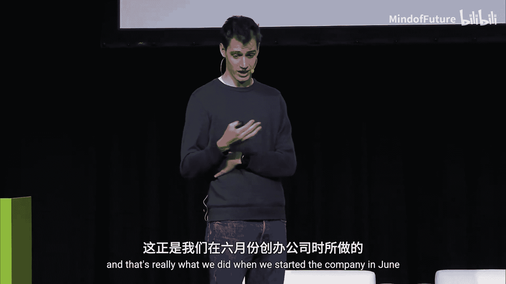

You end up with a model that can be much better than Lamma 2，7 B。

 And so that's how we got to miss style 7 B。 We really pushed the compression as much as we could。

 And we ended up with a model that was outperforming。 well， Lamma 2，13 B at the time。😊。

And then we continued in that direction to get to a model which was called mixedhu on in December。

 running only 12 billion parameters， active parameters and having the same kind of performance and Lama to 7 t B。

 So by pushing this compression and also changing architecture。

 we went to we gain a factor of5 compare to the existing state of the art。

 And when you gain a factor of  five， it's pretty cool because you well you you can deploy it on laptops and you can basically run it five times more so。

😊。

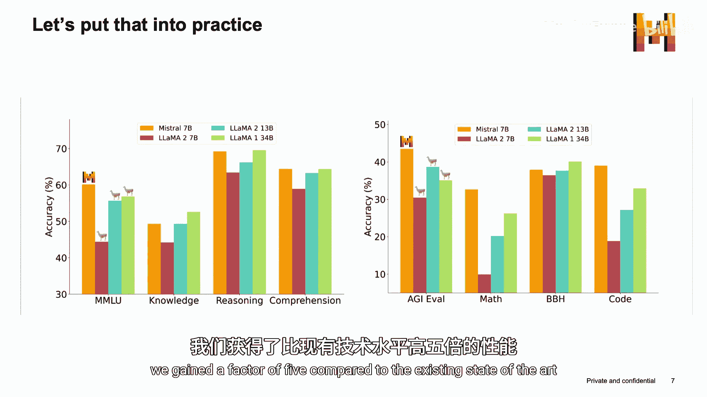

That's， that's an important part I have to take into account。 And it also explains。

 like the movement that we observed in various companies in 2023。

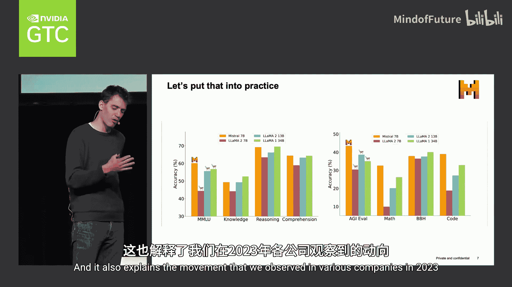

So that's the， that's what we did。 That's the the kind of observation that we had when we started the company。

 We wanted to be efficient， and we wanted to be open source。 So that's we released Miss style 7 B in。

 in June。 we released mixed tile87 B in December。 and we're continuing today to progress onto the on in the open source front to making models that are better and better。

 And we've also opened what we call the optimized models， some commercial models around。😊。

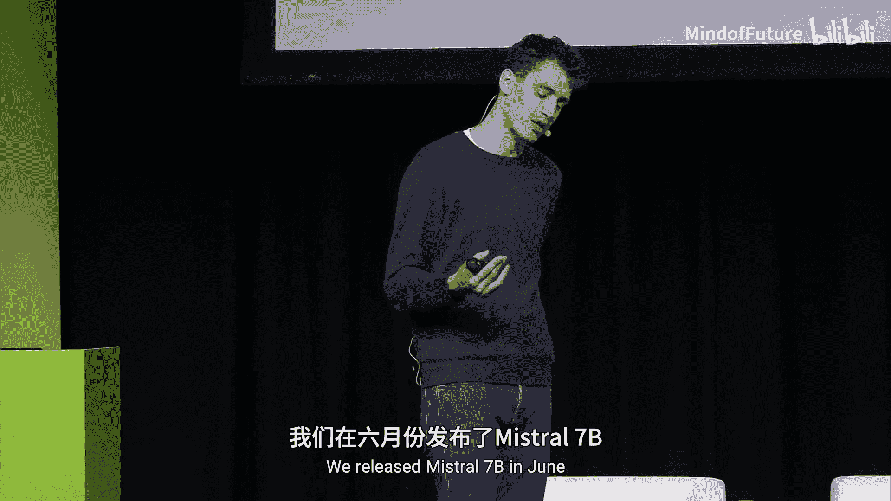

A platform that serves them。 It's very similar， I guess， to， to what many peoples are doing。

 except that we propose a platform that is portable that can be transparent， transparently deployed。

 So that means that we can bring the platform。 We can bring the model weights for them to be modified for for our customers to modify them to fine tune them。

 And we have made a variety of strategy partnerships with cloud providers。

 but also with Nvidia that something that we announced that Jensen announced on Monday。

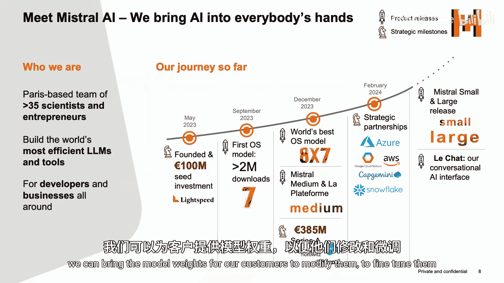

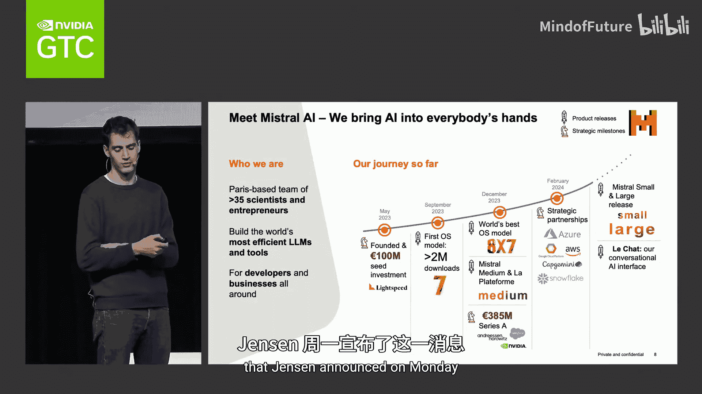

And I think the。Like the， the the mission that we have is to bring the AI to everybody。

 So make it small enough so that it runs on laptops。

 make it good enough so that it it reaches the best reasoning performances And also make it portable enough so that enterprises。

 developers can basically walk where they used to where they are used to work。

 So that can be on on on cloud that can be on a platform that can be on private cloud that can be on prem if needed。

 And oftentimes it is。 as usually what you do with geneI that you。😊。

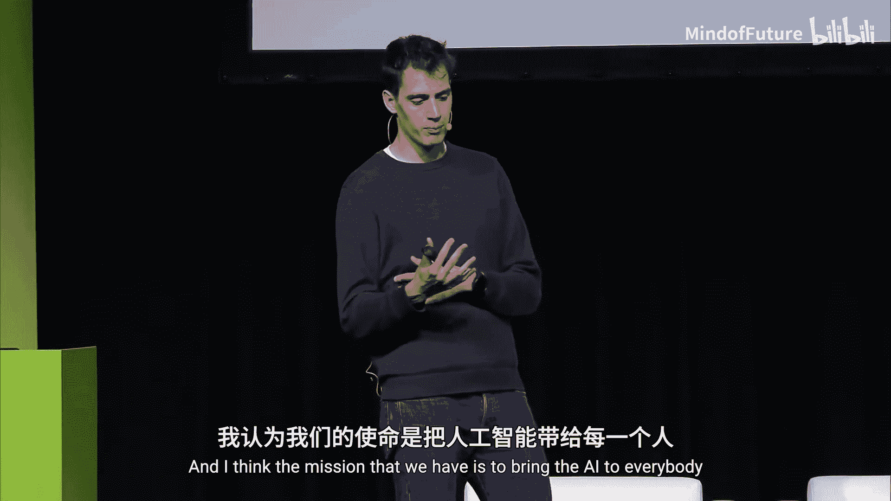

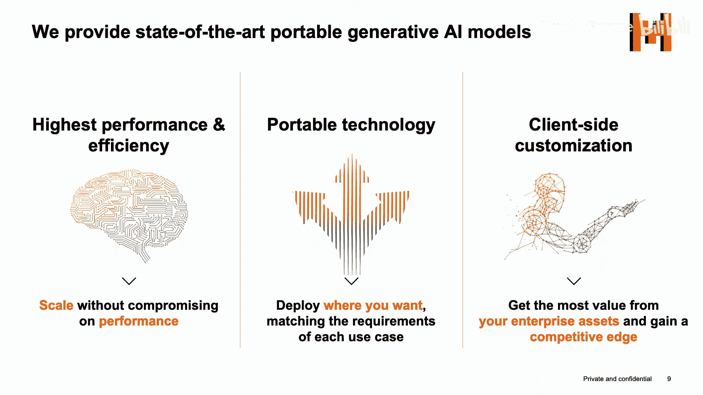

Workalk on your proprietary data。 And so there's a lot of compliance aspects to it that we think should that has pushed us to make a portable platform。

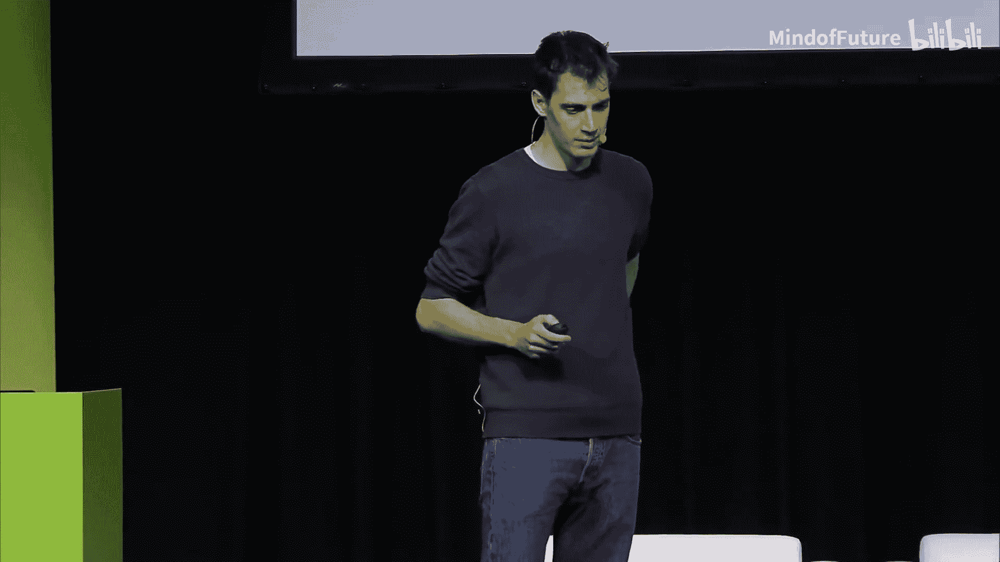

So we do offer like  five models for all Ca all， all these cases and business needs。

 So M Miss style 7 B mixed tile， but we also have this small model。

 which is actually performing better than mixed tile and with lower latency。

 And we have mixed tile Miss tile large， which is currently within the top tis model in terms of reasoning capacities。

😊，We've worked。 so beyond the like the scientific effort that we， we did until December。

 we started to work on adding new capacities to the model。 So it is now multilingual。

 It has function calling。 function calling is actually quite important in， in today's application。

 when you make agents when you make your model interactive databases interactive tools。

 We have this gson mode that allows to forced the model to output something that you can then use to call an API。

 and we've optimd for what we call use cases。 So we optimizing for the model to be able to think about the entire contexted Cs。

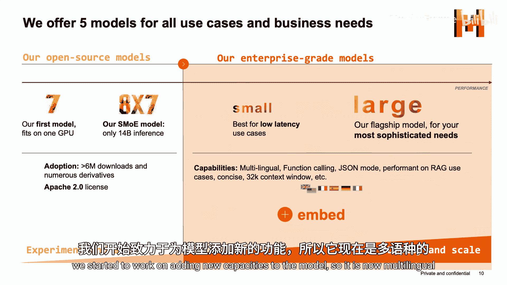

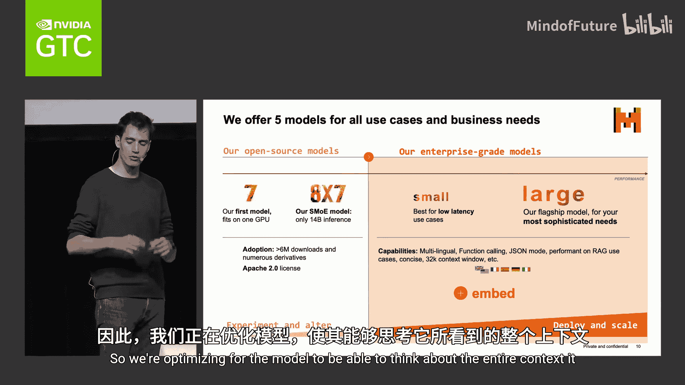

We also have an eming model that we did in December， which used to be a state of the art。

 but which is still pretty much state of the art。 It's。

 it's a very fast moving field even more than than in the large language models。

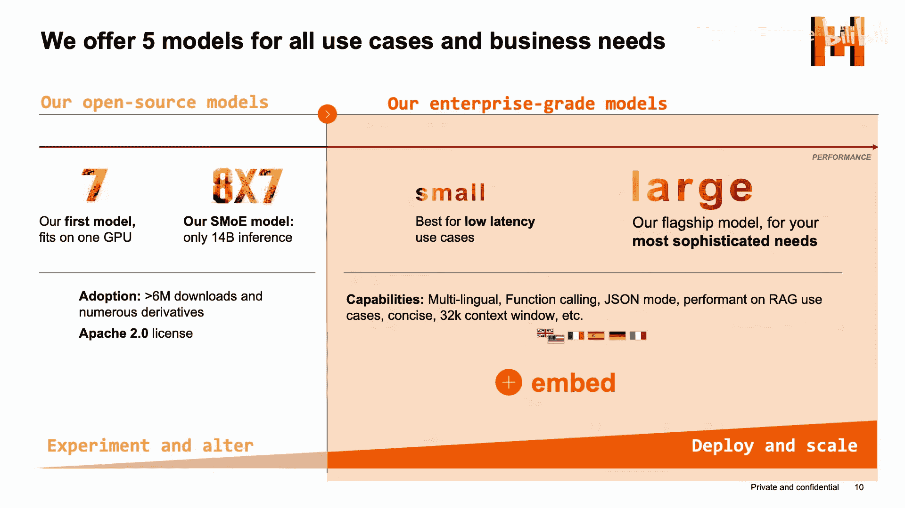

And yeah， that's everything is available through our platform。

 and it's progressively available through a variety of partners。

 It's also available on AI dot10ia dot com now。😊，So yeah， that's I guess that's this I already said。

 And in terms of， yeah， as I've said， terms of performance， we have been optimising。

 including for Mr large over like the latency over the capacity of the model for， well。

 to make it small enough to， we have a certain level of performance。 So today， is large as a。

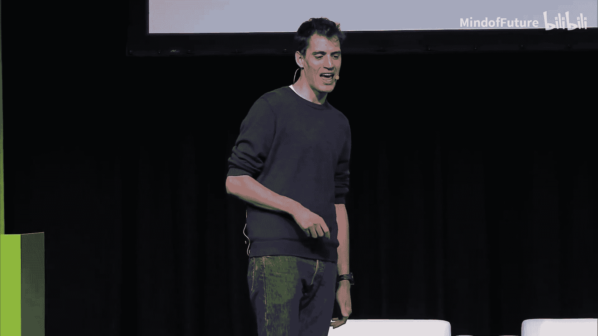

Quite low latency compared to， to others。 And we will continue doing bringing this compression aspect to。

 to our technology， because we think that this is the way in which complex applications can be made。

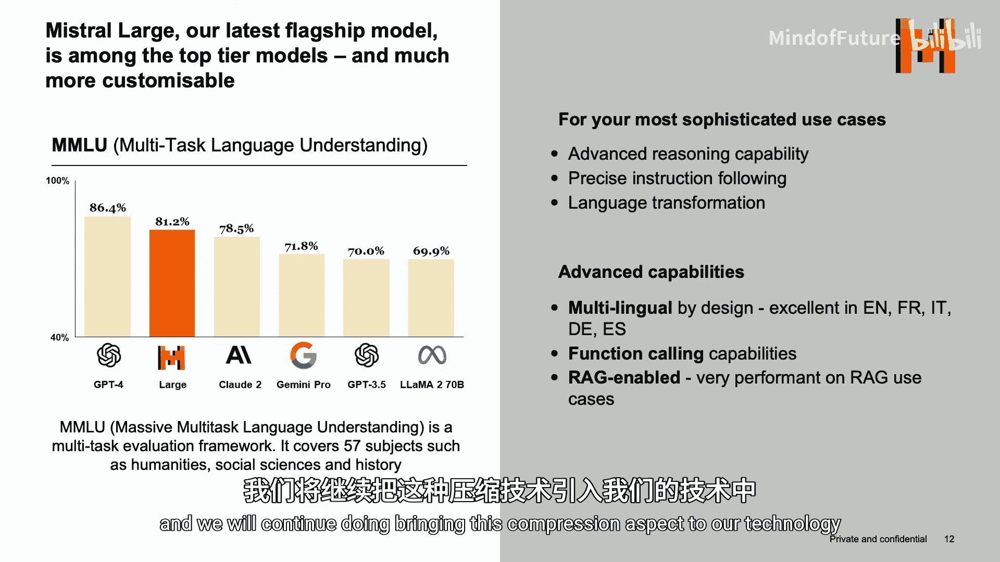

The reason why， like latency matters is that once you reach a certain level of latency。

 So through better hardware， better models， you can stop thinking on how your AI can run on the background。

 So instead of having just a that are talking to people。

 you can have a system that think about on themselves at a sufficient speed so that you can create applications with a good user experience。

 So this is really something that we're optimizing for。

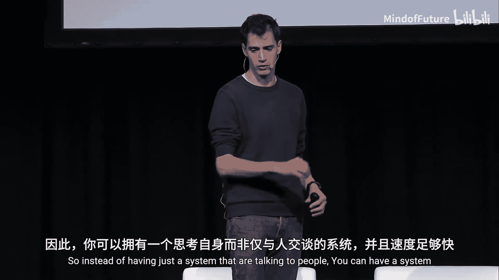

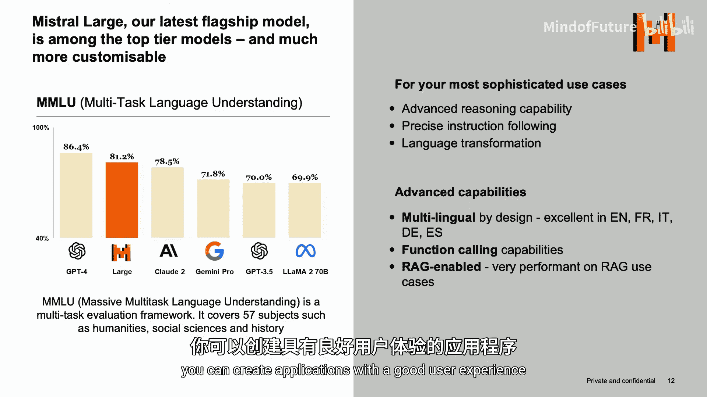

We've optimd for privacy， as I've said， we don't track your inputs。 We've optimd for security。 The。

 the custom deployment。 VPC deployment is basically as secure as you can get。

 We have optd for guardwelling。 So we've you can define what is appropriate for your specific use case。

 you can set basically the， the gareils you need in the prompt and we ensure that it those are respected and。

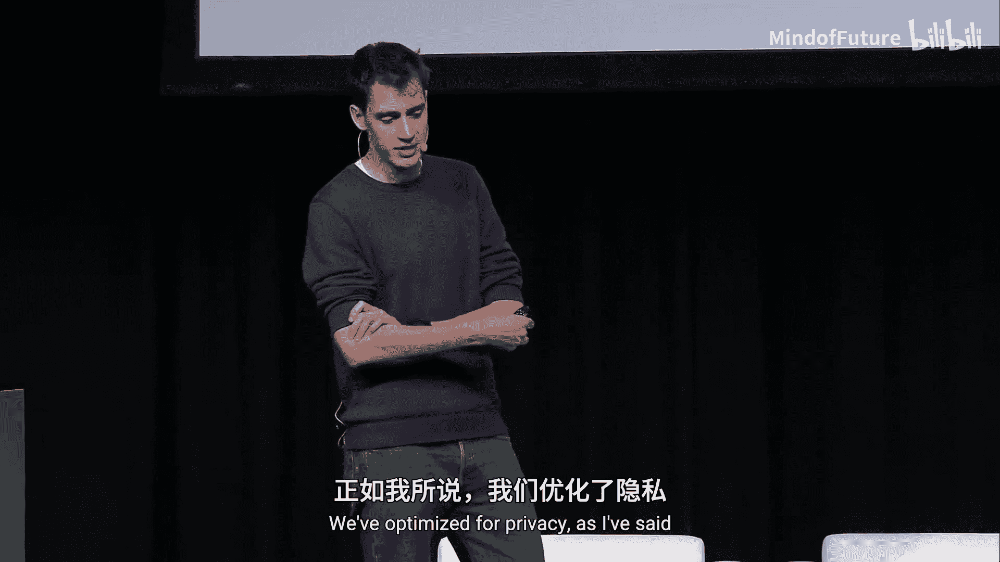

Because we， were， we have been cur our data pretty well。 We。

 we have a very strong bias and control bias control so that our models demonstrate actually top level performance when it comes to gender。

 religion， politics and and bias and ethnicities biases。

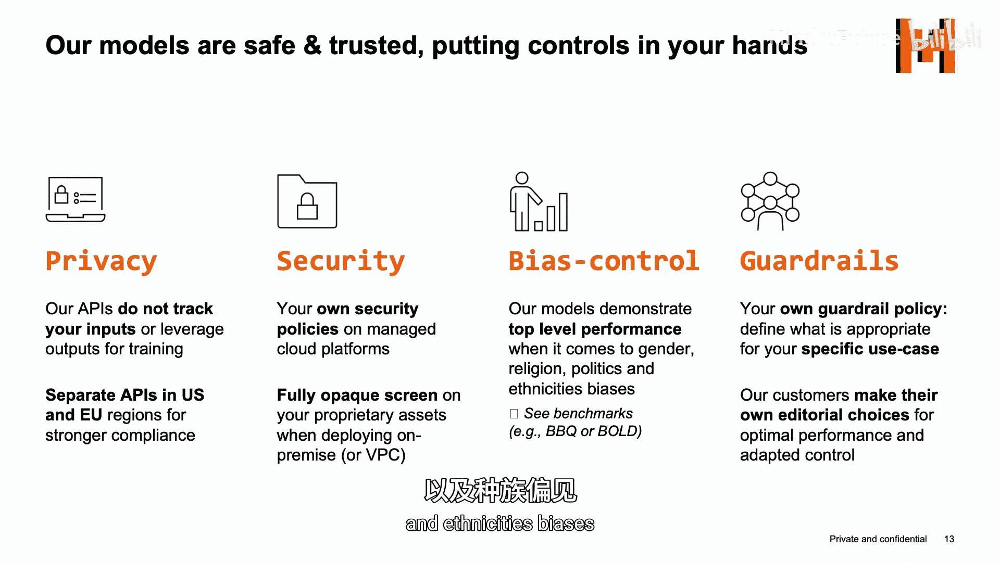

And so I guess I'm， yeah， that's those are basically our。Our core proposition。

 we intend to be the leader in in open source。 And so we're currently resolving the best open source models。

 and， and our intention is to continue doing so in the coming months。 we have better models coming。

 we have new capacities coming。 Multilinguality is something that is quite important to us and that we are pushing forward。

 And as I've said， the idea of， of， of being open and having very strong open source models is also to enable our customers to customer to modify the model and to fine tune them to their use cases so that they get better performance that so that the model actually adapts and get better over time。

 So this is also something that is coming to our platform。

 and to which we will bring our expertise and AI expertise。

 the idea being to lower the bar of admission to our the fine tuning models。

 And so this is coming not announcing dates， but this is coming pretty soon。😊，So thank you， everyone。

 And I'm happy to take any， any questions。😊，違えました。Thank you very much， Arthur。

We do have time for a few questions if would， if you have a question。

 please step to the microphone that's in the aisle over on that side of the room。

Are you guys using any synthetically generated data in your models or model building？So， yes。

 we do to， to a certain extent。😀は。😊，I thought so， that's so。Thank you。

So I want to bring something back to a paper you' worked on the retro transformer Deep mindd。

 you guys were doing retrieval augmented generation before it was cool。

 I was wondering if you and it was integrated itself in like cross attention in the architecture。

 wondering if you see that as another method going forward to integrate retrieval augmented generation directly in the architecture or agents directly in the architecture。

 I want to get your thoughts on that。 Yes， so I think that's so Re brought to a couple of。😊。

Architectural innovation and training innovation。 Some of them were good。 Some of them were not good。

 in particular， training on like pre training with whated well basically with a。Neighbors is。

 is a good idea and a bad idea because it's a good idea because your model actually understands how to retrieve from documents。

 but it's a bad idea because it makes the task much easierca your model now sees much more context。

 And so it doesn't need to try to memorize things as it would， if you， if you。

 if it didn't have access to retrieve documents。 So I think in that in that sense。

 I don't think we cracked it and nobody has ever since。On the architecture side。

 the encode audio deco like models that actually process documents separately。

 I think these are pretty exciting stuff。 This is pretty exciting。 it's a pretty exciting paradigm。

 It's very close to what we propose for is 7 B， which are spa attentions。

 spa attentions is also basically another way of more flexible way of having encode deco structureture。

 And I think this is， this is also the。😊，A very promising aspect to to the architecture development we'll see in the coming years。

 Okay， thank you very much。Hi， thank you for your speech。 I wonder。

 do you plan to come come up with an LLM in French language from scratch or are you guys planning to stick with the translation LLMs。

 And if yes， how different is the process for the French language。

This doesn't seem to be a great idea D to train models on a single language from scratchch in particular for more。

 for languages that are rare than English。 So this is not what we do。

 All models are multi well by design。 And I think that's。We have evidence that it。

 there's some tone fail in between the languages。 So if you want your model to be very good at French。

 you need to train it on English a bit。 Okay， thank you。Okay， thank you for the great talk。

 So I have some some question about the M O E architecture。 So did， did you find some。

 some skating laws specific for M O E and how why， why did you choose this architecture and and also the the the Gro one appears。

 But it's also in M O E， but it's not as efficient as mixture。 So what， what do you think of it。

So M O's and and have some different trade offs。 They'm very good at processing a lot of inputs。

 There are a little w at outputting tokens because you need to load all of the。Basically。

 all of the all of the experts every time you， you output it token。

 So there's some trade offs depends， it depends a bit on the workload you have。 General speaking。

 they are yeah， quite efficient for training。 Then I。

 I know that some of our competitors have trained very large models， very large Ms。 well， it's not。

 it's not all about the size， right，s you also， as I've said。

 there's also some questions on how do you set things up so that you get something that is compact and has a lot of knowledge。

 And so I I'm not sure why our more mixed highly is， is as good， but it is good enough yeah。

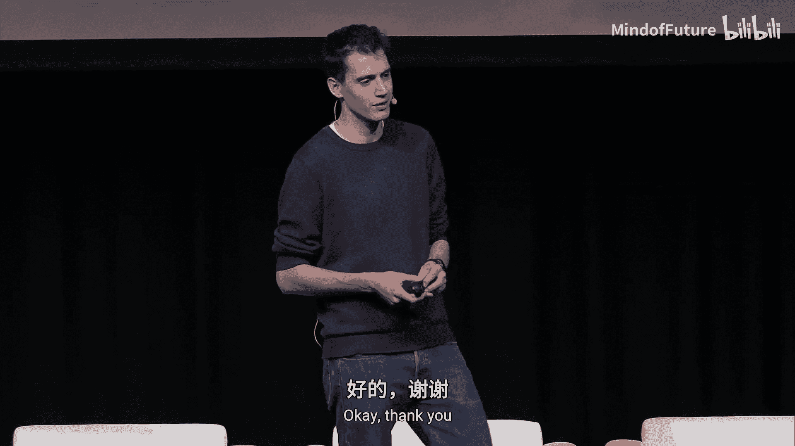

Okay， thank you。Thank you very much， Arthur， that's all the time we have for today。

 you enjoy the rest of GTC。