# 【英伟达GTC人工智能大会 • 中英】NVIDIA GTC 2024 p14 P14 The High-Speed Revolution in AI and Managing the Impact on Humanity -BV1yHAeeqECP_p14-

Welcome to the fireside chat with Fei Fei P Fei Fei Lee and Bill Daley。

 I will just take a quick second to introduce both of them。😊。

Bill Dley joined Nvidia in 2009 as chief scientist after spending 12 years at Stanford University。

 where he chaired the computer science department。Bill and his Stafford team developed the system architecture。

 network architecture， signaling， routing and synchronization technology that is found in large。

 in most large parallel computers today。Feifei Lee is the inaugural Sequoia professor in the computer science Department at Stanford University and co director of Stanford's Human Centered AI Institute。

 She served as the director of Stanford's AI Lab， from 2013 to 2018。

During her sabbatical from Stanford， from January 2017 to September 2018。

 Feif Fei was a vice president at Google and served as chief scientist of AI M。 L at Google Cloud。

Since then， she's served as a board member or advise in various public or private companies。

Feifei's current research interests include cognitively inspired AI， machine learning， deep learning。

 computer vision， robotic learning and AI and healthcare。

 especially ambient intelligence systems for healthcare delivery。In the past。

 she worked on cognitive and computational neuroscience。

Feifei has published more than 300 scientific articles in top tier journals and conferences in science。

 engineering and computer science。She's the inventor of Iagenet and the Inet Cha， a critical。

 large scale data set and benchmarking effort that has contributed to the latest developments in deep learning and AI。

In addition to her technical contributions， she is a national leading voice for advocating diversity in Ste and AI。

 She is co founder and chairperson of the national nonprofit AI for all。

 aimed at increasing inclusion and diversity in AI education。

Fei works with policymakers nationally and locally， to ensure the responsible use of technologies。

 including a number of US Senate and congressional testimonies。

 her service as a special advisor to the Secretary General of the United Nations。

 a member of California Future of Work Commission for the governor of California in 2019 and 2020 and a member of the National Artificial Intelligence Research Resource Task Force for the White House official sorry with the White House Office of Science and Technology。

 Policy and the National Science Foundation in 021， 2022。

 Let us welcome Bill Dally and Feif Fee Lee to the stage。

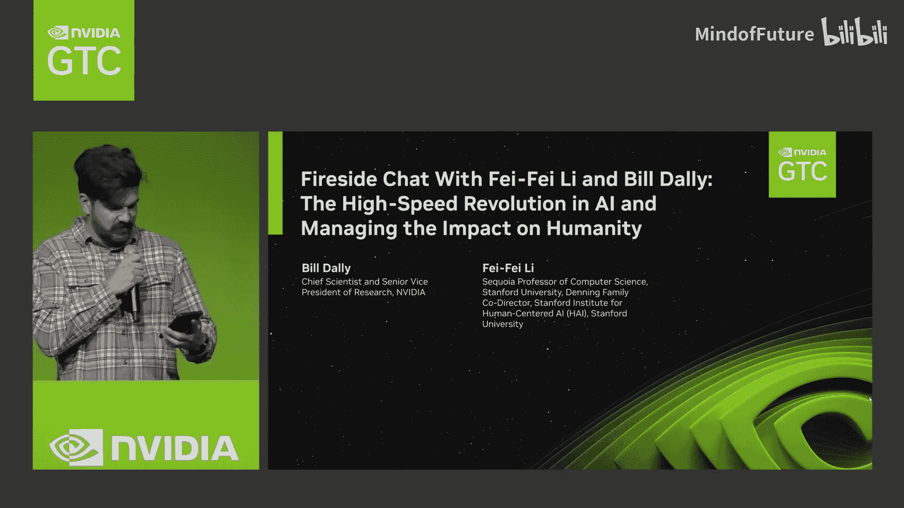

You go， I follow you。Well welcomel， everybody。 and thanks for coming to GTC。

 and hope you're as excited as I am to hear what Feifei has to say。

 So let's go ahead and get started。 So you're a cofounder of the Stanford Humancented AI Initiative Institute。

 Rather， What is the largest impact you see AI having on humans to date。

 what do you see as the largest impact going forward。😊。

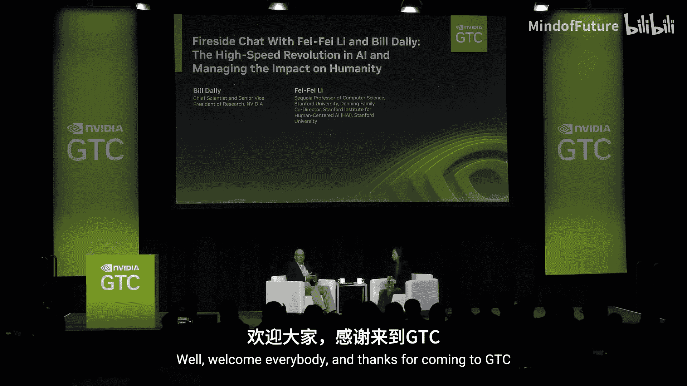

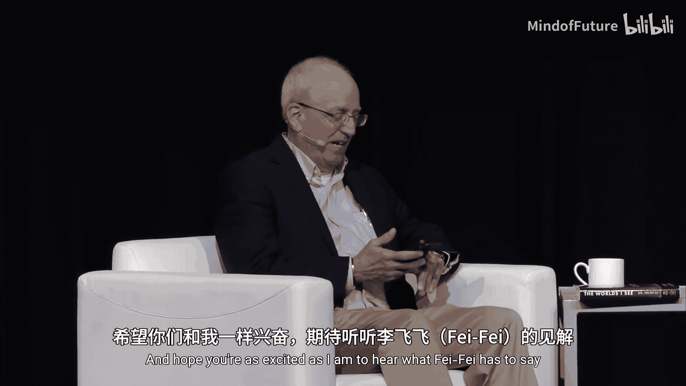

Wow， that's that's a small question to start with Bill， first of all。

 really honored to be invited to GTC。 What is AI's impact on on humans today。😊。

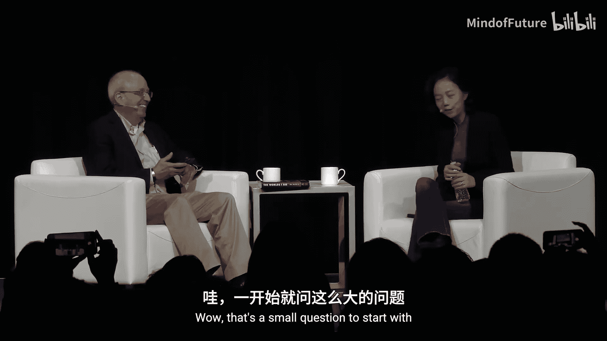

I think the AI is perhaps the most profound technology of， you know。

21st century in terms of transforming。Who we are， what we do and what we can be。

 it's a technology about intelligence。 And to be honest， up to this point。

 humanity's technological inventions， are more or less staying at the layer that leaves intelligence alone。

 right， whether we invent tools to， to go faster， to fly higher， to， to， you know， pull heavy things。

 to， to， to， to see what we humans can see is all still more mechanical。

 But by the time AI is invented everything that defines humans you know， to， to， to read a language。

 to understand a book， to translate， to translate language， to make decisions， to see patterns， to。

 to draw， to to paint all these fundamental human。

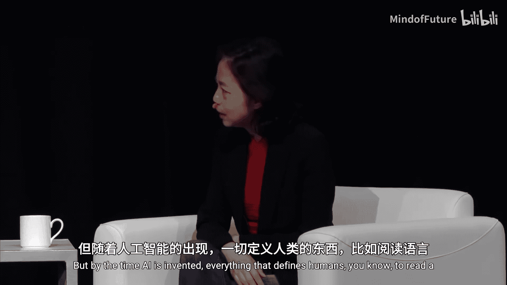

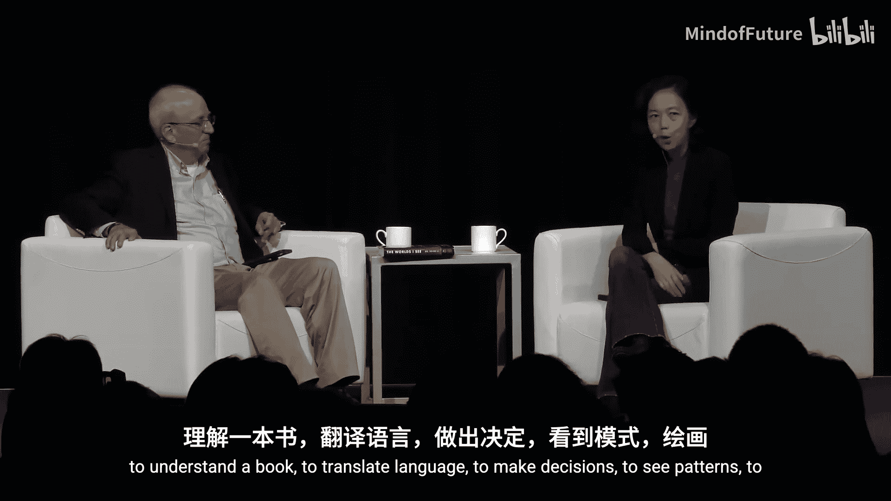

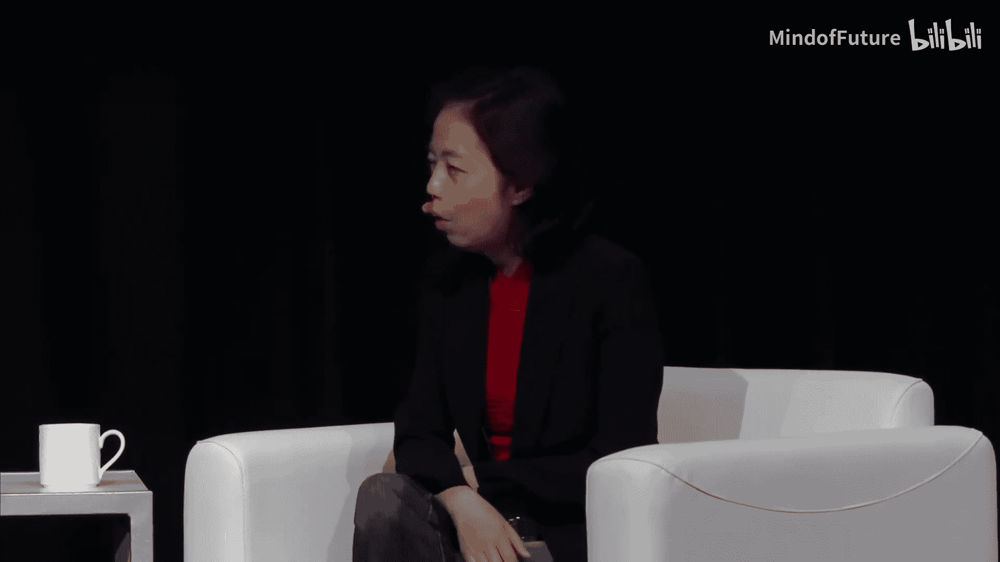

Capbilities are being challenged by this profound technology， so。The impact of AI， to me。

 is the profound impact of。Well， humans are what we can do and who we are that that's that's how I see AI But do you see some particular you know。

 area of human endeavor， whether it's medicine or education or you know。

 transportation where AI is going to have a larger impact than other areas？

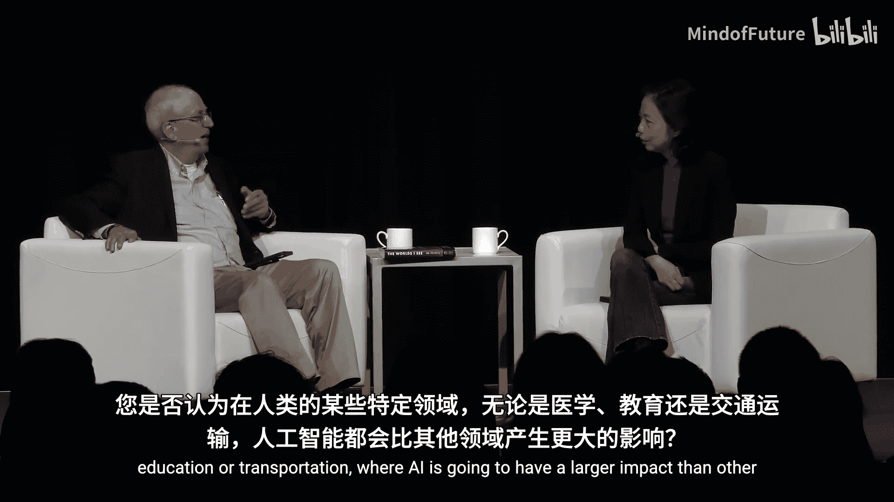

I think AI is very， very horizontal。 you know， even quite a few years ago when I was working as chief scientist at Google Cloud。

 I would see business analytics being a huge user and application area of AI。 Now。

 I totally agree with you。 Health care transportation， mobility， you know， education。

 software engineering， I I I， I see AI's impact really boundless。

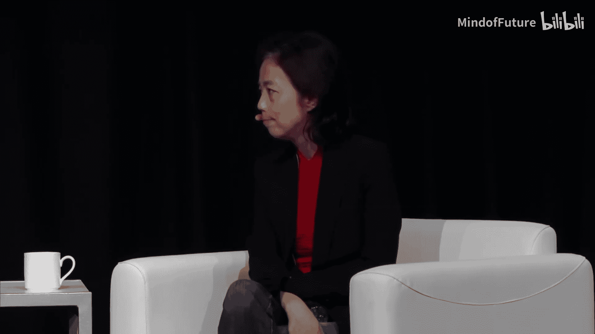

So some luminaries in the field like Elon Musk and Sam Altman have suggested that AI might pose an existential threat to humans。

 What do you think what are the largest risks posed by AI， is it deep fakes， is it loss of jobs。

 what are the downsides of AI？

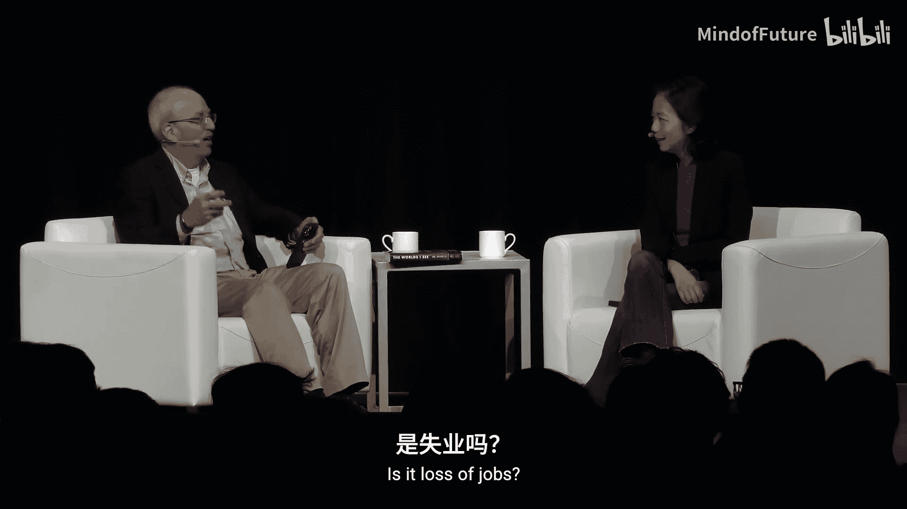

Yeah， I， I think it's a fair question。 you know， you and I both come from universities。

 and one thing that I'm used to， especially working on a university campus is that we should be allowed to ask all kinds of questions including AI's existential threat to humanity。

 it is an intellectually important question down the road， it is something that you know。

 humanity as a species should should recognize for everything we have， you know， invented。

 not just AI， but also the way we're changing our earth the way we're， you know。

 changing the relationship we have with the environment。

 But when it comes to AI and' much more concerned about more immediate and urgent catastrophic risks and some of these risks you have mentioned are deeply social。

 For example， its impact to democracy because of mis and disinformation and and and and it's。

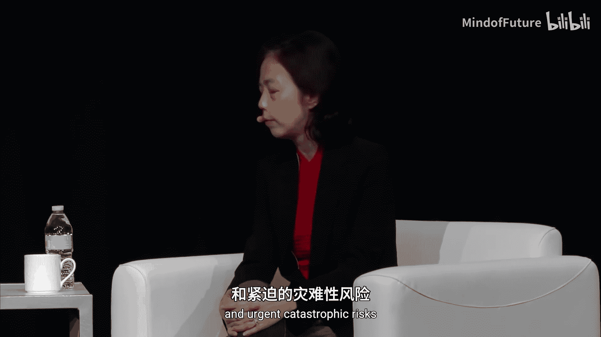

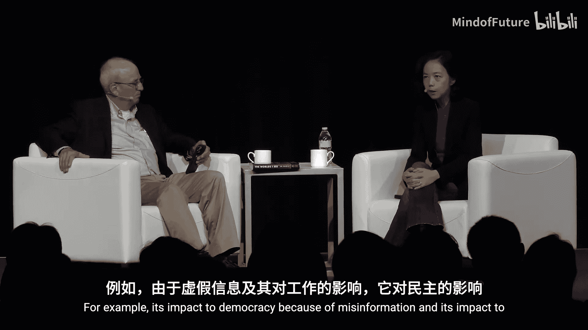

Impact to work， you know， whether it's job replacement or just Labour market landscape shift。

 it's impact to， you know， our， our relationship with data， our privacy， fairness。

 all these are potentially catastrophic social risks。

 if we don't manage this technology's application well。

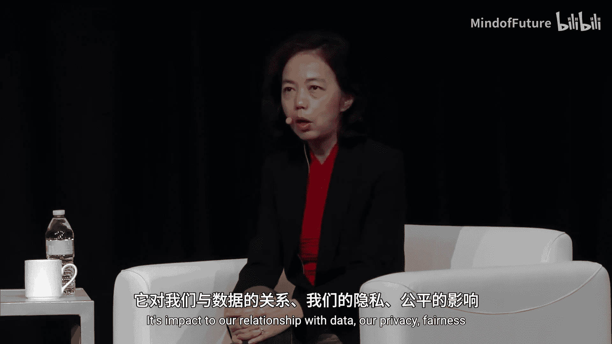

ok。So you recently wrote a science memoir about AI。 I have a copy of it here。

 You should all order from Amazon right now。 Thank you。 here。

 Can you tell us a little bit about the book， and why did you write it。

The the book is a science me。 like you said， I I put the word science first。

 It's a double helix structure about the coming of age of AI。

 especially through my lens as a computer vision scientists where I see that the the evolution of intelligence in nature started with perception of the world。

 and the evolution of AI， especially deep learning history in the past decade and half。

 is intimately intertwined with the evolution of computer vision as a field。

 So it's a coming of age of AI in the past a decade or so。

 But it's also intertwined with a personal journey of coming of age of a young scientist。

 And that part I felt I was cohort to write it。 because when I was asked to write the book a popular book about AI。

 I did。

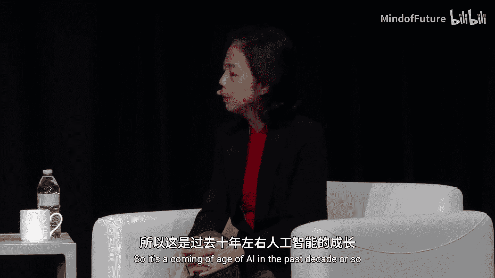

Spend a year in the middle of Covid to write a just about AI and a good friend of both of ours。

 Johng Eitch Mendy， a philosopher and co-director of Stanford Human centre AI Institutestit read my draft and basically said you should rewrite。

 I was very， very distraught。 And and he said， look， a lot of people are writing about AI。

 but you have a unique journey。 you speak to so many people who don't feel they have a voice or identify someone in AI with。

 These are immigrants。 These are young women。 These are people from all walks of life。

 These are people who are not necessarily your typical Sililica Valley AI persona。

 And if you give them a voice， it would be more powerful。 And with that。

 I I change the structure to the double hex structure of the book。

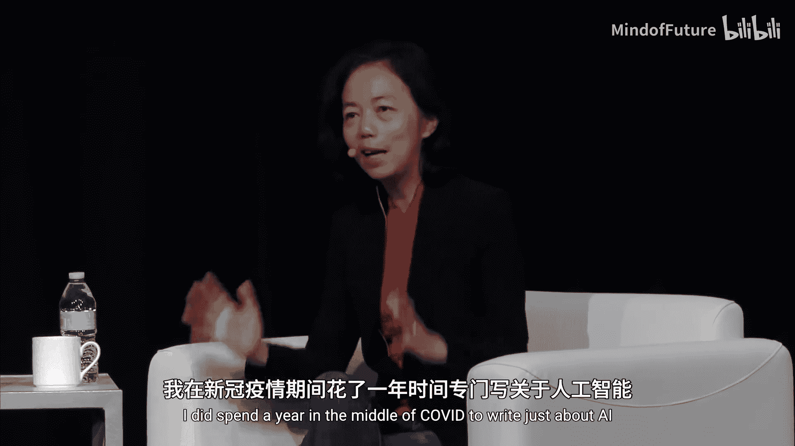

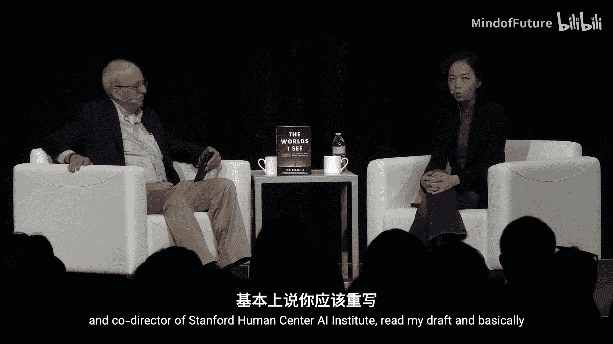

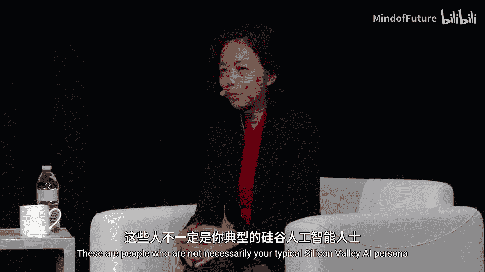

， very interesting。 So this is a coming of age。Of AI sort of intertwined with your sort of。

 I wouldn't say coming of age， but sort of becoming eminent as a scientist， as AI becomes mature。

 say in 10 years time， if you were to write a sequel of the book。

 what do you think that would be like。

Yeah， firstt of all， I don't think I ever wantan to write a sequel。 So it's a labor of love。

 for sure。😊，If I were to write a sequel of this book， be。I， I think I w to write a human。

 triumphant story of how we use this technology to make lives and work better。

 And and I'm not saying this in a delusional， optimistic way， because I know the world is very。

 very complex， It's very messy， especially for the young people out there， sometimes some。

 this world even feels a little dystopia。 But if you look at the arc of human civilization。😔。

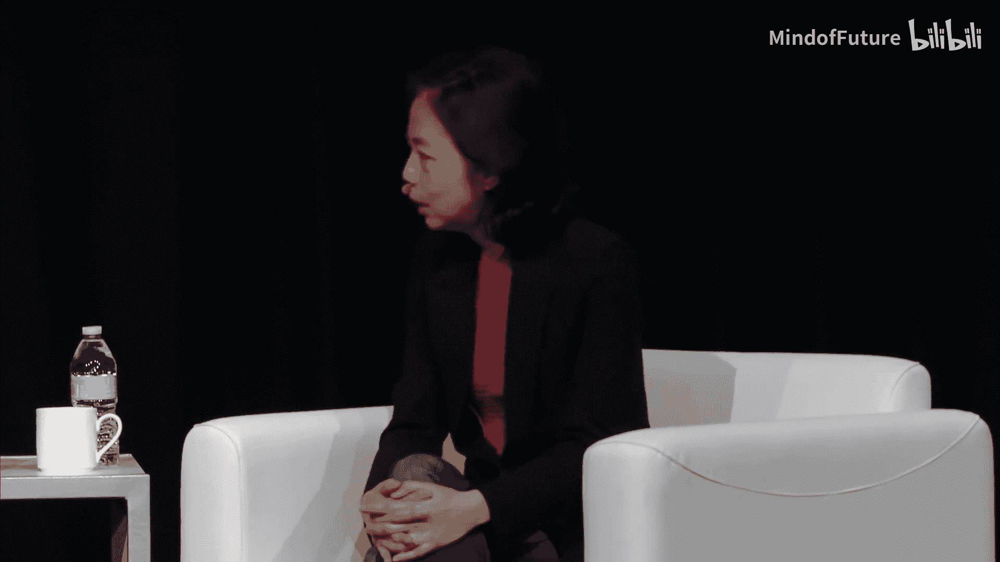

It is long and to paraphrase Dr。 King， the arc of human civilization bends towards justice。

 bends towards hope。 It bends towards benevolence if we can use technology in the right way。

 So we're just seeing even at this GTC， the tip of the iceberg of how we can use this technology to transform healthcare from drug discovery to personalized treatment to healthcare delivery We have just begun to think about how education can be fundamentally changed because suddenly we have a teaching assistant that can deeply personalize learning and teaching。

 We're just seeing how scientific discovery can be assisted by powerful machines and cognitive assistance that can really accelerate the kind of scientific discovery。

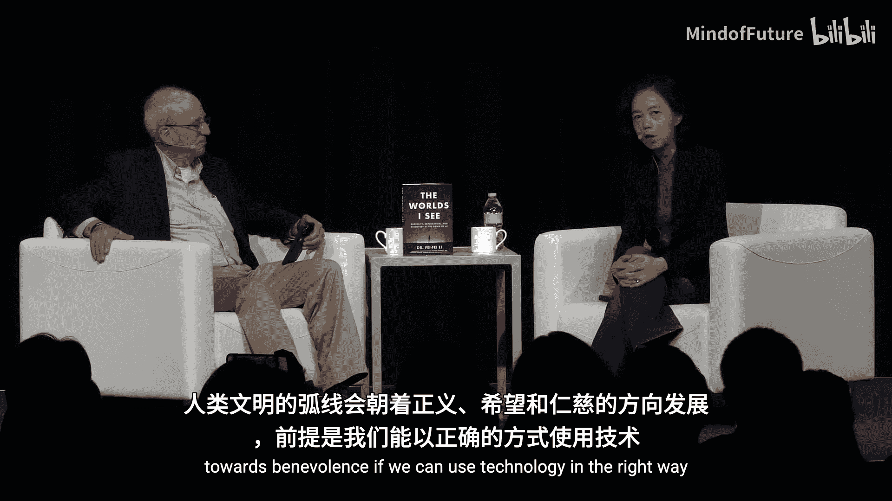

process that humans have been doing for hundreds of years。

 So all this is giving us the light of hope that we will be in five or 10 years that using AI to find climate solutions to democratize access to medicine to to take care of earth。

 as well as ourselves with the help of this book of this technology。

 And this is what I want to write。

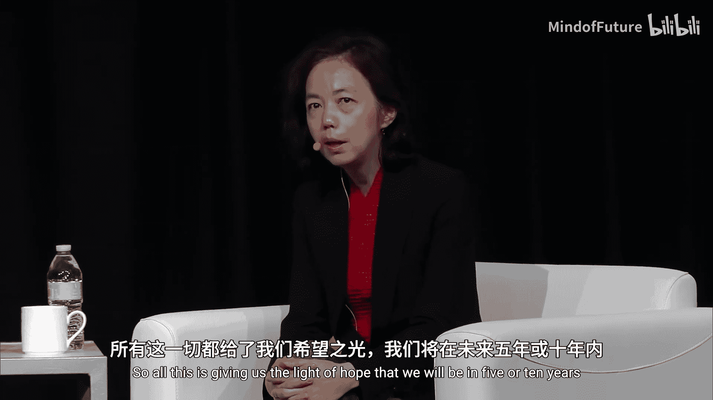

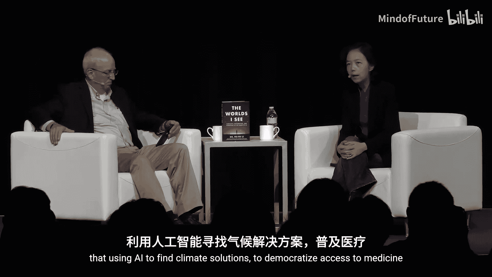

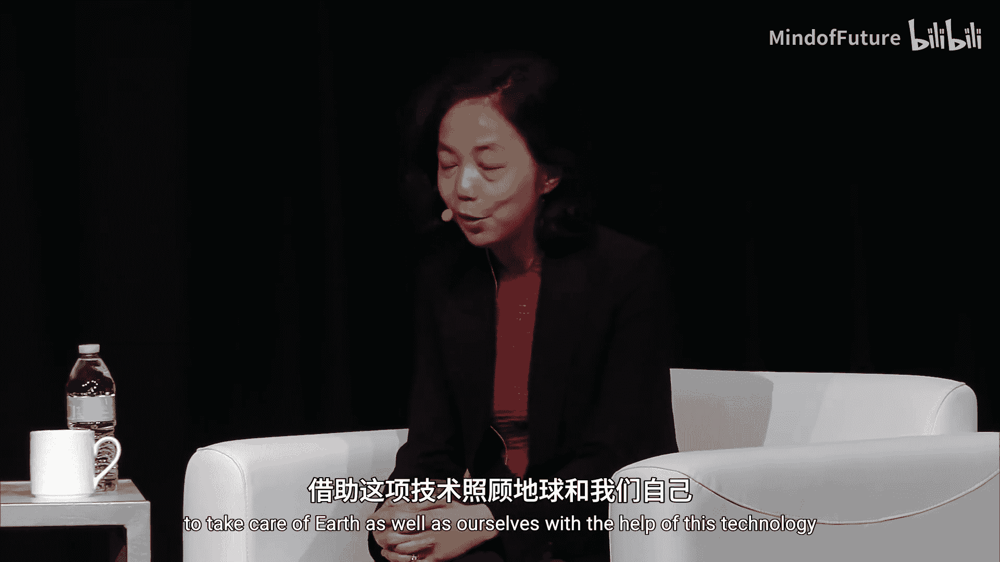

If I were to write a sequel and I w to write about。 Well。

 I hope that's the future that we have to write about。

 It's a very optimistic and positive view of the world。 Well。

 I think I'm only positive if we're doing it together。 I。

 I'm not positive just by sitting here and pontificating。 I。

 I think the collective responsibility is if we believe that we， we do it right。

 So we work together to make the future we want。

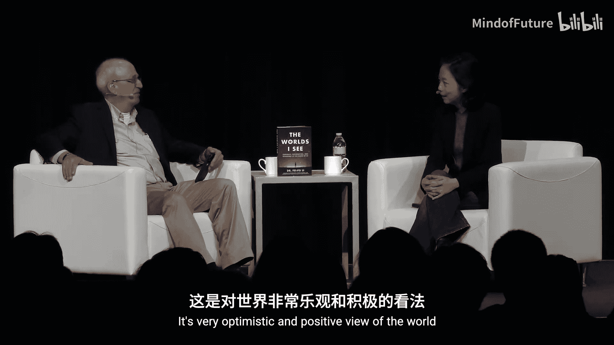

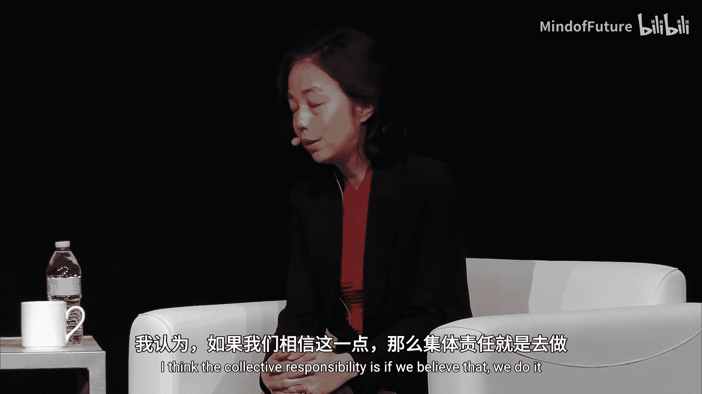

So you've been very vocal about the need to provide resources for academics to pursue AI。

 Yet to date， it's really large well fundunded companies that have the GPs and the data needed to train models。

 How do you see this playing out in the future will the na materialize and democratize AI allowing academics and small companies to have access or will the brain drain from the academic world to the big companies continue。

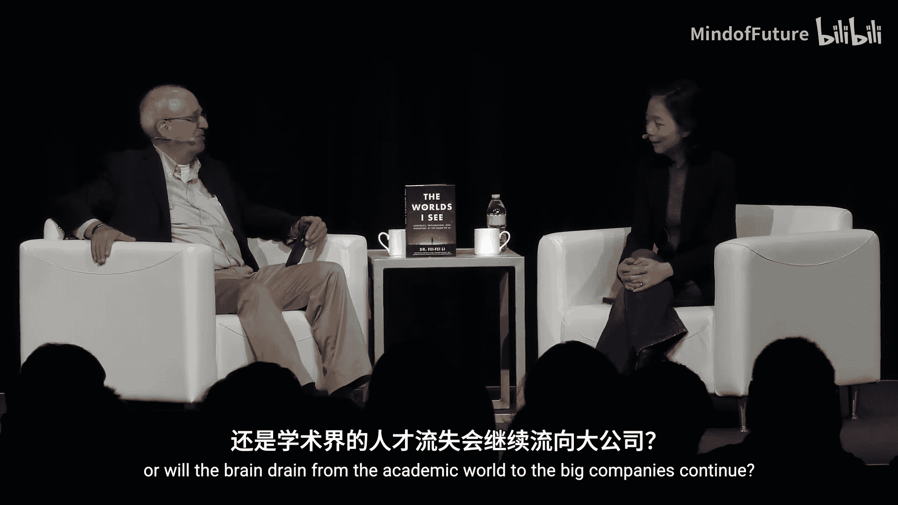

Well， first of all， I think both Bill and I sit in various part of the advisory functions of of today's White House U on the PC and I'm on the task force for President Biden's there。

 So for those of you who don't know what there is there is national AI research resource a few years ago。

 Stanford HI LED an advocacy movement to as the federal government to consider the increase of resource to a public sector AI and especially the resource of computing resource。

 as well as data resource and that translated into an ongoing bill right now。

 still sitting the Congress called create AI Act bill。 if this bill is passed an appropriated。

 itll create federal funding to create a national AI cloud as well as data。

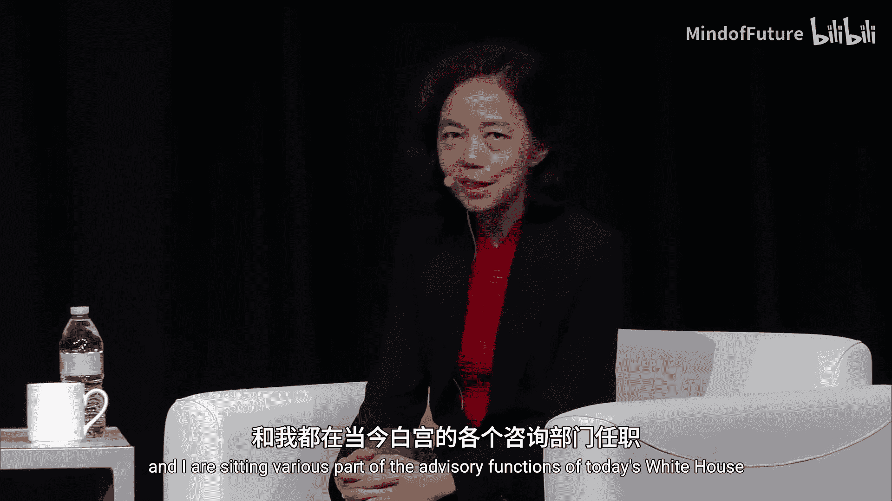

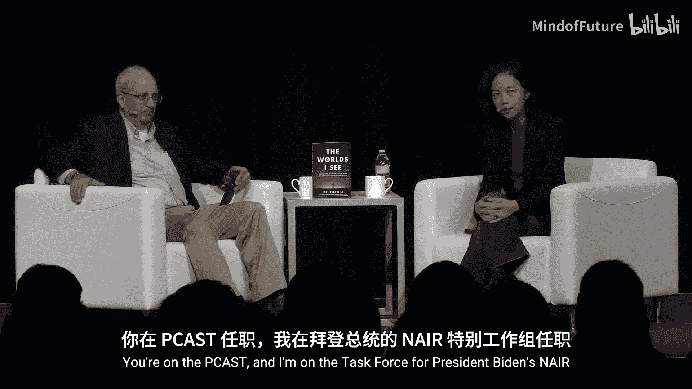

sitory for the public sector to use it。 And， and Stanford has been H AI has been leading that movement。

 And why do I spend so much time in Washington， DCC and believing in that is be。

 I believe in public sector AI as much as I believe in private sector AI And like Bill said。

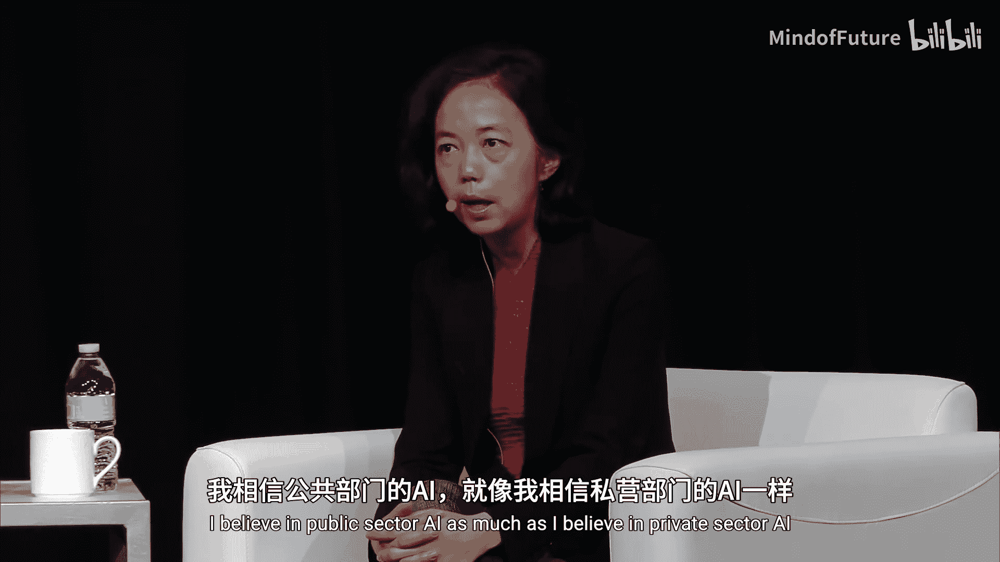

The balance right now is so off balance， right， Like not a single university in this country today can train a chat G model。

 We do not have that thousands of GPUus， not even A 100， little on H 100， little alone B200 and， and。

And some， some of you might ask what， what is wrong with that，'cause we have great companies。

 great big tech companies creating great， you know， technology。 And I think that's true。 it。

 the private sector is， is wonderfully progressing。

 But I think one thing I would love for everybody to recognize is public sector produces public goods。

😊，And what is public goods， Public goods have several dimensions。

 and they're all important for us today and for the future。 First。

 public good includes curiosity and knowledge driven discovery and innovation。

 And this is so important。 Everything you know about today's AI began as curiosity driven academic research topics that no one really has heard about。

 right， from。

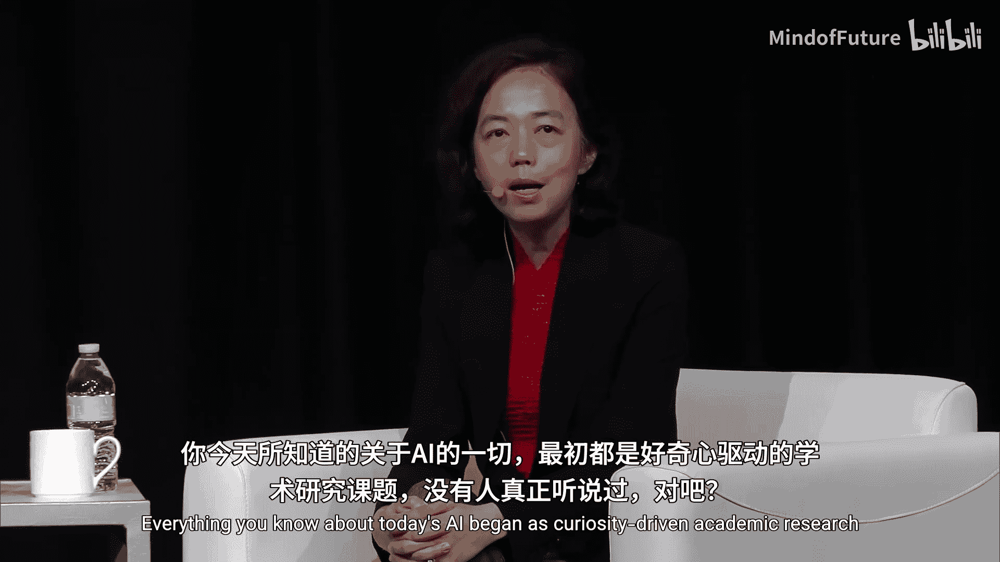

Perceptrons to back propagation algorithms to image net。 All this came from public sector。

 So that kind of blue sky curiosity driven research is critical。 It's a form of public good。

 That's important for the continuous innovation of our society。

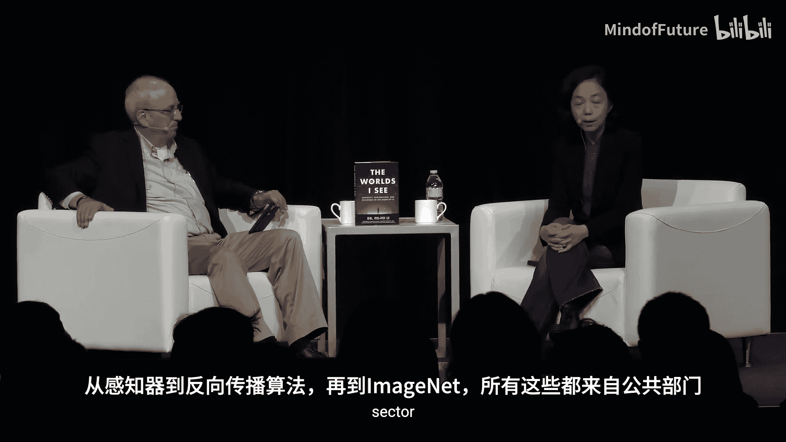

Second part of public good is a trusted partner for the public to explain。

 educate and evaluate technology。 the private sectors are driven by their own goals and who is there as a trusted partner to let us know how safe is this technology。

 What is the transparency index is the data bias how can we use this inference in a fair and and trustworthy way。

 These are important topics that public sectors are by and largege doing and can help the public。

 The last， but not the least a form of public good is the most important one is the talents。

 Its the talents of tomorrow， we are shouldering the responsibility of educating not only the workforce for tomorrow's technology。

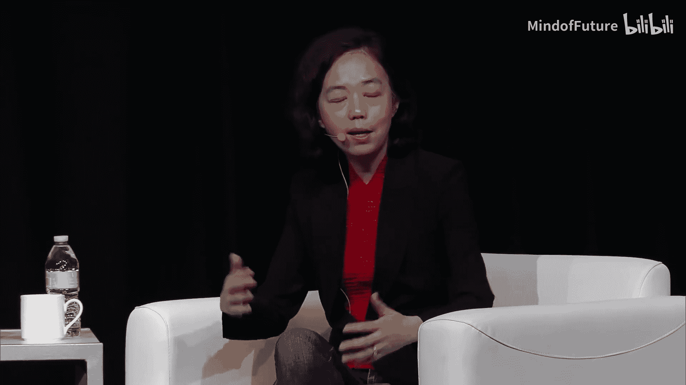

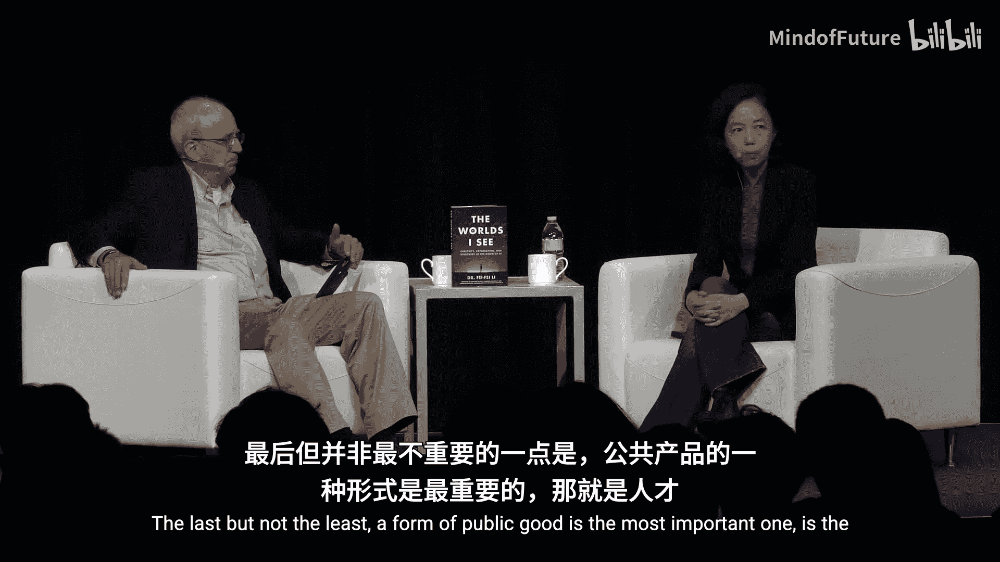

Responsible workforce， workforce that not only learns about how to coding AI。

 but also learns about the ethical framework of AI， the social implications of AI。

 So these are all public goods， and it's important to support public sector， AI。

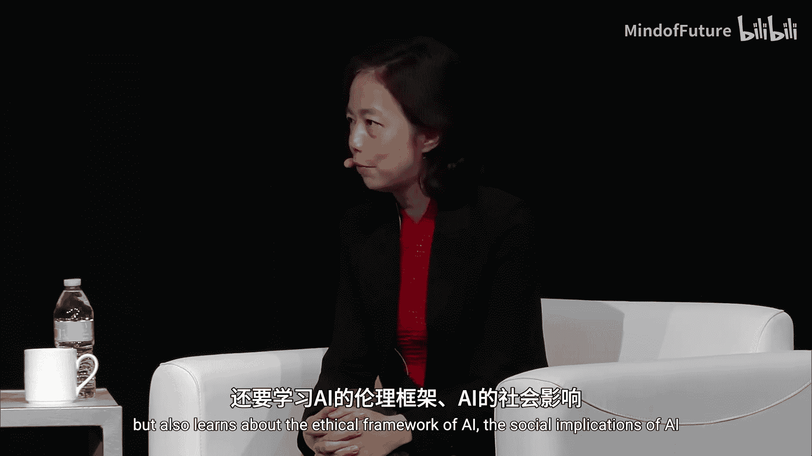

Well on that heading of talent， if we're going to have public sector AI means we need to get AI experts into the public sector。

 given the current AI job market where there's huge bidding wars and basically paying many times with the top GS salary scales are able to pay。

 how do you envision attracting really good AI talent to the public sector？

That's such a great question， Bill。 And I remember you were， you know。

 department chair hiring talents into academia just a decade ago。 So first of all。

 it is always gonna be true that more students will go into private sector， at least in this country。

 right， So it's not like we wan to make it pary 5050。

 but for those who have a life's dream of staying public sector or going to academia。

 I really hope resourcing them is very important。 they're not looking for N V level compensation。

 They're looking for access to compute so that speaking personally。

 I'm looking my students and I would love to have the kind of compute so that we can work with our staffford hospitals to。

 to work on the projects you know， maybe a few hundred GPs if eating。

 they're looking for a community that is not keep draining right they're。

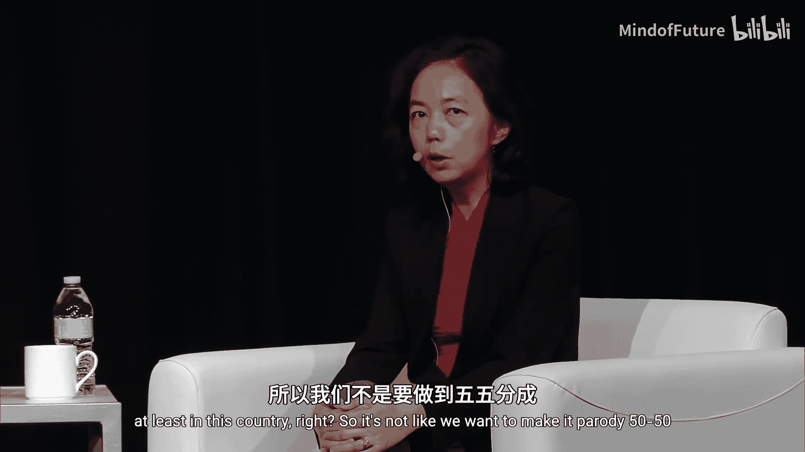

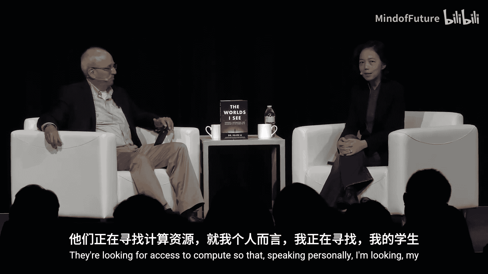

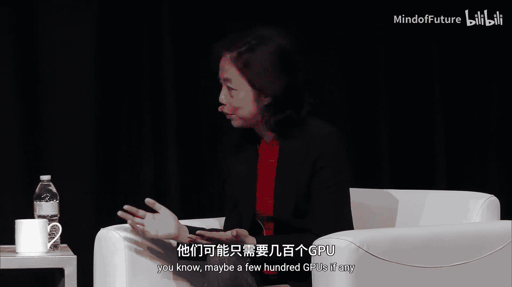

students and fellow faculty and and resourcing and also had a private sector partnership with public sector would go a long way in in resourcing them。

 But I also would like to call out innovation of public sector itself。

 Our public sectors are institutions， this country is a few hundred years old。

 Many of our leading public sector institutions are a few hundred years old。 and their。

 the structure there needs to。

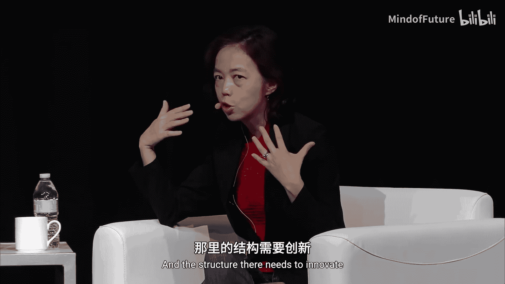

Innovate an answer to today's rapidly changing industry landscape and talent landscape。

 So there is work we should do ourselves。 But I， I hope that both sides can try to come together。

To make this better Yeah， under the heading of public private partnership。

 what do you think of the Na pilot， as you know， as our。

You very hardworking。 public representatives in Congress are pushing the act to both authorize and appropriate the nerve forward。

 In the meantime， a pilot has been launched largely with donated resourcesvidia has put up $30 million and Microsoft a comparable amount of GPU cycles。

 is this going make a difference and how do you see that working。 Yeah， great question。

 So for those of you who don't know their pilot is like Bill said。

 it's a smaller amount of compute resources that's appropriated by the president's AI executive order back in November。

 right So it's part of the E O。

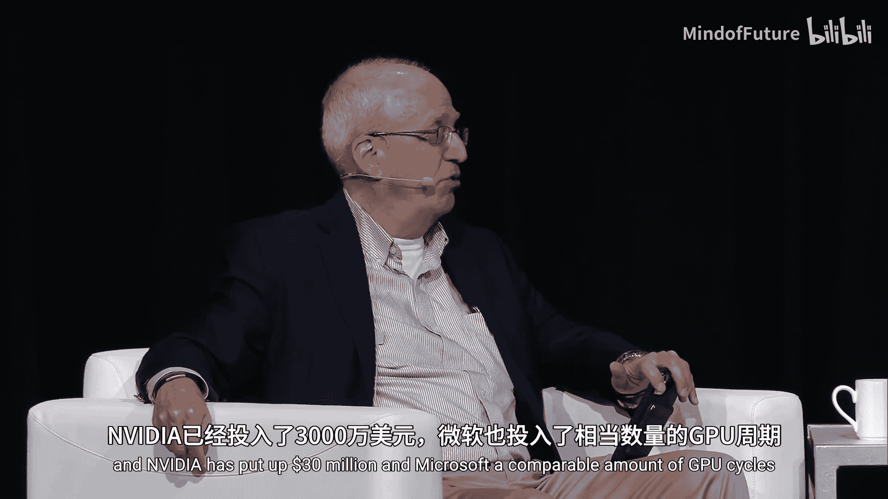

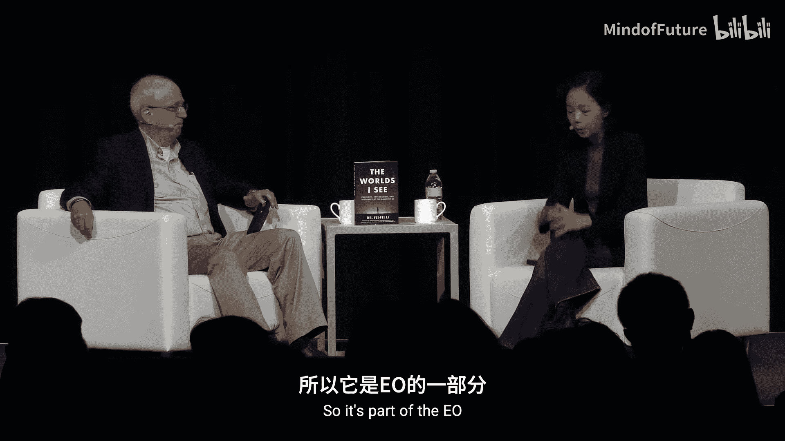

I think positively， in terms of the private companies coming together and trying to support this effort as an academic。

 I was so busy supporting there。 I miss the deadline applying for those compute credit。 So。

 so I'm not gonna benefit from this， this round， but I do see that my colleagues across the country who apply for this。

 have a potential to get benefited。 But let me also just be blunt。 That's too small。

 I don't know if it's even a drop in the bucket。 right， I don't， I'm not trying to dismiss that it's。

 it is a nice first step， but。

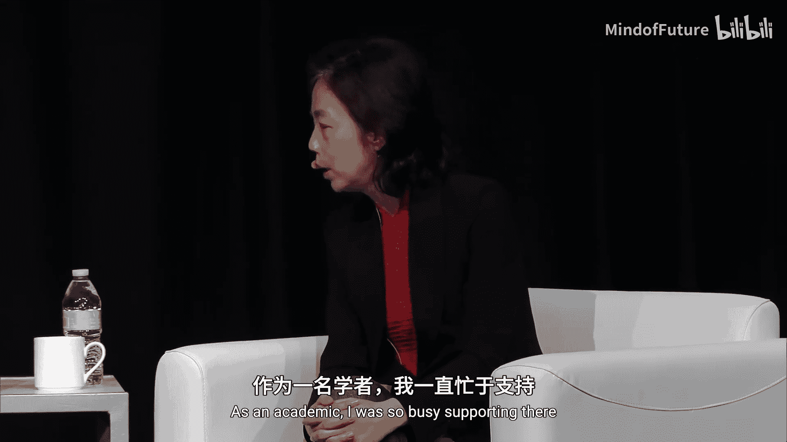

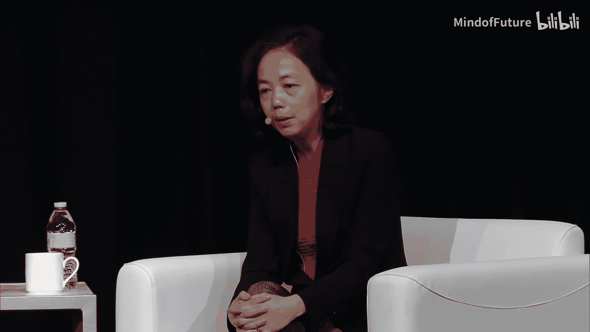

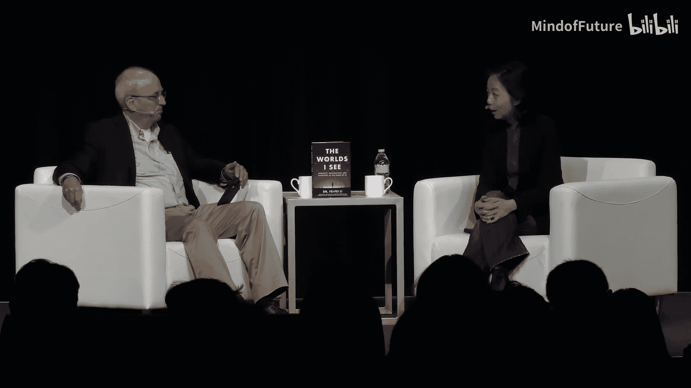

I don'。 I hope no one。 I hope the White House。 I hope the Congress。 I hope that the industry leaders。

I hope no one is content with thatca it's way too small， you know， given the kind of large models。

 the kind of data， the kind of potentials that are out there that the public sector can use these compute for。

 This is really literally a tiny drop in the bucket。 and we have a lot more work to do。

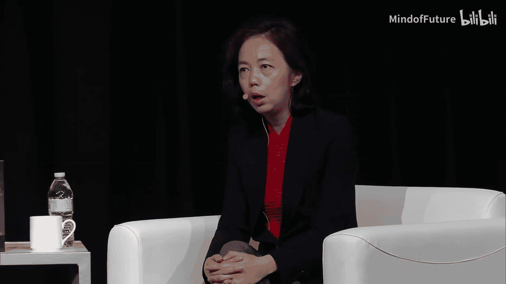

So you've been sort of conflating public sector with。

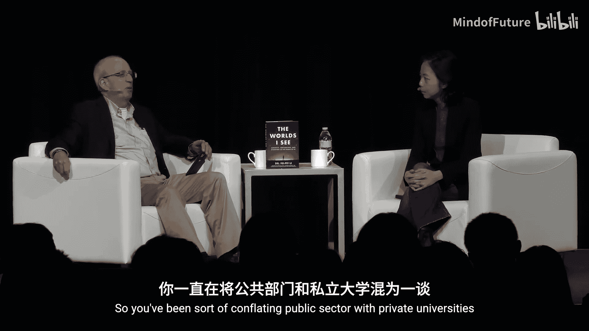

Private universities， if you were to split that apart and ask you。

 how do you see the government actually using AI， will it you know serve the people better。

 Will it streamline access to various government services。

 what are the real public sector applications By the way。

 even private universities are do org So I'm talking do E orm my public sectors more not for profit organizations。

 But you have a great question about government use because government when it comes to AI government role is both as a service government as it business service。

 not for profit， hopefully as well as government role。 And I think there is both rows。

 governments play and you know at Stanford H AI， we have。

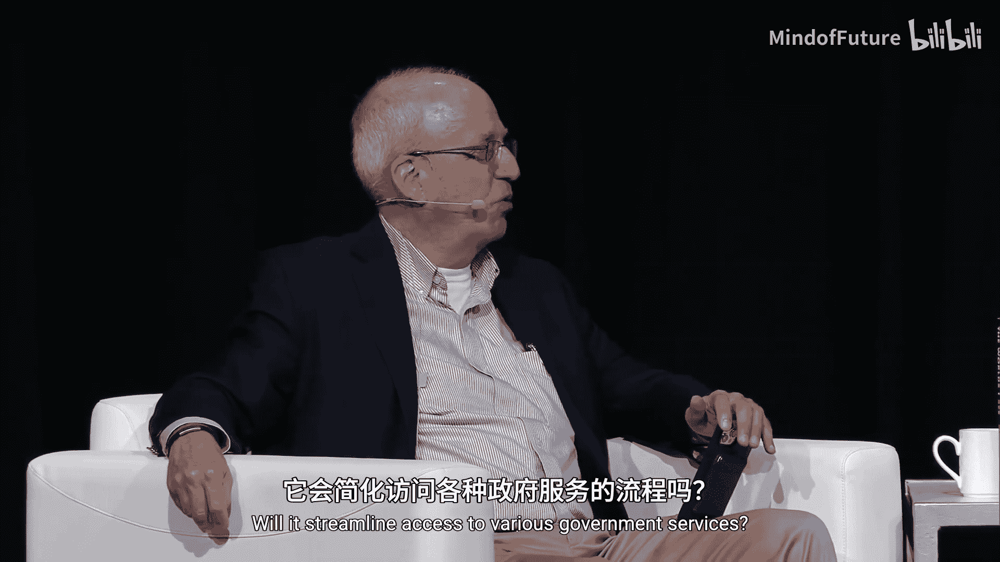

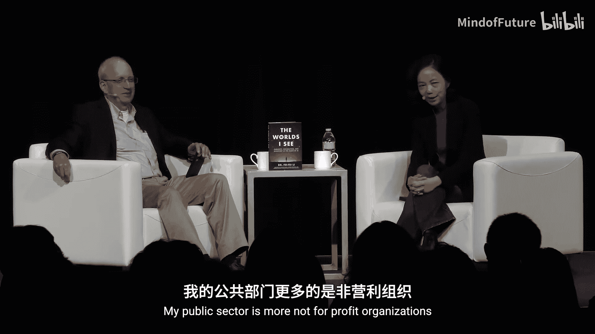

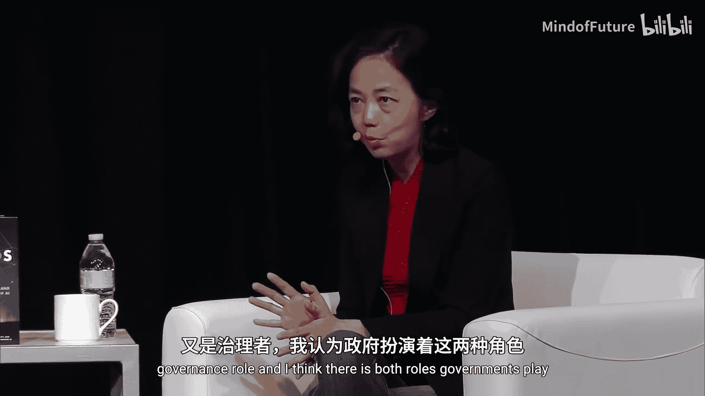

We have leading scholars working with the US government。

 whether it's IRSRS or EPA or other agencies to use AI to modernize the service of， of governments。

Honestly， all of us sitting here are subject to this kind of， you know， we probably feel like。

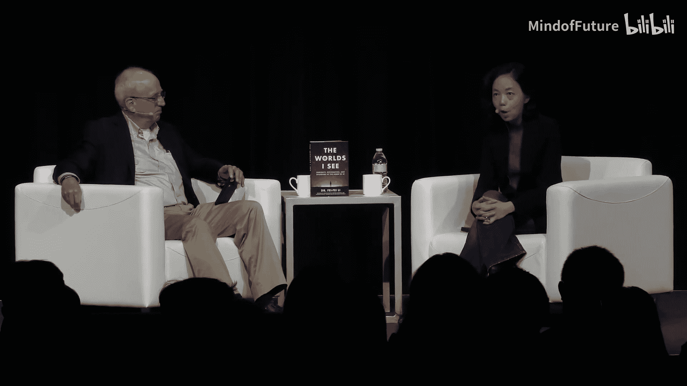

Lack of modern service in many government sectors。 And I think AI really can。

 just like it helps business， whether it's contact centers or， you know。

 personalize help AI can go a long way and also， you know， in。

 in in financial sectors or or even the public sector part of financial sectors。

 AI can do fraud detections can help prioritize cases。

 I was just at the secretary of veteran affairs in D C last week and talking to him about how we can help our veterans better using AI and serving them better。

 So there is a lot of uses in governments just to modernize and make their service to the public more efficient and effective。

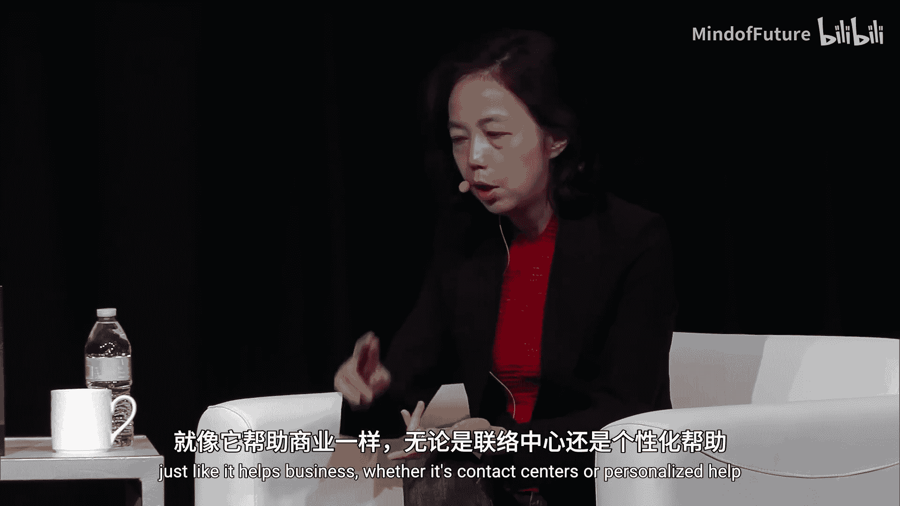

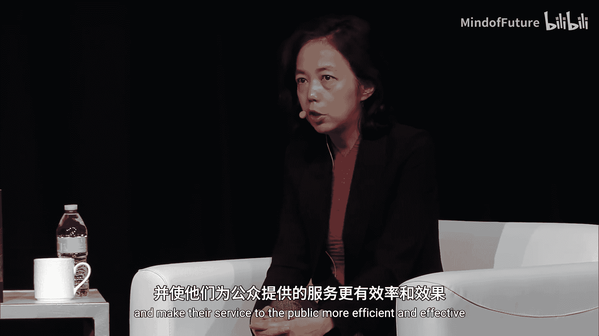

The other role you mentioned of government with AI is that of governance。

 so the EU has recently passed a regulatory act for AI and there are certainly a number of senators and congressmen in the US who are talking about doing something similar in many cases because they feel like they missed the boat on social media and they don't want to get behind on AI。

 where do you see regulation for AI going and is it going to do good or harm。

Yeah， this is such a profound question。 And， of course， when it comes to， you know。

 safety first regulation， E U tends to lead in terms of timing over America where America as a society takes pride in is our innovation。

 right， or our our environment for innovate。I definitely， am a interest， which makes me very boring。

You are anything but boring。

Thank you。😊，嗯。😊，I absolutely believe regulation has a role regulation has a role。

 just like if you have a house， if you have kids in your house， there are some guidelines right。

 So think about every innovation， you know， seat belts saved how many lives， you know， clinical。

 you know， regulatory efforts made our medicines and drugs safer， even though it's not perfect。

 AI is such a profound technology， we cannot not have regulation。

 But how to regulate in an effective way is really critical because from a government point of view。

 and you said up Ps， we have these two forces， one is allow the society to innovate to take advantage of this technology to lift everybody lift the prosperity。

 The other one is to keep it safe， Keep it trustworthy， Keep it fair。 Keep it transparent。

 And I think that's the that's the tension between regulation。

And and incentivization。 And we have to do it thoughtfully。 Just one example。

 I personally do believe in vertical space， especially healthcare care， finance， mobility， you know。

 all these vertical space where we already have a regulatory framework。It's actually time to update。

 because there are many urgent use cases that really do。

It's really time for them to look at AI's impact。 For example， medical devices。

 We have a lot of medical devices out there that have very loose regulatory， you know。

 FDADA you know， inspection or permission。 And we should be really looking at those vertical space and where rubber meets the road。

 how we can keep the AI products and services safe。 More profound regulatory measures。😊。

In the form of， you know， how does it impact our， our democracy， the， the， the， the social media。

 I have to confess， this is a。

Ongoing， complex struggle。Of many sectors from the civil society to academia， to government。

I don't think we have done a great job in the past two decades now， or at least one and a half。

 And I agree with you， Bill that let's hope that we don't。Continue， make。

At least we need to learn something from that， right。

W I agree with you that the vertical approach is the way to do it because each of those verticals。

 whether it's niches that to regulate AI in cars or you know。

The FDADA and and such to regulate AI and in medicine。

 I think you could apply that to social media as well， And it would be the FCC。

 which regulates communications， whether it's over broadcast or whether it's on the Internet。

 There are some who have suggested that we actually need a new agency for AI to regulate AI You know。

 independent of application area。 That doesn't make any sense to me。 What do you think of that。

I see AI as something to the extent of electricity or computers。

And I don't think we can have an agency for electricity or computers。

 So it is hard for me to imagine an independent agency for AI。 AI is so horizontal。

So， so from protein folding to weather simulation， AI is really rapidly accelerating science。

 You know， it used to take， you know，1 PhD to fold one protein， and then Al fold did like 200000 in。

 you know， overnight。 how do you see the the biggest applications of AI for science。

 And how do you see this as transforming the scientific enterprise going forward。

 I actually think this is the most exciting。 I I already mentioned if， if。

If you look at。Human history， human civilization。 At the end of the day。

 it is these scientific discoveries and innovations that would， you know。

 create profound impact and AI as a new tool to assist scientific discovery is the opportunity of our century。

 I especially have the privilege of sitting in on Stanford campus where I talk to my fellow friends and colleagues from neuroscience from material science from nano。

 from aerospace from， you know， oncology from you know。

 chemistry and everywhere I turn I hear their excitement about the data they generate the kind of hypothesis they have formed and how AI can。

 you know， be just a superpower in， in accelerating their discovery process。 So I I。

 I think you know， going。😊。

Back to the question， the role of public sector， especially in university。

 I think doub in tripling down in scientific discovery is exactly what universities should be doing。

 And that's the opportunity。So you personally have been very involved in a number of endeavors applying AI to medicine in that area。

 what do you see as you know， sort of the most exciting things going on now。

 and where do you see that field being in 10 years？

I， you know， talking about re， writing a sequel of the book。 If。

 if I were to write a sequel of the book， I hope half of it is health care and medicine， because。

 I think， you know。AI's application in medicine is probably the most profound and sweeping， right。

 Like I don't personally work in the upstream of drug discovery， biochemistry， genomics and all that。

 But there the the combination of AI and biotech is just accelerating so rapidly。

 I happen to in the past decade plus working the most downstream of healthcare care。

 which is healthcare delivery。 This is where nurses， doctors。

 Home care workers care for patients and the elderly in the chronically ill patients。

 This is where safety is a concern。 there is a labor shortage。

 even when there is no there are caretakers。 It is a very skewed market that women and people of color tend to be predominantly work this space yet there're not even counted in the GDP。

 right So， so there is a lot of。

Ibalance inefficiency and， and also human suffering in healthcare delivery。

 So the kind of opportunity I see is that AI can really become guardian angels or assistive guardian angels。

 for example， my work with Stanford Hospital puts passive sensors。

 non invasiveive pro privacy protected passive sensors in patient rooms where it helps that the hospital to watch important clinically relevant events。

 events like are patients about to fall， events like sudden deterioration of patient condition。

 events like improper hand hygiene practice by clinicians。

 These are clinically relevant events that are right now today living in the dark space of healthcare。

And AI as a form of intelligence sensor， can really help illuminate that dark space and also go into homes。

 We you know， if we believe technology is gonna bring prosperity， is gonna shift jobs。

 though we need to believe that human lives need to continue to live more with more dignity。

 more independence， more selfrespect。 and as the the society ages。

 we want our elderly to have that dignity and independence and and and living situation and AI can help ensure that even when you're living alone。

 even when you're living with chronic illnesses， AI sensors as well as you know。

 AI technology can help keeping an eye on you without invading your space。

 keeping the communication of your。

OrWhile being with your caretakers or family。 And these is。

 this is the space of healthcare delivery that I work in， and I feel passionate about。😊。

That's a very exciting future。So， we've seen a very rapid evolution of models from， you know。

 the early imagenet days when everybody was making cons to you know。

 to R Ns for language to transformers， What's next。

 do these new state face models hold promise or what do you see as being our dominant。

Network model down the road。Well， the latest there are the diffusion models and。

You know， I， I don't have a name for you。 You know， if I do， I would just。Register it right now。But。

 but I think， first of all， I continue to believe in the scaling law of data。

I don't think we have seen the end of that。 You know， theres a lot of conjecture of。

 have we seen the end of， I don't know language data， I I， I don't know。

 I don't work in the language space。 But in terms of the world data， the multimodal data the。

 you know， there is a law out there and humans and nature。

 is producing and taking the advantage of that， using model architecture that supports that is。

 you know， I I continue to bet on that right So if you you take this sort of chinchilla scaling laws for LLMs。

 you apply it to multimodal data one would suggest that you then need bigger and bigger models as you get more and more world data to train Is that the direction you think things are going。

I think that's one direction。 The another direction I do believe in is the structure of the world because language is actually a really。

 I'm kind of jealous of my colleagues in N LP， because it fundamentally it's a 1D structure， right。

 I work in vision， it's fundamentally 3D， if you at time， it's。

 it's 4D and 3D structure is a lot richer， but it's a lot more complex。

 So so when we scale with big data。 If it's complete blind scaling。😊。

You know， well， I guess a video will be happy。 You'll sell a lot more chips。 but。

 but I would like to see the the combination of structured modeling or or models that are biased or induced by by more 3D awareness as structure that combines with big data。

 And I think there is， you know， to really create the kind of spatial intelligence。

 the kind of world models that that is still lacking today。

 So you're suggesting something like the physics informed neural networks that are used for many types of scientific simulations you would extend to basically take priors that you know about the world and use that to make these world models more。

 physics dynamics and  structureuring induced and informed。

 so do you see foundation models coming for the world that we can ask any question about the world and it will respond to us in multimodal 4D formats。

I do。 I do see foundation of models coming to world。

 And I don't think you need to just ask questions。 That's a very language centric way of interacting。

 I actually think you can interact with it。 Look at humans or or organisms， One thing that I。

 you know， being a computer vision person would like to remind everybody。

 nature took 540 million years to create perceptual brain。

 It only took a few hundred thousand years to create a linguistic brain。 So perception is deeply。

 deeply profound。

That's a good point many， many millions of years ahead。Or it's just harder， so that takes longer。So。

 so one of the risks that people have positiveed about AI is it disruption of， of the job market。

 whether you know， you could say it will create jobs and it may make other jobs less important。

 What jobs are uniquely human that you think could never be replaced by an AI or a robot。

That's such a great question。 Bill， you should have told me before you're asking this。

 I actually sent all these over little。It's。

It's a dangerous question because every job our ancestors has imagined since the beginning of our civilization。

Have essentially be。Be done or， you know， collaboratively done by， by machines， right， So moving。

 flying， computing and all this。 So what I， what I feel is that。

What is the definition of job。

If job is a task。

You know， the task of grabbing something or cooking an omelet， I think it will be done by machines。

But if job is part of being human， is's part of defining our creativity， defining our uniqueness。

 defining our intention， our compassion。 our emotional connection to unique emotional connection to others and the unique contribution Each of us。

 Each of us can have to others or to the society。 And I think that will never be completely replaced。

 We will be using machines to help us to do that kind of job better。

 But I don't see a fundamental replacement。 And again， let me go back to healthcare。 right， I spend。

At this point， I spent decades in hospitals taking care of my elderly ail parents。

 And every time I go into that patient room with my parent。

I look at the way that the humans caring for humans are humans needing humans to care for humans。

There's something so profound in that relationship and interaction that no robots， no AI。

 no computer， no A RVR， whatever you're you're thinking of as the next generation technology can completely can completely take over the same with teachers with children。

 Pars with kids， services that we really value， the trips we take。

 there's so much about being human and about human human interaction that goes beyond computation。

 calculation mechanics that I think those will be the kind of jobs that will remain and will evolve into so that will be more and more superpower by machines but the crux of being human will not be replaced。

So you're suggesting sort of the。😀Yeah。😊，Obviously， the audience is deeply moved by that。

 you've connected with them in a human way。 but you're suggesting that sort of the empathy and emotional connection and caring is creativity and creativity is a nuclear human thing。

 but isn't it the case that if we chose to train AI models to have those characteristics that we could do it。

 and we could build caring AI models that can emotionally connect with people。

To an extent， I mean， you know， I， again， I work in computer vision and the kind of text to image and text to video generation that are already deeply creative。

 but I also think。Just like nobody here can predict who will be the next Eint。

That kind of creativity， uncertainty of creativity is just gonna forever exist in。

 in our human society。 So no， no matter how you train machines。

 you cannot train that kind of human intelligence or human creativity。

 And it's not just Einstein's Beethoven。 It's Shakespeare。 It's vanal。 There is just so much。

 And it not doesn't have to be even someone as smart。 My own kid。

 I don't think any machine can create that sweet， smart， humorous little child that I have。

 And that is unique。 And machines cannot take that away。😊。

Like there is is part of us that's uniquely human and will never be replaced。

 on the topic of creativity， you know， you know， generative AI is doing amazing things。

 Openai recently produced Sora where you can type in a prompt and get a video that just looks great。

 Are are we ultimately， maybe when you write your sequel in 10 years going be to the point where if you want to watch a feature film。

 you just write a couple lines of the prompt and it'll generate a two hour movie for you。😊。

I don't think that's gonna to take 10 years， Bill。

😀No， so produce a lot of B 200。 It'll come very soon。😊。

That part， I believe is's gonna happen very soon。So I think， you know， I'm sure Sam has a。

 has a timeline better than mine。 But， but I， as a technology， I see that coming the horizon。

 the ability to create longer forms of。You know， generated world， generated storyline。

 generated character interaction is at the fingertip。

So so in such a world where we have AI programs generating most of this content。

 what is the role of the human content creators who are in Hollywood or in the game studios or the like？

it goes back to that human uniqueness， right， I don't know how many of you are fans of Miyazaki Jubli studio。

 yeah， so。

The best。I。I mean， I just love watching their movies over and over again。

 And from a computer graphics point of view， it is pretty rudimentary。

 They don't do the kind of Pixar graphics St work graphics， so。😊，It's yet。That unique story， right。

 Like， for example， my neighbor told a Ro， how simple is that story， How simple is that kind of。

Humanity in that movie， nobody， not nobody can can create that except Miyazaki。

 And I think that is still what's human， right， We will AI will create movies and will create contents that entertain people But there are people who will use AI to create contents that would touch others or inspire others or serve others in a way that AI cannot I do see that cohabit cohabit possibility So you're suggesting that the AI will basically take over the production part these creative things。

 making really compelling you know， videos getting the graphics looking really good。

 but ultimately what you said before， it's connecting with humans on an emotional level。

 telling the story that move somebody to tears that will be the human part of exactly the one thing I keep stressing。

Bill， is that。Do not forget our humanity。 Do not forget our dignity。

 Do not forget each other's dignity and humanity in this machine age。

That。

That is what is core to us。 And that is what makes us unique。

 And that is the beginning of how we frame the application of machines， the usage of machines。

So， you know， the world is a global place， and AI research is a global effort。

How do you think everybody should work together， you know。

 going forward to accelerate and ensure responsible development of AI。

 particularly in in an environment where there's an increasing divide between two countries that are both very capable in this area。

 the US and China， How can we work with them and bring the world closer together。

Yeah， the world is complex。 and I'm not gonna pretend I understand all the complexity and messiness at Stanford H AI。

 we are actually working with global community were especially working with countries that have shared values of democracy and human rights。

 And I think it's really， really important。 I also think that science， arts， you know。

 just just again， that the fundamental humanity of ours。

 have always been a fundamental uniting force of humanity。

 no matter where the geopolitics and and and all those goes。 So from that point of view， you know。

 a continued effort of collaboration， outreach and just exchange of genuine ideas are still so important。

Do you see the current freeze， know， between the US and China where， for example。

 we're not able to ship them GB200。 That's a jen question， not a favorite question。

But， but even on the level of academic collaborations。

 I think there's a certain amount of pressure put not to collaborate with， you know， people in。

 in certain countries。 Do you see this easing up， Because ultimately。

 I think the world is a better place if we all work together。

Okay， that's a great question。I suppose， I mean， we all are grown ups living in the ups and downs of politics。

 I suppose policies will change Right now， it's not yet easy enough。 You know。

 we have changed either way。 right， Well， you are， you work with the president。 you told me。

😀Ha。😊，I'm interested in your view。 My view is right now。

 following the guideline of what universities give giving us， it's not easing up。 That that is the。

 the， the factual statement。 Can it one day ease up。😊。

We will see。 I don't know if it eases up。 There are definitely opportunities of collaboration。

 You know， I myself， again， for example， I， I have great hope that healthcare is an area that global collaboration。

 We， we have actually collaboration in Thailand in Singapore in， you know， So。

 so these are really important topics that we need global collaboration。😊。

So we have a minute， 32 seconds left。 Is there anything else that you'd like to impart the audience。

 perhaps bringing them to applause once more。

Well， that is a dull order。IThe one thing I think， I mean， GTC is a special conference。

 You're already here because you're somehow involved in AI as I write the book and and talk to a global audience。

 especially a global young audience。 the one question that I often get and I every time I get someone asking that question。

 It still moves me is that what is my role。 you know。

 I'm not a computer scientist from a science major from Stanford， I don't do software engineering。

 I didn't grow up in， you know， a household of computers。 I love dancing。

 I'm serving my community that is， you know， a semirural community。

 all these people coming from all walks of life and ask me what is their role in AIca it feels so complex。

 right， like， you know， several hundred billion parameters like how do you wrap that around your own brain And then all these。

😊。

Fancy words， transformers， generative diffusion。 They seem so far from you， each individual。

 But I really wna bring it down to this is a tool。 It's a tool that does take some mathematical and computing to make it happen。

 but humans are at the end of the day， not only creators of tools。

 where also decision makers of how to use tools， We creators of applications of tools， where also。

 you know， customers of tools， where voters who decide how to govern the tool and govern the people who want to use the tool。

 So there is so much。

Civic possibilities in participating in AI。 I especially one the young people。

 the people who loves arts， who loves community， Who loves law， Who loves medicine， Who loves。

 you know， chemistry， whatever your interest is。Embrace this technology and embrace it with a sense of responsibility that you can actually make a difference to make it better。

 Use it better。 And that's really my plea to everybody。 You have a role in AI。

 And please join us to make it better。 Thank you。😊。

Thank you， Fae。I think you've been inspired everybody and given us a lot to think about。

 so thank you very much for your time for inviting me Phil and everybody have a great GTC。

 thanks for attending。

