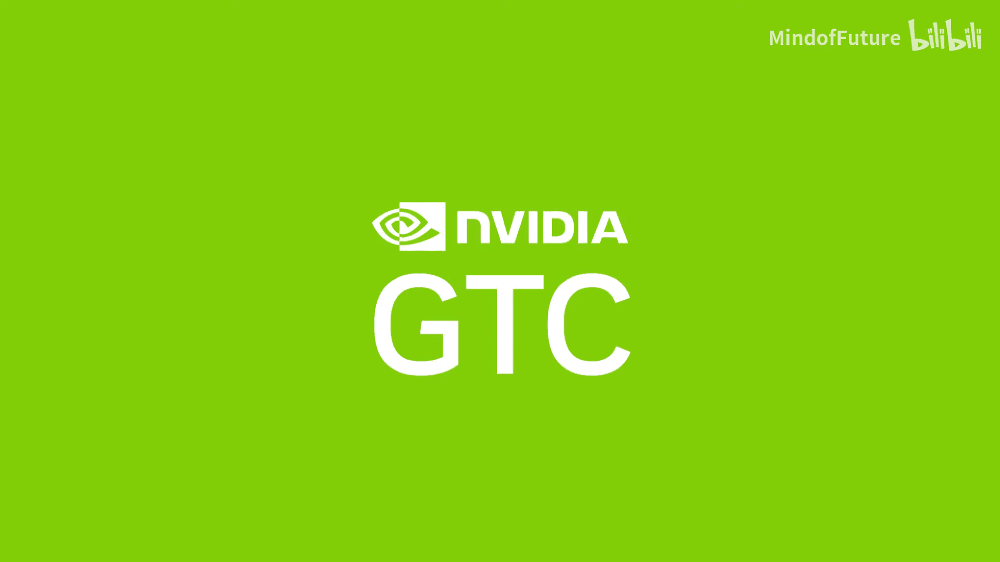
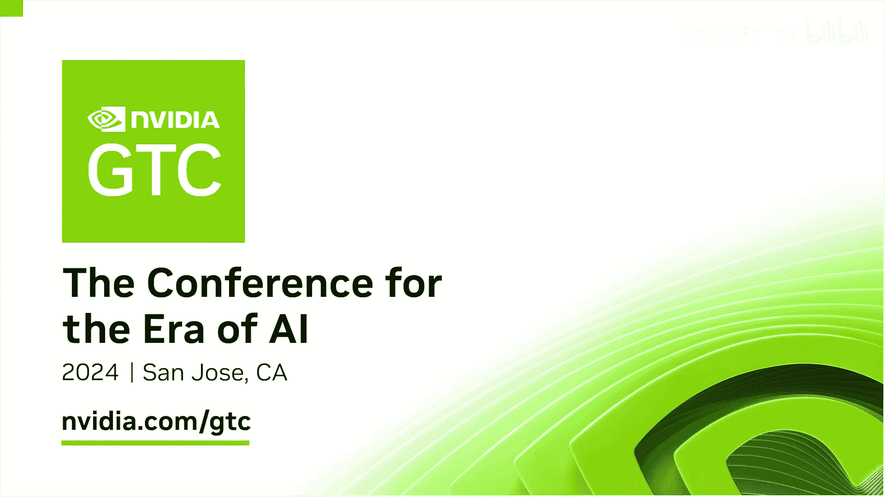

# 【英伟达GTC人工智能大会 • 中英】NVIDIA GTC 2024 p15 P15 Live From GTC - A Conversation With Greg Estes -BV1yHAeeqECP_p15-

Hi I'm Claauudia Cook， I am here with Greg Estes who is our vice president of developer Program and corporate marketing。

 we are coming to you live from GTC 2024 and were so psyched to talk to you guys about what's happening here at the show amazing five years right five years since we've been in the convention center and the energy is insane right Yeah what it changed if you think about it Nvidia is in a very different place than we were as a company five years ago 2019 we had about 8600 people there we 11。

000 people in the keynote yesterday 17，000 might hit 18。

000 here physically and we're expecting by the time the week is out 300。

000 people registered and seeing GTC content online and viewing it that way so the buzz in the energy is just it's off the charts。

It really is you know it's early it's early here and the exhibition isn't open so you can't see the people behind us but last night it was like you couldn't even move it was just it was wall to wall with people everywhere and a lot of happy people a lot of we did have a nice beer garden amongst all the tech you know I like to say it was the perfect blend of tech and fun there you go yeah and the community too our ecosystem our ecosystem is changing too as well everything has changeden Jensen showed in the keynote yesterday you know have we have all of the important players in AI here the Googles and the micro and AWSs and oracles and all the ones you kind of expect Neta and others but then you look at all of the different enterprises of different kinds that are here that are building their businesses you know you have the Wells Fargos and and the John Deeers。

And you know， all of these just really great kinds of brands and companies that are doing amazing things with AI now。

 and that's a huge difference that we've had from。2019， there's a lot of things actually。

In 2019 things that were research， we're showing it wacky new thing that's just been invented last Thursday and we're showing it for the first time and now you see it in deployment in enterprises you know very traditional enterprises of different kinds and they're here talking about that and it's indicative of the way the market has changed it's indicative of how ecosystem has changed to your point I've always loved to see our research come to life like you said。

 actually getting deployed I' thinking back when it was just sort of being born know as an idea super fun and also the emergence of different areas that are that you can just see where AI is going generative AI is the one on everybody's mind of course in 2019 there was people didn't really even know what AI is and now you have 12 year olds that can tell you what chat GT is and it's just such a huge different healthcare you know all the industries。

Using AI and then we have a beautiful AI art installation here right fromfi Refi Anaal's installation is gorgeous so beautiful and it was part of the keynote was people walked in they got to experience that that's right we were really happy to be able to work with him it's at the Museum of Modern art in Manhattan and he's really the leading AI artist in the world certainly the most notable and to do that at the keynote live and to have that on that amazing Taylor Swiftsized screen that we fill the SAP Center with that energy is pretty cool and we actually got to talk to Rfi here at the studio earlier this week so we have an episode with him that people can check out to great he's an interesting guy so people haven't haven't seen it here super great guy Yeah for sure check it out and this studio has been awesome that weve been able to bring in our partners。

 our speakers， having you here。To talk about it since GT is such a passion of yours as it is mine but speaking of TV studios。

 we also have CNBC here it's amazing Jim Kramer broadcasting live 60 minutes is here filming for a segment we have broadcasters from more than a dozen countries here doing all kinds of things all over the place that energy is is really really cool and CNBC for instance they did a countdown until Jensen's keynote and you know the Wall Street Journal leads with a story it was a great story they were saying that Nvidia is pulling 11000 people to a developer conference about AI it just going like think about that for a moment so its pretty pretty cool it is it was actually really fun to wake up to that yesterday morning that countdown was awesome awesome awesome but anything else you want to let people know about like what are you looking for just seeing walk in the floor running into。

FriendsOne of the things that I'm super excited about actually is all of the startups。

 We had our startup program， as you know， is called Inception and we had a reception last night for all the inception partners。

 there were more than 500 people there we had to worry about the fire marshal in the room that we had the mayor of San jose was there speaking which is great One of the things that mayor MattMon is trying to do with San jose is to make it really kind of the capital of AI。

 So now you're seeing governments at state and local government level like San Jose。

 but you're also seeing national governments。 certainly the United States。

 but governments from around the world starting to create this infrastructure of having AI supercomputers in their country and it makes a lot of sense because what you want to do is you want to be able to invest in that infrastructure and then grow in ecosystem around that so that you can have students who were coming out of your top universities and they stay in the country and they built。

startups and they do all of those things and you're doing it in local language and you're keeping the data there and so at every level of government you're seeing the investment now where a few years ago it was like you know AI okay and now it seems like it's an imperative and that makes sense too because just imagine。

What's the business right now that strategically that business is going to say yeah I'm not we're not going to do much with AI I mean who is that so it's just pervasive in terms of technology。

 it's the most profound technology change in our lifetimes and so for people to be able to come to GTC and see the entire ecosystem to learn about it。

 if your developer get hands on training if you're a senior executive or a staff member of countries from around the world。

 you can get immersed in it and truly understand how build your strategy how to build your strategy and so very proud very proud that GTC has become the world's most important conference for AI and very proud that we're blowing through every projection we could possibly have in terms of the number of registrants that we're here and I'm very proud that all of our partners and every。

There's people with two story booth here at a developer conference of ours and so it just it's fundamentally changed where NviDdia is and where the ecosystem is going it's super exciting and we have to get kudos to a team behind the scenes right that helped that pull this all together Yeah people have no idea just how much work it is we start working on GTC as you know。

 eight or nine months ahead of time a year in some cases for some things but certainly we're in full bore eight or nine months ahead of time because we have about a thousand different talks。

And sessions and panels and things well we only accept maybe 64% less of the time I looked of all of the submissions coming in so you have to go through a thousand talks and you're figuring out who to have here and just arranging who's going to be where and what days and it's just the logistics people don't even think about or mind bogg and what helps us here trackers we love our trackers yeah we do little trackers yeah you do having everything but it's just been you know like you said five years。

It's been since we've been here it's just been so great to be back and it's been so great to see you know old friends。

 new friends thank you for helping us put this all together absolutely people who are viewing this you're naturally going to view this after the event has occurred by the time anybody probably sees this but having these GTC sessions on demand and video on demand it makes all of this amazing content available to all of our developers and people who want to be able to get that leading edge of what's happening not just in AI but in data science in high performance graphics and high performance computing it's not all AI it's just AI is the center of gravity if you will but to be able to take advantage of seeing all of this content it's a real gift and I hope people take advantage of that for sure Well thank you Greg for joining me here for this recap of the event and thanks everyone for watching and be sure。

Explore more sessions in the GTC catalog。

