# 【英伟达GTC人工智能大会 • 中英】NVIDIA GTC 2024 p17 P17 GTC March 2024 Keynote with NVIDIA CEO Jensen Huang -BV1yHAeeqECP_p17-

I am a visionary。Illuminating galaxies to witness the birth of stars。

And sharpening our understanding of extreme weather events。I am a helper。

Guiding the blind through a crowded world。I was thinking about running to the store and giving voice to those who cannot speak。

🎼Do not make me laugh。🎼I am a transformer。Harnessing gravity to store renewable power。

And paving the way towards unlimited clean energy for us all。I am a trainer。

Teaching robots to assist。To watch out for danger。🎼And help save lives。🎼I am a healer。

Providing a new generation of cures。

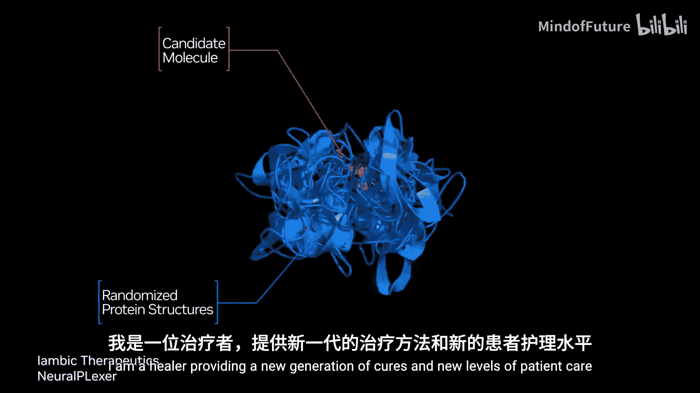

A new levels of patient care doctor that I am allergic to penicillin。

 is it still okay to take the medications Def these antibiotics don't contain penicillin。

 so it's perfectly safe for you to take them。I am a navigator。Generating virtual scenarios。

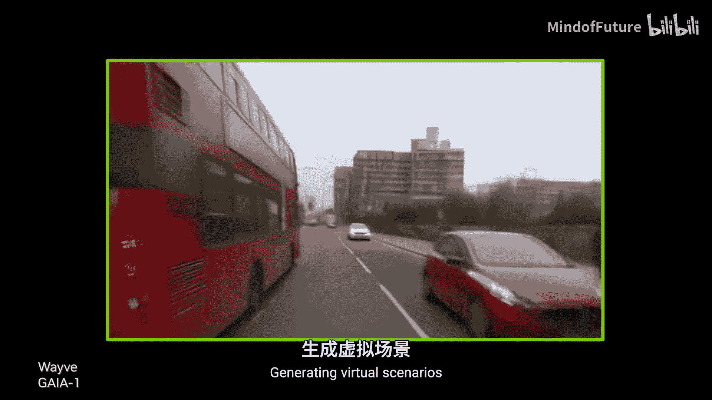

To let us safely explore the real world。And understand every decision。I even helped write the script。

Breathe life into the words。🎼Andもうちょ入をます。

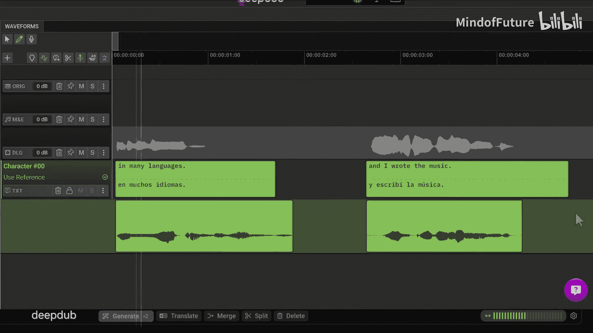

🎼Yesエクby Lamusica。I am AI。Brought to life by NviDdia。Deep learning。And brilliant minds。Everywhere。

Please welcome to the stage， NviDdia Founder and CEO Jensen Wong。

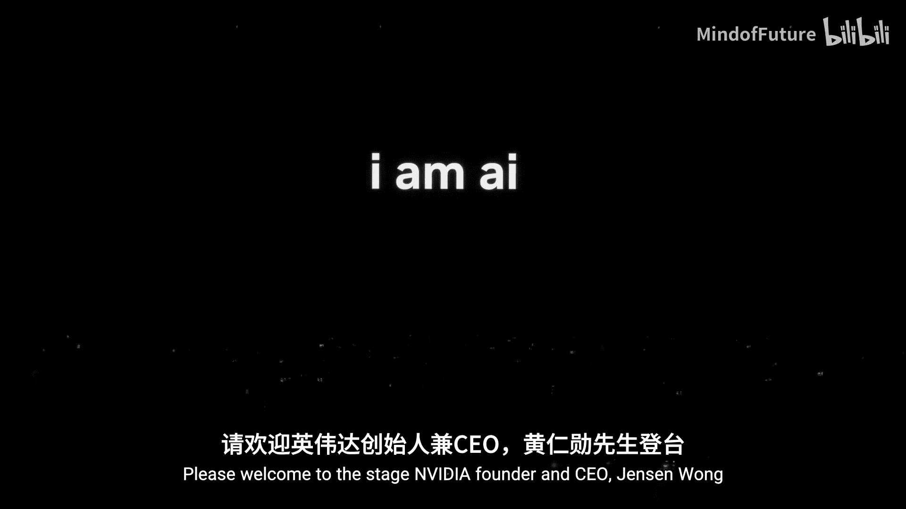

Welcome to GTC。

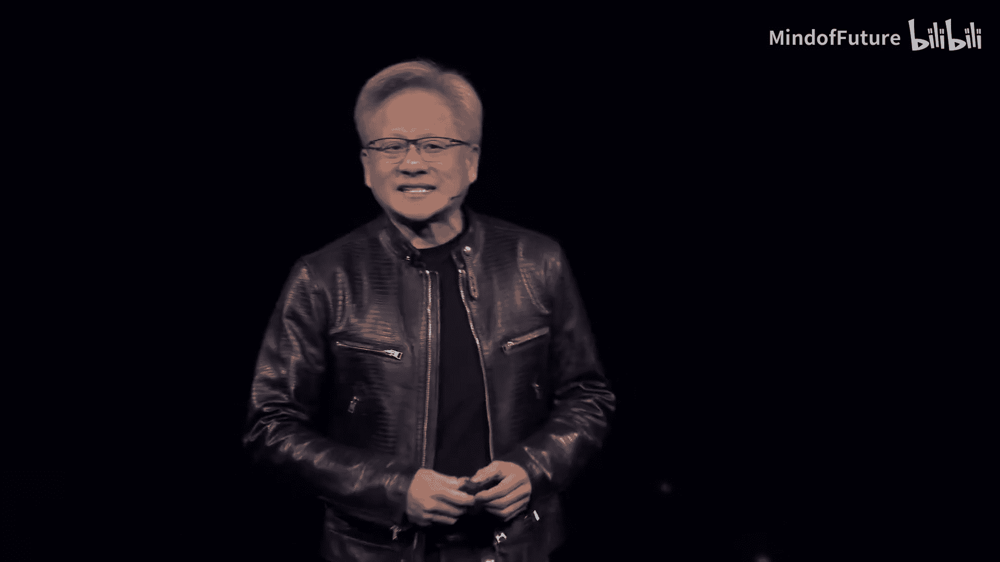

I hope you realize this is not a concert。You have arrived。At a developers conference。

There will be a lot of science described。Algorithms， computer architecture， mathematics。

I sensed a very heavy。Wait in the room。 all of a sudden。Almost like you are in the wrong place， no。

 no conference in the world。Is there a greatest assembly of researchers from such diverse fields of science。

From climate tech。To radio sciences trying to figure out how to use AI to robotically control mimos for next generation 6G radios。

 robotic self driving cars。Even artificial intelligence。Even artificial intelligence。Therebodys。

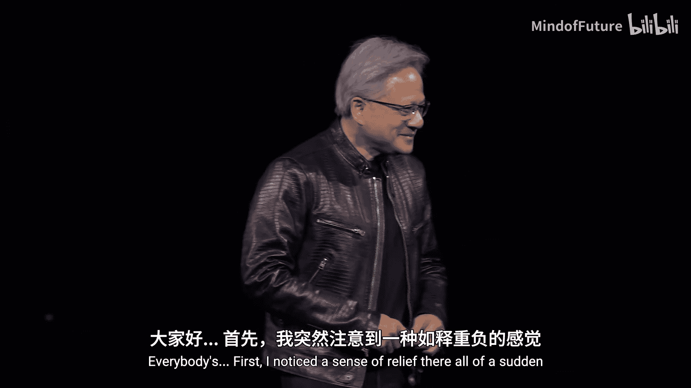

First， I noticed a sense of relief there all of a sudden。Also。

This conference is represented by some amazing companies。😊。

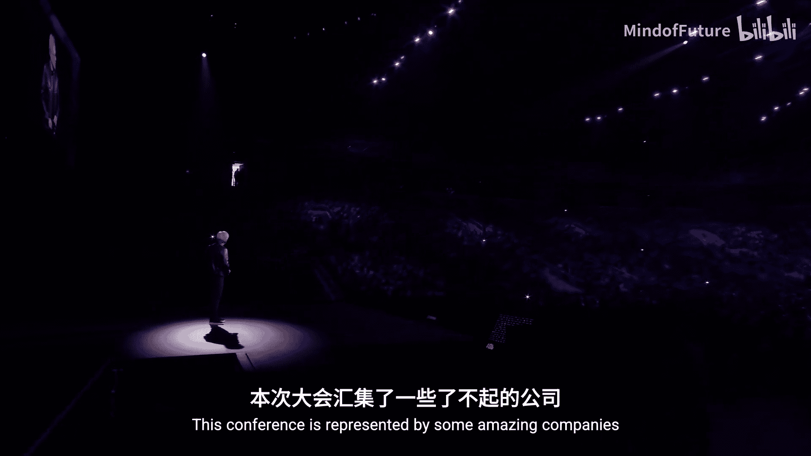

This list。This is not the attendees。These are the presenters。

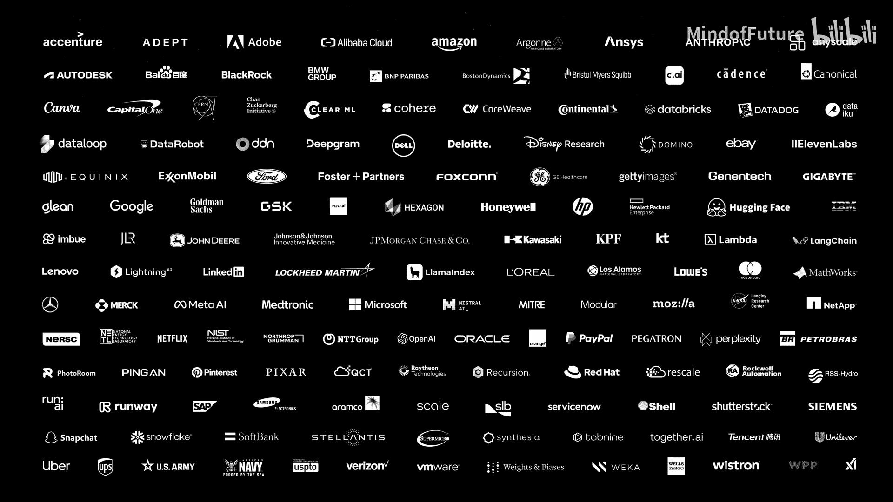

And what's amazing is this。If you take away all of my friends， close friends。

Michael Dell is sitting right there。In the I T industry。

All of the friends I grew up with in the industry， if you take away that list。This is what's amazing。

These are the presenters of the non I T industries using accelerated computing to solve problems that normal computers can't。

It's rip。Represented。In life sciences， healthcare， genomics， transportation， of course， retail。

 logistics， manufacturing， industrial。The gamut of industries represented is truly amazing。

 And you're not here to attend only you're here to present to talk about your research。

$100 trillion of the world's industries is represented in this room today。😊。

This is absolutely amazing。

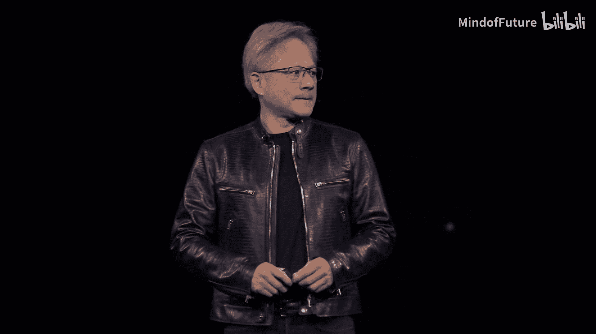

There is absolutely something happening。 There is something going on。

The industry is being transformed， not just ours， because the computer industry。

 the computer is the single most important instrument of society today。

Fundamental transformations in computing affects every industry。

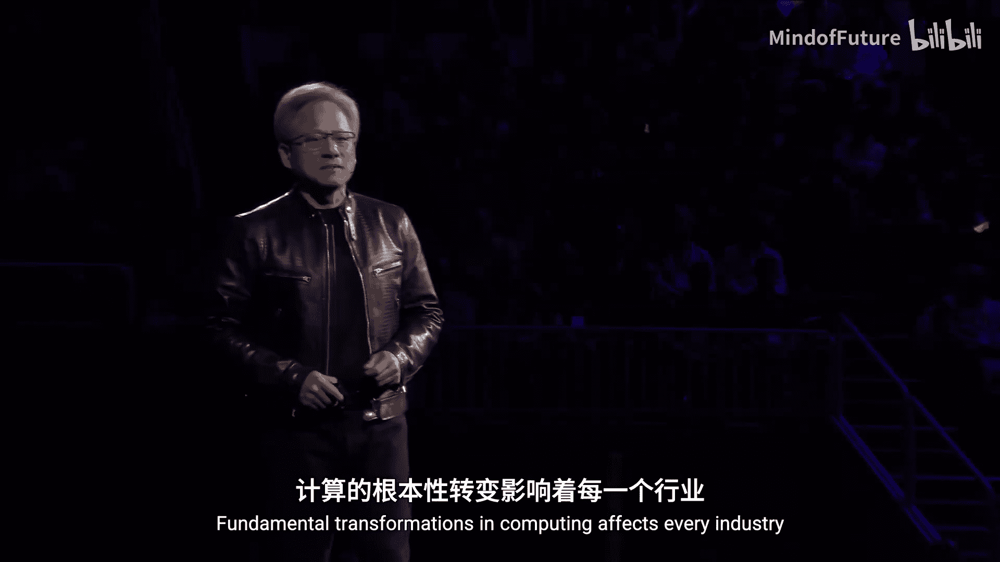

But how did we start， How did we get here。

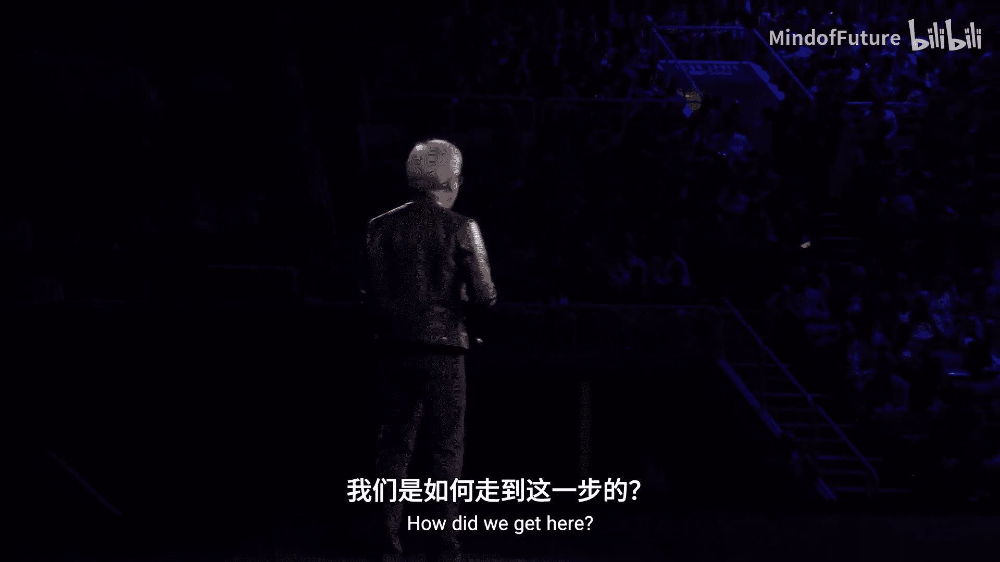

I made a little cartoon for you。 Literally， I drew this。

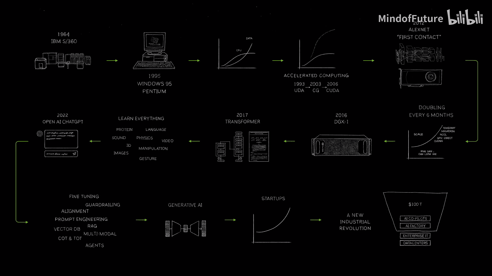

In one page， this is Nvidia' journey。Started in 1993。This might be the rest of the talk。1993。

 this is our journey。 We were founded in 1993。 There are several important events that happen along the way。

I'll just highlight a few。In 2006， Kuta， which has turned out to have been a revolutionary computing model。

 We thought it was revolutionary。 Then it was going be an overnight success。

 And almost 20 years later， it happened。

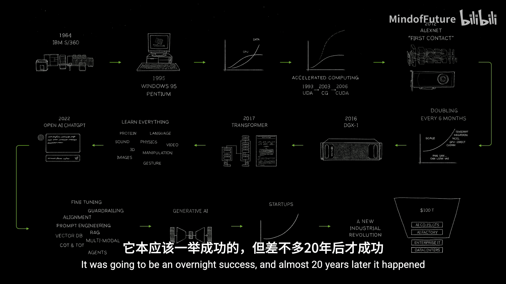

We saw it coming。

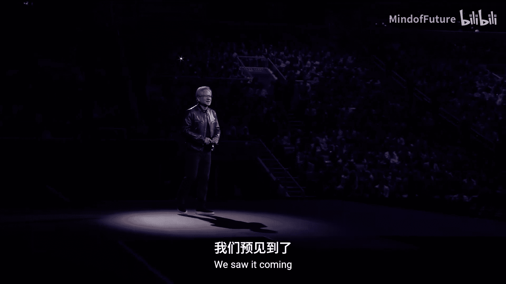

Two decades later。In 2012， Alex Net。AI and Kutuda。Made first contact。In 2016。

 recognizing the importance of this computing model， we invented a brand new type of computer。

 We call the D G， X 1。170terraopps in this supercomputer。

8 GPUs connected together for the very first time。 I hand delivered the very first D G。

 X1 to a startup。😊，Located in San Francisco。Called open AI。

D G X 1 was the world's first AI supercomputer。 Remember 170ter flaps。2017， the transformer arrived。

2022， Cha GT captured the world's imaginations， Have people realize the importance and the capabilities of artificial intelligence in 2023。

Generative AI。Emerged。And a new industry begins。Why。😡，Why is a new industry。

 Because the software never existed before。We are now producing software。

 using computers to write software， producing software that never existed before。

 It is a brand new category。 It took share from nothing。😊，It's a brand new category。

 And the way you produce the software。Is unlike anything we've ever done before in data centers。

Generating tokens。Producing。Floating point numbers。At very large scale， as if in the beginning。

Of this last industrial revolution， when people realized that you would set up factories。

Apply energy to it。

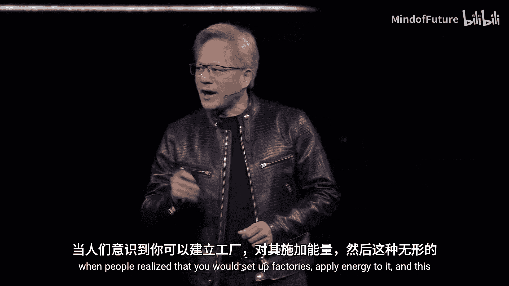

And this invisible， valuable thing called electricity came out， A C generators。

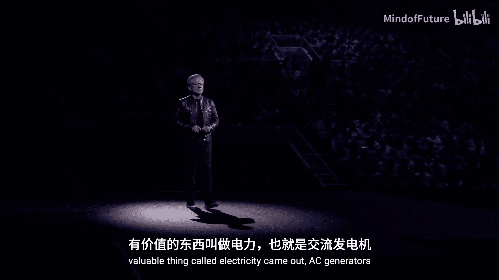

And 100 years later，200 years later， we are now creating new types of electrons。

 tokens using infrastructure。 we call factories， AI factories to generate this new。

 incredibly valuable thing called artificial intelligence。 A new industry has emerged。😊，Well。

 we're going to talk about many things about this new industry。

We're going talk about how we're to do computing next。

We're going talk about the type of software that you build because of this new industry。

 the new software。

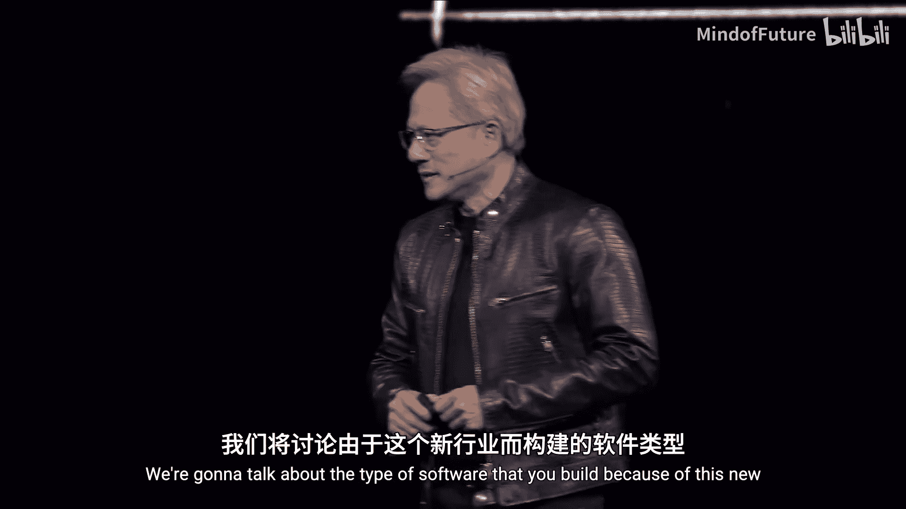

How you would think about this new software。What about applications in this new industry。

And then maybe what's next and how can we start preparing today for what is about to come next。Well。

 but before I start。I want to show you the soul of Nvidia。The soul of our company。

At the intersection。Of computer graphics。Physics。And artificial intelligence。

All intersecting inside a computer。In omniverse。In a virtual world simulation。

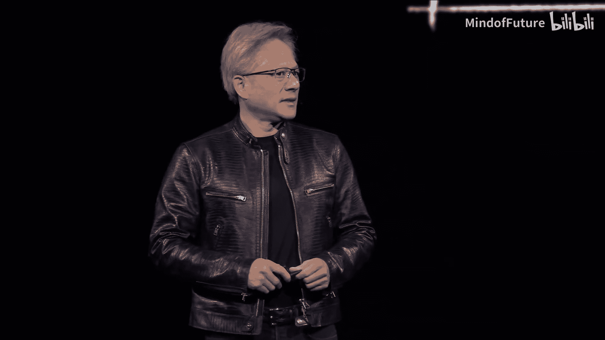

Everything we're going to show you today。 Liter everything we're going to show you today。

Is a simulation， not animation。It's only beautiful because it's physics。 The world is beautiful。😊。

It's only amazing because it's being animated with robotics。😊。

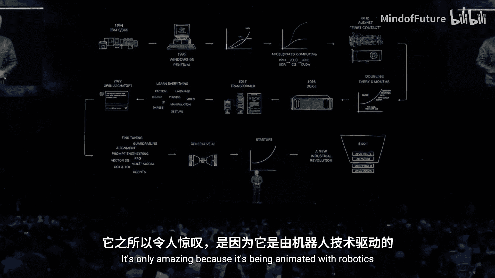

It's being animated with artificial intelligence。 What you're about to see all day。

It's completely generated， completely simulated and omniverse。 And all of it。

 What you're about to enjoy is the world's first concert where everything is homemade。😊。

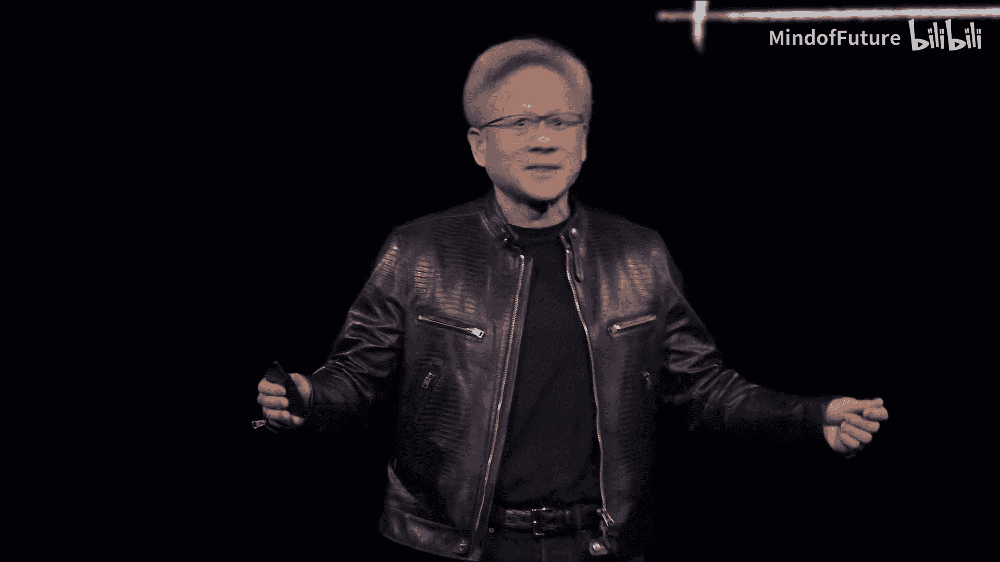

Everything is homemade。 You're about to watch some home videos。 So sit back and enjoy yourself。😊，嗯。😊。

🎼嗯嗯。😊，う。🎼嗯。🎼嗯。😊，🎼う。

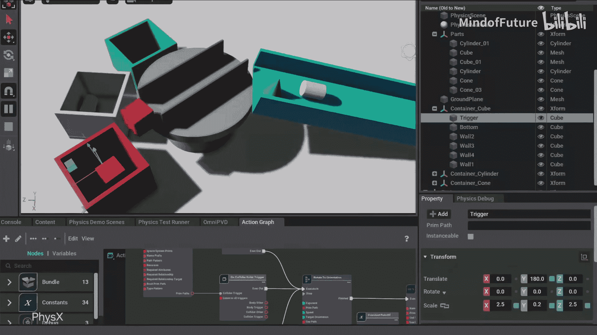

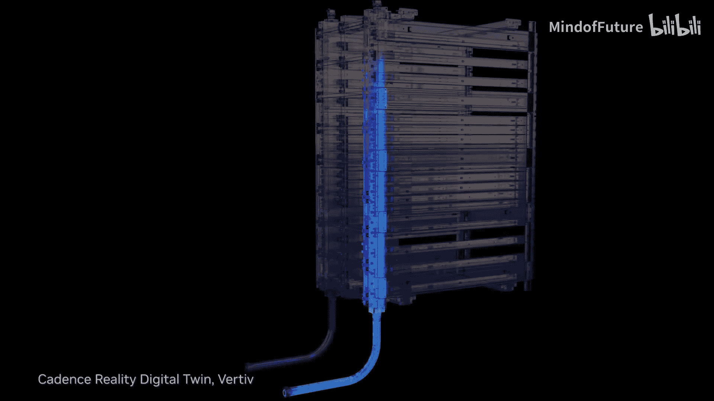

🎼。

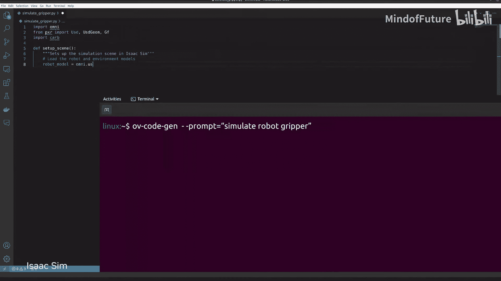

🎼，🎼Okay。🎼Yeah。

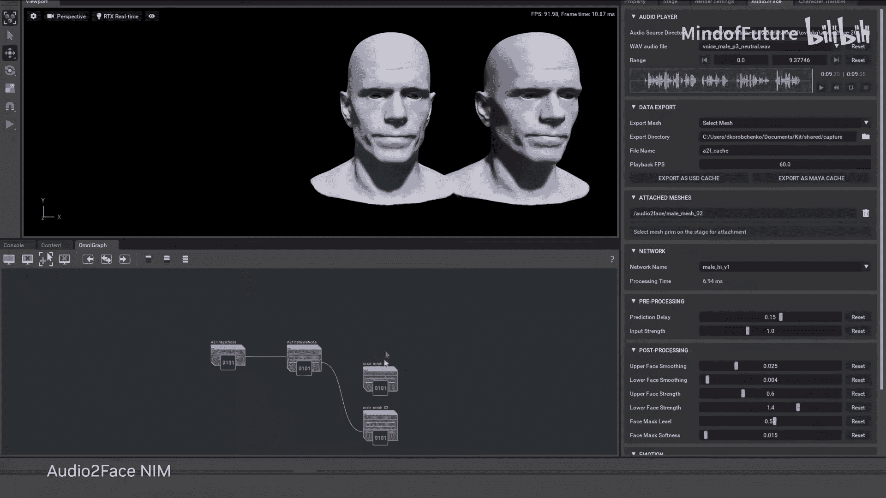

God， I love Nvidia。Accelrated computing has reached the tipping point。

General purpose computing is run out of steam。We need another way of doing computing so that we can continue to scale so that we can continue to drive down the cost of computing so that we can continue to consume more and more computing while being sustainable。

 accelerated computing is a dramatic speed up over general purpose computing。

 And in every single industry， we engage， and I'll show you many。😊，The impact is dramatic。

But in no industry is it more important than our own。The industry of using simulation tools。

To create products。In this industry， it is not about driving down the cost of computing。

 It's about driving up the scale of computing。We would like to be able to simulate the entire product that we do completely in full fidelity。

 completely digitally。And essentially， what we call digital twins。We would like to design it。

 build it， simulate it， operate it。Completely digitally。In order to do that。

We need to accelerate an entire industry。 And today。

 I would like to announce that we have some partners who are joining us in this journey to accelerate their entire ecosystem so that we can bring the world into。

😊，Acclerrated computing。But there's a bonus。When you become accelerated。Your infrastructure。

Is Kup to GPs。And when that happens， it's exactly the same infrastructure。For generative AI。

And so I'm just delighted to announce several very important partnerships。

 There are some of the most important companies in the world， Anis。😊。

Does engineering simulation for what the world makes。

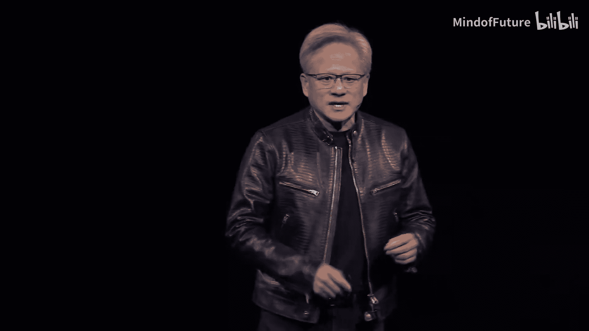

We're partnering with them to co to accelerate the Ans ecosystem to connect Ans to the omniverse digital twin。

 incredible。😊。

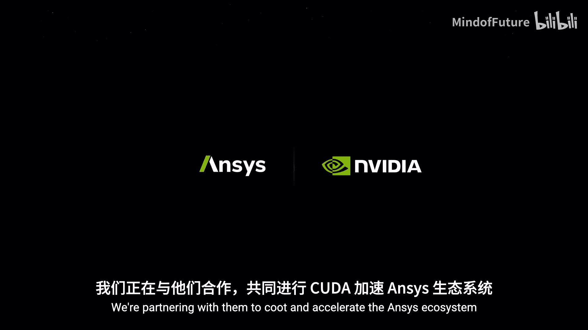

The thing that's really great is that the installed base of media GPU accelerated systems are all over the world in every cloud。

 in every system。😊，All over enterprises。 And so the applications they accelerate will have a giant installed base to go serve。

End users will have amazing applications， and， of course。

 system makers and CP will have great customer demand。😊，Synopsis。Synopsis is invidious。

 literally first。Software partner， they were there in the very first day of our company。

 Synopses revolutionized the chip industry with high level design。

We are going to coulda accelerate synopsis。We're accelerating computational lithography。

 One of the most important applications that nobody's ever known about in order to make chips。

 we have to push lithography to a limit。NVdia has created a library domain specific library that accelerates computational etthography incredibly。

😊，Once we can accelerate and software define all of T SM C。

 who is announcing today that theyre going go into production with Nvidia Kliho。

 Once it's software defined and accelerated， the next step is to apply generative AI to the future of semiconductor manufacturing。

 pushing geometry even further。😊，Cadence builds the world's essential E DA and SDDA tools。

 We also use cadence between these three companies， An synynopsis and cadence。

We basically build Nvidia。Together， we are co to accelerating cadence。😊。

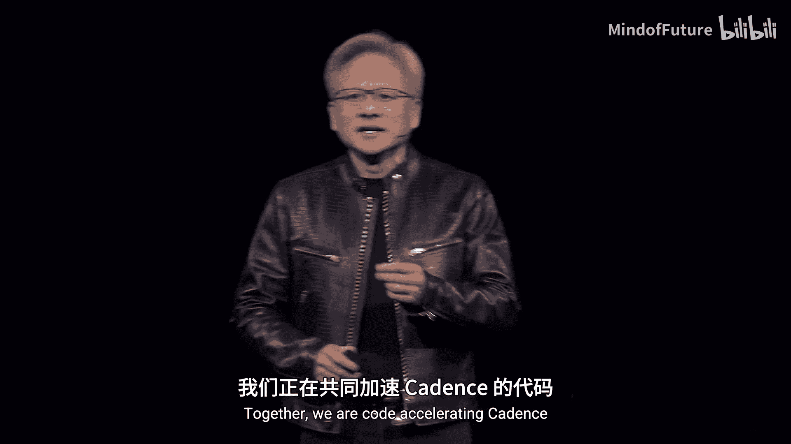

They're also building a supercomputer out of Nvidia GPUs so that their customers could do fluid dynamic simulation at 1001000 time scale。

Basically。

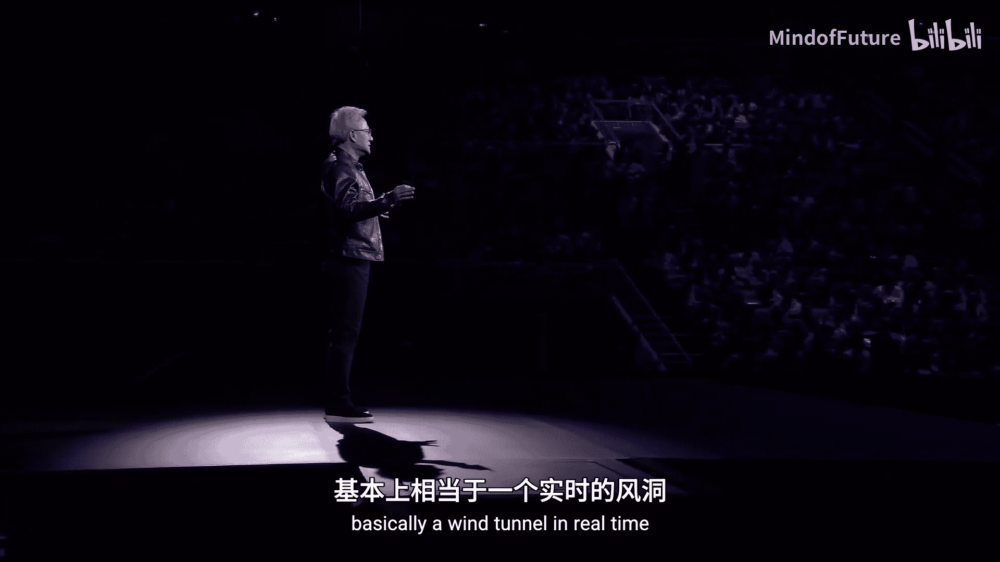

A wind tunnel in real time。Cadence's Millennium， a supercomputer with Nvidia GPUs inside。

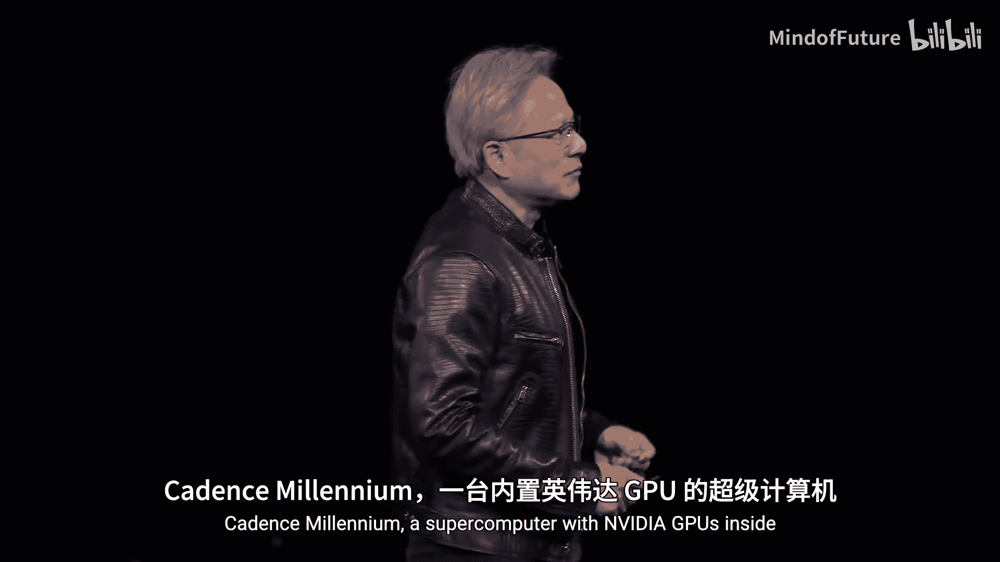

A software company building supercomputers。 I love seeing that。😊，Building cadence， copis together。

 Imagine a day。When Cadence synopsis An tool providers would offer you AI copilos so that we have thousands and thousands of copilot assistants helping us design chips。

 design systems。And we're also going connect Cayden's digital twin platform to Omniverse。

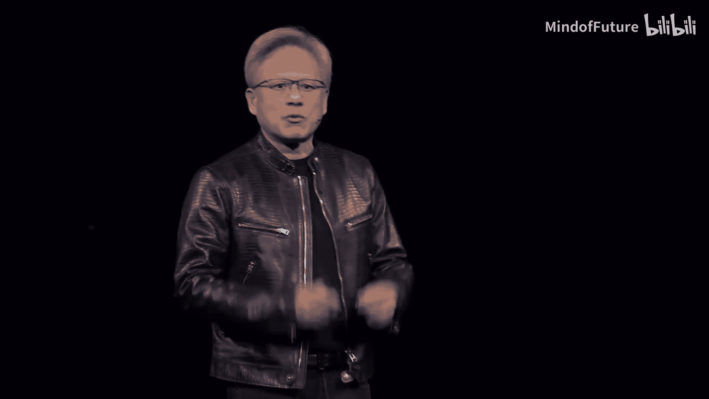

As you could see the trend here， we're accelerating the world's C， A E。

 E D A and SDD A so that we could create our future in digital twins。

 and we're going to connect them all to omniverse， the fundamental operating system for future digital twins。

😊，One of the industries that benefited tremendously from scale。 And， you know。

 you all know this one very well， large language models。Basically。

 after the transformer was invented。We were able to scale large language models at incredible rates。

 effectively doubling every six months。😊，Now， how is it possible that by doubling every six months。

That we have grown the industry。 We have grown the computational requirements so far。

 And the reason for that is quite simply this。If you double the size of the model。

 you double the size of your brain。 You need twice as much information to go fill it。

And so every time you double your。Pararameter count。

 you also have to appropriately increase your training token count。

 The combination of those two numbers。Becomes the computation scale you have to support。The latest。

 the state of the art， open AI model。Is approximately 1。8 trillion parameters。1。

8 trillion parameters required several trillion tokens to go train。

So a few trillion parameters on the order of， a few trillion tokens on the order of when you multiply the two of them together。

 approximately 30，40，50 billion。

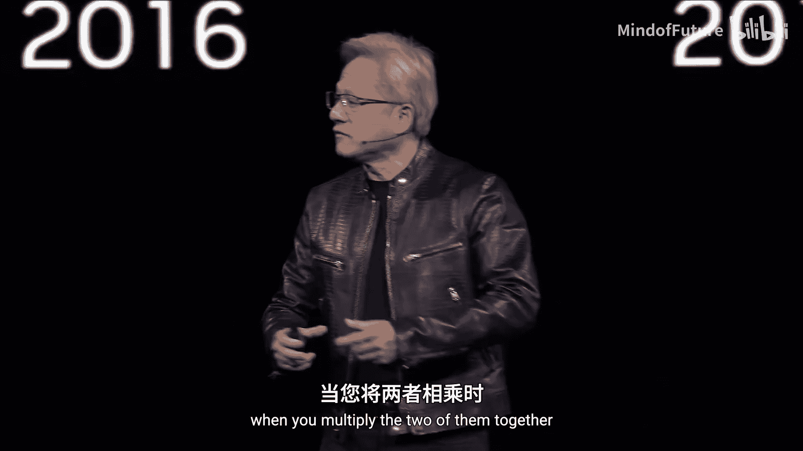

Quaddrillion floating point operations per second。 Now， we just have to do some CEO math right now。

 Just hang hang with me。 So you have 30 billion quadrillion。A quadrillion is like a petta。

And so if you had a petaf flop GPU， you would need 30。Billion seconds to go compute。

 to go train that model，30 billion seconds is approximately 1000 years。Well，1000 years。It's worth it。

Like to do it sooner， but it's worth it。Yeah。Which is usually my answer when most people tell me。

 hey， how， how long is it going take to do something So get 20 years， it's worth it。

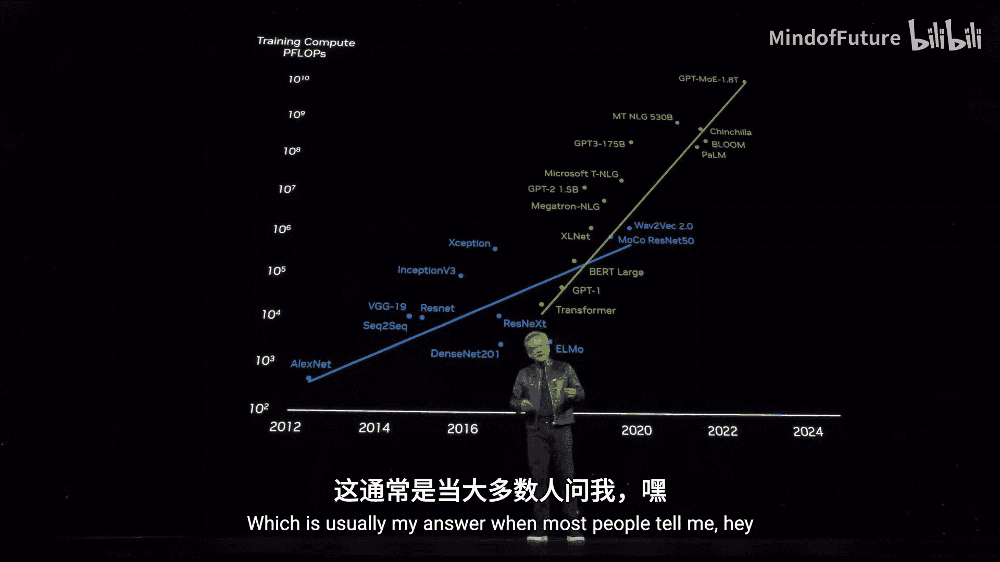

But can we do it next week。And so 1000 years，1000 years。 So what we need， what we need。

Our bigger GPUs。We need much， much bigger GPus。 We recognized this early on。

 and we realized that the answer is to put a whole bunch of GPS together。And， of course。

 innovate a whole bunch of things along the way， like inventing tensor cores。😊。

Advancing M V links so that we could create essentially virtually giant GPs。

And connecting them all together with amazing networks from a company called Melanox。

 Infinnovaan so that we could create these giant systems。😊，And so D G X 1 was our first version。

 but it wasn't the last。 We built， We built supercomputers all the way， all along the way。In 2021。

 we had Celine 4500 GPs or so。And then in 2023， we built one of the largest AI supercomputers in the world。

 It's just come online。Yes。And as we're building these things。

We're trying to help the world build these things。And in order to help the world build these things。

 we got to build them first。We build the chips， the systems， the networking。

 all of the software necessary to do this。 You should see these systems。

Imagine writing a piece of software that runs across the entire system。

 distributing the computation across。Thousands of GPSus， but inside are thousands of smaller GPUs。

Millions of GPs to distribute work across all of that and to balance the workload so that you can get the most energy efficiency。

 the best computation time， keep your costs down。 And so those。

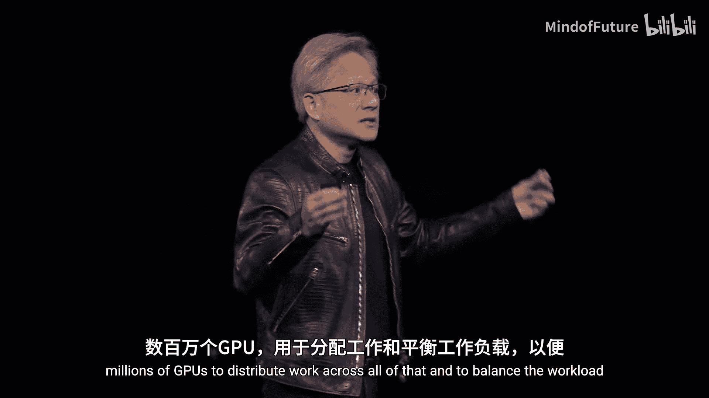

Those fundamental innovations。Is what got us here。And here we are。

As we see the miracle of Cha GT emerge in front of us， we also realize。We have a long ways to go。

We need even larger models。 We're going train it with multimodality data。

 not just text on the Internet， but we're gonna， We're gonna train it on texts and images and graphs and charts。

And just as we learn watching TV。 And so there's gonna be a whole bunch of watching video so that these models。

😊，Can be grounded in physics， understands that an arm doesn't go through a wall。

And so these models would have common sense。By watching a lot of the world's video。

 combined with a lot of the world's languages。It'll use things like synthetic data generation。

 just as you and I do， when we try to learn， we might use our imagination to simulate how it's going to end up just as I did when I was preparing for this keynote。

 I was simulating it all along the way。😊，I hope it's going to turn out。

As well as I head it into my head。As I was simulating how this keynote was going to turn out。

 somebody did say。That another performer。Did her performance completely on a treadmill。

So that she could be in shape to deliver it with full energy。I， I didn't do that。

If I get a low wind at about 10 minutes into this， you know what happened。And so。So where were we？

We're sitting here using synthetic data generation。 We're going use reinforcement learning。

 We're going practice it in our mind。 We're gonna have AI working with AI training each other just like student。

 teacher debaters。All of that is going to increase the size of our model。

 It's going increase the amount of， the amount of data that we have。

 and we're going to have to build even bigger GPus。Hopper is fantastic。But we need bigger GPUs。

And so， ladies and gentlemen。I would like to introduce you。To a very。Very big GPU。

Named after David Blackwell。Mathematician。

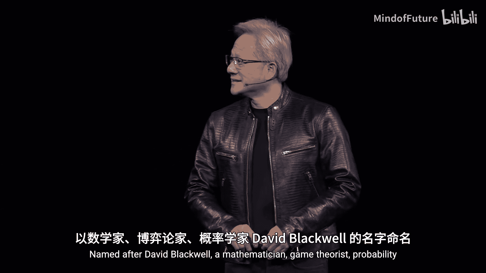

Game theorists。Probability。We thought it was a perfect， perfect name。😊，Blackwell。

 ladies and gentlemen， enjoyed this。Yeah。Yeah。

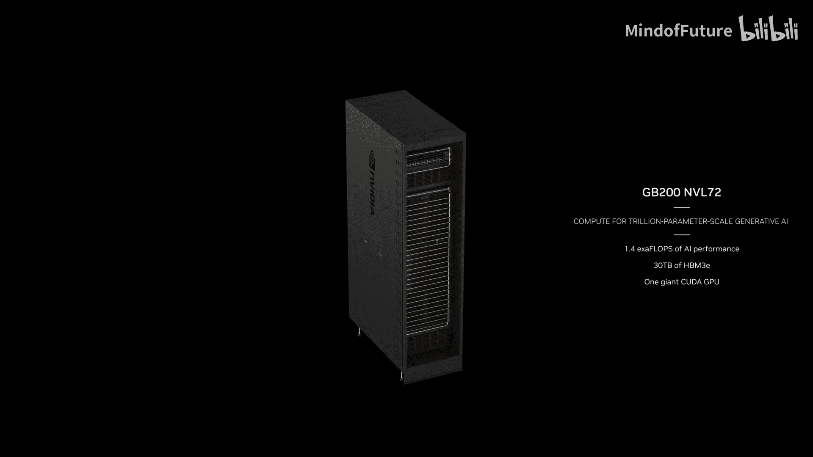

Yeah。

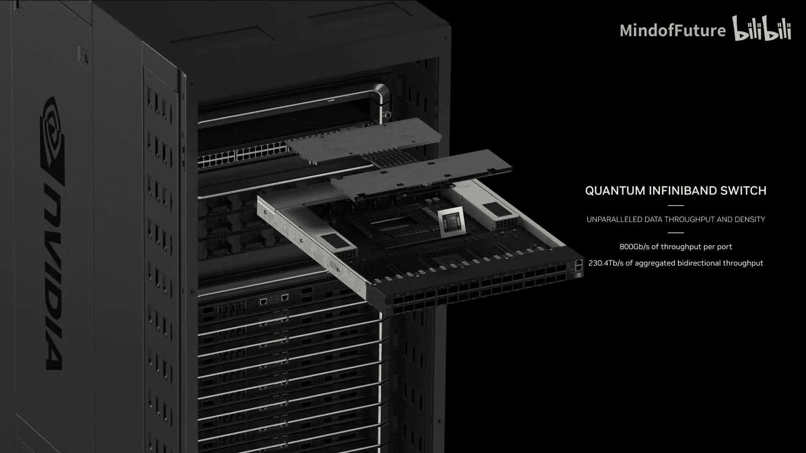

。

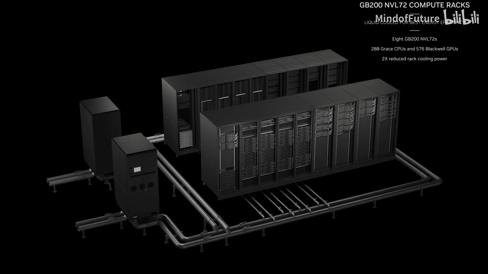

Yeah。

Blackwell is not a chip。 Blackwell is the name of a platform。

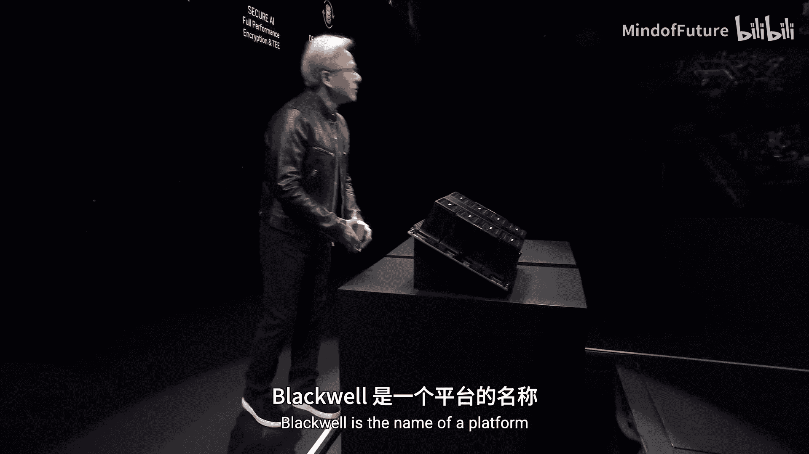

People think we make GPSUs。And and we do。But GPUs don't look the way they used to。Here， here's。

 here's the， here's the， if you w， the heart of the blackwell system。

 And this inside the company is not called Blackwell， It's just the number。And。At this。

This is Blackwell sitting next to， oh， this is the most advanced GPO in the world in production today。

This is Hopper。This is Hopper， Hopper changed the world。This is Blackwell。It's okay， Hopper。You're。

 you're very good。Good， good boy。Okay girl。208 billion transistors。 And so。

 so you could see I can see that there's a small line between two dies。

 This is the first time two dies have a button like this together in such a way that the two chip。

 the two dies think it's one chip。There's 10 TB of data between it，10 TB per second。

So that these two， these two sides of the blackwell chip have no clue which side they're on。

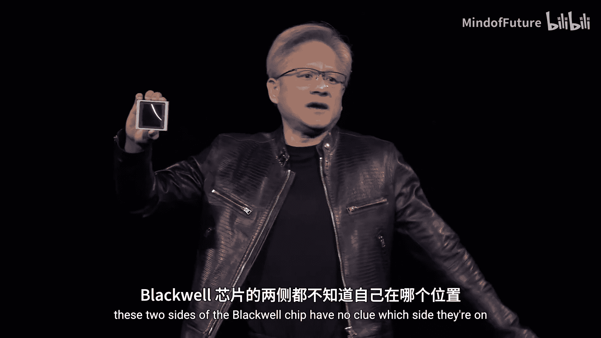

There's no memory locality issues， no cash issues。It's just one giant chip。

And so when we were told that Blackwell's ambitions were beyond the limits of physics。

 the engineer said， so what。And so this is what， what happened。 And so this is the Blackwell chip。

 And it goes into two types of systems。 The first one。Is form fit function compatible to hopper。

 And so you slide on hopper and you push in blackwell。

 That's the reason why one of the challenges of ramping is going to be so efficient。

 There are installations of hopperpers all over the world， and they could be they could be， you know。

 the same infrastructure， same design， the power， the electricity， the thermals， the software。

 identical push it right back。 And so this is a hopper version for the current H G X configuration。😊。

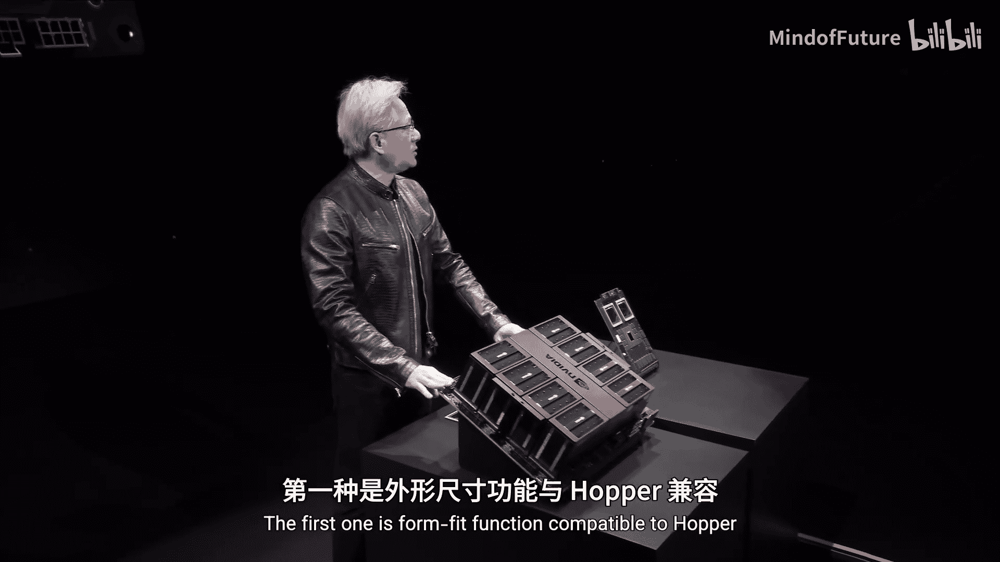

And this is what the other， the second hopper looks like this。 Now， this is a prototype board。

 And Janine， could I just borrow。Ladiesies and gentlemen andine Paul。And so this， is。

 this is a fully functioning board。 And I just be careful here。😊，This right here is， I don't know。

$10 billion。The second one's 5。It gets cheaper after that。 So any customers in the audience。

 it's okay。咩。Alright， but this is， this one's quite expensive。 This is to bring a board。

 And and the way it's gonna go to production is like this one here。 Okay， And so you're gonna take。

 take this。 It has two blackwell die，2，2 blackwell chips and four blackwell dies connected to a grace CPU。

 The gray CPU has a super fast chip to chiplink。 What's amazing is this computer is the first of its kind where this much computation。

 first of all， fits into this small of a place。 Second， Its memory coherent。😊。

They feel like they're just one big， happy family working on one application together。

 And so everything is coherent within it。😊，The just the amount of， you know， you saw the numbers。

 There's a lot of terabytes this and terabyte fats。 But this is， this is a miracle。 This is this。

 Let's see。 What are some of the things on here。 There's an M V link on top。

PCI Express on the bottom。On， on your。Which one is my and your left， One of them。

 it doesn't matter one of them。One of them is a C CPU chip to chip link is my left or youre depending on which side I was。

 I was trying to sort that out。 And I just kind of。ItDoesn't matter。Yeah。Yeah。Hopefully。

 it comes plugged in， so。Yeah。😊，Okay， so this is the Grace Blackwell system。But there's more。

So it turns out， it turns out。All of the specs is fantastic。

 but we need a whole lot of new features in order to push the limits beyond， if you will。

 the limits of physics。😊，We would like to always get a lot more X factors。

And so one of the things that we did was we invented another transformer engine。

 another transformer engine， the second generation。 It has the ability to dynamically。

And automatically， rescale。And recast。Nummerical formats to a lower precision whenever it can。

 Remember， artificial intelligence is about probability。 And so you kind of have， you know，1。7。

 approximately 1。7 times approximately 1。4 to be approximately something else。 Does that make sense。

 And so， so the the ability for the mathematics to retain the precision and the range necessary in that particular stage of the pipeline super important。

 And so this is， it's not just about the fact that we designed a smaller A L U iss not the world is not quite that simple。

You've got to figure out when you can use that across a computation that is。Thousands of GPUs。

 it's running for weeks and weeks on weeks。 And you want to make sure that the， the。

 the training job is going to converge。 And so this new transformer engine。

 we have a fifth generation M V link。It's now twice as fast as Hopper。 But very importantly。

 it has computation in the network。 And the reason for that is because when you have so many different GPus working together。

 we have to share our information with each other。 we have to synchronize and update each other。

 And every so often， we have to reduce the partial products and then rebroadcast out the partial products that some of the partial products back to everybody else。

 And so there's a lot of what is called all reduce and all to all and all gather。

 It's all part of this area of synchronization and collectives so that we can have GPSUs working with each other。

 having extraordinarily fast links and being able to do mathematics right in the network。

 allows us to essentially amplify even further。 So even though it's 1。8  TBs per second。

 It's effectively higher than that。 And so it's many times that of Hopper。 The likelihood。😊。

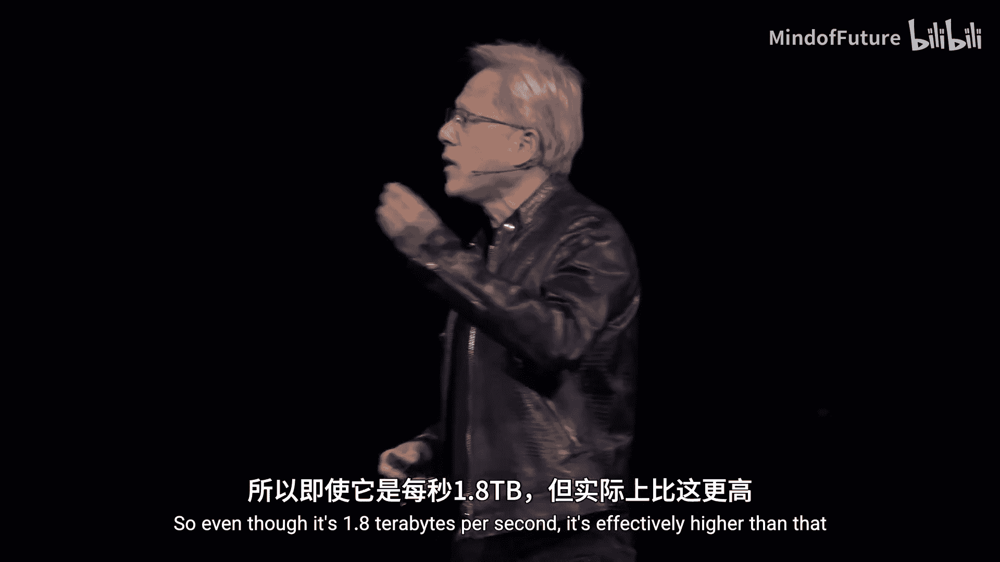

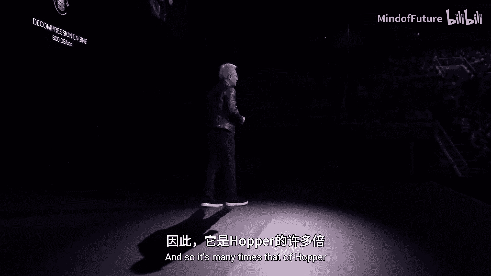

Of a supercomputer running for weeks on in is。Approximately 0。

And the reason for that is because there are so many components working at the same time。

The statistic， the probability of them working continuously is very low。

 And so we need to make sure that whenever there is a。Well。

 we checkpoint and restart as often as we can。But if we have the ability to detect。

A week chip or a week note early， we could retire it and maybe swap in another processor。

 That ability to keep the utilization of the supercomputer high。

 especially when you just spent $2 billion building it is super important。

 And so we put in a ras engine， a reliability engine that does 100% self test in system test of every single gate。

 every single bit of memory。😊，On the black wall chip and all the memory doesn't connect to it。

It's almost as if we shipped with every single chip。

 its own advanced tester that we test our chips with。This is the first time we're doing this。

 Super excited about it。 securecure AI。😊。

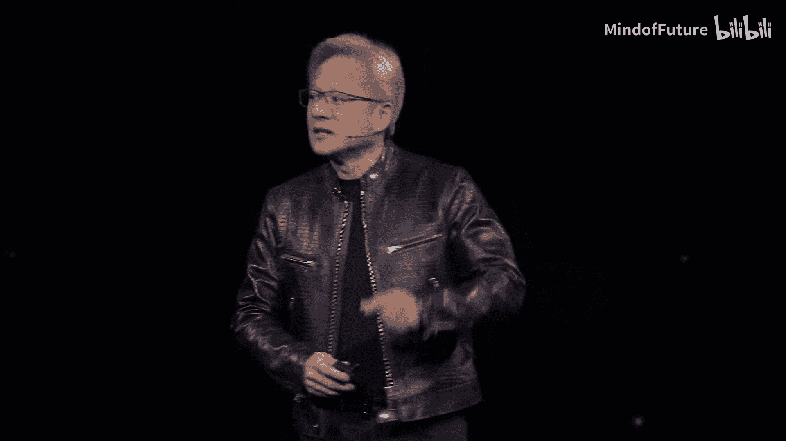

Only this conference do they clap for ass。

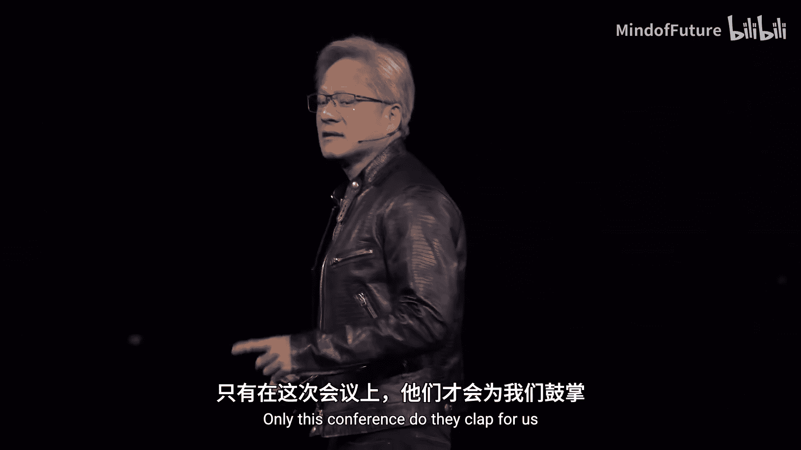

，Secure AI。 Obviously， you've just spent hundreds of millions of dollars creating a very important AI。

 And the， the code， intelligence of that AI is encoded in the parameters。

You want to make sure that on the one hand， you don't lose it。 On the other hand。

 it doesn't get contaminated。 And so we now have the ability。

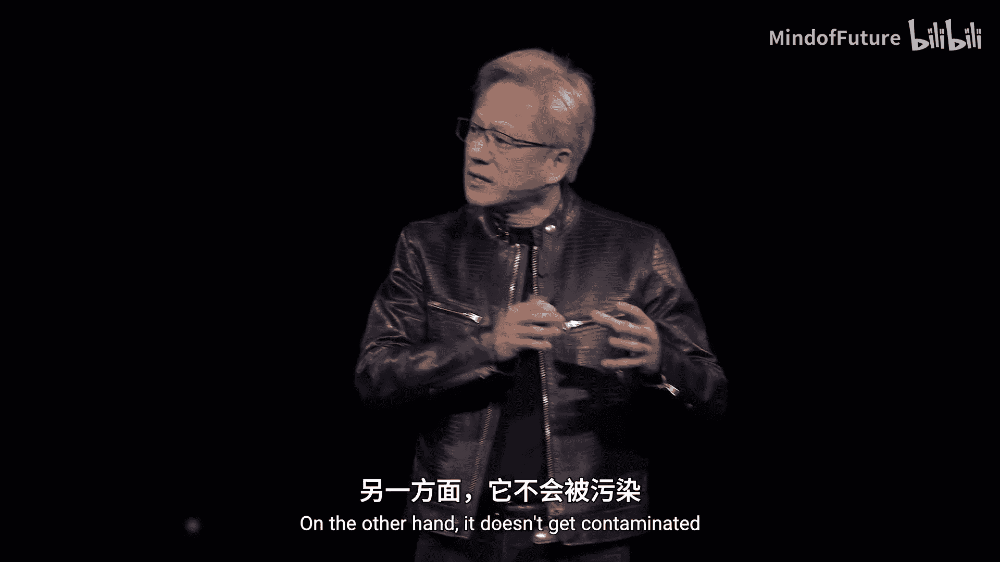

To encrypt data。Of course， at rest， but also in transit。 and while it's being computed。It's。

All encrypted。 And so we now have the ability to encrypt and transmission。

 And when we're computing it， it is in a trusted， trusted environment， trusted engine environment。

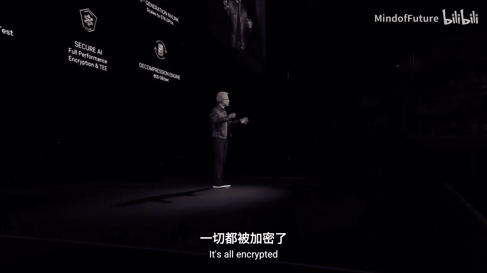

And the last thing is decompression。Moving data in and out of these nodes。

 when the compute is so fast， becomes really essential。

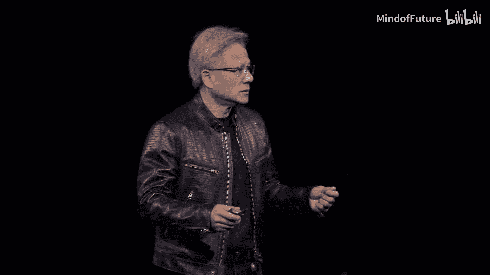

And so we've put in a height line speed compression engine and effectively moves data 20 times faster in and out of these computers。

 These computers are so powerful， and there's such a large investment that last thing we want to do is have them be idle。

 And so all of these capabilities are intended to keep。😊。

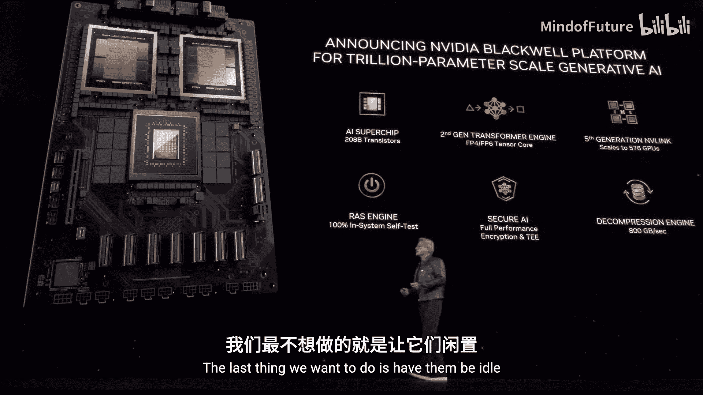

Blackwell， fed， and as。Busy as possible。

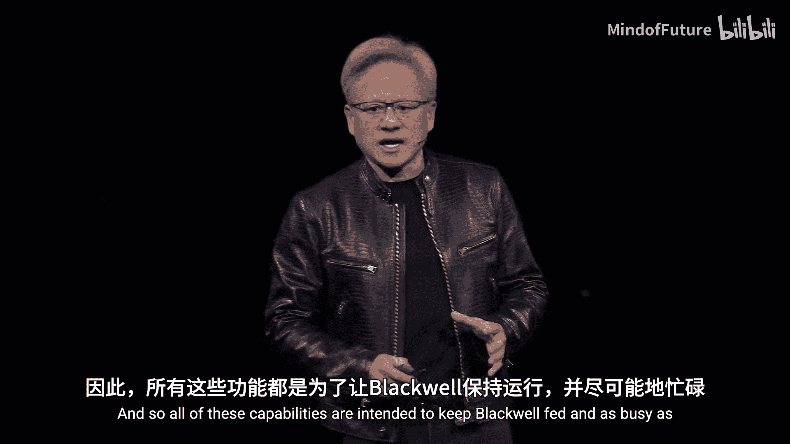

Overall， compared to Hopper。It is two and a half times。

2 and a half times the F8 performance for training。Per chip。It is also。

 It also has this new format called F P6 so that even though the computation speed is the same。

The bandwidth that's amplified because of the memory。

 the amount of parameters you can store into memory is now amplified。

 F P 4 effectively doubles the throughput。 This is vitally important for inference。

One of the things that， that is becoming very clear is that whenever you use a computer with AI on the other side。

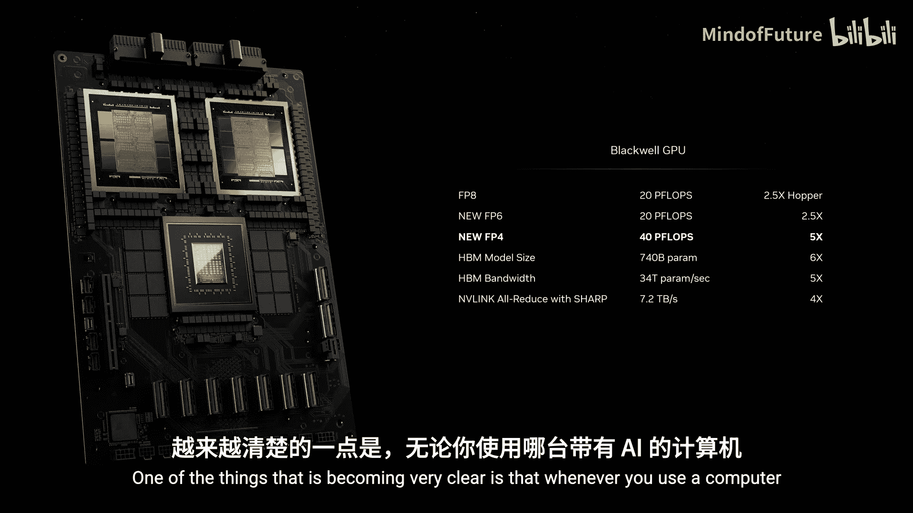

When you're chatting with the chat bot， when you're asking it。To review or make an image。Remember。

 in the back is a GPU generating tokens。Some people call it inference。

 but it's more appropriately generation。The way that computing has done in the past was retrieval。

You would grab your phone。 You would touch something。 Some signals go off。 Basically。

 an email goes off to some storage somewhere。 There's prerecord content。

 Some wrote a story or somebody made an image or somebody recorded a video。

That prerecorded content is then streamed back to the phone and recomposed in a way based on a recommender system。

To present the information to you。

You know that in the future， the vast majority of that content will not be retrieved。

And the reason for that is because that was prerecorded by somebody who doesn't understand the context。

 which is the reason why we have to retrieve so much content。

If you can be working with an AI that understands the context， who you are。

 for what reason you're fetching this information and produces the information for you just the way you like it。

The amount of energy we save， the amount of networking bandwidth we save。

 the amount of waste of time we save。Will be tremendous。The future is generative。

 What is the reason why we call it generative AI。

Which is the reason why this is a brand new industry。The way we compute is fundamentally different。

We created a processor for the generative AI era。And one of the most important parts of it is content token generation。

 We call it this format is F P 4。Well。That's a lot of computation。5 x。The token generation 5 x。

 the inference capability of Hopper seems。Like enough。But why stop there？

The answer is it's not enough， and I'm going to show you why。I'm going to show you what。

And so we would like to have a bigger GPU， even bigger than this one。And so， we。

Decided to scale it and notice。 But first， let me just tell you how we've scaled。

Over the course of the last eight years， with increased computation by 1000 times，8 years，1000 times。

 Remember back in the good old days of Moore's law。It was 2 x。 Well，5 x every。Well，10。

10 x every five years。 That's easiest， easiest amount，10 x every five years，100 times every 10 years。

100 times every 10 years at the。In the middle。And the heydays of the PC revolution。

100 times every 10 years。 In the last eight years， we've gone 1000 times。

 We have two more years to go。

And so that puts it in perspective。The rate at which we're advancing computing is insane。

 and it's still not fast enough。 So we built another chip。

This chip。It's just an incredible chip。 We call it the MV link switch。

It's 50 billion transistors。 It's almost a size of Hopper， all by itself。

This switchship has four MV links in it。Each 1。8 TB per second。And。😊，And it has computation in。

 as I mentioned。What is this chip for？If we were to build such a chip。

We can have every single GPU talk to every other GPU at full speed， at the same time。😊，That's insane。

It doesn't even make sense。

But if you could do that， if you can find a way to do that and build a system to do that。

That's cost effective。That's cost effective。How incredible would it be that we could have all these GPUs connect over a coherent link so that they effectively are one giant GPU。

 Well， one of， one of the great inventions in order to make a cost effective is that this chip has to drive copper directly。

😊。

The30s of this trip is， is just a phenomenal invention so that we could do direct drive to copper。

 And as a result， you can build a system that looks like this。😊，Now this system， this system。

It's kind of insane。This is one D G X。 This is what a D G X looks like now。 Remember。

 just six years ago。It was pretty heavy， but I was able to lift it。

I delivered the the first D G X1 to open AI and， and the researchers there。 It's on， you know。

 the pictures are on the Internet。 And， and we all autographed it。 And if you come to my office。 It'。

 it's autographed there is really beautiful。 And， but， but you could lift it。 this D G X， this DG X。

 that DG X， by the way， was 170。😊。

Terarafls。If you're not familiar with the numbering system， that's 0。17 petaflos。So this is 720。

The first 1 I delivered to open AI was 0。17。

You could round it up to 0。2 won't make any difference。 But， and back then was like， wow， you know。

30 more ter flops。 And so this is now 720 petaflops， almost an exafloop for training。

 And the world's first one exoflops machine in one rack。😊，Just so you know， there are only a couple。

2，3 exafflps machines on the planet as we speak。And so this is an exoffls AI system in one single rack。

 Well， let's take a look at the back of it。So this is what makes it possible。 That's the back。

 That's the， that's the back the D G X M V link spine，130 TBte per second。

Goes through the back of that chassis。 That is more than the aggregate bandwidth of the Internet。

So we， we could basically send everything to everybody within a second。And so， so we。

 we have 5000 cables，5000 M Vlink cables in total， two miles。Now， this is the amazing thing。

 If we had to use optics， we would have had to use transceivers and rers。

 and those transceivers and retirementrs alone would have cost 20000 Ws。😊。

2 kW of just transceivers alone， just to drive the emuling spine as a result。

We did it completely for free over M V link switch。

 And we were able to save the 20 kW for computation。 This entire rack is 1 20 k。

 So that 20 kW makes a huge difference。😊，It's liquid cooled。

 What goes in is 25 degree C about room temperature。

What comes out is 45 degrees C about your jacuzzi。 So room temperature goes in。

 Jacuzzi comes out2 L per second。We could we could sell a peripheral。600000 parts。

Somebody used to say， you know， you guys make GPUs， and we do。

But this is what a GPU looks like to me。 When somebody says GPU， I see this Two years ago。

 when I saw a GPU was the H G X。 It was 70，35000 parts。 Our GPUs now are 600000。

Parts， and。3000。3000，3000。 That's kind of like the weight of a， you know， carbon fiber。Fri。

I don't know if that's a useful metric， but。Everybody's going， I feel it， I feel it， I get it。

I get that。Now that you mentioned that， I feel it。I don't know。 What's 3000。Okay， so 3000 pounds。

 ton and a half。So it's not quite an elephant。So this is what a D G X looks like。 Now。

 let's see what it looks like in operation。 Okay， let's imagine what is。

 what how do we put this to work and what does it mean， Well， if you were to train a G model，1。

8 trillion parameter model。

It took， it took about， apparently about， you know，3 to five months or so with 25000 amppirs。

 If we were to do it with Hopper， It would probably take something like 8000 GPUs。

 and it would consume 15 MW，8000 GPs and 15 MW。 It would take 90 days， about three months。

And that would allow you to train something that is。You know， this groundbreaking AI model。

And this is obviously not as expensive as as as anybody would think， but it's 80008000 GPS。

 It's still a lot of money。And so 8000 GPs， 50 megawaWt， if you were to use Blackwell to do this。

It would only take 2000 GPUs。2000 GPUs， same 90 days。 But this is the amazing part。

 only 4 MgawaWts of power。😊，So from 15， that's right。

And that's， and that's our goal。 Our goal is to continuously drive down the cost and the energy that' are directly proportional to each other cost and energy associated with the computing so that we can continue to expand and scale up the computation that we have to do to train the next generation models。

 Well， this is training。😊，Inference or generation。Is vitally important going forward。You know。

 probably some half of the time that NviDdia GPs are in the cloud these days。

 it's being used for token generation。 You know， they're either doing coppilot this or， you know。

 chat GT that or all these different models that are being used when you're interacting with it or generating generating images or generating videos。

 generating proteins generating chemicals， There's a bunch of generating going on。

 All of that is in the category of computing。 we call inference。

 But inference is extremely hard for large language models because these large language models have several properties。

 One， they're very large。 And so it doesn't fit on one GPU。This is， imagine。

 imagine Excel doesn't fit on one GPU， you know， and imagine some application you're running on a daily base doesn't doesn't fit on one computer。

 like a video game doesn't fit on one computer。😊。

And most， in fact， do。 and many times in the past in hyperscale computing。

 many applications for many people fit on the same computer。 And now， all of a sudden。

 this one inference application where you're interacting with this chatbot。

 That chat bot requires a supercomputer in the back to run it。

And that's the future。 The future is generative with these chatbots。

 and these chatbots are trillions of tokens， trillions of parameters。

 and they have to generate tokens。At interactive rates。 Now， what does that mean well。

3 tokens is about a word。You know， the， the。You know， space， the final frontier。

 These are the adventures。 that's like， that's like 80 tokens。Okay。

 I don't know if that's useful to you and so。Yeah。😊。

The art of communications is selecting good analogies。

Yeah， this is not going well。There， I don't know what he's talking about。Never seen Star Trek。And so。

 and so， so here we are。 We're trying to generate these tokens when you're interacting with it。

 you're hoping that the tokens come back to you as quickly as possible。

 and this is as quickly as you could read it。 And so the ability for generation token is really important。

 you have to paralyze the work of this model across many。

 many GPs so that you could achieve several things， on the one hand。

 you would like throughput because that throughput reduces the cost the overall cost per token of generating。

 So your throughput dictates the cost of of delivering the service。 On the other hand。

 you have another interactive rate， which is another tokens per second， where it's about per user。

 and that has everything to do with quality of service。 And so these two things。

compete against each other。And we have to find a way to distribute work across all of these different GPus and paralyze it in a way that allows us to achieve both。

 And it turns out the search search space is enormous。😊。

You know， I told you there's going to be math involved。And everybody's going， oh， dear。

I heard some gasp just now when I put up that slide。so this right here。

 the Y axisxes is tokens per second， data centered throughput。

 the X axisxes is tokens per second interactivity of the person。

 and notice the upper right is the best。 you want interactivity to be very high。

Number of tokens per second per user。 You want the tokens per second of per data center to be very high。

 The upper upper right is， is terrific。 However， it's very hard to do that。

And in order for us to search for the best answer。

Across every single one of those intersections， X， Y coordinates。 In case。

 you just look at every single X， Y coordinate。 All those blue dots came from some repartitioning of the software。

😊，Some optimizing solution has to go and figure out whether to use use tensor parallel。

Expert parallel， pipeline parallel or data parallel and distribute this enormous model across all these different GPUus and sustain performance that you need。

This exploration space would be impossible， if not for the programmability of Nvidia GPSs。

 And so we could， because of Kuta， because we have such rich ecosystem。

 we could explore this universe and find。😊，That green roof line。 It turns out that green roof line。

 notice。You got T， P 2， E， P A， D P 4。 It means2 parallel，2 Tensor parallel。

 Tensor parallel across  two GPSs， expert parallels across 8 data parallel across 4。

 Notice on the other end， you got tensor parallel across 4 and expert parallel across 16。

The configuration， the distribution of that software。 It's a different， different runtime。

That would produce。

These different results。 And you have to go discover that roof line。 Well， that's just one model。

And this is just one configuration of a computer。 Imagine all of the models being created around the world and all the different。

 different configurations of， of systems that are going to be available。😊。

So now that you understand the basics， let's take a look at inference of blackwell compared to。

Hopper， and this is the extraordinary thing。In one generation。

 because we created a system that's designed for trillion parameter， gene generative AI。

 the inference capability of blackwell is off the charts。And， in fact， it is some 30 times hopper。

 yep。

For large language models， for large language models like Chat G PT and others like it。

 the blue line is Hopper。 I gave you， imagine we didn't change the architecture of Hopper。

 And we just made it a bigger chip。We just used the latest， you know， greatest，10， you know。

 TBab per second。 We connected the two chips together。 We got this giant 208 billion per chip。

 How would we have performed if nothing else changed。 And it turns out quite wonderfully。😊。

Quite wonderfully。 And that's the purple line， but not as great as it could be。

 And that's where the F P4 Tensor core， the new transformer engine。 And very importantly。

 the M V link switch。 And the reason for that is because all these GPUus have to share the results。

 Partial products。 whenever they do all to all， all all gather whenever they communicate with each other。

😊。

That MV link switch is communicating almost 10 times faster。

Than what we could do in the past using the fastest networks。Okay， so。

Blackwell is going to be just an amazing system for a generative AI。 And in the future。😊。

In the future。Data centers are going to be thought of， as I mentioned earlier， as an AI factory。

And AI factory's goal in life is to generate revenues。 generate， in this case。Intelligence。

In this facility。Not generating electricity as an AC C generators。

But of the last industrial revolution and this industrial revolution， the generation of intelligence。

 And so this ability is super， super important。 The excitement of blackwell is really off the charts。

 You know， when we first。😊，When we first。You know， this， this is a year and a half ago。

 two years ago， I guess two years ago， when we first started to， to go to market with Hopper。

You know， we had the benefit of2，2， two CPs joined us in a lunch。 and we were， you know， delighted。

 And so we had two customers。😊，We have more now。

Unbelievable excitement for blackwell， unbelievable excitement。

 And there's a whole bunch of different configurations。 Of course。

 I showed you the configurations that slide into the hopper form factor。

 So that's easy to upgrade I showed you examples that are liquid cooled that are the extreme versions of it。

 One entire rack's that's connected by M V links 6 72。

 We're gonna Blackwell is going to be ramping to the world's AI companies of which there are so many now doing amazing work in different modalities。

😊。

The CSPs， every CSP is geared up。 all the Os and ODMs。Regional clouds。

 sovereign AIs and telcos all over the world are signing up to launch with Blackwell this。

Blackwell， Blackwell would be the the most successful product launch in our history。

 And so I can't wait， wait to see that。 I want to thank。

 I want to thank some partners that are joining us in this。 AWS is gearing up for Blackwell。

're they're going to build the first GPU which secure AI， they're building out a 222 exafflps system。

 you know， just now， when we animated just now， the digital twin。

 if you saw all of those clusters are coming down。 By the way， that is not。😊。

Just art。 That is a digital twin of what we're building。 That's how big it's going to be。

Besides infrastructure， we're doing a lot of things together with AWS we're coa accelerating sageMaker AI。

 where coupa accelerating bedrock AI， Amazon robototics is working with us using NviDdia Omniverse and Isaac Sim AWS Health has Nvidia Health integrated into it So AWS has really leaned into accelerated computing Google is gearing up for Blackwell。

 GCP already has a100s H100s T4s L4s， a whole fleet of NviDdia Kuta GPUs and they recently announced the Gema model that runs across all of it。

 we're working to optimize and accelerate every aspect of GCP we're accelerating datapro for data processing。

 their data processing engine JackX XLA vertex AI and Mujoko for robotics。

 so we're working with Google and GCP across a whole bunch of initiatives Oracle is gearing up for Blackwell Oracle is a great partner of ours for NviDdia DGx Cloud and we're。

Also working together to accelerate something that's really important to a lot of companies Oracle database。

Microsoft is accelerating and Microsoftt is gearing up for Blackwell。

 Microsoft Ninvidia has a wide rangging partnership We're accelerating could accelerating all kinds of services when you。

 when you chat， obviously， and AI services that are in Microsoft Azure。 It's very。

 very likely NviDdia's in the back doing the inference in the token generation。 We built。

 They built the largest NviDdia Infiniban supercomputer。

 basically a digital twin of hours or a physical twin of hours。

 We're bringing the NviDdia ecosystem to Azure。😊。

Nvidia Dijx's cloud to Azure。 Nvidia Omniverse is now hosted in Azure。 Nvidia Healthca is an Azure。

 and all of it is deeply integrated and deeply connected with Microsoft Fric。😊。

The whole industry is gearing up for blackwell。 This is what I'm about to show you， most of the。

 most of the the， the scenes that you've seen so far of blackwell are the。

 are the full fidelity design of blackwell。

Everything in our company has a digital twin。 And， in fact， this digital twin idea is。

 is really spreading。 and it it helps。 it helps companies build very complicated things perfectly the first time。

 and what could be more exciting than。😊。

Creating a digital twin to build a computer that was built in a digital twin。

 And so let me show you what Wron is doing。

To meet the demand for NviIDdia accelerated computing， Wstrron。

 one of our leading manufacturing partners， is building digital twins of NviDdia。

 DGX and HGX factories using custom software developed with omniverse， SDKs and APIs。

For their newest factory， Wstrron started with the digital twin to virtually integrate their multiCD and process simulation data into a unified view。

Testing and optimizing layouts in this physically accurate digital environment increased worker efficiency by 51%。

During construction， the Omniverse digital twin was used to verify that the physical build matched the digital plans。

Identifying any discrepancies early has helped avoid costly change orders。

 and the results have been impressive， using a digital twin helped bring Wiau's factory online in half the time。

 just two and a half months instead of five。

In operation， the Omniverse Digital T helps withdrawn rapidly test new layouts to accommodate new processes or improve operations in the existing space and monitor realtime operations using live IoT data from every machine on the production line。

Which ultimately enabled Wstrron to reduce end to end cycle times by 50% and defect rates by 40%。

With NviDdia AI and Omniburst， NviDdia's global ecosystem of partners are building a new era of accelerated AI enabled digitalization。

That's how we are。That's the way it's going to be in the future when' manufacturing everything digitally first。

 and then we'll manufacture it physically。 People ask me， how did it start。

What got you guys so excited？What was it that you saw？That caused you to put it all in。

On this incredible idea。And it's this。喺我声嘅。Guys， that was going to be such a moment。

That's what happens when you don't rehearse。

This， as you know。Was first contact。2012， Alex Net。You put a cat into this computer。

And it comes out and it says， cat。And we said。Oh my God， this is gonna change everything。

You take 1 million numbers。 You take 1 million numbers。Across three channels， RGB。

These numbers make no sense to anybody。You put it into this software and it compress it dimensionally reduce it。

 It reduces it from a million dimensions， a million dimensions。 It turns it into three letters。

One vector， one number。

And it's generalized。You could have the cat。Be different cats。And。

 and you could have it be the front of the cat and the back of the cat。And you look at this thing。

 you say， unbelievable。 You mean any cats。

Yeah， and he can。And it was able to recognize all these cats。

 And we realized how it did it systematically， structurally， it's scalable。😊，How big can you make it。

 Well， how big do you want to make it。And so we imagine that this is a completely new way of writing software。

And now， today， as you know。You can have you type in the word C A T。 And what comes out as a cat。

It went the other way。Am I right？

Unbelievable。How is it possible， That's right。 How is it possible？ You took three letters。

And you generated a million pixels from it。 And it made sense。Well， that's the miracle。

 And here we are。 just literally 10 years later，10 years later， where we recognize texts。

 We recognize images。 We recognize videos and sounds and images。 Not only do we recognize them。

 we understand their meaning， we understand the meaning of the text。

 That's the reason why I can chat with you。😊。

It can summarize for you。 It understands the text。 It understood。

 not just recognizes the the English。 It understood the English。

 It doesn't just recognize the pixels。 It understood the pixels。 And you can。

 you can even condition it between two modalities， You can have language。

 condition image and generate all kinds of interesting things。 Well。

 if you can understand these things， what else can you understand that you've digitized。

The reason why we started with text and， you know， images is because we digitized those。

 But what else have we digitized Well， it turns out we digitized a lot of things。

 proteins and genes and。Brain waves。Anything you can digitize so long as there's structure。

 we can probably learn some patterns from it。 And if we can learn the patterns from it。

 we can understand its meaning。 if we can understand its meaning。

 we might be able to generate it as well。 And so， therefore， the generative AI revolution is here。

 Well， what else can we generate， What else can we learn。 Well。

 one of the things that we would love to learn。😊。

We would love to learn。Is we would love to learn climate。We would love to learn extreme weather。

 We would love to learn what， how we can。Predict。Future weather。At regional scales。

 at sufficiently high resolution， such that we can keep people out of harm's way before harm comes。

Extreme weather cost the world $150 billion。 Surely more than that。 And it's not evenly distributed。

150 billion is concentrated in some parts of the world。 And， of course， to some people of the world。

 We need to adapt and we need to know what's coming。 And so were creating Earth， too。

 a digital twin of the earth for predicting weather。 And weve。

Made an an extraordinary invention called Coriv， the ability to use generative AI to predict weather at extremely high resolution。

 Let's take a look。😊，🎼As the Earth's climate changes。

 AI powered weather forecasting is allowing us to more accurately predict and track severe storms like Supertyphoon Chanthu which cause widespread damage in Taiwan and the surrounding region in 2021 current AI forecast models can accurately predict the track of storms but they are limited to 25km resolution which can miss important details。

🎼NVIDIdia's Cordiff is a revolutionary new generative AI model trained on high resolution。

 radar assimilated war weather forecasts and Afiery analysis data。🎼Using Cordiff。

 extreme events like Chaanthu can be superre from 25km to 2 kilom resolution。

 with 1000 times the speed and 3000 times the energy efficiency of conventional weather models。

🎼By combining the speed and accuracy of NviIDdiaA's weather forecasting model forecastNe and generative AI models like Cordiff。

 we can explore hundreds or even thousands of kilomet scale regional weather forecasts to provide a clear picture of the best。

 worst， and most likely impacts of a storm。🎼This wealth of information can help minimizeise loss of life and property damage Today Cordiff is optimized for Taiwan。

 but soon generative super samplingling will be available as part of the NviDdia Earth2 In Service for many regions across the globe。

The weather company has to trust a source of global weather prediction。

 We are working together to accelerate their weather simulation。First principled base of simulation。

 however， they're also going to integrate Earth to Cordef so that they could help businesses and countries do regional。

 high resolution weather prediction。 And so if you have some weather prediction you'd like to know。

' like to do， reach out to the weather company。 Really exciting， really exciting work。😊。

Invidia healthcare。Something we started 15 years ago。 We're super super excited about this。

 This is an area we're very， very proud。😊。

Whether it's medical imaging or gene sequencing or computational chemistry。

It is very likely that NviDdia is the computation behind it。We've done so much work in this area。

Today we're announcing。

That we're going to do something really， really cool。

Imagine all of these AI models that are being used。To generate。

Images and audio。 But instead of images and audio。Because it understood images and audio。

 all the digitization that we've done for genes and proteins and amino acids。

 that digitization capability。😊，Is now passed through machine learning so that we understand the language of life。

The ability to understand the language of life， Of course， we saw the first evidence of it。

With Alpha fold， this is really quite an extraordinary thing。 After decades of painstaking work。

 the world had only digitized。😊，And reconstructed using crye microscopy or Xray crystallography。

 These different techniques painstakingly reconstructed the protein，200000 of them。

 And just what is it less than a year or so Al fold has reconstructed 200 million proteins。

 basically every protein， every every living thing that's ever been sequenced。

 This is completely revolutionary。 Well， those models are incredibly hard to use for incredibly hard for people to build。

 And so what we're gonna to do is we're gonna build them。

 We're gonna build them for the researchers around the world。 And it won't be the only one。

 there'll be many other models that we create。 And so let me show you what we're gonna do with it。😊。

🎼Virtual screening for new medicines is a computationally intractable problem。

 existing techniques can only scan billions of compounds and require days on thousands of standard compute nodes to identify new drug candidates。

🎼NviDdia bionemoms enable a new generative screening paradigm。

 using Nimphs for protein structure prediction with alpha fold。

 molecule generation with Mom and docking with diff doc。

 we can now generate and screen candidate molecules in a matter of minutes。

🎼Mulm can connect to custom applications to steer the generative process。

 iteratively optimising for desired properties。🎼These applications can be defined with bionemo microservices or built from scratch。

🎼Here， a physics based simulation optises for a molecule's ability to bind into a target protein while optimising for other favourable molecular properties in parallel。

🎼Mulm generates high quality drug like molecules that bind to the target and are synthesable。

 translating to a higher probability of developing successful medicines faster。

🎼Bionimmo is enabling a new paradigm in drug discovery with NIms。

 providing on demand microservices that can be combined to build powerful drug discovery workflows like denovo protein design or guided Mo generation for virtual screening。

🎼Bionemo NiIms are helping researchers and developers reinvent computational drug design。

Nvidia Momam。MulM， Car di， there's a whole bunch of other models， whole bunch of other models。

 computer vision models。Robotics models， and even， of course。Some really。

 really terrific open source。

Language models， these models。Are groundbreaking。 However， it's hard for companies to use。

 How would you use it。How would you bring it into your company and integrate it into your workflow。

 How would you package it up and run it？ Remember， earlier， I just said。

That inference is an extraordinary computation problem。How would you do the optimization。

For each and every one of these models and put together the computing stack necessary to run that supercomputer。

So that you can run these models in your company。And so we have a great idea。

 We're going invent a new way， Invent a new way for you to receive and operate software。😊。

This software。Comes basically in a digital box。 We call it a container。

And we call it the Nvidia inference microserv， a Nim。 And I let me explain to you what it is。

And now， it's a pretrain model， so it's pretty clever。

And it is packaged and optimized to run across Nvidia's install base， which is very， very large。

 What's inside it is incredible。😊。

You have all these pretrains state of the art open source models。 They could be open source。

 They could be from one of our partners。 It could be created by us， like Nvidia Mo。😊。

It is packaged up with all of its dependencies。 So Kuda， the right version， Q D NN。

 the right version， Tensor R T， L O M distributing across the multiple GPs， try an inference server。

 all completely packaged together。 It's optimized。Depending on whether you have a single GPU。

 multi GPU or multi node of GPUs， it's optimized for that。

 And it's connected up with APIs that are simple to use。Now this， think about what an AI API is。

An AI API is an interface that you just talked to。And so this is a piece of software in the future that has a really simple API。

 And that API is called human。And these packages， incredible bodies of software。

 will be optimized and packaged。And we'll put it on a website。And you can download it。

 you could take it with you。 You can run it in any cloud， You can run it in your own data center。

 You can run in workstations a bit fit。 And all you have to do is come to AI do nvidia dot com。

 We call it Nvidia In microservice， but inside the company， we all call it Nims。

可。

Just imagine， you know， someday there's going to be one of these chatbots and these chatbots is going to just be in a name。

And you， you you'll assemble a whole bunch of chatbots。

 And that's the way software is going to be built someday。 How do we build software in the future。

It is unlikely that you'll write it from scratch or write a whole bunch of Python code or anything like that。

 It is very likely that you assemble a team of AIs。

There's probably going to be a super AI that you use that takes the mission that you give it and breaks it down into an execution plan。

Some of that execution plan could be handed off to another Nim。 That Nim would maybe understand SAP。

The language of S A P is Aap。 It might understand service now。

 and it go retrieve some information from their platforms。

It might then hand that result to another Nim who that goes off and does some calculation on it。

 Maybe it's an optimization software。

A combinatorial optimization algorithm。 Maybe it's， you know， some just some basic calculator。

Maybe it's pandas。To do some numerical analysis on it。 And then it comes back with its answer。

And it gets combined with everybody else's。 And because it's been presented with this is what the right answer should look like。

 It knows what what what right answers to produce。 and it presents it to you。

 We can get a report every single day you know， top of the hour that has something to do with a build plan or some forecast or some customer alert or some bugs database or whatever it happens to be。

 And we can assemble it using all these Nims。 And because these Nims have been packaged up in。😊。

Ready to work on your systems So long as you have video GPs in your data center in the cloud， this。

 this NiIms will work together as a team and do amazing things。😊，And so， we decided。

This is such a great idea。 We're going to go do that。

And so Nvidia hasnymphs running all over the company。 We have。

Chatbots being created all over the place。 And one of the most important chatbots， of course。

 is a chip designer chatbot。You might not be surprised we care a lot about building chips。

And so we want to build chatbots， AI copilos。

That are co designers with our engineers。 And so this is the way we did it。

 So we got ourselves a Lama 2。 This is a 70 B， and it's you know， packaged up in a Nim。

 And we asked it， you know， what is a CTL。

Well turns out CTL is an internal program， and it has an internal proprietary language。

 but it thought the CTL was a combinatorial timing logic。

 and so it describes conventional knowledge of CTL， but that's not very useful to us。

And so we gave it a whole bunch of new examples。You know。

 this is no different than employee onboarding an employee we say， you know thanks for that answer。

 it's completely wrong and then we present to them。

 this is what a CTL is okay and so this is what a CTL is a NVIDdia and the CTL as you can see。

 you know CTL stands for Comp Trace library which makes sense you know we' are tracing compute cycles all the time and it wrote the program。

Isn that amazing。

And so the productivity of our chip designers can go up。 This is what you can do with a Nim。

 First thing you can do with thiss customize it。 We have a service called Nemo microservice that helps you curate the data。

 preparing the data so that you could teach this onboard this AI。 you fine tune them。

 and then you garrail it， you can even evaluate the answer。

 evaluate its performance against other other examples。 And so that's called the Nemo micro service。

 Now， the thing that' that's emerging here is this。 there are three elements。

 three pillars of what we're doing。 The first pillar is， of course。

 inventing the technology for AI models and running AI models and packaging it up for you。

 The second。😊。

Is to create tools to help you modify it。

First is having the AI technology。 Second is to help you modify it。

 And third is infrastructure for you to fine tune it。 And if you like， deploy it。

 you could deploy it on our infrastructure called DG X Cloud， or you can， deploy it onprem。

 You could deploy it anywhere you like。 Once you develop it， It's yours to take anywhere。And so。

 we are effectively。An AI foundry。We will do for you and the industry on AI what T SM C does for us building chips。

And so we go to it with our， go to T SM C with our big ideas。 They manufacture。

 and we take it with us。 And so exactly the same thing here。

 AI Fory and the three pillars are the Nims。

Nmo microservice and D G X Cloud。 The other thing that you could teach the Nim to do is to understand your proprietary information。

Remember， inside our company， the vast majority of our data is not in the cloud。

 It's inside our company。 It's been sitting there， you know， being used all the time。 And， and， gosh。

 it's， it's basically invidious intelligence。 We would like to take that data。Learn its meaning。

 like we learn the meaning of almost anything else that we just talked about。

 learn its meaning and then reindex that knowledge into a new type of database called a vector database。

And so you essentially take structured data or unstructured data。 You learn its meaning。

 You encode its meaning。 So now this becomes an AI database and that AI database。

In the future， once you create it， you can talk to it。

 And so let me give you an example of what you could do。 So suppose you。

 you've got a whole bunch of multi modality data。 And one good example of that is P D F。

 So you take the P DF， you take all of your P Dfs all all your favorite， you know。

 the stuff that that is proprietary to you， critical to your company， you can encode it。😊。

Just as we encode the pixels of a cat and it becomes the word cat， we can encode all of your P D F。

 and it turns into。

Vectctorors that are now stored inside your vector database。

 It becomes the proprietary information of your company。

 And once you have that proprietary information， you could check to it。It's an。

 it's a smart database。 So you just chat with data and how， how much more enjoyable is that。

 you know。😊，For， for our software team， you know， they just chat with the bugs database。 You know。

 how many bugs was there last night， Are we making any progress。

 And then after you're done talking to this bugs database， you need therapy。

And so we have another chatbot for you。You can do it。

Okay， so we call this Nemo retriever。 And the reason for that is because ultimately。

 its job is to go retrieve information as quickly as possible。 And you talk to it。 Hey。

 retrieve this information and goes it brings it back to you。 do you mean this， You go， yeah。

 perfect。 Okay， And so we call it the Nemo retriever。 Well。

 the Nemo service helps you create all these things。 And we have all all these differentnyms。

 We even have nims of digital humans。 I'm Rachel。😊。

Your AI care manager。Okay， so， so it's a really short clip。

 but there were so many videos to show you。 I guess many other demos to show you。 And so I。

 I had to cut this one short。 But this is Diana。 She is a digital humannym。 And。

 and you just talked to her。 And she's connected in this case to Hippocratic AI's large language model for healthcare。

 And it's truly amazing。😊，She is just super smart about healthcare care things。

You know， and so after， after my， my Dwight， my V P of software engineering。

 talks to the chatbot for Bs database。 then you can come over here and talk to Diane。 And， and so。

 so Diane is， is completely animated with AI， and she's a digital human。

There are so many companies that would like to build。 They're sitting on gold mines。The。

 the enterprise I T industry is sitting on a gold mine。

 It's a gold mineine because they have so much understanding of， of the way work is done。

 They have all these amazing tools that have been created over the years。

 and they're sitting on a lot of data。😊，If they could take that gold mine and turn them into copis。

 these copis could help us do things。And so just about every IT franchise IT platform in the world that has valuable tools that people use is sitting on a gold mine for copilos。

 and they would like to build their own copilos in their own chatbots。

 And so we're announcing that NviDdia AI Fory is working with some of the world's great companies。

 SAP generates 87% of the world's global commerce， basically the world runs on SAP。

 We run on an SAP NviDdia and SAP are building SAP Jew co-pilots using NviDdia Nemo and DGX Cloud ServiceNow。

 they run  85% of the world's Forune 500 companies run their people and customer service operations on serviceNow。

😊。

And they're using NviDdiaA AI Foundry to build serviceNow， assist virtual assistants。

Cohesity backs up the world's data。 They're sitting on a gold mine of data。

 hundredundds of exabytes of data over 10000 companies。 Nvidia AI Fory is working with them。

 helping them build their Gaia generative AI agent。

Snowflake is a company that stores the world's digital warehouse in the cloud and serves over 3 billion queries a day。

😊，For 10000 enterprise customers， Snowflake is working with Nvi AI Fory to build copis。

With Nvidia Nemo and Nims， Ne app。

Nearly half of the files in the world。Are stored onprem on Ne app。

 Nvidia AI found is helping them build chatbots and copilots like those vector databases and retrievers with NviDdia Nemo and Nims。

😊，And we have a great partnership with Dell， everybody who。

 everybody who is building these chatbots and generative AI， when you're ready to run it。

 you're going to need an AI factory。😊，And。Nobody is better at building end to end systems of very large scale for the enterprise than Dell。

 And so anybody， any company， every company will need to build AI factories。

 And it turns out that Michael is here。 He's happy to take your order。😊，Ladies and gentlemen。

 Michael Tf。Okay， let's talk about the next wave of robotics， the next wave of AI， robotics。

 physical AI。

So far， all of the AI that we've talked about is one computer。Data comes into one computer。

 lots of the worlds， if you will， experience in digital text form。The AI imitates us。

By reading a lot of the language to predict the next words。

 it's imitating you by studying all of the patterns and all the other previous examples。 Of course。

 it has to understand context and so on and so forth。 But once it understands the context。

 it's essentially imitating you。We take all of the data。 We put it into a system like D G X。

 We compress it into a large language model。 Trillions and trillions of parameters become billionions and billions。

 Trillions of tokens becomes billions of parameters。 These billions of parameters becomes your AI。

Well， in order for us to go to the next wave of AI， where the AI understands the physical world。

 we're going need three computers。The first computer is still the same computer。

 It's that AI computer that now is going to be watching video。

 and maybe it's doing synthetic data generation。 And maybe there's a lot of human。Examples。

 just as we have human examples in text form， we're gonna have human examples in articulation form。

And the AIs will watch us。Understand what is happening。And try to adapt it for themselves。

 into the context。And because it can generalize with these foundation models。

 maybe these robots can also perform in the physical world fairly generally。

So I just described in very simple terms， essentially what just happened in large language models。

 except the chat G PT T moment for robotics may be right around the corner。

And so we've been building the end to end systems for robotics for some time。 I'm super。

 super proud of the work。 We have the AI system， D G X。😊，We have the lower system。

 which is called AG X for autonomous systems， the world's first robotics processor。

 When we first built this thing， people what are you guys building， It's an S O C。 It's one chip。

 It's designed to be very low power， but is's designed for high speed sensor processing and AI。

And so if you want to run transformers in a car or you want to run transformers in in， you know。

 anything that moves， we have the perfect computer for you。 It's called the Jetson。

 And so the D G X on top for training the AI。 The Jetson is the autonomous processor。

 And in the middle， we need another computer。😊。

Whereas large language models have to benefit。Of you providing your examples and then doing reinforcement learning。

 human feedback。What is the reinforcement learning human feedback of a robot， Well。

 it's reinforcement learning physical feedback。 That's how you align the robot。 That's how you。

 that's how the robot knows that as it learning these articulation capabilities and manipulation capabilities。

 it's going to adapt properly into the laws of physics。

And so we need a simulation engine。That represents the world digitally for the robot so that the robot has a gym to go learn how to be a robot。

 We call that。Virtual world omniverse。 and the computer that runs omniverse is called O， V， X。 And O。

 V X， the computer itself is hosted in the Azure cloud。😊，Okay， and so basically。

 we built these three things， these three systems。 On top of it。

 we have algorithms for every single one。Now， I'm going to show you one super example of how AI and omniverse are going to work together。

 The example I'm going to show you is kind of insane， but it's going to be very。

 very close to tomorrow。It's a robotics building。This robotics building is called a warehouse Inside the robotics building are going to be some autonomous systems。

Some of the autonomous systems are going to be called humans。

And some of the autonomous systems are going to be called forklifts。

And these autonomous systems are going to interact with each other， of course， autonomously。

 And it's going to be overlooked upon by this warehouse to keep everybody out of harm's way。

 The warehouse is essentially an air traffic controller。And whenever it sees something happening。

 it will redirect traffic and give new waypoints， just new waypoints to the robots and the people。

 and they'll know exactly what to do。😊，This warehouse， this building you can also talk to。Of course。

 you could talk to it。 Hey， you know， S A P Center。 how are you feeling today。😊，For example。

And so you could ask the same， the warehouse the same questions。 Basically。

 the system I just described will have omniverse cloud that's hosting the virtual simulation and AI running on DG X cloud。

 and all of this is running in real time。 Let's take a look。

The future of heavy industries starts as a digital twin。The AI agents helping robots。

 workers and infrastructure navigate unpredictable events in complex industrial spaces will be built and evaluated first in sophisticated digital twins。

This omniverse digital twin of a 100，000 square foot warehouse is operating as a simulation environment that integrates digital workers。

 AMRs running the NviIDdia Isaac Perceptor stack， centralized activity maps of the entire warehouse from 100 simulated ceilinging mount cameras using NviIDdia Metropolis。

 and AMR route planning with NviIDdia coop。Software and loop testing of AI agents in this physically accurate。

 simulated environment enables us to evaluate and refine how the system adapts to real world unpredictability。

Here， an incident occurs along this AMR's planned route。

 blocking its path as it moves to pick up a pallet。

 NviIDdia Metropolis updates and sends a real time occupancy map to Kuop where a new optimal route is calculated。

The AMR is enabled to see around corners and improve its mission efficiency。

With generative AI powered metropolis vision foundation models。

 operators can even ask questions using natural language。

🎼The visual model understands nuanced activity and can offer immediate insights to improve operations。

 All of the sensor data is created in simulation and passed to the realtime AI。

 running as NviDdia inference Miservices or Nims， and when the AI is ready to be deployed in the physical twin。

 the real War， we connect metropolis and Isaac Nims to real sensors with the ability for continuous improvement of both the digital twin and the AI models。

Is that incredible。And so。Remember， remember， a future facility warehouse factory building will be software defined。

 And so the software is running。 How else would you test the software。

 So you test the software to building the warehouse， the optimization system in the digital twin。

 What about all the robots， All of those robots you were seeing just now。

 they're all running their own autonomous robotic stack。

 And so the way you integrate software in the future。

 C ICD in the future for robotic systems is with digital twins。😊，We've made。Omniverse。

 a lot easier to access。 We're going create basically omniverse cloud APIs。

4 simple API and a channel。 And you can connect your application to it。 So this is。

 this is going to be as wonderfully， beautifully simple in the future that omniverse is going to be。

 And with these APIs， you're gonna have these magical digital twin capability。 We also have turned。😊。

Omniverse into an AI。And integrated it with the ability to chat USD。 the language of our language is。

 you know， human and omniverse language， as it turns out， is universal scene description。

 And so that language is rather complex。 And so we've taught our omniverse that language。

 And so you can speak to it in English。 And it would directly generate USD。

 and it would talk back in USD， but converse back to you in English。

 You could also look for information in this world semantically。

Instead of the world being encoded semantically in language now， it's encoded semantically in scenes。

 And so you could ask it of of certain objects or certain conditions and certain scenarios。

 And it can go and find that scenario for you。 It also can collaborate with you in generation。

 You could design some things in 3D。 It could simulate something in 3D。

 or you could use AI to generate something in 3D。 Let's take a look at how this is all going work。

 We have a great partnership with Siemens。 Siemens is the world's largest industrial engineering and operations platform。

😊。

You've seen now so many different companies in the industrial space。

 Heav industries is one of the greatest final frontiers of I T。

And we finally now have the necessary technology to go and make a real impact。

 Siemens is building the industrial metaverse， and today we're announcing that Siemens is connecting their crown jewel accelerator to Nvidia Omniverse。

 Let's take a look。😊。

Yeah。🎼Seist technology is transformed every day for everyone。🎼TamSer X。

 our leading product Lifecycle management software from the Siemens Acccelator platform is used every day by our customers to develop and deliver products at scale。

🎼Now we are bringing the real and worlds even closer by integrating NVdia AI and omniverse technologies into Teamcent X Omniverse APIs enable data intoopability and physicsbased rendering to industrial scale design and manufacturing projects。

 Our customers HDA， market leader in sustainable ship manufacturing。

 built ammonia and hydrogen powers， often comprising over 7 million discrete parts。

🎼Omniverse APIs TeamS X lets companies like HD Younge unify and visualize these massive engineering data sets interactively and integrate General FAAI to generate 3D objects or HDRI backgrounds to see their projects in context。

🎼The result， an ultra intuitive photoreel physics space that shotwin that eliminates waste and errors。

Delivering huge savings in cost and time。🎼And we are building this for collaboration。

 whether across more Siemens accelerator tools like Siems Nix or star CCM+。

 or across Team working on their favorite devices in the same scene together。

🎼this is just the beginning working within NVA， we will bring aator computing。

 GeneAI and Omniverse integration across the Siemens Accccelerator portfolio。👏The the。

The professional， the professional voice actor happens to be a good friend of mine， Roland Bush。

 who happens to be the CEO of Siemens。Once you。Get。Omniverse connected into your workflow。

 your ecosystem。From the beginning of your design。To engineering。To manufacturing。

 planning all the way to digital twin operations。Once you connect everything together。

 it's insane how much productivity you can get。 And it's just really， really wonderful。

 All of a sudden， everybodys operating on the same ground truth。😊。

You don't have to exchange data and convert data， make mistakes。

 Everybody is working on the same ground truth。From the design department to the art departments。

 the architecture department， all the way to the engineering and even the marketing department。

 Let's take a look at how Nissan has integrated omniverse into their workflow。

 And's all because it's connected by all these wonderful tools and these developers that we're working with。

 Take a look。😊。

🎼嗯。

大家。

🎼每一种颜色都能使这款车型焕发出独特的魅力。我喜欢有质感鞋的灰色，非常好的选择。

嗯。That was not an animation， that was omniverse。Today， we're announcing that omniverse cloud。

Streams to the Vision Pro。

And。It is very， very strange。That you walk around virtual doors。

When I was getting out of that car。And everybody does it。It is really， really quite amazing。

 Vision Pro connected to Omniverse。😊，Porals you into omniverse。

And because all of these cad tools and all these different design tools are now integrated and connected to omniverse。

 you can have this type of workflow really incredible。 Let's talk about robotics。😊。

Everything that moves will be robotic。 There's no question about that。 It's safer。

 It's more convenient。And one of the largest industries is going to be automotive。

We build the robotic stack from top to bottom， as I was mentioned， from the computer system。

 but in the case of self-driving cars， including the self-driving application at the end of this year or I guess beginning of next year。

 we will be shipping in Mercedes。 and then shortly after that JLR。

 And so these autonomous robotic systems。 Our software defined。

 They take a lot of work to do has computer vision has obviously artificial intelligence。

 control and planning all kinds of very complicated technology and takes years to refine。

 We're building the entire stack。😊，However， we open up our entire stack for all of the automotive industry。

 This is just the way we work。 The way we work in every single industry。

 we try to build as much of it as we can that we understand it。

 But then we open it up so everybody can access it。 whether you would like to buy just our computer。

 which is the world's only full， functional， safe A O D system。😊。

That can run AI。This functional， safe A O D quality computer or the operating system on top。 or。

 of course， our data centers， which is in basically every A company in the world。However。

 you would like to enjoy it， We're delighted by it。

Today， we're announcing that B， Y D， the world's largest E V company。

 is adopting our next generation。 It's called Thor。 Thor is designed for transformer engines。 Thor。

 our next generation A V computer will be used by B， Y D。😊。

You probably don't know this fact that we have over a million robotics developers。We created jettson。

 this robotics computer。 We're so proud of it。 The amount of software that goes on top of it is insane。

 But the reason why we can do it at all is because it's 100% co compatible。 Everything that we do。

 everything that we do in our company is in service of our developers。

 And by us being able to maintain this rich ecosystem and make it compatible with everything that you access from us。

 we can bring all of that incredible capability to this little tiny computer。 we call Jetson。

 a robotics computer。 We also today are announcing。😊。

This incredibly advanced new SDK， we call it Isaac Perceptor。Isac perceptor， most。

 most of the robots today are pre programmed。

They're either following rails on the ground， Digital rails， or they'd be following April tags。

 But in the future， they're going to have perception。

 And the reason why you want that is so that you could easily program it。

You say， I would you like to go from point A and point B。

 and it will figure out a way to navigate its way there。 So by only programming waypoints。

 the entire route could be adaptive。 The entire environment could be reprogrammed just as I showed you at the very beginning with the warehouse。

You can't do that。With。Pre programmed A G Vs。 If those boxes fall down。

 they just all gu up and they just wait there for somebody to clear it。 And so now。

 with the Isaac Perceptor。

We have incredible state of the art， vision oometry。😊，3D reconstruction。

 And in addition to 3D reconstruction， depth perception。

 The reason for that is so that you can have two modalities to keep an eye on what's happening in the world。

 Isaac Perceptor。The most used robot today is the manipulator。

Manufacturing arms。 and they are also pre programmegrammed。The computer vision algorithms。

 the AI algorithms， the control and path planning algorithms that are geometry aware。

 incredibly computationally intensive。 We have made these couda accelerated。

 So we have the world's first coa accelerated motion planner that is geometry aware。

 You put something in front of it。 It comes up with a new plan and articulates around it。😊。

It has excellent perception for Poe's estimation of a 3D object。Not just， not it's poses in 2D。

 but it's pose in 3D。 So it has to imagine what's around and how best to grab it。

So the foundation pose， the grip foundation and the articulation algorithms are now available。

 We call it Isaac Manipulator。 And they also just run on V computers。

We are。Starting to do some really great work in the next generation of robotics。😊。

The next generation of robotics。

Will likely be a humanoid robotics。We now have the necessary technology。

And as I was describing earlier。The necessary technology to imagine， generalized human robotics。

In a way， human robotics is likely easier And the reason for that is because we have a lot more。

Imitation training data that we can provide the robots。

 because we are constructed in a very similar way。 And is very likely that the human robotics will be much more useful in our world。

 because we created the world to be something that we can interoperate in and work well in。

 And the way that we set up our workstations and manufacturing and logistics。

 They were designed for for humans that were designed for people。

 And so these human robotics will likely be much more productive。😊。

To deploy。While we're creating， just like we're doing with the others， the entire stack。

Starting from the top， a foundation model that learns from watching video， human， human examples。

 It could be in video form。 It could be in virtual reality form。

 We then created a gym for it called Isaac reinforcecement Learn gym， which allows the。😊。

Humanoid robot to learn how to adapt to the physical world and then an incredible computer。

 the same computer that's going go into a robotic car。

 This computer will run inside a humanoid robot called Thor。 It's designed for transformer engines。😊。

We've combined several of these into one video。 This is something that you're going to really love。

 Take a look。😊。

It's not enough for humans to imagine。

We have to invent。And explore。And push beyond what's been done。Very a amount of detail。

We create Smarter。And faster。We push it to fail。So it can learn。We teach it。

Then help it teach itself。We broaden its understanding。To take on new challenges。

With absolute precision。And succeed。We make it perceive。And move。And even reason。

So it can share our world。With us。

This is where inspiration leads us the next frontier。This is NviDdia Project Group。

A general purpose foundation model for humanoid robot learning。

The group model takes multimodal instructions and past interactions as input and produces the next action for the robot to execute。

We developed Isaac Lab， a robot learning application to train group on Omniverse Isaac Sim。

And we scale out with Osmo， a new compute orchestration service that coordinates workflows across DGX systems for training and OVX systems for simulation。

With these tools， we can train group in physically based simulation and transfer zero shot to the real world。

The Groot model will enable a robot to learn from a handful of human demonstrations so it can help with everyday tasks。

And emulate human movement just by observing us。This is made possible with NviDious technologies that can understand humans from videos。

 train models in simulation， and ultimately deploy them directly to physical robots。

🎼Connecting group to a large language model even allows it to generate motions by following natural language instructions。

 Hi， G1， Can you give me a high five。Good thing， let's hide five。Can you give us some cool moves？

Dirt， check this out。All this incredible intelligence is powered by the new Jetson Thor Robotics chips。

 designed for root built for the future。

With Isaac Lab， Osmo and Groot， we're providing the building blocks for the next generation of AI powered robotics。

About the same size。The soul of Nvidia。The intersection of computer graphics。Physics。

 artificial intelligence， it all came to bear at this moment， the name of that project， General。

 robototics 0，0，3。I know super good。

Super good。Well， I think we have some special guests。Do we？

おし。Hey guys。

So I understand you guys are powered by Jetson。They're powered by jettsons。

Little Jetson robotics computers inside， they learned to walk in Isaac' Sim。

Ladies and gentlemen， this is orange and this is the famous green， they are the BDX robots of Disney。

Amazing Disney research。Come on you guys， let's wrap up。

Let's go。Five things。Where are you going？I sit right here。Don't be afraid， Cam here Green。

 here we go。What are you saying？

No， it's not time to eat。我感注。I'll give you a snack in a let me finish up real quick。Come on， Green。

 hurry up。Stop wasting time。Five things。Five things， first， a new industrial revolution。

Every data center should be accelerated。 A trillion dollars worth of installed data centers。

We become modernized over the next several years， second。

 because of the computational capability we brought to bear， a new way of doing software has emerged。

 generative AI， which is going to create new infrastructure dedicated to doing one thing and one thing only。

 not for multius data centers， but AI generators， these AI generation will create incredibly valuable software。

A new industrial revolution。 Second， the computer of this revolution。

 the computer of this generation， generative AI， trillion parameters。

Blackwell， inanes amounts of computers and computing， third。I'm trying to concentrate。Good job。Third。

New computer， new computer creates new types of software。

 new type of software should be distributed in a new way so that it can， on the one hand。

 be an endpoint in the cloud and easy to use， but still allow you to take it with you because it is your intelligence。

 Your intelligence should be packaged up in a way that allows you to take it with you。

 we call them NiIms， and third， these NiIms are going to help you create a new type of application for the future。

 not one that you wrote completely from scratch， but you're going to integrate them like Teams。

Create these applications， we have a fantastic capability between NiIMs， the AI technology。

 the tools， NeEmo and the infrastructure DGX Cloud。

In our AI foundry to help you create proprietary applications， proprietary chatbots。 and then lastly。

 everything that moves in the future will be robotic。 you're not going to be the only one。

 And these robotic systems， whether they are humanoid， AMRs， selfdriving cars， forklifts。

 manipulating arms， they will all need one thing， giant stadiums， warehouses， factories。

 there can be factories that are robotic， orchestrating factories。

 manufacturing lines that are robotics， building cars that are robotics。

These systems all need one thing， they need a platform， a digital platform， a digital twin platform。

 and we call that omniverse， the operating system of the robotics world。

These are the five things that we talk about today。 What does NviDdia look like。

 What does Nvidia look like when we talk about GPSs。

 there's a very different image that I have when I， when people ask me about GPSUs。 first。

 I see a bunch of software stags and things like that。 And second， I see this。

 This is what we announced to you today。 This is Blackwell。 This is the platform。😊。

amazing processors， MV link switches， networking systems， and the system design is a miracle。

 this is Blackwell and this to me is what a GPU looks like in my mind。

Listen， orange， green， I think we have one more treat for everybody。 What do you think， should we？

Okay， we have one more thing to show you。Roll it。

。

あ。

Thank you。Thank you， have a great GTC， thank you all for coming。

Thank you。

