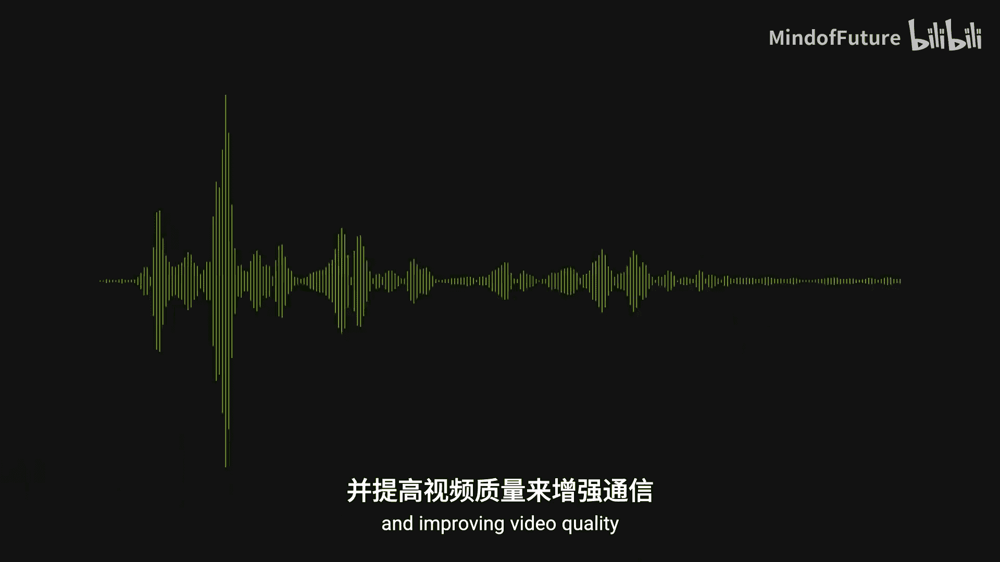
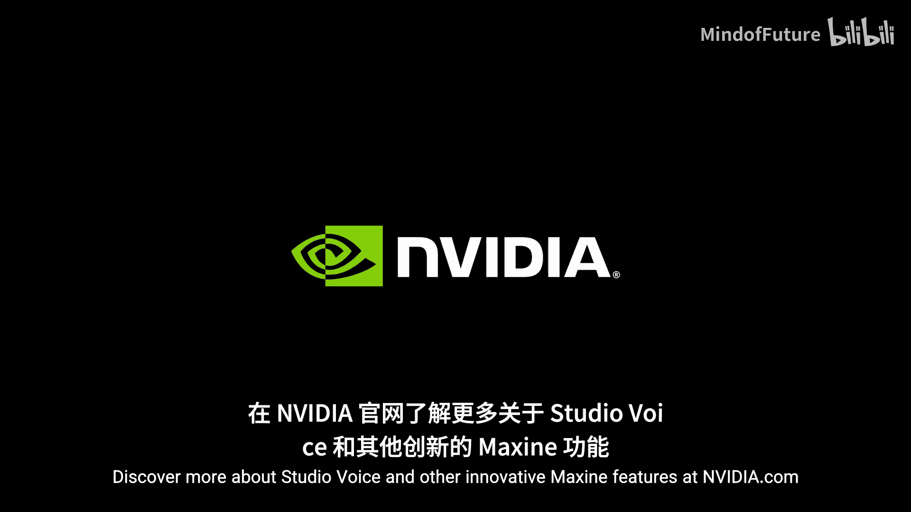

# 【英伟达GTC人工智能大会 • 中英】NVIDIA GTC 2024 p18 P18 Enhance Video Sound Quality with NVIDIA Studio Voice from NVIDIA Maxine -BV1yHAeeqECP_p18-

🎼NVIDdia Maxine's groundbreaking AI models enhance communication and revolutionize video conferencing。

🎼Our latest feature， Studio voice elevates voice quality to professional standards。

 even when using ordinary laptop and desktop microphones。

 Studio voice leverages advanced audio processing techniques to expand the input or recordings audio spectrum by reconstructing frequencies that are lost in the recording process。

 Studio voice can apply sophisticated noise and echo reduction。 The outcome is a cleaner。

 richer sound that dramatically improves the listener's experience。

🎼breaking from revolution Maxine enhances communication by reducing background noise。

 optimizing bandwidth and Disc more about studio voice and other innovative features at Nvidia。com。

