# 【英伟达GTC人工智能大会 • 中英】NVIDIA GTC 2024 p19 P19 Scale AI Applications to the Data Center and Cloud with NVIDIA Nsight System -BV1yHAeeqECP_p19-

As cloud applications continue to ramp up their requests per second and high performance computing applications increase their working set sizes。

 the demand for scalable solutions is more pressing than ever。

Ensight Systemss is NVIDA's comprehensive performance analysis tool Today。

 Ensight Systems is evolving to meet the challenges of AI applications scaling out across data centers and clouds we're excited to introduce new features aimed at assisting application developers with microservices Insight Systems multinode performance analysis is enabled by scriptris called recipes that triage data to help you see and understand application performance。

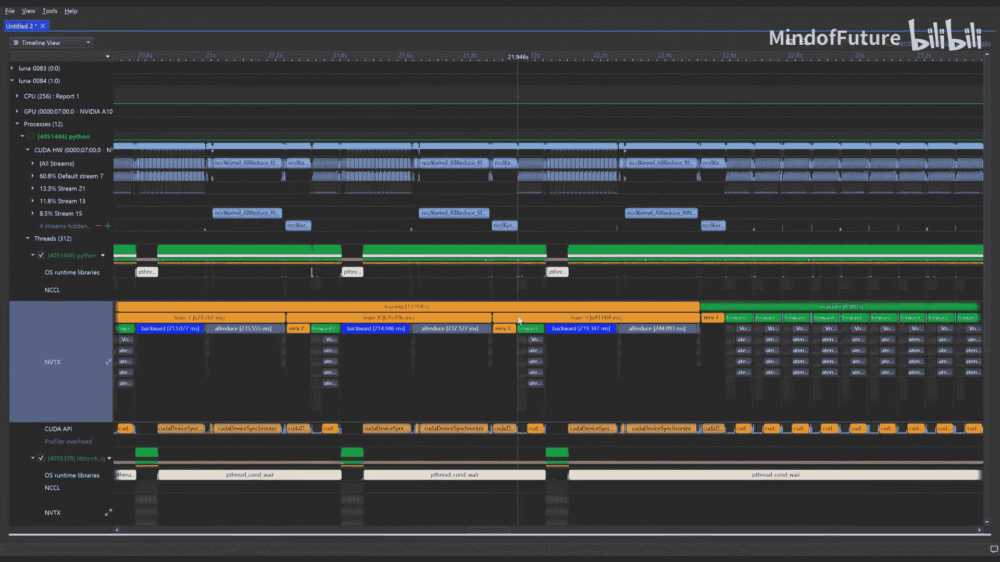

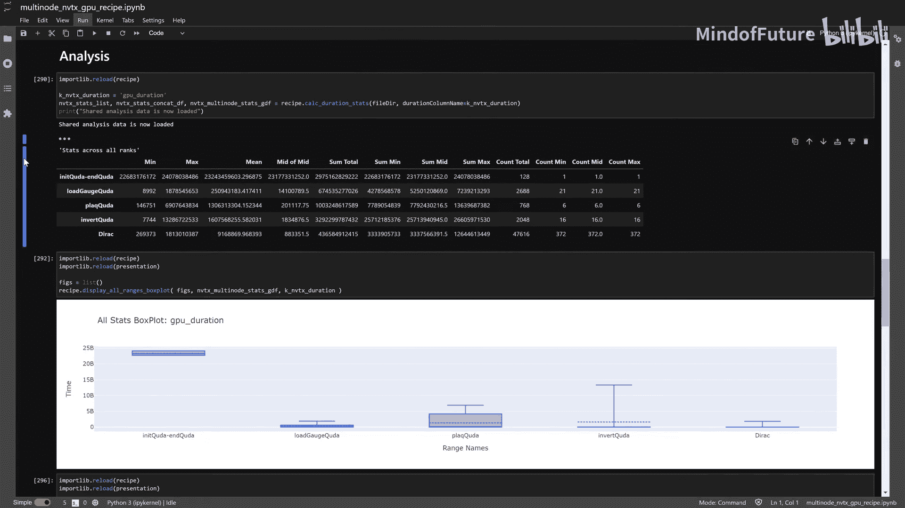

A recipes output is visualized with Jupiter notebook integration。

 this guides you to where optimization is needed and what the likely culprit is。

Recipes help you inspect things like GPU utilization。

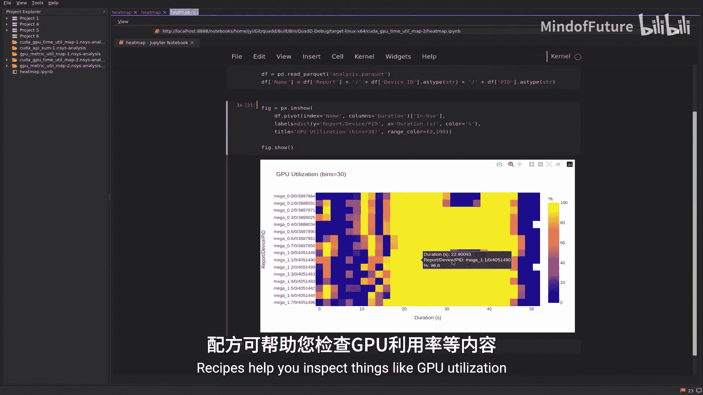

H to Colel Time and now networking。

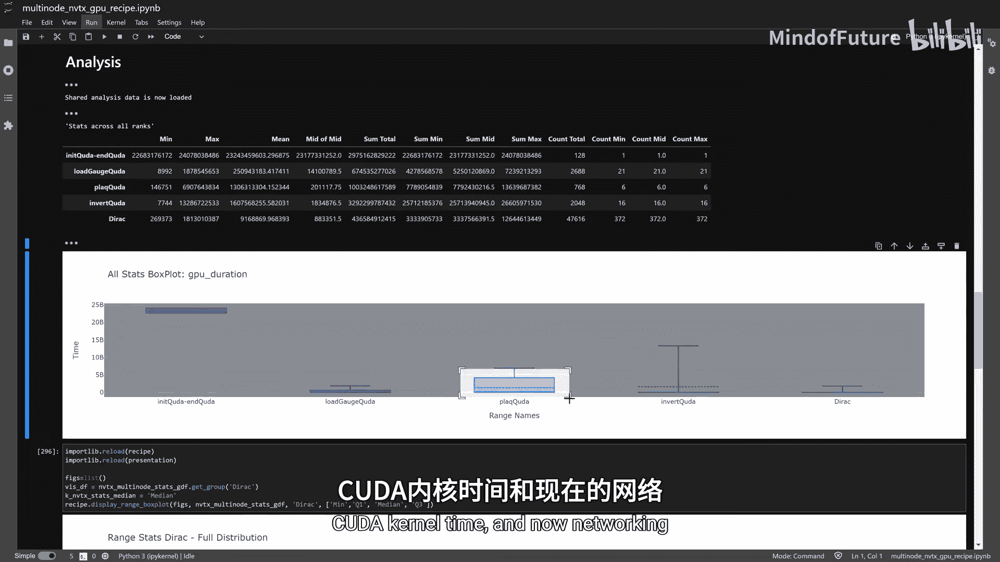

Communications are a critical part of scaling out applications。

 so we're introducing new analysis recipes designed to help users understand how compute cold spots relate to communication and site systems can now generate multinode heat maps to show infinipan congestion。

Infinnovavan and EtherNet throughput。NV linknk throughputs。An overlapped compute and networking。

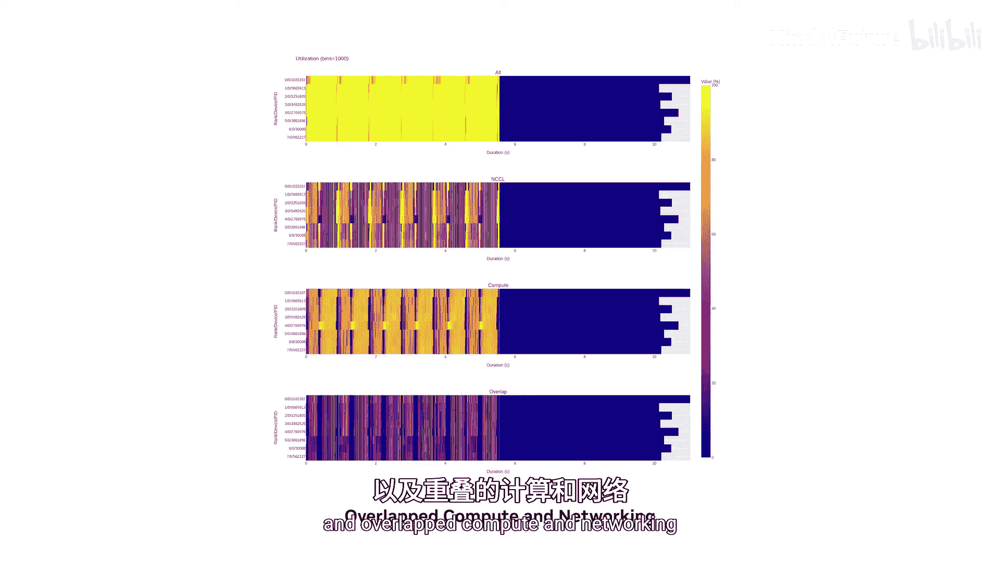

We've also enhanced profiling support for popular container systems like Kubernetes and Docker this includes comprehensive support for CSP Kubernetes services。

 including from Amazon， Azure， Oracle and Google。

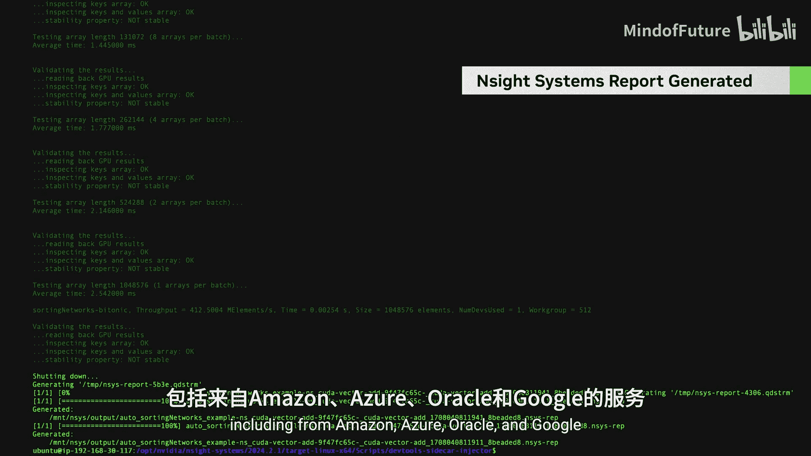

And to meet you where you are writing code， server development is enabled by remote GuI Scam container this allows you to view reports remotely rather than needing to copy them back to your PC or laptop。

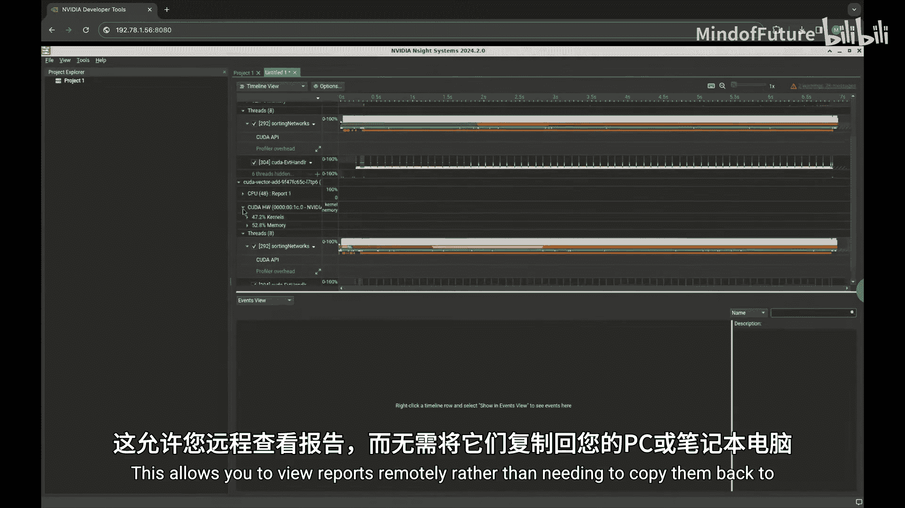

And integration with Jupiter software is expanding even further。

 Enight System now integrates with Jupyter Lab， allowing you to profile code within individual cells。

 you can also view textual results such as statistics directly in Jupiter Lab。

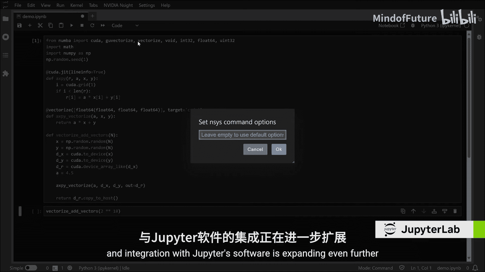

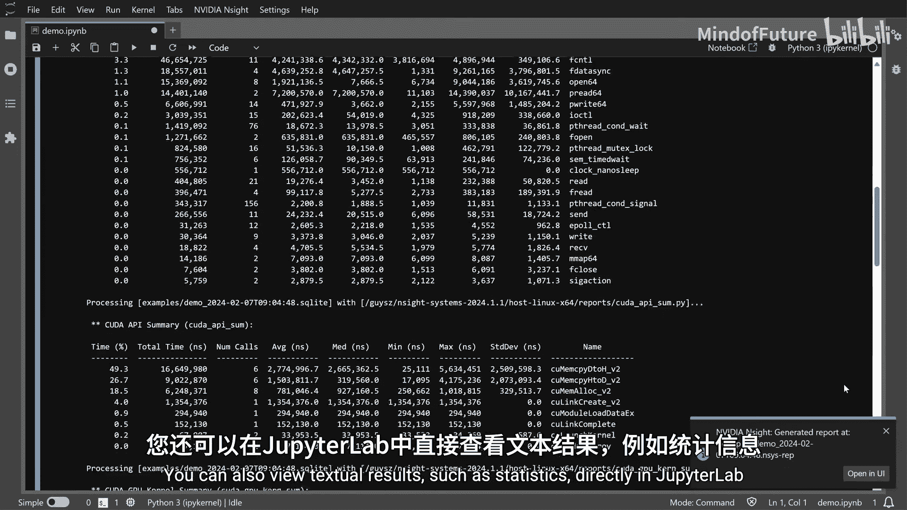

Timeline reports can launch the remote GuI streaming container with a single click seamlessly opening in a new tab。

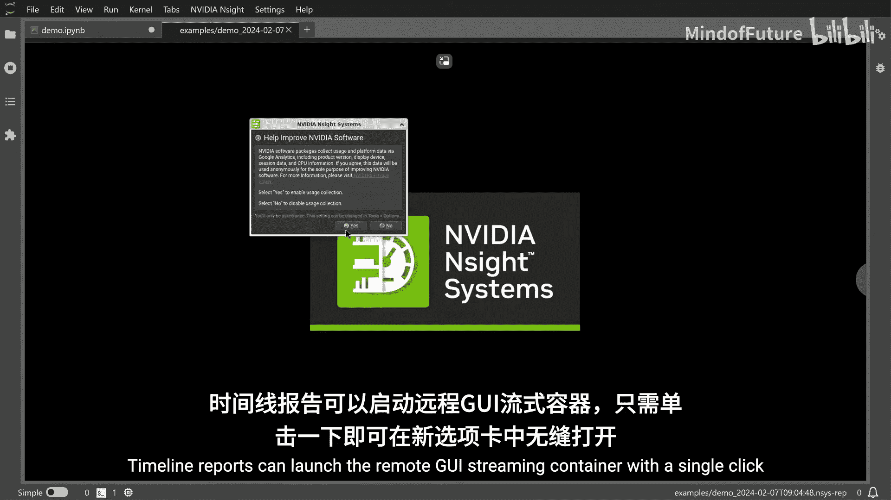

Modernday computing is defined by GPU acceleration and AI scaling applications across multiple nodes and on cloud infrastructure is crucial to meeting these new demands Insight systems has evolved to help you build applications in the new landscape of computing。

 whether onpremise or in the cloud learn more and get started at developer。invidia。com。

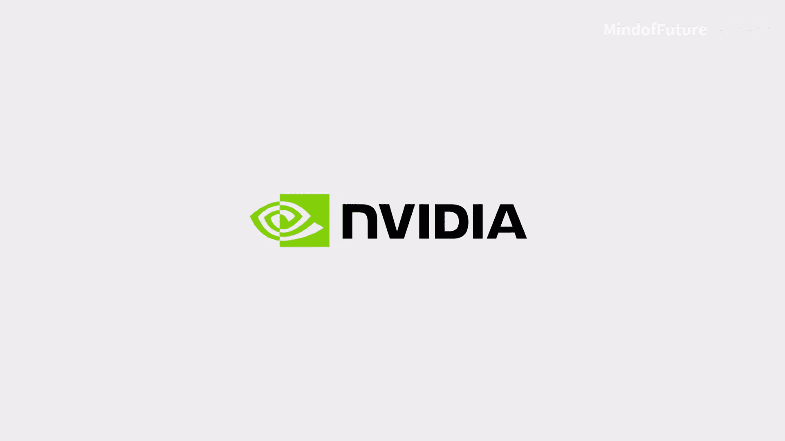