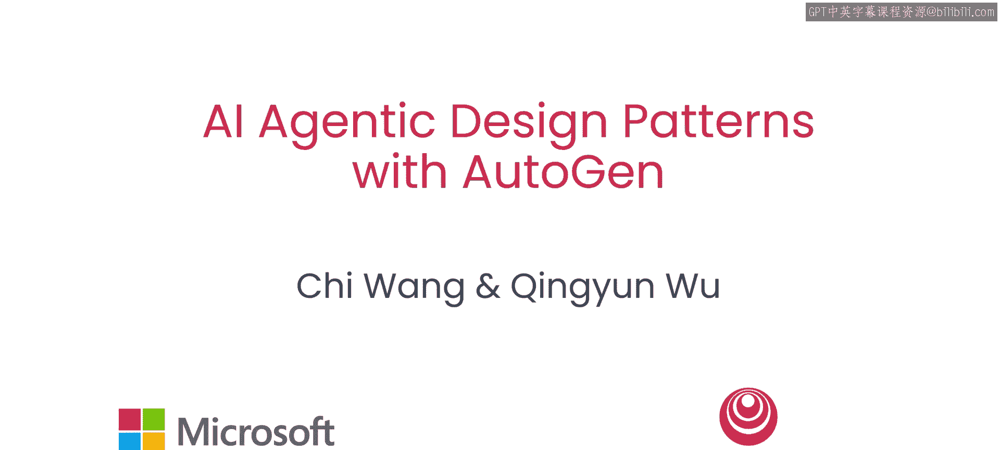
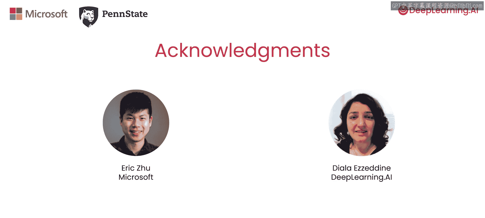

# 【英字可关】吴恩达《利用AutoGen的人工智能智能体设计模式｜AI Agentic Design Patterns with AutoGen》 - P1：1.intro.zh_en - GPT中英字幕课程资源 - BV1WJ4m137dk

Welcome to AI agent design Pat with Autogen， built in partnership with Microsoft。

 I'm joined by the instructors， Zhu Wang， who is transport researcher at Microsoft and T Wu whose assistant professor at Pa State University。

 both of whom are cocreators of autogen。 Thanks， Andrew。 I'm excited to be here。 Thank you。

 Great to be here with you Andrew。 This course is an introduction to Autogen。

 a multiagent conversation framework that enables you to quickly create multiple agents with different roles。

 Peras and capabilities to implement complex AI applications using different AI agent design patterns。

 Let's say you're interested in analyzing financial data。

 The task may require writing code to collect and analyze share prices then synthesizing your findings into the report。

 This might take a person days of research and coding and writing。

A multiagent system can streamline this process by enabling you to create and hire agents to work for you as a researcher。

 data collector， cowriter， and excutor， your agents can also iteratively review。

 critique and improve the results until it meets your standard。

This is just one example of the many practical applications of a multi agent framework and C and Tin will guide you through six lessons each featuring its own unique design process and use case In this course。

 you will learn about all the dream core components by exploring the building agent。

 converible agent。You create and customize a lively conversation between two standup comedian agents while exploring their interactive capabilities。

 Then you will learn about a multi agent interaction pattern called sequential chat。

This allows you to build conversational agents that work step by step to carry out a list of tasks in a sequence。

Wu illustrate this with a customer onboarding application。

 You will also explore the agent reflection framework in two practical scenarios。

 The first one will use multiple agents to produce a well written blog post。

The second adds tools to agents to create a conversational chscape。In both of these examples。

 you will learn another interaction pattern called a nested chat。

Which means when an agent is given a task， it costs a bunch of other agents and iterates with them for a while before it returns the result。

If we think of you， the developer， as a manager of a handful of agents。

 then NA' chat corresponds to letting a agent that you manage also in turn manage their own agents。

 you also learn about a very powerful capability to use in which you can provide a user defined function。

 for example， a function to check if certain ch moves are legal and give that to the agent to use。

And for applications where you might not have a predefined function or predefined piece of code to provide。

 you also learn about coding and code execution， which means asking the agent to write the coded needs which after checking for correctness。

 it could then execute that coded it wrote， maybe in a samplebox environment to computer result needed for a task you see both two use as well as code writing and execution illustrated in the financial analysis example。

 and finally， you learn best practices for building custom multi-agent group chats。

 we will illustrated this with examples of generating a detailed report。

This complex task requires planning In other words。

 the agent has to decide on a sequence of actions to take， such as getting data， analyzing。

 writing and revising you see how we can add a planning agent into the group chat and control how the work flows from one agent to another agent。

 so as to execute the needed individual tasks in the right sequence Many people have worth ci this course。

 I'd like to thank every Jew from Microsoft as was the other as a dean from deep learning AI。

In this first lesson， you will start with building your first autogen agent。

 program a basic two agent conversation， and enjoy a standup comedy show。 That sounds great。

 Let's go into the next video， and get started it。😊。

