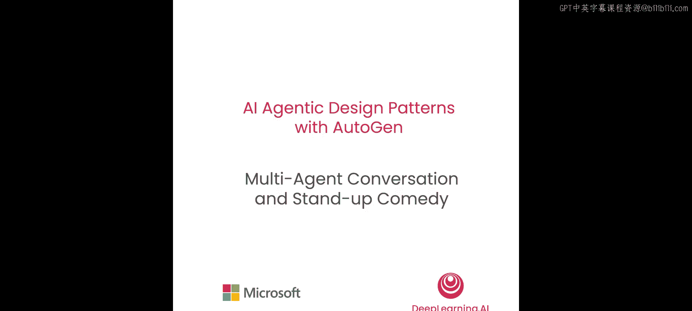
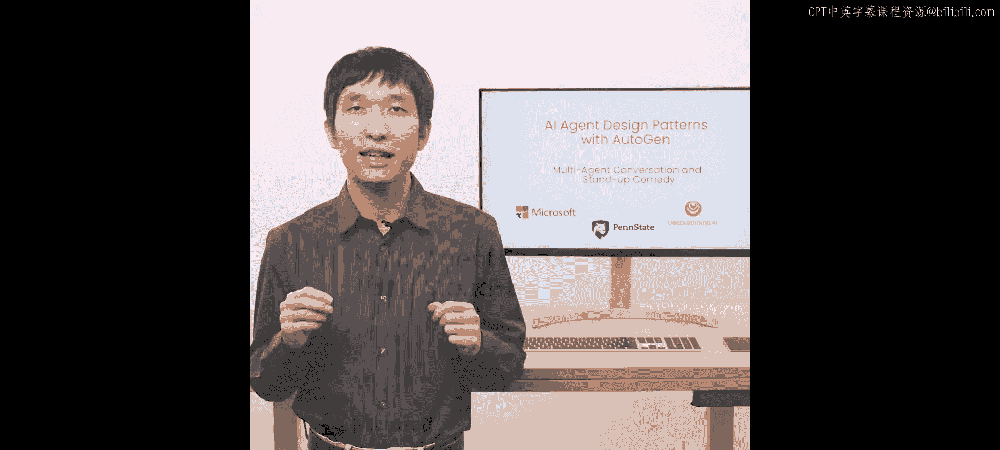
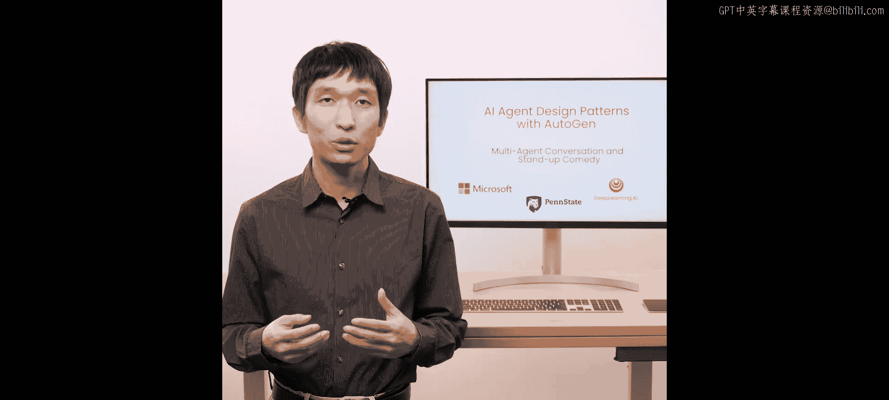
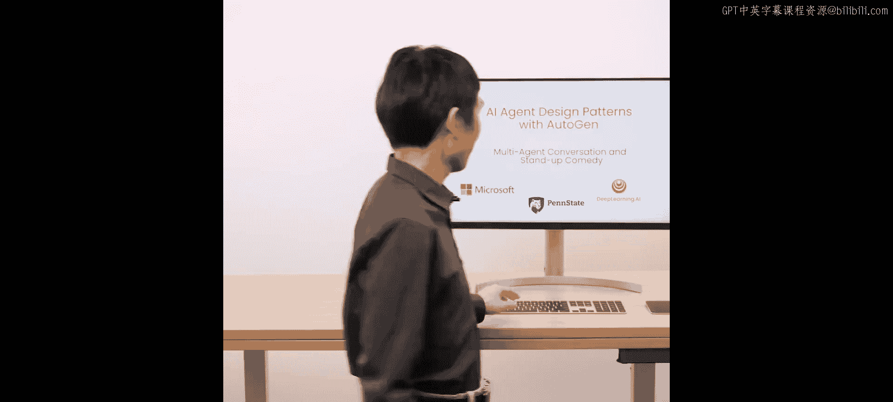
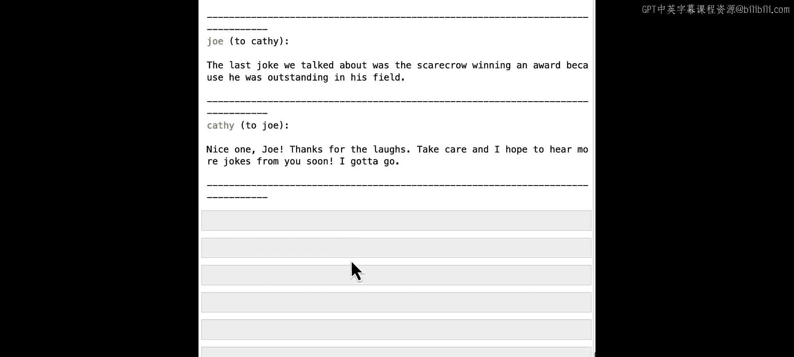

# 【英字可关】吴恩达《利用AutoGen的人工智能智能体设计模式｜AI Agentic Design Patterns with AutoGen》 - P2：2.L1_Multi-Agent_Conversation_and_Stand-up_Comedy.zh_en - GPT中英字幕课程资源 - BV1WJ4m137dk

This lesson introduces the concept of convertversible agent。

A built agent class of autogen that can be used to construct multi agent conversations。

You will learn about the basic functionality， as well as build your first two agent chat and show the fun conversation between two standup comedies。

Let's dive in。

Let's begin with learning the concept of agent。In Autogen。

 an agent is an entity that can act on behalf of human intent， send messages， receive messages。

 perform actions， generate replies and interact with other agents。

 Autogen has a built agent class called conversible agent。

 It unifies different types of agents in the same programming abstraction。

 It comes with a lot of building functionalities。 For example。

 you can use the list of AM configurations to generate replies or you can do code execution or function and two execution also provides a component for keeping human in the loop and checking for stopping the response。

 You can switch each component on and off and customize it to suit the need of your application using these different capabilities。

 You can create agents of different roles using the same interface。😊，In the beginning。

 let's import the open API key from the environment。

So we will import the gett open eye API key utility function。

Run it to get open APII key and then define a LLM configuration。 In this course， we will use a GPT 3。

5 turbo as a model。 And next， let's import the conversible agent class from autogen。

And we will create our first contable agent object。

Here we use a conversable agent class to define agent named chatbot。

 we pass this LLM configuration as we define up there to this converable agent so then this agent will be able to use that large model to generate reply and we also define the human input mode as never this means the agent will never seek for human input it will only use this large model to generate reply in general you could switch the human input mode to other modes。

 for example you could say always then the agent will always ask for human input before it tries to generate reply on his own。

And these are only the basic setups for this agent in general you could also add code execution configuration or function execution and other settings。

 but let's begin with this simple setup the first thing you could do is to ask this agent to generateative response to a question using the geneative reply method。

Here we call this agent's generate P function and give it to message list， the message has a content。

 tell me a joke and row as a user and if we run this。

You should be able to get a reply from the agent， the agent says sure he's a joke for you。

 why did the Scrow win the award because he was outstanding his field？

So this is the most basic thing you could do by asking a question and get a reply from the agent。

 Now if you call this function again， what happen？Let's say we call this general B function again now replace the content with repeat the joke。

Do we expect the agent to repeat the joke？Actually， no。

 because when we call the general reply function， it doesn't alter this internal state of the agent。

 So when we call the general reply function again， it doesn't know that it already generate reply before。

 so it will be a fresh。Function for general reply。 So it will generate a new reply without knowing that it has replied once before。

 you could certainly do this in application for generating different replies if you want。

 but if you want to keep the state and maintain the state and make it perform a series of tasks。

 we need a different approach In the next part and let's look at how to create a conversation between multiple agents and we will do a standup comedy example。

We want to create a application where two standup common des will talk to each other and make fun of each other。

 so the first agent we'll create is a converible agent named Cassie。

In this case we give it a system message to let the agent know your name is Cassy and your standup comedian and will'll pass the same alarm configuration and same human info mode to never when you don't specify this system message then the agent will have an em system message and we just perform as a generic purpose assistant agent and using the system message we customize the behavior of the agent okay that's one comedian we create it how about adding another one。

Let's create another con agent named Zhou and give the system message。

 your name is Joe and your standup comeian。 and we add another instruction After that。

 we say start the next joke from the punch line of the previous joke。

 So this gives us the more specific instruction about how to carry over the conversation。 Okay。

 so we have two comed is is ready to put them in work and create a conversation。

 The way we initiate the conversation is。We will call this initiate chat function from one of the agents。

 For example， if we want the Joe to start the conversation， well call Joe's initial chat function。

 we will set the recipient as Cassy and give it the initial message。 The message says I'm Joe Casy。

 let's keep the jokes rolling。 We set the next turns to be two So we will add two turns of conversations and then finish。

 Let's see what happens。So the Sur message is the same message as we set here。I'm Joe Cassie。

 let's keep the joke rollinging。The next message is from Cassie， Cassie said hey Joe。

 great to meet another comedy enthusiast， let's dive writing with some jokes。

 why did the math book look sad because I had too many problems？The next turn， Zhou says， well。

 Cassy， at least now we know why the math book was always so negative。

 so you can see that Zhou follows our previous instruction and starts the next joke from the last punchline。

And Cassie follows up， says，haha exactly it just couldn't sub the sadness from its pages。

 so it's making continuation of that joke and finally proposed another joke and after these two turns of exchange。

 the conversation stopped。So after the commission finishes。

 we could inspect the chat history in the chat result。 So we import。

APP print library and dual print of the chat history。

 so you could see all the messages got exchanged first from Joe， second from Cassie， Ser from Joe。

 second first from Cassie again。And you can also inspect the token usage in the chat result。

We'll call the chat result cost function。We will see that we are using the G3。5 turbo model。

 we consumed 97 completion tokens and 219 prompt tokens。

 and the total tokens is 316 and the total cost as much dollars。

So in general you could define the conversation in different ways。

 you could also check the summary of the chat result by calling the chat result of summary function so by default we're using the last message as the summary of the chat result So in this case we see that's the last message from the conversation by Cassie if you want to change the summary method we could configure with a different summary method。

For example， we could run the conversation again with a different summary method called reflection with larger model and you can give a summary prompt called summarizemar the conversation So what it happens is after the conversation finishes we will call the larger model with this prompt。

And the language model will reflect on the conversation and probe to reduce a new summary。

 So the same conversation happens and the same result happens because were by default。

 we are using caching to generate the same messages for the same input。

 So now if we check the summary again。We see this time the summary becomes when conversation was focused on sharing jokes and puns between Joe and Casy。

 they playfully exchanged mass and scarecrow related jokes to keep the laughs flowing。

 so that's a better summary。You'll notice that I used the max turns equal to2 to control how many turns to happen in this conversation。

What if you don't know the right number of turns before the conversion finishes， what can you do。

 We could change the termination condition by providing additional configuration called is termination message。

 this is the bulling function So it takes a message as the input and returns a true or words。

 meaning whether the message means the conversation should be terminating， okay， for example。

 you will notice that I change the message here， say when you are ready to end the conversation。

 say I got go， we also pass this stopping condition as checking whether the I got go is inside the message。

 if we detect the I got go freeze。We will consider the conversation as finishing and that is given to each agent。

 so each agent will check the condition from the received message from the other agent and if they see the igotical freeze content in the message they received。

 they will stop replying。Let's round that， and。Let's initial the conversation again。

With a new urban condition and see what happens。So the first few message is similar。But this time。

 you can see they have more turns of conversations。Can it make joke， Joe responded。

And Cassy asked Joe about a different joke and Joe responded with other jokes。

 and eventually the last message from Joehou is glad you enjoyed it， Casy Pza always ahead。

 thanks for the laughs， I gotta go。Yeah， so it all ended the conversation with Iottical and Cassie see that for so it stopped replying so this is a different way of stopping the conversation and is's more flexible。

😊，So after the commission finishes， what if you want to like continue the conversation or if you want to see whether this time the agent can preserve the state。

 we can give that a test。It could test with the same similar questions we said before。

 next time we will let the Cassie send another message。

 what's the last joke we talked about and said the recipient to be Joe？Okay。😊，Will this time。

 will they remember what's the last joke？Let's check that。Binggo， Joehou responded。

The last video we talked about was the scareccrow winning a award because he was outstanding his field。

And they， they also follow the same termination condition。

 And so we see this time Cassie said I got go。 So Joehou also knew that's a signal of stopping the conversation。

 It will stop replying。 So this demonstrated way to makes agent working conversations。

 start the conversation， continue the conversation。 Remember what it hit。

And this is just a very basic demonstration of how to use the concept agent to construct a conversation between two agents in the next few lessons we will learn many other conversation patterns and some agent design patterns。

 including two using reflection planning and co executionec， etc。

