# 【英字可关】吴恩达《利用AutoGen的人工智能智能体设计模式｜AI Agentic Design Patterns with AutoGen》 - P3：3.L2_Sequential_Chats_and_Customer_Onboarding.zh_en - GPT中英字幕课程资源 - BV1WJ4m137dk

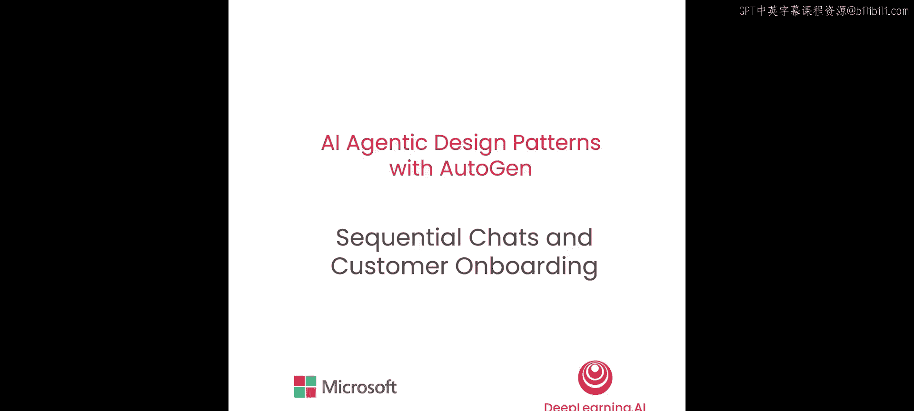

In this lesson， youll learn how to leverage the multiag design to finish a task involving multiple steps。

 You build a sequence of chats between multiple agents who collaborate to provide a fine customer onboarding experience for a product。

 You also experience how humans could be seamlessly involved in the loop of an AI system。 Allright。

 let's code。

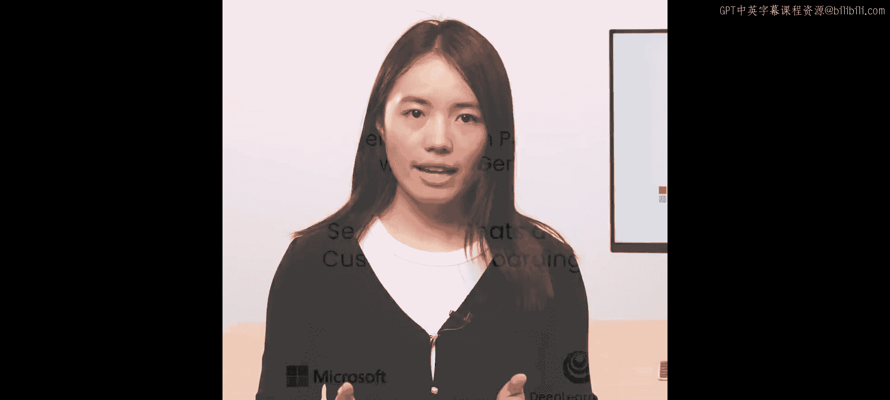

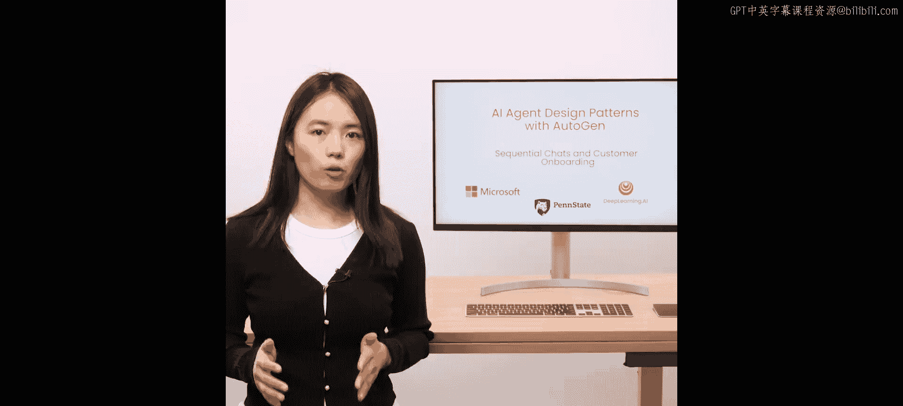

Let's consider a customer onboarding scenario In this scenario。

 a typical procedure is to first collect some customer information and then survey customer interest and then engage with the customer based on the collected information With this in mind is a good idea to decompose this customer onboarding task into three sub tasks。

Including information collecting。Interest survey and custom engagement。

Let's now check how we could finish this series of tasks with sequential chat。

So here we will use the conversible agent class from Autogen to realize those agents。

Let's first import this converible agent from Autogen。

And then the first step is to create an onboarding agent that asks for personal information。

And here we realize that by setting this system message as customer onboarding agent and gave the detailed instruction。

And here we are setting human input mode as never because we are using a large language model to generate response from this agent。

And similarly， let's create another onboarding agent that asks for topic preference， and similarly。

 we can realize what we want to achieve by sending this system message。So here。

 the system message is set to ask the customer interest or preference on the topics。And similarly。

 we will use never as human input mode and use a large model to back this conversible agent。

And another agent we want to create is the customer engagement agent that provides fun facts。

 jokes or interesting stories based on the user's customer's personal information and topic preference。

😊。

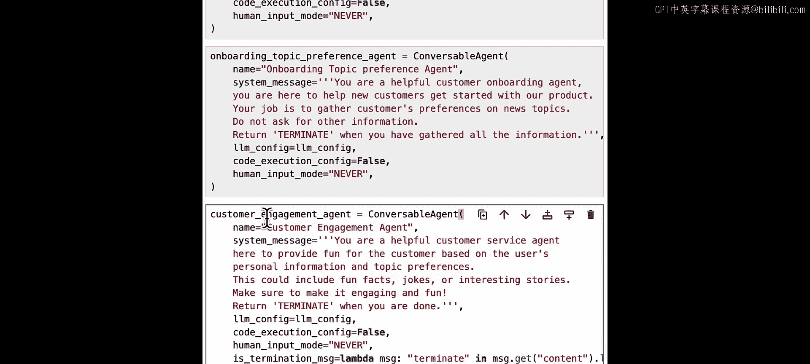

And again， we give detailed instruction on the behavior of this engagement agent by setting the proper system message。

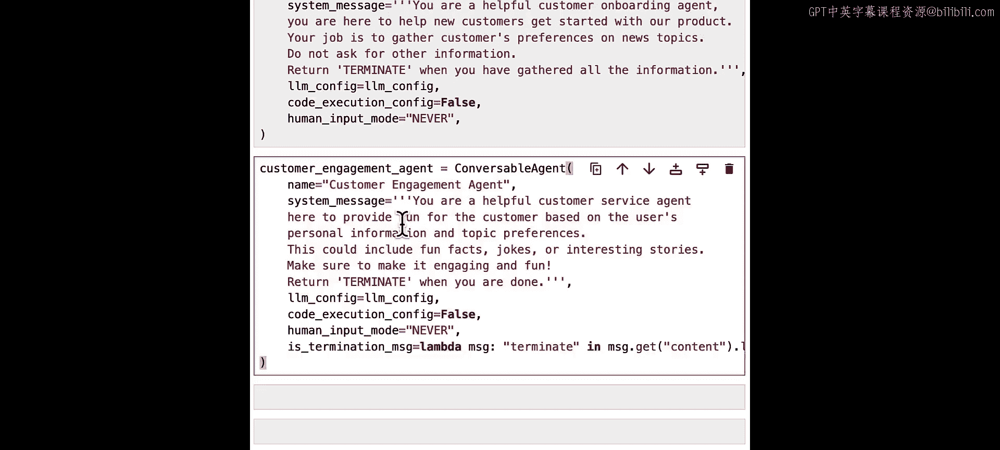

Now， next， we should define a customer proxy agent to act as a proxy for the real customer。

 Note that here we are setting the human input mode as always。

 so that this proxy agent could always solicit human input from the real customer。

So with those agents constructed， we can now craft a sequential chart to finish the onboarding process。

So in this specific example， each chat is effectively a two agent chat between a particular onboarding agent and a custom pery agent。

In each chat， the sender agent sends an initial message to the recipient to kick off the conversation。

 and then they will have back and forth conversation until the Mac is reached or the termination message is received。

In the first chat， we are setting the max turns to two so that they can help at most two turns of conversation。

In addition， in the sequential chart scenario， the tasks typically depend on each other， therefore。

 we may want to summarize information from the previous chart to be used in the next chart。

In this case we want to use summary method In this example。

 we are using reflection as the summary method to summarize the customer's personal information from the first chat and pass it to the second chat we further add summary prompt as a way to instruct the largelan model on how to do the summary so basically here we are instructing it to return the customer information into adjacent object with this format。

 including a field of name and location。So in the second chat we are doing similar things here the center is the onboarding topic preference agent and the recipient is a customer proxy agent。

The kickoff message is great could you tell me what topics you are interested in reading about and the summary method we are using reflection with ourR and this time we are not providing any customized summary prompt and thus will be using the building default prompt and here in this case the mixture instead to be one because we just want to use one term of computation to seek the customers interested topic。

And in your specific case， you can always change it to multiple turns so that you can seek more information。

And in the third chat， we have a chat between the customer property agent and the customer engagement agent。

And this time， it is the customer per agent who kicks off the conversation。 So basically by saying。

 let's find something to read。😊，And after corrupting this chat session。

 we are ready to start the whole onboarding process by executing initiative chats。In this example。

 you will act as a customer and when you are prompted for answers。

 you should type in your response and press in。Okay， let's start the chat。

So here you can see that we are starting our first chat。

 which is between the onboarding personal information agent and the customer proxy agent。Here。

 the onboarding agent is asking the customer what is the name and location。

 Let's say I will use a fake name， Alice。Next， it is asking my location。

 I say my location is New York。And here you can see that we are starting a new chat。

 which is the second chat session between the topic preference agent and the customer preference agent。

Yeah。And here it is asking me to tell it the topics that I'm interested in reading about。

 So let's see the topic I want to read is about Doc。

 And now that you can see we are entering our search chat session and this chat session is between the customer prox agent and the customer engagement agent。

 This is the message from the customer engagement agent。

 So basically you can see that it is using my personal information。

 my name and location and also the topic I'm interested in to have some engagement in the process。

Feel free to pause here and play around with it， for example， you can provide your own preferences。

Okay， so when the chat is done， you could always check the results from each of this chat session in this sequential chat。

 So here let's chat in this chat session。

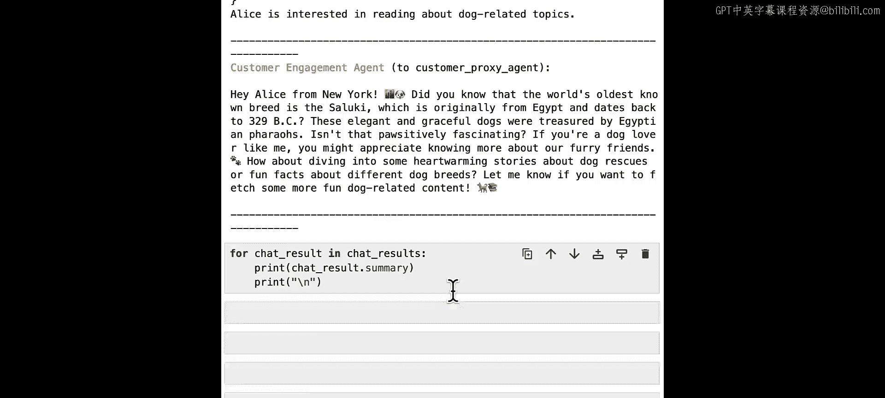

And here you can see that we first have a na decent format of the customer's personal information。

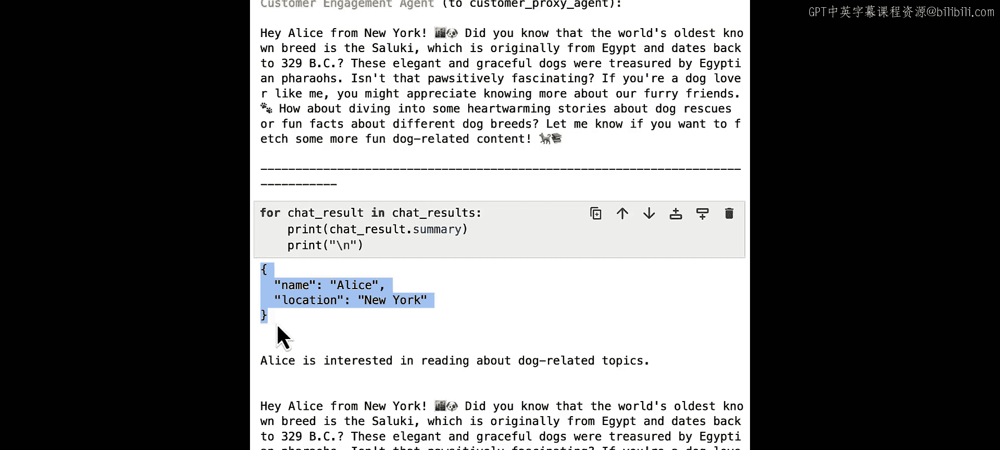

And we have a summary， the customer's interest， which is basically。

 Alice is interested in reading about dog related topics。

 and we also have an nice engagement message with the customer。

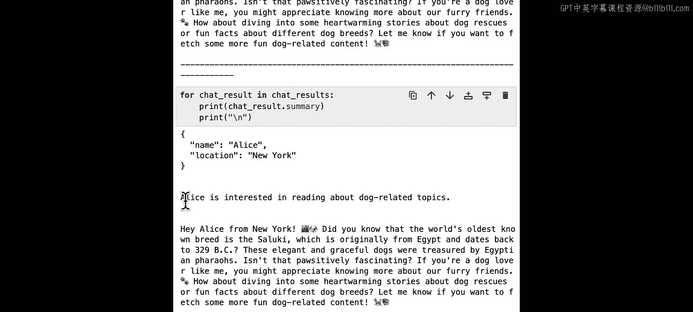

Similarly， you can also check the cost associated with each of these chat。

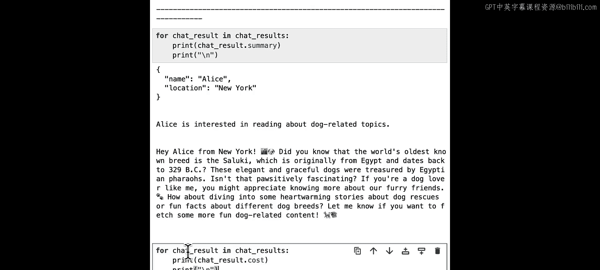

From this result， you can see very detailed cost information， including the total cost。

 the prompt token cost and the completion token cost and the total cost。

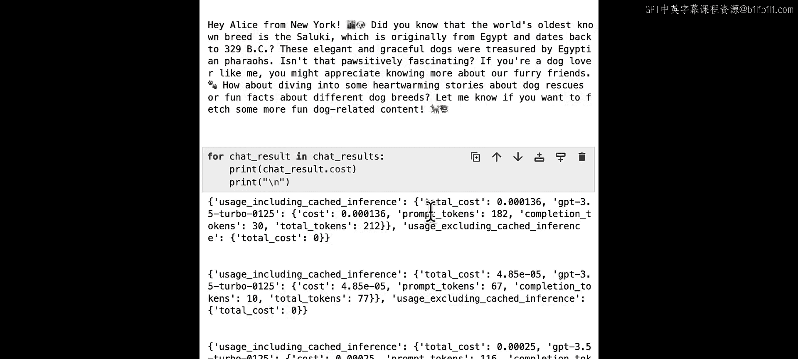

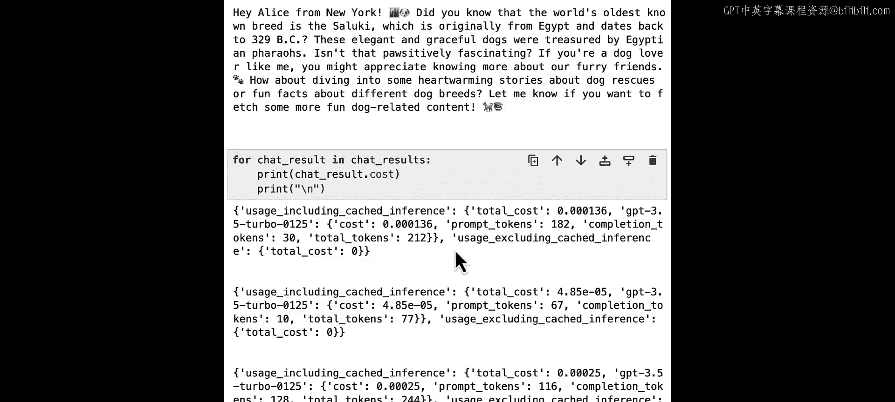

Alright， in this lesson， we have learned how to use sequential chats to finish a sequence of dependent tasks In the next lesson。

 you will learn how to realize the reflection agentant design pattern with NA chat where a chat or a sequence of chats are nested within another chat as an inner monologue of an agent。

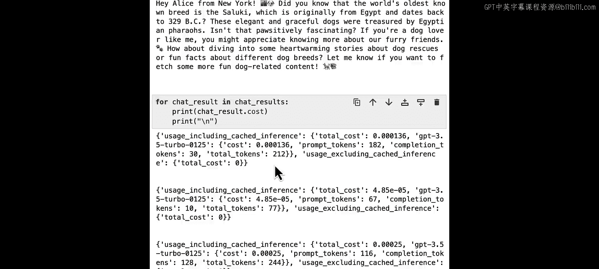