# 【英字可关】吴恩达《利用AutoGen的人工智能智能体设计模式｜AI Agentic Design Patterns with AutoGen》 - P5：5.L4_Tool_Use_and_Conversational_Chess.zh_en - GPT中英字幕课程资源 - BV1WJ4m137dk

In this lesson， you will dive into two use in the message chat between agents。

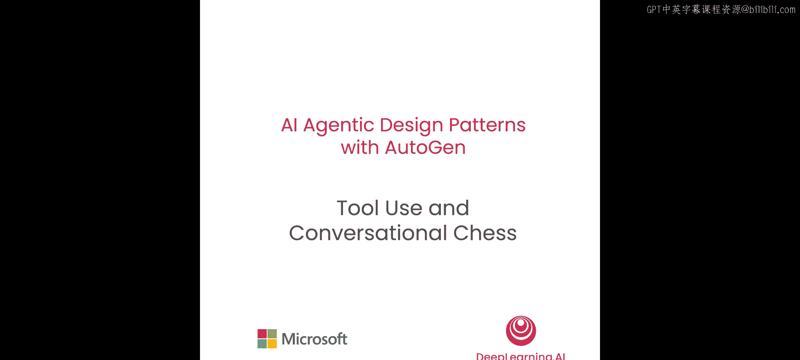

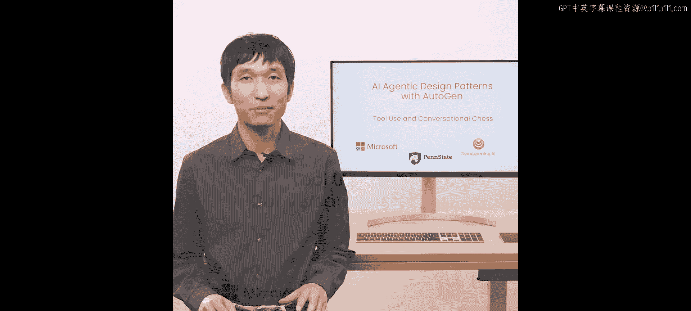

You'll get to build a conversational chess game between two Asian players who both can call tool and make legal moves on the chessboard。

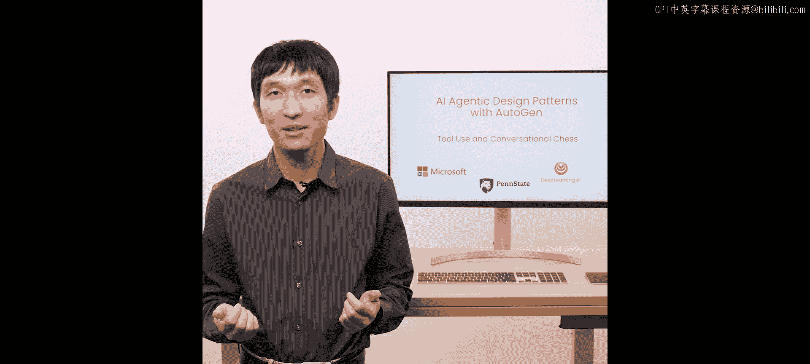

Alright， let's have some fun。In previous sessions， we learned about how to use a conversible agent in Autogen to form conversations。

 and we learned how to use the large models to generatelies in this lesson we're going to learn a new capability for two using and we will still use a nest chat as one conversation pattern to make agents use the tools finish tasks and we will build a conversational chess game to showcase this example So we will build a conversational chess game between two agent players who both can call a two and make legal moves on the chessboard for this lecture we will use the G4 Tbo model as they are much better chess players than G3 The first step is to create the tools needed for this chess game。

For that， we will need to import a few libraries。 We import this chess library。

Which can offer us program ways to carry over the game。We will initialize the chessboard。

To make the chessboard aware of the current status。

We will need to have variable to keep track whether a move has been made。

So we initialize that variable as false。 Okay， now we are ready to define the tools needed by the agents。

 First， we define a tool called get legal moves。 This is a python function。 That we return a string。

As a list of legal moves in UCI format。This UCF format is a format for the language for agents to understand what move has been made。

The definition is very simple。 We will just return a string with content。 possible moves are。

The moves available in the board's legal moves， this annotated part is very important will allow the agent to understand the format of the returned content and the s meaning of it and next we also need to define a tool to make a move on the board。

This function has one input argument named moveve。Okay， so when agent decides to move make a move。

 they can call this function with a particular string， and this move also needs to be in UCI format。

And the returned value of this function should be a string of the result of the move。

And to define this function， we first need to get a move from the ches board。

 so we will call the ches dot move dot from UCI to get the move。

And then we're going to push that move。To the board。And now we。

 we need to make use of the variable on made move。To update that variable。

So we will declare that variable as a global variable。And sad that to true。Other than that that。

 we also want to display the board。So we will call the chess libraries。Board function。

To create the board。And now before we return。The information to the agent。We want to get。

The information about the move we just made， so get a piece from the original point of the move。

 get a symbol of that piece， and create a piece name using the chaesboard function。

And do the normalization。And at last， we return。The move content will return string saying we moved one piece from a original location to a new location。

 so that finish the definition of the tool。Now we are ready to create agents again。

 we will import the conversible agent from Autogen。And we'll first create a player agent。

Player white and give it a system message， you're a chess player and you play as white and we'll also need to let the agent know what toolss available。

 so tell it first called to get a list of legal moves and then call make move to make a move。

We will let him let the agent know the two functions available。

And we also need to pass a larger model configuration to it。Okay， we create one player agent。

 How about another one， The only difference is the name and system message。Okay go around that again。

Now created these two players agents。 One thing to remember is that although we tell the two agents in the system message about the two functions that they can use。

 we have to give them the concrete definition。So later we will need to register tools。

And before that， let's create a store agent。callled board agent the board agent plays a role of checking the moves with the players until the move is legal and also update the status of the board to define that board agent We also need to have a stopping condition for the agent so define that stopping condition and define the function called checkm move so this will check whether a move has been made Now we can define the board agent。

Give it name board proxy and set the lag model confusion to be false。

 meaning this agent will not use library models， and we pass the termination condition function。

 the check made move。So this agent will stop conversing with other agents。When a move has been made。

 otherwise we will keep asking the other agent and say please make a move。

 this is the only reply it will make We also set the human input mode to be never。

So now we have defined all the agents， we can register the tools。To the agents。To do that。

 we will import a function called the register function from autogen。

We need to register for both players， so。We will use a fall loop。Between these two player agents。

And in the follow up， first function we want to register is。Get legal moves。

We will pass the getiggo Mo function and set the call to be one of these player agent and the executor to be the board agent。

And we'll give it a name and give it description in a similar way。

 you can register the second function。Make move。After these functions are registered。

 the caller that is the one of these player agents。

 will be able to propose a function call and the executor， which is the broad proxy agent。

 will be able to execute that tool。Its wrong that？And we could actually inspect the two registration。

 for example， we can check for the player back， what its current ArM configuration2 section。

Here we go。 So this is the two definition following open eye definition。

 there's a list of two functions。 The first function is get legal moves。

 and second function is make move。We see that a few fields like the type， the function description。

 the parameters。Are automatically populated into this two definition。

 This is what what the register function from autogen did。

 So the users don't need to manually write all these definitions。Following the open definition。

Otgen library will do that for you。 All the user needs to do is to define the functions。

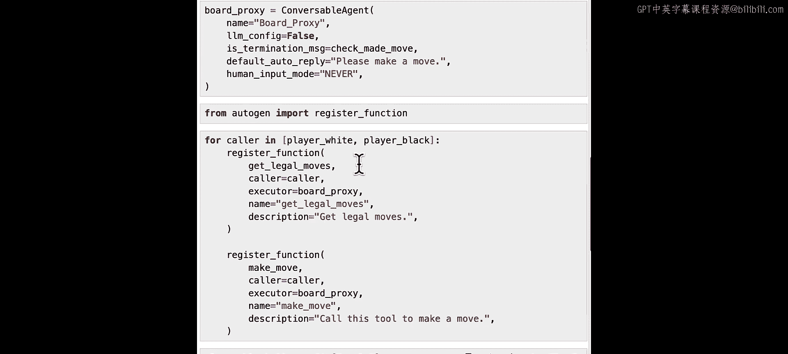

In this way。Pviide the necessary annotation， other than that。

 it's just a normal Python function you learning to write。

 so there's no actual work needed for the agent to consume these tools。After registering the truth。

 we also want to create this message chat conversation pattern because we want when the two players play the game with each other。

 we want them to have message chat with the board agent before they make a move to make sure the move is illegal to do that we first register a message chat with the player white the trigger of the message chat is player black so when player wide received a message from player black this message chat will be triggered and this message chat will be performed before it replies to player back。

And what's the definition of the message chat here we're using a chat queue with only one chat。

 So in the message chat， the chat will be initiated from the proxy， the broad proxy。

And the recipient will be play wide。And we will use the last message as a sumization method for this chat。

So before player White replies to player back， it will first initiate this massive chat between the broad party and player White until player White chose a move。

And then it to reply to player Black about the move。Similarly。

 we can register in the NA chat for a player bag as well。

The trigger at this time is player wide and the inner chat is between ball proxy and player back。

Okay， that's all the work we need to do。Let's get ready to play the game。

 we will first call the chess board function to create a new board and we will call player back initial chat method and with the initial message。

 let's play chess your move。Well set an next turn to be true。When we hit the wrong button。

 we see that the player back。Initiate the message。And now the player wide receives a message it will enter this auto reply with the necessary chat This message chat is between the board proxy and player wide we noticed that the player wide first suggests the tool call get legal moves to get the legal moves from the world the board proxy returns the two execution result returning all the possible moves。

And then player white uses the make move tool with argument E2 E4。

 so that's the move selected by the player white。 The board agent now execute that and returns this message。

 We move the p from E2 to E4。

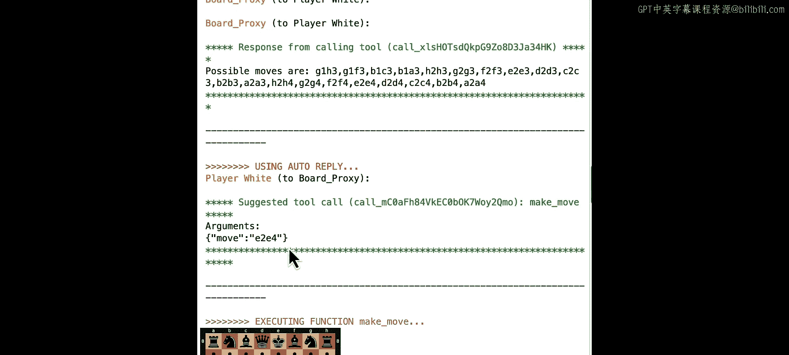

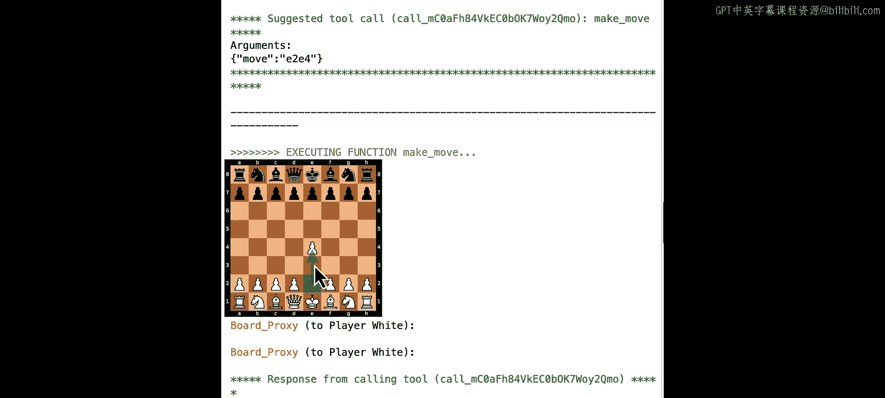

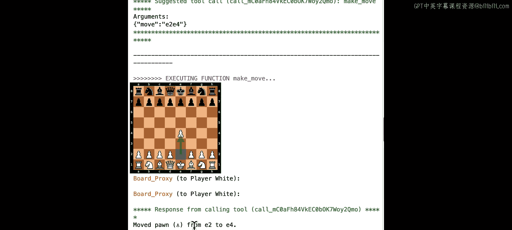

So that's the end of the essay chat because the move has been made。

So after that message chat finishes， the player white will return the reply to player black this is the actual reply sent from player white to player black。

Now， the same message will happen between broad proxy and player black。

 The player Black will also call these tools of get legal moves。

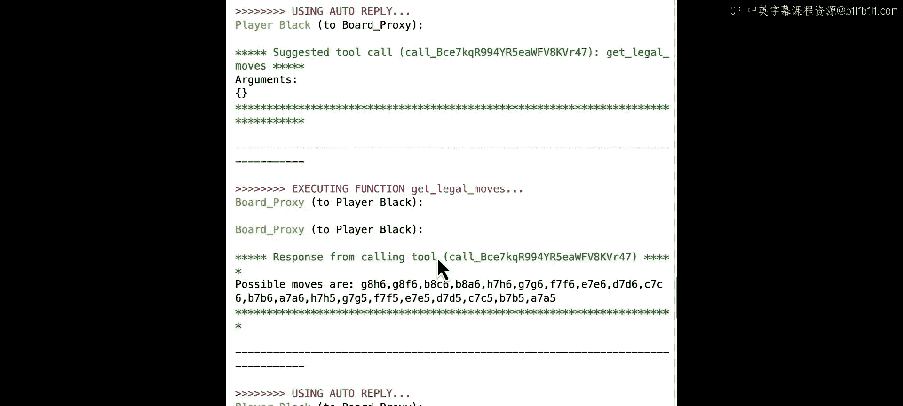

And suggest moves。Using make move。So the move selected by Play black is G8 F6。

Now the broad property returns a confirmation， we move the night from G8 to F6。

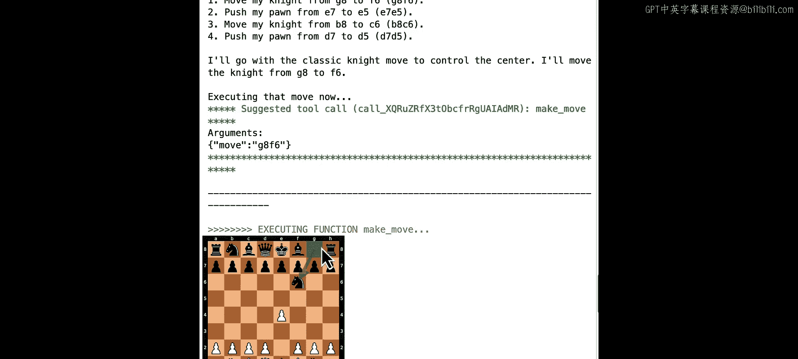

So the final message from Play Black is I've moved my night from 28 to56 is your term that inner message chat finishes so the player black was sent the summary back to playerw。

So the same pattern will happen again， player wide we will get legal moves and choose the move it will play another night。

And that's the end of this two turn conversation。How can we make this game more fun。

 We noted that in this game。The player only are only talking about the moves they're making。

How about we add a little fun to make name Chit chat beyond these moves only？

So we could modify our definition about these player agents。 Now we can change this message。

 say after a move is made， she chat to make the game fun。 so that's one extra extraction we added。

From that。And I do the same for player black。And we will need to repeat the re about the two use。

 and。That's a chat。So two all of that。😔，What cell。And finally。

 we will recreate the board and restart the。Compversation。And by the way。

 we also added a flag side and equal to true in for the message chat。

 so this time we don't need to inspect the inner conversation。

 we just want to see the outer conversation between the two player agents let's see So this time we see the first move made by player white。

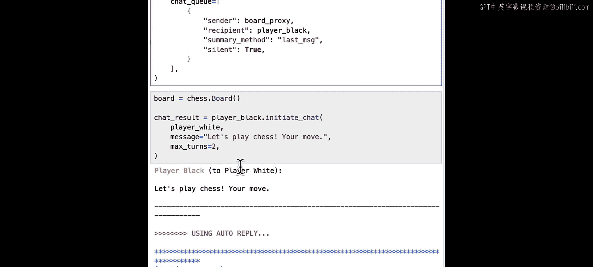

And not only to make the move， Pol says， let's see how you respond to this classic opening。

This time player back to the move of the paw and saying。

 I move my pun to C5 opting for the sizzling defense， your move。

 what strategy are you planning next in this chess battle so they're starting to challenge each other。

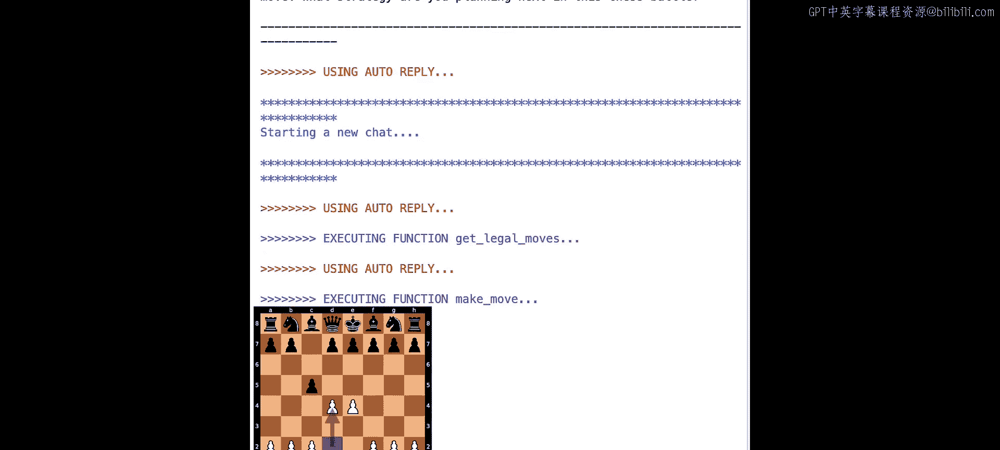

And the player wide responded。I've just moved my point to D4。

 pushing the game into the openly contested territories of the sizzling defense。

 the center is heating up and I'm curious to see how you will respond。

 so they keep making fun and carry over。

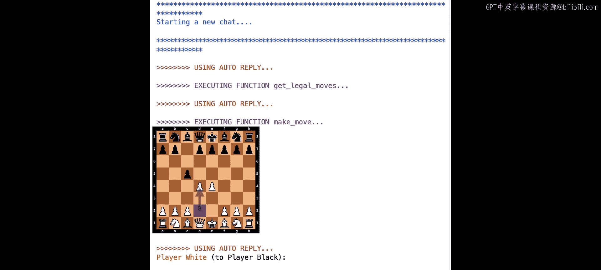

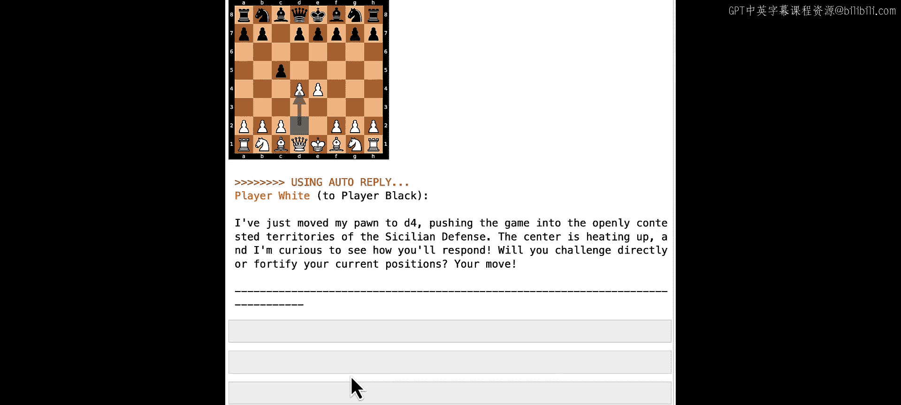

You could try this example yourself and modify this yourself to make them behave differently In this example we see two AI players playing with each other。

 we could watch how they play with each other where they said， how do you like this example？

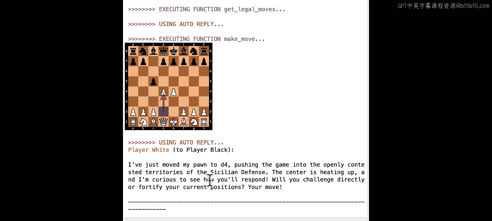

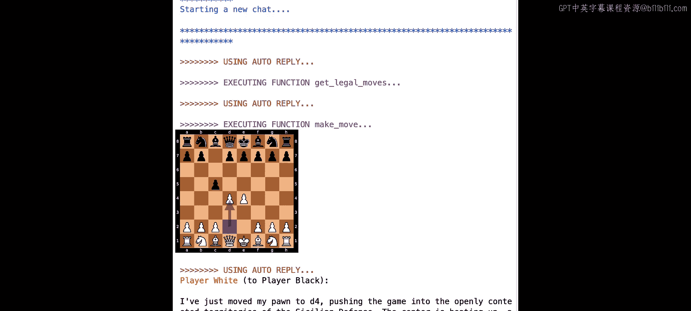

This demonstrates one particular way of using tools within Nechat， it's not the only way。

 but in general when you use tools， you need agent that's able to propose the tool use and another agent that's able to execute the tool if you want to hide this proposing and tool using inside the Ne chatt you could do in a similar way。

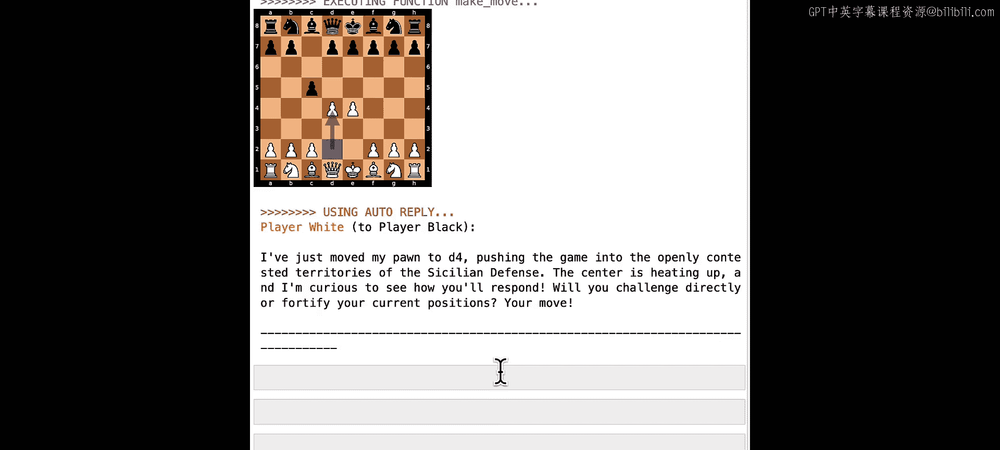

And we can see that when we do that and from outside we don't necessarily need to know there were two agents involved and we can simply create the experience of one agent that is able to make use of tools and perform some functions in some other application you may want to explicitly demonstrate this separation of two proposal and two execution。

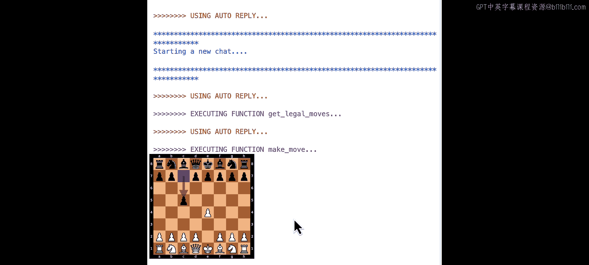

And in the next lesson， we will also demonstrate other ways of using tools， for example。

 using free form code or making the agent to suggest a code or making the agent to consume user defined functions in the more freestyle coding。

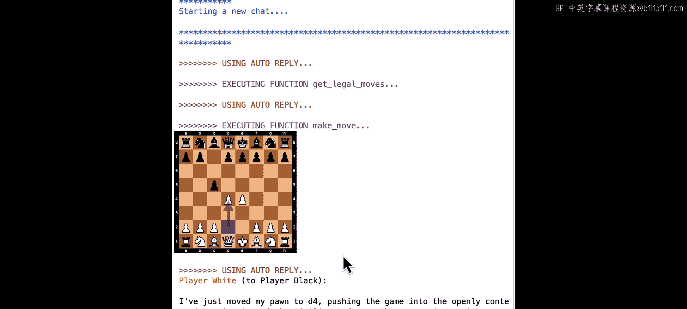