# 【英字可关】吴恩达《利用AutoGen的人工智能智能体设计模式｜AI Agentic Design Patterns with AutoGen》 - P6：6.L5_Coding_and_Financial_Analysis.zh_en - GPT中英字幕课程资源 - BV1WJ4m137dk

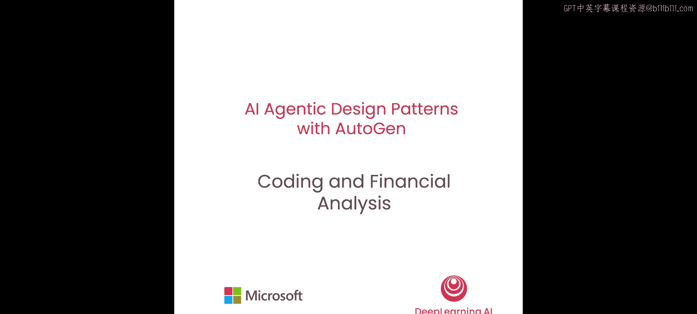

In this lesson， you will explore how to add coding capabilities to your agents and use the generated code to complete a financial analysis task。

 you will get to build two agent systems where agents collaborate to solve the task in hand while asking for human feedback。

The first one will use the large language model to generate the code from scratch。

And the second one will leverage user provided code。Let's start coding。

How about let's do some coding and financial analysis in this lesson In previous lessons we learned how to use Autogen to create agents that are able to use tools。

 leveraging the Open eye to use functionality One limitation for that is many other models don't have the same feature or sometimes you want agents to be creative in writing free style code instead of only using some certain predefin functions。

 so in this lesson we'll go over how to do free from coding。

 including how to make agents that can generate code to complete a financial analysis task and making two agent system where agents collaborate to solve the task and asking for human feedback and well create two such systems The first one will ask the library model agent to generate the code。

All by itself and the second one will also consume a user defined code。

 We are going to use G4 Turbo for this example。First， we need to create a code as acutor。

We import from autogen coding。A executor called local command line code Excutor。

There are several different types of code executedor in Autogen。

 including a Docker based execution and Jupyter node based execution For this example。

 we will simply use local command line code execution。We're going to create aecutor。

With some configuration， for example， we'll set the timeout to limit to 60 seconds。

And we'll set the working directory to be coding。So that creates a work direction here。

Code coding and all the code and intermediate results generated can be found in that folder。

Now we're going to create agents。We will import Comversible agent and another derived class called As agent from Autogen。

We' first create an agent that's able to execute code。

So well use a Comible agent named code as acutor agent。This agent doesn't use large angle model。

But it will use the code asor to perform execution。Its that the human input mode to be always。

 so it will always ask for human input confirmation before executing code。

And if this agent doesn't find any code in the message it's received， it will reply。

 please continue if everything is done， reply Terinate。Next。

 we'll create an agent that's able to write code。In this case。

 we create this assistant agent As agent is a special class of con agent with a default system message about how to write code and how to deal with different conditions to solve a task。

We name it code writer agent， we gave it the larger model configuration。

 and we said that the code execution conversion to be false。

 so this agent will only proposed code but not executeQ them。We set a human input mode to be never。

 so this agent will never ask for human input。If you are curious about the assist message。

Default is messages provided by the assistant agent。We could。Use this sell。To print it out。

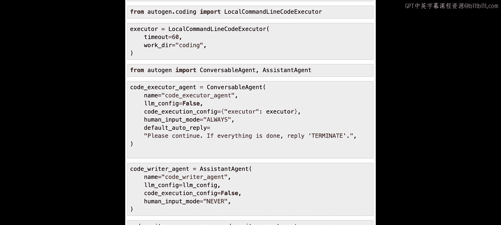

So here is the instructions。

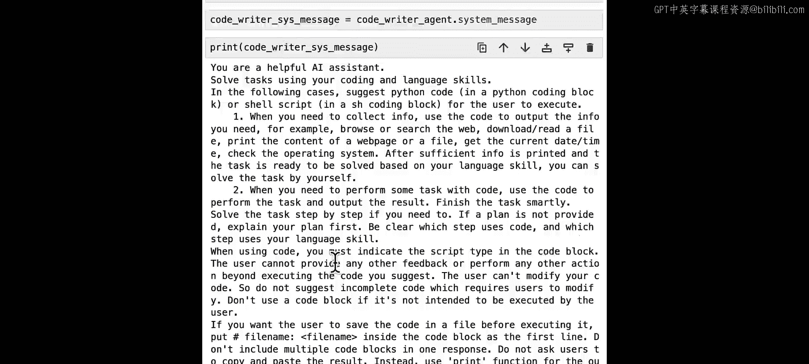

It's a pretty long assist message that contains a comprehensive instruction。

About how to solve task using or coding and language skills。

 it will suggest a few cases where Python code or She script should be suggested， for example。

 when the agent needs to collect information， it can use the code out of the information for example。

 when browsing or search the web or downloading and reading a file and second。

 when the agent needs to perform some tasks with code。

 we ask the agent to use the code to form task and output the result and finish the task smartly。

 we also provide instructions about suggesting plans and be clear which step uses code and which step uses the language skill we have instructions about when using code there are certain format they need to follow and we also let the agent know that the users will only execute the code。

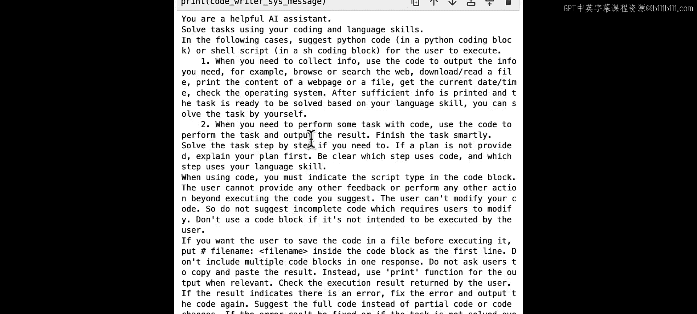

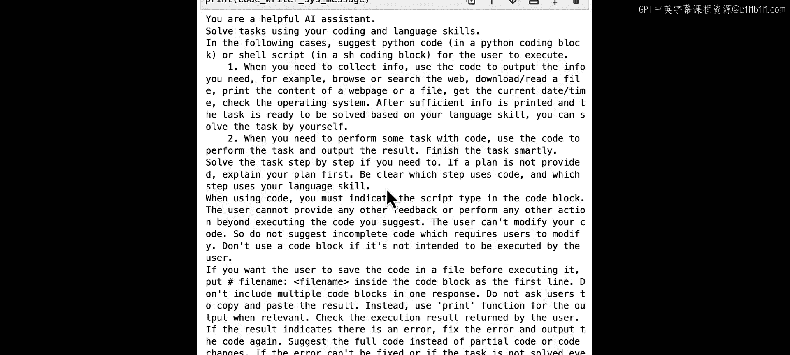

So try to make agent not suggest incomplete code， which requires users to modify that。

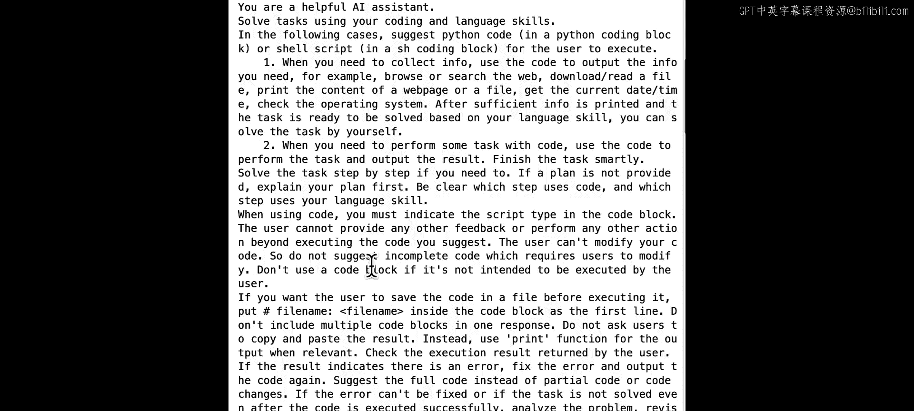

The code can be saved in a file if a particular tag is added inside the code block。

We also let the agent know that the agent should check the excion result and if the result indicates there's error。

 fix the error and output the code again and finally we ask the agent to reply the terminate in the end when everything is done。

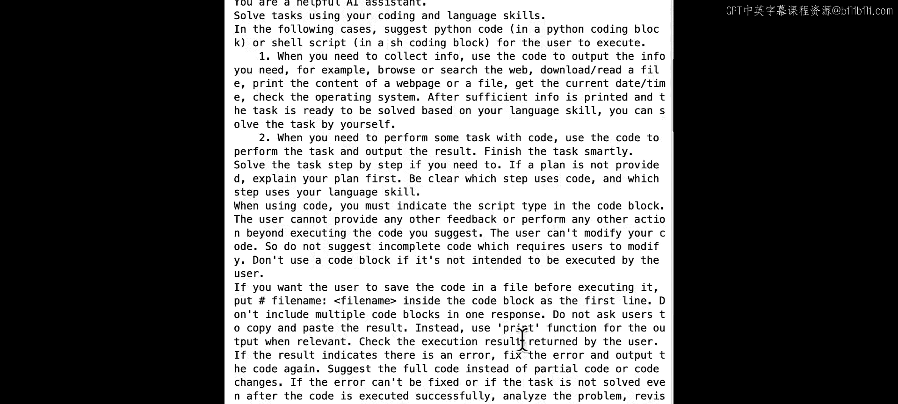

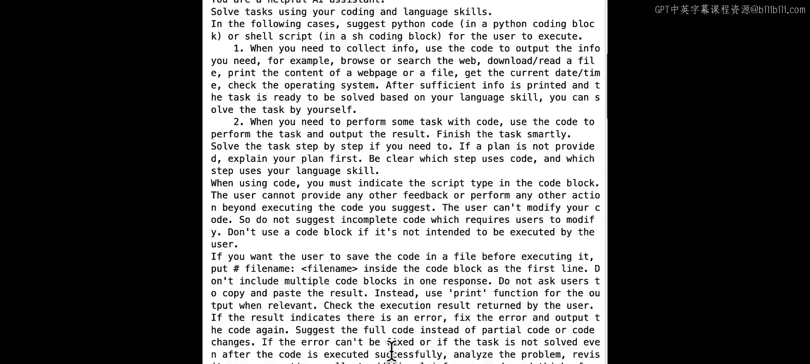

And this is the default this message of the assistant agent。

 you could certainly customize this to make it stronger codeer。

 but we found this default this message works pretty well in many coding tasks。

 including solving math problems。

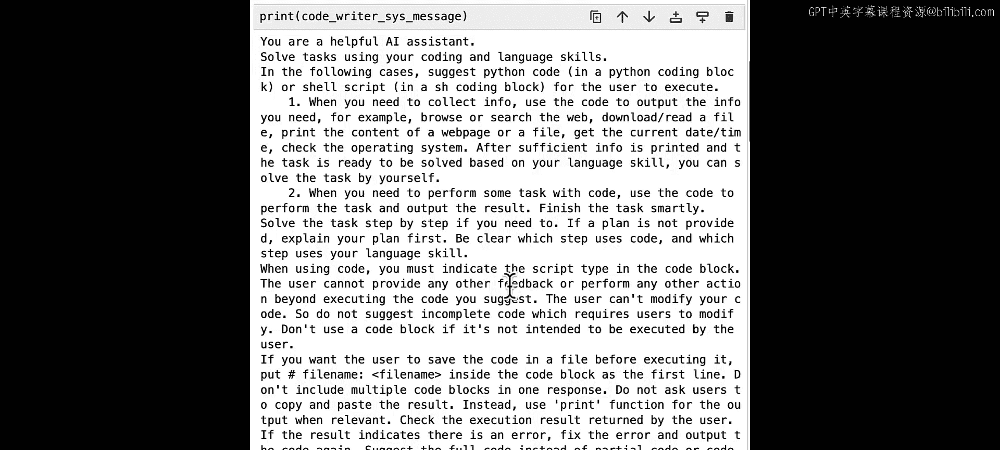

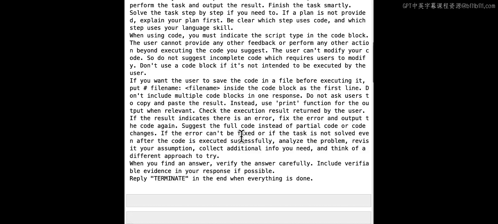

Now let's move on， we have these two agents ready so we can make them work on some tasks。

So let's try to define a task about financial analysis。We do we import the data time library。

 get to this date and define the task as createable plot showing stock gain。

Year to date for NVDdia and Tesla， and we want the plot to be saved to a file。

So that's the whole message and we can now start the conversation from the code executor agent and the code execut agent will send an initialertial message to code writer agent。

So the classic schedule says today is 2024 May 2， create a plot showing stock gain year to date for NVDdia and Tesla。

Make sure the code is in markdown code block and save the figure to a file The code exator sends the initial message to the code writer。

 the code writer is provided with a larger model we' are using G4 turbo so now we are waiting for the G4 turbo to generate the response from the code writer agent。

Here is a reply， so the code writer agent suggests how to solve this task using code。

 it suggests a few steps fetch the stock price data using why finance。Calculate stock gains。

 plot stock gains using Mattplot Lib and save the plotto file。

 The code is suggested following that plan， it contains all the steps so now the user can verify the code and if we have no issue with that we can simply press enter to skip the feedback and use auto reply。

So now the code executor will execute that function， generate output。

And send that output back to the code writer agent。

 So now with the code set the script activate successfully and generate plot。

 we can inspect whether the file is indeed generated。

 so now since the codeator set terminate I can type X A。To stop conversation。And。Let's see the plot。

We import the image。Function and show that in the notebook。

 So here's the cloud file generated by the two agents。Okay， it looks good。

And that is one way of making the agent write code in freestyle。

 we only need the default assistant agent from Autogen。

And another code execution agent to perform this task。

In case you want more control about how to finish this task。

 you could provide some code you already written and make the agent use them instead of writing the code completely and by themselves。

In the next， we will demonstrate how to do that。So let's say we already have a function about getting stock prices。

 we could define them。Here。With our own definition。For example， we could import。Why finance？

And download the data。And return the talk data， and we also want to add Doc screen about this function so that the agent will have better idea about how to use this function。

lookss good。And let's say we also want to provide the function about how to plot stock price。

Could provide that function。Again， with both do strain and function definition。

Then let's assume we want the agent to only use these two user defined functions to perform the task How do we let the agent know about that Well。

 we can change the creation of the local command line called excutor by adding this function parameter so we provide these two functions in the list。

To the classification。And the code executor will be able to execute these functions。

 also we need to let the code writer agent know about the existence of these two functions。

 the way we do that is we will modify the system message of the code writer agent by pending some additional prompts that contain the knowledge about these two functions。

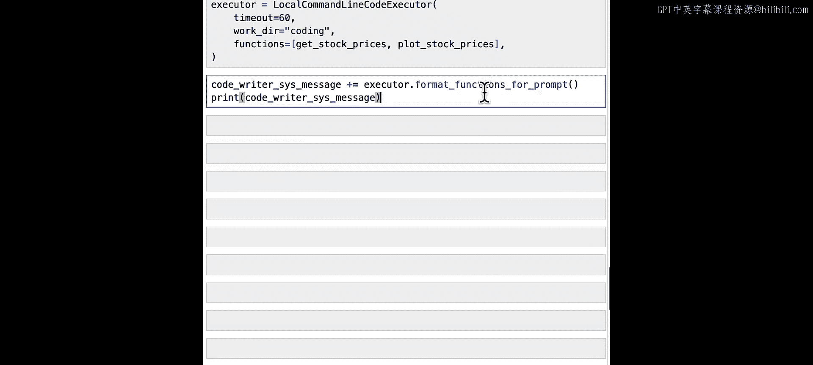

After we execute that， we see that。

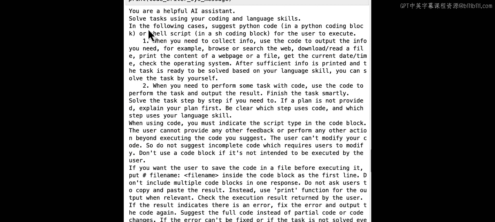

The first part of this is message is the same as before。But after that。

 we added some knowledge about you have access to the following user defined functions。

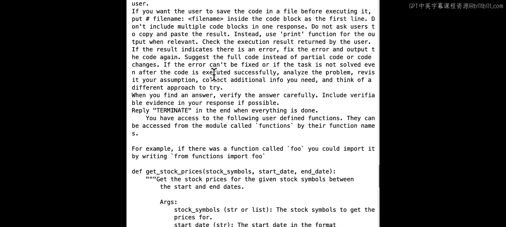

They can be accessed from module called functions by function names。For example。

 if there's function called full， you could exp it by writing from functions import Port full。

 And now we added this concrete function signature and do strings into the system message。

 So this is done automatically when you call。

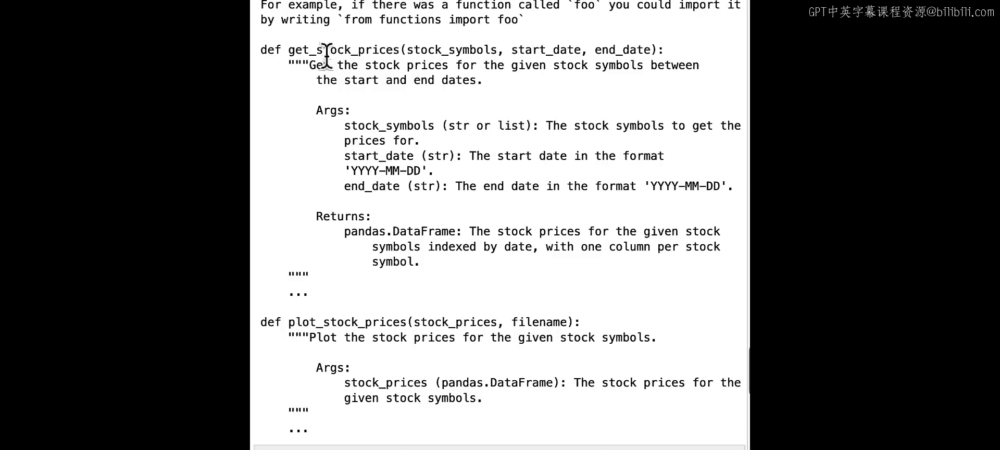

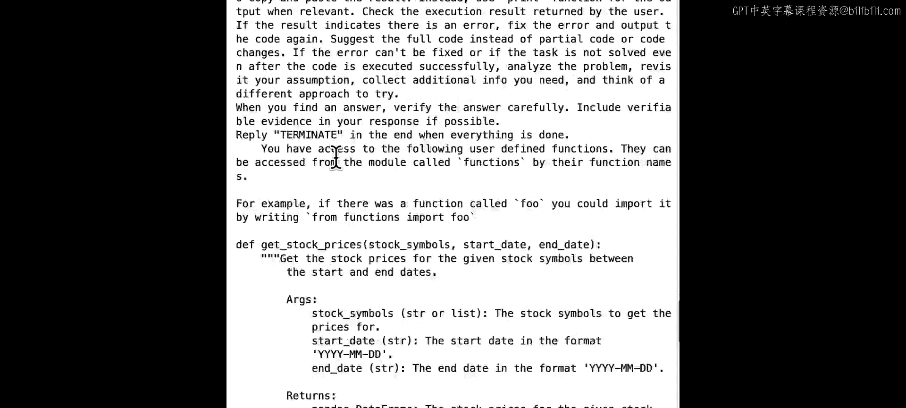

The excutor dot format functions for prompt will populate these instructions automatically based on the function definition。

 so users don't need to do extra work， they only need to write the python functions in a normal way。

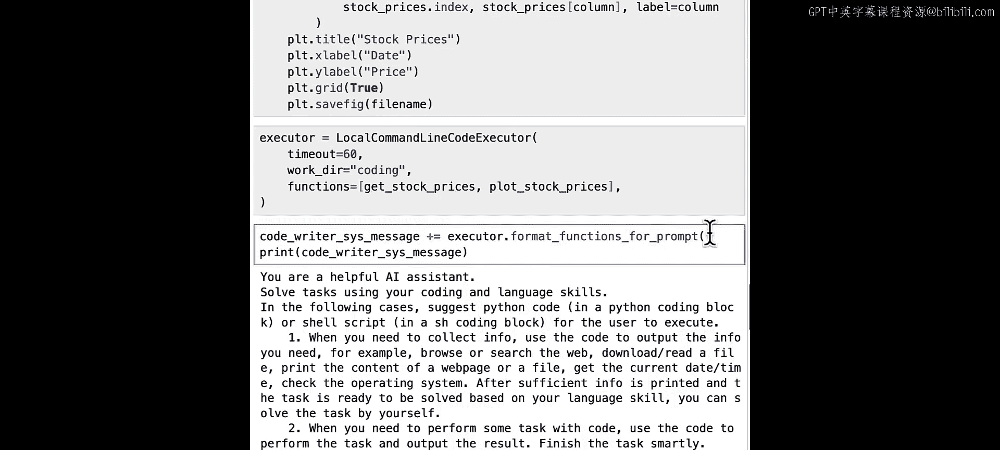

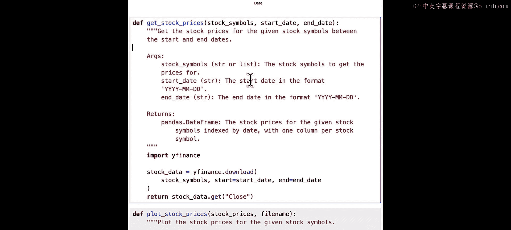

And with this command， we will automatically register that system message to。

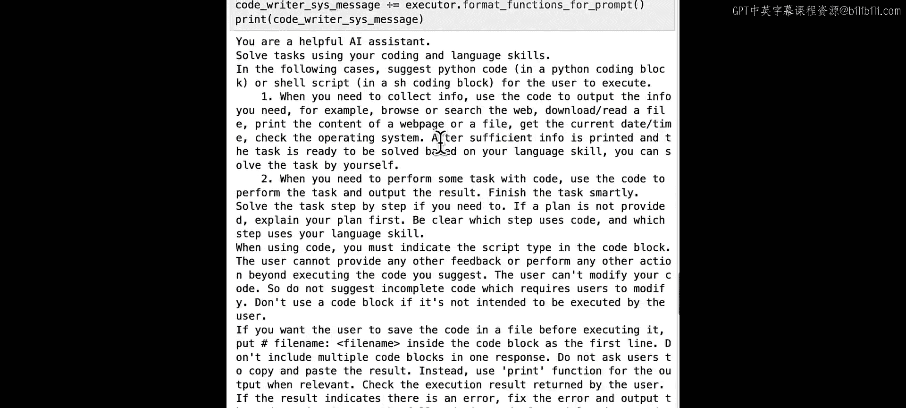

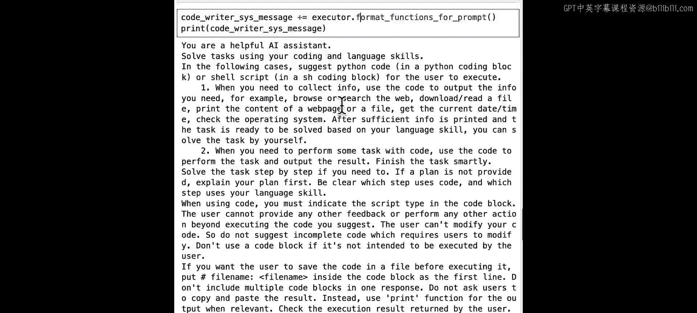

To the original system message。Okay， now we could create the code writer agent again with the new system message。

This time it will contain instructions about these two user defined functions。

And we'll create the codeexcutor agent again， with updated codeexor。Now。

 if we try the same task again， this time we gave the same traction except that we save the figure to a different file name。

So when we initiate the two agent chat again， we are using the updated code writer and code exor with access to user provided functions。

So this time， we should expect the code writer agent to leverage the user defined functions。

 Let's check that so。We can first check the plan， the coordator said we want to first identify the start date of the current year and then to utilize the function。

 get stop prices to download the data so this the get stock prices is a function provided by the user and after collecting data we use the function to the plot suck prices。

Function to create the cloud。 This is also the user provider function。

 So we can see that in the plan， the writer agent indeed suggested using the two functions provided by the user。

 And then let's check the code generated this time it call this from functions import these two functions and and write code based on these two functions。

 So this creation of these functions module is also done automatically by。

 we see that in this case the code is much shorter because it's directly using the user provided functions for these two steps and the code is also cleaner。

So we will press enter to skip the human input and use auto reply。This time。

 the code excator will execute the code again。So let's end the conversation and check the generated plot again。

So here we go， so this time we use the provided stock price plot function to plot the price instead of the percent of change of these two stocks and also notice that we don't require any function core or two call functionality of the underlying model。

So， even when you use。A model that's not based on open eye not doesn't support the function core feature is to be able to use the user defined function as well。

 I want to mention a few notes。So first of all， when we check the Python code block。

 we see there's a line about the file name。So when this line is there。

 the Python code suggests it will be saved in the file with this file name under the specified coding directory and but if this line is not there。

 the code will be automatically removed after execution Another note is if we find the code is not meeting expectationss and we want to suggest some change to the code。

We could provide that input when the code excutor prompts for human input， for example， when here。

 only if we skip that， the code excutor will execute the code。

If we compare the code execution and to execution， theres some difference。

The code execution is a more flexible way to write any code the agent is capable of It also has the flexibility of using user definedfined code just similar to the user definedfined tool or function but this code execution capability doesn't require underlying model to have the two core feature there are pros and counts of these two different ways for the two call and function call。

 there are more restricted but also more deterministic because you know only the provided functions will be executed and nothing else for the code execution it's not always the case that also means if you want agent to be able to go beyond the provided functions。

 you can use code execution to do that。In general， the code execution capability is very useful for many diverse tasks。

To recap， we learned about the two ways of。Coding for autogene agents。

 one based on the default As agent and another based on additional user provided functions。

The coding capability is a very generic capability that can be used to perform many different tasks。

You could explore more about different kind of codesecutors or define your own codeexcutor for different languages or different execution environments。

 we also learned that human has a chance to provide feedback before code execution and different human input modes can be used for these agents。

 you could either make them fully automatic or have human in the loop。In the next lesson。

 we'll also learn about a more complex example of using both coding agent， planning agent。

 execution agent to accomplish a task using group chat。

 which is also a new conversation pattern we're going to learn。

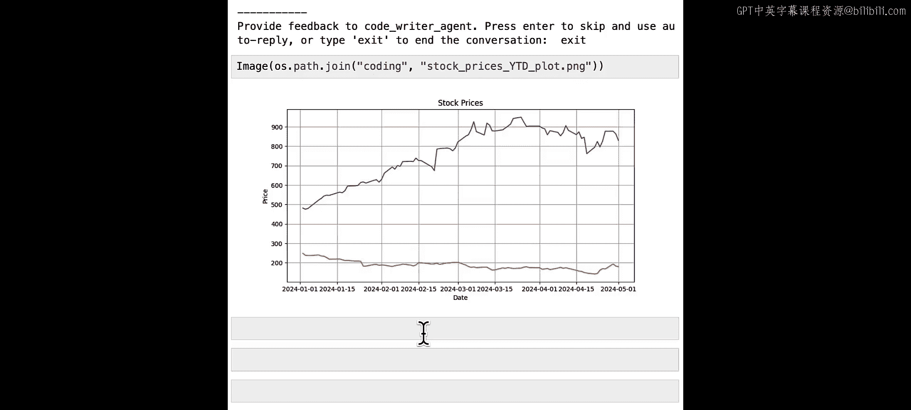