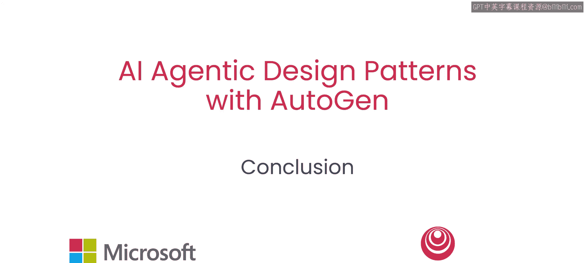
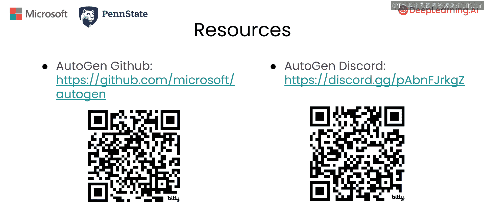

# 【英字可关】吴恩达《利用AutoGen的人工智能智能体设计模式｜AI Agentic Design Patterns with AutoGen》 - P8：8.conclusion.zh_en - GPT中英字幕课程资源 - BV1WJ4m137dk

In this course， you learned about a few agentant design patterns in autogen。

 including multi agentent collaboration， reflection， to use， code generation， and planning。

 you can use these building blocks to construct creative applications and solve very complex tasks。

Check our website for more advanced features that were not covered in this course。

 Thanks to the awesome open source community for making all this happen。😊。

Join our Discor community with more than 16，000 members I look forward to seeing what you have built on your own。

