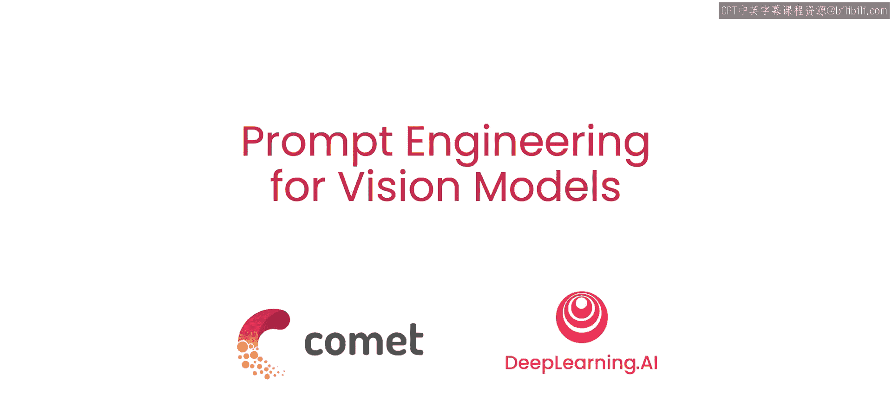
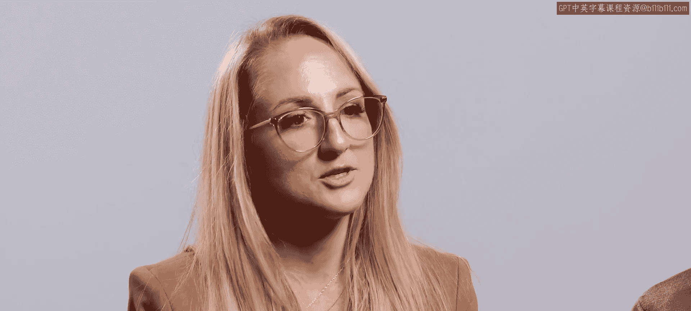
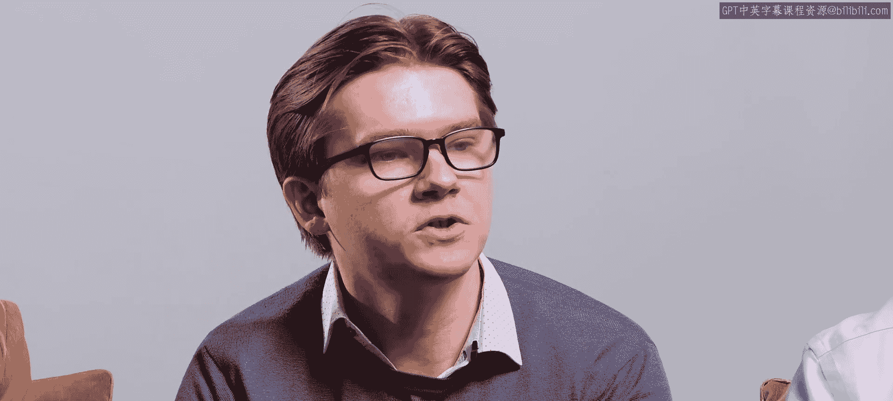
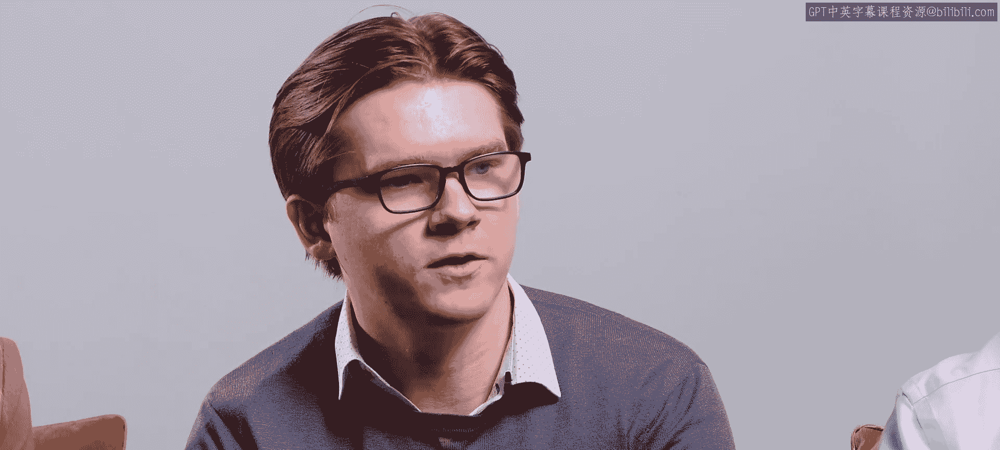
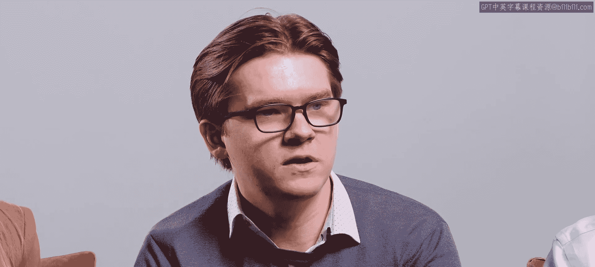
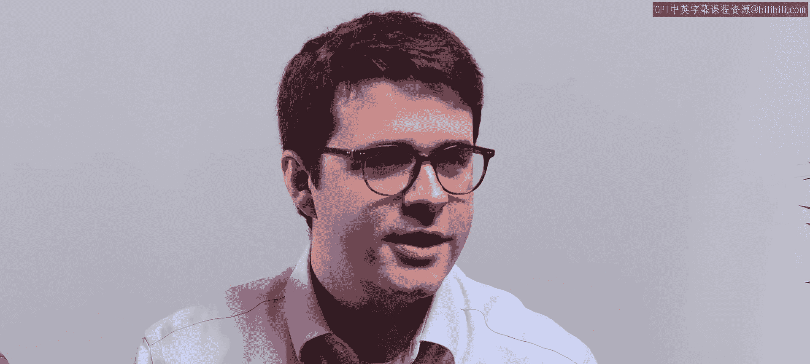
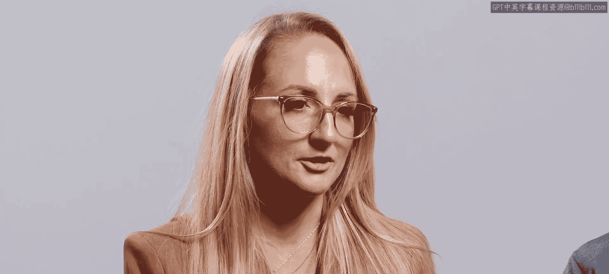
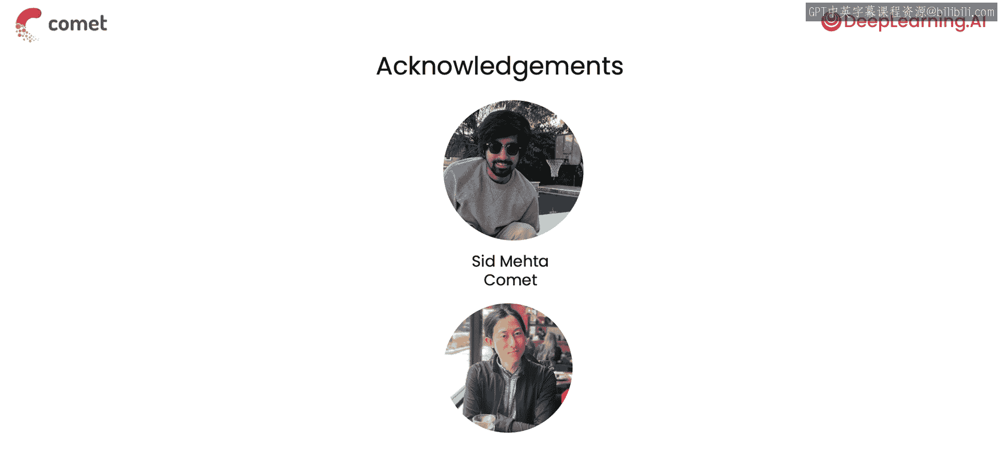

# 【英文可关，可拖拽】吴恩达《视觉模型的提示工程｜Prompt Engineering for Vision Models》中英字幕 - P1：1.introduction.zh_en - GPT中英字幕课程资源 - BV1iM4m1o77p

Welcome to Pro Engineering for Vis models built in partnership with Comet and taught by Abby Morgan。

 Jacque Beray and Caleb Kaiser， prompting applies not just to text， but also to vision。

 including some image segmentation， object detection and image generation models。

 depending on the vision model， the prompts maybe text。

 but could also be pixel coordinates or bounding boxes or segmentation mass。

In this course， you prompt matters segment anything model or S A Sam to identify the outline of an object by giving it some coordinates or points or bound boxes to help it identify the object。

 For example， maybe a t-shirt the dog was wearing。 You also apply negative prompts to tell the model which regions to exclude when identifying an object。

 using a combination of positive and negative prompts helps you to isolate the region or object that you are interested in。

 such as maybe a specific pattern on a t-shirt that the dog is wearing。

But prompting Sam is just one example。 You learn about many other tools。

 as was best practices for prompting both to analyze that is to understand images。

 as was to generate or otherwise manipulate or change images。

 I'm delighted to introduce our instructors for this course。

 Abby Morgan is a machine learning engineer who creates technical content and tutorials for the developer community。

 Jacquereray is head product at Comet， and hes spearheaded the release of Com model production monitoring offering。

 and is also an active contributor to Com technical documentation。

 and Kuk Kaiser is also a machine learning engineer who works on Com open source and community projects like Canangs and Comt OM。

 Thanks Andrew。😊，In the course you'll also apply prompt engineering to image generation。For instance。

 you can provide the text prompt a dragon to the stability diffusion model to generate the image of a dragon。

 and you'll iterate on that prompt。 For instance， a realistic green dragon to get a different image of a dragon。

 You will also prompt the diffusion model to replace a photograph of a cat with the dragon while keeping the rest of the photograph intact。

 This is called in painting in which you edit a painting or photograph by removing a segmented object and replacing it with a generated image。

For in painting， your prompt will not only be the text， a realistic green dragon。

 but also an outline of the cat that the dragon will replace。

 You'll obtain that outline or mask using image segmentation Furthermore。

 you'll obtain the bounding box that Sam uses as input by prompting an object detection model。

 This time with a text prompt， such as cute dog with a pink jacket to generate a bounding box around that dog。

 You will iterate on both the prompts and the model hyperparameters that you will tune in this in painting pipeline。

Diffusion models work by transforming a sample from a simple distribution like Gaussian noise into a complex learn distribution。

 like images。 The guided scale hyperparameter determines how heavily the text input should affect the target distribution during the reverse diffusion process。

 A lower guidanced scale will allow the model to sample freely from its learned distribution of images。

 whereas a higher guidanced scale will guide the model towards a sample that more closely matches the text input。

The number of inference steps， Hyparameter controls how gradually the model transforms the noisy distribution back into a clean sample。

 More steps generally allows for a more detailed and accurate generation as the model has more opportunities to refine the data。

 However， more steps also means more computation time。

 The strength hyperparameter and the context of stable diffusion determines how noisy the initial distribution is during the endpa process where the added noise is used to erase portions of the initial image。

 Strength essentially determines how much of the initial image is retained in the diffusion process。

Furthermore， what if you wanted to personalize the diffusion model to generate not just a generic dragon。

 cat or person， but a specific dragon， your specific pet cat， or your best friend？

You'll use a fine tuning method called Dreambooth developed by Google Research to tune this stable diffusion model to associate a text label with a particular object such as your good friend in the course you'll use the Dreambo tuning process on the stable diffusion model to associate the word Andrew Ink with just six photographs of Andrew After fine tuning you can prompt the model with text such as a Van Gogh painting of Andrew and the model can generate the image。

One unique aspect of vision model development workflows is that evaluation metrics won't always be able to tell you the full story。

 Oftentimes， you'll want to visualize your image outputs and inspect them manually to understand where your model is getting things right and where it's getting things wrong and we'll talk through best practices for efficiently carrying out this type of iteration as well。

 Let's say your object detection model is performing poorly all of a sudden and your input data distribution hasn't changed。

You open up a few incorrect predictions and realize that a new object has been introduced to your images that your model is mistakn for your target object It's time to further train your model on this new object。

It's unlikely that evaluation metrics alone would it be able to paint the full story of what was going on here。

 And so visualizing your output can be very important。 Similarly。

 when iterating across different sets of hyperparameters。

 you'll sometimes need to see the output image in order to understand how the hyperparameter values are affecting it。

 experimenteriment tracking tools can help you compare these output images side by side and track and organize which inputs lead to which outputs so you can reproduce them later on。

 Comp vision workflows are highly iterative。 So it's valuable to track each of your experiment runs。

Many people have worked to create this course， I'd like to thank on the Com side Si Meter。

 Seni growth Engineer at Comet from Deep learninging AI Eddie Shu also contributed to this course。

In the first lesson， you'll get an overview of visual prompting for image segmentation。

 object detection and diffusion models that you'll use in this course that sounds great。

 let's get started and after finishing this course。

 I think you could be a real visionary when it comes to prompting。

