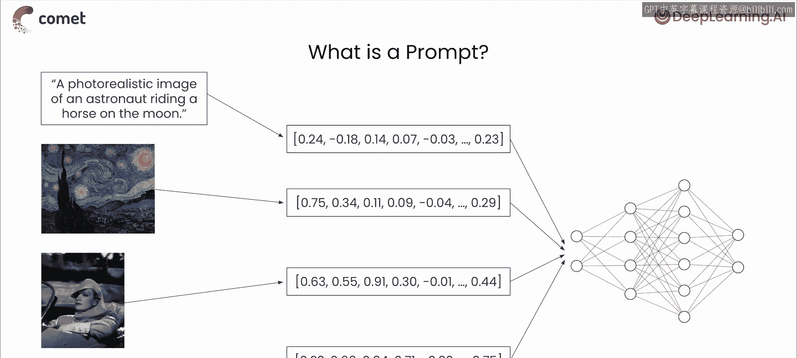
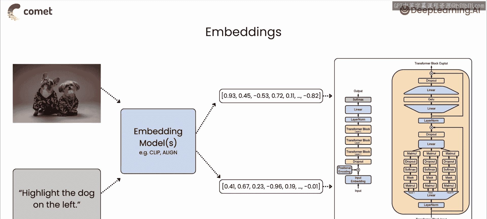
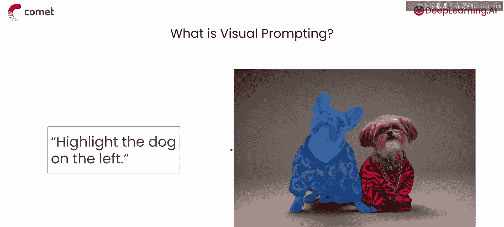
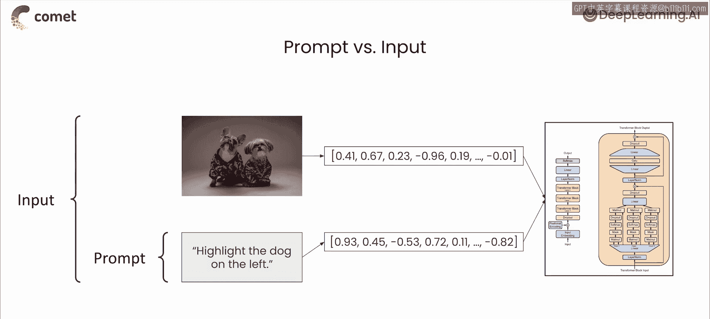
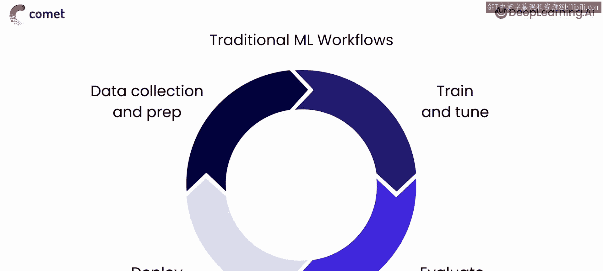
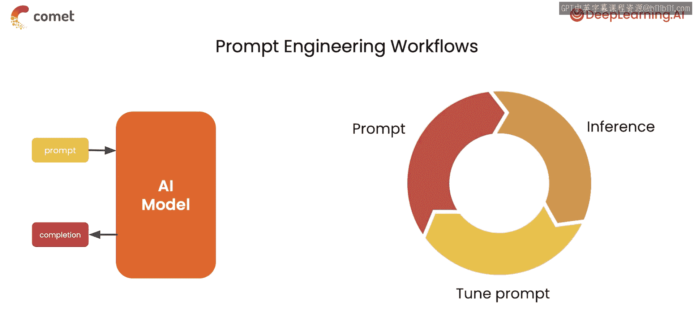
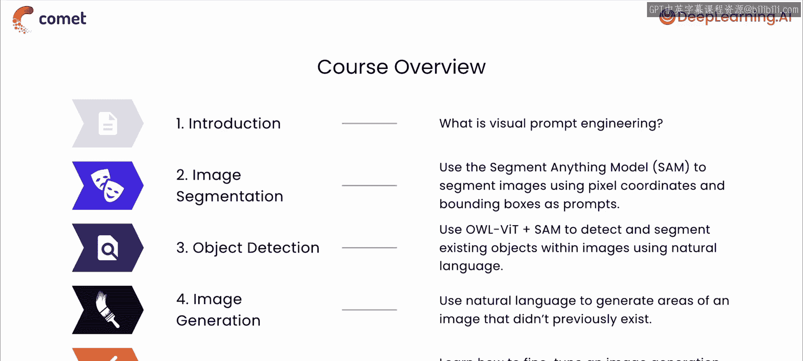

# 【英文可关，可拖拽】吴恩达《视觉模型的提示工程｜Prompt Engineering for Vision Models》中英字幕 - P2：2.overview.zh_en - GPT中英字幕课程资源 - BV1iM4m1o77p

2023 saw the rise of a new machine learning workflow， prompt engineering。In this lesson。

 we'll cover some basic prompt engineering concepts that will serve as foundational knowledge for the following code walkthroughs。

Let's start with the basics。What is a prompt？You may be most familiar with text prompts for LLMs。

 but prompts aren't just limited to text or to just large language models。 In fact， theoretically。

 any kind of data can be a prompt， including text and image， but also audio and video。

 a prompt is simply an input that guides the distribution of the output。

 and visual inputs do just that for diffusion models。 So the text here。

 a photoreistic image of an astronaut riding a horse on the moon is a prompt。

 as you may be familiar with if you've interacted with large language models。

 in image can also be a prompt， since as we've just mentioned。

 a prompt is just an input that guides the sampling distribution of the output。

 You might instruct a vision model to recreate an image in the style of the Van Gogh painting we have here。

 for example， for a more detailed breakdown of how diffusion models use sampling distributions。

 check out Sharonzo's fantastic short course on how diffusion models work for the。

Same reason as an image can be a prompt。 So too， can a video。

 Since a video at the end of the day is just a series of images。 Finally。

 an audio file could also be a prompt。 The audio clip of a person saying a photo realisticistic image of an astronaut riding a horse on the moon could be used as a prompt to an audio model。

Ultimately， each of these data types will be converted into a numerical representation before being fed to the machine learning model。

 and often， these input will be further processed into embeddings to save on space and compute。

 an embedding is just a relatively low dimensional space into which you can translate high dimensional vectors。

 Some popular embedding techniques for text and images include clip or a line。

 both of which are incorporated into the models you'll use in this course。

Visual prompting， like language model prompting， is a method of interacting with a pre traineded model to accomplish a specific task that it might not necessarily have been explicitly trained to do。

 This typically involves passing a set of instructions describing what you'd like the model to do。

 sometimes with some sort of accompanying image data， as mentioned。

 these instructions can come in a variety of forms， including text and other images。

 but also pixel coordinates are bounding boxes， both of which will use in this course。

Let's clarify the difference between a prompt and an input。

 A prompt is a set of instructions describing what tasks the model should perform。 Therefore。

 the prompt is a part of the total input data that is fed to the model。

 which may also include additional contact data。 In this example。

 the prompt is the instruction to highlight the dog on the left。

 but the total input is the input image of the dogs combined with the prompt。

 It's also important to note that the input to a model does not necessarily include a prompt。

Prompt engineering workflows are innately different from traditional machine learning workflows which focus on training。

 testing， and iteration。

In fact， in prompt engineering workflows， you won't be doing any training at all。 Instead。

 you'll be using a pretrained model and will focus on engineering the optimal combination of model settings。

 input data and prompts in order to get the desired output noticeice that in this workflow we never update model weights。

 we simply change the inputs being passed to the model。 In most of this course。

 we won't be doing any model training， so we'll want to either use a model that was fine- tuned on our specific use case or a model that generalizes well to tasks and concepts that it might not have seen before。

 We'll take a look at fine tuning in the last lesson of this course as well as some of the best practices for tracking and visualizing training runs so that they are easily reproducible。

Whether you're building a traditional machine learning system or prompt engineering。

 keeping track of all the data， model and hyperparameter configurations will help you reproduce results and also iterate faster。

 This is called experiment tracking。 You can use observability tools such as comet to automate the tracking of all these components for both the model training phase and production monitoring phase of your application life cycle。

 In this course， you'll be leveraging comet to keep track of your fine tuning data using its dataset set versioning functionality。

 As well as its visualization capabilities that will help you review the images that you will be generating All the code you will run will also be saved in comet ensuring that you can come back to each image and know exactly how it was generated。

 In this course， you'll explore several different ways to prompt large vision models by creating a text image in painting pipeline that your track and comet。

 First， you'll use metas segment anything。Model or Sam for short to create and select segmentation masks for regions of your images。

 You'll then explore how to use pixel coordinates， bending boxes。

 and even text to instruct Sam on which masks to generate。 Next。

 you'll perform in painting with AI in painting in a nonaiI context is the method of restoring artwork that has faded or been damaged in some parts in the context of AI in painting refers to the action of editing parts of an image using a series of vision models to first identify a region of the image to edit and then generate its replacement。

 The image generation model you'll be using a stable diffusion from stability AI。

 You'll get to see for yourself how slightly different versions of a prompt can lead to a very different outcome。

 You'll also track all of these input and outputs with comment。

 so that you can examine all of your results side by side。Se the best generated image。

 Having an experimentation tracking tool as your assistant will enable you and anyone else you collaborated with to walk through the exact same steps to create the exact same images in the future。

 promptmp engineering is often the cheapest and quickest way to optimize your outputs for a large language or vision model。

 But sometimes you may find that prompt engineering just isn't enough to perform your specific task in which time finetning the model to perform that specific action may get better results。

 So you'll explore how to finetunetable diffusion via Googles Dreambo training technique on your own custom image dataset。

 By the end of this course are goals for you or that you'll understand what visual prompting is。

 that you'll be able to prompt large vision models with pixel coordinates bounding boxes。

 wrongbeddings and natural language you'll be able to finet a diffusion model with。Few images。

 and you will know how to track， organize and visualize all of your inputs and outputs so that you're able to reproduce your results later on in the next lesson。

 you'll prompt the segment anything model to generate masks using both pixel coordinates and bounding boxes。

 Let's go on to the next lesson。

