# 【英文可关，可拖拽】吴恩达《视觉模型的提示工程｜Prompt Engineering for Vision Models》中英字幕 - P4：4.object_detection.zh_en - GPT中英字幕课程资源 - BV1iM4m1o77p

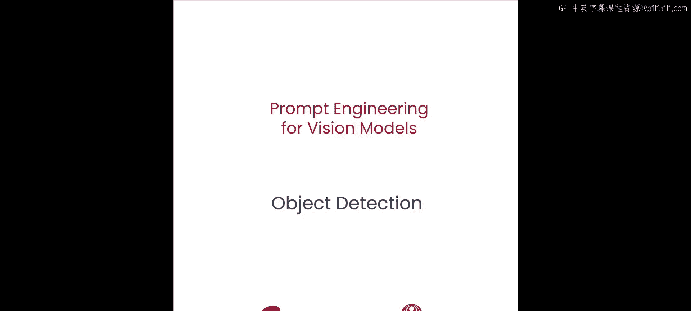

In this lesson， you'll use natural language to prompt a zero shot object detection model， owl VIT。

 where VIT stands for fission Transformer。You'll then use the output of this model as an input to some。

 which you used in the asked lesson。You'll create an image editing pipeline by chaining these two vision models so that a user can give a natural language prompt and the pipeline outputs a segmentation mask。

 Let's get started。

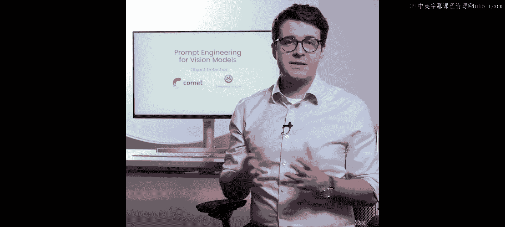

In the last lesson we saw how to create masks based on point prompts or bounding boxes In this lesson we're going to see how we can use natural text to generate these masks instead。

In order to do this， we're going to be using a pipeline of models。

 which means simply that the output of the first model will be fed into the second model。

The first model in this pipeline will be a zero shot object detection model。

 which will then be followed by a sum model that will take the generated banding box from this zero shot object detection model to generate the masks。

The zero shot object detection model we will be using is called Owl VIT。

The Owl VIT model is a zero shot object detection model。

 meaning it can detect objects within an image based on simple text prompts。

The fact that it is a zero shot model means that you don't need to train it in any way for it to detect any object within an image。

 the way we will be using ourwl VIT within this lesson is by using a text prompt I。e。

 a string of text to generate a band box， we will not be covering in detail how the owl VIT model works。

 but we can cover some of the basics way in which it was trained。

The Owl VIT model was traineded in two parts。1 pre training phase and a second fine tuning phase in the pre training phase。

 the model learns to associate an image with a piece of text using a technique that leverages contrastive loss。

 And this process allows the owl VIT model to develop a strong understanding of both an image and its corresponding text。

In order for this model to achieve good performance， it also required a fine tuning stage。

During this stage， the model is strained specifically for object detection。

While in the pretraining phase， the model was just learning how to associate a piece of text and an image During the fine tuning stage。

 the model learns to identify object and associate them with a particular word or a string。

Now that we have covered at a high level how the Owl VIT model works。

 let's jump into some code and see how we can use it in practice。

Before we start leveraging the two models we will be using in this pipeline。

 let's start by creating a comet experiment which will allow us to compare the generated masks that will be produced at the end of this pipeline。

We have created here an anonymous experiment。Meaning you don't need to create a come account to get access to the Com functionality Now that we have initialized Com ML。

 we can go ahead and create our first experiment which will be used to track all of the work within this code walkthrough。

For this lesson， we will be using the same image as we used in the previous lesson。

 The images of the two dogs sitting side by side。 Let's first load in this image and display it within the notebook so we can remind ourselves what it looks like。

In order to view this image， we will be using the image function from the pillar library。

Instead of downloading the image directly from the internet。

 we will be leveraging comment artifacts to download all of the images required for this lesson。

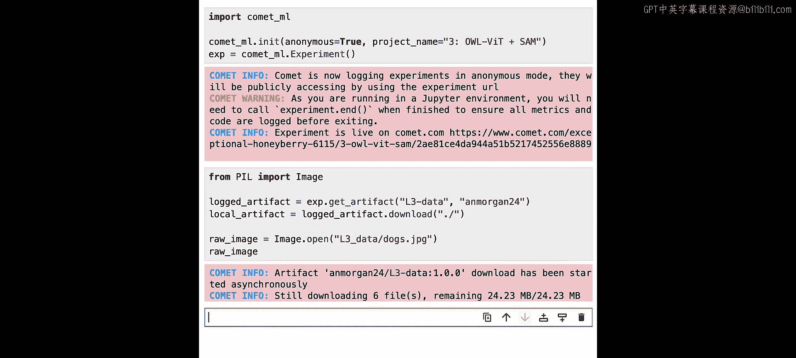

As you can see， we now have the same image as we used in the previous notebook。

Let's go ahead and load the Owl V IT model from the Hogging Face H。

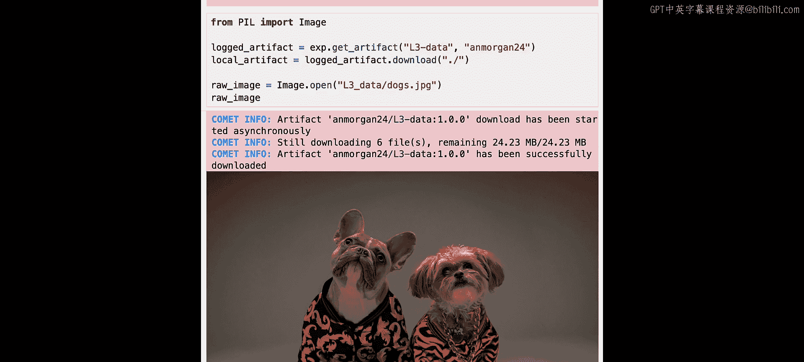

In order to access the AL VIT model， we will be using the Transformers library and specifically the pipeline method。

There are many different versions of the owl model available on Huging face for this particular lesson。

 you will be using the base model。Ourwl visit base。Now that the model has been loaded。

 we can go ahead and use it to identify the dogs in the image。

 The first thing you will do is specify what you want to identify in the image In this case。

 a dog you can then pass the text prompt to the detector model that you have just loaded to generate the bounding boxes of the dogs in the image。

 you will be passing here the text prompt as a list for the candidate labels parameter of the detector model as it is possible to pass in multiple text prompts。

 for example， if you had an image with both a cat and a dog you could pass the text prompt cat and dog to identify both animals in the image。

Let's take a look at the output variable。As you can see here。

 the model has detected two different banding boxes for the label dog in two different position。

 This is quite promising。 It means the model has most likely identified the two dogs in the image。

But let's use a couple of u functions to plot the banding boxes on top of the image that we have seen above。

 the pre processcess outputs function simply takes the output above and reforms it to make it easier to plot the banding boxes on the image。

We can then use the show boxes and labels on image function to view the bounding boxes on top of the image of the two dogs。

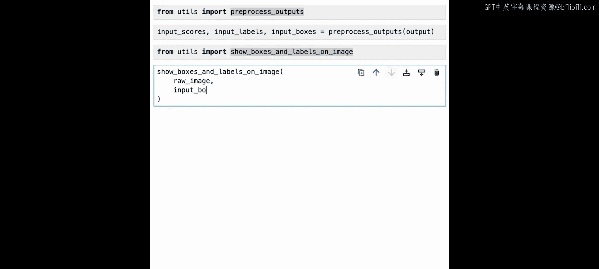

As you can see here， the Owl VID model has been able to take a text input dog and generate two banding boxes highlighting each dog on the image it was even able to overlap the banding boxes of the two dogs。

You have now successfully identified the two dogs on the image based on a simple text prompt。

 You can now move on to the next step of the pipeline。

 which is to use these bounding boxes to create segmentation masks for each dog The approach we will be taking is very similar to the previous lesson However。

 instead of using the fast Sam model， you will be using the mobile Sam model。

 As you will have seen in the previous lesson。 The Sam model or segment anything model can be used to generate masks based on bounding boxes。

 The Sam model is quite large and requires a lot of computational resources in order to generate these masks In this lesson。

 we will be using the mobile Sam model， which has been optimized to run on devices that might not have access to GPus in order to perform more efficiently。

 the mobile Sam model uses。

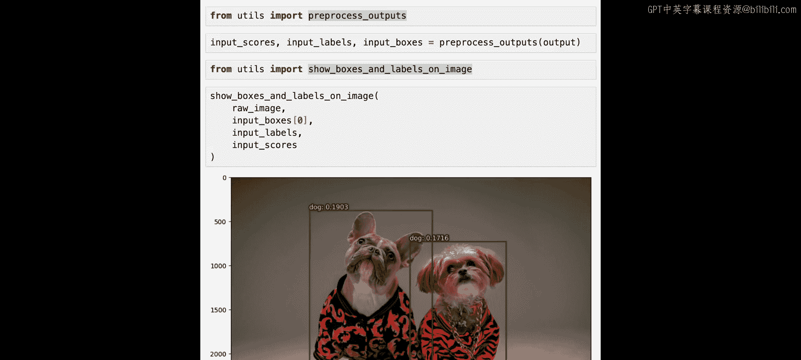

Process known as model distillation， model distillation allows you to take a very large model and transfer its knowledge to a smaller model。

 and this allows you to run the model a lot more efficiently。

 Model distillation is a different technique compared to model compression techniques or quantization in the sense that it doesn't actually change the model format but trains an entirely new and much smaller model In this lesson。

 you will see that the mobile Sam model performs just as well as the larger Sam model。

 You can now load the mobile Sam model using the ultralytics library。

You will now use the SA model we have just loaded and the bounding boxes generated from the owl model to generate our first set of segmentation masks for each dog。

Similarly to the previous lesson， we will be defining labels to specify whether banding box belongs to the object we would like to segment or the background。

 In our case， all of the banding boxes belong to the object we would like to segment， and therefore。

 the labels will be specified as one instead of zeros。

 Given we are implementing a pipeline where the output of the first model is used as an input to the following model。

 we will be using the nuy repeat function to simply generate an array filled with ones where the length of the array is equal to the number of banding boxes generated by the first model。

We can then use the raw image， the banding boxes and the labels to generate segmentation masks using the mobile sound model。

As you can see， we have been able to create segmentation masks and under a second using the highly optimized mobile SA model。

The model predictic function returns a result object that contains not just the masks。

 but also the original image and additional metadata。

We can then extract the masks from this object using the following code。

The masks are simply a series of false and true booles which indicate whether a particular pixel belongs to the background of the image or belongs to the mask that we have generated。

In order to visualize the masks you have just created。

 we can use the show masks on image U function that we have created for you。

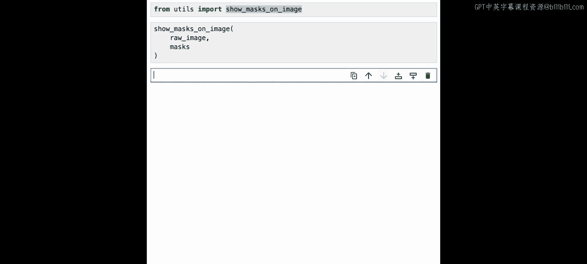

As you can see， the mobile Sam model has been able to create two very accurate masks for both the dog on the right and the dog on the left。

You have now successfully used the ourwl model to go from a text prompt to a bending box and the sum model to go from the banding blocks to the generated masks。

 Pu these two models together means that you now have a pipeline to go directly from text to a masked image。

 You can now go one step further and use the generated masks to edit the image。

Let's now try a different use case where we would like to blur out people's faces in an image。

 You will start by loading in the image to see which faces you have to blur。

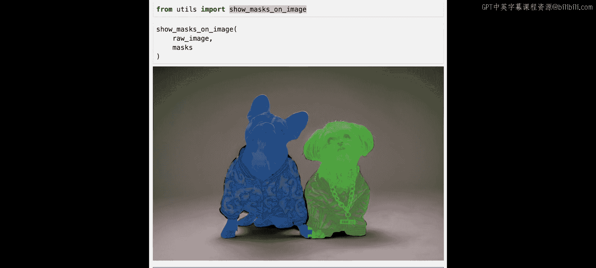

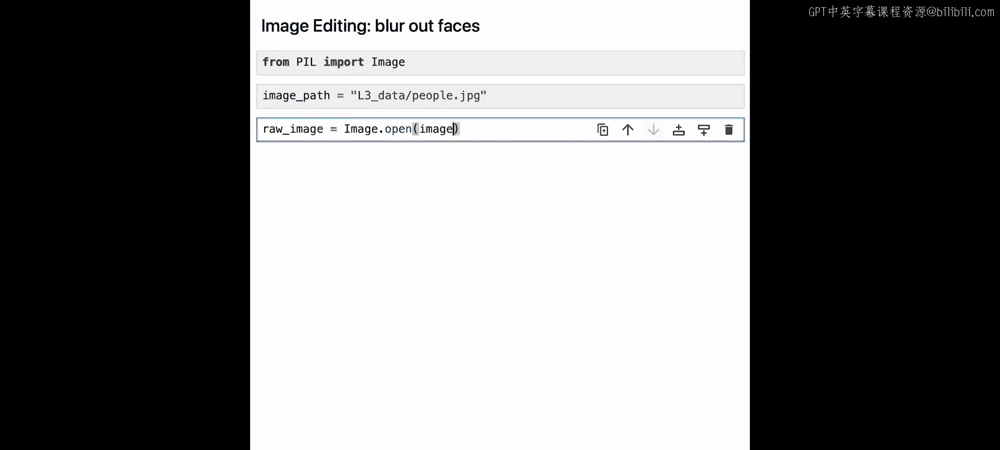

As you can see， we have an image here with five different people。

 and we will be blurring out each of their faces before using the owl and mobile Sam model to perform the image editing。

 We will first resize the image to be just 600 pixels wide。

 This will allow us to perform the entire pipeline in a more time efficient manner。

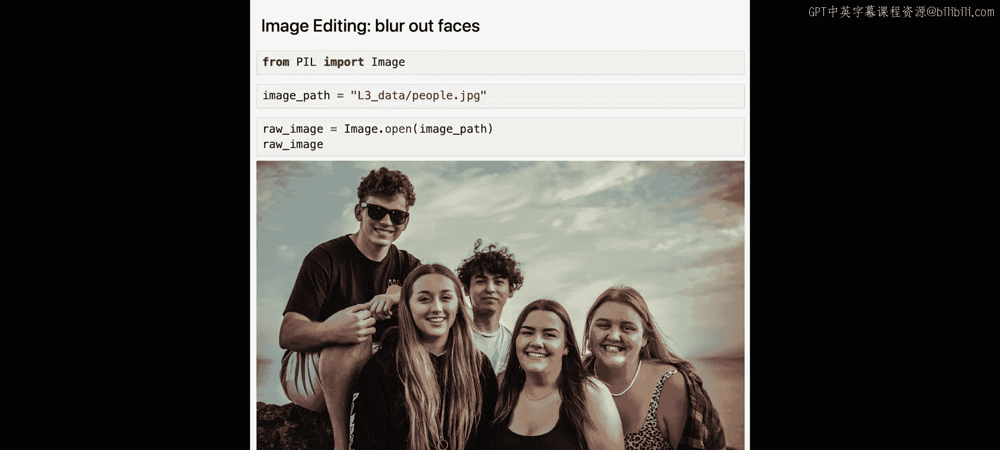

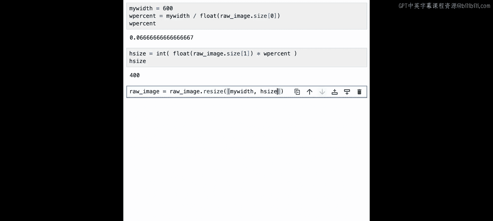

As you can see， the image is very similar to the high resolution image and has simply been then sampled。

 this process of resizing images is very useful if you're working with high definition images。

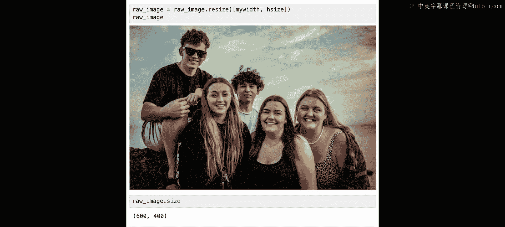

Let's use a similar pipeline as we've used for isolating the dogs on the previous image to isolate the faces on this image。

 The first step will be to define what the text prompt should be。

 In this case we will be using the text prompt human face as we are starting a new model pipeline let's create a new come experiment to keep track of all of the different steps of this pipeline。

 you will start by creating a new experiment and logging the raw image to this experiment。

You can now use the owl model to create the banding boxes of the faces in the image。

 let's take a quick look at the banding boxes generated to see if the ourwl model has been able to identify any faces in the image。

As you can see here， five different bounding boxes have been found by the model。

 this makes sense as they are indeed five different faces in the image。

In order to keep track of each step in the model pipeline。

 let's log the image and the banding boxes to the Comt platform。

 we have created a make banding boxes annotation U function to make it easier for you to log these banding boxes to the Com platform。

You can now use the mobile sound model with the aing box prompts as an input to generate the segmentation masks。

Now that we have generated the segmentation masks， we can go ahead and blur out the faces in the original image。

In order to do this， we will start by creating an image that is entirely blurred。

 we will then be using the original image and using the segmentation masks created by the Sam model to replace only parts of the image with the blurred image you will be creating now。

You can now use the blurred image you have created to replace just parts of the image。

 You will start by combining the masks generated by the mobile Sam model into a single mask that we will then use to replace parts of the image。

Now that you have this single mask， you can go ahead and use the mask to replace parts of the image with the blurd out image。

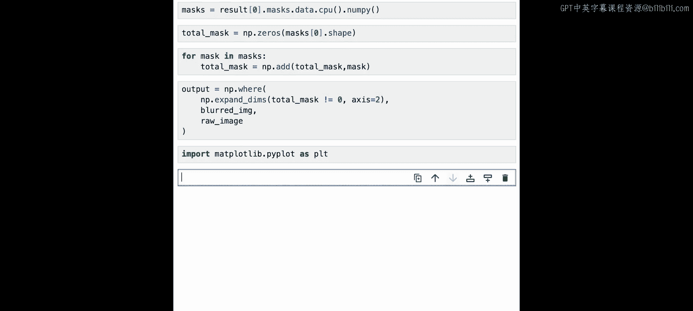

As you can see， the faces have been successfully blurred out in the image。

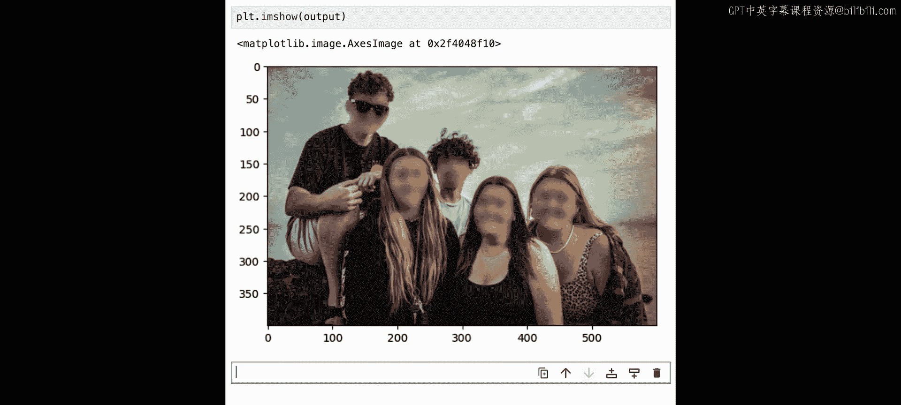

And you can go ahead and log this image to the Com platform。

You have now successfully used the text prompt human face to replace all of the human faces within the image。

What if you wanted to blur out not all of the faces within this image。

 but only the faces of the individuals that are not wearing sunglasses。

 Let's go ahead and give that a try。 You can go back to the part of the code where we defined what the candidate label should be and replace the text prompt human face with a person without sunglasses。

 for example。Let's go ahead and rerun all of the different parts of the pipeline to see if the model is able to blur out only the faces of the individuals that are not wearing sunglasses。

As you can see， the model has generated a single bounding box。

 whereas there are four individuals that are not wearing sunglasses。

 This might indicate to us that something has not been performing well with this model。

 Let's continue with the model pipeline and then switch over to the come platform to better understand what is happening。

By running all of the different steps of the pipeline。

 you can see that the models have replaced only the sunglasses in the image rather than what we had originally intended。

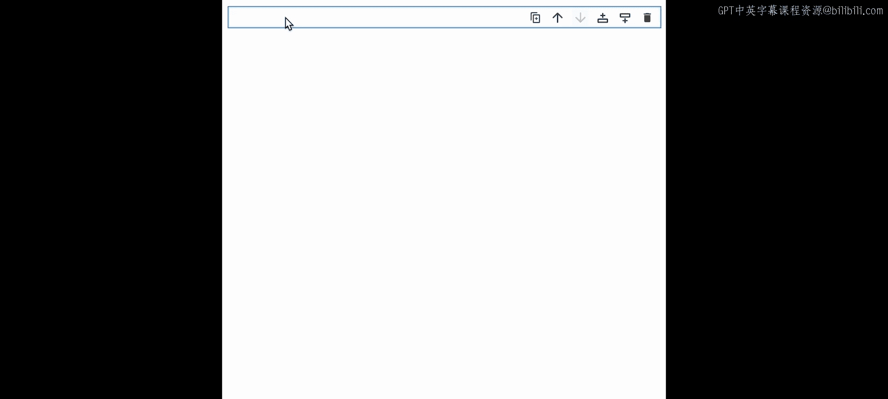

As you can see， the model pipeline is not performing as expected。

 let's switch over to the Come platform to better understand where the model is failing。

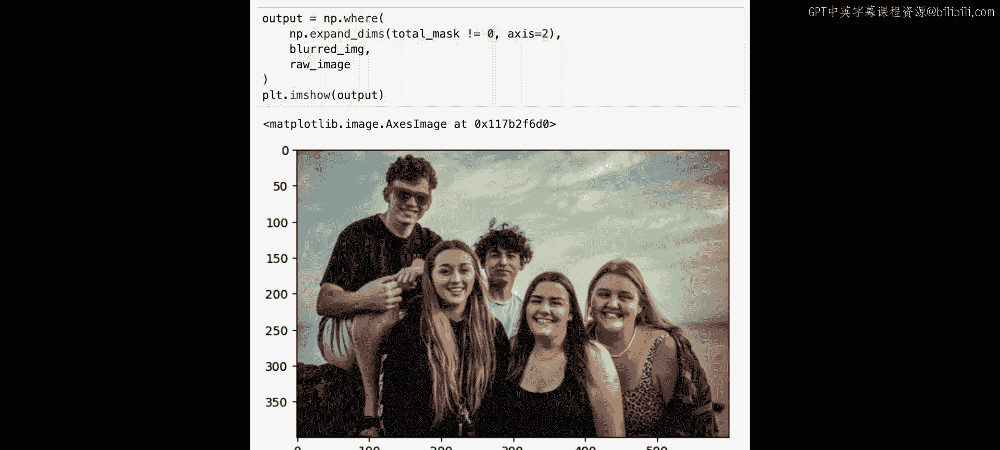

You are now in the comet platform， which you can use， even if you do not have a come account。

 Let's start by comparing all of the different images that we have generated side by side。

 to do this， you can add a new panel。 Select the image panel。

 Choose the images you would like to compare。 In this case， raw image。

 The owl image and the final blurred image。Let's dig into one of the experiments to better understand what is happening。

In the original code walkthrough， you use the text prompt a human face and as you can see。

 the Owl model has successfully identified all of the different faces in the image as a result the mobile Sam model was able to segment out each face and replace it with its blurred version。

 as you can see here。For the second prompt that you used a person without sunglasses。

 the owl model created a bounding box around the sunglasses rather than around the faces of all of the individuals in the image。

 as a result， the sand model then blurred out the sunglasses themselves。

 rather than the faces of the individuals not wearing sunglasses。

Comt allows you to visualize a number of images。 As you can see here。

 we did not log the image with the banding box to the come platform。

 Instead we log the image and the banding box and the come platform combined the two for us here using comet you can even turn off the banding boxes to view the image when logging data to the come platform。

 you do not have to log a static image Instead you can log the image and the banding boxes separately。

 This allows you in the come platform to filter out the banding boxes based on the confidence score of the model。

 for example， you can change here the confidence score from 74。

3 to 80 to better see which banding box the model is very confident in。

 and as you can see the model has different confidence scores dependinging on the banding boxes that have been generated you can even turn off the band。

Name boxes all together。Now that you have used the model pipeline a couple of times。

 why not tweak the text prompt to get the model to blur out the faces of all of the individuals in this image that are not wearing sunglasses。

 or maybe even better。 Why not try it with one of your own images。

 We have also added a couple of images in this notebook for you to try out the techniques you have learned on new images。

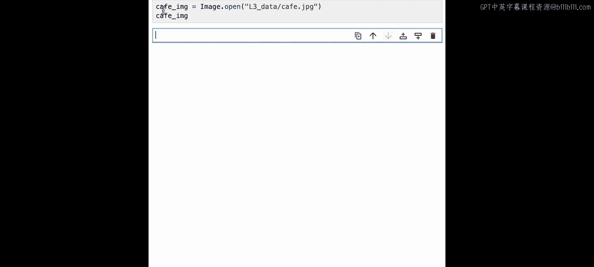

You could use the image of people in a cafe and blur out their faces。

 or why not blur out the faces of people walking on the street？

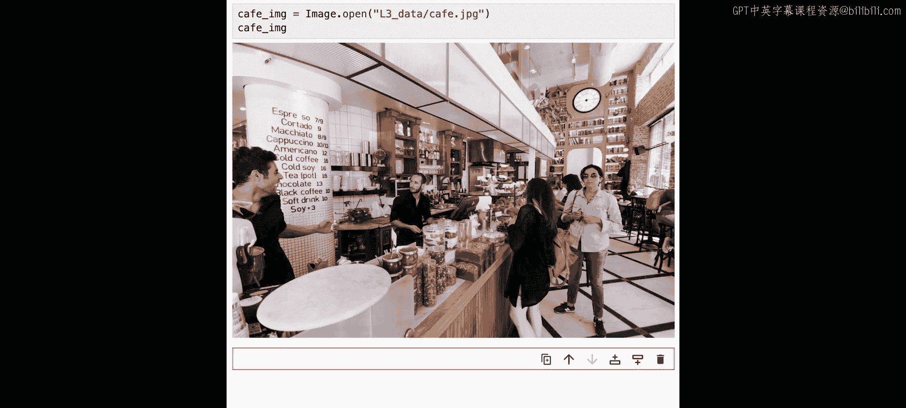

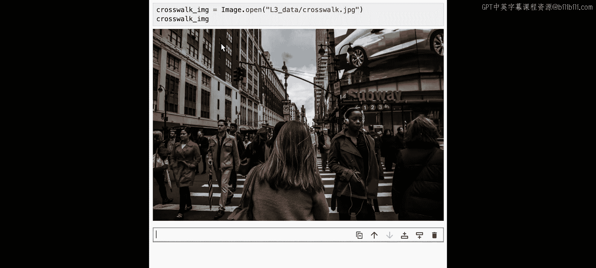

Or in the metro。Even better， you could blur out the faces of the people in this photo。

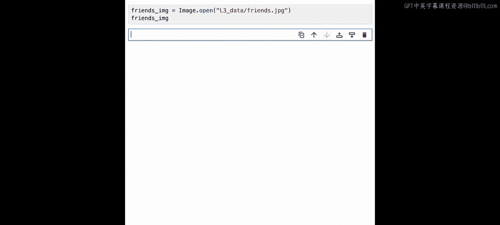

In this lesson you will have created your first pipeline using the output of one model， the o model。

 to serve as an input for the second model in this case Mo sound In the next lesson you will be looking at how to use stable diffusion to perform in painting let's go on to the next lesson。

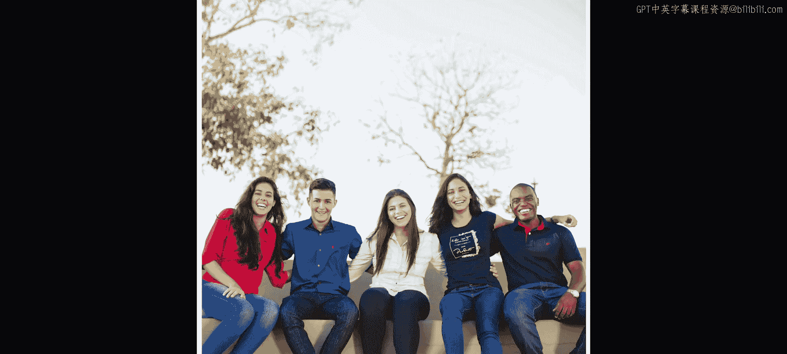