# 【英文可关，可拖拽】吴恩达《视觉模型的提示工程｜Prompt Engineering for Vision Models》中英字幕 - P5：5.image_generation.zh_en - GPT中英字幕课程资源 - BV1iM4m1o77p

You can prompt stable diffusion with text， but also with images and masks。 Additionally。

 you can tune some hyperparameters such as guidance scale。

 strength and the number of inference steps to better control the diffusion process。

 Lets generate some images。

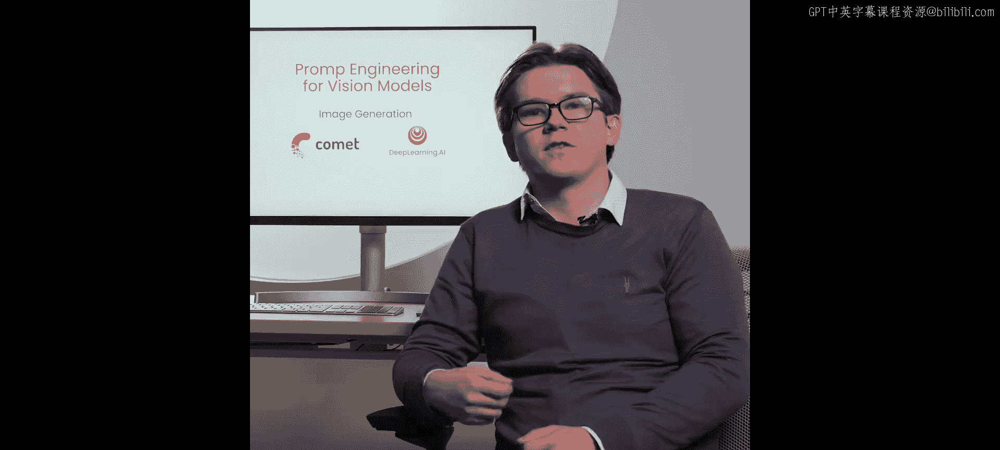

In previous lessons， you've learned how to use computer vision models to extract information from your images in the form of bounding boxes and segmentation masks。

And these next lessons， you're going to learn how to use computer vision models to add information to your images using diffusion models。

 Before we dive in， let's first review a little bit about how diffusion models work under the hood。

 If you're interested in going deeper， I'd recommend going through deep learning AI's introduction to diffusion models course。

 Note that this course is not going to get into the mathematics diffusion models。

 We're aiming to give a high level overview of how they work so that you can do these exercises productively。

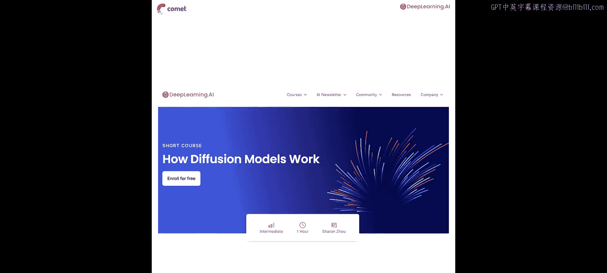

Diffusion models like the one you'll be using in this lesson are really incredible。

 They're capable of generating unbelievably detailed images from text prompts。

 And they do this via a process called diffusion， which at a super high level works like this。

 The model generates an image of pure Gaussian noise。

 Then the model dennoises the image gradually one step at a time。 Eventually。

 the model removes enough noise to leave us with an attractive image。 In a way。

 we're kind of lying to the model。 We give it an image of pure noise。

 but we tell it that underneath the noise， there's actually an image of a dog。 intuitivetuitively。

 you can think of the model as sort of chiseling the image out of that noise。

 mathematicalthematically， the model is transforming a sample from a simple distribution like Gaussian noise。

 and to a complex learned distribution like images。 Our text prompt shifts our target distribution。

 guiding the model towards chiseling out an image that satisfies the prompt。

 The model that does the actual denoying as a un model。

 and we use a text encoder to generate the prompt embeddings for guiding our generation。😊。

The model you'll be using， however， can take more than just texts of prompt。

 You can also provide it with images， masks and various hyperparameters to better control the diffusion process。

 You can even direct your model to take an initial image and use diffusion to edit just a specific portion of the image via a technique called end painting。

 And this lesson， you're going to learn to do exactly that。 Let's dive into the first exercise。

To motivate this exercise， imagine that one of your less computer savvy friends ask you to edit a photo of them。

 They give you a photo of them leaning over a cat and ask you to replace the cat with a dragon。

 You could spend days using Photoshop to edit the image。

 or you could use a diffusion model to do it in minutes to get started。

 We're going to download our masks and images from come as artifacts。

 You've already learned about artifacts previously， but to recap。

 artifacts are just version controlled assets。 They can be anything from models to data sets。

 or in this case， your friend's photo and a segmentation mask of a cat。😊。

Once our artifact has been downloaded， we can extract the images from them and view them using Matpltlib。

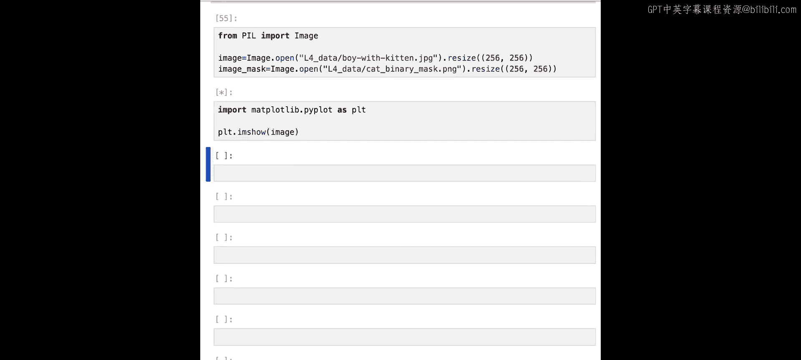

As you can see， we now have an image of our friend leaning over a cat。

 and we have a segmentation mask of the cat。 This is all we need to get started with our diffusion editing process。

 Before we initialize our model， we want to import torch， and we want to set our device correctly。

 If we have access the GPus， we want to use those。 but if not， we can use CPUus for this。

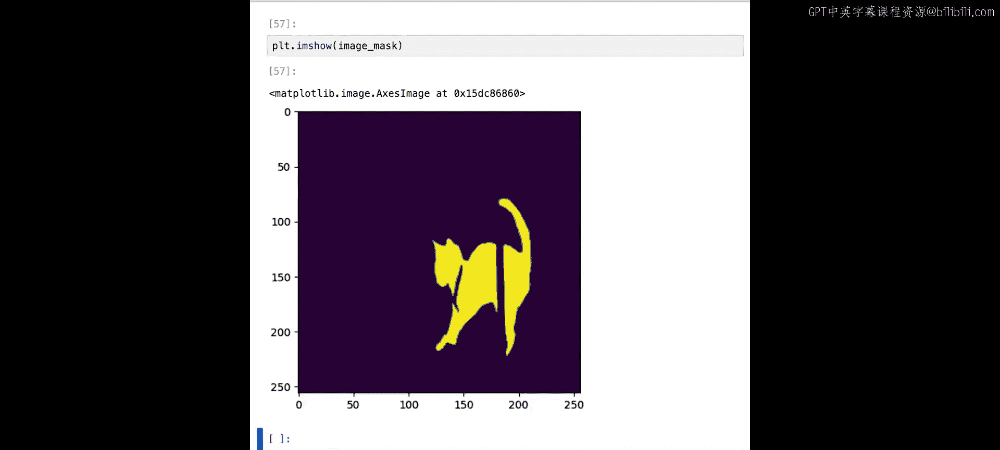

Once our device is set， we can initialize a stable diffusion in painting pipeline from the diffuser's library。

You should notice that we're using the stable diffusion  to end painting model。

 which is a diffusion model that is trained specifically for these end painting tasks。

 We're also using different demeric formats， depending on our hardware situation。

 This should say with some memory。 Once our pipeline is initialized。

 we want to start thinking about the parameters we're going to use to generate our image。

 The most important and maybe most overlooked parameter is the seed。

 We want to set our seed number manually so that our results are reproducible later。In addition。

 we'll need our prompt。 We'll need our image。 We'll need our mask image。

 and we'll need a hyperparameter that we haven't discussed yet。 In this experiment specifically。

 we're going to be looking at the number of infr steps。With di fusion pipelines。

 you can control how many inference steps the pipeline takes and denoizing the image When you allow the pipeline to take more inference steps。

 there's a more gradual denoying process。 Oftentimes， this can lead to a higher quality image。

 However， there's a point of diminishing returns where you're simply wasting your compute power。

 You can also end up with an image that looks a little overly processed。

 where the features are a little too smooth or the colors are exactly realistic。😊。

Returning to our code， let's get ready to generate some images。 First。

 we'll initialize a new common experiment that we can use to log our images。

 our metadata and our parameters。Then we'll pass our parameters into our stable diffusion pipeline and generate the output from there。

 we can extract the image， and then we can log the image， the prompt。

 the seed and the number of inference steps all to come。When we're done。

 well end our experiments and analyze our results。Now we're not going to actually run this code in this environment because it'll take a while on CPUUs。

 but we ran ahead and ran this code in another environment and logged the results to a common experiment。

 which we can view now。

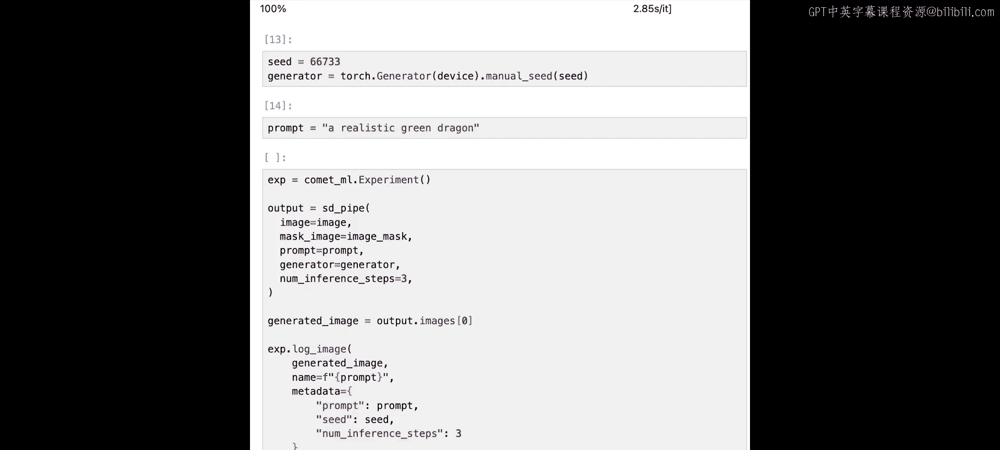

This image was generated using the exact same code as above。

 Just run on a system with GP PUus so it could run a bit faster。 As you can see。

 we're not quite there yet。 We've definitely painted over the cat。 But instead of a dragon。

 we have a frankly， terrifying， sort of skeletal， lizard looking thing。

The first thing we might try in this situation is simply increasing the inference steps to a much larger number。

 lets say 100。

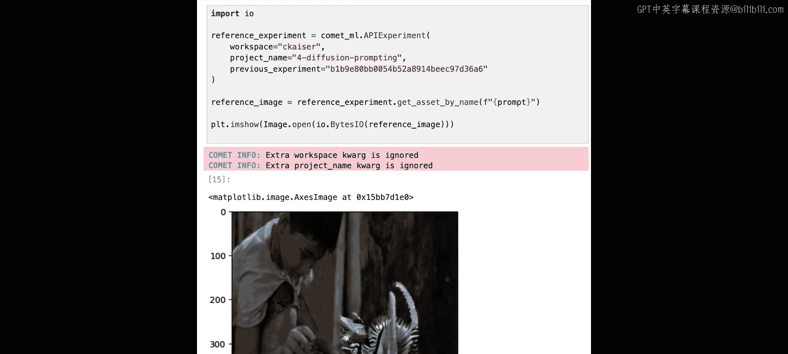

If you look， this is the exact same code as before。

 we've just changed the inference steps from 3 to 100。As before， we're not going to run this code。

 but we do have another common experiment that was run using this exact same code and we can view its outputs right now。

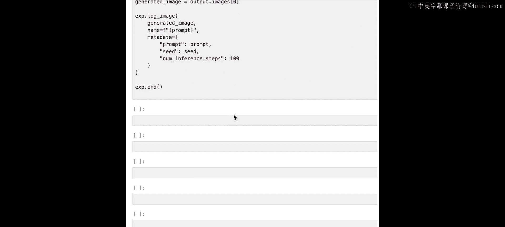

Okay， this is looking much better。 However， we still have some features that look a little odd and I think we could do better。

😊。

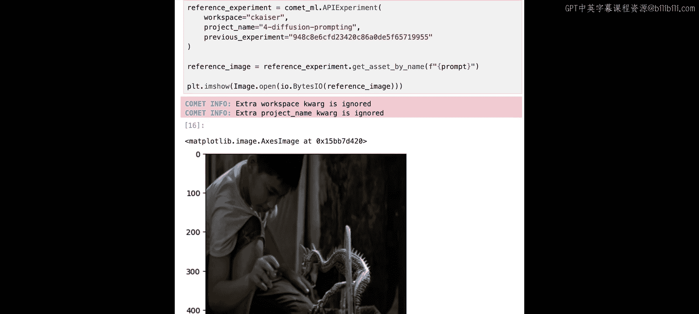

The next thing we might try is tinkering with another hyperparameter called the guidance scale。

 The guidance scale is a numeric value that determines how closely the model should follow the prompt。

 Basically， you can think of it as scaling the effect that the text input has on the target distribution during the denoising process。

 A higher guidance scale means a higher prompt fidelity， but potentially lower image quality。

 You can see this example here。 I gave a diffusion model a prompt。

 An oil painting of a tabby cat dressed like a character in the matrix。

 When the guidance scale is set lower。 We get an image of a cat that's a pretty good painting。

 However， there's not a lot of matrix C things here。 When the guidance scale is set higher。

 in this case twice as high， we get an image of a cat who has some matrix S sunglassses going on。

 but the image of the cat itself is not very good。 One thing to know about the guidance scale。

 is that the default is going to be different for each diffusion model。

 there's not a standard across the field。 So firstable diffusion 1。5。

 which is a smaller model you might use on CPUs。7。5 is the default value for other models that's 5 for other models。

 That's one。😊，And you really just need to check the model specifications to know what's right。

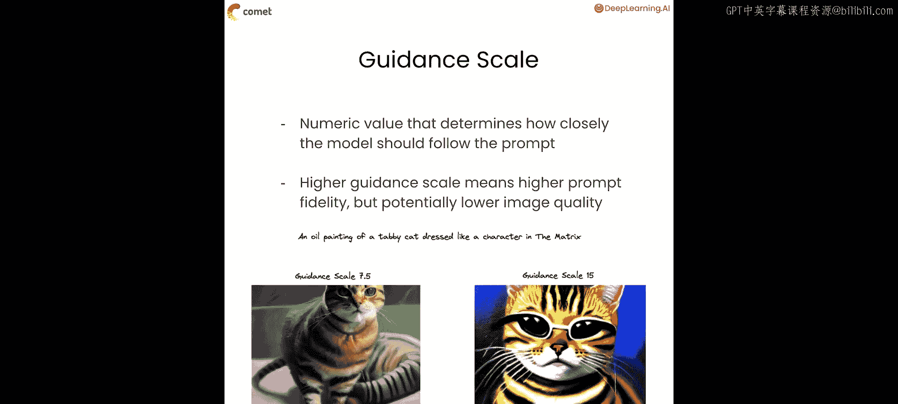

Returning to our code， what we want to do next is run an experiment where we try several different guidance scale values。

To start， we'll make a nuy array of different guidance skill values we'll use in our pipeline。

With the guided scale set， we'll run some code that's very similar to the code we wrote previously。

 The difference being that this time we're running multiple experiments and that we're passing the guidance scale parameter into our pipeline as well。

 Again， we're not going to run this code here。 It would take quite a long time to roll in CPUus。

 but we do have another common experiment where we run this same code and logged its outputs already。

😊，By calling displaying our experiment and passing in the tab equals Image argument。

 we're actually able to see the images dashboard of the real common application。As you can see here。

 you can see all the image metadata。And here we can see our different outputs。

These two images seem to be our best。At least at a guy scale of 10。And of 20。

So we know that our best outputs seem to occur when the guidance scale of summer between 10 and 20。

 we might do a further experiment， trying more guidance scale values between 10 and 20 till we find the perfect number。

For now， let's move on to trying a different hyper ofpar。

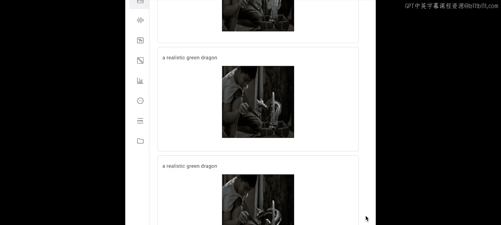

The next hyperparameter we're going to look at is one that is unique to image to image applications of diffusion models。

 This is called the strength hyperparameter。 When we use the diffusion model to edit an image as we're doing and in painting。

 we have to add a lot of noise to it to delete the section that we want to replace。

 how much noise we add to it decides how much information gets removed。 If we add a little noise。

 the image will look very similar to the way it looked originally。 If we add a lot of noise。

 The section we want to replace will be completely removed。

 Streng what determines how much noise gets added。 Let's run an experiment of strength similar to our guidance scale experiment。

 where we iterate across a number of possible values。😊，As you can see here。

 the code is largely the same。 We're creating a set of possible values for strength。

 We're iterating across them， or passing them all into our stable diffusion pipeline for each of our outputs。

 we log the image and the metadata to comet so that we can analyze it later。 As before。

 we're not going to run this experiment here。 And we're instead going to view the results of this code via comm experiment。

😊，As we can see， when strength is very low， the cat has hardly changed at all。

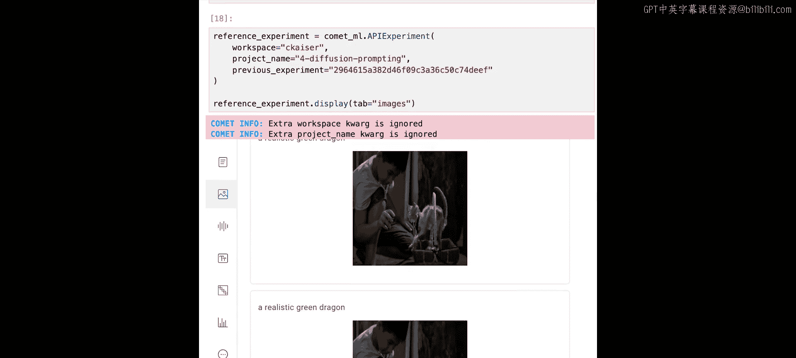

As strength increases， more and more of the ca is removed。And unfortunately。

 changing the strength doesn't seem to have led to a better image for us。 That's okay。

 That's part of the experimentmentation process。The final input we want to explore adding to our stable diffusion pipeline is the negative prompt。

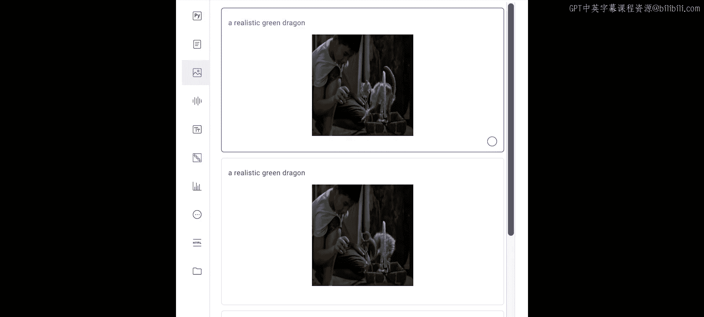

The negative prompt should be very intuitive。 It's simply a prompt that tells the model what the image to not look like。

 So because we used a realistic green dragon as our prompt， we might give it a negative prompt。

 like cartoon。 This should reinforce the realism of our output。Again。

 you can see that our code is largely unchanged。 We're using the best results for our previous experiments。

 setting the guidance scale at 10， using 100 different steps if we have access to a GPU。

 and we're also passing in this negative prompt。 again， we're not going to run the code here。

 but we've run this code elsewhere and logged the output to a come experiment。

 which we can view right now。😊。

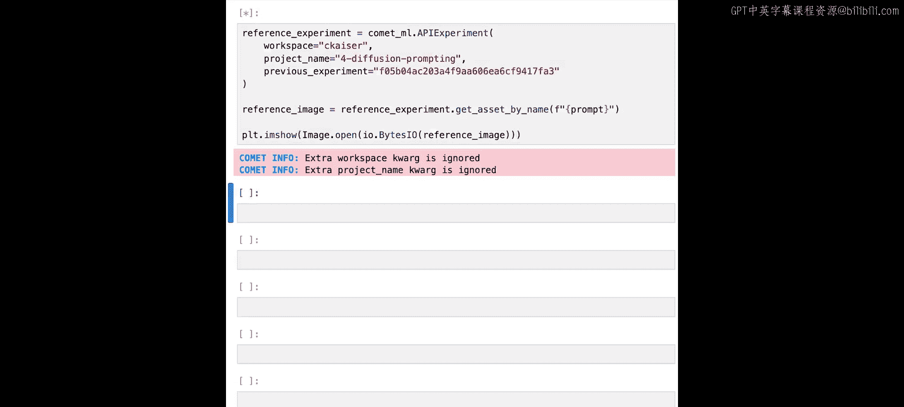

And look at that。 we refine our dragon to get rid of some of the features we didn't love in the previous generations while enhancing the good qualities with everything you've learnedt here and everything we covered in other lessons。

 you should be able to build a pipeline where you take an image， generate a mask。

 use end painting to edit it and do it all in a streamlined fashion。

 sort of like a stable diffusion powered Photoshop。😊，That's it for this lesson。

 and the next lesson we're going to go one step further with diffusion models。

 and we're going to learn how to teach a diffusion model to generate an image of something it's never seen before。

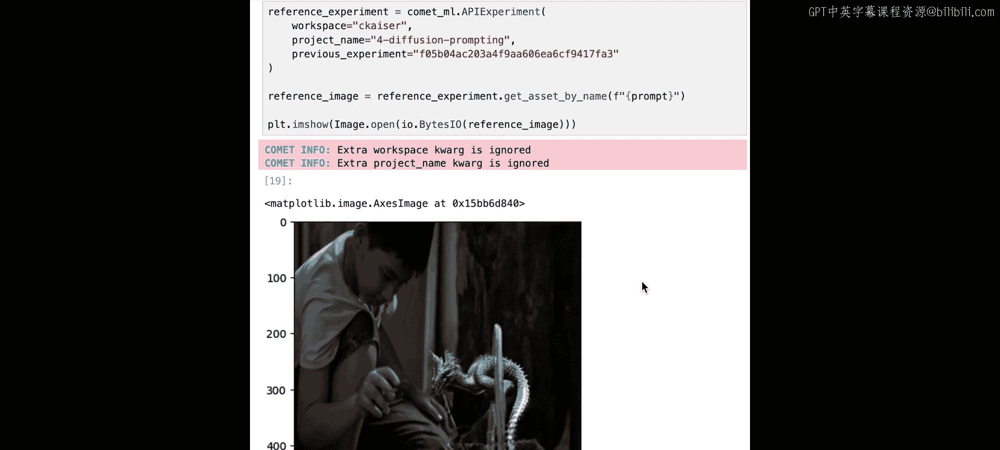