# 【英文可关，可拖拽】吴恩达《视觉模型的提示工程｜Prompt Engineering for Vision Models》中英字幕 - P6：6.fine_tuning.zh_en - GPT中英字幕课程资源 - BV1iM4m1o77p

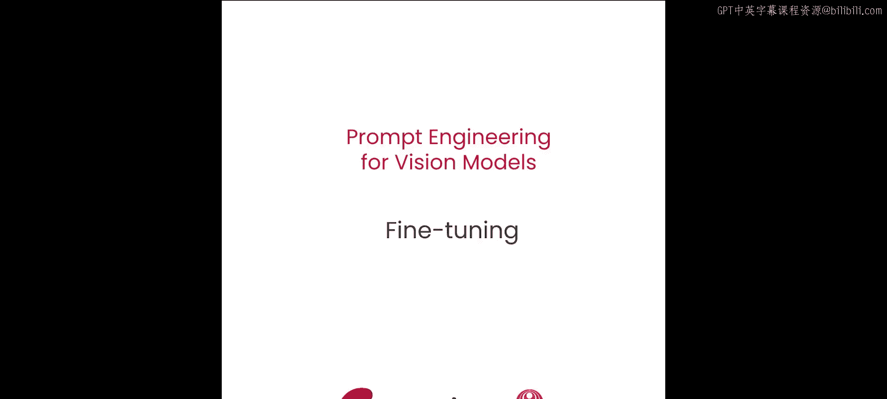

Diffusion models are powerful tools for image of generation。

 but sometimes no amount of prompt engineering or hyperparameter optimization will yield the results you're looking for。

When prompt engineering isn't enough， you may opt for fine tuning instead。

Fine tuning is extremely resource intensive， but thankfully there's a method of fine tuning's stable diffusion that uses far fewer resources called Dream Bos。

In this lesson， youll learn how to find tune stable diffusion with just a few images in order to produce your own custom results。

 Let's jump in。

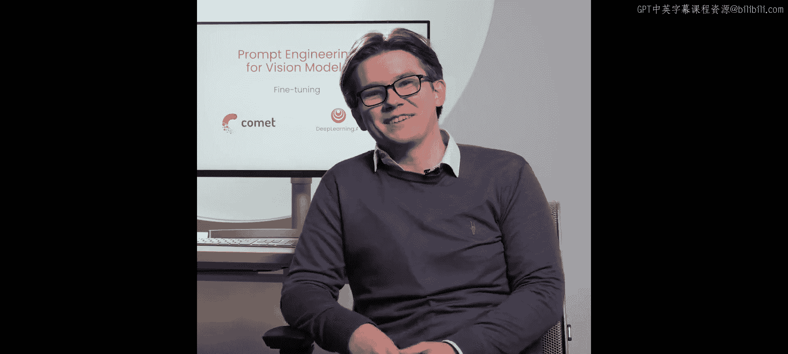

Previously， you've seen how manipulating your prompts and parameters can allow you to control the output of diffusion models。

Now， you're going to explore ways of teaching a model to generate images of a subject It's never seen before。

 For example， how might we teach a model to generate an image of Andrew as a Van Gog painting To achieve this。

 you're going to learn two new techniques for fine tuning diffusion models。

 The first technique is called Dream bootho。 Dreambo is designed to teach diffusion models。

 new subjects using very small amounts of example data。 And this project， for instance。

 will only be using six images of Andrew。 The second technique is called Laurara。

 which stands for low rank adaptation。 We're going to get into more detail with Laura later。

 But for now， let's start with dream booths。

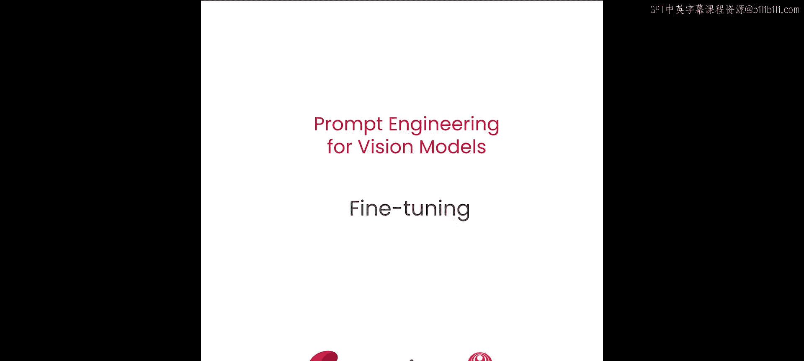

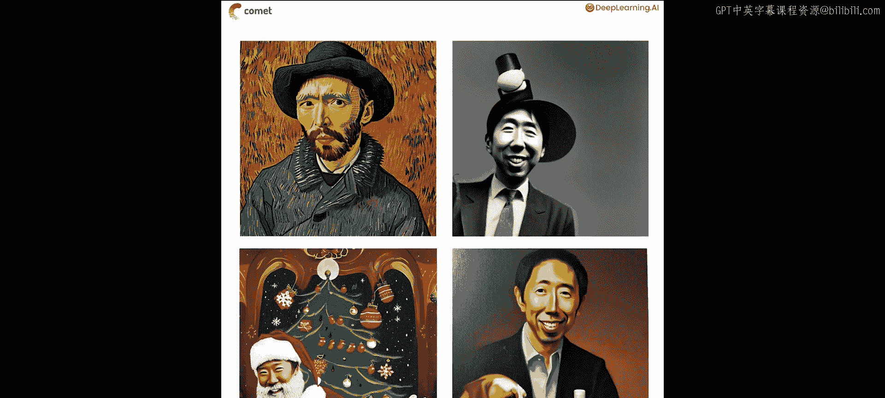

Before we talk about the mathematics behind Dreambo， first。

 think about why it might be difficult to fine tune a diffusion model with such a small data set。

 What problems might this cause。The first and most obvious issue has to do with the robustness of your data。

6 headshots of Andrew might be enough for the model to generate a decent headshot。

 but it's unlikely that the model is going to be able to generate images of Andrew in other contexts。

 The second issue has to do with language drift。 When we fine tune models were always walking this tightrop between improving the model's performance on our downstream task and damaging the model's performance on our other tasks。

 In other words， imagine we aggressively tune the model with our six photos of Andrew。

 Each pair with a prompt like a photo of a man named Andrew。

 It's very likely that the model's embedded definitions of photo and man will begin to drift to match the distribution of our small。

 narrow data set。 That will then damage the quality of the model。

 if we use it later to generate anything besides a photo of Andrew。 For example。

 it might think that all men look like Andrew。 or that every photo needs to have Andrew in the frame。

 Dreambo solves both of these problems in large part。

 by leveraging the diffusion models' existing understanding of the world。

 The authors of the Dreambo paper call this the semantic。😊。

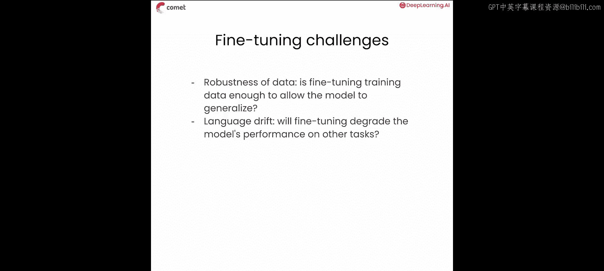

Knowledge， you can think of this like using context clues when you're reading a newton word when the model sees a prompt like a photo of a man named Andrew。

 it might not know what Andrew looks like， but it knows generally what a photo of a man looks like。

 It can then leverage this information and training。

 allowing us to get by with a much smaller example dataset set。

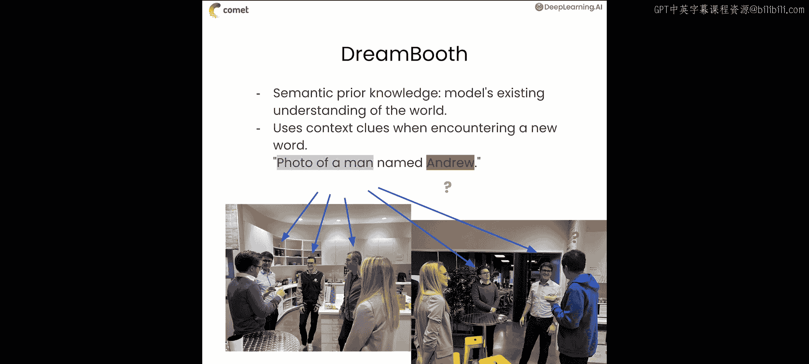

More concretely， this is what dreambo looks like in practice。 First， you select a token。

 which the model rarely sees like this bracketed V。

 your training loop will overwrite the information。 the model associates with this token。

 This is similar to many other techniques for altering diffusion models you might run into。

 You then pair this rare token with another token that generally describes the class。

 which your subject belongs to。 for example， for Andrew， we might select token pair brackets V man。

 We then associate prompts， which include this token pair with our images of Anda。 So， for example。

 if we had an image of Andrew playing basketball in our data set。

 We might associate it with the prompt a photo of a brackets V man playing basketball。

 The model should be able to use its prior understanding of all the other words in that sentence to guide its generation。

 So even if we're not giving the model a super robust data set。

 because it knows generally what a photo of a man playing basketball should look like。

 it can hopefully， pick up on the specific differences that differentiate the photo of Andrew playing basketball from a general photo of a man playing basketball。

 After fine tuning。😊，The model should associate the token pair brackets fee man。

 specifically with Andrew。 Now， this might solve the issue of having a small data set。

 but it does not solve the language drift issue we discussed earlier。 In fact。

 based on everything we described so far， It might seem to you like。

 we're almost certainly going to destroy the model's definition of man in the training process。

 Dreambo addresses this problem in a really clever way。

The authors of the paper created a custom loss metric， which they call prior preservation loss。

 which implements an interesting form of regular。 Prior preservation penalizes the model for drifting too far from its existing understanding of the world。

Generally speaking， it works like this。 You create a data set of images paired with prompts。

 In this case， you might have six photos of And with captions like a photo of a brackets V man and Dreambo parlance。

 We call these the instance images and instance prompts。In this project。

 you're going to use a single prompt for every single one of your images。

 But you should experiment with writing custom prompts for each image。

 You can even use a model like Blinnt to automatically generate the captions for your images。

 which is really useful when you're working with a larger number of images。

 you then select a prompt that is representative of all the concepts you' are afraid your model is going to lose during fine tuning。

 And the Dreambo literature。 We call this the class prompt。 For example。

 if your instance prompt is a photo of a brackets V man。

 Your class prompt would simply be a photo of a man using the class prompt。

 You generate 100 to 200 images from the diffusion pipeline。 with these images。

 you can construct a robust distribution representing the model's prior understanding of these prompt concepts。

 During the training process， you then calculate two losses。 First。

 you calculate the loss against the instance data。 Basically。

 how good does the model at reconstructing these images of Andrew。

 When we give it our modified token pair。 Second， you calculate the loss for the class data。

 In other words， how close does the model come to generating an image from the prior distribution。😊。

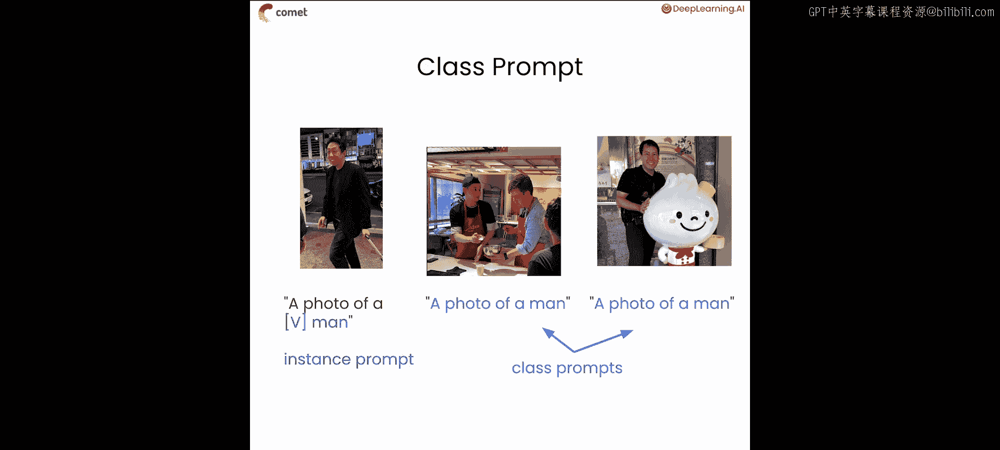

When prompted with the class prompt， because the class distribution is sampled directly from the model before you conduct any fine tuning。

 it gives you a concrete basis for measuring how far the model is drifted。 Basically。

 if given the same prompt， the model generates a wildly different image before and after fine tuning。

 we know that there's been some drift。You can then combine these two terms。

 which we'll call the instance loss in the class loss to give you a comprehensive loss metric。

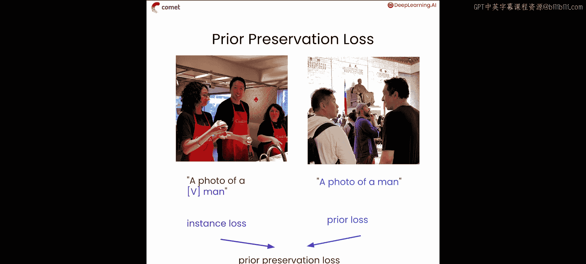

Now that we're familiar with Dream Bo from a theoretical perspective。

 let's try actually implementing it。Much of the code you'll be using throughout this section is adapted from hugging faces。

 Dream booth training scripts， which you can find link to the bottom of this notebook。

You're encouraged to explore these examples to learn about all the complex optimizations that are available here。

 in this example， we've done everything we can to simplify this code to highlight the high level concepts。

You'll also be using comment to log your training metrics throughout this exercise Com automatically integrates with many of the libraries you'll be using throughout this project。

 so it's really important that we import and initialize comment before we import any other libraries。

Most of our focus throughout this project is going to be on the hyperparameters and how we can tune them to control the outputs of our diffusion model。

 We'll be rest storing our hyperparameter and a simple dictionary that we can update throughout the lesson。

Most of these terms should be familiar to you already。

 but there's a couple things we want to call out here。 First。

 you should notice that we're importing a different model depending on whether or not you have access to a GPU。

If you have a GPU， we're going to use stable diffusion Excel。

 This is one of the larger stable diffusion models and has really high quality images。

 If you're running on a CPUU， we're going to use stable diffusion version 1。5。

 which is an earlier model that can still generate high quality images。

 is just not quite as powerful。We have our instance prompt and our class prompt。

 we also have a manual seed that we're setting to make sure that our results are reproducible。

You can see here that we set the resolution to 1024 pixels if we have a GPU。

 and if not we set it to 512， this is because different stable diffusion models do better at different sizes。

Additionally， we're going to set our number of inference steps to be 50， our guidance scale to be 5。

0。 We're going to by default， generate 200 class images。

 and we're going to set the prior loss weight to 1。0。

The prior loss weight is the numeric value that scales our class loss when we're calculating our prior preservation loss。

If all we care about is making sure our model learns our new concept。 We can set this to0。

 If we're really concerned with making sure the model doesn't drift during a training process。

 we can increase this to a higher value。Next， we want to initialize a common experiment that we can use throughout the project。

Before you can start training your model， you're going to need to generate your class images。

We're going to write the code for generating your class images。

 but we're not actually going to run it because we're doing this on CPU can take quite a bit of time。

Instead， we've provided the entire dataset set of class images as a common artifact that we can just download immediately as a refresher。

 a common artifact is an asset that's stored in common and version controlled。

The easiest way to generate your class images is to use this Dr booth trainer or utility class we provided。

 We're going to use this a lot throughout this project to abstract away some of the boilerplate you'll need to run your training pipeline。

Now， if at any time you get curious about what's actually going on under the hood with these utility methods。

 you can always use the double question mark operator to look inside the source code。

To download our class data from Com， we're going to make use of the experiment we initialized earlier。

Once that data set has been downloaded， we can take a peek at it by using the display images method on our trainer。

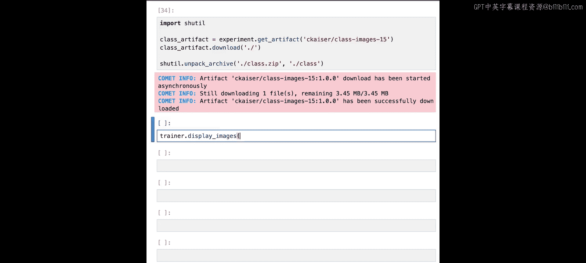

As you can see， stableable diffusion 1。5 does a decent job of generating images of men。

 although it seems to have a thing for black and white photos and mustaches。Next。

 we need to download our instance data set， which consists of images of And。

 We have that saves as a common artifact as well， and we can download it using very similar code。

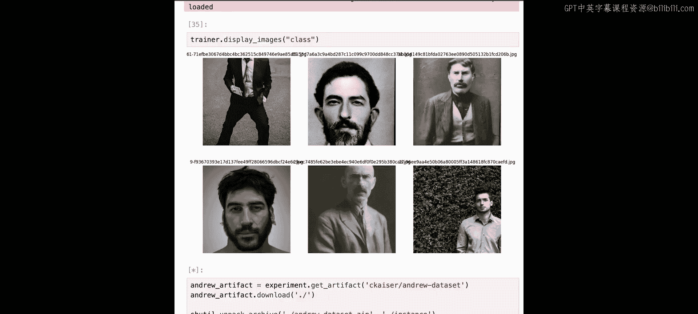

Once it's downloaded， we can take a P insideci it using the same display images method we used earlier。

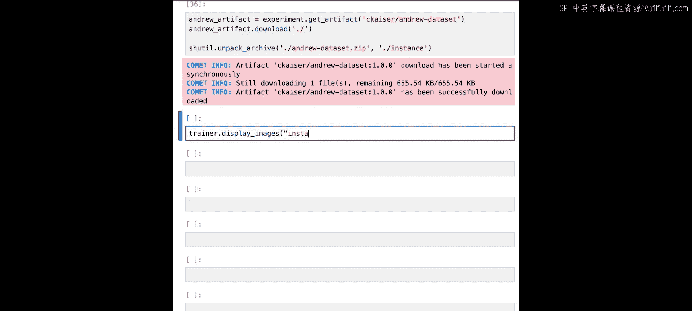

There are two really important things to note when looking at this data set。One。

 notice that the images are of different sizes and in different quality。

 This isn't a data set that we did a lot of pre processing on。This illustrates that with Dream booth。

 you can tune a model really effectively using data that's readily available to you。

 The second important thing to notice is that Andrew owns a lot of blue shirts。

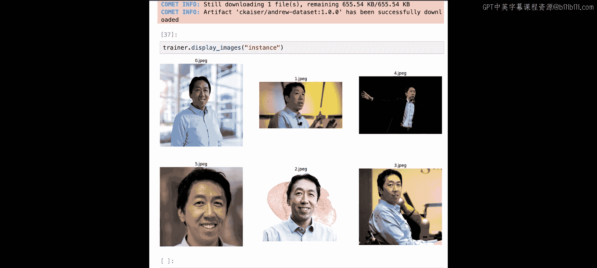

Now that our dataset sets are downloaded， we can move on to initializing our models。 if you recall。

 a diffusion pipeline consists of a text encoder model， a variational autoencor。

 and a Unet model that is used for the actual denoizing process。 We can initialize all of these。

 along with our tokenizer by using the trainer dot initialized models method。

Adding random noise to our images at different time steps is an essential part of the diffusion process。

 because of this， we're going to need a noise scheduler to generate our noise。

Huuggging Faces diffusers library provides a lot of really nice abstractions for accessing these kinds of schedulers。

Now， we're almost ready to begin training our model。 But first， we need to talk about Laura。

 The technique we'll be using to actually fine tune the model。

 One of the key challenges behind fine tuning large models is that weight matrices are at the risk of sounding obvious。

 really large。 If your weight matrix is of size M by N。

 Then you may need to compute a gradient matrix that's also a size M by N for every single update。

 with many optimizers such as add on with momentum。

 you actually compute multiple such matrices leading to a very large memory footprint。 However。

 the update matrix that you generate during the fine tuning process also tends to be really low rank。

 That means that the rank of the matrix or the number of linearly independent columns tends to be much smaller than the actual number of columns in the matrix。

 Intuly， this tells us that we can probably capture a lot of the important information for updating our weights and smaller matrices。

 This is essentially what Laura does。 Instead of computing a full M by N update matrix to update our weights at every single step of the training process。

 Laura instead trains a new set of smaller weights， which we call a。😊。

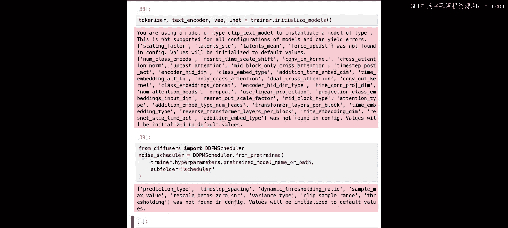

Which are then added to the original weights。Mathematicically。

 this is what Laura looks like in a normal training update。

 the weights at the next time step look like the weights at the current time step plus an update matrix。

 where the weights and the update matrix are both matrices of size M by N。In Lauraura。

 the weights at time step T are equal to the original weights。 plus the product of two matrices。

 A and B taken at time step T。 Now， matrix A is an M by R matrix。 While matrix B is an R by N matrix。

 and R is less than the smaller of M and N。 Essentially， we take two smaller matrices。

 and we train them instead of training the original weights。

These smaller weights can then be added to the initial weights to achieve the effect of fine tuning。

Besides the reduced memory footprint， one of the nice parts of Laura is that you can have many different sets of Laura adapters that you can switch in and out easily。

 So， for instance， if you later want to define fine tune a Laura adapter for a photo of a different person。

 you could swap them out for your Andrew adapters very easily。😊，In this example。

 we're only going to be tuning the unit model， so it's the only model we need to prepare for Laura。

In addition， we also need to initialize our optimizer and extract the parameters we're going to be optimizing。

Finally， we need to initialize our training data， our training data loader。

 and our learning rate scheduler， we'll then load all our relevant models along with our data sets and to Acccelerator。

 which is a hugging face library that allows us to train more efficiently。Now。

 let's get into our actual training loop。 First， we need to calculate our total batch size。

 We're going to use gradient accumulation in this pipeline。

 This is a technique where we only update the weights every few steps。Because of this。

 we need to set our total batch size to be our number of gradient accumulation steps。

 times our single step batch size。Now for the training loop itself。

 first we want to set up the progress bar for tracking our training。

The diffusion process has a few steps。 First， we want to convert our image into its latent representation。

To do this， we pass the pixel representation of our image into our variational autoender。

 Then we sample from the latent distribution。Once we've converted our image into its latent representation。

 we then need to sample the noise that we're going to add to the latent as we train。Finally。

 to complete the forward diffusion process， we need to add our noise to random time steps。Now。

 if the forward diffusion process is done， we need to perform reverse diffusion to do this。

 we need to get the embeddings of our prompt and use the UN model to predict the noise in the image。

Once we have our prediction， we can calculate our prior loss and our incidence loss and add them with the prior loss weight to calculate the prior preservation loss。

Once our loss have been calculated， we can form back propagation and step our optimizer as you would in any other training loop。

Now， at the end of each epoch， we want to log our lost metrics to comment。At the end of our training。

 we want to save our lael weights， log our parameters to comet and add a little tag so that we remember that this was a dreambo training project。

 Then we can call end training on our accelerator， and we're done Again。

 we're not going to actually run this training code in this environment because on CPUs。

 this will take quite a long time。😊，However， we do have an existing common experiment taken from a training run of this exact same model which we can use to analyze the results。

We can call display on this experiment and see the metrics that it logged to come。Now。

 we can edit the layout to get a better look at our most important metrics。 In particular。

 we want to see how the loss， the prior loss and the instant loss all compare。Throughout this course。

 we've emphasized the importance of getting hands on with your image data and visually inspecting your model's output。

 This project really drives this point home。 because if we look at these loss metrics。

 you'll notice some really interesting data。 First。

 you can see that the loss seems to overcorrect back and forth between the prior loss and the instance loss。

 The peaks and the prior loss tend to correspond to valleys in the instance loss and vice versa。

 This kind of seesaw effect might make you think that the prior preservation loss metric didn't really work as the model doesn't seem to converge。

 However， if we look at the outputs of the model we'll see a very different story。To illustrate this。

 we're going to use our model to generate a bunch of different images of Andrew and a bunch of images that don't include Andrew。

To start， let's set some prompts and some validation prompts。

 You can see we have several prompts that are targeted at generating an image of a man who looks like Andrew。

 and then we have several equivalent prompts that remove the bracketed V token。

Once we have our prompts in place， we want to create a diffusion pipeline out of the model。

 we just finished training。 If you look， we initialize a pretrain diffusion pipeline using theable diffusion 1。

5 model。 Then we load our lael weights onto that model。 with our pipeline。

 we iterate over each prompt generate an image and logging it to common。 Again。

 we're not going to run this code here because it will take some time on CPUus。

 But we've already run this on comment and we've stored the results in an experiment that we can visualize below。

😊，We can load our existing experiment like this， and then we can view the images that are logged by passing the tab equals I argument to the experiment display method。

This is what the actual images tab in the Com dashboard will look like。In it。

 we can see the images that were logged by the pipeline。 If we click on one of them。

 we can see that this was one of our validation prompts， as theres no bracketed V token here。

Looking at the image， it makes sense。 it looks like a normal man。

If we find its equivalent instance prompt， however。We see that when we add the bracketed V man。

 the mural that is generated looks a lot like Andrew。Similarly。

 this image of a brackets V man playing basketball looks a lot like Andrew。

Whereas this image of a man playing basketball doesn't look like Andrew at all。

 Even though the loss curves wouldn't tell us that our model had improved。 by looking at the outputs。

 we can see that it clearly is learning。

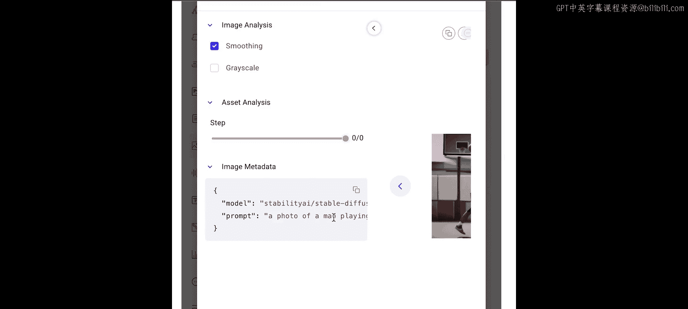

The key for us is that we visually inspect the outputs of our model。

 no matter what the loss curve is saying， oftentimes we'll be surprised by the results。

That brings us to the end of this lesson。 You' are encouraged to take things a step further and try experimenting with some other hyper parametersa。

 You can also try to tune a larger stable diffusion model using a GPU environment like Google Colab。

 You can even collect a data set yourself or try targeting a different token。

 usinging the code provided here。 You should be able to take on a diverse array of projects。😊。

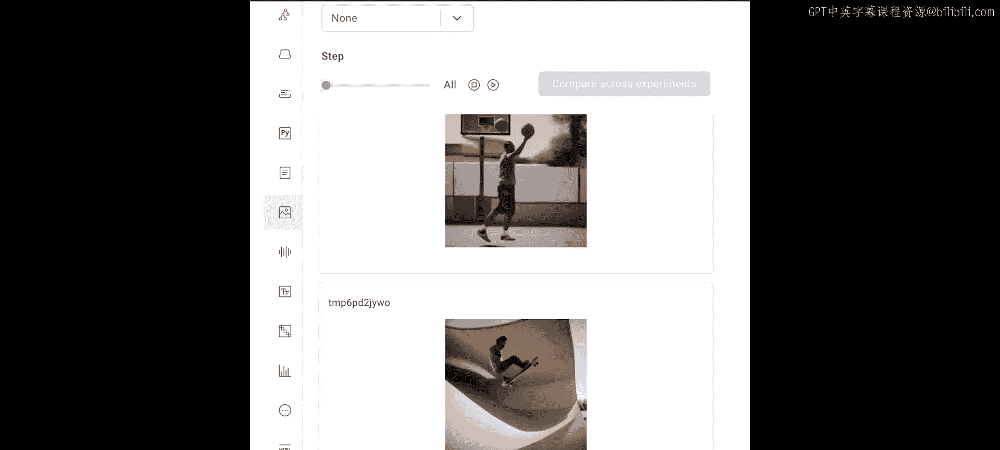