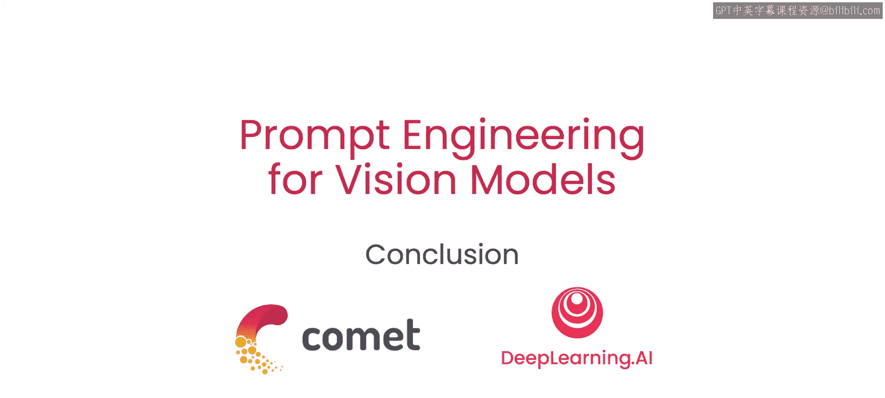
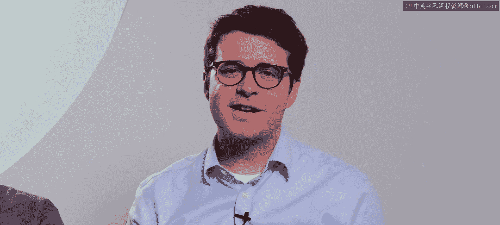

# 【英文可关，可拖拽】吴恩达《视觉模型的提示工程｜Prompt Engineering for Vision Models》中英字幕 - P7：7.conclusion.zh_en - GPT中英字幕课程资源 - BV1iM4m1o77p

Congratulations， you've made it you've learned how to isolate any part of an image using SAM You've also prompted OL VIT in order to segment objects in an image using only text you combined object detection。

 image segmentation and guide and diffusion to programmatically create entirely new images。

You also fine tune stable diff fusion with the dreambo method so that it can generate images of an custom object if you have access to GPUs such as with Google CoLab。

 you can try iterating on your own prompts and finetning the models further with GPUs Perhaps you can expand these inpat pipeline methods to video editing Now that there are more foundational models you'll have more opportunities to apply prompt engineering to your computer vision applications We look forward to seeing what you will build next。

