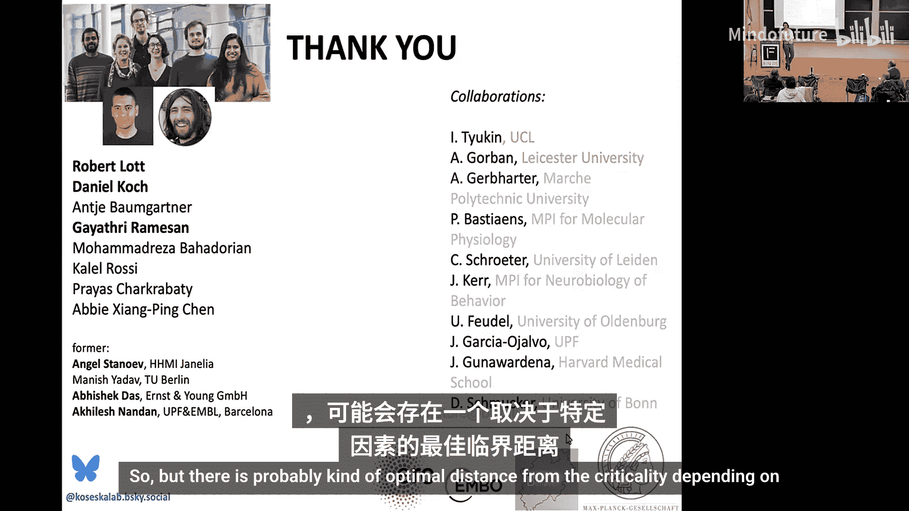

# 【菲尔兹研究所】网络科学领域实验室 ｜ Fields Lab For Network Science p01 P01_细胞计算与学习 -BV1Ty6qBJEvZ_p1-

The bacteria leaves a signal， a chemical signal that the neutrophil chases。

 but at the same time it faces all these conflicting signals that come out from the other cells that it finds in the environment。

😊。

So if the world is also complex for the and has many different and conflicting signals。

 also for the single cells that if we follow this logic。

 even the cell needs to have some form of a memory or being able to predict or anticipate what are the events that going come up in the environment and be able to respond accordingly。

 but we have two different levels of organization on the one hand the mouse uses neuralnal networks which can do highly sophisticated computations。

 but on the other hand， the cell only has a network of genes and proteins so how can both of these networks be able to achieve these seemingly similar type of computations。

 so if we look in neuroscience， how we try to explain these behavior is that we have very complex external world then the neuralnal network makes a form of internal models so it extracts important principles or statistics from the。

😊，And it uses this internal model to be able to co guide the behavior。😊。

But if we look in classical cell biology， how we think about the cell。

 well we think that cells are very simple machines that only associate a stimulus with a response and in my opinion this has come about because in cell biology the experiments are usually done in very simple environment so you stimulate the cell with a constant signal so the cell only sees one bit of information the signal is either there or not there and if my environment is is constant and then I don't require any memory or any learning to be able to live in this environment also if you take the other side if your environment is completely random again memory and learning is not going to do any good because there is nothing to extract from the environment so only if my environment has some forms of regularity in terms of the signal then also the biochemical network in this case the network of proteins that processes this information from the environment requires。

Some form of memory signal integration。Or learning in order to be able to deal with the world in which it lives。

So the question that we are asking in my group is on the one hand how complex are cellular computations。

 so what is everything in terms of computations that in particular protein interaction networks can do and if we are able to extract some form of dynamical principles for these computations。

 we would like to see on a theoretical basis， whether these rules of computations also scale up and can be they also be applied on the level of neural neural networks and is there any similarity between these biological computations that happen on different scales or organization in living systems。

So from theory， the generic framework of how we see computations as we've heard several times yesterday and also today is this framework of attractor-based computing so we have one any network it can be neuralnal or biochemical in mathematics or in theory we usually understand how the dynamics of this network or each of these nodes changes over time and we can we have many theories so we can calculate the overall what are the possible solutions of this network so as Urika also showed yesterday we can have these stable fixed points that are separated by saddles or unstable fixed points you can have more complex like oscillations orrc chatic solutions and so on。

 but in general how we think about the computation is that the system it goes over time and it's attracted to one of these stable solutions so what matters are only this asymptootic or long-ter stable solution。

In the network。And here and Bart nicely formulate this for neuralnal networks。

 but the same is how we think about biochemical networks in single cells is that as the system evolves over time when they a signaled from the environment。

 the system switches from one to the other stable state。

 and this is what we know or we term as a computation of the network。

 and then each of these states is associated with particular behavior of the system。😊。

So we wanted to understand whether this framework of computation actually also applies to biochemical network with a very simple question and the question was how do single cells sense signals。

 when these signals change over time the cells do this by these transmembrane receptor proteins where the chemical signals from the environment bind。

 the proteins get activated and the whole biochemical networks gets activated and this determines then the response properties of the network。

 so we worked in particular we chose one of these receptors。

 the epidermal growth factor network is a typical oncogene a few years ago we identify the minimal what are the most important components in this protein interaction networks that regulate the dynamics and because we have the detailed biochemical knowledge of these network we can also understand。

And it's dynamical properties， so this network maybe you can already see it has a double negative feedback and autocaaltic activation。

 so from theory this is classical can produce by stability。😊。

In this system this depends on the EGFR concentration or this receptor concentration on the membrane。

 so if you have for certain concentration of the receptor on the membrane the system can be either in a basal EGFR phospholation state or in a high protein activity state。

 so both solutions will be stable if we think into this landscape。

 it will be a landscape with two wells， one well is the basal activity。

 the other well is the high activity state。So what would it mean if the system will be organized or has- if cells have EGFR concentration that correspond to this pi stable organization。

 then it's very simple to predict with the simulation that if you give it even just a single pulse of a growth factor。

 the system will switch from the basal to the high activity state， you remove the pulse。

 the system stays in this state because it's a stable attractor。

 so in a way the system has a form of a permanent memory。

Which means that if you add other signals in the system。

 the cell is not going to be able to respond because it's already in the active state。

 so it doesn't care anymore if there are other signals that come in the environment。

So we decided to test this also experimentally， so the experiments that we do is that we place single cells and we work with epithelial cells in general。

 we put them in microfluidic devices where we can do this complex signals with any different frequency from the outside and then we have fluorescently tag our proteins in the single cells so we can record both their localization but also their activity。

 so we did perturbation experiments as I said as we know the network topology if you overexpress the receptor or you knock down one of the other components。

 we ensure that the system is exactly organized in this bistable regime。

So when we stimulated the cells with five minute chemical signals every 30 minutes。

 what we see is very similar to what we saw in the simulation。

 the receptor activity increases with the first pulse。

 so you switch from the basal to an active stay， and then the system stays in an active stay。

 irrespective of how many signals the system sees。Which means that if my world is dynamic and I have a long-term memory which comes from stable attractor that the system is fixed into a stable attractor。

 then the cell is not going to be able to integrate signals and it's not going to be able to respond to changes in the environment so it has the robustness property but it does not have the property to be able to flexible and respond to other signal and this is actually the case for the onogenic situation so in the most of the cases is if our mutations are typical for breast cancer and in the most typical mutation is that receptor is overexpressed so the system is exactly poised either in this bistabletable regime or on the other side in the high activity regime which means that the receptor is continuously active。

 it's continuously signals and cell continuously proliferationry so this is not the general or it's not。

In a way how cell would function and be able to respond to signals。

 chemical signals that change in the environment。But these very simple experiments also showed that there are limitations of our thinking of that the system with signals from the environment just switch introduces switching between attractors because we see that this cannot explain how cells process signals when these signals change over time。

So。Very similar to what Ian just showed you we proposed from the model that what would be optimal for the cell is actually not to sit in this bis stable regime。

 but to sit exactly at this critical transition in this case it' a different type of a dynamical bifurcation it's a saddle node bifurcation。

 but if the system sits close to this transition， so if it has EGFR concentration that correspond to this regime。

 this would correspond to ability of the cell or in this case the receptor to activate when you remove the signal。

 the system will stay transiently active， so it will have a memory but it will be form of a transient or a temporal memory and then the receptor activity will reset which would allow the cell then to activate with every new signal so basically the cell has both the property of a stability because you maintain your active state for a transient period of time。

 but you also reset so you again response。To new signals that change in the environment。

So when we measured the activity of the protein in a single cells。

 this is just an example from a single cell， when you give a growth factor pulse。

 the protein activates when you remove the pulse， protein stays active for a transient period of time and then it resets。

And this memory is actually on the order of 40 to 50 minutes on average。

 so if you think about the underlying phosphorylation de phosphorylation process。

 this is submin and this memory is on an order of hour or longer。

 which means that the system gains an additional long time scale in which it can keep the information that it has seen signal before。

😊，And the duration of this memory does not depend whether you stimulate five minutes or you stimulate for one hour。

 the duration of the memory is an intrinsic property of the system。

So we have shown that receptor network， so I show you the example here for the EGFR。

 but we have shown you that this is a typical property for the whole family of receptor thyroidsic highaseesis。

 not just for this molecule， they seem to have a signature of critical organization so they sit sit very close to this dynamical transition and because of this they have these emergent property of having a transient memory and this transient memory comes with an additional addom to the system that it gains this slow timescales so basically now you have many different two different timescales that the system has and it can use potentially for computations and this is only because the system is both such that it sits close to this dynamical bifurcation。

So then the question was， of course， why cells would need a memory？So there are many cases。😊。

In our bodies or in any system where cells actually have to migrate over very large large distances in a complex environment。

 so among many cells， so this is an example from development from gm affirm in zebrafish and if you have seen the video or you watch the video carefully you see that the cell migrates in this direction。

😊，Potentially it will get confused so it will go and go downwards。

 but eventually reset sets and it continues on its on its path upwards。

 So if I put this into a cartoon， this means that。I am a cell and I need to move in a long distance。

 and this is the case， for example， during development。

 but the same problem arises also during wound healing。

So you have to move along a very crowded tissue you are guided only by local signals or chemicals that the cells are secreting these signals will be noisy。

 they will disrupt it， they appear and disappear， so the typical migration pattern of cells is that they migrate in a random walk migration pattern。

When there is a signal coming from one side they will polarize and move in the direction of that signal。

 so if I move in a directed manner only when I see the signal or when I sense the signal and I start in a random walk immediately when the signal is disrupted then cell will never be able to achieve this long-range migration however if the cell has a memory okay I moved in this direction my signal disappeared for a while but I will continue moving in the same direction then cells can actually breach this periods when the signal are disrupted but also this memory very similar to the questions I was just asking if another signal appears while I'm in the memory regime then the cell should be able to sense this and it should be able to redirect its direction of migration so again it is this property of balancing between two op features you have to have robust migration to be。

AbleTo bridge these disruptive and noisy periods， but you also need to remain flexible to be able to adapt to new changes in the environment。

So we put the same cells now in microfluidic devices where we generate gradients from the chemicals from the outside。

 we make this gradients dynamic， and we wash them out after a while。

So the gradient comes from the left， the cell will polarize。

 it will start moving in the direction of the gradient， when we remove the gradient。

 the cell continues moving in the direction of the gradient and again for a range of 40 to 50 minutes on average and when it loses this memory。

 it will start to move into a random walk migration。

So cells need this memory in order to be able to continue migrating in the direction of a previously seen signal。

😊，However， this memory would be very important if you move in a complex environment。

So if you have a signal that comes from the left and it's disrupted， if the cell again。

 starts moving immediately into a random war migration when the signal is disrupted。

 then it's not going to be able to do one long range migration。

So we did experiment where we put the signal from the left， we disrupt it。

 but when still the system is within this memory range， we established the signal from the same side。

 then we disrupt it again and while the system is still in the memory side we switch the signal from the opposite side。

 so we wanted to see whether the cell is actually able to integrate all this information。

So it's indeed what the cells do， they start moving to the left， we disrupt the signal。

 they have a memory so they continue moving in the same direction。

 we disrupt the signal again and we switch it to the opposite side and even when the cell is in the memory range。

 it's able to sense actually that oh now I don't have a signal on this side but I have now a signal on the other side so the cells repolarize and start chasing and the signal on the opposite side when we switch off the third signal the cells still have a memory of that signal and when they lose that memory then they start random what migration。

And this is a form of。嗯。Working memory that is very comparable to the working memory that you have in a nervous system because you store information over time。

 but you remain responsive to other signals so。We argued here that cells also use a form of a molecular memory to be able to navigate when the signals in the environment continuously change and this is important。

 exactly to be able to achieve this balance between robust migration when your environment is changing and noisy。

 but also be able to flexibly adapt exactly to these changes。And。

We thought okay this is if cells have a basic form of memory。

 can one actually also look for properties of learning on the level of single cells。

 so how to think about learning in biochemical networks because they are not equivalent to neural networks we don't have the synaptic changes and plasticity in the connectivity all our connections are well defined but this is also not a new problem there are experiments and this is one of one of the I think maybe even the first experiment。

 it was done by American physiologist Jennings in 1907 he took a single cell organism which is called stentor which is this shape like ciliot and he showed that if you stimulate the ciliot with beats the experiences or this place。

ential pattern of well-defined behavior so if you stimulate it with beats first it tries to pan away if the beats still keep coming then the second step it will reverse cilia to try to kind of spit out the particles if this doesn't help it will contract and eventually it will detach so it goes to this really define sequence of behaviors which shows that they can modulate their responses depending on a prior experience in addition to this he has also shown and that that center can exhibit a very basic form of non-associative learning which is habituation so under a different condition when you stimulate the ciiate with pulses in this case again it was just temporal addition of these beats what the system does if the beats are not harmful to the system they are just annoying it will。

The center will respond with a decline in its response， so at some point it decides oh well。

 it's annoying but doesn't harm me so it stops contracting actually。And。

This experiment has been very recently recapitulated in the group of Jeremy Guna Verdina in Harvard。

 and this has also sparked a series of theoretical work， okay。

 do we have a biochemical or minimal biochemical network motifs that actually can exhibit these basic forms of learning such as habitation？

But in this class of very basic forms of learning， there is almost kind of the opposite and that is sensitization。

 and this is the case that upon a repetitive presentation of a stimulus。

 the system actually shows an inclined an increase in the response properties。😊。

So this is the example like if you rub your hands， they will start getting warm and you'll start get a pain but after a while it goes away and this is because you're repeating this stimulation the nervous system gets activated so you get this increase in response。

 you get the pain it lasts for a while but then you lose it however。

 even in the or as much as we try to look we didn't find that there is a mechanistic model that explains how sensitization happens even for a neural neural network and sensitization is very interesting because it has been also very often being discussed also from an evolutionary perspective that it is a mechanism that supports survival so if you have a signal that repeats into the environment potentially you think oh this is probably harmful so you increase your responsiveness in order to be able。

To properly survive in this environment。So we thought， okay。

 we take our single cell network and let's see our epidliial cells that we work with and let's see whether they have these basic forms of non-associative learning and I'll show you the example of sensitization but we have also looked at habituation。

😊，So as I mentioned， sensitization has this particular feature that when you repeat a stimuli you see a response in。

 but this is not everything also if you withheld the signal for a while and you give it again。

 then the system shows the same amplitude of response。

 but if you withheld even for a longer time and you present the stimulus， the system has reset it。

 so it's a transient process and you have to go over the same sequence of behavior to relearn the behavior。

So if this would be a neuralnal system， we would think， okay。

 I have some statistics of my signal in the environment。

 the system needs to form an internal model to extract the information about the environment and generate this complex behavior。

But in this case we only work with single cell， so our hypothesisthees is that the internal representation for a single cell comes through the transient dynamic or these dynamical states in the biochemical network and the cell uses these dynamical states to be able to extract causal influence and in this case of morphological behavior。

 so the most simplest behavior that we could think is changing in the shape of the cell。

 so we do the experiments where we stimulate the cells again in microfluidic devices with the growth factor pulse with some duration we record the proteinte activities in single cells to see how the biochemical network encodes this and then we also quantify the shape changes with respect to to these responses so this is the examples of the cell。

 when you see I hope you can see when you see some green flashes。😊。

This is actually when we deliver these pulse and you see that there is this continuous change in morphology。

If we quantify that change in morphology， so we do one minute pulses with three minute interval pulse interval。

 what we see when we look at the change in the perimeter of the cell shape we see that we have this increase in the in the response or this amplitude of the morphological morphological change and they respond in a form of an oscillatory pattern when we delivered with the last pulse we see that the cell maintains this type of strong change in morphology or a transient period of time and that it reset so you have this basic forms that correspond to the nonassociative learning of a response increment a form of a temporal memory and the system resets and if we look at the。

At the protein dynamics in this case， we measure the activity of the receptor at the same time。

 we see that we see the similar features also in the internal representation of the cell。

 so you have this climbing activity in terms of the activation of the receptor。

 you see this transient activity which is maintained and then the system resets。

And this is not everything we also have seen and that the system actually has even more more complex features such as frequency and s。

 meaning that more frequent stimulation results in a more rapid and more pronounced response increment which is also or well slightly in the just in the opposite way is one of these hallmarks of habituation that have been defined but actually no one even defined response properties for sensitization。

 so this is one of the properties of sensitization that we were able to derive from single cells。

 even though this is a very simple example， I think it demonstrates that even biochemical networks in single cells can have very basic forms in this case of knownassociative learning so to us being。

😊，Primarily coming from theory， it was important， of course to understand。

 okay what are the features in these biochemical or simple biochemical networks that actually lead to the memory and learning so I mentioned this memory comes because the network is organized close to this dynamical organization dynamical bifurcation and we know from dynamical systems and that if the system sits close to a saddle node bifurcation。

 what happens when you give the signal so you're actually changing this landscape this landscape is not fixed so when you start here the system has only one stable status state so one well when you give an input this landscape changes so the system goes to the high activity state。

 when you remove the signal you change back the landscape to the one well of the basal activity state but because you sit close to this dynamical transition you have an area in this landscape。

😊，Whi is where you come down from three sides and you go away only from one side and in this landscape the surface is slightly tilted and because it's almost flat。

 you're going to go slowly on this surface and this is what in dynamic systems is known as a ghost set and it's kind of a ghost。

 you had an active state， this state is not stable anymore but the system keeps kind of a ghost of this active state so you start moving down this shallow slope and this slows down。

 this is why the system gets this memory and it gets it on a timescale which is order of magnitude longer than the timescale of the underlying processes and then the system will fall down basically it will reset。

So in this system， it was of course easy to identify because we worked with a minimal network motif。

 we knew or measured those experimentally， all of the parameters so we can model it in details。

 but how would you identify if you have a large scale network？So。

We have recently done this kind of generalization of this ghost sets。

 so basically for any network you can define a form of a leuna function which in this case we used kinetic energy of the network that you can minimize and if the kinetic energy is zero this is going to give you your fixed points but if the kinetic energy is close to zero is going to give you areas in this landscape which are relatively flat。

 so it's going to be able to identify this range of this ghost attracting sets and because the kinetic energy is close to zero。

 the system is still you can linearize it so you can locally calculate the eigenvalues of the system and if you look at the maximal eigenvalue。

 this maximal eigenvalue has a gradient from negative to positive which is what directs the flow so if you have the trajectory of the system that。

Projectory of the system would directly go or pass through these go sets。

 so what these go sets help is despite that the system is away from any steady state。

 they're enabling to direct the flow in the system and how the system will develop over time。😊。

So since this is not formally a stable state， of course the question is well is this table with respect to noise because what we observe in cells is of course that biochemical networks are inherently noiseisy so would we still be able to observe this quasi stable dynamics even if we have noise in the system。

 so what we did in the simulation is we increase noise intensity and we estimated the trapping time of the system in this go sets so for minimal models you can do this even analytically but what we saw is that this trapping time or how long you spend in this go set so how long is the memory is actually very stable up to very high noise intensity and from the experiments both from the EGFR and we also measure other proteins in the network we were able to estimate the noise and this is of course does not only represent it's a mixture of the technical and。

😊，And the biological noise， but we are between 10 to the minus third and 10 to the minus second in the experiments and this is probably also why we were able actually to observe this memory in the single cell measurements。

 but the most important message is that networks that sit close to this dynamical transitions。

 they also。They could work with such goal sets that enable the emergence of these long transients and these long transients are robust to noise。

 and this is one important characteristic that if you would like to do any sensible computations。

 of course， the dynamical objects with whom you do the computations and they need to be robust to noise。

So。How does the learning happen Well again it is a mixture of the system sitting close to this saddle node bifurcation as I mentioned this gives the system a slow time scale but also very important to remember the fact that when we have dynamic signals what happens is that these landscape continually continually reshapes so when the system is organized at the bifurcation it has only a single fixed point and that is the fixed point here。

 but what happens when we give the stimuli in the simulation you see that this number so all these squares are the different fixed points in the system which appear and disappear and what you get is this kind of a funnel of slow points so the system starts moving along with a signal because it wants to reach the high activity steady state but you remove the signal。

So you reshape the trajectory starts going or tries to go back to the fixed point。

 but it moves on this set of slow points and because it's slow when the other signal comes。

 it does not reach the fixed point when the other signal comes。

 it is pushed forward so actually it can generate this climate activity。So this set of slow points。

 despite that giving the memory to the system， it also enables to have this climbing activity upon repetition of the signals。

 so this organization close to dynamical bifurcation is important for cells because it enables them to sense time varying signals because they get a form of a dynamic memory but also this slow dynamics is important for the system to generate climbing activity and thereby have this basic form of sensitization and very important dimension mention here is that during this whole process of the integration of the signal the system actually maintained away from a static state so the computation is formally done with the transient of the system。

So， we have。Argued or we would like to argue that we also need to change the mathematical framework。

 how we study networks that are stimulated with timebeing signals so that we need to switch from non-aumous system description where we only define the properties of the system through the network topology and number of study states。

 the system has to a non-autonmous system description where the environment or the external signals are part of the system。

 because as I showed you when our signals change over time。

 the number and the position of study states can change so they formally don't even represent anymore more the solutions of the system but you can show that there is a family of solution operators where the solution of the systems are now the trajectories。

 so formerly the trajectories of the dynamical system will be the solutions and how we need to describe the response of dynamical systems。

And they' are subjected to time varying signals。So。哦。

Considering that we have found these ghost sets or that cells use these ghost sets for having a memory and also basic forms of learning。

 we went on to more formally define this ghost sets the definition is very similar to what Uureque has shown you before that we have a ghost attracting set if it's a close- bounded set that does not contain any semitrojector is important in time。

 you can define a basing of attraction of this of this ghost attracting set where the traor is enter。

 they spend some time and then they potentially live but if you define it like this formally then it's very easy to see that you can have more complex structures of this ghost attracting sets in phaseb so basically you can align them such that the system goes on one of these ghost sets stay for a while then fall on and goes to the next ghost attracting sets so basically you can generate this。

chanhannels of go sets or you can loop the trajectory back and you can generate a cycle of this go sets so what would be the dynamics for example of one such a go cycle so we did very simple geometric models in this case。

But you see exactly the same so the trajectory of the system stays on one of the ghost and very rapidly transitions to the second one。

 it will stay for a transient period of time and then it will transition to the next one and so on。

 so you get a very reliable sequential switching dynamics which is also maintained even when you have increased noise。

 yes。So this is it similar to like a hop like coffee design factor generate like a massive stable behavior。

And the properties will not be equivalent because here how long you stay in one of the attractor is the property of the ghost set in that case。

 if you're just with a noise， you cannot control。Yes， so this is let's say。

 I would like to argue that for computation， this is reliable in contrast to if you only rely on the noise of the system。

noise level noise there could be some right so we have only done this or also how robust the system is it's just an additive and Gaussian right noise nothing else just note yes yes yes。

And so this is just exactly what I just said， the system stays on the one goes and hops to the next one。

 that hops to the next one， so you can go on in a cycle forever because they are arranged in such a way that we always switch between the different ghost attracting sets。

You can quantify this so for example the period that you're going to get on this ghost cycle is very reliable up to very high noise intensity。

 the trapping in the ghost vicinity is also very reliable which comes from the property of a single ghost set and very importantly for this sequential switching dynamics and we have heard some talks yesterday as well is that you maintain your behavior table for a transient period of time。

 but then you have a very rapid switching to the next and we see again that this difference between longtping and very rapid switching is also maintained and is not disrupted with the noise。

And。To us this resembles very much this sequential switching that you see in neuronal ensembles。

 this is just one example that has been a range of experimental papers。

 this is an example of encoding of different tastes in the atory cortex where they measured the neuronal activity and then you see that for each of the different taste。

 what you see is a sequential switching activity pattern。

 so when you repeat the same the same stimulus， what happens is only that you can have a slight variation when the system goes to the next sequence。

 but the sequence and the order of the sequence remains the same and for the different tastes。

 the encoding is by different sequences so this suggests that the neuronal information encoding especially for such sequential switching activity patterns could potentially happen through goes catalysts that are generated in the neuronal。

So we wanted to test this a bit more so we wanted to test what are the computational capabilities of these ghost scaffolds and what I forgot to mention is where I think that computation with quasitable transients such as those that come from coast scaffolds will be important when you have the time also part of the equation where you need to remember something over a transient period of time or you have to integrate over time because this is these are the examples where you have to have this balance between robustness and plasticity so we looked in the literature to see how or what is the description about how neural neural networks in code perceived time and what we found in the references is that of course that this is very important for living systems but what we。

In references is that how it is taught in neuroscience is that the timing is an intrinsic computation that emerges。

 so it's not a specific circuit in the brain， but rather it's an emerging property that comes from the inherent dynamics of the network。

😊，And how this is usually tested very similar to some of the tasks that we have also seen yesterday is these are one of these very basic working memory tasks that they do in primates so you give the。

You give the monkeys a goalQ， which you so the measure and the weight here， the first two signals。

 so the monkey has to remember this time interval， then you wait for a delay period and then you give them a goalQ and they should。

 for example， push a button exactly after the time interval that they have remembered。So。

We taught to train a minimal neural network and in this case we use gated recurrent units in order to be able to also and we decided consciously for a very small network and that is a three component network because we wanted to know whether we can understand how the network encodes this information about the time interval so you can train very very efficiently this network to do the task。

 but what you can do because this is now a very simple network。

 you can see how actually the dynamics of the network changes during the training。

So you start from a single study state and during the different training epos。

 what you see is that the system actually generates a bistable behavior。

 but at the end when the training is finished the system is poised close to the bifurcation。

 so this neuralnal network in order to be able to encode this complex tasks。

 it finds the solution that it's optimal to be close to a dynamic bifurcation yes。

So say your training， yes， the whole， not not yeah， we change yeah。No， sorry。

 so it's a gated recurrent unit network， so each node is represented by three variables which you can remap it's a discrete system but you can map it to a time continuous system。

 so basically it's kind of activity of each of the nodes。And。

So then because we are very close to a dynamic verificationcation。

 this is very similar to what we have seen before with the single cells。

 so we used exactly the same features what we have defined before so this kinetic energy approximation in the network where we see this cloud of slow points that the network has and then in this cloud you can also calculate the eigenvalues。

 this is the maximal eigenvalues and we see that the system has only single fixed point which we also solve from the organization of the network and here we see this distribution of eigenvalues from negative to positive which hints to the existence that this cloud of slow points is actually a go set so when you look how the network works actually when we give the signals so the trajectory continuously stays in this cloud of slow points。

 so when you give the signal you move it away。It comes back and actually this time interval that the network has to encode and potentially reproduce it corresponds to the distance that the trajectory travels in this cloud of slow points So what the network does or at least how we understand it for the moment what it does during training is shapes this cloud of slow points and then for different intervals of that you need to remember or different t delays。

 you just end up on different positions of this cloud of slow points and these determines or this is the way in which the network remembers this time interval again。

 the very， I think interesting thing for us is that all these computations is done away from the fixed point just to remind you the fixed point is in the upper upper right corner and even after the cell。

After the network makes the prediction， it takes time for the system to reach the steady state。

 so it does not use at all this steady state for the computation。So。

We would like to think that both in biochemical networks， but in neuron networks。

 especially for tasks that are related to time， that maybe the dominant mode of computation is these computations with the transients。

 which is important because trajectories do not settle on any attractor。

 which means that the system remains。Remains flexible。

 but and they also evolve non asymptotically because your landscape continuously changes under the influence of slow sets。

 So if the system stays on this。Set of slow points it basically gives the system more time that it can use to integrate the information so in this way the system can remain both flexible but it will be also robust。

 which is what one needs to be able to operate in environment which is continuously changing。

So of course， now that we know the principle you can easily find a minimal more biochemical network that can actually do the same task。

 so we think despite an analogy between how biochemical networks compute and how neural neural network computes compute there might be a very generic principles that would allow to study also these more complex task on a level or design experiments to study on a level of single cells that we're actually currently starting to do so just to wrap up。

With what we did with these very simple experiments by challenging cells with dynamic signals in microfluidic devices。

 what we have seen is that they are not simple input output machines。

 but rather they actively process and integrate the signals in the environment we found especially for the receptor networks and that it seems that it's a typical typical solution for many of these receptor networks。

 that theyre organized that criticality， and this is important because it allows them to balance between robustness and plasticity in their dynamics。

 but by that also in the responses to the environment and it seems also intuitive that if your environment。

 this meta table then better your dynamic intrinsic dynamics also operate in a meta table regime。

 because this is the way how you can respond to the environment and one way how one can do this is by having this go。

Or more complex scaffolds， which seems our。Present in biochemical networks in single cells。

 but also in these models of neuralnal networks that we have looked in a very very simple examples。

So this gives us some hope that we can actually extend the framework of learning also on the level of cells to and be able now to ask questions how cells predict。

 anticipate or how they time their responses， one example as I showed you this timing task one can easily imagine such a task on a level of biochemical network in single cells。

 and we also work on a more，Generic or global theoretical framework that will enable to explain biological computations across the scales of organization based on computing with this ghost networks。

 but also to construct artificial neural networks that have these ghost networks as a main computational capabilities。

 because we think you can have more minimal or small networks with small number of components that will be able to do the same reform the same task as many other RNAN。

And with that， I would like to thank an amazing group of people with whom I have been fortunate to work with。

 the first work on the characterization of PGFR Network and organization at criticality was the work of a PhG student An。

 Abbiek and Aculls did the work on cellular navigation in changingG& key Environments。

 then Aculles Dan Neil and Gaotetry did the formal theoretical work on the Coast attracting set。

 the singleingle cell learning is the work of Robert， and our Nancy the work of Chiyiatry。

 would like to thank an amazing group of collaborators with whom we have been also fortunate to work with throughout the years。

 our funding and you for your attention。😊，P don。I was curious， I mean。

 given that it has ensure that neuro networks universal function approximately。

 do you think at some point， we can also show that at least ghost network also can be。Yes， I。

I hope I hope I think this is one of a line of research that we would like to follow up on。

 I think we well we still kind of struggle how to I mean we know how to construct like more simple ghost networks but not in a more generic generic sense so once we are there then yes that would be a next point to show。

😊，对。3 think for so a question about the task that it show that you you have like the three nodes now work and then you' have this delay so just to make sure your records so you have like the delay this delay varies you can have different delays and then you're training a bunch of different delays and just by doing this training the now work position yes yes there's some critical like just policy application and then does it generalize the different delays if you。

So to some extent， it does so you train it let's say on an interval between 30 and 180 so if you go out of this interval it's better in the prediction the closer to the interval and then you go further it the error is larger so it does。

 but。You can actually， it would work for NT and NT delay if you only change the amplitude of your GoQ。

So because this maps the system you have during training， it sets its cloud of slow points。

 so what this amplitude of the goal Q does is position you in a different area。

 so basically you can do it for NT and entityT delay without training。This is a。And yeah。

 and if if you map it out， you get some kind of like an S shape function， so for any T or T delay。

 you have like three different possibilities， how you can reach it。S对 just。cells for these cells。

 so from theory the closer you are to the bifurcation the memory goes to infinity and actually in those cells because we can measure the concentration receptor which is how close you are to the bifurcation we actually see that the closer the system is to the bifurcation。

 the memory is longer for this receptor on average it's 40 to 50 minutes if some cells it was even 150 minutes for different receptors you get different memory length。

 and we think that this is probably evolutionary depending on the signals in the environment that the system has seen。

 but this is a speculation so the memory length is different for of these receptors。Its a much。

So the length of your memory， at least in the model。 So is dependent on the closest to practicality。

So， but there is probably a kind of optimal。

Distance from the criticality， depending on what the。

