# 【菲尔兹研究所】网络科学领域实验室 ｜ Fields Lab For Network Science p02 P02_决策几何学 -BV1Ty6qBJEvZ_p2-

So yeah， I'm going to talk about decision making today at different scales of biological organization。

😊，So most of the people in this room are extremely familiar with organization within the brain。

 but what about when brains come together via invisible interactions among the organisms that really connects brains and so I'm interested in this connection between individual level cognition and collective cognition specifically spatial temporal computation so today I're also going to talk about spatial decision making。

😊，But sort of I've been inspired by， I've got this。

I've been inspired by many of the talks that I've seen here that we saw some stalllings at the very beginning of the meeting。

And for example， I've been thinking about work I did do my PhD。

 so back in the late 90s that showed that ant colonies actually show waves of activity。

 the propagate from the middle of the colony across the colony。

 we still have absolutely no idea why the ants do this。

 but it's certainly if you think about the sort of collective computation that we've seen within many of the systems。

 over the last three days， it made me rethink this and think this could be a very tractable system at least outside the brain for trying to understand why we get rhythmic patterns of activity that are associated perhaps with computation。

😊，So I just want to throw out there because we've got tons of data and no one knows why earth this happens and when I also I looked at bigger colonies and the waves got too complicated for me at the time to understand but I've now seen some methods in the last few days that could allow us to really understand these more complex waves we see within these colonies Yes so here I mean this was back in the 90s so I was just looking at pixel differences so I just looked at a grid and then when the ants move this created different image that when there's activity this is brighter and if you look at I mean this is I mean nowadays。

😊，I mean now we can of course tag the individual ants and do something much more sophisticated but still looks like this。

 but now we can actually know how each individual contributes each ant also has a little zone within the nest that they tend to occupy so it's a little bit like neurons and that they're not just completely fluid but they're interacting with each other bumping into each other and it's possible you know that when they are close you know when they're more active。

 they're more sensitive perhaps to input into the colony which is what we speculated。

 but there's no evidence no one knows if there's any if you warm them up or whatever is their homeostasis no is checked if you for example provide food sources that the troughs do they then shift hasn't been done so but you know it's really nice example potentially of how some the ideas that I've been seeing in the last few days might relate directly to these other groups movement movement and spend 80% of their time inactive in a sleeplike state so you know。

They are very efficient， but when they are active， they will bump into other individuals that will activate them。

 they'll bump into other individuals and you get the spatial wave propagating。😊。

change if you change the number of individuals or the size of which you put the end。

 So we did experiments where we。Where we change the size of the colony and that allows them to buffer because ants leaving the nest become uncoupled and so when they come back they add a noise to it and if you don't allow them that space to have this sort of coupled oscillated dynamic then that noise gets propagated through the colony they will try to attempt to prevent that from happening which suggests it's adaptive having these waves of activity but again who knows？

But when you look at other waves of activity within these colonies。

 this is much more recent work such as you know why do cells come together to actually coordinate for the early o multicellular animals。

 we can look at this really cool animal called placozoa it's in it own in phylum it's a basal mezoin and it's basically more or less a twodimensional swarm of cells and here we're just tracking the density in the opacity and then the direction that the cells are traveling and now you see not just waves but you see waves that are actually propagating across the surface of the animal。

😊，If you look at the length scale of these waves as a function in this case of system sites。

 so as these organisms grow and you look to see where this crosses over。

 you can see that there's a sort of scale free dynamic as the system gets larger。

 these waves can get larger and percollate across the whole system。😊。

And then by simulating these cellular sheets， we can begin to understand how it's parameterized in this particular way and it's in a sort of a special regime that allows the system to be close to what's called criticality and so you get these skill-free dynamics and the idea here is perhaps being poised at criticality allows the system to both be robust but also sensitive to inputs coming in such as about chemicals in the environment and so we could show in this particular organism they seem to be in a regime that really optimizes information processing。

😊，If we take that idea further， we can then look at animals like schooling fish and flocking birds and again。

 these waves of transmission of behavior are really a homework。

And they will do this of course in response to predators but they will also it's an intrinsically excitable system so you also get spontaneous waves percolating across the system it's thought to be about 80% of the waves that you see are actually these spontaneous waves and so again we can look at the size or the distribution of these waves and a log log axis and even though there's not enough events to say anything more than this is a very long tail distribution。

 you can see it's very hard to predict a priori whether these waves are going to be very small or propagate through the system we can also do some of the things I just included this because these are the sort of things you're also measuring the spatial extent of these waves and so forth。

😊，Oh。And when we think about the interactions now this is where things get very different to neural systems。

 so we study organisms where the interactions are almost exclusively driven by vision。

 we also study the lateral line system which actually turns out not to be involved in hydrodynamic social interactions but that's not a storyor not for today but here we're reconstructing the visual field of the right eye and blue。

 the red eye left of this focal individual we can do this for all of the individuals and we could then reverse engineer which visual features are they paying attention to in terms of transmission of behavior。

😊，And this then allows us to reconstruct this sort of hidden network of interaction。

 this invisible network and as we saw from the talk earlier today， if you zoom in on this network。

 it's both weighted and directed and time varying， so this is very common in social systems。

 I might be strongly influenced by you but you not by me。

So we inherently and there's also some other interesting aspect， for example。

 individuals with many neighbors are not the most socially influential it's actually being connected strongly to a few neighbors makes you far more influential because the contagion is not like a disease the behavioral contagion it's a complex contagion the animals seek reinforcement from multiple actually positions in the sensory field before they will copy the behavior so there's all sorts of interesting things and these networks have been under selection pressure for millennia to process information so there's a lot of reasons to think about the types of topologies and properties that we see within such evolved networks。

😊，Another aspect that we've looked at is you know when the world gets more dangerous and there's a chemical so when fish bitten by a predator they release a chemical called shrekst that's this scientific name it literally means scary stuff in German but it's just stuck since the first publications this is where the name shrek for the cartoon comes from as well and so if you put shrekst in oil and you put it on the water they get a sense that the world is more dangerous but there's no specific location that's more dangerous so what do you do for an individual animal it's been shown that you will reduce your threshold to response and so you'll be more edgy。

 more likely to have false alarms but it's a trade off。😊，However。

 if you think about a networked system。It's actually not clear what the optimal strategy is and what we could actually show is that if anything the individuals move they actually change the threshold to become less sensitive to inputs。

 which means each individual is less likely to make a false alarm。

 but they change the spatial topology such that the network now if an individual alarms it's much more likely to transition so they really change the network properties。

 not the individual level properties when they're incurding risk。😊。

And we could also look at then these you know， is there any evidence that these networks of these selfish genetically selfish individuals unlike the cells are close to criticality well this line here indicates the sort of criticality line so was maximum sensitivity coded in red and you can see when their baseline they're pretty far away from that when they exhibit this alarm detection they get close to but subcritical so they don't quite get to criticality and there's various reasons why that may be from an information processing perspective a reasonable thing to do but that's sort of。

Related to some of these topics about how you tune a network system to be sensitive。

 appropriately sensitive to information without being overly sensitive and I also think it's really these networks are really beautiful they're not scale free。

 they're not small world， they're in their own network class that minimizes local correlation which is good because you don't want correlation erodes collective intelligence but yet it still minimizes the number of hops it takes for information to transfer from one side of a group to another。

 so theyre really poised in network space in a very special place。

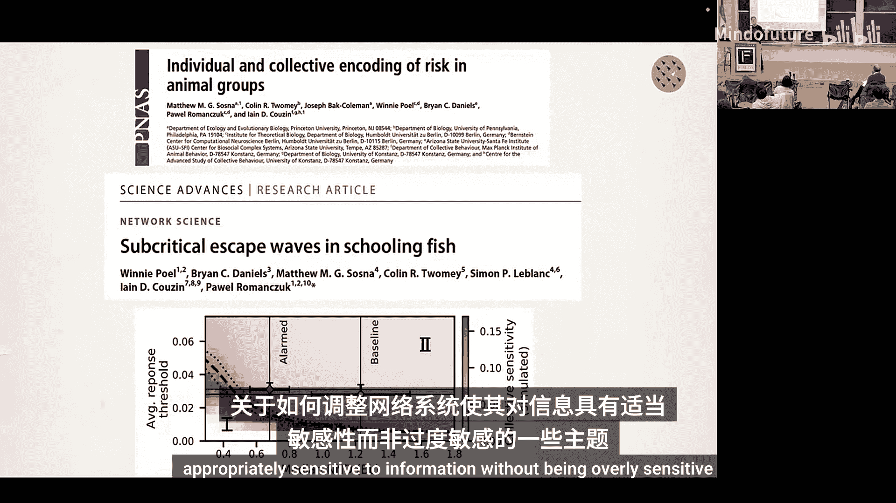

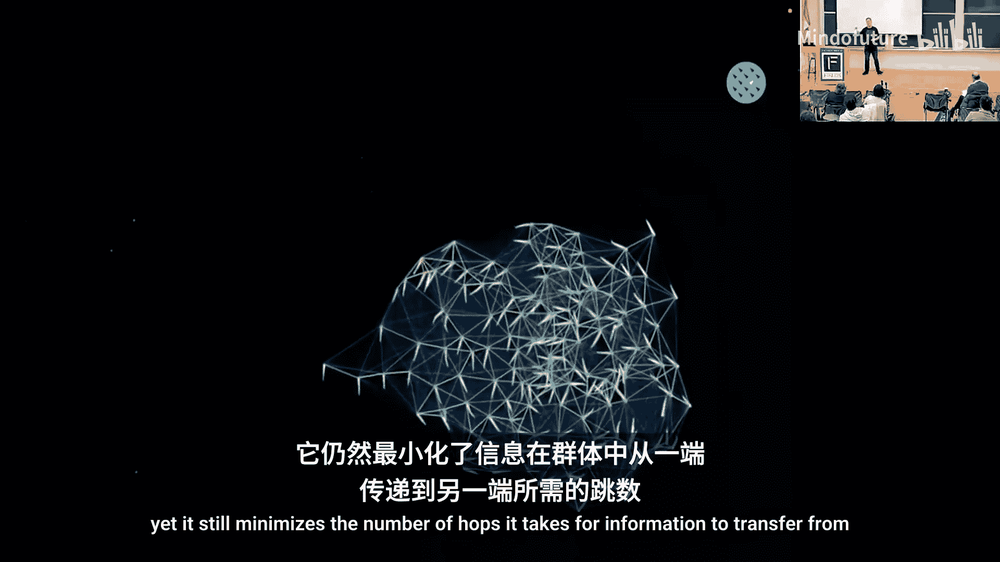

And so over the years， we've been able to show that computation can be an emergent property of the structure of the networks of these groups in a wide range of contexts。

 such as regulating social contagion， modulating behavioral response to increased risk。

 also sensing long range environmental gradients， we're able to show that they can sense gradients。

 the group can sense gradients， that no individual is capable of sensing，ちし分がね。

So we are the only people that have studied it at this level。

 so we would expect that these properties because they are in that special place would be conserved。

 but in all honesty， these are the only studies。It's really kind of tricky well I'm kind of jealous as well。

 you know when I see all these people you're talking about all the the neuroscience work that's going on。

 probably you can go to conferences with probably 10，000， 20，000 people。😊。

We have a handful of labs around the world， but the thing is the same right natural selection is operating in the same way for computation just at a different scale of biological organization。

And we've also shown that these properties， these network properties readily evolve among genetically selfish individuals。

 so we're not suggesting that selection is operating at the collective level。

 right selection is operating the individual scale。

 but that translates to the collective scale because your chances of success are intimately connected in a fitness sense with these kind of collective properties and so this is why I think it's so relevant to consider the types of computation that occur within the brain as well as how it could occur within these sort of hidden networks of interaction between the brains。

😊。

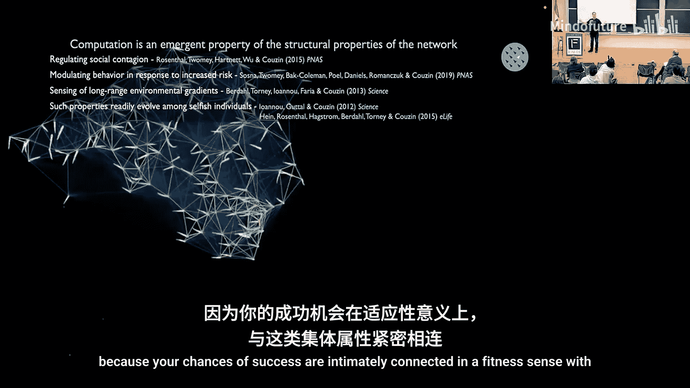

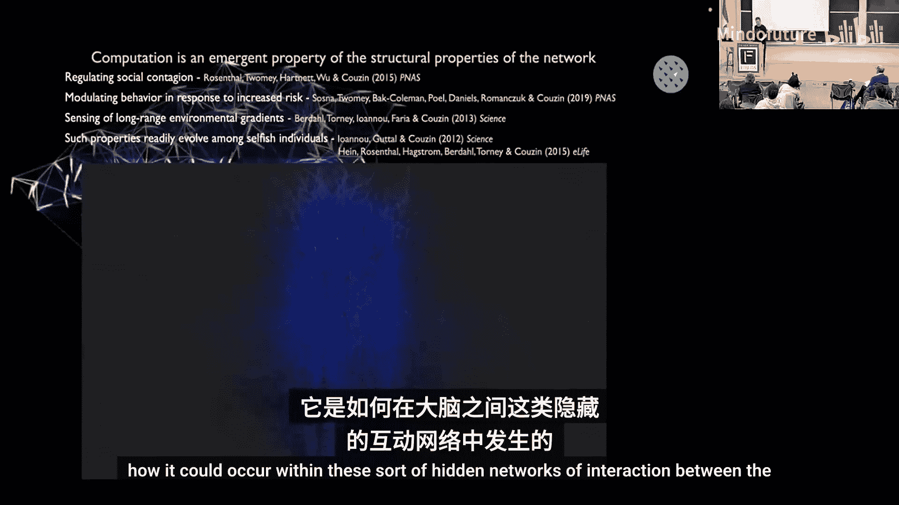

And so yeah， can we think of collective condition in animals and what sort of flavor does that have。

 and can it tell us anything about individual decision making？

And so another thing this is unpublished work， but we've also been inspired by the types of experiments that you've been showing about monkeys。

 for example， looking at the random moving dots。We can then take these ideas and directly translate them to looking at collective sensing。

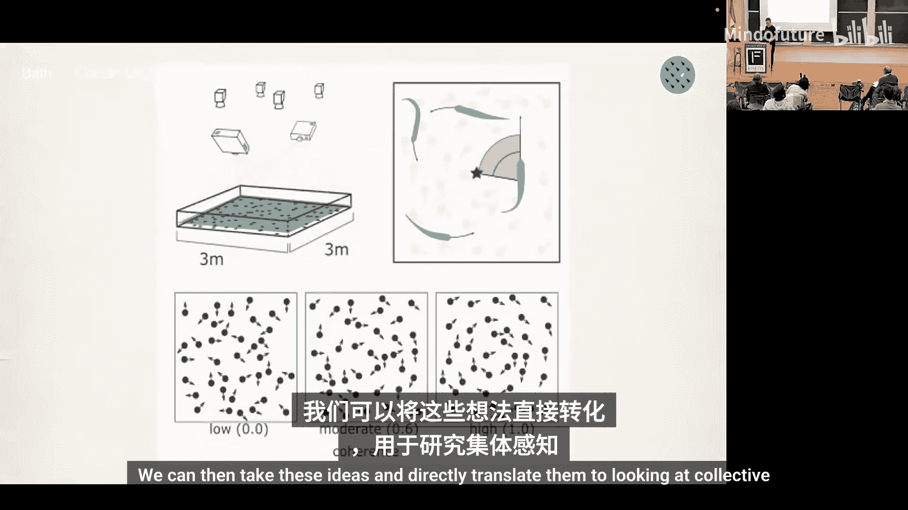

For example here this is it's not showing very well。

 this is 100% correlation but we can change the correlation of these moving dots and ask how does the system is the system able to detect this information。

 thank you， able to detect this information and how does this change as a function of group size and so again you can also look to see at what level of coherence is it 5050 for example。

😊。

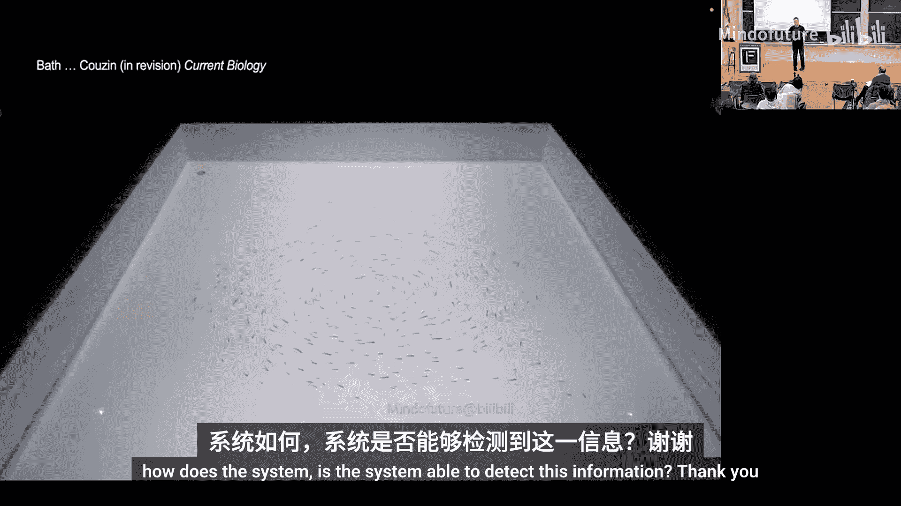

And we can look at how group size can change the probability of the group correctly detecting the motion within that environment so we can really utilize these powerful experimental paradigms from neuroscience directly to look at collective sensing and collective intelligence。

😊，And so when I wrote this article back in 2007 I was very cautious to draw parallels between computation within the brain and computation between brains。

 the level of selection is so different the mechanisms of interaction are so different surely it's just。

😊，An interesting metaphor， but what I'll argue today is it's not I actually think there are fundamental features of spatial T computation that transcend organizational levels and it really relates to the mathematics or the geometry of decision making when we're looking at spatial decisions so that's what I'll try to argue today。

😊，But again， going back in time when we were sort of first trying to understand how do animals move in groups or flocks or fish schools and you may have encountered these types of models in the past。

 we speculated， of course， that individuals may interact locally with neighbors。

We also speculated that there may be rules of interaction， such as if you're isolated from others。

 you show attraction in the zone of attraction， if you come too close。

 you're repelled from others in the zone of propulsion and it could be a zone of orientation in which you align with other individuals。

😡，And these papers have been cited thousands of times。

 and I will show you today that they're completely wrong。

And it's really by not understanding what's going on in the brain that there's a whole field of research which I've partly been responsible for creating that is I think has gone down the wrong direction in terms of understanding these types of systems。

😡，But you know and why did we why did we think well these models were useful so I'll start off with some useful things we learned from them firstly it can show that local interactions can scale to large scale behaviors such as flocks and schools。

But just because this looks like the real world。Is not a very good assessment of to whether it's actually an appropriate model of the real world。

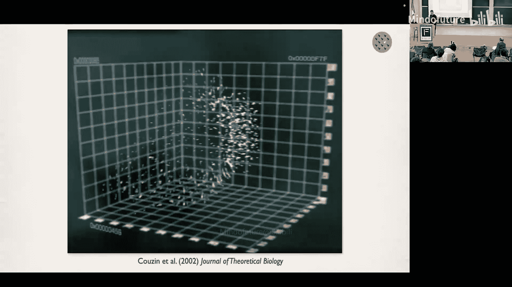

But certainly we learn some things for example， in this particular study I was interested in whether information can transmit within groups without explicit signaling without individuals being able to count without individual recognition so I'm going to have individuals colored white so we can see who they are in the model no one knows who is informed and who is not informed and they want to go in a common direction of travel touch as towards the right。

And we could show that without signaling or counting or anything like that。

 then the information could very accurately be conveyed across the group。

We could also show that if there's a conflict， for example， someone to get to the white target。

 someone want to get to the red target， and others are uninformed。

 that groups are really amazing at coming to a consensus and deciding in this case it's going to be random because there's an equal number for each option。

😡，In this particular example， they select the red option， but if I ran it again and again。

 it would be random。But what we find is if you break the symmetry and I say 11 that want to get to white versus 10 that want to get to red。

 the group will almost always choose the majority preferred direction。

 even though no individual knows if they're in the majority or not。

 they only know their own informational status they cannot count， yet it's extremely accurate。

 even in the face of noise， very heavy noise and local interactions of choosing the majority。😡。

Now that turns out to them years later， really have changed my thinking about how we think the brain makes decisions。

😡，And so if we think in a very abstracted sense， you can think of these uninformed individuals。

 which tend out to be super important and informed individuals that have different preferences。

 but the information is being transmitted by this local copying behavior， the local social influence。

😊，However， if you imagine that zonal model I described to you earlier on。

 operating now at the level of the individual because they live in fish and fusion populations。😊。

Well， it's not going to be so effective because what would happen is the topmost option will counter the bottom most option。

 and the animal will be stuck in indecision。So that's a clear example where there's something wrong with this formulation of how interactions are working。

And， you know， we really were guessing what these interactions were。😡。

Yeah and because it produced patterns that looked realistic。

 we were kind of okay with that at the time。But now， of course。

 there's been real breakthroughs in neuroscience in understanding the spatial navigation circuits of both invertebrates first into around 2014 onwards。

 and in 2023， then the discovery in the zebrafish also of this ring of neurons。

 which is a sort of compass within the brain that gives the animals a sense of the direction towards objects。

😊，And so if we think of this very simple schematic of vectorial integration that I was interested in when I was studying these animal groups。

 it actually relates remarkably， actually mathematically。

 we think it's identical to high firing rates and low firing rates within these ring like structures within the brain。

😊，And so， you know， having thought for so long about this problem， I thought， well， you know。

 maybe this could translate to what's going on when animals make decisions on the move。

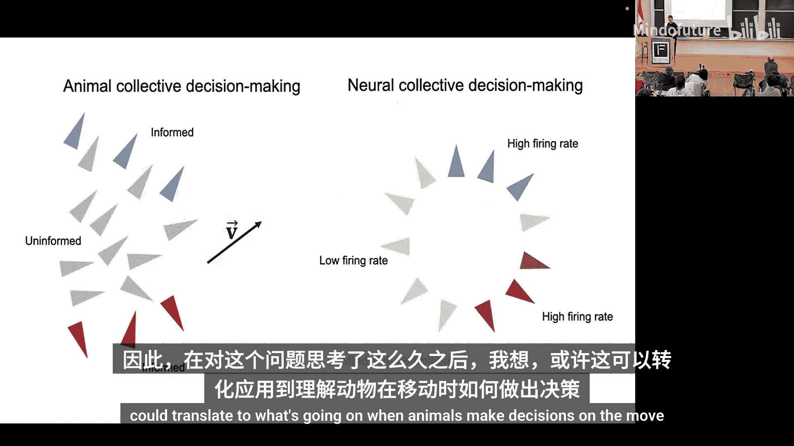

And so what I want to argue is that we need to move away from this perspective that animals are following fixed rules。

 they're not driven by fixed rules， they're driven by dynamics within the brain。

 that's going to sound so obvious to you， but really there's almost no publications on this is still people are using these very simple zonalbased models。

😡，So instead of these classic so-called self prop particle models。

 we argue it's really critical to put in the sensory motor interface and so some work I've been doing with Car Fristen has been looking at surprise minimization so say the brain is just trying to so there's two ways you can change。

😊，Your sort of model of the world， one is you can move， which is going to change the sensory input。

 but you can also change the internal parameters of your model。

And if you just assume that the brains have evolved to minimize uncertainty。😡。

Then you can actually reverse engineer many of these control laws。

and get collective dynamics coming out， but I don't have time to go into that particular framework。

 but I did think it's worth mentioning as a potentially very useful framework。

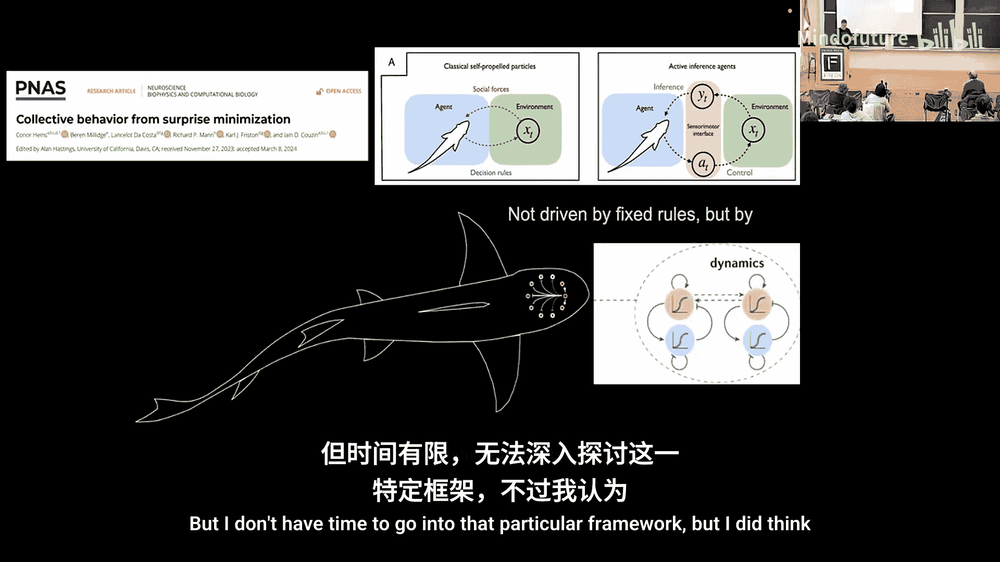

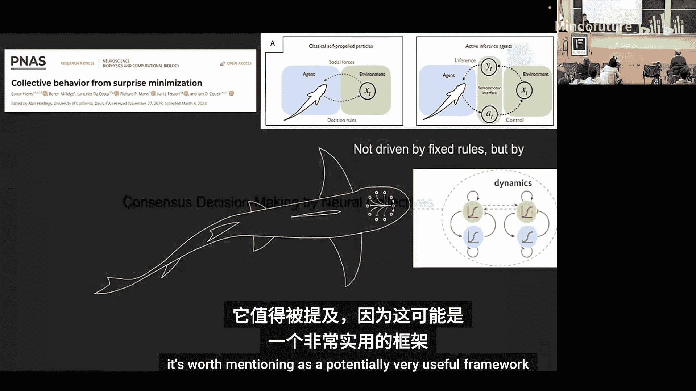

Well what I will talk about today is now consensus decision making among neuronal collectives and how this leads to decisions that animals make on the move。

Before I go further I want to thank Vivek， who's a PhD student with me this year who's starting a faculty position at University of Washington。

 Dan who's a black hole physicist who I've converted to a biologist who's done the analytic theory and Ne Gova collaborator at the Weman when I was on sabbatical there。

 Rico came up with some of these ideas and realized there's connections among all of these different systems。

😊，And you， and you know it's really inspired even though our work was done before this was discovered in the zebrafish。

 as you'll see from our data， we had very strong evidence that there were going to be these ring like structures informing decisions。

And David Jaman Janlia has really pioneered the work in Drososophila。

 this bump of electrical activity on this ellipsoid body in the brain literally includes vectorial representation。

 the strength of preference and the direction of where the animal will go。

 absolutely remarkable and if you look at the structure， the ultrastructure。

 I mean this is the real world， this a real beta， absolutely incredible。😊。

Now in the vertebrate brain， it's not literally in an ellipoid like this。

 but it's functionally behaving exactly like an ellipsoid and people like Heson Polinsky have studied these types of networks in head direction cells。

 so this itself is not a new idea。😊，Well what might be surprising to you is that no one had studied ring attractors on the move。

😡，And I'll explain to you why that's important in a moment。

And I don't even need to go into the details of the model because it's you know remarkably simple so we have a model with just two parameters。

 the reason it's so simple is because you know all animals have had to evolve the same property independently in many cases but it's a conserved property making decisions on the move so the model is analytically tractable which is one advantage as well。

 Furthermoremore we can always add complexity if we want to at the cost of generalizability but also also be shown by Ben de Be at Harvard for example。

 really threw in lots of details that none of those details really mattered as long as they're within a class of ring attractor models you're going to get the results that I'll show you today so there's excitation or positive feedback among your ensembles that have similar directional preferences on the ring this is not dissimilar to some of the direction sense activity we saw within the visual system earlier and then there can be global inhibition and or long range inhibition for today's purposes they produce。

😊，Similar results， but there's some very interesting differences and some animals like Drophil La Global。

 others have long range。But overall， we can think of this as a neural ring tractor network。

So as a schematic， as I mentioned， we have local excitation， long range inhibition。

 and we can prove that this will lead to a stable bump of activity typically。

 and if there's no input to this network， this bump can appear in any direction。😊。

Now one of the things that we haven't published yet， but working with Philiplip Min。

 who was my postdoc advisor back in the day and his PhD student Vit I'm very interested in you know if we have this internal like dynamical network within the brain。

 well animals need to do things when there is no sensory information what do they need to do they need to explore they need to search and when you look at the literature。

 there are classic examples of systematic like spiral searches or looping searches and stochastic searches like levee flights or correlated random walks。

😊，So one of the interesting things we've been asking in the analytic version of the model shown here is how you can get these traveling wave solutions on the ring attractor。

 for example， if the wave travels at the same speed this will cause a loop in the trajectory of the animal if the wave increases speed this will cause an archimedian spiral。

 of course in the stochastic version of the model， it would never look so clean。

 but the analytic version allows us to show the regimes where these occur。

 but these are the types of data that you see in nature such as the spiral search in ants。😊。

And so we can also go to a stochastic model and you can see here that the animal will be exhibiting an award spiral it looks much messier。

 but this is more akin to what we think is going on within the brain of the animal so it's a generative model and you can also see different regimes such as this wiggly wavy movement which is something again that people have seen in nature。

 that animals will need to coordinate their motion in such a systematic way。😊。

But today I am not going to talk about search I'm going to talk about when the network actually has inputs so here we have a perceptual layer I'm going to show data with visual information but that's only because we have virtual reality that works really well with vision that could be acoustic it could be a combination of acousticical faction。

 whatever you have some sort of sensory input that comes in to this decision making layer。😊。

And the decision making layer comes to a consensus based on that input as to where the animal goes。😊。

And as the animal moves that changes the geometry of the perceptual input。

 which changes the consensus themic， which changes the movement， which changes the geometry。

 so it's an embodied process and that had not been studied before and so here you can get a hint at what we're going to see which is that the solution becomes unstable at a critical angle between these options and suddenly the animal abruptly chooses between them in this case these options are identical I'll discuss differences between options in a moment。

😡。

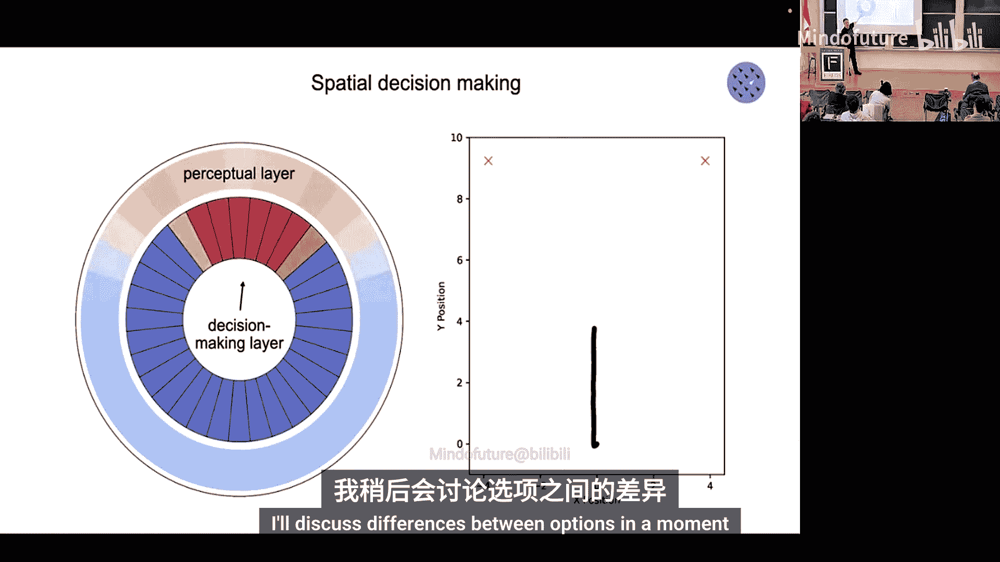

And all animals at some point in their lives have to make decisions about where to go so what we want to ask is are there common algorithms for spatial decision making across tax certain contexts so if you take the model the ringtractor model and you ask how this embodied process works as I showed you without one example and now you're going to see thousands of examples as a heat map you can see that the prediction is that the brain will average the inputs up to a critical geometric angle。

😊，And then it will the symmetry will be broken in the brain and the animal will choose to go one way or the other Now this is a bifurcation in dynamical systems theory it happens to also translate to a bifurcation in the real physical world but when I talk about bifurcation I'm typically talking about in the neural space so the animal could come in from here and it would still bifurcate to the two options the trajectory would look different but a neural space it's identical。

😡。

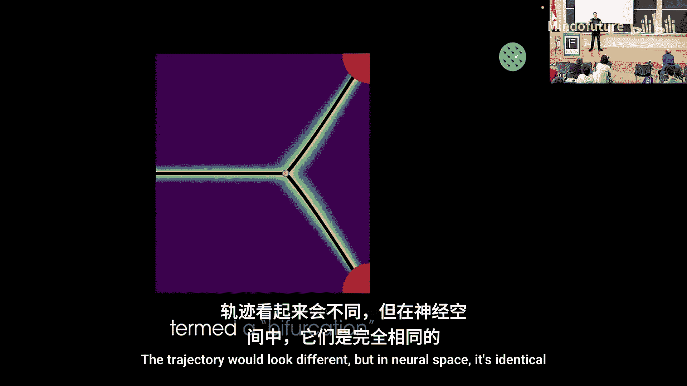

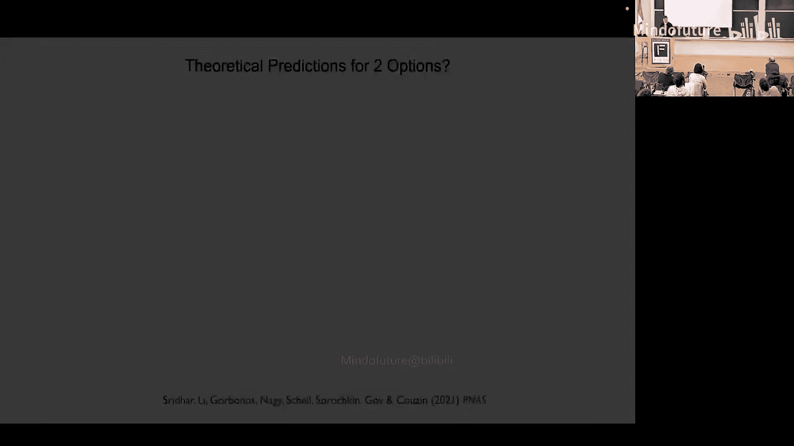

And so what is the theoretical prediction if we look at the mean field model。

 we can see that if the neural noise， there are going to be two parameters in the model。

 one of which is neural noise， so the system is not fully deterministic as I showed you before。

 the system actually has thermal noise effectively in terms of the interactions which represents neural error。

😡，And this is now the egocentric angle between the options。

 so if the animal is far away from the options， this egocentric angle will be small and what we can prove is that the brain will select the average among the options and then as the animal slowly approaches the targets。

 this angle will increase smoothly continuous variable until you hit the spinodal here at which the brain has to provably has to transition to a decision- making state。

😡，And I'll come back to the parameterization in a moment。

 but the idea is as the animal moves to physical space if youre sort of looking top down on an animal choosing between two targets。

 we should see this criticality as an abrupt change of direction in the animal caused by the bifurcation in the neuronal dynamics within the brain。

😊，So let me go into the two model parameters in a little bit more detail。

 one is neural noise equivalent to temperature within a physical system。😡。

And we can actually estimate these from the data， as I'll show you in a moment。😊。

Now there's a critical point。Of temperature below which we have a first order face transition above which we have a second order face transition so as long as the neuro noise is below a certain temperature。

 then you will get the dynamics that I've showed you this abrupt sudden phase transition within the brain。

Above that， the brain would drift between the options so it will make a decision。

 but a relatively poor decision。😡，The only other parameter we have in the model is the neural tuning。

😡，And what do I mean by that， well， that is this excitation to inhibition。

 the functional form that that takes within the brain。😡，And so Larry Abbot。

 a very well known neuroscientist， describes the function that they find from their experiments as a weird functional form。

 but looks a bit like this。And later on in the brain， when data。

 when the vectors go to the fan shape body， it's always cosine。😊。

And they have a beautiful paper that argues that this allows the brain to do phaser arithmetic。

 basically adding a cursine to a cursine always gives you a cosine so you can figure out where you've been in the past completely true。

 but what they didn't understand is why prior to that it has this weird form and I will try to explain to you why that is today。

😊，But we can again， you know， if you look at the stochastic version of this model。

 we can't really talk about a true phase transition。

 but it's a phase like transition and we show that even with as few as nine neurons。

 this is still a very nonlinear abrupt transition， so it's a very robust finding。

So why could this be important to decision making， well I think it's important to try to understand how animals actually move through space。

 but when we see this criticality。😡，There's a feature associated with it called susceptibility or ultrasensitibility。

 which means that the brain undergoing this type of transition even in the simulation now in the analytic model this goes to infinity。

 the susceptibility in the finite size system you get the strong peak what that means is the brain at that point as an emergent property becomes incredibly sensitive to differences between the inputs in the world。

😊，What a brilliant thing to have its a free property that you get as an emergent feature of a face transition。

😊，And there's incredible work in physics that really shows that this ultra sensitivityensitivity is a universal feature of any system under this type of transition。

 so we be quite confident that if the animals are behaving this way。

 this could be an important feature。😊，So how can we test our theory。

 our theory is all based around symmetry breaking within the brain and dynamical bifurcations。😡。

This is going to be really hard to test empirically。😡，Because in my lab。

 even though I've got a really nice facility， there could be a slight air current or an electrical gradient that I can't sense that the animals can will break the symmetry in the brain and the animals will make decisions that I can't understand I need if I'm going to explore symmetry in the brain。

 I need to look at the making decisions that in ultra symmetrical world。😊。

So the way we got around this was to develop virtual reality or immersive virtual reality for freely moving animals。

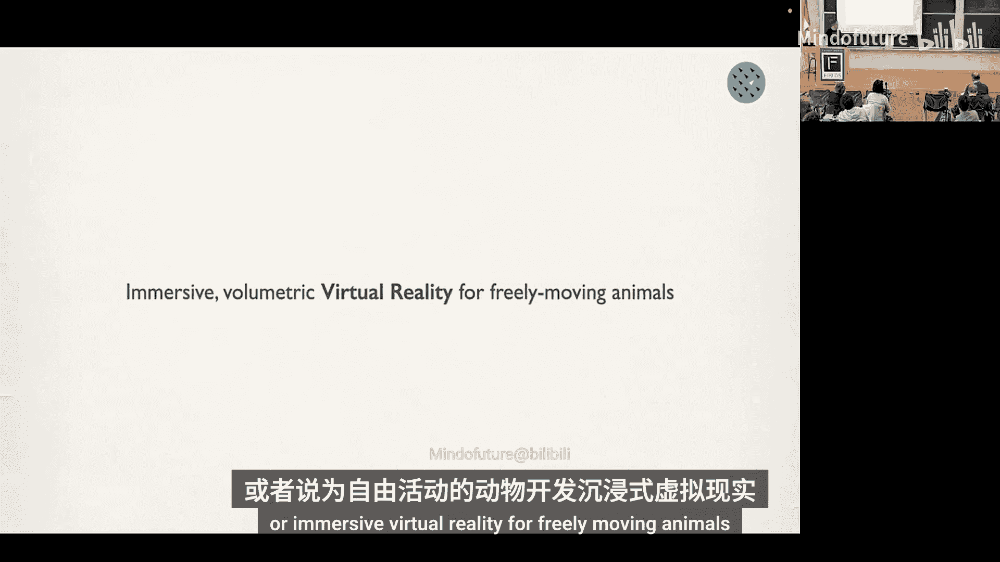

And so I can tell you right now that this tape does not have a volume above the table。😡。

But even your complex human brains， having been told this is an illusion。

 still see it volumetally until the illusion's broken。😡。

But even if it comes in roughly into the right position， again。

 the volumetric cues are so strong in your brain， your prizes are so strong that again。

 you see it in 3D， Similarlyly， this shoe is not actually three dimensional。😡。

So if we have an animal in a world like this and we reconstruct its visual field 1 hundred0 times a second。

 then we can have it interacting。😡，Fully， immersively in a virtual environment。

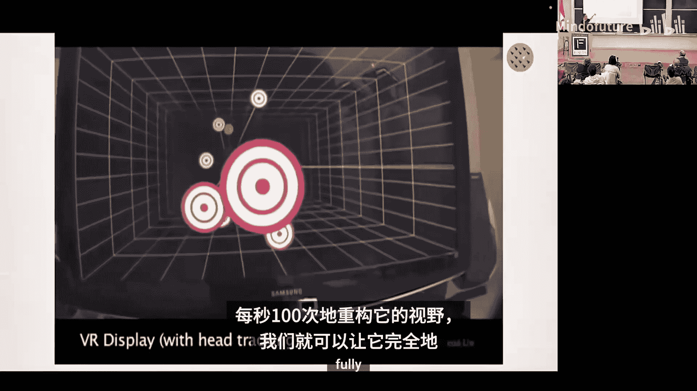

We can control the laws of physics， we can have rotational invariance。

And so we've developed this for a wide range of animals from fruit flies。

 I'll show you data from flies， from locusts。😊。

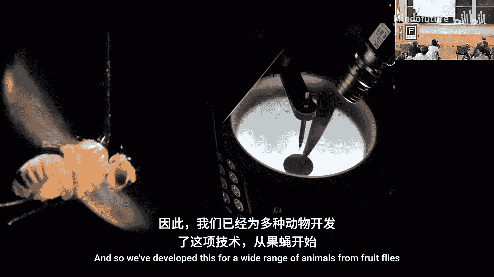

Which are in a big motion compensating ball that I'll show you near the end。😡，Of the talk。

And some unpublished data that we collected last week。

 or week before last with ants in virtual environment。And so。

I was astonished that there are thousands and thousands of papers on decision making。

 but we could not find a single paper where people had reported the movement of an animal as it makes a decision。

The closest we could find were hand movements， for example， in both primates and humans or sards。

But in actual fact， you know， in terms of this particular theory， in animals moving through space。

 nothing， some people think animals look at the options。

 make a decision and movement is just the output。But what we're arguing is it's an embodied process。

😡，And so we conducted experiments first with fruit flies。

 so now you're seeing a heat map which is hundreds of fly trajectories showing you the probability distribution of where they go towards two cylinders so this is a reflex behavior they want to get to those cylinders to land on them unfortunately for the poor flies。

 there's nothing actually there but they'll keep making these decisions again and again and similarly locusts will move towards vertical objects because this could be food in their barren desert environment。

😊，So evidence that there is this bifurcation within the brain。

Now the ant data we collected just a few weeks ago。

 the ants are so much better than any other animal we've worked with here these ants are called diacma ants。

 they forage individually， they do not use pheromone so they don't lay chemical trails they go out there they live in colonies but they forage entirely alone and because they sting like crazy they've got almost no predators so they're kind of going out just trying to find food bring it back to the colony and because they then give it to other ants they've evolved to basically just do this again and again and again they don't get full and then stop behaving and so working with PhD in August。

😊，We can then test across the range of different angles between the options to test the theory more comprehensively and this is completely unfiltered data。

 the exact trajectories， not even heat maps showing you their behavior of the ants so even at an individual level you get these abrupt transitions in behavior and so what we're working on now is testing the susceptibility hypothesis with the ants and the data look really very good。

And so now we can actually take these behavioral data。

 plus some neural data from V vector I and actually fit the parameters of our model。😊。

And so I showed you before that there's a face transition。

 as long as the temperature of the noise is below a critical value between the first and second or the face transition。

 then we can explain the data and it turns out that it's well below， it's about 0。2 to 0。25。😊。

When you look at the neural tuning parameter， just as Larry Abbott and others had find。

 we only can fit it for the data that fits both the neural data plus the bifurcation that we see within our experiments。

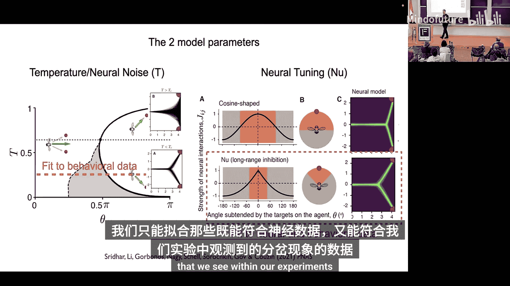

What about three options？😡，In animals in the real world they have to deal with any number of options most neural models do not scale well you have to add another component or another component and it gets really messy here as I'll show you later it naturally scales to any number of options and it's a factractal process so for example。

 if within this option like a tree there are many other options the process will just rebranch again and again。

😡。

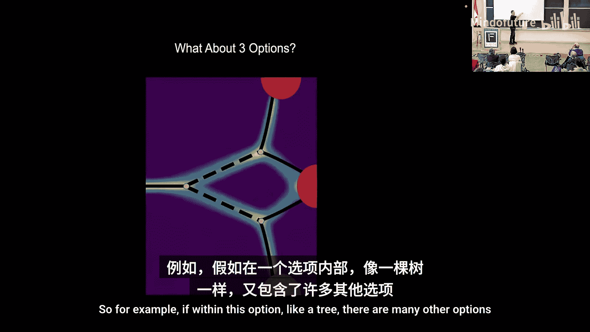

But because it's going to be pretty hard to test this experimentally。

 I'll focus first on three options and to be able to see the symmetry breaking。

 we need the world to be symmetrical， remember。😊，So to see this process we need symmetry。

 but the reason we think they have this process is to break symmetry at each of these branching points。

 I'll come back to that in a moment。

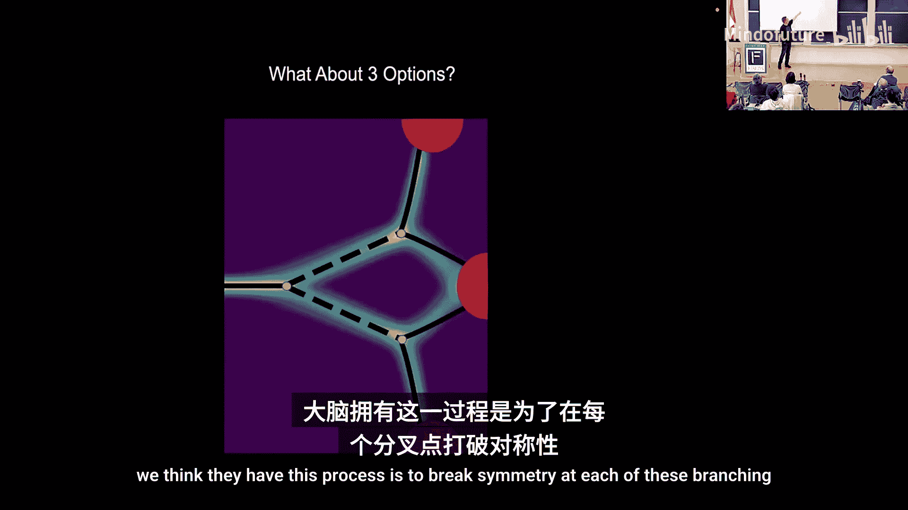

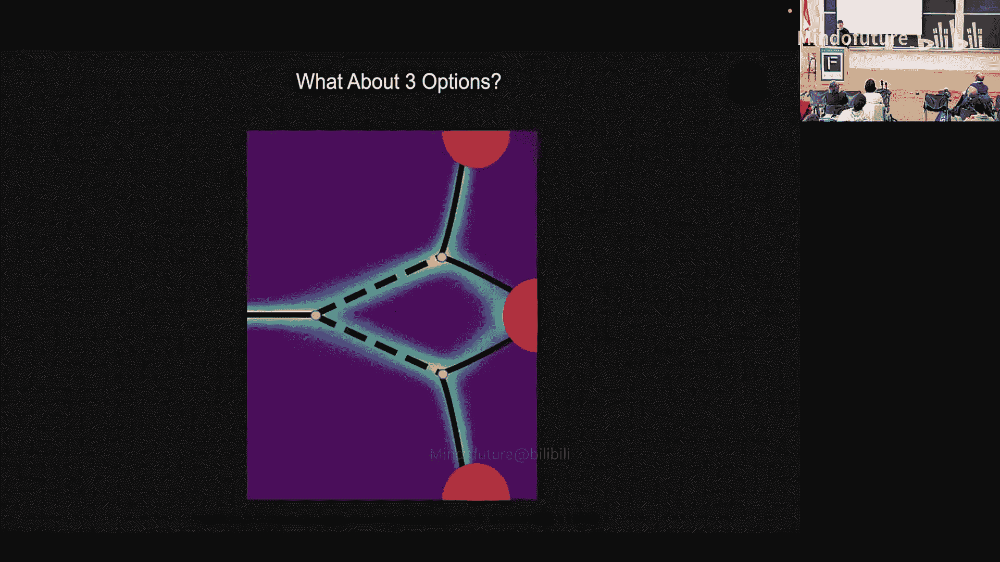

And so we tested this。With with our virtual reality， so this is the theory。

 so we predicted brain spontaneously breaks the complexity of the world band to binary decisions we can prove also I'll show you later that's always binary even if there are many。

 many possible branches in dynamical neuralspace you'll only ever see two at each bifurcation point and close to each critical bifurcation the brain will probabilistically exclude the worst and the next worst and the next worst option again a property that comes for free because it's an emergent property we don't put this in the model。

And here are the data from the experiments with fruit flies and with locust。

 showing as predicted by the theory， we have evidence that there's this double bifurcation in the brain as it moves through space。

Now I showed you the mapping of the two parameters to the data before for two options。

And it turns out that those two parameters exactly also map to the three option case。And in fact。

 if the temperature was above that critical temperature。

 the poor animals would not be able to make decisions for three options at all because the left cancels the right and they always go down the middle。

But below the critical temperature in the regime that they're well into。

 we see that this double branching process occurs and again， as we find before。

 the neuro tuning parameter has to be within this regime that's been found in the neuroscientific experiments in order to explain the bifurcation geometries we see so it all fits together。

And again， I want to highlight this ultra sensitivityitivity is the reason that this is such a great thing。

 even a little noisy brain can become like a supercomputer at this critical point。😊。

And so we're just beginning to do experiments where we can break the symmetry and look at differences between the options。

 unfortunately an data which is really good my students in the Maldives at the moment and couldn't get me the figure in time。

 but I think this is important because we know that if there's a perceived difference between options is easy to see you can make a fast accurate decision。

😊，If it's difficult， you can integrate over time， this is completely true。😡。

But we don't need to integrate over time for this geometric criticality and the animals don't spend more time at the bifurcation point nor do they need to and so you can kind of cheat this in a way by going through the bifurcation point we predict that the animal brain will strongly choose a preferred option even when it's a very difficult choice。

 but if the animal is beyond the bifurcation point such as shown here it will make a very bad decision。

😊，And of course， biologists don't know about this， so they often do experiments by just popping the animal in between two options。

But we think there's going to be a big difference between whether the brain can go through the critical biification or not。

So with undergraduate Lisa Ecker， we tested this for the locusts and indeed if the brain can't go through the bifurcation。

 they do select the preferred option a little bit more than chance。

 but if they can go through the bifurcation， this is massively amplified as predicted by the geometric bifurcation theory。

😊，There's another interesting aspect about this weird functional form as Larry called it。

 and that's the fact that effectively it means the brain is encoding space not in an Eidean way。

 but in an elliptic way in a whoping space with respect to the animal。

It turns out that's critically important if you warp space too much or too little。

 the animals will fail to make decisions for three or more options。

 they'll get trapped in endless loops between the options。

And one way we can explore this is to look at the mean field model now the meanfield model makes lots of assumptions that you have an infinite amount of time at any point in space for example。

 but it still surprisingly captures the dynamics that we see probably because the neural dynamics are so much faster than the movements exhibited by the animals that the mean field does a reasonable job。

😊，And so what we can do in the mean field model is to find steady state solutions to the equations。

And so for each point we can figure out which vectors are possible now as we get as we get more targets。

 you're gonna have possible vectors towards the targets or towards the averages of the targets so this scales pretty badly but I'll show it well I mean at least conceptually it works really well in practice but if you look just at the two option case you can then define the fur fields along which the animals must move and then when they reach this manifolds the brain must bifurcate and will' choose between the two options it's very simple to understand in the two option case and in fact many parameterizations can solve this problem。

However， when you go to three or four options， that's when you have to be in this sweet spot that we find the real animals are。

So we can identify bifurcation points shown as red dots where solutions become unstable and then you can look at the energy around these dots so again let's look at the two option case it's going to be very simple at this point here the solution to move ahead becomes unstable and two new solutions appear and it's 5050 if the options are equal to fall into one of those two attractors。

😊，When we start dealing with three options， things can get pretty crazy because it looks like it's the same bifurcation process to the side options as to the middle。

 but actual fact it's not， there's a convergence of self-sim pattern towards the middle target with this bifurcation after bifurcation。

 but it looks in a stochastic model as if there's just been a single choice selected。😊。

Another thing that I think is very interesting and we're still working on is that beyond the first bifurcation。

 if you look at say three， four， whatever options， all the bifurcation points。

 the points at which irrespective the animal comes in those bifurcation points lie on curves。

 and it turns out to be that sort of meta description of how those curves intersect that define the trajectories of the individuals。

 which is quite a difficult thing at least for me to get my head around。😡，And so for example。

 if the animal's brain encodes information in the Eccruidean way， so using the cosine。

 then you can actually get an infinite number of bifurs and the animal can get trapped in indecision between the options。

😡，This is not good。😡，But it turns out that as you have this more nonuclidean functional form。

 that unwraps these bifurcation curves and allows you to go from an infinite number of bifurcations down to a finite number。

 and there's a specific sweet spot that for any geometrical configuration minimizes the number of bifurcations that the animals exhibit。

 allowing them then to reach the targets and to make highly accurate decisions。😊。

If you want to learn more about that particular aspect。

 we have one paper that came out last year in PX life but we're working on a much more general version of the model where we can also map the reina tractor model formally map it to be mathematically equivalent to drift diffusion model and to also nomininate opinion dynamics models and so this is why I think there's just this general framework of decision- making that transcends specific systems we can also show where it's always binary and so in that sweet spot animals can make decisions for any number of options and just exhibit this fractal behavior as they reach their targets。

😊。

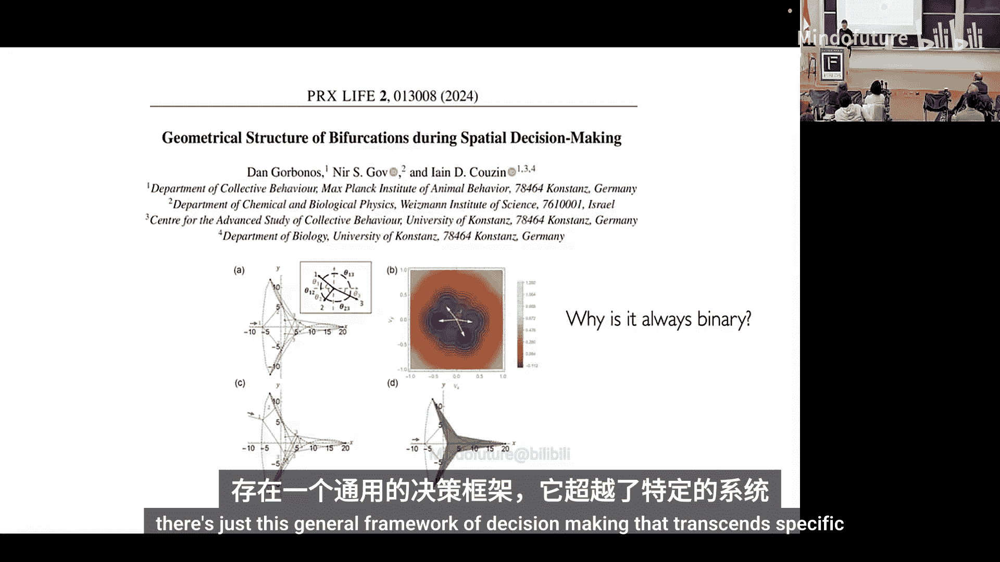

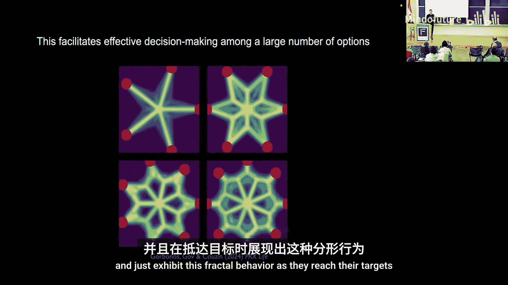

And it also produces really pretty pictures。

So if this is a general principle and in those three systems that we've studied。

 we find that the two parameters are identical。Let's take the model exactly the same model with those exact same two parameters and now apply it to a completely different brain。

 the vertebrate brain。😡，And fish and I not attracted to static objects。

 but they are definitely attracted to other fish， as you can see here within our virtual reality where the real fish is following this virtual fish and these fish are less than a centit longer juvenleszebrafish so we can also go into the brain there's nothing in the tank。

 but it believes it to be in the tank even though we're projecting on the surface。😊。

Now I can't put more than one fish into these environments because remember when that paper was moved。

 the illusion was suddenly broken， it can only work for one particular perspective。

 but what we do is we network the systems together so this one can interact in real time with the hologram of this one and vice versa so we can play with the network toppology we can add time lags we can play with the role physics and time in ways to really understand how the brain behaves so now you're seeing it's a bit jerky just because of the zoom link but you're seeing two zebrafish interacting not in the same physical world but in the same virtual world and we call this the matrix because it's similar to the movie。

the paper actually is coming out on the 30th of April this particular study。

But going back to the earlier work， we could then show you know if we can change the distance between these virtuals I could never train real fish to exhibit such exquisite behavior。

 then we should see a bifurcation within the brain of the animal or we should see behavior consistent with the bifurcation in the brain of the animal which is exactly what we see and if we didn't have the theory and we didn't have the virtual reality we would never be able to construct experiments like this where you now see a double bifurcation in the theory。

 it looks different because now we have a moving frame of reference imagine the camera it's following the fish but we see this evidence of the double bifurcation and here the experimental data。

And we have another paper where we look at all sorts of different configurations， front back。

 left right， four， five fish， and so on， and it fits everything we've thrown at it。😊。

And so now collaborating with Armond Ba who's a neuroscientist we've developed a system where you can do whole brain imaging at cellular level resolution of a fish that thinks it's swimming with other fish。

 it's actually paralyzed and Armon is decoding information given to the spine to turn left。

 turn right， accelerate and so forth and so look out for some really cool stuff where we can then link the cellular level level resolution to individual decisions and individual decisions to collective decisions using the same setup。

😊，If this is so robust， then we should also be able to explain the behaviour of animals in the wild。

 such as wild primates， so these are wild unhabituated baboons。

 olive baboons in Kenya with GPS collars and for ethical reasons we do not put collars on juveniles but they tend to stay with their mothers anyway。

😡，And every second we have the location of the animals。

 and there are tens of thousands of events where some individuals go one way。

 others go in a different direction， and so we can ask from the perspective of each individual。

 how are you making decisions with respect to the angle of the options？😡。

You can see these individuals give up and rejoin the group。

And so we can ask these questions about bifurcations and symmetry breaking within the brain of these wild primates。

 and again we found evidence that the brain is behaving in this way。😊。

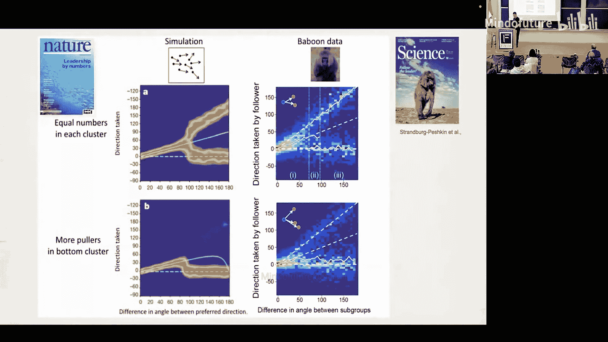

And so we think there's a common algorithm that governs decision making and it actually transcends scales of biological organization。

 so natural selection has found the same algorithm for the same reasons。

 but with very different mechanisms at these different scales。😊。

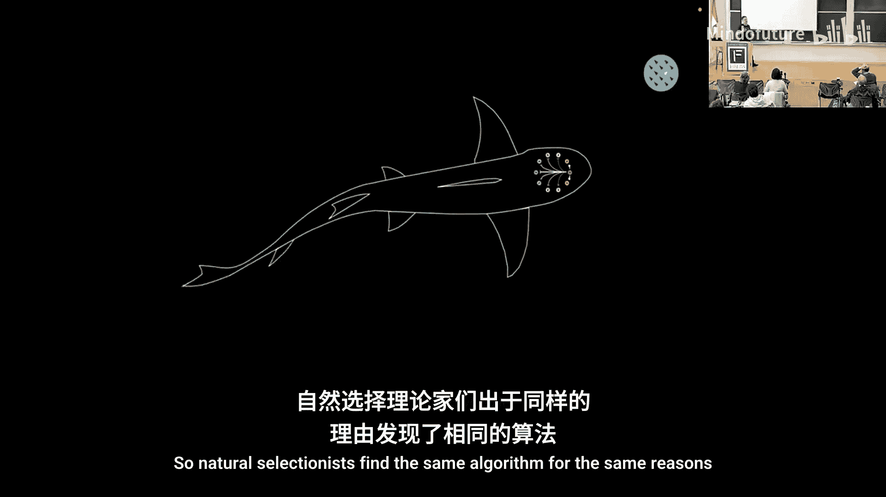

So how could applied this to real world problems。😡，Well。

 one way we can do this is to ask whether really complex creatures like humans exhibit bifurcations and this is unfiltered data of we've now done that。

 I don't know， hundreds of people。

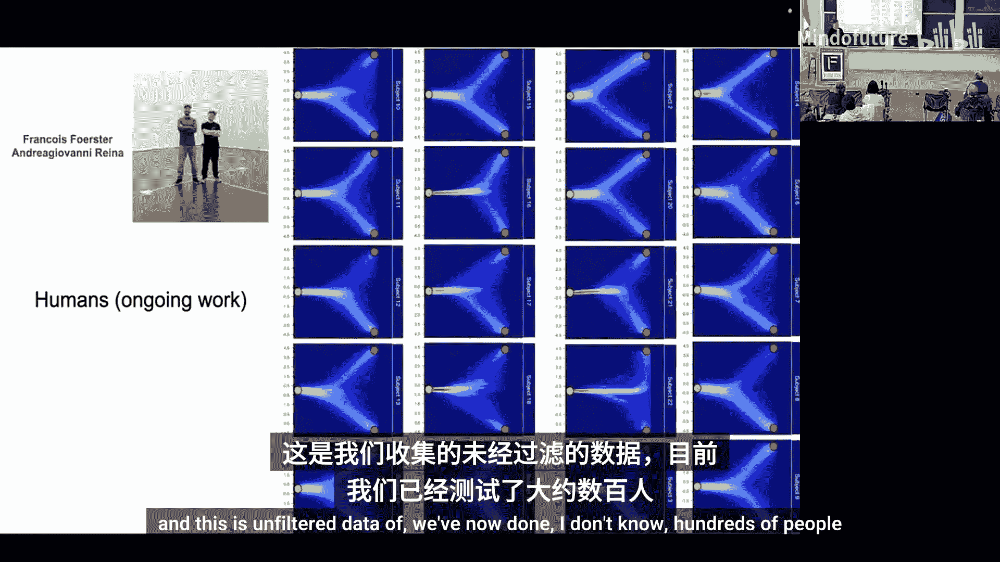

Maybe there's evidence that humans also， when they're walking through real physical space。

 exhibit similar bifurcations。We can also reverse engineer these algorithms and apply them in robotics so many people talk about bioinspired like An swarm colony optimization or whatever。

 but it's really very loosely inspired by biology What if we actually take this algorithm and apply it directly in robots such as drones and so we did so we collaborated with Danielle Larus at MIT we developed the model predictive controller which is the optimal humanm controller which takes 18 hours as a supercomputer to optimize there's tons of parameters and needs to know everything about the robot。

😡，Compared to our algorithm with two parameters we did this with drones in Cons and we did it with vehicles in Cons and watercraft at MIT and showed that yes。

 the model predictive controller is slightly better。

 but only ever so slightly and it really is an omniscient kind of model versus the natural model which is highly effective and we could also show scales up to 14 robots in this particular demo。

Well what about coming back to collective behavior。

 so I argued that I developed and me and others had developed these sort simple zonnal based models back in the 90s and 80s。

😡，You know， how can this new understanding of how the brain works perhaps help us explain animal collectives such as these vast plagues of swarming locusts？

And you this is a real problem because these insects impact one in 10 people on the planet through food shortage and food security。

 yet there's almost no one studying it because these people cannot afford agrochemicals。And so。

Locusts actually are shy cryptic green grasshoppers that can't stand being near each other。

They're actually solitarious， if given the opportunity to be so。😡。

But they can transition into this ggarious form where when they shed their skin， they become black。

 yellow with red eyes I'll show you a video in a moment。😡，And so it's kind of remarkable。

 you've got two animals in one genome and it can flip between these two different states in the 60s。

 it was thought that these were different species because they behave and look so differently。😊。

So why did they do this？😡，Well， it's an evolutionary adaptation to living in these extremely variable environments。

So when the monsoons come into East Africa， they can bring tons of rainfall and very quickly within a week or two you can see green growth coming up through the environment。

😊，And this is perfect for those little green grasshoppers to flourish and to prosper。

 and this greening can extend over vast scales， so the population of these grasshoppers massively increases。

But then under those conditions， then these populations of solitarious individuals grow there's plenty of food they can avoid each other。

 if individuals were gregarious， they actually turned back into the solitarus type and so these populations can get large。

But if the population gets too large or if there's a drought or they eat too much food。

 then they're forced to come together。😡，And when they come together。

 that is when they turn into this the gregarious form and they exhibit these massive swarampms and these swarms allow these insects to migrate in a highly directed way out of nutrient poor areas。

 if you put a human in the desert with no GPS they will turn in circles similar to these animals but if they're in vast swaramps。

 this allows them to persist and to at out of nutrient poor areas。

 we've also shown that they cannibalize each other to survive these long journeys。😊。

And the mothers even then convey information via a chemical in the egg form that tells their offspring whether to prepare for a solitious or gregarious life。

 so across generation after generation they can persist really amazing animals。😊。

And so there was a massive swarm in January 2020。In Africa exacerbated by COVID meaning it was not possible to move chemicals or people around Africa。

 but we managed to get a team in just before the flights were canceled to actually possesss no data。

 quantitative data of these swams it's so hard to predict when and where they will form and so this is the team so it's a collaboration between in Ats lab and my lab and also with a postdoc shared between our groups Sirjan who's the lead author on this work。

And so with this new deep learning technology， we can now track animals under these very complex environmental conditions and this paper just came out at the end of February。

And so what we found in the field， if you take a locust out of the swarm and pop it back in。

 it will march along the direction of the swarm， which is from left to right。

If you remove their ability to smell doesn't change anything。

 their ability to detect polarized light， they have this special sensing on the top of the eye doesn't do anything。

 but if you remove their ability to see they will still much but in completely random directions and this surprised me is I thought this was a nomatic ordered system if you imagine closing your eyes and you're in a crowd that dense you can feel the direction to go so they're actually turning that off in the swarm behavior and they really are relying on vision alone。

😡，So how is vision used to coordinate collective motion and I'm going to talk about localcus swaramps。

 but this generalizes to fish schools as well。What people have done experiments where you show an animal like a fly or a locust moving dots or moving bars and they will turn to move with it。

 it's innate。😡，It's robust。Therefore， people assumed without checking that this must be the mechanism for swarming。

 flocking， and schooling。Similarly， when you see even recent reviews on schooling fish。

 it's argued that this innate optimmoto reaction， the following reflex ensures that fish maintain a single school。

😊，But no one had actually checked if that is true。😡，In fact。

 in this work in a Tel Aviv University on localists。

It's assumed so strongly that the poor locust can't even turn。

 it's just presented these moving dot stimuli， and it's argued that this explains this one motion。😡。

And you can see why that is thought to be the case， we know that vision is sufficient and necessary。

 and if you imagine yourself to be within the swarm。

 there's going to be a ton of optical flow cues that you experience。

So we can take advantage of the fact that we have an organism that either is wants to be solitary or wants to be gregarious。

😡，And if this was an adaptation to swarm behavior， we may expect that thegarious ones are more sensitive to the moving dots。

😡，In this optimta response。Well that's not the case， this is the dot density。

 so it's a bit like the experiments we saw with the primates before where you can change the coherence of the stimulus。

 but we see no difference between the two forms。But the optic flow that they're actually seeing in the swarm is not these sort of moving black dots against the white background it's volumetric it's the motion of other locusts so how can we represent that type of optic flow Well this is our big motion compensating ball the biggest ball we can fit through the door of the university。

😡，And then we can have the locust walking on the ball and the ball always moves to keep the locust on top and we can immerse it within a virtual swarm。

And so here you can see the ball moving and we can then track the motion of the ball。

 which gives us the motion of the locust。😊，And I can't show you what it looks like to the locust because this is volumetric and they can see all the way around。

 but this is the type of perspective that I can show you to give you a sense of what it's like to be in a virtual swarm。

😊，And so exactly the same experiment as before， but now instead of moving dots。

 we show biologically meaningful optic flow and now we do see a massive difference between the Solitus and the Greggarus。

 and if， for example we make this as swarm solitious individuals， even though they can sense them。

 they do not swarm with them。😊，And so optic flow is not the mechanism by which collective motion is mediated。

And you won't be surprised to hear that we then tested the ring attractor neural network model and we could。

 among other things design and experiment with orthogonal predictions where the classic models of collective motion like the cousin model。

 the Vche model， optic flow models would all predict that the animals should just go with a flow if you've got a swarm on one side and a swarm on the other side going in the same direction。

 but the ring attractor model actually predicts the animals will move orthogonal to that and then only align when they're within the group。

And so we have two differing predictions which we can then test within this virtual environment again it's going to not be exactly how the locuss see it。

 but they have two swaramps and they're in the middle and we can ask which direction do they go。😊。

And so the ring attractor model predicts that they should move directly towards one or the other group。

And so these are the theoretical trajectories。And those are the experimental data。

showing clearly that they're not utilizing these classic models of collective motion。

 and we were then able to do experiments with large numbers of insects within a large imaging environment in Cons to confirm these findings。

We can also show that the ring attractive model can account for long range order。😡。

But only if the animals have what's called an allocentric representation that they need something in their environment to lock their compass onto and then suddenly collective motion can arise。

 we don't need to guess what the rules are， it's just there in the circuits that animals have。

 therefore collectively it could readily evolve， it's a tiny tiny tweak from an evolutionary perspective。

And so yes， so this is sort of， as they said in an accompanying article sort of rewriting the rules of the swarm and also this holds for schooling fish as well。

 and so now we can do experiments with much larger numbers of individuals such as 10。

000 locusts where we can get these swarms to form under laboratory conditions for the first time。😊。

And you can do all sorts of predictions like the model also predicts if there are two targets that the brain will oscillate between the two targets and the social coupling will lead to coupled oscillator dynamics which is not a prediction from the classic models we can see here that the locust readily fall into this coupled oscillator dynamics so now we can make all sorts of predictions and there's also all sorts of active turbulence and interesting stuff that's going on here plus we can also go into the brain and record what's going on when the animals make these decisions and this is inats work looking at the brain activity of the locusts and so I kind of like the system because you can go from the brain all the way up to the movement of the animals in the wild and so we've been developing these tiny little tags where we track the back half the size of your thumb across its entire home range in the Hula Valley in Israel and we're now taking these same tags and applying them to work with the locust allowing us to track them over tens of kilometers so you can really go from the dynamics up to the global phenomenon using these new technology。

And it's all happening in Cons in southern Germany。

 which is very close to Zurich Air 45 minutes away。

 so if you want to come and visit we have the Centre for the Advanced Study of collectiveive Behavi and indeeddisciplinary group that studies all of these different cool systems plus we have a new building that overlooks the lake and the mountains。

 so it's not a bad place to work。😊，And one of these big experiments were done in the imagingaging hangar。

 which is this unique facility that we share anyone can come and use this for humanss for animals。

 we do studies with birds estimating 3D from 2D。😊，including vocalizations。

 we can take these technologies into the wild to look at social learning behaviors， nest building。

 we all know birdss build nests， but this has not been studied before。

 so it's another study that we're doing using these technologies and even with advanced animals like wolves wolves humans cannot get any data on wolves because there's so hard to approach but they've got no airborne predators and so the habituated drones plus they have hypervariability of coat patterns which means that we can follow them probably 80% of the time day and night and get the individuality。

 the identities of individuals plus things like the head direction because you can see the wolf clearly it's looking at another individual over there and so when an individual comes in you can see its attention is not actually drawn to that individual is drawn to someone else and so these new technologies allow us including the three dimensionmensional structure of the environment allow us to see the world in really new ways。

😊，And we get to work in some pretty arduous environments， such as here studying octopus。

 which were thought to be solitary， but they are solitary， only with other octopus though。

 they have complex socialized with multiple species of fish with whom they almost always hunt with a complex network of associations。

 but when the paper was published， there was only one thing that the press was interested in。

 which is that the octopus will also punch individuals if they do not cooperate within these hunting groups。

 so here you'll see some of our footage of the octopus punching， especially the blackt grouper。

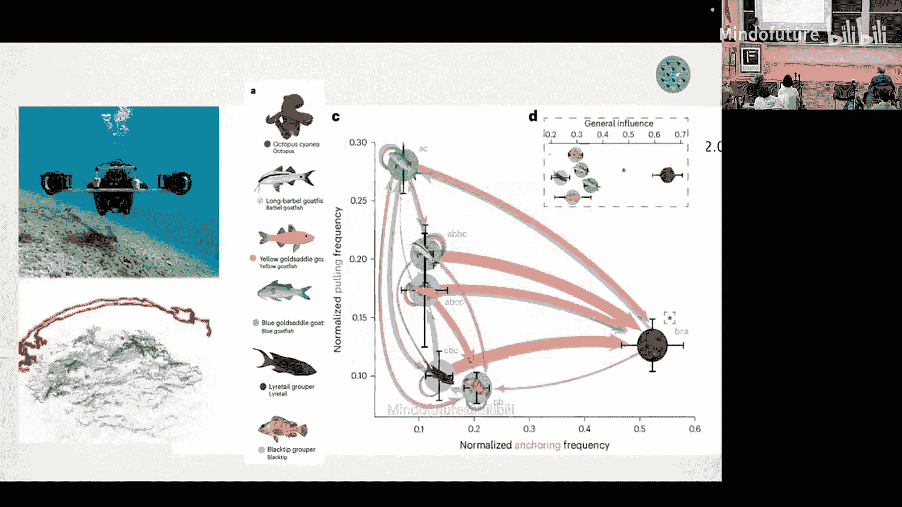

And Stephen Colbert made the very valid point that if you have eight arms。

 it's a highly effective way to be a pugilist。And these you technologies I can see how stressful it is these technologies also allow us to do things like look at predator prey interactions in the real world which is never possible this is in the Maldives and it has to be there because the white sand and you can see an actual hunting event here that actually is due to this high contrast environment and so we can even track the motion of the prey schools for example to get the waves of turning within the prey fields in in these natural groups including the movement of the prey and the predators as shown here so I think it's a super exciting time and it turns out the sharks are also collective inside each of these vacs as a shark。

😊。

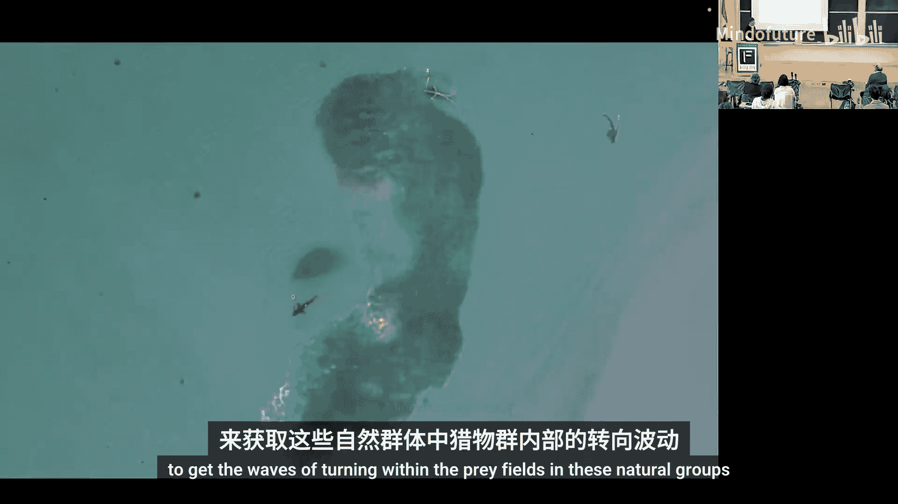

UAnd yeah， it's really cool and fun to work on these things and thanks a lot for listening。好。

There's are， again real， there's a timeless。